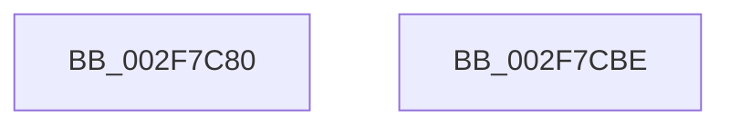

# KeQueryCurrentStackInformation

- RVA: `0x002F7C80`–`0x002F7CBF` (길이 `63` bytes)
- VA: `0x00000001402F7C80`
- 실행 섹션: `.text`
- PDB 이름 있음: `예`; PDB Function 태그: `아니요`
- unwind 정보 RVA: `0x00060BC4`
- 디코드: `19`개 명령, `63/63` bytes 표시
- 미해석 바이트: `0` (있으면 어셈블리에 `.byte`로 보존)

> 이 문서는 커널 이미지의 기계어와 PDB 기호를 분석해 생성했습니다. 4번과 5번은 함수 원형과 자료형을 바이너리 사용 방식에서 추정한 C 해석이며 원본 소스 복구 결과는 아닙니다.

## 1. Dependencies

- 직접 호출 지점: **2**; 고유 호출 대상: **2**
- 직접 호출자로 확인된 함수: **4**
- RIP 상대 이미지 참조: **0**

### Outgoing calls
- `0x002F7C98` → [KeGetCurrentStackPointer](../6B/KeGetCurrentStackPointer_function_006B1070.md) (function, `0x006B1070`)
- `0x002F7CA9` → [KeQueryCurrentStackInformationEx](KeQueryCurrentStackInformationEx_function_002F7CD0.md) (function, `0x002F7CD0`)

### Direct callers
- [PnprGetStackLimits](../5A/PnprGetStackLimits_function_005A8C4C.md) at `0x005A8C77`
- [KeBugCheck2](../5B/KeBugCheck2_function_005B27D0.md) at `0x005B2980`
- [EtwpCovSampCaptureKernelStack](../65/EtwpCovSampCaptureKernelStack_function_00653C28.md) at `0x00653C54`
- [ViDeadlockAnalyze](../../pagevrfy/BA/ViDeadlockAnalyze_function_00BA8BD4.md) at `0x00BA8C4B`

### Static image references
- 디코드된 RIP-relative 메모리 참조가 없습니다.

## 2. Other-region calls and transfers

- 다른 실행 섹션으로 향하는 call: **0**
- 별도 외부 분기/꼬리 이동을 확인하지 못했습니다.

## 3. Assembly (complete function range)

```asm
002F7C80  48 89 5C 24 08                  mov qword ptr [rsp + 8], rbx
002F7C85  48 89 74 24 10                  mov qword ptr [rsp + 0x10], rsi
002F7C8A  57                              push rdi
002F7C8B  48 83 EC 20                     sub rsp, 0x20
002F7C8F  49 8B D8                        mov rbx, r8
002F7C92  48 8B FA                        mov rdi, rdx
002F7C95  48 8B F1                        mov rsi, rcx
002F7C98  E8 D3 93 3B 00                  call 0x1406b1070
002F7C9D  48 8B C8                        mov rcx, rax
002F7CA0  4C 8B CB                        mov r9, rbx
002F7CA3  4C 8B C7                        mov r8, rdi
002F7CA6  48 8B D6                        mov rdx, rsi
002F7CA9  E8 22 00 00 00                  call 0x1402f7cd0
002F7CAE  48 8B 5C 24 30                  mov rbx, qword ptr [rsp + 0x30]
002F7CB3  48 8B 74 24 38                  mov rsi, qword ptr [rsp + 0x38]
002F7CB8  48 83 C4 20                     add rsp, 0x20
002F7CBC  5F                              pop rdi
002F7CBD  C3                              ret
002F7CBE  CC                              int3
```

## 4. C-style interpretation (structured pseudocode)

```c
__int64 __fastcall KeQueryCurrentStackInformation(__int64 a1, __int64 a2, __int64 a3)
{
    __int64 result;
    __int64 v_rsp;
    unsigned __int64 v_stack_p10;
    unsigned __int64 v_stack_p8;

    v_stack_p8 = v_rbx;
    v_stack_p10 = v_rsi;
    v_rsp = (v_rsp) - (32);
    result = KeGetCurrentStackPointer(a1, a2, a3, a4);
    result = KeQueryCurrentStackInformationEx(result, a1, a2, a3);
    v_rsp = (v_rsp) + (32);
    return result;
}
```

## 5. (Beta) C Style

```c
int64_t KeQueryCurrentStackInformation(int64_t Arg1, int64_t Arg2, int64_t Arg3)
{
    int64_t result;
    int64_t local_rsp;
    uint64_t v_stack_p10;
    uint64_t v_stack_p8;

    v_stack_p8 = local_rbx;
    v_stack_p10 = local_rsi;
    local_rsp = (local_rsp) - (32);
    result = KeGetCurrentStackPointer(Arg1, Arg2, Arg3, a4);
    result = KeQueryCurrentStackInformationEx(result, Arg1, Arg2, Arg3);
    local_rsp = (local_rsp) + (32);
    return result;
}
```

## 6. Execution-region graph

[열기: 2D/3D 그래프와 함수 탐색 컨트롤 패널](../../../control-panel.html?section=text&rva=0x002F7C80&view=graph)

- 2D 그래프는 위에서 아래로 흐르고, 3D 그래프는 빈 공간을 드래그해 회전합니다. Shift+드래그는 이동, 휠은 확대·축소, 함수 노드 선택은 대상 보고서 이동입니다.

### Static fallback


