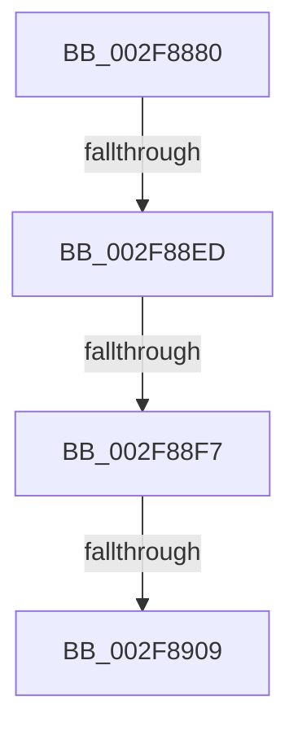

# KiExpandKernelStackAndCalloutOnStackSegment

- RVA: `0x002F8880`–`0x002F8911` (길이 `145` bytes)
- VA: `0x00000001402F8880`
- 실행 섹션: `.text`
- PDB 이름 있음: `예`; PDB Function 태그: `아니요`
- unwind 정보 RVA: `0x000726C8`
- 디코드: `37`개 명령, `145/145` bytes 표시
- 미해석 바이트: `0` (있으면 어셈블리에 `.byte`로 보존)

> 이 문서는 커널 이미지의 기계어와 PDB 기호를 분석해 생성했습니다. 4번과 5번은 함수 원형과 자료형을 바이너리 사용 방식에서 추정한 C 해석이며 원본 소스 복구 결과는 아닙니다.

## 1. Dependencies

- 직접 호출 지점: **0**; 고유 호출 대상: **0**
- 직접 호출자로 확인된 함수: **1**
- RIP 상대 이미지 참조: **1**

### Outgoing calls
- 직접 디코드된 call 명령이 없습니다.

### Direct callers
- [sub_002F819C](Unknown_function_002F819C.md) at `0x002F8203`

### Static image references
- `0x002F88F7` → RVA `0x00FC5020` (`ALMOSTRO`; read)

## 2. Other-region calls and transfers

- 다른 실행 섹션으로 향하는 call: **0**
- call이 아닌 외부 분기/꼬리 이동: **3**
  - `0x002F88E7` → [sub_002F8BA0 + 0xF](Unknown_function_002F8BA0.md) (`tail-transfer`)
  - `0x002F88F1` → [sub_002F8BA0](Unknown_function_002F8BA0.md) (`tail-transfer`)
  - `0x002F8903` → [sub_002F8BA0 + 0x27](Unknown_function_002F8BA0.md) (`tail-transfer`)

## 3. Assembly (complete function range)

```asm
002F8880  4C 89 44 24 18                  mov qword ptr [rsp + 0x18], r8
002F8885  48 89 54 24 10                  mov qword ptr [rsp + 0x10], rdx
002F888A  48 89 4C 24 08                  mov qword ptr [rsp + 8], rcx
002F888F  55                              push rbp
002F8890  53                              push rbx
002F8891  57                              push rdi
002F8892  41 54                           push r12
002F8894  41 55                           push r13
002F8896  41 56                           push r14
002F8898  48 8D 6C 24 D9                  lea rbp, [rsp - 0x27]
002F889D  48 81 EC E8 00 00 00            sub rsp, 0xe8
002F88A4  48 8B 5D 7F                     mov rbx, qword ptr [rbp + 0x7f]
002F88A8  0F 57 C0                        xorps xmm0, xmm0
002F88AB  45 8B E1                        mov r12d, r9d
002F88AE  45 33 C9                        xor r9d, r9d
002F88B1  41 8B D1                        mov edx, r9d
002F88B4  4C 89 4D B7                     mov qword ptr [rbp - 0x49], r9
002F88B8  0F 11 44 24 40                  movups xmmword ptr [rsp + 0x40], xmm0
002F88BD  89 55 77                        mov dword ptr [rbp + 0x77], edx
002F88C0  40 32 FF                        xor dil, dil
002F88C3  0F 11 45 8F                     movups xmmword ptr [rbp - 0x71], xmm0
002F88C7  4C 89 4C 24 38                  mov qword ptr [rsp + 0x38], r9
002F88CC  0F 11 45 9F                     movups xmmword ptr [rbp - 0x61], xmm0
002F88D0  65 4C 8B 34 25 88 01 00 00      mov r14, qword ptr gs:[0x188]
002F88D9  44 0F 20 C0                     mov rax, cr8
002F88DD  48 89 45 CF                     mov qword ptr [rbp - 0x31], rax
002F88E1  41 8D 49 10                     lea ecx, [r9 + 0x10]
002F88E5  3C 02                           cmp al, 2
002F88E7  0F 84 C2 02 00 00               je 0x1402f8baf
002F88ED  41 F6 C4 08                     test r12b, 8
002F88F1  0F 85 A9 02 00 00               jne 0x1402f8ba0
002F88F7  8B 05 23 C7 CC 00               mov eax, dword ptr [rip + 0xccc723]
002F88FD  45 8B E9                        mov r13d, r9d
002F8900  4C 3B C0                        cmp r8, rax
002F8903  0F 87 BE 02 00 00               ja 0x1402f8bc7
002F8909  41 83 CC 04                     or r12d, 4
002F890D  4C 89 4D 6F                     mov qword ptr [rbp + 0x6f], r9
```

## 4. C-style interpretation (structured pseudocode)

```c
__int64 __fastcall KiExpandKernelStackAndCalloutOnStackSegment(__int64 a1, __int64 a2, __int64 a3, int a4, __int64 a5)
{
    __int64 v_r12;
    __int64 v_rdi;
    __int64 v_rsp;
    unsigned __int64 v_stack_m57;
    unsigned __int64 v_stack_m88;
    unsigned __int64 v_stack_mA0;
    unsigned __int64 v_stack_mB8;
    unsigned __int64 v_stack_mC8;
    unsigned __int64 v_stack_mD8;
    unsigned __int64 v_stack_mE0;
    unsigned __int64 v_stack_p10;
    unsigned __int64 v_stack_p18;
    unsigned int v_stack_p20;
    unsigned __int64 v_stack_p8;

    v_stack_p18 = a3;
    v_stack_p10 = a2;
    v_stack_p8 = a1;
    v_rsp = (v_rsp) - (232);
    a4 = 0;
    v_stack_mA0 = 0;
    v_stack_mD8 = v_xmm0;
    v_stack_p20 = 0;
    v_rdi = 0;
    v_stack_mC8 = v_xmm0;
    v_stack_mE0 = 0;
    v_stack_mB8 = v_xmm0;
    v_stack_m88 = v_cr8;
    v_r12 = (unsigned int)(((unsigned int)(a4)) | (4));
    v_stack_p18 = 0;
    return (unsigned int)(*(unsigned int *)(v_rip + 13420323));
}
```

## 5. (Beta) C Style

```c
int64_t KiExpandKernelStackAndCalloutOnStackSegment(int64_t Arg1, int64_t Arg2, int64_t Arg3, int32_t Arg4, int64_t Arg5)
{
    int64_t local_r12;
    int64_t local_rdi;
    int64_t local_rsp;
    uint64_t v_stack_m57;
    uint64_t v_stack_m88;
    uint64_t v_stack_mA0;
    uint64_t v_stack_mB8;
    uint64_t v_stack_mC8;
    uint64_t v_stack_mD8;
    uint64_t v_stack_mE0;
    uint64_t v_stack_p10;
    uint64_t v_stack_p18;
    uint32_t v_stack_p20;
    uint64_t v_stack_p8;

    v_stack_p18 = Arg3;
    v_stack_p10 = Arg2;
    v_stack_p8 = Arg1;
    local_rsp = (local_rsp) - (232);
    Arg4 = 0;
    v_stack_mA0 = 0;
    v_stack_mD8 = v_xmm0;
    v_stack_p20 = 0;
    local_rdi = 0;
    v_stack_mC8 = v_xmm0;
    v_stack_mE0 = 0;
    v_stack_mB8 = v_xmm0;
    v_stack_m88 = v_cr8;
    local_r12 = (uint32_t)(((uint32_t)(Arg4)) | (4));
    v_stack_p18 = 0;
    return (uint32_t)(*(uint32_t *)(v_rip + 0xCCC723));
}
```

## 6. Execution-region graph

[열기: 2D/3D 그래프와 함수 탐색 컨트롤 패널](../../../control-panel.html?section=text&rva=0x002F8880&view=graph)

- 2D 그래프는 위에서 아래로 흐르고, 3D 그래프는 빈 공간을 드래그해 회전합니다. Shift+드래그는 이동, 휠은 확대·축소, 함수 노드 선택은 대상 보고서 이동입니다.

### Static fallback


