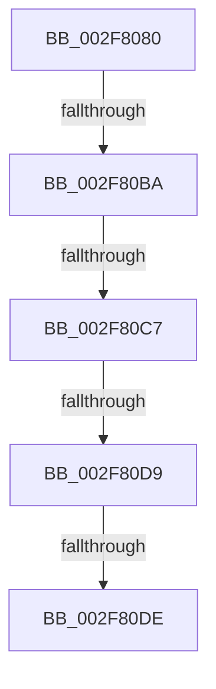

# KiExpandKernelStackAndCalloutSwitchStack

- RVA: `0x002F8080`–`0x002F80EA` (길이 `106` bytes)
- VA: `0x00000001402F8080`
- 실행 섹션: `.text`
- PDB 이름 있음: `예`; PDB Function 태그: `아니요`
- unwind 정보 RVA: `0x00072530`
- 디코드: `27`개 명령, `106/106` bytes 표시
- 미해석 바이트: `0` (있으면 어셈블리에 `.byte`로 보존)

> 이 문서는 커널 이미지의 기계어와 PDB 기호를 분석해 생성했습니다. 4번과 5번은 함수 원형과 자료형을 바이너리 사용 방식에서 추정한 C 해석이며 원본 소스 복구 결과는 아닙니다.

## 1. Dependencies

- 직접 호출 지점: **0**; 고유 호출 대상: **0**
- 직접 호출자로 확인된 함수: **1**
- RIP 상대 이미지 참조: **2**

### Outgoing calls
- 직접 디코드된 call 명령이 없습니다.

### Direct callers
- [KeExpandKernelStackAndCalloutInternal](KeExpandKernelStackAndCalloutInternal_function_002F8450.md) at `0x002F847E`

### Static image references
- `0x002F80AB` → RVA `0x00FC51D8` (`ALMOSTRO`; read)
- `0x002F80BA` → RVA `0x00FCEC68` (`ALMOSTRO`; read)

## 2. Other-region calls and transfers

- 다른 실행 섹션으로 향하는 call: **0**
- call이 아닌 외부 분기/꼬리 이동: **5**
  - `0x002F80B4` → [sub_002F8242 + 0x1C](Unknown_function_002F8242.md) (`tail-transfer`)
  - `0x002F80C1` → [sub_002F828E + 0x12](Unknown_function_002F828E.md) (`tail-transfer`)
  - `0x002F80D3` → [sub_002F8242](Unknown_function_002F8242.md) (`tail-transfer`)
  - `0x002F80DC` → [sub_002F80EA](Unknown_function_002F80EA.md) (`tail-transfer`)
  - `0x002F80E4` → [sub_002F828E](Unknown_function_002F828E.md) (`tail-transfer`)

## 3. Assembly (complete function range)

```asm
002F8080  40 53                           push rbx
002F8082  55                              push rbp
002F8083  56                              push rsi
002F8084  41 54                           push r12
002F8086  41 55                           push r13
002F8088  48 83 EC 40                     sub rsp, 0x40
002F808C  33 C0                           xor eax, eax
002F808E  41 8B E9                        mov ebp, r9d
002F8091  48 89 44 24 30                  mov qword ptr [rsp + 0x30], rax
002F8096  49 8B D8                        mov rbx, r8
002F8099  48 89 44 24 38                  mov qword ptr [rsp + 0x38], rax
002F809E  4C 8B E2                        mov r12, rdx
002F80A1  89 84 24 80 00 00 00            mov dword ptr [rsp + 0x80], eax
002F80A8  4C 8B E9                        mov r13, rcx
002F80AB  8B 05 27 D1 CC 00               mov eax, dword ptr [rip + 0xccd127]
002F80B1  4C 3B C0                        cmp r8, rax
002F80B4  0F 87 A4 01 00 00               ja 0x1402f825e
002F80BA  80 3D A7 6B CD 00 00            cmp byte ptr [rip + 0xcd6ba7], 0
002F80C1  0F 85 D9 01 00 00               jne 0x1402f82a0
002F80C7  48 8B B4 24 90 00 00 00         mov rsi, qword ptr [rsp + 0x90]
002F80CF  0F BA E5 1E                     bt ebp, 0x1e
002F80D3  0F 82 69 01 00 00               jb 0x1402f8242
002F80D9  48 85 F6                        test rsi, rsi
002F80DC  74 0C                           je 0x1402f80ea
002F80DE  0F B6 46 07                     movzx eax, byte ptr [rsi + 7]
002F80E2  A8 01                           test al, 1
002F80E4  0F 85 A4 01 00 00               jne 0x1402f828e
```

## 4. C-style interpretation (structured pseudocode)

```c
__int64 __fastcall KiExpandKernelStackAndCalloutSwitchStack(__int64 a1, __int64 a2, __int64 a3, int a4, __int64 a5)
{
    __int64 result;
    __int64 v_rsp;
    unsigned __int64 v_stack_m30;
    unsigned __int64 v_stack_m38;
    unsigned int v_stack_p18;

    v_rsp = (v_rsp) - (64);
    result = 0;
    v_stack_m38 = 0;
    v_stack_m30 = 0;
    v_stack_p18 = 0;
}
```

## 5. (Beta) C Style

```c
int64_t KiExpandKernelStackAndCalloutSwitchStack(int64_t Arg1, int64_t Arg2, int64_t Arg3, int32_t Arg4, int64_t Arg5)
{
    int64_t result;
    int64_t local_rsp;
    uint64_t v_stack_m30;
    uint64_t v_stack_m38;
    uint32_t v_stack_p18;

    local_rsp = (local_rsp) - (64);
    result = 0;
    v_stack_m38 = 0;
    v_stack_m30 = 0;
    v_stack_p18 = 0;
}
```

## 6. Execution-region graph

[열기: 2D/3D 그래프와 함수 탐색 컨트롤 패널](../../../control-panel.html?section=text&rva=0x002F8080&view=graph)

- 2D 그래프는 위에서 아래로 흐르고, 3D 그래프는 빈 공간을 드래그해 회전합니다. Shift+드래그는 이동, 휠은 확대·축소, 함수 노드 선택은 대상 보고서 이동입니다.

### Static fallback


