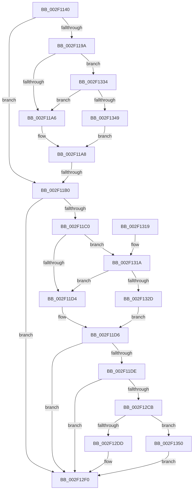

# MiLogBadMapper

- RVA: `0x002F1140`–`0x002F137E` (길이 `574` bytes)
- VA: `0x00000001402F1140`
- 실행 섹션: `.text`
- PDB 이름 있음: `예`; PDB Function 태그: `예`
- unwind 정보 RVA: `0x00071DBC`
- 디코드: `137`개 명령, `574/574` bytes 표시
- 미해석 바이트: `0` (있으면 어셈블리에 `.byte`로 보존)

> 이 문서는 커널 이미지의 기계어와 PDB 기호를 분석해 생성했습니다. 4번과 5번은 함수 원형과 자료형을 바이너리 사용 방식에서 추정한 C 해석이며 원본 소스 복구 결과는 아닙니다.

## 1. Dependencies

- 직접 호출 지점: **4**; 고유 호출 대상: **4**
- 직접 호출자로 확인된 함수: **2**
- RIP 상대 이미지 참조: **7**

### Outgoing calls
- `0x002F12CF` → [ExtractAggregateFieldTypes](ExtractAggregateFieldTypes_function_002F1390.md) (function, `0x002F1390`)
- `0x002F12EB` → [InsertEventEntryInLookUpTable](InsertEventEntryInLookUpTable_function_002F1424.md) (function, `0x002F1424`)
- `0x002F12F7` → [_security_check_cookie](../6A/_security_check_cookie_function_006AC640.md) (function, `0x006AC640`)
- `0x002F1374` → [EtwWriteEx](../25/EtwWriteEx_function_0025F0D0.md) (function, `0x0025F0D0`)

### Direct callers
- [sub_002F1861](Unknown_function_002F1861.md) at `0x002F1AF3`
- [IoInitSystemPreDrivers](../../init/C2/IoInitSystemPreDrivers_function_00C2AC3C.md) at `0x00C2B69A`

### Static image references
- `0x002F115F` → RVA `0x00E0A740` (`.data`; read)
- `0x002F1182` → RVA `0x00E37618` (`.data`; read)
- `0x002F1233` → RVA `0x00057F6F` (`.rdata`; read)
- `0x002F1252` → RVA `0x00043590` (`.rdata`; read)
- `0x002F1291` → RVA `0x00057F79` (`.rdata`; read)
- `0x002F129C` → RVA `0x0005BCFD` (`.rdata`; read)
- `0x002F12BE` → RVA `0x00A69500` (`TlgAggregateInternalRegisteredProviderEtwCallback`; read)

## 2. Other-region calls and transfers

- 다른 실행 섹션으로 향하는 call: **0**
- call이 아닌 외부 분기/꼬리 이동: **1**
  - `0x002F11AA` → [sub_006DEEFE](../6D/Unknown_function_006DEEFE.md) (`tail-transfer`)

## 3. Assembly (complete function range)

```asm
002F1140  48 8B C4                        mov rax, rsp
002F1143  48 89 58 08                     mov qword ptr [rax + 8], rbx
002F1147  48 89 70 10                     mov qword ptr [rax + 0x10], rsi
002F114B  48 89 78 18                     mov qword ptr [rax + 0x18], rdi
002F114F  55                              push rbp
002F1150  41 54                           push r12
002F1152  41 56                           push r14
002F1154  48 8D 68 D8                     lea rbp, [rax - 0x28]
002F1158  48 81 EC 10 01 00 00            sub rsp, 0x110
002F115F  48 8B 05 DA 95 B1 00            mov rax, qword ptr [rip + 0xb195da]
002F1166  48 33 C4                        xor rax, rsp
002F1169  48 89 45 00                     mov qword ptr [rbp], rax
002F116D  4D 85 C0                        test r8, r8
002F1170  48 8D 7C 24 50                  lea rdi, [rsp + 0x50]
002F1175  0F 57 C0                        xorps xmm0, xmm0
002F1178  44 8B F2                        mov r14d, edx
002F117B  49 0F 45 F8                     cmovne rdi, r8
002F117F  48 8B F1                        mov rsi, rcx
002F1182  4C 8B 05 8F 64 B4 00            mov r8, qword ptr [rip + 0xb4648f]
002F1189  41 BC 08 00 00 00               mov r12d, 8
002F118F  0F 11 44 24 50                  movups xmmword ptr [rsp + 0x50], xmm0
002F1194  41 83 38 05                     cmp dword ptr [r8], 5
002F1198  76 16                           jbe 0x1402f11b0
002F119A  41 8A 40 10                     mov al, byte ptr [r8 + 0x10]
002F119E  84 C0                           test al, al
002F11A0  0F 88 8E 01 00 00               js 0x1402f1334
002F11A6  32 C0                           xor al, al
002F11A8  84 C0                           test al, al
002F11AA  0F 85 4E DD 3E 00               jne 0x1406deefe
002F11B0  48 8B 1D 61 64 B4 00            mov rbx, qword ptr [rip + 0xb46461]
002F11B7  83 3B 05                        cmp dword ptr [rbx], 5
002F11BA  0F 86 30 01 00 00               jbe 0x1402f12f0
002F11C0  49 B8 80 00 00 00 00 40 00 00   movabs r8, 0x400000000080
002F11CA  4C 85 43 10                     test qword ptr [rbx + 0x10], r8
002F11CE  0F 85 46 01 00 00               jne 0x1402f131a
002F11D4  32 C0                           xor al, al
002F11D6  84 C0                           test al, al
002F11D8  0F 84 12 01 00 00               je 0x1402f12f0
002F11DE  0F B7 0F                        movzx ecx, word ptr [rdi]
002F11E1  48 8D 44 24 60                  lea rax, [rsp + 0x60]
002F11E6  83 65 AC 00                     and dword ptr [rbp - 0x54], 0
002F11EA  48 8D 55 E8                     lea rdx, [rbp - 0x18]
002F11EE  83 65 BC 00                     and dword ptr [rbp - 0x44], 0
002F11F2  83 65 CC 00                     and dword ptr [rbp - 0x34], 0
002F11F6  83 65 DC 00                     and dword ptr [rbp - 0x24], 0
002F11FA  83 65 EC 00                     and dword ptr [rbp - 0x14], 0
002F11FE  83 65 FC 00                     and dword ptr [rbp - 4], 0
002F1202  48 89 45 A0                     mov qword ptr [rbp - 0x60], rax
002F1206  48 8D 44 24 68                  lea rax, [rsp + 0x68]
002F120B  48 89 45 B0                     mov qword ptr [rbp - 0x50], rax
002F120F  48 8D 44 24 40                  lea rax, [rsp + 0x40]
002F1214  48 89 45 C0                     mov qword ptr [rbp - 0x40], rax
002F1218  48 8B 47 08                     mov rax, qword ptr [rdi + 8]
002F121C  48 89 45 E0                     mov qword ptr [rbp - 0x20], rax
002F1220  B8 00 00 00 81                  mov eax, 0x81000000
002F1225  48 89 44 24 70                  mov qword ptr [rsp + 0x70], rax
002F122A  48 8D 44 24 70                  lea rax, [rsp + 0x70]
002F122F  48 89 45 F0                     mov qword ptr [rbp - 0x10], rax
002F1233  0F B7 05 35 6D D6 FF            movzx eax, word ptr [rip - 0x2992cb]
002F123A  89 44 24 54                     mov dword ptr [rsp + 0x54], eax
002F123E  48 8B 43 08                     mov rax, qword ptr [rbx + 8]
002F1242  48 89 45 80                     mov qword ptr [rbp - 0x80], rax
002F1246  48 89 55 D0                     mov qword ptr [rbp - 0x30], rdx
002F124A  BA 02 00 00 00                  mov edx, 2
002F124F  89 4D E8                        mov dword ptr [rbp - 0x18], ecx
002F1252  48 8D 0D 37 23 D5 FF            lea rcx, [rip - 0x2adcc9]
002F1259  48 89 74 24 60                  mov qword ptr [rsp + 0x60], rsi
002F125E  44 89 65 A8                     mov dword ptr [rbp - 0x58], r12d
002F1262  48 89 74 24 68                  mov qword ptr [rsp + 0x68], rsi
002F1267  44 89 65 B8                     mov dword ptr [rbp - 0x48], r12d
002F126B  44 89 74 24 40                  mov dword ptr [rsp + 0x40], r14d
002F1270  C7 45 C8 04 00 00 00            mov dword ptr [rbp - 0x38], 4
002F1277  89 55 D8                        mov dword ptr [rbp - 0x28], edx
002F127A  44 89 65 F8                     mov dword ptr [rbp - 8], r12d
002F127E  C7 44 24 50 00 00 00 0B         mov dword ptr [rsp + 0x50], 0xb000000
002F1286  4C 89 44 24 58                  mov qword ptr [rsp + 0x58], r8
002F128B  0F B7 00                        movzx eax, word ptr [rax]
002F128E  89 45 88                        mov dword ptr [rbp - 0x78], eax
002F1291  48 8D 05 E1 6C D6 FF            lea rax, [rip - 0x29931f]
002F1298  48 89 45 90                     mov qword ptr [rbp - 0x70], rax
002F129C  48 8D 05 5A AA D6 FF            lea rax, [rip - 0x2955a6]
002F12A3  2B C1                           sub eax, ecx
002F12A5  89 55 8C                        mov dword ptr [rbp - 0x74], edx
002F12A8  C7 45 98 79 00 00 00            mov dword ptr [rbp - 0x68], 0x79
002F12AF  C7 45 9C 01 00 00 00            mov dword ptr [rbp - 0x64], 1
002F12B6  89 44 24 48                     mov dword ptr [rsp + 0x48], eax
002F12BA  8B 44 24 48                     mov eax, dword ptr [rsp + 0x48]
002F12BE  48 8D 05 3B 82 77 00            lea rax, [rip + 0x77823b]
002F12C5  48 39 43 28                     cmp qword ptr [rbx + 0x28], rax
002F12C9  75 25                           jne 0x1402f12f0
002F12CB  48 8D 55 80                     lea rdx, [rbp - 0x80]
002F12CF  E8 BC 00 00 00                  call 0x1402f1390
002F12D4  48 8D 54 24 50                  lea rdx, [rsp + 0x50]
002F12D9  84 C0                           test al, al
002F12DB  74 73                           je 0x1402f1350
002F12DD  4C 8D 4D 80                     lea r9, [rbp - 0x80]
002F12E1  88 44 24 20                     mov byte ptr [rsp + 0x20], al
002F12E5  45 8A C4                        mov r8b, r12b
002F12E8  48 8B CB                        mov rcx, rbx
002F12EB  E8 34 01 00 00                  call 0x1402f1424
002F12F0  48 8B 4D 00                     mov rcx, qword ptr [rbp]
002F12F4  48 33 CC                        xor rcx, rsp
002F12F7  E8 44 B3 3B 00                  call 0x1406ac640
002F12FC  4C 8D 9C 24 10 01 00 00         lea r11, [rsp + 0x110]
002F1304  49 8B 5B 20                     mov rbx, qword ptr [r11 + 0x20]
002F1308  49 8B 73 28                     mov rsi, qword ptr [r11 + 0x28]
002F130C  49 8B 7B 30                     mov rdi, qword ptr [r11 + 0x30]
002F1310  49 8B E3                        mov rsp, r11
002F1313  41 5E                           pop r14
002F1315  41 5C                           pop r12
002F1317  5D                              pop rbp
002F1318  C3                              ret
002F1319  CC                              int3
002F131A  48 8B 4B 18                     mov rcx, qword ptr [rbx + 0x18]
002F131E  48 8B C1                        mov rax, rcx
002F1321  49 23 C0                        and rax, r8
002F1324  48 3B C1                        cmp rax, rcx
002F1327  0F 85 A7 FE FF FF               jne 0x1402f11d4
002F132D  B0 01                           mov al, 1
002F132F  E9 A2 FE FF FF                  jmp 0x1402f11d6
002F1334  49 8B 48 18                     mov rcx, qword ptr [r8 + 0x18]
002F1338  48 8B C1                        mov rax, rcx
002F133B  25 80 00 00 00                  and eax, 0x80
002F1340  48 3B C1                        cmp rax, rcx
002F1343  0F 85 5D FE FF FF               jne 0x1402f11a6
002F1349  B0 01                           mov al, 1
002F134B  E9 58 FE FF FF                  jmp 0x1402f11a8
002F1350  48 8B 4B 20                     mov rcx, qword ptr [rbx + 0x20]
002F1354  48 8D 45 80                     lea rax, [rbp - 0x80]
002F1358  48 89 44 24 38                  mov qword ptr [rsp + 0x38], rax
002F135D  45 33 C9                        xor r9d, r9d
002F1360  44 89 64 24 30                  mov dword ptr [rsp + 0x30], r12d
002F1365  45 33 C0                        xor r8d, r8d
002F1368  48 83 64 24 28 00               and qword ptr [rsp + 0x28], 0
002F136E  48 83 64 24 20 00               and qword ptr [rsp + 0x20], 0
002F1374  E8 57 DD F6 FF                  call 0x14025f0d0
002F1379  E9 72 FF FF FF                  jmp 0x1402f12f0
```

## 4. C-style interpretation (structured pseudocode)

```c
__int64 __fastcall MiLogBadMapper(__int64 a1, int a2, __int64 a3)
{
    __int64 result;
    __int64 v_rdi;
    __int64 v_rsp;
    unsigned __int8 v_stack_m108;
    unsigned __int64 v_stack_m18;
    unsigned __int64 v_stack_mB8;
    unsigned __int64 v_stack_mC0;
    unsigned __int64 v_stack_mC8;
    unsigned __int64 v_stack_mD0;
    unsigned int v_stack_mD4;
    unsigned __int64 v_stack_mD8;
    unsigned int v_stack_mE0;
    unsigned __int64 v_stack_mE8;
    unsigned __int64 v_stack_mF0;

    *(unsigned __int64 *)(v_rsp + 8) = v_rbx;
    *(unsigned __int64 *)(v_rsp + 16) = v_rsi;
    *(unsigned __int64 *)(v_rsp + 24) = v_rdi;
    v_rsp = (v_rsp) - (272);
    result = (*(unsigned __int64 *)(v_rip + 11638234)) ^ (v_rsp);
    *(unsigned __int64 *)(v_rsp - 40) = result;
    v_rdi = v_stack_mD8;
    if (a3 != 0) { v_rdi = a3; }
    v_stack_mD8 = v_xmm0;
    if ((*(unsigned int *)(*(unsigned __int64 *)(v_rip + 11822223))) <= 5) goto loc_002F11B0;
    if (sign_flag) goto loc_002F1334;
loc_002F11A6:
    result = 0;
loc_002F11A8:
loc_002F11B0:
    if ((*(unsigned int *)(*(unsigned __int64 *)(v_rip + 11822177))) <= 5) goto loc_002F12F0;
    if (((*(unsigned __int64 *)(*(unsigned __int64 *)(v_rip + 11822177) + 16)) & (*(unsigned __int64 *)(v_rip + 11822223))) != 0) goto loc_002F131A;
loc_002F11D4:
    result = 0;
loc_002F11D6:
    if (0 == 0) goto loc_002F12F0;
    *(unsigned __int64 *)(v_rsp - 40 - 96) = v_stack_mC8;
    *(unsigned __int64 *)(v_rsp - 40 - 80) = v_stack_mC0;
    *(unsigned __int64 *)(v_rsp - 40 - 64) = v_stack_mE8;
    *(unsigned __int64 *)(v_rsp - 40 - 32) = *(unsigned __int64 *)(v_rdi + 8);
    v_stack_mB8 = (unsigned int)(0x81000000ULL);
    *(unsigned __int64 *)(v_rsp - 40 - 16) = v_stack_mB8;
    v_stack_mD4 = (unsigned int)(*(unsigned __int16 *)(v_rip - 2724555));
    *(unsigned __int64 *)(v_rsp - 40 - 128) = *(unsigned __int64 *)(*(unsigned __int64 *)(v_rip + 11822177) + 8);
    *(unsigned __int64 *)(v_rsp - 40 - 48) = v_rsp - 40 - 24;
    *(unsigned int *)(v_rsp - 40 - 24) = (unsigned int)(*(unsigned __int16 *)(v_rdi));
    v_stack_mC8 = a1;
    *(unsigned int *)(v_rsp - 40 - 88) = 8;
    v_stack_mC0 = a1;
    *(unsigned int *)(v_rsp - 40 - 72) = 8;
    v_stack_mE8 = (unsigned int)((unsigned int)(a2));
    *(unsigned int *)(v_rsp - 40 - 56) = 4;
    *(unsigned int *)(v_rsp - 40 - 40) = 2;
    *(unsigned int *)(v_rsp - 40 - 8) = 8;
    v_stack_mD8 = 0xB000000ULL;
    v_stack_mD0 = *(unsigned __int64 *)(v_rip + 11822223);
    *(unsigned int *)(v_rsp - 40 - 120) = (unsigned int)(*(unsigned __int16 *)(*(unsigned __int64 *)(*(unsigned __int64 *)(v_rip + 11822177) + 8)));
    *(unsigned __int64 *)(v_rsp - 40 - 112) = v_rip - 2724639;
    result = (unsigned int)((v_rip - 2708902) - ((unsigned int)(v_rip - 2809033)));
    *(unsigned int *)(v_rsp - 40 - 116) = 2;
    *(unsigned int *)(v_rsp - 40 - 104) = 121;
    *(unsigned int *)(v_rsp - 40 - 100) = 1;
    v_stack_mE0 = (unsigned int)(result);
    if ((*(unsigned __int64 *)(*(unsigned __int64 *)(v_rip + 11822177) + 40)) != (v_rip + 7832123)) goto loc_002F12F0;
    result = ExtractAggregateFieldTypes(v_rip - 2809033, v_rsp - 40 - 128, *(unsigned __int64 *)(v_rip + 11822223), a4);
    if ((unsigned __int8)(result) == 0) goto loc_002F1350;
    v_stack_m108 = (unsigned __int8)(result);
    result = InsertEventEntryInLookUpTable(*(unsigned __int64 *)(v_rip + 11822177), v_stack_mD8, 8, v_rsp - 40 - 128);
loc_002F12F0:
    a1 = (*(unsigned __int64 *)(v_rsp - 40)) ^ (v_rsp);
    result = _security_check_cookie(a1, v_stack_mD8, 8, v_rsp - 40 - 128);
    return result;
loc_002F131A:
    result = (*(unsigned __int64 *)(*(unsigned __int64 *)(v_stack_m18 + 32) + 24)) & (8);
    if (result != (*(unsigned __int64 *)(*(unsigned __int64 *)(v_stack_m18 + 32) + 24))) goto loc_002F11D4;
    goto loc_002F11D6;
loc_002F1334:
    result = (unsigned int)((*(unsigned __int64 *)(8 + 24)) & (128));
    if (result != (*(unsigned __int64 *)(8 + 24))) goto loc_002F11A6;
    goto loc_002F11A8;
loc_002F1350:
    v_stack_mD8 = v_rsp - 40 - 128;
    a4 = 0;
    v_stack_mE0 = 8;
    a3 = 0;
    result = EtwWriteEx(*(unsigned __int64 *)(*(unsigned __int64 *)(v_stack_m18 + 32) + 32), v_stack_mD8, a3, a4);
    goto loc_002F12F0;
}
```

## 5. (Beta) C Style

```c
int64_t MiLogBadMapper(int64_t Arg1, int32_t Arg2, int64_t Arg3)
{
    int64_t result;
    int64_t local_rdi;
    int64_t local_rsp;
    uint8_t v_stack_m108;
    uint64_t v_stack_m18;
    uint64_t v_stack_mB8;
    uint64_t v_stack_mC0;
    uint64_t v_stack_mC8;
    uint64_t v_stack_mD0;
    uint32_t v_stack_mD4;
    uint64_t v_stack_mD8;
    uint32_t v_stack_mE0;
    uint64_t v_stack_mE8;
    uint64_t v_stack_mF0;

    *(uint64_t *)(local_rsp + 0x8) = local_rbx;
    *(uint64_t *)(local_rsp + 0x10) = local_rsi;
    *(uint64_t *)(local_rsp + 0x18) = local_rdi;
    local_rsp = (local_rsp) - (272);
    result = (*(uint64_t *)(v_rip + 0xB195DA)) ^ (local_rsp);
    *(uint64_t *)(local_rsp - 0x28) = result;
    local_rdi = v_stack_mD8;
    if (Arg3 != 0) { local_rdi = Arg3; }
    v_stack_mD8 = v_xmm0;
    if ((*(uint32_t *)(*(uint64_t *)(v_rip + 0xB4648F))) <= 5) goto loc_002F11B0;
    if (sign_flag) goto loc_002F1334;
loc_002F11A6:
    result = 0;
loc_002F11A8:
loc_002F11B0:
    if ((*(uint32_t *)(*(uint64_t *)(v_rip + 0xB46461))) <= 5) goto loc_002F12F0;
    if (((*(uint64_t *)(*(uint64_t *)(v_rip + 0xB46461) + 0x10)) & (*(uint64_t *)(v_rip + 0xB4648F))) != 0) goto loc_002F131A;
loc_002F11D4:
    result = 0;
loc_002F11D6:
    if (0 == 0) goto loc_002F12F0;
    *(uint64_t *)(local_rsp - 0x28 - 0x60) = v_stack_mC8;
    *(uint64_t *)(local_rsp - 0x28 - 0x50) = v_stack_mC0;
    *(uint64_t *)(local_rsp - 0x28 - 0x40) = v_stack_mE8;
    *(uint64_t *)(local_rsp - 0x28 - 0x20) = *(uint64_t *)(local_rdi + 0x8);
    v_stack_mB8 = (uint32_t)(0x81000000ULL);
    *(uint64_t *)(local_rsp - 0x28 - 0x10) = v_stack_mB8;
    v_stack_mD4 = (uint32_t)(*(uint16_t *)(v_rip - 0x2992CB));
    *(uint64_t *)(local_rsp - 0x28 - 0x80) = *(uint64_t *)(*(uint64_t *)(v_rip + 0xB46461) + 0x8);
    *(uint64_t *)(local_rsp - 0x28 - 0x30) = local_rsp - 40 - 24;
    *(uint32_t *)(local_rsp - 0x28 - 0x18) = (uint32_t)(*(uint16_t *)(local_rdi));
    v_stack_mC8 = Arg1;
    *(uint32_t *)(local_rsp - 0x28 - 0x58) = 8;
    v_stack_mC0 = Arg1;
    *(uint32_t *)(local_rsp - 0x28 - 0x48) = 8;
    v_stack_mE8 = (uint32_t)((uint32_t)(Arg2));
    *(uint32_t *)(local_rsp - 0x28 - 0x38) = 4;
    *(uint32_t *)(local_rsp - 0x28 - 0x28) = 2;
    *(uint32_t *)(local_rsp - 0x28 - 0x8) = 8;
    v_stack_mD8 = 0xB000000ULL;
    v_stack_mD0 = *(uint64_t *)(v_rip + 0xB4648F);
    *(uint32_t *)(local_rsp - 0x28 - 0x78) = (uint32_t)(*(uint16_t *)(*(uint64_t *)(*(uint64_t *)(v_rip + 0xB46461) + 0x8)));
    *(uint64_t *)(local_rsp - 0x28 - 0x70) = v_rip - 2724639;
    result = (uint32_t)((v_rip - 2708902) - ((uint32_t)(v_rip - 2809033)));
    *(uint32_t *)(local_rsp - 0x28 - 0x74) = 2;
    *(uint32_t *)(local_rsp - 0x28 - 0x68) = 121;
    *(uint32_t *)(local_rsp - 0x28 - 0x64) = 1;
    v_stack_mE0 = (uint32_t)(result);
    if ((*(uint64_t *)(*(uint64_t *)(v_rip + 0xB46461) + 0x28)) != (v_rip + 7832123)) goto loc_002F12F0;
    result = ExtractAggregateFieldTypes(v_rip - 2809033, local_rsp - 40 - 128, *(uint64_t *)(v_rip + 0xB4648F), a4);
    if ((uint8_t)(result) == 0) goto loc_002F1350;
    v_stack_m108 = (uint8_t)(result);
    result = InsertEventEntryInLookUpTable(*(uint64_t *)(v_rip + 0xB46461), v_stack_mD8, 8, local_rsp - 40 - 128);
loc_002F12F0:
    Arg1 = (*(uint64_t *)(local_rsp - 0x28)) ^ (local_rsp);
    result = _security_check_cookie(Arg1, v_stack_mD8, 8, local_rsp - 40 - 128);
    return result;
loc_002F131A:
    result = (*(uint64_t *)(*(uint64_t *)(v_stack_m18 + 0x20) + 0x18)) & (8);
    if (result != (*(uint64_t *)(*(uint64_t *)(v_stack_m18 + 0x20) + 0x18))) goto loc_002F11D4;
    goto loc_002F11D6;
loc_002F1334:
    result = (uint32_t)((*(uint64_t *)(8 + 0x18)) & (128));
    if (result != (*(uint64_t *)(8 + 0x18))) goto loc_002F11A6;
    goto loc_002F11A8;
loc_002F1350:
    v_stack_mD8 = local_rsp - 40 - 128;
    a4 = 0;
    v_stack_mE0 = 8;
    Arg3 = 0;
    result = EtwWriteEx(*(uint64_t *)(*(uint64_t *)(v_stack_m18 + 0x20) + 0x20), v_stack_mD8, Arg3, a4);
    goto loc_002F12F0;
}
```

## 6. Execution-region graph

[열기: 2D/3D 그래프와 함수 탐색 컨트롤 패널](../../../control-panel.html?section=text&rva=0x002F1140&view=graph)

- 2D 그래프는 위에서 아래로 흐르고, 3D 그래프는 빈 공간을 드래그해 회전합니다. Shift+드래그는 이동, 휠은 확대·축소, 함수 노드 선택은 대상 보고서 이동입니다.

### Static fallback


