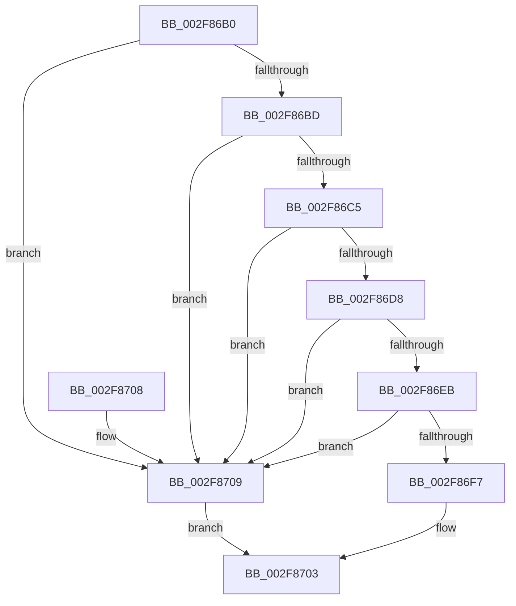

# MmCanThreadFault

- RVA: `0x002F86B0`–`0x002F870D` (길이 `93` bytes)
- VA: `0x00000001402F86B0`
- 실행 섹션: `.text`
- PDB 이름 있음: `예`; PDB Function 태그: `아니요`
- unwind 정보 RVA: `0x00069B1C`
- 디코드: `26`개 명령, `93/93` bytes 표시
- 미해석 바이트: `0` (있으면 어셈블리에 `.byte`로 보존)

> 이 문서는 커널 이미지의 기계어와 PDB 기호를 분석해 생성했습니다. 4번과 5번은 함수 원형과 자료형을 바이너리 사용 방식에서 추정한 C 해석이며 원본 소스 복구 결과는 아닙니다.

## 1. Dependencies

- 직접 호출 지점: **1**; 고유 호출 대상: **1**
- 직접 호출자로 확인된 함수: **8**
- RIP 상대 이미지 참조: **2**

### Outgoing calls
- `0x002F86B4` → [KeAreInterruptsEnabled](KeAreInterruptsEnabled_function_002F8060.md) (function, `0x002F8060`)

### Direct callers
- [ObpPushStackInfo](../21/ObpPushStackInfo_function_002109E4.md) at `0x00210AAC`
- [EtwpEventWriteFull](../22/EtwpEventWriteFull_function_00225C10.md) at `0x002262B3`
- [EtwpLogKernelEvent](../25/EtwpLogKernelEvent_function_0025CC00.md) at `0x0025D2E4`
- [RtlWalkFrameChain](RtlWalkFrameChain_function_002F85E0.md) at `0x002F862A`
- [sub_002FA4E0](Unknown_function_002FA4E0.md) at `0x002FA555`
- [EtwpGetStackExtendedHeaderItem](../44/EtwpGetStackExtendedHeaderItem_function_00443D70.md) at `0x00443DFE`
- [EtwpCovSampCaptureApc](../44/EtwpCovSampCaptureApc_function_004440D0.md) at `0x0044418A`
- [EtwpCovSampSafeForUserAddressCapture](../45/EtwpCovSampSafeForUserAddressCapture_function_00452C28.md) at `0x00452C75`

### Static image references
- `0x002F86DF` → RVA `0x005C84F0` (`KiExecuteDpc`; read)
- `0x002F86EB` → RVA `0x00FC8C40` (`ALMOSTRO`; read)

## 2. Other-region calls and transfers

- 다른 실행 섹션으로 향하는 call: **0**
- 별도 외부 분기/꼬리 이동을 확인하지 못했습니다.

## 3. Assembly (complete function range)

```asm
002F86B0  48 83 EC 28                     sub rsp, 0x28
002F86B4  E8 A7 F9 FF FF                  call 0x1402f8060
002F86B9  84 C0                           test al, al
002F86BB  74 4C                           je 0x1402f8709
002F86BD  44 0F 20 C0                     mov rax, cr8
002F86C1  3C 02                           cmp al, 2
002F86C3  73 44                           jae 0x1402f8709
002F86C5  65 48 8B 0C 25 88 01 00 00      mov rcx, qword ptr gs:[0x188]
002F86CE  8B 81 A4 05 00 00               mov eax, dword ptr [rcx + 0x5a4]
002F86D4  A8 02                           test al, 2
002F86D6  75 31                           jne 0x1402f8709
002F86D8  48 8B 81 60 05 00 00            mov rax, qword ptr [rcx + 0x560]
002F86DF  48 8D 0D 0A FE 2C 00            lea rcx, [rip + 0x2cfe0a]
002F86E6  48 3B C1                        cmp rax, rcx
002F86E9  74 1E                           je 0x1402f8709
002F86EB  48 8B 0D 4E 05 CD 00            mov rcx, qword ptr [rip + 0xcd054e]
002F86F2  48 85 C9                        test rcx, rcx
002F86F5  74 12                           je 0x1402f8709
002F86F7  33 C0                           xor eax, eax
002F86F9  48 39 81 38 88 00 00            cmp qword ptr [rcx + 0x8838], rax
002F8700  0F 95 C0                        setne al
002F8703  48 83 C4 28                     add rsp, 0x28
002F8707  C3                              ret
002F8708  CC                              int3
002F8709  33 C0                           xor eax, eax
002F870B  EB F6                           jmp 0x1402f8703
```

## 4. C-style interpretation (structured pseudocode)

```c
__int64 __fastcall MmCanThreadFault(void)
{
    __int64 result;
    __int64 v_rsp;

    v_rsp = (v_rsp) - (40);
    result = KeAreInterruptsEnabled(a1, a2, a3, a4);
    if ((unsigned __int8)(result) == 0) goto loc_002F8709;
    if (((unsigned __int8)(v_cr8)) >= 2) goto loc_002F8709;
    if ((((unsigned __int8)((unsigned int)(*(unsigned int *)(*(unsigned __int64 *)(gs_base + (0 + 392)) + 1444)))) & (2)) != 0) goto loc_002F8709;
    if ((*(unsigned __int64 *)(*(unsigned __int64 *)(gs_base + (0 + 392)) + 1376)) == (v_rip + 2948618)) goto loc_002F8709;
    if (*(unsigned __int64 *)(v_rip + 13436238) == 0) goto loc_002F8709;
    result = 0;
    result = ((*(unsigned __int64 *)(*(unsigned __int64 *)(v_rip + 13436238) + 34872)) != 0) ? 1 : 0;
loc_002F8703:
    v_rsp = (v_rsp) + (40);
    return result;
loc_002F8709:
    result = 0;
    goto loc_002F8703;
}
```

## 5. (Beta) C Style

```c
void MmCanThreadFault(void)
{
    int64_t result;
    int64_t local_rsp;

    local_rsp = (local_rsp) - (40);
    result = KeAreInterruptsEnabled(a1, a2, a3, a4);
    if ((uint8_t)(result) == 0) goto loc_002F8709;
    if (((uint8_t)(v_cr8)) >= 2) goto loc_002F8709;
    if ((((uint8_t)((uint32_t)(*(uint32_t *)(*(uint64_t *)(gs_base + (0 + 0x188)) + 0x5A4)))) & (2)) != 0) goto loc_002F8709;
    if ((*(uint64_t *)(*(uint64_t *)(gs_base + (0 + 0x188)) + 0x560)) == (v_rip + 2948618)) goto loc_002F8709;
    if (*(uint64_t *)(v_rip + 0xCD054E) == 0) goto loc_002F8709;
    result = 0;
    result = ((*(uint64_t *)(*(uint64_t *)(v_rip + 0xCD054E) + 0x8838)) != 0) ? 1 : 0;
loc_002F8703:
    local_rsp = (local_rsp) + (40);
    return result;
loc_002F8709:
    result = 0;
    goto loc_002F8703;
}
```

## 6. Execution-region graph

[열기: 2D/3D 그래프와 함수 탐색 컨트롤 패널](../../../control-panel.html?section=text&rva=0x002F86B0&view=graph)

- 2D 그래프는 위에서 아래로 흐르고, 3D 그래프는 빈 공간을 드래그해 회전합니다. Shift+드래그는 이동, 휠은 확대·축소, 함수 노드 선택은 대상 보고서 이동입니다.

### Static fallback


