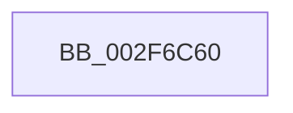

# MmCheckCachedPageStates

- RVA: `0x002F6C60`–`0x002F6C7D` (길이 `29` bytes)
- VA: `0x00000001402F6C60`
- 실행 섹션: `.text`
- PDB 이름 있음: `예`; PDB Function 태그: `예`
- unwind 정보 RVA: `0x000722DC`
- 디코드: `6`개 명령, `29/29` bytes 표시
- 미해석 바이트: `0` (있으면 어셈블리에 `.byte`로 보존)

> 이 문서는 커널 이미지의 기계어와 PDB 기호를 분석해 생성했습니다. 4번과 5번은 함수 원형과 자료형을 바이너리 사용 방식에서 추정한 C 해석이며 원본 소스 복구 결과는 아닙니다.

## 1. Dependencies

- 직접 호출 지점: **0**; 고유 호출 대상: **0**
- 직접 호출자로 확인된 함수: **6**
- RIP 상대 이미지 참조: **1**

### Outgoing calls
- 직접 디코드된 call 명령이 없습니다.

### Direct callers
- [MiFinishHardFault](../2B/MiFinishHardFault_function_002B6F10.md) at `0x002B74B9`
- [CcMapAndRead](CcMapAndRead_function_002F6AC0.md) at `0x002F6B83`
- [CcFetchDataForRead](CcFetchDataForRead_function_002F8720.md) at `0x002F87AA`
- [CcPinFileData](../33/CcPinFileData_function_0033FB40.md) at `0x0033FF41`
- [CcPinFileData](../33/CcPinFileData_function_0033FB40.md) at `0x00340624`
- [CcMapAndCopyInToCache](../3C/CcMapAndCopyInToCache_function_003CA7F0.md) at `0x003CACEC`
- [CcMapAndCopyInToCache](../3C/CcMapAndCopyInToCache_function_003CA7F0.md) at `0x003CAFB7`
- [CcMapDataForOverwrite](../46/CcMapDataForOverwrite_function_00466160.md) at `0x0046627C`
- [CcMapDataForOverwrite](../46/CcMapDataForOverwrite_function_00466160.md) at `0x004662AA`

### Static image references
- `0x002F6C6B` → RVA `0x00E0A740` (`.data`; read)

## 2. Other-region calls and transfers

- 다른 실행 섹션으로 향하는 call: **0**
- 별도 외부 분기/꼬리 이동을 확인하지 못했습니다.

## 3. Assembly (complete function range)

```asm
002F6C60  4C 8B DC                        mov r11, rsp
002F6C63  56                              push rsi
002F6C64  48 81 EC 40 01 00 00            sub rsp, 0x140
002F6C6B  48 8B 05 CE 3A B1 00            mov rax, qword ptr [rip + 0xb13ace]
002F6C72  48 33 C4                        xor rax, rsp
002F6C75  48 89 84 24 00 01 00 00         mov qword ptr [rsp + 0x100], rax
```

## 4. C-style interpretation (structured pseudocode)

```c
__int64 __fastcall MmCheckCachedPageStates(void)
{
    __int64 result;
    __int64 v_rsp;
    unsigned __int64 v_stack_m48;

    v_rsp = (v_rsp) - (320);
    result = (*(unsigned __int64 *)(v_rip + 11614926)) ^ (v_rsp);
    v_stack_m48 = result;
    return result;
}
```

## 5. (Beta) C Style

```c
void MmCheckCachedPageStates(void)
{
    int64_t result;
    int64_t local_rsp;
    uint64_t v_stack_m48;

    local_rsp = (local_rsp) - (320);
    result = (*(uint64_t *)(v_rip + 0xB13ACE)) ^ (local_rsp);
    v_stack_m48 = result;
    return result;
}
```

## 6. Execution-region graph

[열기: 2D/3D 그래프와 함수 탐색 컨트롤 패널](../../../control-panel.html?section=text&rva=0x002F6C60&view=graph)

- 2D 그래프는 위에서 아래로 흐르고, 3D 그래프는 빈 공간을 드래그해 회전합니다. Shift+드래그는 이동, 휠은 확대·축소, 함수 노드 선택은 대상 보고서 이동입니다.

### Static fallback


