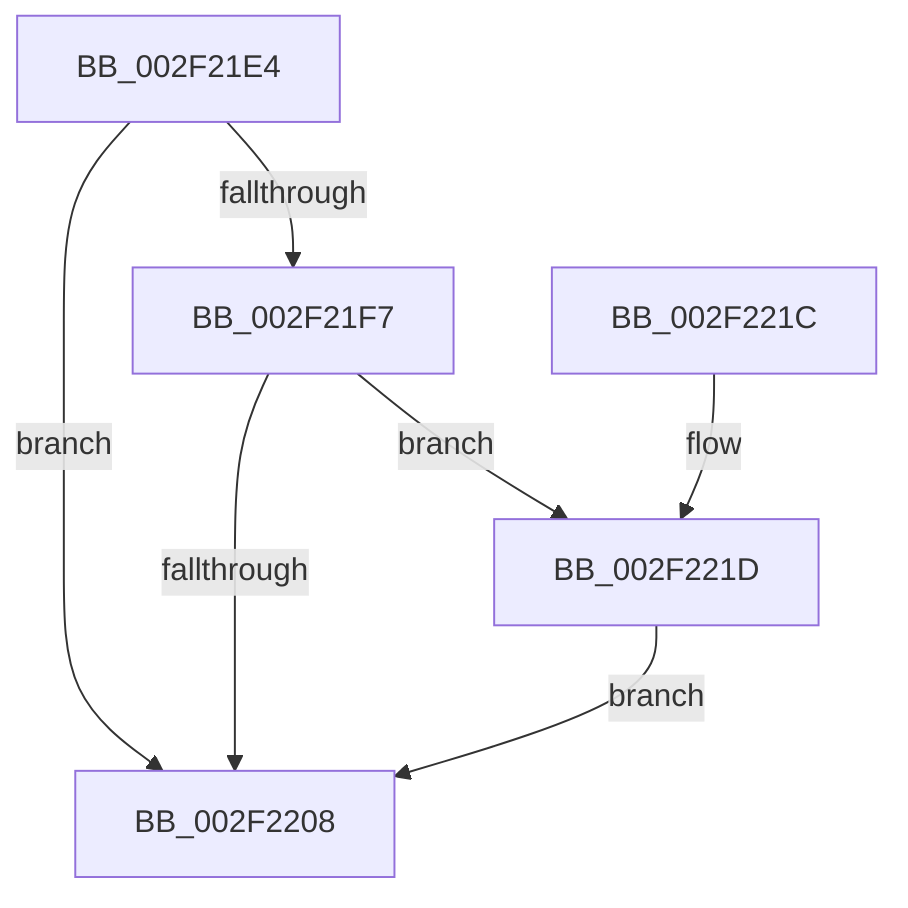

# MmLockLoadedModuleListShared

- RVA: `0x002F21E4`–`0x002F2224` (길이 `64` bytes)
- VA: `0x00000001402F21E4`
- 실행 섹션: `.text`
- PDB 이름 있음: `예`; PDB Function 태그: `아니요`
- unwind 정보 RVA: `0x0005DAC8`
- 디코드: `19`개 명령, `64/64` bytes 표시
- 미해석 바이트: `0` (있으면 어셈블리에 `.byte`로 보존)

> 이 문서는 커널 이미지의 기계어와 PDB 기호를 분석해 생성했습니다. 4번과 5번은 함수 원형과 자료형을 바이너리 사용 방식에서 추정한 C 해석이며 원본 소스 복구 결과는 아닙니다.

## 1. Dependencies

- 직접 호출 지점: **2**; 고유 호출 대상: **2**
- 직접 호출자로 확인된 함수: **8**
- RIP 상대 이미지 참조: **2**

### Outgoing calls
- `0x002F220F` → [ExAcquireSpinLockSharedAtDpcLevel](../24/ExAcquireSpinLockSharedAtDpcLevel_function_00248E30.md) (function, `0x00248E30`)
- `0x002F221D` → [KiRaiseIrqlProcessIrqlFlags](../4F/KiRaiseIrqlProcessIrqlFlags_function_004F56FC.md) (function, `0x004F56FC`)

### Direct callers
- [MmUnlockPagableImageSection](../2A/MmUnlockPagableImageSection_function_002A39F0.md) at `0x002A3A03`
- [MiIsDriverPage](../2A/MiIsDriverPage_function_002A5514.md) at `0x002A5541`
- [sub_002F1861](Unknown_function_002F1861.md) at `0x002F191A`
- [RtlpxLookupFunctionTable](RtlpxLookupFunctionTable_function_002F3610.md) at `0x002F3775`
- [RtlPcToFileName](../3F/RtlPcToFileName_function_003FEBB0.md) at `0x003FEBC5`
- [MiDriverPdeOkToDelete](../66/MiDriverPdeOkToDelete_function_0066E6E4.md) at `0x0066E74A`
- [MmGetImageRetpolineCodePage](../68/MmGetImageRetpolineCodePage_function_00682AD0.md) at `0x00682AF2`
- [MmMarkImageForHiberPhase](../../pagelk/B7/MmMarkImageForHiberPhase_function_00B748EC.md) at `0x00B748FE`

### Static image references
- `0x002F21FF` → RVA `0x00FC6D20` (`ALMOSTRO`; read)
- `0x002F2208` → RVA `0x00FCF200` (`CACHEALI`; read)

## 2. Other-region calls and transfers

- 다른 실행 섹션으로 향하는 call: **0**
- 별도 외부 분기/꼬리 이동을 확인하지 못했습니다.

## 3. Assembly (complete function range)

```asm
002F21E4  40 53                           push rbx
002F21E6  48 83 EC 20                     sub rsp, 0x20
002F21EA  44 0F 20 C3                     mov rbx, cr8
002F21EE  BA 0F 00 00 00                  mov edx, 0xf
002F21F3  3A DA                           cmp bl, dl
002F21F5  73 11                           jae 0x1402f2208
002F21F7  44 0F 20 C1                     mov rcx, cr8
002F21FB  44 0F 22 C2                     mov cr8, rdx
002F21FF  83 3D 1A 4B CD 00 00            cmp dword ptr [rip + 0xcd4b1a], 0
002F2206  75 15                           jne 0x1402f221d
002F2208  48 8D 0D F1 CF CD 00            lea rcx, [rip + 0xcdcff1]
002F220F  E8 1C 6C F5 FF                  call 0x140248e30
002F2214  8A C3                           mov al, bl
002F2216  48 83 C4 20                     add rsp, 0x20
002F221A  5B                              pop rbx
002F221B  C3                              ret
002F221C  CC                              int3
002F221D  E8 DA 34 20 00                  call 0x1404f56fc
002F2222  EB E4                           jmp 0x1402f2208
```

## 4. C-style interpretation (structured pseudocode)

```c
__int64 __fastcall MmLockLoadedModuleListShared(void)
{
    __int64 result;
    __int64 v_rsp;

    v_rsp = (v_rsp) - (32);
    if (((unsigned __int8)(v_cr8)) >= 15) goto loc_002F2208;
    if ((*(unsigned int *)(v_rip + 13454106)) != 0) goto loc_002F221D;
loc_002F2208:
    result = ExAcquireSpinLockSharedAtDpcLevel(v_rip + 13488113, 15, a3, a4);
    v_rsp = (v_rsp) + (32);
    return (unsigned __int8)(v_cr8);
loc_002F221D:
    result = KiRaiseIrqlProcessIrqlFlags(v_rip + 13488113, 15, a3, a4);
    goto loc_002F2208;
}
```

## 5. (Beta) C Style

```c
void MmLockLoadedModuleListShared(void)
{
    int64_t result;
    int64_t local_rsp;

    local_rsp = (local_rsp) - (32);
    if (((uint8_t)(v_cr8)) >= 15) goto loc_002F2208;
    if ((*(uint32_t *)(v_rip + 0xCD4B1A)) != 0) goto loc_002F221D;
loc_002F2208:
    result = ExAcquireSpinLockSharedAtDpcLevel(v_rip + 13488113, 15, a3, a4);
    local_rsp = (local_rsp) + (32);
    return (uint8_t)(v_cr8);
loc_002F221D:
    result = KiRaiseIrqlProcessIrqlFlags(v_rip + 13488113, 15, a3, a4);
    goto loc_002F2208;
}
```

## 6. Execution-region graph

[열기: 2D/3D 그래프와 함수 탐색 컨트롤 패널](../../../control-panel.html?section=text&rva=0x002F21E4&view=graph)

- 2D 그래프는 위에서 아래로 흐르고, 3D 그래프는 빈 공간을 드래그해 회전합니다. Shift+드래그는 이동, 휠은 확대·축소, 함수 노드 선택은 대상 보고서 이동입니다.

### Static fallback


