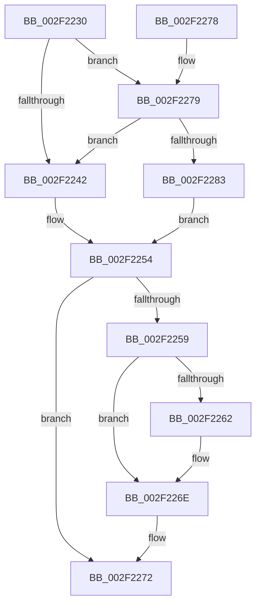

# MmUnlockLoadedModuleListShared

- RVA: `0x002F2230`–`0x002F2296` (길이 `102` bytes)
- VA: `0x00000001402F2230`
- 실행 섹션: `.text`
- PDB 이름 있음: `예`; PDB Function 태그: `아니요`
- unwind 정보 RVA: `0x0006084C`
- 디코드: `26`개 명령, `102/102` bytes 표시
- 미해석 바이트: `0` (있으면 어셈블리에 `.byte`로 보존)

> 이 문서는 커널 이미지의 기계어와 PDB 기호를 분석해 생성했습니다. 4번과 5번은 함수 원형과 자료형을 바이너리 사용 방식에서 추정한 C 해석이며 원본 소스 복구 결과는 아닙니다.

## 1. Dependencies

- 직접 호출 지점: **2**; 고유 호출 대상: **2**
- 직접 호출자로 확인된 함수: **9**
- RIP 상대 이미지 참조: **5**

### Outgoing calls
- `0x002F2269` → [KiLowerIrqlProcessIrqlFlags](../4F/KiLowerIrqlProcessIrqlFlags_function_004F5698.md) (function, `0x004F5698`)
- `0x002F228F` → [ExpReleaseSpinLockSharedFromDpcLevelInstrumented](ExpReleaseSpinLockSharedFromDpcLevelInstrumented_function_002F0F48.md) (function, `0x002F0F48`)

### Direct callers
- [MmUnlockPagableImageSection](../2A/MmUnlockPagableImageSection_function_002A39F0.md) at `0x002A3A19`
- [MiIsDriverPage](../2A/MiIsDriverPage_function_002A5514.md) at `0x002A555C`
- [sub_002F1861](Unknown_function_002F1861.md) at `0x002F1AC4`
- [sub_002F1B5E](Unknown_function_002F1B5E.md) at `0x002F1B8F`
- [RtlpxLookupFunctionTable](RtlpxLookupFunctionTable_function_002F3610.md) at `0x002F3817`
- [RtlPcToFileName](../3F/RtlPcToFileName_function_003FEBB0.md) at `0x003FEBF2`
- [MiDriverPdeOkToDelete](../66/MiDriverPdeOkToDelete_function_0066E6E4.md) at `0x0066E80E`
- [MmGetImageRetpolineCodePage](../68/MmGetImageRetpolineCodePage_function_00682AD0.md) at `0x00682B1B`
- [MmMarkImageForHiberPhase](../../pagelk/B7/MmMarkImageForHiberPhase_function_00B748EC.md) at `0x00B74914`

### Static image references
- `0x002F2236` → RVA `0x00FC6B06` (`ALMOSTRO`; read)
- `0x002F2242` → RVA `0x00FCF200` (`CACHEALI`; read/write)
- `0x002F2259` → RVA `0x00FC6D20` (`ALMOSTRO`; read)
- `0x002F2279` → RVA `0x00F0DE58` (`.data`; read)
- `0x002F2288` → RVA `0x00FCF200` (`CACHEALI`; read)

## 2. Other-region calls and transfers

- 다른 실행 섹션으로 향하는 call: **0**
- 별도 외부 분기/꼬리 이동을 확인하지 못했습니다.

## 3. Assembly (complete function range)

```asm
002F2230  40 53                           push rbx
002F2232  48 83 EC 20                     sub rsp, 0x20
002F2236  F6 05 C9 48 CD 00 01            test byte ptr [rip + 0xcd48c9], 1
002F223D  0F B6 D9                        movzx ebx, cl
002F2240  75 37                           jne 0x1402f2279
002F2242  F0 81 25 B3 CF CD 00 FF FF FF BF  lock and dword ptr [rip + 0xcdcfb3], 0xbfffffff
002F224D  F0 FF 0D AC CF CD 00            lock dec dword ptr [rip + 0xcdcfac]
002F2254  80 FB 0F                        cmp bl, 0xf
002F2257  73 19                           jae 0x1402f2272
002F2259  83 3D C0 4A CD 00 00            cmp dword ptr [rip + 0xcd4ac0], 0
002F2260  74 0C                           je 0x1402f226e
002F2262  44 0F 20 C1                     mov rcx, cr8
002F2266  0F B6 D3                        movzx edx, bl
002F2269  E8 2A 34 20 00                  call 0x1404f5698
002F226E  44 0F 22 C3                     mov cr8, rbx
002F2272  48 83 C4 20                     add rsp, 0x20
002F2276  5B                              pop rbx
002F2277  C3                              ret
002F2278  CC                              int3
002F2279  8B 05 D9 BB C1 00               mov eax, dword ptr [rip + 0xc1bbd9]
002F227F  85 C0                           test eax, eax
002F2281  75 BF                           jne 0x1402f2242
002F2283  48 8B 54 24 28                  mov rdx, qword ptr [rsp + 0x28]
002F2288  48 8D 0D 71 CF CD 00            lea rcx, [rip + 0xcdcf71]
002F228F  E8 B4 EC FF FF                  call 0x1402f0f48
002F2294  EB BE                           jmp 0x1402f2254
```

## 4. C-style interpretation (structured pseudocode)

```c
__int64 __fastcall MmUnlockLoadedModuleListShared(unsigned __int8 a1)
{
    __int64 result;
    __int64 v_rsp;
    unsigned __int64 v_stack_p28;

    v_rsp = (v_rsp) - (32);
    if (((*(unsigned __int8 *)(v_rip + 13453513)) & (1)) != 0) goto loc_002F2279;
loc_002F2242:
loc_002F2254:
    if (a1 >= 15) goto loc_002F2272;
    if ((*(unsigned int *)(v_rip + 13454016)) != 0) {
        a1 = v_cr8;
        a2 = a1;
        result = KiLowerIrqlProcessIrqlFlags(a1, a2, a3, a4);
    }
loc_002F2272:
    v_rsp = (v_rsp) + (32);
    return result;
loc_002F2279:
    if ((unsigned int)((unsigned int)(*(unsigned int *)(v_rip + 12696537))) != 0) goto loc_002F2242;
    result = ExpReleaseSpinLockSharedFromDpcLevelInstrumented(v_rip + 13487985, v_stack_p28, a3, a4);
    goto loc_002F2254;
}
```

## 5. (Beta) C Style

```c
int64_t MmUnlockLoadedModuleListShared(uint8_t Arg1)
{
    int64_t result;
    int64_t local_rsp;
    uint64_t v_stack_p28;

    local_rsp = (local_rsp) - (32);
    if (((*(uint8_t *)(v_rip + 0xCD48C9)) & (1)) != 0) goto loc_002F2279;
loc_002F2242:
loc_002F2254:
    if (Arg1 >= 15) goto loc_002F2272;
    if ((*(uint32_t *)(v_rip + 0xCD4AC0)) != 0) {
        Arg1 = v_cr8;
        a2 = Arg1;
        result = KiLowerIrqlProcessIrqlFlags(Arg1, a2, a3, a4);
    }
loc_002F2272:
    local_rsp = (local_rsp) + (32);
    return result;
loc_002F2279:
    if ((uint32_t)((uint32_t)(*(uint32_t *)(v_rip + 0xC1BBD9))) != 0) goto loc_002F2242;
    result = ExpReleaseSpinLockSharedFromDpcLevelInstrumented(v_rip + 13487985, v_stack_p28, a3, a4);
    goto loc_002F2254;
}
```

## 6. Execution-region graph

[열기: 2D/3D 그래프와 함수 탐색 컨트롤 패널](../../../control-panel.html?section=text&rva=0x002F2230&view=graph)

- 2D 그래프는 위에서 아래로 흐르고, 3D 그래프는 빈 공간을 드래그해 회전합니다. Shift+드래그는 이동, 휠은 확대·축소, 함수 노드 선택은 대상 보고서 이동입니다.

### Static fallback


