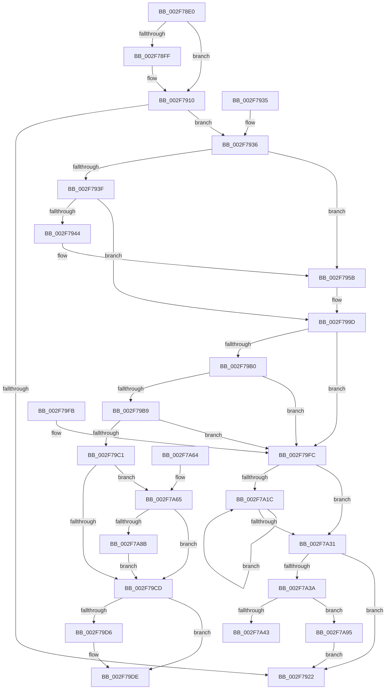

# ObfDereferenceObjectWithTag

- RVA: `0x002F78E0`–`0x002F7AAB` (길이 `459` bytes)
- VA: `0x00000001402F78E0`
- 실행 섹션: `.text`
- PDB 이름 있음: `예`; PDB Function 태그: `아니요`
- unwind 정보 RVA: `0x000723EC`
- 디코드: `118`개 명령, `459/459` bytes 표시
- 미해석 바이트: `0` (있으면 어셈블리에 `.byte`로 보존)

> 이 문서는 커널 이미지의 기계어와 PDB 기호를 분석해 생성했습니다. 4번과 5번은 함수 원형과 자료형을 바이너리 사용 방식에서 추정한 C 해석이며 원본 소스 복구 결과는 아닙니다.

## 1. Dependencies

- 직접 호출 지점: **10**; 고유 호출 대상: **9**
- 직접 호출자로 확인된 함수: **692**
- RIP 상대 이미지 참조: **6**

### Outgoing calls
- `0x002F790B` → [ObpPushStackInfo](../21/ObpPushStackInfo_function_002109E4.md) (function, `0x002109E4`)
- `0x002F7955` → [KeBugCheckEx](../4F/KeBugCheckEx_function_004FD660.md) (function, `0x004FD660`)
- `0x002F7997` → [KeBugCheckEx](../4F/KeBugCheckEx_function_004FD660.md) (function, `0x004FD660`)
- `0x002F79B0` → [KeAreInterruptsEnabled](KeAreInterruptsEnabled_function_002F8060.md) (function, `0x002F8060`)
- `0x002F79D9` → [ObpDeregisterObject](../../page/9D/ObpDeregisterObject_function_009D7F78.md) (function, `0x009D7F78`)
- `0x002F79E3` → [ObpRemoveObjectRoutine](../../page/86/ObpRemoveObjectRoutine_function_00864A60.md) (function, `0x00864A60`)
- `0x002F7A3A` → [KeGetEffectiveIrql](KeGetEffectiveIrql_function_002F8030.md) (function, `0x002F8030`)
- `0x002F7A4C` → [ExQueueWorkItem](ExQueueWorkItem_function_002F9520.md) (function, `0x002F9520`)
- `0x002F7A8B` → [ObpHandleRevocationBlockRemoveObject](../../page/9D/ObpHandleRevocationBlockRemoveObject_function_009D7E30.md) (function, `0x009D7E30`)
- `0x002F7AA1` → [KeInsertQueueDpc](../20/KeInsertQueueDpc_function_00207C50.md) (function, `0x00207C50`)

### Direct callers
- [KeInsertQueueApc](../20/KeInsertQueueApc_function_00203F10.md) at `0x002041DB`
- [IopCompleteRequest](../20/IopCompleteRequest_function_0020AF50.md) at `0x0020B1EE`
- [IopCompleteRequest](../20/IopCompleteRequest_function_0020AF50.md) at `0x0020B343`
- [IopCompleteRequest](../20/IopCompleteRequest_function_0020AF50.md) at `0x0020B437`
- [sub_00210801](../21/Unknown_function_00210801.md) at `0x00210944`
- [sub_002109A2](../21/Unknown_function_002109A2.md) at `0x002109B8`
- [SepRmCallLsa](../22/SepRmCallLsa_function_00223630.md) at `0x00223945`
- [SepAdtLogAuditRecord](../22/SepAdtLogAuditRecord_function_00224B6C.md) at `0x00224D29`
- [SepAdtLogAuditRecord](../22/SepAdtLogAuditRecord_function_00224B6C.md) at `0x00224D93`
- [SepAdtLogAuditRecord](../22/SepAdtLogAuditRecord_function_00224B6C.md) at `0x00224DA1`
- [PsGetSessionObjectById](../22/PsGetSessionObjectById_function_002250C0.md) at `0x00225122`
- [PopPowerRequestCreateUserModeRequest](../22/PopPowerRequestCreateUserModeRequest_function_0022F91C.md) at `0x0022F9C7`
- [PspProcessUnbindVirtualizedTimers](../22/PspProcessUnbindVirtualizedTimers_function_0022FC3C.md) at `0x0022FCC8`
- [PoStoreRequester](../23/PoStoreRequester_function_002304D4.md) at `0x002306E7`
- [PoDestroyReasonContext](../23/PoDestroyReasonContext_function_00230944.md) at `0x00230960`
- [PsRemoveVirtualizedTimer](../23/PsRemoveVirtualizedTimer_function_00230B5C.md) at `0x00230BDE`
- [PsRemoveVirtualizedTimer](../23/PsRemoveVirtualizedTimer_function_00230B5C.md) at `0x00230C14`
- [NtCancelTimer](../23/NtCancelTimer_function_00230D90.md) at `0x00230F4F`
- [NtCancelTimer](../23/NtCancelTimer_function_00230D90.md) at `0x0023109A`
- [NtSetTimer](../23/NtSetTimer_function_00231190.md) at `0x002313A0`
- [NtSetTimer](../23/NtSetTimer_function_00231190.md) at `0x00231409`
- [NtSetTimerEx](../23/NtSetTimerEx_function_00231480.md) at `0x002316B6`
- [NtSetTimerEx](../23/NtSetTimerEx_function_00231480.md) at `0x00231704`
- [ExpSetTimerObject](../23/ExpSetTimerObject_function_00231730.md) at `0x002323E6`
- [IopCompleteIrpInFileObjectList](../24/IopCompleteIrpInFileObjectList_function_0024F330.md) at `0x0024FA32`
- [PopIrpWorker](../26/PopIrpWorker_function_0026D410.md) at `0x0026D66B`
- [PopFreeIrp](../26/PopFreeIrp_function_0026FAA0.md) at `0x0026FB7E`
- [PopFreeIrp](../26/PopFreeIrp_function_0026FAA0.md) at `0x0026FB88`
- [IopCompleteUnloadOrDelete](../27/IopCompleteUnloadOrDelete_function_00270BC8.md) at `0x00270D69`
- [IopCompleteUnloadOrDelete](../27/IopCompleteUnloadOrDelete_function_00270BC8.md) at `0x00270EA9`
- [PopAllocateIrp](../27/PopAllocateIrp_function_0027116C.md) at `0x002714FA`
- [PopAllocateIrp](../27/PopAllocateIrp_function_0027116C.md) at `0x0027150C`
- [PopAllocateIrp](../27/PopAllocateIrp_function_0027116C.md) at `0x0027158F`
- [IoAllowExecution](../27/IoAllowExecution_function_00272498.md) at `0x002724B7`
- [MiRemoveFromSystemSpace](../29/MiRemoveFromSystemSpace_function_002962FC.md) at `0x00296623`
- [MiDeleteCachedSubsection](../29/MiDeleteCachedSubsection_function_00297888.md) at `0x00297BE4`
- [FsRtlReleaseFileForModWrite](../29/FsRtlReleaseFileForModWrite_function_00299100.md) at `0x0029940C`
- [FsRtlAcquireFileForModWriteEx](../29/FsRtlAcquireFileForModWriteEx_function_00299E5C.md) at `0x0029A227`
- [IopfCompleteRequest](../29/IopfCompleteRequest_function_0029B5F8.md) at `0x0029BA32`
- [IopfCompleteRequest](../29/IopfCompleteRequest_function_0029B5F8.md) at `0x0029BD37`
- [IopfCompleteRequest](../29/IopfCompleteRequest_function_0029B5F8.md) at `0x0029BD6C`
- [NtSetInformationFile](../29/NtSetInformationFile_function_0029C5E0.md) at `0x0029C8B2`
- [NtSetInformationFile](../29/NtSetInformationFile_function_0029C5E0.md) at `0x0029CE60`
- [NtSetInformationFile](../29/NtSetInformationFile_function_0029C5E0.md) at `0x0029CEF8`
- [NtSetInformationFile](../29/NtSetInformationFile_function_0029C5E0.md) at `0x0029D26E`
- [NtSetInformationFile](../29/NtSetInformationFile_function_0029C5E0.md) at `0x0029D284`
- [NtSetInformationFile](../29/NtSetInformationFile_function_0029C5E0.md) at `0x0029D4B0`
- [IopReferenceFileObject](../29/IopReferenceFileObject_function_0029D530.md) at `0x0029D5AB`
- [PspReaper](../2A/PspReaper_function_002A1220.md) at `0x002A1289`
- [NtShutdownWorkerFactory](../2A/NtShutdownWorkerFactory_function_002A4E60.md) at `0x002A4F4F`
- [ExpShutdownWorkerFactory](../2A/ExpShutdownWorkerFactory_function_002A4F70.md) at `0x002A4FC5`
- [ExpShutdownWorkerFactory](../2A/ExpShutdownWorkerFactory_function_002A4F70.md) at `0x002A5014`
- [NtGetWriteWatch](../2A/NtGetWriteWatch_function_002A7CE0.md) at `0x002A8575`
- [PfSnNameQueryWorker](../2C/PfSnNameQueryWorker_function_002C0E20.md) at `0x002C0EAD`
- [CcGetDirtyPages](CcGetDirtyPages_function_002F0720.md) at `0x002F07E3`
- [CcForEachPartition](CcForEachPartition_function_002F0828.md) at `0x002F08FB`
- [PsGetNextPartitionUnsafe](PsGetNextPartitionUnsafe_function_002F0E38.md) at `0x002F0E99`
- [SepGetAnonymousToken](../30/SepGetAnonymousToken_function_00301830.md) at `0x00301984`
- [ExpLeaveWorkerFactoryAwayMode](../34/ExpLeaveWorkerFactoryAwayMode_function_00344350.md) at `0x0034440F`
- [NtSetInformationWorkerFactory](../35/NtSetInformationWorkerFactory_function_00350A30.md) at `0x00350D32`
- [MiPrepareToFlushSubsection](../36/MiPrepareToFlushSubsection_function_00369094.md) at `0x00369150`
- [CcDeleteSharedCacheMap](../38/CcDeleteSharedCacheMap_function_0038A804.md) at `0x0038A9DC`
- [CcDeleteSharedCacheMap](../38/CcDeleteSharedCacheMap_function_0038A804.md) at `0x0038AA27`
- [sub_0038C58B](../38/Unknown_function_0038C58B.md) at `0x0038C7DC`
- [sub_0038C58B](../38/Unknown_function_0038C58B.md) at `0x0038C8A8`
- [FsRtlPrivateCheckWaitingLocks](../38/FsRtlPrivateCheckWaitingLocks_function_0038DCBC.md) at `0x0038DE4C`
- [PsReleaseSiloHardReference](../38/PsReleaseSiloHardReference_function_0038DEA0.md) at `0x0038DEBA`
- [FsRtlPrivateLock](../38/FsRtlPrivateLock_function_0038DF90.md) at `0x0038E57C`
- [IopCloseFileObjectExtension](../38/IopCloseFileObjectExtension_function_0038F6E0.md) at `0x0038F72D`
- [NtWaitForWorkViaWorkerFactory](../39/NtWaitForWorkViaWorkerFactory_function_00394270.md) at `0x0039452C`
- [NtWaitForWorkViaWorkerFactory](../39/NtWaitForWorkViaWorkerFactory_function_00394270.md) at `0x003949F9`
- [ExpSetTimer2](../3A/ExpSetTimer2_function_003A0470.md) at `0x003A05FA`
- [ExpSetTimerObject2](../3A/ExpSetTimerObject2_function_003A0658.md) at `0x003A0743`
- [RtlCheckTokenCapability](../3A/RtlCheckTokenCapability_function_003A5520.md) at `0x003A5795`
- [RtlCheckTokenMembershipEx](../3A/RtlCheckTokenMembershipEx_function_003A5A30.md) at `0x003A5C1C`
- [SepInternalSetSecurityAttributesToken](../3A/SepInternalSetSecurityAttributesToken_function_003A9474.md) at `0x003A954B`
- [SmKmStoreHelperCleanup](../3A/SmKmStoreHelperCleanup_function_003AFFE8.md) at `0x003B0025`
- [SMKM_STORE&lt;SM_TRAITS&gt;::SmStCleanup](../3B/SMKM_STORE_SM_TRAITS_SmStCleanup_function_003B00E0.md) at `0x003B0168`
- [SMKM_STORE&lt;SM_TRAITS&gt;::SmStCleanup](../3B/SMKM_STORE_SM_TRAITS_SmStCleanup_function_003B00E0.md) at `0x003B01C8`
- [CcCoalescingCallBack](../3C/CcCoalescingCallBack_function_003CA040.md) at `0x003CA0FD`
- [CcUninitializeCacheMap](../3C/CcUninitializeCacheMap_function_003CD520.md) at `0x003CD9B2`
- [IopIoRingCompleteIrp](../3E/IopIoRingCompleteIrp_function_003ED13C.md) at `0x003ED1E1`
- [IopCompleteIoRingEntry](../3E/IopCompleteIoRingEntry_function_003ED2C0.md) at `0x003ED3F6`
- [SepReferenceTokenByHandle](../3E/SepReferenceTokenByHandle_function_003EDAD0.md) at `0x003EDC52`
- [SepReferenceTokenByHandle](../3E/SepReferenceTokenByHandle_function_003EDAD0.md) at `0x003EDCD1`
- [FsRtlpAcknowledgeOplockBreakByCacheFlags](../3F/FsRtlpAcknowledgeOplockBreakByCacheFlags_function_003F1988.md) at `0x003F2027`
- [FsRtlpAcknowledgeOplockBreakByCacheFlags](../3F/FsRtlpAcknowledgeOplockBreakByCacheFlags_function_003F1988.md) at `0x003F259D`
- [FsRtlpRequestExclusiveOplock](../3F/FsRtlpRequestExclusiveOplock_function_003F3800.md) at `0x003F3D99`
- [IopValidateAndGetWriteParameters](../40/IopValidateAndGetWriteParameters_function_00400C30.md) at `0x00401119`
- [IopValidateAndGetWriteParameters](../40/IopValidateAndGetWriteParameters_function_00400C30.md) at `0x0040112F`
- [IopAllocateAndPopulateWriteIrp](../40/IopAllocateAndPopulateWriteIrp_function_004011F4.md) at `0x0040157D`
- [IopAllocateAndPopulateWriteIrp](../40/IopAllocateAndPopulateWriteIrp_function_004011F4.md) at `0x0040158E`
- [NtLockVirtualMemory](../40/NtLockVirtualMemory_function_004088A0.md) at `0x00408E83`
- [NtLockVirtualMemory](../40/NtLockVirtualMemory_function_004088A0.md) at `0x00409096`
- [NtLockVirtualMemory](../40/NtLockVirtualMemory_function_004088A0.md) at `0x004090C3`
- [ExpReleaseDisownedFastResourceShared](../41/ExpReleaseDisownedFastResourceShared_function_00416338.md) at `0x00416436`
- [ExpReleaseDisownedFastResourceExclusive](../41/ExpReleaseDisownedFastResourceExclusive_function_00416470.md) at `0x00416582`
- [AlpcpLookasidePacketCallbackRoutine](../41/AlpcpLookasidePacketCallbackRoutine_function_00419D50.md) at `0x00419F78`
- [FsRtlpOplockCleanup](../42/FsRtlpOplockCleanup_function_00425030.md) at `0x0042548A`
- [FsRtlpOplockCleanup](../42/FsRtlpOplockCleanup_function_00425030.md) at `0x00425539`
- [FsRtlpOplockCleanup](../42/FsRtlpOplockCleanup_function_00425030.md) at `0x00425627`
- [FsRtlpRemoveAndCompleteRHIrp](../42/FsRtlpRemoveAndCompleteRHIrp_function_00425964.md) at `0x00425A45`
- [FsRtlpRemoveAndCompleteRHIrp](../42/FsRtlpRemoveAndCompleteRHIrp_function_00425964.md) at `0x00425C8D`
- [NtCancelWaitCompletionPacket](../42/NtCancelWaitCompletionPacket_function_0042F100.md) at `0x0042F1F5`
- [NtCancelWaitCompletionPacket](../42/NtCancelWaitCompletionPacket_function_0042F100.md) at `0x0042F22B`
- [NtAssociateWaitCompletionPacket](../42/NtAssociateWaitCompletionPacket_function_0042F270.md) at `0x0042F4DF`
- [NtAssociateWaitCompletionPacket](../42/NtAssociateWaitCompletionPacket_function_0042F270.md) at `0x0042F4F1`
- [NtAssociateWaitCompletionPacket](../42/NtAssociateWaitCompletionPacket_function_0042F270.md) at `0x0042F503`
- [IopCloseWaitCompletionPacket](../42/IopCloseWaitCompletionPacket_function_0042F520.md) at `0x0042F5F9`
- [IopCancelWaitCompletionPacket](../42/IopCancelWaitCompletionPacket_function_0042F614.md) at `0x0042F68B`
- [IopCancelWaitCompletionPacket](../42/IopCancelWaitCompletionPacket_function_0042F614.md) at `0x0042F695`
- [IopCancelWaitCompletionPacket](../42/IopCancelWaitCompletionPacket_function_0042F614.md) at `0x0042F69F`
- [PopTraceThermalRequestPassiveHistogram](../42/PopTraceThermalRequestPassiveHistogram_function_0042FFB4.md) at `0x004301F0`
- [PspRemoveProperty](../43/PspRemoveProperty_function_00434C10.md) at `0x00434C8B`
- [RtlpQueryLowBoxId](../43/RtlpQueryLowBoxId_function_00438A50.md) at `0x00438B2D`
- [RtlpQueryLowBoxId](../43/RtlpQueryLowBoxId_function_00438A50.md) at `0x00438B8A`
- [RtlpAllowsLowBoxAccess](../43/RtlpAllowsLowBoxAccess_function_00438B9C.md) at `0x00438C64`
- [SeAccessCheckByType](../44/SeAccessCheckByType_function_00440BC8.md) at `0x004426E6`
- [SeLogAccessFailure](../44/SeLogAccessFailure_function_00448550.md) at `0x00448695`
- [PsGetEffectiveContainerId](../44/PsGetEffectiveContainerId_function_004497A0.md) at `0x00449906`
- [EtwpTraceImageUnloadApc](../44/EtwpTraceImageUnloadApc_function_0044BF50.md) at `0x0044C007`
- [EtwpTraceImageUnloadApc](../44/EtwpTraceImageUnloadApc_function_0044BF50.md) at `0x0044C015`
- [IopSessionChangeWorker](../45/IopSessionChangeWorker_function_004522B0.md) at `0x0045233F`
- [MiCreateSystemSection](../45/MiCreateSystemSection_function_00453158.md) at `0x00453307`
- [MiCreateSystemSection](../45/MiCreateSystemSection_function_00453158.md) at `0x00453319`
- [FsRtlCreateSectionForDataScan](../45/FsRtlCreateSectionForDataScan_function_00453330.md) at `0x0045347E`
- [FsRtlCreateSectionForDataScan](../45/FsRtlCreateSectionForDataScan_function_00453330.md) at `0x0045356C`
- [IopCheckInitiatorHint](../45/IopCheckInitiatorHint_function_00457134.md) at `0x00457244`
- [IopCheckInitiatorHint](../45/IopCheckInitiatorHint_function_00457134.md) at `0x00457286`
- [SepDesktopAppxSubProcessToken](../45/SepDesktopAppxSubProcessToken_function_0045BD90.md) at `0x0045C1B8`
- [SepVerifyDesktopAppPolicyOverrideCaller](../45/SepVerifyDesktopAppPolicyOverrideCaller_function_0045C1F0.md) at `0x0045C2E8`
- [PnpRemoveLockedDeviceNode](../47/PnpRemoveLockedDeviceNode_function_004702AC.md) at `0x00470621`
- [AlpcpReleaseDirectAttribute](../47/AlpcpReleaseDirectAttribute_function_00474804.md) at `0x00474816`
- [NtWorkerFactoryWorkerReady](../47/NtWorkerFactoryWorkerReady_function_00474CF0.md) at `0x00474D98`
- [MmFreeAccessPfnBuffer](../47/MmFreeAccessPfnBuffer_function_004751BC.md) at `0x004751DE`
- [PopPowerRequestEvaluatePendingRequestStatus](../47/PopPowerRequestEvaluatePendingRequestStatus_function_00477914.md) at `0x00477AB6`
- [PopPowerRequestCallbackWorker](../47/PopPowerRequestCallbackWorker_function_00477AD0.md) at `0x00477C23`
- [PnpDeviceActionWorker](../47/PnpDeviceActionWorker_function_00478400.md) at `0x004786DB`
- [PnpDeviceActionWorker](../47/PnpDeviceActionWorker_function_00478400.md) at `0x00478874`
- [WmipDeregisterRegEntry](../47/WmipDeregisterRegEntry_function_0047B568.md) at `0x0047B6A6`
- [WmipDeregisterRegEntry](../47/WmipDeregisterRegEntry_function_0047B568.md) at `0x0047B6E1`
- [ExpRemoveCurrentThreadFromThreadHistory](../48/ExpRemoveCurrentThreadFromThreadHistory_function_00483154.md) at `0x0048318F`
- [CmpDoFileRead](../48/CmpDoFileRead_function_00485658.md) at `0x00485786`
- [CmpDoFileRead](../48/CmpDoFileRead_function_00485658.md) at `0x004857D0`
- [ExpDeleteWorkerFactory](../48/ExpDeleteWorkerFactory_function_00486880.md) at `0x004868D5`
- [ExpDeleteWorkerFactory](../48/ExpDeleteWorkerFactory_function_00486880.md) at `0x004868ED`
- [CmSiEventTupleCleanup](../48/CmSiEventTupleCleanup_function_00487E8C.md) at `0x00487EA3`
- [CcIsThereDirtyData](../48/CcIsThereDirtyData_function_0048BE30.md) at `0x0048BEED`
- [HalPutDmaAdapter](../48/HalPutDmaAdapter_function_0048E530.md) at `0x0048E539`
- [CcPerformReadAhead](../48/CcPerformReadAhead_function_0048F738.md) at `0x0048FC4C`
- [IopKeepAliveWorker](../49/IopKeepAliveWorker_function_00494FD0.md) at `0x00495141`
- [IopKeepAliveWorker](../49/IopKeepAliveWorker_function_00494FD0.md) at `0x004951A8`
- [ExpTimerApcRoutine](../49/ExpTimerApcRoutine_function_0049A5E0.md) at `0x0049A671`
- [ExpWorkerFactoryDeferredThreadCreation](../49/ExpWorkerFactoryDeferredThreadCreation_function_0049F1A8.md) at `0x0049F20E`
- [IoNotifyQuotaState](../4A/IoNotifyQuotaState_function_004A13C0.md) at `0x004A1439`
- [ExpTimerDpcRoutine](../4A/ExpTimerDpcRoutine_function_004A1570.md) at `0x004A167B`
- [PopCreatePowerThread](../4A/PopCreatePowerThread_function_004A17D8.md) at `0x004A1894`
- [PspStorageEmptyArrayNonReadonly](../4A/PspStorageEmptyArrayNonReadonly_function_004A3F6C.md) at `0x004A4017`
- [PopFxIsDevicePotentialDripsConstraint](../4A/PopFxIsDevicePotentialDripsConstraint_function_004A5D34.md) at `0x004A5D97`
- [IopPerfCallDriver](../4A/IopPerfCallDriver_function_004A9680.md) at `0x004A96FB`
- [PoSetSystemWakeDevice](../4A/PoSetSystemWakeDevice_function_004AA6D0.md) at `0x004AA6F8`
- [SepLinkLogonSessions](../4A/SepLinkLogonSessions_function_004AAE78.md) at `0x004AAFC4`
- [SepLinkLogonSessions](../4A/SepLinkLogonSessions_function_004AAE78.md) at `0x004AB12F`
- [PopDiagTraceDeviceIdleCheck](../4A/PopDiagTraceDeviceIdleCheck_function_004AB30C.md) at `0x004AB37E`
- [PopDiagTraceThermalZoneRundown](../4A/PopDiagTraceThermalZoneRundown_function_004AF240.md) at `0x004AF421`
- [FsRtlpRemoveAndCompleteReadOnlyIrp](../4B/FsRtlpRemoveAndCompleteReadOnlyIrp_function_004B495C.md) at `0x004B49BF`
- [IoWriteErrorLogEntry](../4B/IoWriteErrorLogEntry_function_004B5B30.md) at `0x004B5C07`
- [ExUnregisterCallback](../4B/ExUnregisterCallback_function_004B7F80.md) at `0x004B8024`
- [EtwGetProviderIdFromHandle](../4B/EtwGetProviderIdFromHandle_function_004B8850.md) at `0x004B88CB`
- [FsRtlpOplockBreakToII](../4B/FsRtlpOplockBreakToII_function_004BB824.md) at `0x004BB93A`
- [IopReplaceCompletionPort](../4B/IopReplaceCompletionPort_function_004BCA58.md) at `0x004BCAE0`
- [CmpAdjustFileCFSafety](../4B/CmpAdjustFileCFSafety_function_004BCEF8.md) at `0x004BD05D`
- [ExRegisterCallback](../4B/ExRegisterCallback_function_004BDFC0.md) at `0x004BE049`
- [ExRegisterCallback](../4B/ExRegisterCallback_function_004BDFC0.md) at `0x004BE0A0`
- [PspJobDelete](../4B/PspJobDelete_function_004BF8F0.md) at `0x004BFA8D`
- [PspJobDelete](../4B/PspJobDelete_function_004BF8F0.md) at `0x004BFC66`
- [SepMandatorySubProcessToken](../4C/SepMandatorySubProcessToken_function_004C0B88.md) at `0x004C0F14`
- [IopFreeCopyObjectsFromDataBuffer](../4C/IopFreeCopyObjectsFromDataBuffer_function_004C201C.md) at `0x004C206B`
- [SeSetLearningModeObjectInformation](../4C/SeSetLearningModeObjectInformation_function_004C7098.md) at `0x004C7127`
- [SeSetLearningModeObjectInformation](../4C/SeSetLearningModeObjectInformation_function_004C7098.md) at `0x004C72A5`
- [PspMapView](../4C/PspMapView_function_004C77E8.md) at `0x004C78C6`
- [IopInvalidateBusRelationsWorker](../4C/IopInvalidateBusRelationsWorker_function_004C8900.md) at `0x004C8A27`
- [PnpHandleEnumerateHandlesAgainstPdoStack](../4C/PnpHandleEnumerateHandlesAgainstPdoStack_function_004C8F94.md) at `0x004C903E`
- [PnpHandleEnumerateHandlesAgainstPdoStack](../4C/PnpHandleEnumerateHandlesAgainstPdoStack_function_004C8F94.md) at `0x004C9049`
- [PnpHandleEnumerateHandlesAgainstPdoStack](../4C/PnpHandleEnumerateHandlesAgainstPdoStack_function_004C8F94.md) at `0x004C9086`
- [PnpHandleEnumerateHandlesAgainstPdoStack](../4C/PnpHandleEnumerateHandlesAgainstPdoStack_function_004C8F94.md) at `0x004C909F`
- [NtSubmitIoRing](../4C/NtSubmitIoRing_function_004CF9E0.md) at `0x004CFC31`
- [NtQueryInformationWorkerFactory](../4D/NtQueryInformationWorkerFactory_function_004D4480.md) at `0x004D4690`
- [IopCheckUnloadDriver](../4D/IopCheckUnloadDriver_function_004DC454.md) at `0x004DC4CC`
- [PopTraceThermalZonePassiveHistogram](../4D/PopTraceThermalZonePassiveHistogram_function_004DDD10.md) at `0x004DDE67`
- [EtwpGetDriverDataDosPath](../4D/EtwpGetDriverDataDosPath_function_004DDF10.md) at `0x004DE03B`
- [MiReferenceAweHandle](../4E/MiReferenceAweHandle_function_004E00A4.md) at `0x004E0131`
- [PopFxDestroyDeviceDpm](../4E/PopFxDestroyDeviceDpm_function_004E394C.md) at `0x004E3976`
- [PopFxDestroyDeviceDpm](../4E/PopFxDestroyDeviceDpm_function_004E394C.md) at `0x004E3986`
- [PopFxDestroyDeviceDpm](../4E/PopFxDestroyDeviceDpm_function_004E394C.md) at `0x004E3996`
- [FsRtlUninitializeOplock](../4E/FsRtlUninitializeOplock_function_004E42C0.md) at `0x004E43D6`
- [FsRtlUninitializeOplock](../4E/FsRtlUninitializeOplock_function_004E42C0.md) at `0x004E44B6`
- [FsRtlUninitializeOplock](../4E/FsRtlUninitializeOplock_function_004E42C0.md) at `0x004E45CA`
- [FsRtlpOplockBreakByCacheFlags](../4E/FsRtlpOplockBreakByCacheFlags_function_004E4990.md) at `0x004E5744`
- [FsRtlCancelNotify](../4E/FsRtlCancelNotify_function_004E7F90.md) at `0x004E831D`
- [IopCopyCompleteReadIrp](../4E/IopCopyCompleteReadIrp_function_004E83F0.md) at `0x004E85D7`
- [IopCopyCompleteReadRequest](../4E/IopCopyCompleteReadRequest_function_004E8760.md) at `0x004E8803`
- [PiCollapseEnumRequests](../4E/PiCollapseEnumRequests_function_004E8890.md) at `0x004E8968`
- [PnpRemoveDeviceActionRequests](../4E/PnpRemoveDeviceActionRequests_function_004E89A4.md) at `0x004E8B5A`
- [PopTraceThermalRequestActiveActivity](../4E/PopTraceThermalRequestActiveActivity_function_004E9104.md) at `0x004E938D`
- [SeCaptureAtomTableCallout](../4E/SeCaptureAtomTableCallout_function_004E9BD0.md) at `0x004E9CB7`
- [SepCreateTokenEx](../4E/SepCreateTokenEx_function_004E9CD0.md) at `0x004EA4EA`
- [SepCreateTokenEx](../4E/SepCreateTokenEx_function_004E9CD0.md) at `0x004EA7D0`
- [WmipReceiveNotifications](../4E/WmipReceiveNotifications_function_004EC280.md) at `0x004EC538`
- [WmipReceiveNotifications](../4E/WmipReceiveNotifications_function_004EC280.md) at `0x004EC716`
- [NtUnlockVirtualMemory](../4E/NtUnlockVirtualMemory_function_004EE890.md) at `0x004EEF07`
- [NtUnlockVirtualMemory](../4E/NtUnlockVirtualMemory_function_004EE890.md) at `0x004EEF96`
- [FsRtlpSyncWithAckTimeout](../4F/FsRtlpSyncWithAckTimeout_function_004F23C4.md) at `0x004F23FF`
- [SepCreateAppContainerToken](../4F/SepCreateAppContainerToken_function_004F43AC.md) at `0x004F4607`
- [SepCreateAppContainerToken](../4F/SepCreateAppContainerToken_function_004F43AC.md) at `0x004F4C97`
- [SepCreateAppContainerToken](../4F/SepCreateAppContainerToken_function_004F43AC.md) at `0x004F4CF7`
- [FsRtlpOplockBreakToNone](../4F/FsRtlpOplockBreakToNone_function_004F8354.md) at `0x004F844F`
- [FsRtlpCancelExclusiveIrp](../4F/FsRtlpCancelExclusiveIrp_function_004F96CC.md) at `0x004F9773`
- [HalpIommuCreateDevice](../54/HalpIommuCreateDevice_function_0054ED60.md) at `0x0054EF92`
- [HalpIommuCreateDevice](../54/HalpIommuCreateDevice_function_0054ED60.md) at `0x0054EFD8`
- [HalpIommuDeleteDevice](../54/HalpIommuDeleteDevice_function_0054F368.md) at `0x0054F4FF`
- [HalpDmaGetReservedRegionsForDeviceResources](../55/HalpDmaGetReservedRegionsForDeviceResources_function_00552018.md) at `0x0055226C`
- [HalpIommuGetDeviceId](../55/HalpIommuGetDeviceId_function_005536C0.md) at `0x0055373A`
- [HalpDeleteSecondaryIcEntry](../55/HalpDeleteSecondaryIcEntry_function_00556E58.md) at `0x00556ECC`
- [IommuUnregisterInterfaceStateChangeCallback](../56/IommuUnregisterInterfaceStateChangeCallback_function_00568730.md) at `0x0056882A`
- [CcDeleteVolumeCacheMap](../57/CcDeleteVolumeCacheMap_function_0057B070.md) at `0x0057B0B0`
- [CcGetDeviceGuidAsync](../57/CcGetDeviceGuidAsync_function_0057ED70.md) at `0x0057EE3D`
- [DbgkCaptureLiveKernelDump](../58/DbgkCaptureLiveKernelDump_function_00580288.md) at `0x005805F3`
- [DbgkCaptureLiveKernelDump](../58/DbgkCaptureLiveKernelDump_function_00580288.md) at `0x00580609`
- [FsRtlpAcknowledgeOplockBreak](../58/FsRtlpAcknowledgeOplockBreak_function_00582144.md) at `0x005822F1`
- [FsRtlpOplockAckTimeoutWorker](../58/FsRtlpOplockAckTimeoutWorker_function_00582950.md) at `0x005829E5`
- [IoWriteCapturedPristineTriageDumpToDedicatedDumpFile](../59/IoWriteCapturedPristineTriageDumpToDedicatedDumpFile_function_005934C0.md) at `0x005936A2`
- [IopDisassociateThreadIrp](../59/IopDisassociateThreadIrp_function_0059708C.md) at `0x00597227`
- [IopGetDriverPathInformation](../59/IopGetDriverPathInformation_function_005973A8.md) at `0x00597486`
- [IoFreeErrorLogEntry](../59/IoFreeErrorLogEntry_function_00597A40.md) at `0x00597A58`
- [IoFreeErrorLogEntry](../59/IoFreeErrorLogEntry_function_00597A40.md) at `0x00597A6B`
- [IoRevokeHandlesForProcess](../59/IoRevokeHandlesForProcess_function_005981A8.md) at `0x005982F9`
- [IoRevokeHandlesForProcess](../59/IoRevokeHandlesForProcess_function_005981A8.md) at `0x00598306`
- [IopQueueWorkItemNotInsertedEpilog](../59/IopQueueWorkItemNotInsertedEpilog_function_00598404.md) at `0x0059841B`
- [IopQueueWorkItemNotInsertedEpilog](../59/IopQueueWorkItemNotInsertedEpilog_function_00598404.md) at `0x0059842E`
- [IopIoRingUpdateCompletionUserEvent](../59/IopIoRingUpdateCompletionUserEvent_function_0059886C.md) at `0x005988E7`
- [IopLiveDumpAddProcessFilter](../59/IopLiveDumpAddProcessFilter_function_00599008.md) at `0x0059908F`
- [IopLiveDumpReleaseResources](../59/IopLiveDumpReleaseResources_function_0059DF1C.md) at `0x0059E0D2`
- [PnpRemoveDeviceActionRequestFromQueue](../5A/PnpRemoveDeviceActionRequestFromQueue_function_005A83E0.md) at `0x005A84EB`
- [PiCollapseRebalanceRequests](../5A/PiCollapseRebalanceRequests_function_005AA590.md) at `0x005AA634`
- [PnpProcessRebalance](../5A/PnpProcessRebalance_function_005AA7C8.md) at `0x005AA8E6`
- [KdUpdateTimeSlipEvent](../5B/KdUpdateTimeSlipEvent_function_005B0C1C.md) at `0x005B0C52`
- [KiAllocateDpcDelegateThread](../5B/KiAllocateDpcDelegateThread_function_005B697C.md) at `0x005B69E3`
- [KiFreePrcbThreads](../5B/KiFreePrcbThreads_function_005B7F40.md) at `0x005B7F5A`
- [KiFreePrcbThreads](../5B/KiFreePrcbThreads_function_005B7F40.md) at `0x005B7F70`
- [KiFreeProcessorStateInitializationParameters](../5B/KiFreeProcessorStateInitializationParameters_function_005B80A8.md) at `0x005B80D5`
- [KiAllocatePrcbThread](../5B/KiAllocatePrcbThread_function_005B9130.md) at `0x005B9395`
- [PopDiagTraceThermalStateChange](../5D/PopDiagTraceThermalStateChange_function_005D702C.md) at `0x005D7129`
- [PopDiagTraceThermalZoneEnumeration](../5D/PopDiagTraceThermalZoneEnumeration_function_005D7154.md) at `0x005D74B5`
- [PopDiagTraceThermalZoneThrottleDurationPerfTrack](../5D/PopDiagTraceThermalZoneThrottleDurationPerfTrack_function_005D74F4.md) at `0x005D75F9`
- [PopDiagTraceThermalZoneThrottlePerfTrack](../5D/PopDiagTraceThermalZoneThrottlePerfTrack_function_005D7628.md) at `0x005D7738`
- [PopTracePowerLimitHistogram](../5D/PopTracePowerLimitHistogram_function_005D7B10.md) at `0x005D7D3B`
- [PopTraceThermalZoneActiveActivity](../5D/PopTraceThermalZoneActiveActivity_function_005D7FE0.md) at `0x005D8181`
- [PopTraceZoneCr3Mitigated](../5D/PopTraceZoneCr3Mitigated_function_005D81B4.md) at `0x005D82A8`
- [PopTraceZoneCr3Tripped](../5D/PopTraceZoneCr3Tripped_function_005D82DC.md) at `0x005D8461`
- [TtmpScheduledEvaluationDpc](../5E/TtmpScheduledEvaluationDpc_function_005E2100.md) at `0x005E212F`
- [PsSetCpuQuotaInformation](../5E/PsSetCpuQuotaInformation_function_005E28F8.md) at `0x005E2ADE`
- [PspJobCycleTimeNotificationDpcRoutine](../5E/PspJobCycleTimeNotificationDpcRoutine_function_005E3980.md) at `0x005E39B3`
- [PspTimerDelayProcess](../5E/PspTimerDelayProcess_function_005E3EC0.md) at `0x005E3F16`
- [PspTimerDelayWorkerRoutine](../5E/PspTimerDelayWorkerRoutine_function_005E3F30.md) at `0x005E3F71`
- [PspIumFreePartitionState](../5E/PspIumFreePartitionState_function_005E48C4.md) at `0x005E499B`
- [PsQuitNextPartition](../5E/PsQuitNextPartition_function_005E4AFC.md) at `0x005E4B12`
- [LdrpMapResourceFile](../5E/LdrpMapResourceFile_function_005E5CBC.md) at `0x005E5EB0`
- [SeGetProcessAntiTamperIdentity](../60/SeGetProcessAntiTamperIdentity_function_00606740.md) at `0x006067B2`
- [SeGetProcessAntiTamperUIPolicy](../60/SeGetProcessAntiTamperUIPolicy_function_00606800.md) at `0x00606893`
- [SepOneWayLinkLogonSessions](../60/SepOneWayLinkLogonSessions_function_006068D8.md) at `0x00606BB4`
- [SepOneWayLinkLogonSessions](../60/SepOneWayLinkLogonSessions_function_006068D8.md) at `0x00606BD0`
- [SepOneWayLinkLogonSessions](../60/SepOneWayLinkLogonSessions_function_006068D8.md) at `0x00606BEF`
- [SepSetImageEa](../60/SepSetImageEa_function_0060874C.md) at `0x0060881B`
- [SepVerifyDesktopAppxImage](../60/SepVerifyDesktopAppxImage_function_0060885C.md) at `0x00608A68`
- [SeReportLearningModeViolation](../60/SeReportLearningModeViolation_function_00608B50.md) at `0x00608DE8`
- [SeCreateClientSecurityFromSubjectContextEx](../60/SeCreateClientSecurityFromSubjectContextEx_function_00609440.md) at `0x0060951E`
- [SeSetSecurityAttributesTokenEx](../60/SeSetSecurityAttributesTokenEx_function_00609C00.md) at `0x00609D55`
- [SmKmEtwAppendObjectName](../60/SmKmEtwAppendObjectName_function_0060F6D8.md) at `0x0060F79C`
- [SmKmEtwAppendProductName](../60/SmKmEtwAppendProductName_function_0060F854.md) at `0x0060F99B`
- [DifObfDereferenceObjectWithTagWrapper](../63/DifObfDereferenceObjectWithTagWrapper_function_006386C0.md) at `0x00638794`
- [DifObfDereferenceObjectWrapper](../63/DifObfDereferenceObjectWrapper_function_00638830.md) at `0x00638902`
- [EtwpCancelTraceImageUnloadApc](../65/EtwpCancelTraceImageUnloadApc_function_00650810.md) at `0x006508AC`
- [EtwpCancelTraceImageUnloadApc](../65/EtwpCancelTraceImageUnloadApc_function_00650810.md) at `0x006508BA`
- [EtwpCovSampCaptureCancelApcs](../65/EtwpCovSampCaptureCancelApcs_function_00653B44.md) at `0x00653BD7`
- [ExpDeleteSiloState](../65/ExpDeleteSiloState_function_00657664.md) at `0x00657691`
- [ExpNlsDeleteSiloState](../65/ExpNlsDeleteSiloState_function_00657E74.md) at `0x00657E8C`
- [ExCreateDpcEvent](../65/ExCreateDpcEvent_function_00659520.md) at `0x006595F0`
- [ExDeleteDpcEvent](../65/ExDeleteDpcEvent_function_00659630.md) at `0x00659642`
- [ExpFreeAsid](../65/ExpFreeAsid_function_0065B1E8.md) at `0x0065B26F`
- [ExpSvmDereferenceAsid](../65/ExpSvmDereferenceAsid_function_0065BB40.md) at `0x0065BBA6`
- [ExpWorkerFactoryManagerThread](../65/ExpWorkerFactoryManagerThread_function_0065CCC0.md) at `0x0065CE19`
- [CmShutdownSystem2](../66/CmShutdownSystem2_function_0066A7FC.md) at `0x0066A84C`
- [CmSiProcessTupleStartFromHandle](../66/CmSiProcessTupleStartFromHandle_function_0066DC44.md) at `0x0066DD3B`
- [MiReAcquireCommitFailWorker](../66/MiReAcquireCommitFailWorker_function_0066F560.md) at `0x0066F583`
- [MiDeleteAwePageTables](../68/MiDeleteAwePageTables_function_006884B0.md) at `0x00688775`
- [MiStoreDeletePartition](../69/MiStoreDeletePartition_function_006926F4.md) at `0x00692800`
- [MiDeleteThreadContext](../69/MiDeleteThreadContext_function_00695E54.md) at `0x00695EED`
- [MiInsertNewZeroThread](../69/MiInsertNewZeroThread_function_00696140.md) at `0x0069633E`
- [NtReplacePartitionUnit](../6A/NtReplacePartitionUnit_function_006A85A0.md) at `0x006A8819`
- [NtReplacePartitionUnit](../6A/NtReplacePartitionUnit_function_006A85A0.md) at `0x006A882B`
- [FsRtlPrivateLock$fin$0](../6D/FsRtlPrivateLock_fin_0_function_006D2360.md) at `0x006D2414`
- [CcPerformReadAhead$fin$1](../6D/CcPerformReadAhead_fin_1_function_006D3929.md) at `0x006D39FE`
- [sub_006DA8DA](../6D/Unknown_function_006DA8DA.md) at `0x006DA98F`
- [sub_006DCCA8](../6D/Unknown_function_006DCCA8.md) at `0x006DCD0F`
- [sub_006E25FA](../6E/Unknown_function_006E25FA.md) at `0x006E260D`
- [sub_006E2698](../6E/Unknown_function_006E2698.md) at `0x006E26A8`
- [sub_006ECEEA](../6E/Unknown_function_006ECEEA.md) at `0x006ECFD7`
- [sub_006ECEEA](../6E/Unknown_function_006ECEEA.md) at `0x006ED08B`
- [sub_006EF382](../6E/Unknown_function_006EF382.md) at `0x006EF39B`
- [sub_006EF3AA](../6E/Unknown_function_006EF3AA.md) at `0x006EF4B4`
- [sub_006F0AA0](../6F/Unknown_function_006F0AA0.md) at `0x006F0AE4`
- [sub_006F784A](../6F/Unknown_function_006F784A.md) at `0x006F7852`
- [sub_006F88AE](../6F/Unknown_function_006F88AE.md) at `0x006F8E0A`
- [sub_006F9E40](../6F/Unknown_function_006F9E40.md) at `0x006F9E77`
- [sub_006FA500](../6F/Unknown_function_006FA500.md) at `0x006FA50E`
- [sub_006FB21E](../6F/Unknown_function_006FB21E.md) at `0x006FB223`
- [sub_006FBBFE](../6F/Unknown_function_006FBBFE.md) at `0x006FBC09`
- [sub_006FCC20](../6F/Unknown_function_006FCC20.md) at `0x006FCC31`
- [PiUEventIsProcessFrozen](../../page/6F/PiUEventIsProcessFrozen_function_006FDF30.md) at `0x006FDF70`
- [NtResumeProcess](../../page/70/NtResumeProcess_function_007009C0.md) at `0x00700A24`
- [MmGetSectionStrongImageReference](../../page/70/MmGetSectionStrongImageReference_function_00701DF0.md) at `0x00701E9C`
- [DbgkCaptureLiveDump](../../page/71/DbgkCaptureLiveDump_function_0071113C.md) at `0x007114D9`
- [IopSetFileObjectIosbRange](../../page/71/IopSetFileObjectIosbRange_function_0071C1C8.md) at `0x0071C55D`
- [IopSetFileObjectIosbRange](../../page/71/IopSetFileObjectIosbRange_function_0071C1C8.md) at `0x0071C62B`
- [IopSetFileMemoryPartitionInformation](../../page/71/IopSetFileMemoryPartitionInformation_function_0071E414.md) at `0x0071E525`
- [PnpReportTargetDeviceChangeAsyncWorker](../../page/72/PnpReportTargetDeviceChangeAsyncWorker_function_00729E20.md) at `0x00729E56`
- [PnpRequestDeviceEjectExWorker](../../page/72/PnpRequestDeviceEjectExWorker_function_0072A6D0.md) at `0x0072A74B`
- [PiPagePathSetState](../../page/72/PiPagePathSetState_function_0072BDE0.md) at `0x0072BEF0`
- [PiProcessResourceRequirementsChanged](../../page/72/PiProcessResourceRequirementsChanged_function_0072D504.md) at `0x0072D645`
- [PiUEventBroadcastHardwareProfilesChangedEvent](../../page/72/PiUEventBroadcastHardwareProfilesChangedEvent_function_0072DD18.md) at `0x0072DD91`
- [PiUEventBroadcastPortsChangedEvent](../../page/72/PiUEventBroadcastPortsChangedEvent_function_0072DDA8.md) at `0x0072DECB`
- [PiUEventBroadcastVolumesChangedEvent](../../page/72/PiUEventBroadcastVolumesChangedEvent_function_0072DF04.md) at `0x0072DF74`
- [IopEjectDevice](../../page/73/IopEjectDevice_function_0073DC84.md) at `0x0073DE20`
- [PiInitializeDevice](../../page/73/PiInitializeDevice_function_0073EC5C.md) at `0x0073ECE4`
- [PipDgqFreeEntry](../../page/74/PipDgqFreeEntry_function_007446BC.md) at `0x007446CE`
- [KeUnregisterAvailableCpusChangeNotification](../../page/74/KeUnregisterAvailableCpusChangeNotification_function_00745FB4.md) at `0x007460F6`
- [AlpcpPortQueryServerInfo](../../page/74/AlpcpPortQueryServerInfo_function_0074C784.md) at `0x0074CA2B`
- [ObpDeleteDeviceMap](../../page/74/ObpDeleteDeviceMap_function_0074F2F0.md) at `0x0074F310`
- [PfSnAltProfileCleanup](../../page/75/PfSnAltProfileCleanup_function_00752270.md) at `0x00752282`
- [PfSnAppLaunchScenarioControl](../../page/75/PfSnAppLaunchScenarioControl_function_00752294.md) at `0x00752386`
- [PfSnSetAltPrefetchParam](../../page/75/PfSnSetAltPrefetchParam_function_00752424.md) at `0x00752878`
- [PopAssociateThermalRequest](../../page/75/PopAssociateThermalRequest_function_00756E78.md) at `0x007570C9`
- [PopOrphanCoolingExtension](../../page/75/PopOrphanCoolingExtension_function_00757474.md) at `0x00757585`
- [PopDirectedDripsNotifyTransitionFailed](../../page/75/PopDirectedDripsNotifyTransitionFailed_function_00757A34.md) at `0x00757A69`
- [PopFxRegisterDevice](../../page/75/PopFxRegisterDevice_function_00759B80.md) at `0x00759DE3`
- [PopFxRegisterDevice](../../page/75/PopFxRegisterDevice_function_00759B80.md) at `0x00759DF5`
- [PopCreateHiberFile](../../page/75/PopCreateHiberFile_function_0075CE70.md) at `0x0075D380`
- [PopDiagTracePassiveCooling](../../page/76/PopDiagTracePassiveCooling_function_00761CAC.md) at `0x00761EE2`
- [PopDiagTracePowerLimitExtension](../../page/76/PopDiagTracePowerLimitExtension_function_0076233C.md) at `0x0076253E`
- [PopDiagTracePowerLimitRequest](../../page/76/PopDiagTracePowerLimitRequest_function_007626D0.md) at `0x00762994`
- [PopDiagTraceZoneCriticalTripPointExceeded](../../page/76/PopDiagTraceZoneCriticalTripPointExceeded_function_007637D8.md) at `0x007638AF`
- [PopDiagTraceZoneS4TripPointExceeded](../../page/76/PopDiagTraceZoneS4TripPointExceeded_function_007638CC.md) at `0x007639A3`
- [PopConnectToPolicyDevice](../../page/76/PopConnectToPolicyDevice_function_00765D20.md) at `0x00765E76`
- [PopConnectToPolicyDevice](../../page/76/PopConnectToPolicyDevice_function_00765D20.md) at `0x00765E88`
- [PopGetPolicyDeviceObject](../../page/76/PopGetPolicyDeviceObject_function_00765EB8.md) at `0x00765FAE`
- [PopPolicyDeviceRemove](../../page/76/PopPolicyDeviceRemove_function_00766414.md) at `0x0076646C`
- [PopIdleWakeFreeWakeSourceAccounting](../../page/76/PopIdleWakeFreeWakeSourceAccounting_function_0076B370.md) at `0x0076B398`
- [PopSqmThermalCriticalEvent](../../page/77/PopSqmThermalCriticalEvent_function_00772678.md) at `0x0077280D`
- [PsRegisterSyscallProvider](../../page/77/PsRegisterSyscallProvider_function_0077E140.md) at `0x0077E2E5`
- [PspDestroySyscallProvider](../../page/77/PspDestroySyscallProvider_function_0077E454.md) at `0x0077E496`
- [PspGetNextSyscallProviderProcess](../../page/77/PspGetNextSyscallProviderProcess_function_0077E598.md) at `0x0077E66D`
- [PsRootSiloInformation](../../page/77/PsRootSiloInformation_function_0077F510.md) at `0x0077F599`
- [PsRootSiloInformation](../../page/77/PsRootSiloInformation_function_0077F510.md) at `0x0077F5CD`
- [PspDeleteServerSiloGlobals](../../page/77/PspDeleteServerSiloGlobals_function_0077FC54.md) at `0x0077FC74`
- [PspDeleteServerSiloGlobals](../../page/77/PspDeleteServerSiloGlobals_function_0077FC54.md) at `0x0077FE37`
- [PspProcessQosChangeNotificationWorker](../../page/78/PspProcessQosChangeNotificationWorker_function_00781740.md) at `0x00781955`
- [NtChangeProcessState](../../page/78/NtChangeProcessState_function_00782C00.md) at `0x00782DED`
- [NtChangeProcessState](../../page/78/NtChangeProcessState_function_00782C00.md) at `0x00782DFE`
- [NtCreateCpuPartition](../../page/78/NtCreateCpuPartition_function_00782E30.md) at `0x0078304B`
- [NtCreateProcessStateChange](../../page/78/NtCreateProcessStateChange_function_007830C0.md) at `0x0078322C`
- [NtQueryInformationCpuPartition](../../page/78/NtQueryInformationCpuPartition_function_00783320.md) at `0x007834E3`
- [NtSetInformationCpuPartition](../../page/78/NtSetInformationCpuPartition_function_00783510.md) at `0x0078376E`
- [NtSetInformationCpuPartition](../../page/78/NtSetInformationCpuPartition_function_00783510.md) at `0x00783782`
- [PsDereferenceCpuPartition](../../page/78/PsDereferenceCpuPartition_function_00783CBC.md) at `0x00783CC0`
- [PspAssignCpuPartitionsToProcess](../../page/78/PspAssignCpuPartitionsToProcess_function_00783FB4.md) at `0x007840B4`
- [PspDeleteCpuPartition](../../page/78/PspDeleteCpuPartition_function_00784310.md) at `0x0078433F`
- [PspDeleteProcessStateChange](../../page/78/PspDeleteProcessStateChange_function_00784400.md) at `0x00784442`
- [PspAssignPrimaryToken](../../page/78/PspAssignPrimaryToken_function_00784870.md) at `0x00784A05`
- [PspAddProcessToWorkingSetChangeList](../../page/78/PspAddProcessToWorkingSetChangeList_function_00784B38.md) at `0x00784BDB`
- [PspApplyWorkingSetLimits](../../page/78/PspApplyWorkingSetLimits_function_00784C00.md) at `0x00784D4E`
- [PspEstablishDfssHierarchy](../../page/78/PspEstablishDfssHierarchy_function_00784EF0.md) at `0x00784FD9`
- [PspQueryProcessInterferenceCountCallback](../../page/78/PspQueryProcessInterferenceCountCallback_function_007851C0.md) at `0x00785276`
- [PspQuitNextJobProcess](../../page/78/PspQuitNextJobProcess_function_00785298.md) at `0x007852EE`
- [PsWaitForAllProcesses](../../page/78/PsWaitForAllProcesses_function_00786318.md) at `0x00786399`
- [PsWaitForAllProcesses](../../page/78/PsWaitForAllProcesses_function_00786318.md) at `0x007863C2`
- [PspWaitForUsermodeExit](../../page/78/PspWaitForUsermodeExit_function_0078661C.md) at `0x00786664`
- [PspWaitForUsermodeExit](../../page/78/PspWaitForUsermodeExit_function_0078661C.md) at `0x00786687`
- [PsCreateMinimalProcess](../../page/78/PsCreateMinimalProcess_function_00786D14.md) at `0x007870B6`
- [PspCreatePicoProcess](../../page/78/PspCreatePicoProcess_function_007873B0.md) at `0x007875BD`
- [PspCreatePicoProcess](../../page/78/PspCreatePicoProcess_function_007873B0.md) at `0x007875E3`
- [PspCreatePicoProcess](../../page/78/PspCreatePicoProcess_function_007873B0.md) at `0x007875F5`
- [NtAlertResumeThread](../../page/78/NtAlertResumeThread_function_00787920.md) at `0x007879BE`
- [NtAlertResumeThread](../../page/78/NtAlertResumeThread_function_00787920.md) at `0x007879E0`
- [PsIumEnableOnDemandDebugWithResponse](../../page/78/PsIumEnableOnDemandDebugWithResponse_function_00787C30.md) at `0x00787CA8`
- [PspTeardownPartition](../../page/78/PspTeardownPartition_function_00788480.md) at `0x007885C9`
- [PspAttachSession](../../page/78/PspAttachSession_function_00788EB0.md) at `0x00788F16`
- [PspDereferenceSessionFinal](../../page/78/PspDereferenceSessionFinal_function_00788F5C.md) at `0x00789087`
- [PspSessionObjectCreate](../../page/78/PspSessionObjectCreate_function_007892A8.md) at `0x0078950D`
- [SeSetSessionIdTokenWithLinked](../../page/79/SeSetSessionIdTokenWithLinked_function_0079CF90.md) at `0x0079D0D4`
- [SepNotifyFileSystems](../../page/7A/SepNotifyFileSystems_function_007A1910.md) at `0x007A19A2`
- [EtwpGetPrivateSessionTraceHandle](../../page/7B/EtwpGetPrivateSessionTraceHandle_function_007BC5A8.md) at `0x007BC665`
- [EtwpObjectHandleEnumCallback](../../page/7C/EtwpObjectHandleEnumCallback_function_007C0240.md) at `0x007C03C6`
- [ExpTimeZoneWork](../../page/7C/ExpTimeZoneWork_function_007C64F0.md) at `0x007C654E`
- [ExpProfileCreate](../../page/7D/ExpProfileCreate_function_007D1AB8.md) at `0x007D1F79`
- [ExpProfileCreate](../../page/7D/ExpProfileCreate_function_007D1AB8.md) at `0x007D1F91`
- [ExpProfileDelete](../../page/7D/ExpProfileDelete_function_007D1FE0.md) at `0x007D2027`
- [NtPssCaptureVaSpaceBulk](../../page/7D/NtPssCaptureVaSpaceBulk_function_007D4EA0.md) at `0x007D5180`
- [CmpDumpOneKeyBody](../../page/7E/CmpDumpOneKeyBody_function_007EAC5C.md) at `0x007EACAD`
- [MiLdwPopupWorker](../../page/7F/MiLdwPopupWorker_function_007FCFF0.md) at `0x007FD027`
- [MiCreatePagingFile](../../page/7F/MiCreatePagingFile_function_007FEFF4.md) at `0x007FF9F4`
- [MiDeletePagefile](../../page/7F/MiDeletePagefile_function_007FFB88.md) at `0x007FFCE3`
- [MiInsertPageFileInList](../../page/7F/MiInsertPageFileInList_function_007FFF80.md) at `0x0080021C`
- [MiApplyImageHotPatchRequest](../../page/80/MiApplyImageHotPatchRequest_function_008025AC.md) at `0x0080298F`
- [MiApplyImageHotPatchRequest](../../page/80/MiApplyImageHotPatchRequest_function_008025AC.md) at `0x00802AE9`
- [MiInjectThreadForHotPatch](../../page/80/MiInjectThreadForHotPatch_function_00803FD8.md) at `0x008041A3`
- [NtCreateEnclave](../../page/80/NtCreateEnclave_function_00808CC0.md) at `0x00809015`
- [NtInitializeEnclave](../../page/80/NtInitializeEnclave_function_008090B0.md) at `0x008092BA`
- [MiAllocateUserPhysicalPages](../../page/80/MiAllocateUserPhysicalPages_function_00809828.md) at `0x0080A628`
- [NtFreeUserPhysicalPages](../../page/80/NtFreeUserPhysicalPages_function_0080AF30.md) at `0x0080B40D`
- [MiInSwapSharedWorkingSetWorker](../../page/80/MiInSwapSharedWorkingSetWorker_function_0080C510.md) at `0x0080C5DF`
- [MiDeletePartitionResources](../../page/80/MiDeletePartitionResources_function_0080D074.md) at `0x0080D1F5`
- [MiReferenceNonPagedMemoryProcessList](../../page/80/MiReferenceNonPagedMemoryProcessList_function_0080EAF8.md) at `0x0080EC4E`
- [MiReferenceNonPagedMemoryProcessList](../../page/80/MiReferenceNonPagedMemoryProcessList_function_0080EAF8.md) at `0x0080ECA0`
- [MmScrubMemory](../../page/80/MmScrubMemory_function_0080EFA0.md) at `0x0080F126`
- [MmScrubMemory](../../page/80/MmScrubMemory_function_0080EFA0.md) at `0x0080F192`
- [MiDeleteSpecialPurposeMemory](../../page/80/MiDeleteSpecialPurposeMemory_function_0080F52C.md) at `0x0080F554`
- [MiCreateMemoryEvent](../../page/81/MiCreateMemoryEvent_function_00810D98.md) at `0x00810F1D`
- [VrpHandleIoctlCreateMultipleNamespaceNodes](../../page/83/VrpHandleIoctlCreateMultipleNamespaceNodes_function_0083B17C.md) at `0x0083B43B`
- [VrpHandleIoctlModifyFlags](../../page/83/VrpHandleIoctlModifyFlags_function_0083B69C.md) at `0x0083B77F`
- [ObpDirectoryTeardownCallback](../../page/83/ObpDirectoryTeardownCallback_function_0083CEC0.md) at `0x0083CED9`
- [NtSetInformationKey](../../page/84/NtSetInformationKey_function_00843720.md) at `0x00843C90`
- [NtSetInformationKey](../../page/84/NtSetInformationKey_function_00843720.md) at `0x00843DE2`
- [ObpDecrementHandleCount](../../page/86/ObpDecrementHandleCount_function_008632E0.md) at `0x008638BF`
- [ObpDecrementHandleCount](../../page/86/ObpDecrementHandleCount_function_008632E0.md) at `0x008638ED`
- [ObWaitForSingleObject](../../page/86/ObWaitForSingleObject_function_00868C50.md) at `0x00868D2A`
- [ObWaitForSingleObject](../../page/86/ObWaitForSingleObject_function_00868C50.md) at `0x00868D91`
- [ObWaitForMultipleObjects](../../page/86/ObWaitForMultipleObjects_function_00868DF0.md) at `0x00869179`
- [ObpReferenceObjectByHandleWithTag](../../page/86/ObpReferenceObjectByHandleWithTag_function_00869650.md) at `0x0086984E`
- [ObCloseHandleTableEntry](../../page/86/ObCloseHandleTableEntry_function_00869E20.md) at `0x0086A1CC`
- [ObCloseHandleTableEntry](../../page/86/ObCloseHandleTableEntry_function_00869E20.md) at `0x0086A82B`
- [ObCloseHandleTableEntry](../../page/86/ObCloseHandleTableEntry_function_00869E20.md) at `0x0086A85A`
- [SeReleaseSubjectContext](../../page/86/SeReleaseSubjectContext_function_0086B710.md) at `0x0086B7A7`
- [SeReleaseSubjectContext](../../page/86/SeReleaseSubjectContext_function_0086B710.md) at `0x0086B7B6`
- [ObpCreateHandle](../../page/86/ObpCreateHandle_function_0086B950.md) at `0x0086C37D`
- [ObpCreateHandle](../../page/86/ObpCreateHandle_function_0086B950.md) at `0x0086CB0C`
- [ObpCreateHandle](../../page/86/ObpCreateHandle_function_0086B950.md) at `0x0086D8BE`
- [sub_008720D0](../../page/87/Unknown_function_008720D0.md) at `0x008720D5`
- [sub_00872196](../../page/87/Unknown_function_00872196.md) at `0x0087219E`
- [CmpCmdHiveOpen](../../page/87/CmpCmdHiveOpen_function_00878404.md) at `0x008785FA`
- [CmpOpenHiveFile](../../page/87/CmpOpenHiveFile_function_0087A71C.md) at `0x0087ACA5`
- [PspGetMemoryPartitionFromJobList](../../page/87/PspGetMemoryPartitionFromJobList_function_0087D988.md) at `0x0087DABA`
- [PspEstablishJobHierarchy](../../page/87/PspEstablishJobHierarchy_function_0087E17C.md) at `0x0087E30E`
- [sub_0087FFB4](../../page/87/Unknown_function_0087FFB4.md) at `0x008800D2`
- [NtProtectVirtualMemory](../../page/88/NtProtectVirtualMemory_function_00880CA0.md) at `0x00880EB9`
- [MiCommitFileBackedSection](../../page/88/MiCommitFileBackedSection_function_00882238.md) at `0x00882488`
- [MmAllocateUserStack](../../page/88/MmAllocateUserStack_function_00882B30.md) at `0x00882CAA`
- [NtAllocateVirtualMemory](../../page/88/NtAllocateVirtualMemory_function_00882D20.md) at `0x00882F49`
- [MiAllocateVirtualMemoryCommon](../../page/88/MiAllocateVirtualMemoryCommon_function_00883000.md) at `0x00883142`
- [MiAllocateVirtualMemoryPrepare](../../page/88/MiAllocateVirtualMemoryPrepare_function_00883220.md) at `0x00883B2F`
- [sub_00885AED](../../page/88/Unknown_function_00885AED.md) at `0x00885BD4`
- [MiDeleteVad](../../page/88/MiDeleteVad_function_00888C80.md) at `0x00888F88`
- [sub_0088A3A2](../../page/88/Unknown_function_0088A3A2.md) at `0x0088A3BB`
- [sub_0088A40D](../../page/88/Unknown_function_0088A40D.md) at `0x0088A48B`
- [AlpcViewDestroyProcedure](../../page/88/AlpcViewDestroyProcedure_function_0088B080.md) at `0x0088B2AC`
- [AlpcSecurityDestroyProcedure](../../page/88/AlpcSecurityDestroyProcedure_function_0088B330.md) at `0x0088B479`
- [AlpcSecurityDestroyProcedure](../../page/88/AlpcSecurityDestroyProcedure_function_0088B330.md) at `0x0088B4AF`
- [sub_0088B611](../../page/88/Unknown_function_0088B611.md) at `0x0088B65B`
- [AlpcpCreateSecurityContext](../../page/89/AlpcpCreateSecurityContext_function_00890D94.md) at `0x00890F44`
- [SeCreateClientSecurity](../../page/89/SeCreateClientSecurity_function_008911B0.md) at `0x0089136D`
- [AlpcpExposeTokenAttribute](../../page/89/AlpcpExposeTokenAttribute_function_00891390.md) at `0x008915DB`
- [AlpcpExposeTokenAttribute](../../page/89/AlpcpExposeTokenAttribute_function_00891390.md) at `0x00891742`
- [sub_00891924](../../page/89/Unknown_function_00891924.md) at `0x0089192C`
- [sub_00891C14](../../page/89/Unknown_function_00891C14.md) at `0x00891C1C`
- [sub_00891C14](../../page/89/Unknown_function_00891C14.md) at `0x00891C33`
- [ObCaptureObjectStateForDuplication](../../page/89/ObCaptureObjectStateForDuplication_function_00893684.md) at `0x0089383E`
- [ObCaptureObjectStateForDuplication](../../page/89/ObCaptureObjectStateForDuplication_function_00893684.md) at `0x0089386D`
- [ObCompleteObjectDuplication](../../page/89/ObCompleteObjectDuplication_function_0089387C.md) at `0x00893AC2`
- [NtAlpcOpenSenderProcess](../../page/89/NtAlpcOpenSenderProcess_function_008953B0.md) at `0x0089562B`
- [sub_00896999](../../page/89/Unknown_function_00896999.md) at `0x00896B17`
- [NtMapViewOfSection](../../page/89/NtMapViewOfSection_function_008986E0.md) at `0x00898959`
- [NtMapViewOfSection](../../page/89/NtMapViewOfSection_function_008986E0.md) at `0x0089896B`
- [MiMapViewOfSectionCommon](../../page/89/MiMapViewOfSectionCommon_function_00898C90.md) at `0x00898E8D`
- [MiMapViewOfSectionCommon](../../page/89/MiMapViewOfSectionCommon_function_00898C90.md) at `0x00898ED8`
- [MiMapViewOfSectionCommon](../../page/89/MiMapViewOfSectionCommon_function_00898C90.md) at `0x00898EED`
- [MiMapViewOfSectionCommon](../../page/89/MiMapViewOfSectionCommon_function_00898C90.md) at `0x00898EFA`
- [sub_0089A511](../../page/89/Unknown_function_0089A511.md) at `0x0089A686`
- [sub_0089A511](../../page/89/Unknown_function_0089A511.md) at `0x0089A6B4`
- [sub_0089AE5C](../../page/89/Unknown_function_0089AE5C.md) at `0x0089AEBF`
- [sub_0089AEE3](../../page/89/Unknown_function_0089AEE3.md) at `0x0089AF37`
- [sub_0089AEE3](../../page/89/Unknown_function_0089AEE3.md) at `0x0089B0DE`
- [ObCreateObjectEx](../../page/89/ObCreateObjectEx_function_0089B1E0.md) at `0x0089B687`
- [ObCreateObjectEx](../../page/89/ObCreateObjectEx_function_0089B1E0.md) at `0x0089B81A`
- [ObpLookupObjectName](../../page/89/ObpLookupObjectName_function_0089BE90.md) at `0x0089C26A`
- [ObpLookupObjectName](../../page/89/ObpLookupObjectName_function_0089BE90.md) at `0x0089D5A0`
- [ObpLookupObjectName](../../page/89/ObpLookupObjectName_function_0089BE90.md) at `0x0089DB00`
- [sub_008A2AAB](../../page/8A/Unknown_function_008A2AAB.md) at `0x008A2BE1`
- [DbgkpQueueMessage](../../page/8A/DbgkpQueueMessage_function_008A31C0.md) at `0x008A34B0`
- [DbgkpQueueMessage](../../page/8A/DbgkpQueueMessage_function_008A31C0.md) at `0x008A34BA`
- [IopExceptionCleanupEx](../../page/8A/IopExceptionCleanupEx_function_008AE5C8.md) at `0x008AE621`
- [PfSnCleanupTrace](../../page/8B/PfSnCleanupTrace_function_008B0B7C.md) at `0x008B0C62`
- [sub_008B4B10](../../page/8B/Unknown_function_008B4B10.md) at `0x008B4B15`
- [sub_008B4C99](../../page/8B/Unknown_function_008B4C99.md) at `0x008B4CA8`
- [sub_008B4FBA](../../page/8B/Unknown_function_008B4FBA.md) at `0x008B4FBF`
- [sub_008B500F](../../page/8B/Unknown_function_008B500F.md) at `0x008B5017`
- [NtOpenProcessTokenEx](../../page/8B/NtOpenProcessTokenEx_function_008B72D0.md) at `0x008B73A6`
- [sub_008B756E](../../page/8B/Unknown_function_008B756E.md) at `0x008B75ED`
- [sub_008B7711](../../page/8B/Unknown_function_008B7711.md) at `0x008B7716`
- [sub_008B7711](../../page/8B/Unknown_function_008B7711.md) at `0x008B7738`
- [sub_008B7711](../../page/8B/Unknown_function_008B7711.md) at `0x008B774F`
- [sub_008B7711](../../page/8B/Unknown_function_008B7711.md) at `0x008B7763`
- [NtOpenThreadTokenEx](../../page/8B/NtOpenThreadTokenEx_function_008B7840.md) at `0x008B7E54`
- [NtOpenThreadTokenEx](../../page/8B/NtOpenThreadTokenEx_function_008B7840.md) at `0x008B8093`
- [NtOpenThreadTokenEx](../../page/8B/NtOpenThreadTokenEx_function_008B7840.md) at `0x008B80B2`
- [ObInsertObjectEx](../../page/8B/ObInsertObjectEx_function_008B97A0.md) at `0x008B9E7C`
- [ObInsertObjectEx](../../page/8B/ObInsertObjectEx_function_008B97A0.md) at `0x008B9F5C`
- [EtwpDeleteRegistrationObject](../../page/8C/EtwpDeleteRegistrationObject_function_008C1F30.md) at `0x008C21BE`
- [NtDuplicateObject](../../page/8C/NtDuplicateObject_function_008C4DC0.md) at `0x008C4F40`
- [NtDuplicateObject](../../page/8C/NtDuplicateObject_function_008C4DC0.md) at `0x008C4F52`
- [ObDuplicateObject](../../page/8C/ObDuplicateObject_function_008C4FA0.md) at `0x008C5679`
- [ObDuplicateObject](../../page/8C/ObDuplicateObject_function_008C4FA0.md) at `0x008C57C2`
- [ObDuplicateObject](../../page/8C/ObDuplicateObject_function_008C4FA0.md) at `0x008C5849`
- [ObDuplicateObject](../../page/8C/ObDuplicateObject_function_008C4FA0.md) at `0x008C5A02`
- [ObDuplicateObject](../../page/8C/ObDuplicateObject_function_008C4FA0.md) at `0x008C5D82`
- [ObDuplicateObject](../../page/8C/ObDuplicateObject_function_008C4FA0.md) at `0x008C5EDB`
- [SeDeleteAccessState](../../page/8C/SeDeleteAccessState_function_008C5F70.md) at `0x008C600E`
- [SeDeleteAccessState](../../page/8C/SeDeleteAccessState_function_008C5F70.md) at `0x008C601D`
- [ObpCallPreOperationCallbacks](../../page/8C/ObpCallPreOperationCallbacks_function_008C6570.md) at `0x008C6804`
- [ObpCallPreOperationCallbacks](../../page/8C/ObpCallPreOperationCallbacks_function_008C6570.md) at `0x008C6967`
- [NtGetNextThread](../../page/8C/NtGetNextThread_function_008C7D40.md) at `0x008C7FFD`
- [NtGetNextThread](../../page/8C/NtGetNextThread_function_008C7D40.md) at `0x008C800D`
- [NtGetNextThread](../../page/8C/NtGetNextThread_function_008C7D40.md) at `0x008C807B`
- [MiAllowImageMap](../../page/8C/MiAllowImageMap_function_008C8B10.md) at `0x008C8C2E`
- [MiAllowImageMap](../../page/8C/MiAllowImageMap_function_008C8B10.md) at `0x008C8CF3`
- [PspTerminateAllThreads](../../page/8C/PspTerminateAllThreads_function_008C97D0.md) at `0x008C991E`
- [PspTerminateAllThreads](../../page/8C/PspTerminateAllThreads_function_008C97D0.md) at `0x008C9934`
- [PspGetPreviousProcessThread](../../page/8C/PspGetPreviousProcessThread_function_008C9A68.md) at `0x008C9AED`
- [PsEnumProcessThreads](../../page/8C/PsEnumProcessThreads_function_008C9B30.md) at `0x008C9B93`
- [PsGetNextProcessThread](../../page/8C/PsGetNextProcessThread_function_008C9CF0.md) at `0x008C9DD1`
- [NtSetInformationThread](../../page/8C/NtSetInformationThread_function_008C9F60.md) at `0x008CA200`
- [NtSetInformationThread](../../page/8C/NtSetInformationThread_function_008C9F60.md) at `0x008CA2A1`
- [NtSetInformationThread](../../page/8C/NtSetInformationThread_function_008C9F60.md) at `0x008CA3B7`
- [NtSetInformationThread](../../page/8C/NtSetInformationThread_function_008C9F60.md) at `0x008CA464`
- [NtSetInformationThread](../../page/8C/NtSetInformationThread_function_008C9F60.md) at `0x008CA626`
- [NtSetInformationThread](../../page/8C/NtSetInformationThread_function_008C9F60.md) at `0x008CA6F2`
- [NtSetInformationThread](../../page/8C/NtSetInformationThread_function_008C9F60.md) at `0x008CA9C0`
- [NtSetInformationThread](../../page/8C/NtSetInformationThread_function_008C9F60.md) at `0x008CAAB0`
- [NtSetInformationThread](../../page/8C/NtSetInformationThread_function_008C9F60.md) at `0x008CABC6`
- [NtSetInformationThread](../../page/8C/NtSetInformationThread_function_008C9F60.md) at `0x008CAC68`
- [NtSetInformationThread](../../page/8C/NtSetInformationThread_function_008C9F60.md) at `0x008CACA7`
- [NtSetInformationThread](../../page/8C/NtSetInformationThread_function_008C9F60.md) at `0x008CAE05`
- [NtSetInformationThread](../../page/8C/NtSetInformationThread_function_008C9F60.md) at `0x008CAE7A`
- [NtSetInformationThread](../../page/8C/NtSetInformationThread_function_008C9F60.md) at `0x008CAF0B`
- [NtSetInformationThread](../../page/8C/NtSetInformationThread_function_008C9F60.md) at `0x008CB2CD`
- [NtSetInformationThread](../../page/8C/NtSetInformationThread_function_008C9F60.md) at `0x008CB3E4`
- [NtSetInformationThread](../../page/8C/NtSetInformationThread_function_008C9F60.md) at `0x008CB482`
- [NtSetInformationThread](../../page/8C/NtSetInformationThread_function_008C9F60.md) at `0x008CB6B5`
- [NtSetInformationThread](../../page/8C/NtSetInformationThread_function_008C9F60.md) at `0x008CB7B5`
- [PsImpersonateClient](../../page/8C/PsImpersonateClient_function_008CBE10.md) at `0x008CC08D`
- [PsImpersonateClient](../../page/8C/PsImpersonateClient_function_008CBE10.md) at `0x008CC3C8`
- [PsImpersonateClient](../../page/8C/PsImpersonateClient_function_008CBE10.md) at `0x008CC465`
- [PsImpersonateClient](../../page/8C/PsImpersonateClient_function_008CBE10.md) at `0x008CC477`
- [NtImpersonateThread](../../page/8C/NtImpersonateThread_function_008CD230.md) at `0x008CD3AE`
- [IopDeviceInterfaceFilterCallback](../../page/8E/IopDeviceInterfaceFilterCallback_function_008E5410.md) at `0x008E54D5`
- [sub_008E5659](../../page/8E/Unknown_function_008E5659.md) at `0x008E575C`
- [PiPnpRtlApplyMandatoryFilters](../../page/8E/PiPnpRtlApplyMandatoryFilters_function_008E5C80.md) at `0x008E5DF0`
- [PiPnpRtlApplyMandatoryDeviceFilters](../../page/8E/PiPnpRtlApplyMandatoryDeviceFilters_function_008E5E90.md) at `0x008E60F6`
- [PiCMMandatoryFilterCallback](../../page/8E/PiCMMandatoryFilterCallback_function_008E6490.md) at `0x008E6536`
- [sub_008E6883](../../page/8E/Unknown_function_008E6883.md) at `0x008E68FE`
- [PiCMValidateDeviceInstance](../../page/8E/PiCMValidateDeviceInstance_function_008E799C.md) at `0x008E7B22`
- [PiGetRelatedDevice](../../page/8E/PiGetRelatedDevice_function_008E846C.md) at `0x008E8641`
- [PiGetRelatedDevice](../../page/8E/PiGetRelatedDevice_function_008E846C.md) at `0x008E8681`
- [PiControlGetPropertyData](../../page/8F/PiControlGetPropertyData_function_008FA330.md) at `0x008FA48C`
- [IopSynchronousCall](../../page/8F/IopSynchronousCall_function_008FB018.md) at `0x008FB152`
- [IopSynchronousCall](../../page/8F/IopSynchronousCall_function_008FB018.md) at `0x008FB1A0`
- [IoDisconnectInterrupt](../../page/90/IoDisconnectInterrupt_function_00900890.md) at `0x009009CA`
- [PsReferencePartitionByHandle](../../page/90/PsReferencePartitionByHandle_function_0090337C.md) at `0x0090341F`
- [PspExitLastThread](../../page/90/PspExitLastThread_function_00904184.md) at `0x00904306`
- [PspExitLastThread](../../page/90/PspExitLastThread_function_00904184.md) at `0x009043DE`
- [PspSchedulerSharedDataRegionSlotFree](../../page/90/PspSchedulerSharedDataRegionSlotFree_function_00905AD4.md) at `0x00905C29`
- [NtTerminateThread](../../page/90/NtTerminateThread_function_00905DA0.md) at `0x00905E60`
- [NtTerminateThread](../../page/90/NtTerminateThread_function_00905DA0.md) at `0x00905E6F`
- [PspExitThread](../../page/90/PspExitThread_function_00905F60.md) at `0x009066EB`
- [PspRundownSingleProcess](../../page/90/PspRundownSingleProcess_function_00906D50.md) at `0x00906F0A`
- [NtQueryWnfStateData](../../page/90/NtQueryWnfStateData_function_00909DF0.md) at `0x0090A61F`
- [ExpNtUpdateWnfStateData](../../page/90/ExpNtUpdateWnfStateData_function_0090A7A0.md) at `0x0090AFAB`
- [PopEnableHiberFile](../../page/90/PopEnableHiberFile_function_0090F850.md) at `0x0090F9BB`
- [PsGetNextSession](../../page/91/PsGetNextSession_function_009128C0.md) at `0x00912959`
- [PsGetNextSession](../../page/91/PsGetNextSession_function_009128C0.md) at `0x0091297D`
- [PsGetSiloBySessionId](../../page/91/PsGetSiloBySessionId_function_00912F94.md) at `0x00912FC1`
- [PopPowerRequestDelete](../../page/91/PopPowerRequestDelete_function_00913030.md) at `0x0091307C`
- [PspJobClose](../../page/91/PspJobClose_function_00916FE0.md) at `0x009170C4`
- [PspAllocateAndQueryNotificationChannel](../../page/91/PspAllocateAndQueryNotificationChannel_function_00917EE4.md) at `0x00918350`
- [PspClearNoWakeChargeLimitNotification](../../page/91/PspClearNoWakeChargeLimitNotification_function_00918378.md) at `0x009183C5`
- [PspGetNextJobProcess](../../page/91/PspGetNextJobProcess_function_00918450.md) at `0x009184C9`
- [sub_0091A1C3](../../page/91/Unknown_function_0091A1C3.md) at `0x0091A1CB`
- [PspEnumJobsAndProcessesInJobHierarchy](../../page/91/PspEnumJobsAndProcessesInJobHierarchy_function_0091A1EC.md) at `0x0091A363`
- [PspEnumJobsAndProcessesInJobHierarchy](../../page/91/PspEnumJobsAndProcessesInJobHierarchy_function_0091A1EC.md) at `0x0091A37A`
- [ExpGetProcessInformation](../../page/91/ExpGetProcessInformation_function_0091A878.md) at `0x0091BC69`
- [ExpGetProcessInformation](../../page/91/ExpGetProcessInformation_function_0091A878.md) at `0x0091BC8F`
- [sub_0091BD9C](../../page/91/Unknown_function_0091BD9C.md) at `0x0091BDA4`
- [PsEnumProcesses](../../page/91/PsEnumProcesses_function_0091BE84.md) at `0x0091BED2`
- [PfpPrivSourceEnum](../../page/91/PfpPrivSourceEnum_function_0091BF00.md) at `0x0091C582`
- [EtwpLogMemInfoWs](../../page/91/EtwpLogMemInfoWs_function_0091C594.md) at `0x0091C8A8`
- [PsGetNextProcess](../../page/91/PsGetNextProcess_function_0091C900.md) at `0x0091CA0F`
- [ExGetNextProcess](../../page/91/ExGetNextProcess_function_0091CAD0.md) at `0x0091CBE4`
- [ExProcessCounterSetCallback](../../page/91/ExProcessCounterSetCallback_function_0091CDF0.md) at `0x0091D314`
- [IopQueryProcessIdsUsingFile](../../page/91/IopQueryProcessIdsUsingFile_function_0091D7A0.md) at `0x0091D897`
- [NtGetNextProcess](../../page/91/NtGetNextProcess_function_0091DF50.md) at `0x0091E187`
- [PsGetPreviousProcess](../../page/91/PsGetPreviousProcess_function_0091E24C.md) at `0x0091E2D4`
- [DbgkpSendErrorMessage](../../page/92/DbgkpSendErrorMessage_function_009210A8.md) at `0x0092144A`
- [NtQuerySection](../../page/92/NtQuerySection_function_00921770.md) at `0x009218AC`
- [SeDeleteClientSecurity](../../page/92/SeDeleteClientSecurity_function_00923F90.md) at `0x00923FAB`
- [AlpcpDoPortCleanup](../../page/92/AlpcpDoPortCleanup_function_00924E54.md) at `0x00924ED5`
- [AlpcpDeletePort](../../page/92/AlpcpDeletePort_function_00925010.md) at `0x009250E4`
- [AlpcpCreateClientPort](../../page/92/AlpcpCreateClientPort_function_009270AC.md) at `0x00927215`
- [sub_0093345B](../../page/93/Unknown_function_0093345B.md) at `0x0093388A`
- [sub_0093389E](../../page/93/Unknown_function_0093389E.md) at `0x009338B0`
- [VrpHandleIoctlCreateNamespaceNode](../../page/93/VrpHandleIoctlCreateNamespaceNode_function_0093511C.md) at `0x00935326`
- [VrpHandleIoctlGetVirtualRootKey](../../page/93/VrpHandleIoctlGetVirtualRootKey_function_00935374.md) at `0x009354C7`
- [VrpHandleIoctlLoadDifferencingHive](../../page/93/VrpHandleIoctlLoadDifferencingHive_function_00935C5C.md) at `0x00935EDC`
- [VrpHandleIoctlInitializeJobForVreg](../../page/93/VrpHandleIoctlInitializeJobForVreg_function_00937254.md) at `0x00937558`
- [VrpHandleIoctlInitializeJobForVreg](../../page/93/VrpHandleIoctlInitializeJobForVreg_function_00937254.md) at `0x00937581`
- [VrpHandleIoctlUnloadDynamicallyLoadedHives](../../page/93/VrpHandleIoctlUnloadDynamicallyLoadedHives_function_0093778C.md) at `0x009377D1`
- [MmPrefetchVirtualMemory](../../page/93/MmPrefetchVirtualMemory_function_0093A698.md) at `0x0093A777`
- [PspInsertProcess](../../page/94/PspInsertProcess_function_009472CC.md) at `0x009474BD`
- [SeAuditProcessCreation](../../page/94/SeAuditProcessCreation_function_00947624.md) at `0x009479AE`
- [PnpQueueQueryAndRemoveEvent](../../page/94/PnpQueueQueryAndRemoveEvent_function_0094FD2C.md) at `0x0094FF8B`
- [IopProcessSetInterfaceState](../../page/95/IopProcessSetInterfaceState_function_00950964.md) at `0x00950B78`
- [IoRegisterPlugPlayNotification](../../page/95/IoRegisterPlugPlayNotification_function_009535A0.md) at `0x009536F6`
- [PnpNotifyTargetDeviceChange](../../page/95/PnpNotifyTargetDeviceChange_function_00954790.md) at `0x00954939`
- [PnpCompleteDeviceEvent](../../page/95/PnpCompleteDeviceEvent_function_00955548.md) at `0x009555D7`
- [PiCMDeviceAction](../../page/96/PiCMDeviceAction_function_0096488C.md) at `0x00964AC2`
- [ObpReferenceCurrentDeviceMap](../../page/96/ObpReferenceCurrentDeviceMap_function_0096CBD0.md) at `0x0096CCDC`
- [ObpReferenceCurrentDeviceMap](../../page/96/ObpReferenceCurrentDeviceMap_function_0096CBD0.md) at `0x0096CE35`
- [NtQuerySecurityAttributesToken](../../page/97/NtQuerySecurityAttributesToken_function_00972C80.md) at `0x00972EEB`
- [PfpCopyEvent](../../page/97/PfpCopyEvent_function_0097BE5C.md) at `0x0097C01F`
- [MiMapViewOfImageSection](../../page/97/MiMapViewOfImageSection_function_0097E92C.md) at `0x0097F09C`
- [MiMapViewOfImageSection](../../page/97/MiMapViewOfImageSection_function_0097E92C.md) at `0x0097F94F`
- [MmCreateSectionEx](../../page/98/MmCreateSectionEx_function_009839CC.md) at `0x00983BCF`
- [MmCreateCacheManagerSection](../../page/98/MmCreateCacheManagerSection_function_00983CB8.md) at `0x00983E00`
- [MiCreateSection](../../page/98/MiCreateSection_function_00983EC0.md) at `0x00984062`
- [MiFinishCreateSection](../../page/98/MiFinishCreateSection_function_009844FC.md) at `0x009845CC`
- [MiFinishCreateSection](../../page/98/MiFinishCreateSection_function_009844FC.md) at `0x009846F1`
- [MiFinishCreateSection](../../page/98/MiFinishCreateSection_function_009844FC.md) at `0x00984796`
- [MiFinishCreateSection](../../page/98/MiFinishCreateSection_function_009844FC.md) at `0x009847F5`
- [sub_009848DC](../../page/98/Unknown_function_009848DC.md) at `0x00984AB9`
- [PopEtEnergyTrackerQuery](../../page/98/PopEtEnergyTrackerQuery_function_0098B668.md) at `0x0098C6A2`
- [PopEtEnumEnergyTrackers](../../page/98/PopEtEnumEnergyTrackers_function_0098D150.md) at `0x0098D18A`
- [PopEtGetNextEnergyTracker](../../page/98/PopEtGetNextEnergyTracker_function_0098E384.md) at `0x0098E3F3`
- [ExpWnfQueryCurrentUserSID](../../page/98/ExpWnfQueryCurrentUserSID_function_0098FFB0.md) at `0x009900EE`
- [ExpWnfQueryCurrentUserSID](../../page/98/ExpWnfQueryCurrentUserSID_function_0098FFB0.md) at `0x0099011A`
- [PspRemoveCpuRateControl](../../page/99/PspRemoveCpuRateControl_function_0099E134.md) at `0x0099E1A6`
- [ObpDeleteDirectoryName](../../page/99/ObpDeleteDirectoryName_function_0099EF94.md) at `0x0099EFB9`
- [ObpMarkDirectoryObjectsTemporary](../../page/99/ObpMarkDirectoryObjectsTemporary_function_0099F00C.md) at `0x0099F22A`
- [ObpInsertOrLocateNamedObject](../../page/99/ObpInsertOrLocateNamedObject_function_0099F2C0.md) at `0x0099F5B8`
- [ObpInsertOrLocateNamedObject](../../page/99/ObpInsertOrLocateNamedObject_function_0099F2C0.md) at `0x0099F5E7`
- [MiMapViewOfSectionExCommon](../../page/9A/MiMapViewOfSectionExCommon_function_009A1C60.md) at `0x009A1ECD`
- [MiMapViewOfSectionExCommon](../../page/9A/MiMapViewOfSectionExCommon_function_009A1C60.md) at `0x009A1ED9`
- [ObpCallPostOperationCallbacks](../../page/9A/ObpCallPostOperationCallbacks_function_009A7BC0.md) at `0x009A7C4E`
- [NtCreateWorkerFactory](../../page/9A/NtCreateWorkerFactory_function_009A7E10.md) at `0x009A81A3`
- [sub_009A8F31](../../page/9A/Unknown_function_009A8F31.md) at `0x009A8F9A`
- [sub_009A8FBC](../../page/9A/Unknown_function_009A8FBC.md) at `0x009A8FC4`
- [NtQueryInformationProcess](../../page/9A/NtQueryInformationProcess_function_009AA250.md) at `0x009AA516`
- [NtQueryInformationProcess](../../page/9A/NtQueryInformationProcess_function_009AA250.md) at `0x009AA852`
- [NtQueryInformationProcess](../../page/9A/NtQueryInformationProcess_function_009AA250.md) at `0x009AAF81`
- [NtQueryInformationProcess](../../page/9A/NtQueryInformationProcess_function_009AA250.md) at `0x009AB03B`
- [NtQueryInformationProcess](../../page/9A/NtQueryInformationProcess_function_009AA250.md) at `0x009AB0E5`
- [NtQueryInformationProcess](../../page/9A/NtQueryInformationProcess_function_009AA250.md) at `0x009AB202`
- [NtQueryInformationProcess](../../page/9A/NtQueryInformationProcess_function_009AA250.md) at `0x009AB3BC`
- [NtQueryInformationProcess](../../page/9A/NtQueryInformationProcess_function_009AA250.md) at `0x009AB4D2`
- [NtQueryInformationProcess](../../page/9A/NtQueryInformationProcess_function_009AA250.md) at `0x009AB562`
- [NtQueryInformationProcess](../../page/9A/NtQueryInformationProcess_function_009AA250.md) at `0x009AB62F`
- [NtQueryInformationProcess](../../page/9A/NtQueryInformationProcess_function_009AA250.md) at `0x009AB6F1`
- [NtQueryInformationProcess](../../page/9A/NtQueryInformationProcess_function_009AA250.md) at `0x009AB7F4`
- [NtQueryInformationProcess](../../page/9A/NtQueryInformationProcess_function_009AA250.md) at `0x009ABA9C`
- [NtQueryInformationProcess](../../page/9A/NtQueryInformationProcess_function_009AA250.md) at `0x009ABB05`
- [NtQueryInformationProcess](../../page/9A/NtQueryInformationProcess_function_009AA250.md) at `0x009ABB81`
- [NtQueryInformationProcess](../../page/9A/NtQueryInformationProcess_function_009AA250.md) at `0x009ABC1C`
- [NtQueryInformationProcess](../../page/9A/NtQueryInformationProcess_function_009AA250.md) at `0x009ABCBF`
- [NtQueryInformationProcess](../../page/9A/NtQueryInformationProcess_function_009AA250.md) at `0x009ABD31`
- [NtQueryInformationProcess](../../page/9A/NtQueryInformationProcess_function_009AA250.md) at `0x009ABEE0`
- [NtQueryInformationProcess](../../page/9A/NtQueryInformationProcess_function_009AA250.md) at `0x009AC4B3`
- [NtQueryInformationProcess](../../page/9A/NtQueryInformationProcess_function_009AA250.md) at `0x009AC5E1`
- [NtQueryInformationProcess](../../page/9A/NtQueryInformationProcess_function_009AA250.md) at `0x009AC686`
- [NtQueryInformationProcess](../../page/9A/NtQueryInformationProcess_function_009AA250.md) at `0x009AC6EF`
- [NtQueryInformationProcess](../../page/9A/NtQueryInformationProcess_function_009AA250.md) at `0x009AC7AF`
- [NtQueryInformationProcess](../../page/9A/NtQueryInformationProcess_function_009AA250.md) at `0x009ACE71`
- [NtQueryInformationProcess](../../page/9A/NtQueryInformationProcess_function_009AA250.md) at `0x009ACEF9`
- [NtQueryInformationProcess](../../page/9A/NtQueryInformationProcess_function_009AA250.md) at `0x009ACF66`
- [NtQueryInformationProcess](../../page/9A/NtQueryInformationProcess_function_009AA250.md) at `0x009AD008`
- [NtQueryInformationProcess](../../page/9A/NtQueryInformationProcess_function_009AA250.md) at `0x009AD1F2`
- [NtQueryInformationProcess](../../page/9A/NtQueryInformationProcess_function_009AA250.md) at `0x009AD3F9`
- [NtQueryInformationProcess](../../page/9A/NtQueryInformationProcess_function_009AA250.md) at `0x009AD573`
- [NtQueryInformationProcess](../../page/9A/NtQueryInformationProcess_function_009AA250.md) at `0x009AD876`
- [NtQueryInformationProcess](../../page/9A/NtQueryInformationProcess_function_009AA250.md) at `0x009AD939`
- [NtQueryInformationProcess](../../page/9A/NtQueryInformationProcess_function_009AA250.md) at `0x009ADAE0`
- [NtQueryInformationProcess](../../page/9A/NtQueryInformationProcess_function_009AA250.md) at `0x009ADB4E`
- [NtQueryInformationProcess](../../page/9A/NtQueryInformationProcess_function_009AA250.md) at `0x009ADCA9`
- [NtQueryInformationProcess](../../page/9A/NtQueryInformationProcess_function_009AA250.md) at `0x009ADEA5`
- [NtQueryInformationProcess](../../page/9A/NtQueryInformationProcess_function_009AA250.md) at `0x009AE157`
- [NtQueryInformationProcess](../../page/9A/NtQueryInformationProcess_function_009AA250.md) at `0x009AE2E4`
- [NtQueryInformationProcess](../../page/9A/NtQueryInformationProcess_function_009AA250.md) at `0x009AE401`
- [PspSetQuotaLimits](../../page/9B/PspSetQuotaLimits_function_009BA8A8.md) at `0x009BAC91`
- [MiFreeLargePageView](../../page/9B/MiFreeLargePageView_function_009BB3B4.md) at `0x009BB447`
- [MiReadWriteVirtualMemory](../../page/9B/MiReadWriteVirtualMemory_function_009BB4E0.md) at `0x009BB6D8`
- [PiUEventHandleVetoEvent](../../page/9C/PiUEventHandleVetoEvent_function_009C2744.md) at `0x009C2858`
- [AlpcpPortQueryServerSessionInfo](../../page/9C/AlpcpPortQueryServerSessionInfo_function_009CAB0C.md) at `0x009CABE6`
- [AlpcpPortQueryConnectedSidInfo](../../page/9C/AlpcpPortQueryConnectedSidInfo_function_009CAC3C.md) at `0x009CAD9E`
- [PspChargeJobWakeCounter](../../page/9D/PspChargeJobWakeCounter_function_009D5D20.md) at `0x009D5FBE`
- [PspQueryQuotaLimits](../../page/9D/PspQueryQuotaLimits_function_009D6280.md) at `0x009D63FE`
- [NtFlushVirtualMemory](../../page/9D/NtFlushVirtualMemory_function_009D6DB0.md) at `0x009D6EE3`
- [MmQueryVirtualMemory](../../page/9D/MmQueryVirtualMemory_function_009D9280.md) at `0x009D962E`
- [MmQueryVirtualMemory](../../page/9D/MmQueryVirtualMemory_function_009D9280.md) at `0x009D966E`
- [MmQueryVirtualMemory](../../page/9D/MmQueryVirtualMemory_function_009D9280.md) at `0x009D96B8`
- [MmQueryVirtualMemory](../../page/9D/MmQueryVirtualMemory_function_009D9280.md) at `0x009D96EE`
- [MmQueryVirtualMemory](../../page/9D/MmQueryVirtualMemory_function_009D9280.md) at `0x009D9741`
- [MmQueryVirtualMemory](../../page/9D/MmQueryVirtualMemory_function_009D9280.md) at `0x009D978E`
- [MmQueryVirtualMemory](../../page/9D/MmQueryVirtualMemory_function_009D9280.md) at `0x009D987E`
- [MmQueryVirtualMemory](../../page/9D/MmQueryVirtualMemory_function_009D9280.md) at `0x009D990E`
- [MmQueryVirtualMemory](../../page/9D/MmQueryVirtualMemory_function_009D9280.md) at `0x009D9957`
- [MmQueryVirtualMemory](../../page/9D/MmQueryVirtualMemory_function_009D9280.md) at `0x009D998E`
- [MmQueryVirtualMemory](../../page/9D/MmQueryVirtualMemory_function_009D9280.md) at `0x009D9D5F`
- [MmQueryVirtualMemory](../../page/9D/MmQueryVirtualMemory_function_009D9280.md) at `0x009D9E09`
- [MmQueryVirtualMemory](../../page/9D/MmQueryVirtualMemory_function_009D9280.md) at `0x009D9EA7`
- [MmQueryVirtualMemory](../../page/9D/MmQueryVirtualMemory_function_009D9280.md) at `0x009D9ED9`
- [MmQueryVirtualMemory](../../page/9D/MmQueryVirtualMemory_function_009D9280.md) at `0x009DA082`
- [PsQueryProcessAttributes](../../page/9D/PsQueryProcessAttributes_function_009DB630.md) at `0x009DB6EE`
- [EtwpEnableDisableUMGL](../../page/9E/EtwpEnableDisableUMGL_function_009E3C88.md) at `0x009E3DA4`
- [SeQuerySessionIdTokenEx](../../page/9E/SeQuerySessionIdTokenEx_function_009E7680.md) at `0x009E7719`
- [CmpGetOrCreateContextForSiloNoRef](../../page/9E/CmpGetOrCreateContextForSiloNoRef_function_009E7E44.md) at `0x009E7EAF`
- [IopCleanupFileObjectIosbRange](../../page/9E/IopCleanupFileObjectIosbRange_function_009E88A8.md) at `0x009E88D8`
- [MiLockUnlockCommon](../../page/9E/MiLockUnlockCommon_function_009EA5D0.md) at `0x009EA729`
- [ExpWnfReleaseCapturedScopeInstanceId](../../page/9E/ExpWnfReleaseCapturedScopeInstanceId_function_009EC0B4.md) at `0x009EC0DA`
- [PsCreateSystemThreadEx](../../page/9E/PsCreateSystemThreadEx_function_009ED120.md) at `0x009ED35C`
- [NtCreateThreadEx](../../page/9E/NtCreateThreadEx_function_009ED3D0.md) at `0x009ED64D`
- [PspCreateThread](../../page/9E/PspCreateThread_function_009EF034.md) at `0x009EF2C9`
- [PspCreateThread](../../page/9E/PspCreateThread_function_009EF034.md) at `0x009EF373`
- [PspCreateThread](../../page/9E/PspCreateThread_function_009EF034.md) at `0x009EF3C6`
- [PspDeleteCreateProcessContext](../../page/9E/PspDeleteCreateProcessContext_function_009EF4C4.md) at `0x009EF61B`
- [PspAllocateThread](../../page/9E/PspAllocateThread_function_009EF72C.md) at `0x009EFFA6`
- [PspCreatePicoThread](../../page/9F/PspCreatePicoThread_function_009F0D70.md) at `0x009F1141`
- [NtSetInformationVirtualMemory](../../page/9F/NtSetInformationVirtualMemory_function_009F4580.md) at `0x009F4B77`
- [NtSetInformationVirtualMemory](../../page/9F/NtSetInformationVirtualMemory_function_009F4580.md) at `0x009F4E27`
- [PspRundownProcess](../../page/9F/PspRundownProcess_function_009F65CC.md) at `0x009F6644`
- [PspGetNextChildJob](../../page/9F/PspGetNextChildJob_function_009F66A4.md) at `0x009F673C`
- [MiProcessCrcList](../../page/9F/MiProcessCrcList_function_009F6F94.md) at `0x009F72FA`
- [MiProcessCrcList](../../page/9F/MiProcessCrcList_function_009F6F94.md) at `0x009F7315`
- [MiProcessCrcList](../../page/9F/MiProcessCrcList_function_009F6F94.md) at `0x009F747C`
- [NtSetInformationJobObject](../../page/9F/NtSetInformationJobObject_function_009F84C0.md) at `0x009F88DC`
- [NtSetInformationJobObject](../../page/9F/NtSetInformationJobObject_function_009F84C0.md) at `0x009F8A2C`
- [NtSetInformationJobObject](../../page/9F/NtSetInformationJobObject_function_009F84C0.md) at `0x009FB03A`
- [PspSendWakeNotification](../../page/9F/PspSendWakeNotification_function_009FB394.md) at `0x009FB41C`
- [NtQueryInformationJobObject](../../page/9F/NtQueryInformationJobObject_function_009FB860.md) at `0x009FC0D0`
- [MiIsUserQueryVmCallerTrusted](../../page/9F/MiIsUserQueryVmCallerTrusted_function_009FE378.md) at `0x009FE538`
- [EtwpTiVadQueryEventWriteCallback](../../page/A0/EtwpTiVadQueryEventWriteCallback_function_00A03970.md) at `0x00A03A39`
- [PipProcessRebuildPowerRelationsQueue](../../page/A0/PipProcessRebuildPowerRelationsQueue_function_00A06844.md) at `0x00A06915`
- [PnpDelayedRemoveWorker](../../page/A0/PnpDelayedRemoveWorker_function_00A08AE0.md) at `0x00A08C8A`
- [PiClearDeviceObjectList](../../page/A0/PiClearDeviceObjectList_function_00A09AD0.md) at `0x00A09B1A`
- [PoThermalCounterSetCallback](../../page/A0/PoThermalCounterSetCallback_function_00A0E350.md) at `0x00A0E479`
- [PoThermalCounterSetCallback](../../page/A0/PoThermalCounterSetCallback_function_00A0E350.md) at `0x00A0E496`
- [PoThermalCounterSetCallback](../../page/A0/PoThermalCounterSetCallback_function_00A0E350.md) at `0x00A0E505`
- [NtRemoveProcessDebug](../../page/A0/NtRemoveProcessDebug_function_00A0FAF0.md) at `0x00A0FC27`
- [NtDebugActiveProcess](../../page/A0/NtDebugActiveProcess_function_00A0FC60.md) at `0x00A0FDE7`
- [DbgkpSetProcessDebugObject](../../page/A1/DbgkpSetProcessDebugObject_function_00A10468.md) at `0x00A1068F`
- [DbgkpFreeDebugEvent](../../page/A1/DbgkpFreeDebugEvent_function_00A10718.md) at `0x00A1074D`
- [DbgkpFreeDebugEvent](../../page/A1/DbgkpFreeDebugEvent_function_00A10718.md) at `0x00A1075B`
- [DbgkpPostFakeProcessCreateMessages](../../page/A1/DbgkpPostFakeProcessCreateMessages_function_00A10780.md) at `0x00A10812`
- [NtSuspendProcess](../../page/A1/NtSuspendProcess_function_00A10850.md) at `0x00A108BD`
- [DbgkpPostFakeThreadMessages](../../page/A1/DbgkpPostFakeThreadMessages_function_00A108CC.md) at `0x00A109B1`
- [DbgkpPostFakeThreadMessages](../../page/A1/DbgkpPostFakeThreadMessages_function_00A108CC.md) at `0x00A10BD6`
- [DbgkpPostFakeThreadMessages](../../page/A1/DbgkpPostFakeThreadMessages_function_00A108CC.md) at `0x00A10BF0`
- [NtSuspendThread](../../page/A1/NtSuspendThread_function_00A11000.md) at `0x00A110A5`
- [PspCreateProcess](../../page/A1/PspCreateProcess_function_00A12758.md) at `0x00A12CF1`
- [PspCreateProcess](../../page/A1/PspCreateProcess_function_00A12758.md) at `0x00A12D10`
- [PspAllocateProcess](../../page/A1/PspAllocateProcess_function_00A13B3C.md) at `0x00A14D0E`
- [PsQuitNextSession](../../page/A1/PsQuitNextSession_function_00A1D870.md) at `0x00A1D879`
- [MiSegmentDelete](../../page/A1/MiSegmentDelete_function_00A1FBB4.md) at `0x00A1FC7C`
- [NtResumeThread](../../page/A2/NtResumeThread_function_00A20D90.md) at `0x00A20E35`
- [AlpcpQuerySidMessage](../../page/A2/AlpcpQuerySidMessage_function_00A20F28.md) at `0x00A20FB9`
- [PspQueryWorkingSetWatch](../../page/A2/PspQueryWorkingSetWatch_function_00A21478.md) at `0x00A2158A`
- [PopPowerRequestActionInfo](../../page/A2/PopPowerRequestActionInfo_function_00A21968.md) at `0x00A21A01`
- [PopPowerRequestSpecialRequestSet](../../page/A2/PopPowerRequestSpecialRequestSet_function_00A21B4C.md) at `0x00A21C41`
- [PopPowerRequestSpecialRequestClear](../../page/A2/PopPowerRequestSpecialRequestClear_function_00A21C6C.md) at `0x00A21D2E`
- [ObReleaseDuplicateInfo](../../page/A2/ObReleaseDuplicateInfo_function_00A21DB8.md) at `0x00A21DDF`
- [ObReleaseDuplicateInfo](../../page/A2/ObReleaseDuplicateInfo_function_00A21DB8.md) at `0x00A21DEC`
- [NtAssignProcessToJobObject](../../page/A2/NtAssignProcessToJobObject_function_00A22FC0.md) at `0x00A23098`
- [PspAssignProcessToJob](../../page/A2/PspAssignProcessToJob_function_00A23370.md) at `0x00A238ED`
- [NtIsProcessInJob](../../page/A2/NtIsProcessInJob_function_00A23940.md) at `0x00A23A16`
- [PspSchedulerSharedDataRegionSlotAllocate](../../page/A2/PspSchedulerSharedDataRegionSlotAllocate_function_00A268C8.md) at `0x00A26AEB`
- [PipCallDriverAddDevice](../../page/A2/PipCallDriverAddDevice_function_00A272E0.md) at `0x00A27B2D`
- [PipCallDriverAddDevice](../../page/A2/PipCallDriverAddDevice_function_00A272E0.md) at `0x00A27B3F`
- [IopQueryInterfaceRecurseUp](../../page/A2/IopQueryInterfaceRecurseUp_function_00A283C8.md) at `0x00A284A0`
- [PnpQueryInterface](../../page/A2/PnpQueryInterface_function_00A28D38.md) at `0x00A28E51`
- [PiProcessNewDeviceNode](../../page/A2/PiProcessNewDeviceNode_function_00A28F20.md) at `0x00A29449`
- [PiProcessNewDeviceNode](../../page/A2/PiProcessNewDeviceNode_function_00A28F20.md) at `0x00A296BE`
- [MmGetFileNameForAddress](../../page/A2/MmGetFileNameForAddress_function_00A2B878.md) at `0x00A2B947`
- [PopUmpoProcessMessage](../../page/A2/PopUmpoProcessMessage_function_00A2E8C8.md) at `0x00A2E99D`
- [MiSectionDelete](../../page/A2/MiSectionDelete_function_00A2ECA0.md) at `0x00A2ECF3`
- [PsConvertToGuiThread](../../page/A2/PsConvertToGuiThread_function_00A2F8B0.md) at `0x00A2FA04`
- [FsRtlNotifyCleanupOneEntry](../../page/A3/FsRtlNotifyCleanupOneEntry_function_00A32908.md) at `0x00A329A6`
- [PopDiagTraceCoolingExtension](../../page/A3/PopDiagTraceCoolingExtension_function_00A39C28.md) at `0x00A39DC7`
- [VrpDereferenceJobContext](../../page/A4/VrpDereferenceJobContext_function_00A4474C.md) at `0x00A44755`
- [NtWaitForDebugEvent](../../page/A4/NtWaitForDebugEvent_function_00A464E0.md) at `0x00A467A7`
- [NtWaitForDebugEvent](../../page/A4/NtWaitForDebugEvent_function_00A464E0.md) at `0x00A467B2`
- [PsGetNextProcessEx](../../page/A4/PsGetNextProcessEx_function_00A48CC0.md) at `0x00A48D42`
- [NtResetWriteWatch](../../page/A4/NtResetWriteWatch_function_00A48F60.md) at `0x00A490E7`
- [PiQueryDeviceRelations](../../page/A4/PiQueryDeviceRelations_function_00A4BE8C.md) at `0x00A4C00D`
- [PiQueryDeviceRelations](../../page/A4/PiQueryDeviceRelations_function_00A4BE8C.md) at `0x00A4C08E`
- [SeCreateClientSecurityFromSubjectContext](../../page/A4/SeCreateClientSecurityFromSubjectContext_function_00A4D360.md) at `0x00A4D464`
- [PopCheckThermalPolicy](../../page/A4/PopCheckThermalPolicy_function_00A4E6C8.md) at `0x00A4E870`
- [PopDiagTraceThermalCoolingMode](../../page/A4/PopDiagTraceThermalCoolingMode_function_00A4E96C.md) at `0x00A4EACD`
- [PspJobNotificationWorker](../../page/A5/PspJobNotificationWorker_function_00A55CB0.md) at `0x00A55D2E`
- [ExpQuerySystemInformation](../../page/A5/ExpQuerySystemInformation_function_00A57858.md) at `0x00A58FA3`
- [PiGetDeviceDepth](../../page/A5/PiGetDeviceDepth_function_00A5EBA0.md) at `0x00A5EC10`
- [MmProcessWorkingSetControl](../../page/A6/MmProcessWorkingSetControl_function_00A616C4.md) at `0x00A6188F`
- [MiInSwapStoreWorker](../../page/A6/MiInSwapStoreWorker_function_00A61C60.md) at `0x00A61CE5`
- [PnpAsynchronousCall](../../page/A6/PnpAsynchronousCall_function_00A635D0.md) at `0x00A636C0`
- [EtwpUpdatePerProcessTracing](../../page/A6/EtwpUpdatePerProcessTracing_function_00A67374.md) at `0x00A67458`
- [PspNotificationPacketCallback](../../page/A6/PspNotificationPacketCallback_function_00A67B30.md) at `0x00A67BC1`
- [SepRmCommandServerThread](../../page/A6/SepRmCommandServerThread_function_00A6A8D0.md) at `0x00A6AAFC`
- [SepRmLsaConnectRequest](../../page/A6/SepRmLsaConnectRequest_function_00A6AB54.md) at `0x00A6AD23`
- [PopRequestShutdownWait](../../page/A6/PopRequestShutdownWait_function_00A6AE34.md) at `0x00A6AE9A`
- [PiControlGetDeviceStack](../../page/A6/PiControlGetDeviceStack_function_00A6FE34.md) at `0x00A6FEF0`
- [PiControlGetDeviceStack](../../page/A6/PiControlGetDeviceStack_function_00A6FE34.md) at `0x00A6FF5A`
- [PiControlGetDeviceStack](../../page/A6/PiControlGetDeviceStack_function_00A6FE34.md) at `0x00A6FFA3`
- [PopDiagTraceAppPowerMessage](../../page/A7/PopDiagTraceAppPowerMessage_function_00A7080C.md) at `0x00A708F9`
- [PnpIsDeviceInstanceEnabled](../../page/A7/PnpIsDeviceInstanceEnabled_function_00A75A3C.md) at `0x00A75D2D`
- [PiUEventBroadcastDevnodesChangedEvent](../../page/A7/PiUEventBroadcastDevnodesChangedEvent_function_00A76600.md) at `0x00A76675`
- [NtCreateThreadStateChange](../../page/A7/NtCreateThreadStateChange_function_00A77110.md) at `0x00A772BB`
- [ExpGetNextCallback](../../page/A7/ExpGetNextCallback_function_00A77380.md) at `0x00A773FC`
- [PspSchedulerSharedDataRegionDelete](../../page/A7/PspSchedulerSharedDataRegionDelete_function_00A777A0.md) at `0x00A777FE`
- [PspSchedulerSharedDataRegionDelete](../../page/A7/PspSchedulerSharedDataRegionDelete_function_00A777A0.md) at `0x00A7781C`
- [PspThreadDelete](../../page/A7/PspThreadDelete_function_00A79C20.md) at `0x00A79FF5`
- [PfpRpControlRequestUpdate](../../page/A7/PfpRpControlRequestUpdate_function_00A7D2A8.md) at `0x00A7D342`
- [PsQuitNextProcess](../../page/A8/PsQuitNextProcess_function_00A83210.md) at `0x00A83219`
- [PspDeleteMemoryPartitionContext](../../page/A8/PspDeleteMemoryPartitionContext_function_00A85D50.md) at `0x00A85D64`
- [NtAlertThread](../../page/A8/NtAlertThread_function_00A89FB0.md) at `0x00A8A01B`
- [NtExtendSection](../../page/A8/NtExtendSection_function_00A8EC60.md) at `0x00A8ECFE`
- [NtAcquireProcessActivityReference](../../page/A8/NtAcquireProcessActivityReference_function_00A8EFF0.md) at `0x00A8F0BB`
- [SepCleanupLUIDDeviceMapDirectory](../../page/A9/SepCleanupLUIDDeviceMapDirectory_function_00A98F24.md) at `0x00A98FCC`
- [PspDeleteThreadStateChange](../../page/A9/PspDeleteThreadStateChange_function_00A9B010.md) at `0x00A9B02A`
- [PiPnpFreePdoDeviceList](../../page/A9/PiPnpFreePdoDeviceList_function_00A9B5F8.md) at `0x00A9B61C`
- [PnpHandleEnumerateHandlesAgainstDeviceObject](../../page/A9/PnpHandleEnumerateHandlesAgainstDeviceObject_function_00A9D7A8.md) at `0x00A9D83E`
- [SepDeleteLogonSessionTrack](../../page/AA/SepDeleteLogonSessionTrack_function_00AA04E0.md) at `0x00AA0637`
- [SeSubProcessToken](../../page/AA/SeSubProcessToken_function_00AAD570.md) at `0x00AAD741`
- [MiMapImageForEnclaveUse](../../page/AB/MiMapImageForEnclaveUse_function_00AB213C.md) at `0x00AB22F0`
- [MiCombineIdenticalPages](../../page/AB/MiCombineIdenticalPages_function_00AB2324.md) at `0x00AB264E`
- [MiCombineIdenticalPages](../../page/AB/MiCombineIdenticalPages_function_00AB2324.md) at `0x00AB2662`
- [MiLoadHotPatchForUserSid](../../page/AB/MiLoadHotPatchForUserSid_function_00AB4F08.md) at `0x00AB51D1`
- [MiLoadHotPatch](../../page/AB/MiLoadHotPatch_function_00AB521C.md) at `0x00AB552D`
- [MiLoadHotPatch](../../page/AB/MiLoadHotPatch_function_00AB521C.md) at `0x00AB560E`
- [MiLoadHotPatch](../../page/AB/MiLoadHotPatch_function_00AB521C.md) at `0x00AB5624`
- [MiOpenHotPatchFile](../../page/AB/MiOpenHotPatchFile_function_00AB5684.md) at `0x00AB5B4D`
- [PnpLogVetoInformation](../../page/AB/PnpLogVetoInformation_function_00AB6BE8.md) at `0x00AB6D77`
- [PiUEventGetProcessImagePath](../../page/AB/PiUEventGetProcessImagePath_function_00AB76F0.md) at `0x00AB7792`
- [PspProcessRundownWorkerSingle](../../page/AB/PspProcessRundownWorkerSingle_function_00ABCC10.md) at `0x00ABCC4A`
- [PspProcessRundownWorker](../../page/AC/PspProcessRundownWorker_function_00AC31D0.md) at `0x00AC3208`
- [PspProcessRundownWorker](../../page/AC/PspProcessRundownWorker_function_00AC31D0.md) at `0x00AC3240`
- [SepInformLsaOfDeletedLogon](../../page/AC/SepInformLsaOfDeletedLogon_function_00AC3274.md) at `0x00AC32BA`
- [SepInformLsaOfDeletedLogon](../../page/AC/SepInformLsaOfDeletedLogon_function_00AC3274.md) at `0x00AC3311`
- [MiQueryProcessActivePatches](../../page/AC/MiQueryProcessActivePatches_function_00AC6164.md) at `0x00AC6862`
- [PipDeviceObjectListRemove](../../page/AC/PipDeviceObjectListRemove_function_00ACA6D8.md) at `0x00ACA708`
- [PsIumGetOnDemandDebugChallenge](../../page/AC/PsIumGetOnDemandDebugChallenge_function_00ACA8B4.md) at `0x00ACA936`
- [PspQueryPooledQuotaLimits](../../page/AC/PspQueryPooledQuotaLimits_function_00ACB678.md) at `0x00ACB7B0`
- [PipUnlinkDeviceObjectAndDependencyNode](../../page/AC/PipUnlinkDeviceObjectAndDependencyNode_function_00ACD550.md) at `0x00ACD56E`
- [MiForceCrashForInvalidAccess](../../page/AC/MiForceCrashForInvalidAccess_function_00ACEFA4.md) at `0x00ACF193`
- [PfpSourceGetPrefetchSupport](../../page/AC/PfpSourceGetPrefetchSupport_function_00ACF6C0.md) at `0x00ACF7F4`
- [PiQueueDeviceRequest](../../page/AD/PiQueueDeviceRequest_function_00AD1878.md) at `0x00AD19BE`
- [SepUpdateSiloInClientSecurity](../../page/AD/SepUpdateSiloInClientSecurity_function_00AD4E10.md) at `0x00AD4EA7`
- [PopDiagTraceActiveCooling](../../page/AD/PopDiagTraceActiveCooling_function_00AD72A8.md) at `0x00AD74A4`
- [PspFindFirstThreadByTebValue](../../page/AD/PspFindFirstThreadByTebValue_function_00AD8E2C.md) at `0x00AD8FCF`
- [MiCreateUserPhysicalView](../../page/AD/MiCreateUserPhysicalView_function_00ADA4B4.md) at `0x00ADA560`
- [MiCreateUserPhysicalView](../../page/AD/MiCreateUserPhysicalView_function_00ADA4B4.md) at `0x00ADA5DD`
- [MiCreateUserPhysicalView](../../page/AD/MiCreateUserPhysicalView_function_00ADA4B4.md) at `0x00ADA6CB`
- [MiCreateUserPhysicalView](../../page/AD/MiCreateUserPhysicalView_function_00ADA4B4.md) at `0x00ADA715`
- [PfpDeprioritizeOldPagesInWs](../../page/AD/PfpDeprioritizeOldPagesInWs_function_00ADF310.md) at `0x00ADF463`
- [PopPowerRequestNotifyUserSessionAttributed](../../page/AD/PopPowerRequestNotifyUserSessionAttributed_function_00ADF48C.md) at `0x00ADF558`
- [PopCleanCoolingExtension](../../page/AD/PopCleanCoolingExtension_function_00ADF580.md) at `0x00ADF5E7`
- [PopDiagTraceThermalRequest](../../page/AD/PopDiagTraceThermalRequest_function_00ADF828.md) at `0x00ADFAC7`
- [NtQueryInformationThread](../../page/AE/NtQueryInformationThread_function_00AE3760.md) at `0x00AE3A7C`
- [NtQueryInformationThread](../../page/AE/NtQueryInformationThread_function_00AE3760.md) at `0x00AE3B0C`
- [NtQueryInformationThread](../../page/AE/NtQueryInformationThread_function_00AE3760.md) at `0x00AE3BF8`
- [NtQueryInformationThread](../../page/AE/NtQueryInformationThread_function_00AE3760.md) at `0x00AE3C84`
- [NtQueryInformationThread](../../page/AE/NtQueryInformationThread_function_00AE3760.md) at `0x00AE3CFC`
- [NtQueryInformationThread](../../page/AE/NtQueryInformationThread_function_00AE3760.md) at `0x00AE3D5C`
- [NtQueryInformationThread](../../page/AE/NtQueryInformationThread_function_00AE3760.md) at `0x00AE3DC5`
- [NtQueryInformationThread](../../page/AE/NtQueryInformationThread_function_00AE3760.md) at `0x00AE3E6E`
- [NtQueryInformationThread](../../page/AE/NtQueryInformationThread_function_00AE3760.md) at `0x00AE3EE6`
- [NtQueryInformationThread](../../page/AE/NtQueryInformationThread_function_00AE3760.md) at `0x00AE3F5C`
- [NtQueryInformationThread](../../page/AE/NtQueryInformationThread_function_00AE3760.md) at `0x00AE3FD5`
- [NtQueryInformationThread](../../page/AE/NtQueryInformationThread_function_00AE3760.md) at `0x00AE4146`
- [NtQueryInformationThread](../../page/AE/NtQueryInformationThread_function_00AE3760.md) at `0x00AE4206`
- [NtQueryInformationThread](../../page/AE/NtQueryInformationThread_function_00AE3760.md) at `0x00AE433D`
- [NtQueryInformationThread](../../page/AE/NtQueryInformationThread_function_00AE3760.md) at `0x00AE4381`
- [NtQueryInformationThread](../../page/AE/NtQueryInformationThread_function_00AE3760.md) at `0x00AE43FA`
- [NtQueryInformationThread](../../page/AE/NtQueryInformationThread_function_00AE3760.md) at `0x00AE4504`
- [NtQueryInformationThread](../../page/AE/NtQueryInformationThread_function_00AE3760.md) at `0x00AE45A5`
- [NtQueryInformationThread](../../page/AE/NtQueryInformationThread_function_00AE3760.md) at `0x00AE4631`
- [NtQueryInformationThread](../../page/AE/NtQueryInformationThread_function_00AE3760.md) at `0x00AE46AA`
- [NtQueryInformationThread](../../page/AE/NtQueryInformationThread_function_00AE3760.md) at `0x00AE47D9`
- [NtQueryInformationThread](../../page/AE/NtQueryInformationThread_function_00AE3760.md) at `0x00AE491F`
- [NtQueryInformationThread](../../page/AE/NtQueryInformationThread_function_00AE3760.md) at `0x00AE4B49`
- [NtQueryInformationThread](../../page/AE/NtQueryInformationThread_function_00AE3760.md) at `0x00AE4CE4`
- [NtQueryInformationThread](../../page/AE/NtQueryInformationThread_function_00AE3760.md) at `0x00AE4FB8`
- [NtQueryInformationThread](../../page/AE/NtQueryInformationThread_function_00AE3760.md) at `0x00AE50C4`
- [NtQueryInformationThread](../../page/AE/NtQueryInformationThread_function_00AE3760.md) at `0x00AE522D`
- [NtSetInformationProcess](../../page/AE/NtSetInformationProcess_function_00AE5370.md) at `0x00AE57A6`
- [NtSetInformationProcess](../../page/AE/NtSetInformationProcess_function_00AE5370.md) at `0x00AE5851`
- [NtSetInformationProcess](../../page/AE/NtSetInformationProcess_function_00AE5370.md) at `0x00AE5909`
- [NtSetInformationProcess](../../page/AE/NtSetInformationProcess_function_00AE5370.md) at `0x00AE5AA0`
- [NtSetInformationProcess](../../page/AE/NtSetInformationProcess_function_00AE5370.md) at `0x00AE61B3`
- [NtSetInformationProcess](../../page/AE/NtSetInformationProcess_function_00AE5370.md) at `0x00AE62BC`
- [NtSetInformationProcess](../../page/AE/NtSetInformationProcess_function_00AE5370.md) at `0x00AE6435`
- [NtSetInformationProcess](../../page/AE/NtSetInformationProcess_function_00AE5370.md) at `0x00AE6506`
- [NtSetInformationProcess](../../page/AE/NtSetInformationProcess_function_00AE5370.md) at `0x00AE6859`
- [NtSetInformationProcess](../../page/AE/NtSetInformationProcess_function_00AE5370.md) at `0x00AE7304`
- [NtSetInformationProcess](../../page/AE/NtSetInformationProcess_function_00AE5370.md) at `0x00AE7462`
- [NtSetInformationProcess](../../page/AE/NtSetInformationProcess_function_00AE5370.md) at `0x00AE7D0C`
- [NtSetInformationProcess](../../page/AE/NtSetInformationProcess_function_00AE5370.md) at `0x00AE8D55`
- [NtSetInformationProcess](../../page/AE/NtSetInformationProcess_function_00AE5370.md) at `0x00AE8DD3`
- [NtSetInformationProcess](../../page/AE/NtSetInformationProcess_function_00AE5370.md) at `0x00AE8E4F`
- [NtSetInformationProcess](../../page/AE/NtSetInformationProcess_function_00AE5370.md) at `0x00AE8ED0`
- [NtSetInformationProcess](../../page/AE/NtSetInformationProcess_function_00AE5370.md) at `0x00AE8EEB`
- [NtSetInformationProcess](../../page/AE/NtSetInformationProcess_function_00AE5370.md) at `0x00AE932A`
- [NtSetInformationProcess](../../page/AE/NtSetInformationProcess_function_00AE5370.md) at `0x00AE9418`
- [NtSetInformationProcess](../../page/AE/NtSetInformationProcess_function_00AE5370.md) at `0x00AE9519`
- [NtSetInformationProcess](../../page/AE/NtSetInformationProcess_function_00AE5370.md) at `0x00AE9824`
- [NtSetInformationProcess](../../page/AE/NtSetInformationProcess_function_00AE5370.md) at `0x00AE9D80`
- [NtSetInformationProcess](../../page/AE/NtSetInformationProcess_function_00AE5370.md) at `0x00AE9F8F`
- [NtChangeThreadState](../../page/AE/NtChangeThreadState_function_00AEA210.md) at `0x00AEA62C`
- [NtChangeThreadState](../../page/AE/NtChangeThreadState_function_00AEA210.md) at `0x00AEA63F`
- [NtCreateUserProcess](../../page/AE/NtCreateUserProcess_function_00AEA680.md) at `0x00AEB6BA`
- [NtTerminateProcess](../../page/AE/NtTerminateProcess_function_00AEC320.md) at `0x00AEC3DB`
- [NtTerminateProcess](../../page/AE/NtTerminateProcess_function_00AEC320.md) at `0x00AEC442`
- [NtQueryInformationToken](../../page/AE/NtQueryInformationToken_function_00AECDD0.md) at `0x00AECFF7`
- [NtQueryInformationToken](../../page/AE/NtQueryInformationToken_function_00AECDD0.md) at `0x00AED023`
- [NtQueryInformationToken](../../page/AE/NtQueryInformationToken_function_00AECDD0.md) at `0x00AED10F`
- [NtQueryInformationToken](../../page/AE/NtQueryInformationToken_function_00AECDD0.md) at `0x00AED13B`
- [NtQueryInformationToken](../../page/AE/NtQueryInformationToken_function_00AECDD0.md) at `0x00AED217`
- [NtQueryInformationToken](../../page/AE/NtQueryInformationToken_function_00AECDD0.md) at `0x00AED243`
- [NtQueryInformationToken](../../page/AE/NtQueryInformationToken_function_00AECDD0.md) at `0x00AED383`
- [NtQueryInformationToken](../../page/AE/NtQueryInformationToken_function_00AECDD0.md) at `0x00AED3AF`
- [NtQueryInformationToken](../../page/AE/NtQueryInformationToken_function_00AECDD0.md) at `0x00AED45D`
- [NtQueryInformationToken](../../page/AE/NtQueryInformationToken_function_00AECDD0.md) at `0x00AED4B7`
- [NtQueryInformationToken](../../page/AE/NtQueryInformationToken_function_00AECDD0.md) at `0x00AED4E3`
- [NtQueryInformationToken](../../page/AE/NtQueryInformationToken_function_00AECDD0.md) at `0x00AED50F`
- [NtQueryInformationToken](../../page/AE/NtQueryInformationToken_function_00AECDD0.md) at `0x00AED799`
- [NtQueryInformationToken](../../page/AE/NtQueryInformationToken_function_00AECDD0.md) at `0x00AED7BF`
- [NtQueryInformationToken](../../page/AE/NtQueryInformationToken_function_00AECDD0.md) at `0x00AED7EF`
- [NtQueryInformationToken](../../page/AE/NtQueryInformationToken_function_00AECDD0.md) at `0x00AED90E`
- [NtQueryInformationToken](../../page/AE/NtQueryInformationToken_function_00AECDD0.md) at `0x00AED93A`
- [NtQueryInformationToken](../../page/AE/NtQueryInformationToken_function_00AECDD0.md) at `0x00AEDAC3`
- [NtQueryInformationToken](../../page/AE/NtQueryInformationToken_function_00AECDD0.md) at `0x00AEDAEF`
- [NtQueryInformationToken](../../page/AE/NtQueryInformationToken_function_00AECDD0.md) at `0x00AEDC3B`
- [NtQueryInformationToken](../../page/AE/NtQueryInformationToken_function_00AECDD0.md) at `0x00AEDC56`
- [NtQueryInformationToken](../../page/AE/NtQueryInformationToken_function_00AECDD0.md) at `0x00AEDCF8`
- [NtQueryInformationToken](../../page/AE/NtQueryInformationToken_function_00AECDD0.md) at `0x00AEDD13`
- [NtQueryInformationToken](../../page/AE/NtQueryInformationToken_function_00AECDD0.md) at `0x00AEDD99`
- [NtQueryInformationToken](../../page/AE/NtQueryInformationToken_function_00AECDD0.md) at `0x00AEDDB4`
- [NtQueryInformationToken](../../page/AE/NtQueryInformationToken_function_00AECDD0.md) at `0x00AEDE44`
- [NtQueryInformationToken](../../page/AE/NtQueryInformationToken_function_00AECDD0.md) at `0x00AEDE5F`
- [NtQueryInformationToken](../../page/AE/NtQueryInformationToken_function_00AECDD0.md) at `0x00AEDF04`
- [NtQueryInformationToken](../../page/AE/NtQueryInformationToken_function_00AECDD0.md) at `0x00AEDF1F`
- [NtQueryInformationToken](../../page/AE/NtQueryInformationToken_function_00AECDD0.md) at `0x00AEDFDC`
- [NtQueryInformationToken](../../page/AE/NtQueryInformationToken_function_00AECDD0.md) at `0x00AEDFF7`
- [NtQueryInformationToken](../../page/AE/NtQueryInformationToken_function_00AECDD0.md) at `0x00AEE012`
- [NtQueryInformationToken](../../page/AE/NtQueryInformationToken_function_00AECDD0.md) at `0x00AEE096`
- [NtQueryInformationToken](../../page/AE/NtQueryInformationToken_function_00AECDD0.md) at `0x00AEE0B1`
- [NtQueryInformationToken](../../page/AE/NtQueryInformationToken_function_00AECDD0.md) at `0x00AEE1A6`
- [NtQueryInformationToken](../../page/AE/NtQueryInformationToken_function_00AECDD0.md) at `0x00AEE1C1`
- [NtQueryInformationToken](../../page/AE/NtQueryInformationToken_function_00AECDD0.md) at `0x00AEE24D`
- [NtQueryInformationToken](../../page/AE/NtQueryInformationToken_function_00AECDD0.md) at `0x00AEE493`
- [NtQueryInformationToken](../../page/AE/NtQueryInformationToken_function_00AECDD0.md) at `0x00AEE4BF`
- [NtQueryInformationToken](../../page/AE/NtQueryInformationToken_function_00AECDD0.md) at `0x00AEEA06`
- [NtQueryInformationToken](../../page/AE/NtQueryInformationToken_function_00AECDD0.md) at `0x00AEEA31`
- [NtQueryInformationToken](../../page/AE/NtQueryInformationToken_function_00AECDD0.md) at `0x00AEEA59`
- [NtQueryInformationToken](../../page/AE/NtQueryInformationToken_function_00AECDD0.md) at `0x00AEECDA`
- [NtQueryInformationToken](../../page/AE/NtQueryInformationToken_function_00AECDD0.md) at `0x00AEED06`
- [NtQueryInformationToken](../../page/AE/NtQueryInformationToken_function_00AECDD0.md) at `0x00AEED93`
- [NtQueryInformationToken](../../page/AE/NtQueryInformationToken_function_00AECDD0.md) at `0x00AEEDAE`
- [NtQueryInformationToken](../../page/AE/NtQueryInformationToken_function_00AECDD0.md) at `0x00AEEE67`
- [NtQueryInformationToken](../../page/AE/NtQueryInformationToken_function_00AECDD0.md) at `0x00AEEF7C`
- [NtQueryInformationToken](../../page/AE/NtQueryInformationToken_function_00AECDD0.md) at `0x00AEEFA8`
- [NtQueryInformationToken](../../page/AE/NtQueryInformationToken_function_00AECDD0.md) at `0x00AEF12C`
- [NtQueryInformationToken](../../page/AE/NtQueryInformationToken_function_00AECDD0.md) at `0x00AEF158`
- [NtQueryInformationToken](../../page/AE/NtQueryInformationToken_function_00AECDD0.md) at `0x00AEF221`
- [NtQueryInformationToken](../../page/AE/NtQueryInformationToken_function_00AECDD0.md) at `0x00AEF2CE`
- [NtQueryInformationToken](../../page/AE/NtQueryInformationToken_function_00AECDD0.md) at `0x00AEF2FA`
- [NtQueryInformationToken](../../page/AE/NtQueryInformationToken_function_00AECDD0.md) at `0x00AEF388`
- [NtQueryInformationToken](../../page/AE/NtQueryInformationToken_function_00AECDD0.md) at `0x00AEF3A3`
- [NtQueryInformationToken](../../page/AE/NtQueryInformationToken_function_00AECDD0.md) at `0x00AEF484`
- [NtQueryInformationToken](../../page/AE/NtQueryInformationToken_function_00AECDD0.md) at `0x00AEF4B0`
- [NtQueryInformationToken](../../page/AE/NtQueryInformationToken_function_00AECDD0.md) at `0x00AEF5F6`
- [NtQueryInformationToken](../../page/AE/NtQueryInformationToken_function_00AECDD0.md) at `0x00AEF622`
- [NtQueryInformationToken](../../page/AE/NtQueryInformationToken_function_00AECDD0.md) at `0x00AEF781`
- [NtQueryInformationToken](../../page/AE/NtQueryInformationToken_function_00AECDD0.md) at `0x00AEF7AD`
- [NtQueryInformationToken](../../page/AE/NtQueryInformationToken_function_00AECDD0.md) at `0x00AEF93B`
- [NtQueryInformationToken](../../page/AE/NtQueryInformationToken_function_00AECDD0.md) at `0x00AEF967`
- [NtQueryInformationToken](../../page/AE/NtQueryInformationToken_function_00AECDD0.md) at `0x00AEFA24`
- [NtQueryInformationToken](../../page/AE/NtQueryInformationToken_function_00AECDD0.md) at `0x00AEFA3F`
- [NtQueryInformationToken](../../page/AE/NtQueryInformationToken_function_00AECDD0.md) at `0x00AEFB86`
- [NtQueryInformationToken](../../page/AE/NtQueryInformationToken_function_00AECDD0.md) at `0x00AEFBB2`
- [NtQueryInformationToken](../../page/AE/NtQueryInformationToken_function_00AECDD0.md) at `0x00AEFC8D`
- [NtQueryInformationToken](../../page/AE/NtQueryInformationToken_function_00AECDD0.md) at `0x00AEFD8D`
- [NtQueryInformationToken](../../page/AE/NtQueryInformationToken_function_00AECDD0.md) at `0x00AEFDB9`
- [NtQueryInformationToken](../../page/AE/NtQueryInformationToken_function_00AECDD0.md) at `0x00AEFF48`
- [NtQueryInformationToken](../../page/AE/NtQueryInformationToken_function_00AECDD0.md) at `0x00AEFF74`
- [NtQueryInformationToken](../../page/AE/NtQueryInformationToken_function_00AECDD0.md) at `0x00AF006E`
- [NtQueryInformationToken](../../page/AE/NtQueryInformationToken_function_00AECDD0.md) at `0x00AF009A`
- [NtQueryInformationToken](../../page/AE/NtQueryInformationToken_function_00AECDD0.md) at `0x00AF00EA`
- [NtQueryInformationToken](../../page/AE/NtQueryInformationToken_function_00AECDD0.md) at `0x00AF0116`
- [NtQueryInformationToken](../../page/AE/NtQueryInformationToken_function_00AECDD0.md) at `0x00AF0223`
- [NtQueryInformationToken](../../page/AE/NtQueryInformationToken_function_00AECDD0.md) at `0x00AF024F`
- [NtQueryInformationToken](../../page/AE/NtQueryInformationToken_function_00AECDD0.md) at `0x00AF0360`
- [NtQueryInformationToken](../../page/AE/NtQueryInformationToken_function_00AECDD0.md) at `0x00AF038C`
- [NtQueryInformationToken](../../page/AE/NtQueryInformationToken_function_00AECDD0.md) at `0x00AF04E6`
- [NtQueryInformationToken](../../page/AE/NtQueryInformationToken_function_00AECDD0.md) at `0x00AF04FE`
- [EtwQueryPerformanceTraceInformation](../../page/AF/EtwQueryPerformanceTraceInformation_function_00AF28A4.md) at `0x00AF2EE0`
- [NtLoadEnclaveData](../../page/AF/NtLoadEnclaveData_function_00AF8DF0.md) at `0x00AF92E6`
- [NtLoadEnclaveData](../../page/AF/NtLoadEnclaveData_function_00AF8DF0.md) at `0x00AF935C`
- [NtSetInformationThread$fin$1](../../page/B0/NtSetInformationThread_fin_1_function_00B0ED68.md) at `0x00B0ED97`
- [ExpGetProcessInformation$fin$12](../../page/B0/ExpGetProcessInformation_fin_12_function_00B0FA27.md) at `0x00B0FA4A`
- [ExpGetProcessInformation$fin$12](../../page/B0/ExpGetProcessInformation_fin_12_function_00B0FA27.md) at `0x00B0FA71`
- [NtQueryInformationThread$fin$2](../../page/B1/NtQueryInformationThread_fin_2_function_00B140CC.md) at `0x00B140FE`
- [sub_00B19664](../../page/B1/Unknown_function_00B19664.md) at `0x00B19672`
- [sub_00B1B2E4](../../page/B1/Unknown_function_00B1B2E4.md) at `0x00B1B457`
- [sub_00B1B2E4](../../page/B1/Unknown_function_00B1B2E4.md) at `0x00B1B47F`
- [sub_00B1B2E4](../../page/B1/Unknown_function_00B1B2E4.md) at `0x00B1B659`
- [sub_00B1B2E4](../../page/B1/Unknown_function_00B1B2E4.md) at `0x00B1B6B3`
- [sub_00B20D7E](../../page/B2/Unknown_function_00B20D7E.md) at `0x00B20DD5`
- [sub_00B2A146](../../page/B2/Unknown_function_00B2A146.md) at `0x00B2A1C3`
- [sub_00B2A146](../../page/B2/Unknown_function_00B2A146.md) at `0x00B2A474`
- [sub_00B2AB7A](../../page/B2/Unknown_function_00B2AB7A.md) at `0x00B2ABA9`
- [sub_00B2E606](../../page/B2/Unknown_function_00B2E606.md) at `0x00B2E66F`
- [sub_00B30BB4](../../page/B3/Unknown_function_00B30BB4.md) at `0x00B30BC9`
- [sub_00B30C5A](../../page/B3/Unknown_function_00B30C5A.md) at `0x00B30DCC`
- [sub_00B36A42](../../page/B3/Unknown_function_00B36A42.md) at `0x00B36AA9`
- [sub_00B36A42](../../page/B3/Unknown_function_00B36A42.md) at `0x00B36AD8`
- [sub_00B36B22](../../page/B3/Unknown_function_00B36B22.md) at `0x00B36C28`
- [sub_00B36B22](../../page/B3/Unknown_function_00B36B22.md) at `0x00B36C42`
- [sub_00B47AE6](../../page/B4/Unknown_function_00B47AE6.md) at `0x00B47C17`
- [PopGracefulShutdown](../../pagelk/B6/PopGracefulShutdown_function_00B6BEC8.md) at `0x00B6BFE5`
- [PopProcessDeviceWakeSource](../../pagelk/B6/PopProcessDeviceWakeSource_function_00B6C534.md) at `0x00B6C5C4`
- [PopSystemIrpCompletion](../../pagelk/B7/PopSystemIrpCompletion_function_00B70CC0.md) at `0x00B70E7D`
- [ExShutdownSystem](../../pagelk/B7/ExShutdownSystem_function_00B7290C.md) at `0x00B7296D`
- [MmShutdownSystem](../../pagelk/B7/MmShutdownSystem_function_00B73D80.md) at `0x00B73DE9`
- [MiDeleteAllHardwareEnclaves](../../pagelk/B7/MiDeleteAllHardwareEnclaves_function_00B74CAC.md) at `0x00B74E1E`
- [IoBuildPoDeviceNotifyList](../../pagelk/B7/IoBuildPoDeviceNotifyList_function_00B78B0C.md) at `0x00B78E92`
- [IoBuildPoDeviceNotifyList](../../pagelk/B7/IoBuildPoDeviceNotifyList_function_00B78B0C.md) at `0x00B79106`
- [IopCheckDeviceFlags](../../pagelk/B7/IopCheckDeviceFlags_function_00B79250.md) at `0x00B7928E`
- [IopCheckDeviceFlags](../../pagelk/B7/IopCheckDeviceFlags_function_00B79250.md) at `0x00B792BC`
- [IovpCallDriver1](../../pagevrfy/B9/IovpCallDriver1_function_00B9CCA4.md) at `0x00B9CE26`
- [IovpCallDriver1](../../pagevrfy/B9/IovpCallDriver1_function_00B9CCA4.md) at `0x00B9CFC6`
- [IovpCallDriver1](../../pagevrfy/B9/IovpCallDriver1_function_00B9CCA4.md) at `0x00B9D092`
- [IovpCallDriver2](../../pagevrfy/B9/IovpCallDriver2_function_00B9D270.md) at `0x00B9D3AC`
- [IovpExamineDevObjForwarding](../../pagevrfy/B9/IovpExamineDevObjForwarding_function_00B9D59C.md) at `0x00B9D5C1`
- [IovpExamineDevObjForwarding](../../pagevrfy/B9/IovpExamineDevObjForwarding_function_00B9D59C.md) at `0x00B9D614`
- [VfIoDeleteDevice](../../pagevrfy/BA/VfIoDeleteDevice_function_00BA221C.md) at `0x00BA230F`
- [IovUtilIsWdmStack](../../pagevrfy/BA/IovUtilIsWdmStack_function_00BA2C68.md) at `0x00BA2C83`
- [ViCreateProcessCallbackInternal](../../pagevrfy/BA/ViCreateProcessCallbackInternal_function_00BA68C0.md) at `0x00BA69C7`
- [VfPnpVerifyIrpStackUpward](../../pagevrfy/BB/VfPnpVerifyIrpStackUpward_function_00BB58E0.md) at `0x00BB5A49`
- [VfPnpVerifyIrpStackUpward](../../pagevrfy/BB/VfPnpVerifyIrpStackUpward_function_00BB58E0.md) at `0x00BB5A75`
- [ViPnpVerifyMinorWasProcessedProperly](../../pagevrfy/BB/ViPnpVerifyMinorWasProcessedProperly_function_00BB5BC0.md) at `0x00BB5D33`
- [sub_00BBC0C8](../../pagevrfy/BB/Unknown_function_00BBC0C8.md) at `0x00BBC18D`
- [IoInitSystemPreDrivers](../../init/C2/IoInitSystemPreDrivers_function_00C2AC3C.md) at `0x00C2BE4E`
- [IopCreateArcNamesCd](../../init/C2/IopCreateArcNamesCd_function_00C2C060.md) at `0x00C2C448`
- [IopCreateArcNamesDisk](../../init/C2/IopCreateArcNamesDisk_function_00C2C594.md) at `0x00C2C6CE`
- [IopMarkBootPartition](../../init/C2/IopMarkBootPartition_function_00C2CFA0.md) at `0x00C2D151`
- [IopMarkBootPartition](../../init/C2/IopMarkBootPartition_function_00C2CFA0.md) at `0x00C2D15E`
- [IopStoreBootDriveLetter](../../init/C2/IopStoreBootDriveLetter_function_00C2D5CC.md) at `0x00C2D761`
- [IopCallBootDriverReinitializationRoutines](../../init/C2/IopCallBootDriverReinitializationRoutines_function_00C2D9F0.md) at `0x00C2DA5A`
- [IopGetBootDiskInformation](../../init/C2/IopGetBootDiskInformation_function_00C2DAAC.md) at `0x00C2DC71`
- [IopGetBootDiskInformation](../../init/C2/IopGetBootDiskInformation_function_00C2DAAC.md) at `0x00C2DD97`
- [IopInitializeBootDrivers](../../init/C2/IopInitializeBootDrivers_function_00C2E6F4.md) at `0x00C2F25A`
- [PipAddDevicesToBootDriverWorker](../../init/C3/PipAddDevicesToBootDriverWorker_function_00C30448.md) at `0x00C30473`
- [PiDaDriverEntry](../../init/C3/PiDaDriverEntry_function_00C357E0.md) at `0x00C358A7`
- [PopUmpoInitializeChannel](../../init/C4/PopUmpoInitializeChannel_function_00C428F0.md) at `0x00C42B1D`
- [PopUmpoInitializeMonitorChannel](../../init/C4/PopUmpoInitializeMonitorChannel_function_00C42B6C.md) at `0x00C42CB0`
- [PopUmpoInitializeMonitorChannel](../../init/C4/PopUmpoInitializeMonitorChannel_function_00C42B6C.md) at `0x00C42CED`
- [SshpAlpcInitialize](../../init/C4/SshpAlpcInitialize_function_00C448B4.md) at `0x00C44B64`
- [PsInitializeBootCpuPartitions](../../init/C4/PsInitializeBootCpuPartitions_function_00C44D94.md) at `0x00C45119`
- [PspInitializeSiloStructures](../../init/C4/PspInitializeSiloStructures_function_00C461B0.md) at `0x00C46321`
- [PspInitializeSiloStructures](../../init/C4/PspInitializeSiloStructures_function_00C461B0.md) at `0x00C46347`
- [ExpWatchProductTypeInitialization](../../init/C5/ExpWatchProductTypeInitialization_function_00C52170.md) at `0x00C52315`
- [MiInitializeApiSets](../../init/C6/MiInitializeApiSets_function_00C6BA2C.md) at `0x00C6BAB2`
- [SbpAddTransportToInstance](../../init/C6/SbpAddTransportToInstance_function_00C6F314.md) at `0x00C6F4C6`
- [SbpStartLanman](../../init/C6/SbpStartLanman_function_00C6F500.md) at `0x00C6F876`
- [IopInitializeSystemDrivers](../../init/C7/IopInitializeSystemDrivers_function_00C73590.md) at `0x00C7363D`
- [CmpOpenSystemDriverHiveContext](../../init/C7/CmpOpenSystemDriverHiveContext_function_00C73D90.md) at `0x00C73EE7`
- [CmpCloseSystemDriverHiveContext](../../init/C7/CmpCloseSystemDriverHiveContext_function_00C73F30.md) at `0x00C73F59`
- [IopInitializeBuiltinDriver](../../init/C7/IopInitializeBuiltinDriver_function_00C7625C.md) at `0x00C76710`

### Static image references
- `0x002F78EF` → RVA `0x00FC5010` (`ALMOSTRO`; read)
- `0x002F7966` → RVA `0x00000000` (`image boundary/outside`; read)
- `0x002F7985` → RVA `0x00FC6E4C` (`ALMOSTRO`; read)
- `0x002F79FC` → RVA `0x00F0F640` (`.data`; read)
- `0x002F7A45` → RVA `0x00F0F620` (`.data`; read)
- `0x002F7A98` → RVA `0x00F0F5E0` (`.data`; read)

## 2. Other-region calls and transfers

- 다른 실행 섹션으로 향하는 call: **3**
  - `0x002F79D9` → [ObpDeregisterObject](../../page/9D/ObpDeregisterObject_function_009D7F78.md) (`.text` → `PAGE`)
  - `0x002F79E3` → [ObpRemoveObjectRoutine](../../page/86/ObpRemoveObjectRoutine_function_00864A60.md) (`.text` → `PAGE`)
  - `0x002F7A8B` → [ObpHandleRevocationBlockRemoveObject](../../page/9D/ObpHandleRevocationBlockRemoveObject_function_009D7E30.md) (`.text` → `PAGE`)
- 별도 외부 분기/꼬리 이동을 확인하지 못했습니다.

## 3. Assembly (complete function range)

```asm
002F78E0  48 89 5C 24 08                  mov qword ptr [rsp + 8], rbx
002F78E5  48 89 74 24 10                  mov qword ptr [rsp + 0x10], rsi
002F78EA  57                              push rdi
002F78EB  48 83 EC 30                     sub rsp, 0x30
002F78EF  83 3D 1A D7 CC 00 00            cmp dword ptr [rip + 0xccd71a], 0
002F78F6  48 8D 79 D0                     lea rdi, [rcx - 0x30]
002F78FA  48 8B F1                        mov rsi, rcx
002F78FD  74 11                           je 0x1402f7910
002F78FF  44 8B CA                        mov r9d, edx
002F7902  48 8B CF                        mov rcx, rdi
002F7905  33 D2                           xor edx, edx
002F7907  44 8D 42 01                     lea r8d, [rdx + 1]
002F790B  E8 D4 90 F1 FF                  call 0x1402109e4
002F7910  48 C7 C3 FF FF FF FF            mov rbx, 0xffffffffffffffff
002F7917  F0 48 0F C1 1F                  lock xadd qword ptr [rdi], rbx
002F791C  48 83 EB 01                     sub rbx, 1
002F7920  7E 14                           jle 0x1402f7936
002F7922  48 8B C3                        mov rax, rbx
002F7925  48 8B 5C 24 40                  mov rbx, qword ptr [rsp + 0x40]
002F792A  48 8B 74 24 48                  mov rsi, qword ptr [rsp + 0x48]
002F792F  48 83 C4 30                     add rsp, 0x30
002F7933  5F                              pop rdi
002F7934  C3                              ret
002F7935  CC                              int3
002F7936  48 8B 4F 08                     mov rcx, qword ptr [rdi + 8]
002F793A  48 85 C9                        test rcx, rcx
002F793D  75 1C                           jne 0x1402f795b
002F793F  48 85 DB                        test rbx, rbx
002F7942  79 59                           jns 0x1402f799d
002F7944  33 D2                           xor edx, edx
002F7946  48 89 5C 24 20                  mov qword ptr [rsp + 0x20], rbx
002F794B  44 8D 49 02                     lea r9d, [rcx + 2]
002F794F  4C 8B C6                        mov r8, rsi
002F7952  8D 4A 18                        lea ecx, [rdx + 0x18]
002F7955  E8 06 5D 20 00                  call 0x1404fd660
002F795A  CC                              int3
002F795B  41 B9 01 00 00 00               mov r9d, 1
002F7961  48 89 4C 24 20                  mov qword ptr [rsp + 0x20], rcx
002F7966  4C 8D 15 93 86 D0 FF            lea r10, [rip - 0x2f796d]
002F796D  48 8B C7                        mov rax, rdi
002F7970  48 C1 E8 08                     shr rax, 8
002F7974  4C 8B C6                        mov r8, rsi
002F7977  0F B6 D0                        movzx edx, al
002F797A  0F B6 47 18                     movzx eax, byte ptr [rdi + 0x18]
002F797E  41 8D 49 17                     lea ecx, [r9 + 0x17]
002F7982  48 33 D0                        xor rdx, rax
002F7985  0F B6 05 C0 F4 CC 00            movzx eax, byte ptr [rip + 0xccf4c0]
002F798C  48 33 D0                        xor rdx, rax
002F798F  49 8B 94 D2 00 78 FC 00         mov rdx, qword ptr [r10 + rdx*8 + 0xfc7800]
002F7997  E8 C4 5C 20 00                  call 0x1404fd660
002F799C  CC                              int3
002F799D  65 48 8B 04 25 88 01 00 00      mov rax, qword ptr gs:[0x188]
002F79A6  66 83 B8 E6 01 00 00 00         cmp word ptr [rax + 0x1e6], 0
002F79AE  75 4C                           jne 0x1402f79fc
002F79B0  E8 AB 06 00 00                  call 0x1402f8060
002F79B5  84 C0                           test al, al
002F79B7  74 43                           je 0x1402f79fc
002F79B9  44 0F 20 C0                     mov rax, cr8
002F79BD  3C 01                           cmp al, 1
002F79BF  73 3B                           jae 0x1402f79fc
002F79C1  0F B6 47 1A                     movzx eax, byte ptr [rdi + 0x1a]
002F79C5  A8 40                           test al, 0x40
002F79C7  0F 85 98 00 00 00               jne 0x1402f7a65
002F79CD  83 3D 3C D6 CC 00 00            cmp dword ptr [rip + 0xccd63c], 0
002F79D4  74 08                           je 0x1402f79de
002F79D6  48 8B CF                        mov rcx, rdi
002F79D9  E8 9A 05 6E 00                  call 0x1409d7f78
002F79DE  33 D2                           xor edx, edx
002F79E0  48 8B CF                        mov rcx, rdi
002F79E3  E8 78 D0 56 00                  call 0x140864a60
002F79E8  48 8B C3                        mov rax, rbx
002F79EB  48 8B 5C 24 40                  mov rbx, qword ptr [rsp + 0x40]
002F79F0  48 8B 74 24 48                  mov rsi, qword ptr [rsp + 0x48]
002F79F5  48 83 C4 30                     add rsp, 0x30
002F79F9  5F                              pop rdi
002F79FA  C3                              ret
002F79FB  CC                              int3
002F79FC  0F 0D 0D 3D 7C C1 00            prefetchw byte ptr [rip + 0xc17c3d]
002F7A03  48 8B 0D 36 7C C1 00            mov rcx, qword ptr [rip + 0xc17c36]
002F7A0A  48 89 4F 08                     mov qword ptr [rdi + 8], rcx
002F7A0E  48 8B C1                        mov rax, rcx
002F7A11  F0 48 0F B1 3D 26 7C C1 00      lock cmpxchg qword ptr [rip + 0xc17c26], rdi
002F7A1A  74 15                           je 0x1402f7a31
002F7A1C  48 8B C8                        mov rcx, rax
002F7A1F  48 89 47 08                     mov qword ptr [rdi + 8], rax
002F7A23  F0 48 0F B1 3D 14 7C C1 00      lock cmpxchg qword ptr [rip + 0xc17c14], rdi
002F7A2C  48 3B C1                        cmp rax, rcx
002F7A2F  75 EB                           jne 0x1402f7a1c
002F7A31  48 85 C9                        test rcx, rcx
002F7A34  0F 85 E8 FE FF FF               jne 0x1402f7922
002F7A3A  E8 F1 05 00 00                  call 0x1402f8030
002F7A3F  3C 02                           cmp al, 2
002F7A41  77 52                           ja 0x1402f7a95
002F7A43  33 D2                           xor edx, edx
002F7A45  48 8D 0D D4 7B C1 00            lea rcx, [rip + 0xc17bd4]
002F7A4C  E8 CF 1A 00 00                  call 0x1402f9520
002F7A51  48 8B 74 24 48                  mov rsi, qword ptr [rsp + 0x48]
002F7A56  48 8B C3                        mov rax, rbx
002F7A59  48 8B 5C 24 40                  mov rbx, qword ptr [rsp + 0x40]
002F7A5E  48 83 C4 30                     add rsp, 0x30
002F7A62  5F                              pop rdi
002F7A63  C3                              ret
002F7A64  CC                              int3
002F7A65  83 E0 7F                        and eax, 0x7f
002F7A68  4C 8D 15 91 85 D0 FF            lea r10, [rip - 0x2f7a6f]
002F7A6F  48 8B CF                        mov rcx, rdi
002F7A72  42 0F B6 84 10 80 FF F0 00      movzx eax, byte ptr [rax + r10 + 0xf0ff80]
002F7A7B  48 2B C8                        sub rcx, rax
002F7A7E  48 8B 09                        mov rcx, qword ptr [rcx]
002F7A81  80 79 18 00                     cmp byte ptr [rcx + 0x18], 0
002F7A85  0F 84 42 FF FF FF               je 0x1402f79cd
002F7A8B  E8 A0 03 6E 00                  call 0x1409d7e30
002F7A90  E9 38 FF FF FF                  jmp 0x1402f79cd
002F7A95  45 33 C0                        xor r8d, r8d
002F7A98  48 8D 0D 41 7B C1 00            lea rcx, [rip + 0xc17b41]
002F7A9F  33 D2                           xor edx, edx
002F7AA1  E8 AA 01 F1 FF                  call 0x140207c50
002F7AA6  E9 77 FE FF FF                  jmp 0x1402f7922
```

## 4. C-style interpretation (structured pseudocode)

```c
__int64 __fastcall ObfDereferenceObjectWithTag(__int64 a1, int a2)
{
    __int64 result;
    __int64 v_rbx;
    __int64 v_rsp;
    unsigned __int64 v_stack_p10;
    unsigned __int64 v_stack_p20;
    unsigned __int64 v_stack_p40;
    unsigned __int64 v_stack_p48;
    unsigned __int64 v_stack_p78;
    unsigned __int64 v_stack_p8;
    unsigned __int64 v_stack_p80;

    v_stack_p8 = v_rbx;
    v_stack_p10 = v_rsi;
    v_rsp = (v_rsp) - (48);
    if ((*(unsigned int *)(v_rip + 13424410)) != 0) {
        a4 = a2;
        a1 = a1 - 48;
        a2 = 0;
        a3 = a2 + 1;
        result = ObpPushStackInfo(a1, a2, a3, a4);
    }
    v_rbx = (-1) - (1);
    if (condition_is_less_or_equal) goto loc_002F7936;
loc_002F7922:
    v_rsp = (v_rsp) + (48);
    return v_rbx;
loc_002F7936:
    if (*(unsigned __int64 *)(a1 - 48 + 8) != 0) goto loc_002F795B;
    if (!sign_flag) goto loc_002F799D;
    a2 = 0;
    v_stack_p20 = v_stack_p8;
    result = KeBugCheckEx(a2 + 24, a2, v_stack_p10, *(unsigned __int64 *)(a1 - 48 + 8) + 2);
loc_002F795B:
    v_stack_p20 = a2 + 24;
    result = (a1 - 48) >> (8);
    a2 = ((unsigned __int8)(result)) ^ (*(unsigned __int8 *)(a1 - 48 + 24));
    a2 = (a2) ^ (*(unsigned __int8 *)(v_rip + 13432000));
    result = KeBugCheckEx(1 + 23, *(unsigned __int64 *)(v_rip - 3111277 + a2 * 8 + 16545792), v_stack_p10, 1);
loc_002F799D:
    if ((*(unsigned __int16 *)(*(unsigned __int64 *)(gs_base + (0 + 392)) + 486)) != 0) goto loc_002F79FC;
    result = KeAreInterruptsEnabled(1 + 23, *(unsigned __int64 *)(v_rip - 3111277 + a2 * 8 + 16545792), v_stack_p10, 1);
    if ((unsigned __int8)(result) == 0) goto loc_002F79FC;
    if (((unsigned __int8)(v_cr8)) >= 1) goto loc_002F79FC;
    if ((((unsigned __int8)(*(unsigned __int8 *)(a1 - 48 + 26))) & (64)) != 0) goto loc_002F7A65;
loc_002F79CD:
    result = *(unsigned __int8 *)(a1 - 48 + 26);
    if ((*(unsigned int *)(v_rip + 13424188)) != 0) {
        a1 = a1 - 48;
        result = ObpDeregisterObject(a1, *(unsigned __int64 *)(v_rip - 3111277 + a2 * 8 + 16545792), v_stack_p10, 1);
    }
    a2 = 0;
    result = ObpRemoveObjectRoutine(a1 - 48, a2, v_stack_p10, 1);
    v_rsp = (v_rsp) + (48);
    return v_stack_p8;
loc_002F79FC:
    *(unsigned __int64 *)(a1 - 48 + 8) = *(unsigned __int64 *)(v_rip + 12680246);
    if (condition_is_equal) goto loc_002F7A31;
loc_002F7A1C:
    *(unsigned __int64 *)(a1 - 48 + 8) = *(unsigned __int64 *)(v_rip + 12680246);
    if ((*(unsigned __int64 *)(v_rip + 12680246)) != (*(unsigned __int64 *)(v_rip + 12680246))) goto loc_002F7A1C;
loc_002F7A31:
    if (*(unsigned __int64 *)(v_rip + 12680246) != 0) goto loc_002F7922;
    result = KeGetEffectiveIrql(*(unsigned __int64 *)(v_rip + 12680246), a2, v_stack_p10, 1);
    if (((unsigned __int8)(result)) > 2) goto loc_002F7A95;
    a2 = 0;
    result = ExQueueWorkItem(v_rip + 12680148, a2, v_stack_p10, 1);
    v_rsp = (v_rsp) + (48);
    return v_stack_p40;
loc_002F7A65:
    result = (unsigned int)((v_stack_p40) & (127));
    a1 = (a1 - 48) - (*(unsigned __int8 *)(result + v_rip - 3111535 * 1 + 15794048));
    if ((*(unsigned __int8 *)(*(unsigned __int64 *)(a1) + 24)) == 0) goto loc_002F79CD;
    result = ObpHandleRevocationBlockRemoveObject(*(unsigned __int64 *)(a1), a2, v_stack_p10, 1);
    goto loc_002F79CD;
loc_002F7A95:
    a3 = 0;
    a2 = 0;
    result = KeInsertQueueDpc(v_rip + 12680001, a2, a3, 1);
    goto loc_002F7922;
}
```

## 5. (Beta) C Style

```c
int64_t ObfDereferenceObjectWithTag(void *Arg1, int32_t Arg2)
{
    uint8_t *arg1 = (uint8_t *)Arg1;

    int64_t result;
    int64_t local_rbx;
    int64_t local_rsp;
    uint64_t v_stack_p10;
    uint64_t v_stack_p20;
    uint64_t v_stack_p40;
    uint64_t v_stack_p48;
    uint64_t v_stack_p78;
    uint64_t v_stack_p8;
    uint64_t v_stack_p80;

    v_stack_p8 = local_rbx;
    v_stack_p10 = local_rsi;
    local_rsp = (local_rsp) - (48);
    if ((*(uint32_t *)(v_rip + 0xCCD71A)) != 0) {
        a4 = Arg2;
        Arg1 = Arg1 - 48;
        Arg2 = 0;
        a3 = Arg2 + 1;
        result = ObpPushStackInfo(Arg1, Arg2, a3, a4);
    }
    local_rbx = (-1) - (1);
    if (condition_is_less_or_equal) goto loc_002F7936;
loc_002F7922:
    local_rsp = (local_rsp) + (48);
    return local_rbx;
loc_002F7936:
    if (*(uint64_t *)(arg1 - 0x30 + 0x8) != 0) goto loc_002F795B;
    if (!sign_flag) goto loc_002F799D;
    Arg2 = 0;
    v_stack_p20 = v_stack_p8;
    result = KeBugCheckEx(Arg2 + 24, Arg2, v_stack_p10, *(uint64_t *)(arg1 - 0x30 + 0x8) + 2);
loc_002F795B:
    v_stack_p20 = Arg2 + 24;
    result = (Arg1 - 48) >> (8);
    Arg2 = ((uint8_t)(result)) ^ (*(uint8_t *)(arg1 - 0x30 + 0x18));
    Arg2 = (Arg2) ^ (*(uint8_t *)(v_rip + 0xCCF4C0));
    result = KeBugCheckEx(1 + 23, *(uint64_t *)(v_rip - 0x2F796D + Arg2 * 8 + 0xFC7800), v_stack_p10, 1);
loc_002F799D:
    if ((*(uint16_t *)(*(uint64_t *)(gs_base + (0 + 0x188)) + 0x1E6)) != 0) goto loc_002F79FC;
    result = KeAreInterruptsEnabled(1 + 23, *(uint64_t *)(v_rip - 0x2F796D + Arg2 * 8 + 0xFC7800), v_stack_p10, 1);
    if ((uint8_t)(result) == 0) goto loc_002F79FC;
    if (((uint8_t)(v_cr8)) >= 1) goto loc_002F79FC;
    if ((((uint8_t)(*(uint8_t *)(arg1 - 0x30 + 0x1A))) & (64)) != 0) goto loc_002F7A65;
loc_002F79CD:
    result = *(uint8_t *)(arg1 - 0x30 + 0x1A);
    if ((*(uint32_t *)(v_rip + 0xCCD63C)) != 0) {
        Arg1 = Arg1 - 48;
        result = ObpDeregisterObject(Arg1, *(uint64_t *)(v_rip - 0x2F796D + Arg2 * 8 + 0xFC7800), v_stack_p10, 1);
    }
    Arg2 = 0;
    result = ObpRemoveObjectRoutine(Arg1 - 48, Arg2, v_stack_p10, 1);
    local_rsp = (local_rsp) + (48);
    return v_stack_p8;
loc_002F79FC:
    *(uint64_t *)(arg1 - 0x30 + 0x8) = *(uint64_t *)(v_rip + 0xC17C36);
    if (condition_is_equal) goto loc_002F7A31;
loc_002F7A1C:
    *(uint64_t *)(arg1 - 0x30 + 0x8) = *(uint64_t *)(v_rip + 0xC17C36);
    if ((*(uint64_t *)(v_rip + 0xC17C36)) != (*(uint64_t *)(v_rip + 0xC17C36))) goto loc_002F7A1C;
loc_002F7A31:
    if (*(uint64_t *)(v_rip + 0xC17C36) != 0) goto loc_002F7922;
    result = KeGetEffectiveIrql(*(uint64_t *)(v_rip + 0xC17C36), Arg2, v_stack_p10, 1);
    if (((uint8_t)(result)) > 2) goto loc_002F7A95;
    Arg2 = 0;
    result = ExQueueWorkItem(v_rip + 12680148, Arg2, v_stack_p10, 1);
    local_rsp = (local_rsp) + (48);
    return v_stack_p40;
loc_002F7A65:
    result = (uint32_t)((v_stack_p40) & (127));
    Arg1 = (Arg1 - 48) - (*(uint8_t *)(result + v_rip - 0x2F7A6F * 1 + 0xF0FF80));
    if ((*(uint8_t *)(*(uint64_t *)(arg1) + 0x18)) == 0) goto loc_002F79CD;
    result = ObpHandleRevocationBlockRemoveObject(*(uint64_t *)(arg1), Arg2, v_stack_p10, 1);
    goto loc_002F79CD;
loc_002F7A95:
    a3 = 0;
    Arg2 = 0;
    result = KeInsertQueueDpc(v_rip + 12680001, Arg2, a3, 1);
    goto loc_002F7922;
}
```

### 관측된 메모리 오프셋

구조체 형식이 확인되지 않은 접근은 인자 기준의 오프셋으로만 기록했습니다.

| 기준 인자 | 오프셋 표현 | 폭 (bit) | 접근 |
|---|---:|---:|---|
| `Arg1` | `- 0x30` | `64` | `R` |
| `Arg1` | `+ 0x0` | `64` | `R` |
| `Arg1` | `+ 0x0` | `64` | `R/W` |
| `Arg1` | `+ 0x8` | `64` | `R` |
| `Arg1` | `+ 0x8` | `64` | `W` |
| `Arg1` | `+ 0x18` | `8` | `R` |
| `Arg1` | `+ 0x1A` | `8` | `R` |

## 6. Execution-region graph

[열기: 2D/3D 그래프와 함수 탐색 컨트롤 패널](../../../control-panel.html?section=text&rva=0x002F78E0&view=graph)

- 2D 그래프는 위에서 아래로 흐르고, 3D 그래프는 빈 공간을 드래그해 회전합니다. Shift+드래그는 이동, 휠은 확대·축소, 함수 노드 선택은 대상 보고서 이동입니다.

### Static fallback


