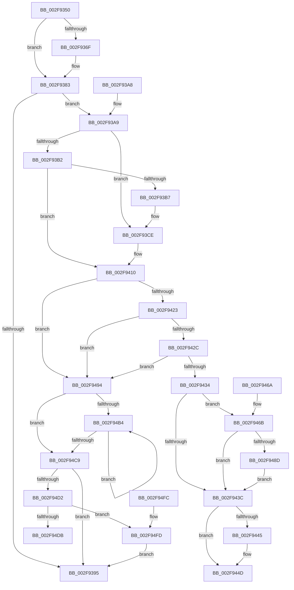

# ObfDereferenceObject

- RVA: `0x002F9350`–`0x002F9513` (길이 `451` bytes)
- VA: `0x00000001402F9350`
- 실행 섹션: `.text`
- PDB 이름 있음: `예`; PDB Function 태그: `아니요`
- unwind 정보 RVA: `0x00072830`
- 디코드: `118`개 명령, `451/451` bytes 표시
- 미해석 바이트: `0` (있으면 어셈블리에 `.byte`로 보존)

> 이 문서는 커널 이미지의 기계어와 PDB 기호를 분석해 생성했습니다. 4번과 5번은 함수 원형과 자료형을 바이너리 사용 방식에서 추정한 C 해석이며 원본 소스 복구 결과는 아닙니다.

## 1. Dependencies

- 직접 호출 지점: **10**; 고유 호출 대상: **9**
- 직접 호출자로 확인된 함수: **658**
- RIP 상대 이미지 참조: **6**

### Outgoing calls
- `0x002F937E` → [ObpPushStackInfo](../21/ObpPushStackInfo_function_002109E4.md) (function, `0x002109E4`)
- `0x002F93C8` → [KeBugCheckEx](../4F/KeBugCheckEx_function_004FD660.md) (function, `0x004FD660`)
- `0x002F940A` → [KeBugCheckEx](../4F/KeBugCheckEx_function_004FD660.md) (function, `0x004FD660`)
- `0x002F9423` → [KeAreInterruptsEnabled](KeAreInterruptsEnabled_function_002F8060.md) (function, `0x002F8060`)
- `0x002F9448` → [ObpDeregisterObject](../../page/9D/ObpDeregisterObject_function_009D7F78.md) (function, `0x009D7F78`)
- `0x002F9452` → [ObpRemoveObjectRoutine](../../page/86/ObpRemoveObjectRoutine_function_00864A60.md) (function, `0x00864A60`)
- `0x002F948D` → [ObpHandleRevocationBlockRemoveObject](../../page/9D/ObpHandleRevocationBlockRemoveObject_function_009D7E30.md) (function, `0x009D7E30`)
- `0x002F94D2` → [KeGetEffectiveIrql](KeGetEffectiveIrql_function_002F8030.md) (function, `0x002F8030`)
- `0x002F94E4` → [ExQueueWorkItem](ExQueueWorkItem_function_002F9520.md) (function, `0x002F9520`)
- `0x002F9509` → [KeInsertQueueDpc](../20/KeInsertQueueDpc_function_00207C50.md) (function, `0x00207C50`)

### Direct callers
- [AlpcpSignalAndWait](AlpcpSignalAndWait_function_002F9620.md) at `0x002F98A7`
- [NtWaitForWorkViaWorkerFactory](../39/NtWaitForWorkViaWorkerFactory_function_00394270.md) at `0x00394F2C`
- [SeDuplicateTokenWithPredictedClaims](../../page/6F/SeDuplicateTokenWithPredictedClaims_function_006FD084.md) at `0x006FD1E7`
- [FsRtlpOplockGetThreadIntegrityLevel](../../page/6F/FsRtlpOplockGetThreadIntegrityLevel_function_006FD814.md) at `0x006FD8C4`
- [NtDeletePrivateNamespace](../../page/70/NtDeletePrivateNamespace_function_00700920.md) at `0x007009A0`
- [IopGetSessionIdFromSymbolicName](../../page/70/IopGetSessionIdFromSymbolicName_function_00702084.md) at `0x007020C7`
- [EtwpCoverageEnsureContext](../../page/70/EtwpCoverageEnsureContext_function_007028E4.md) at `0x00702D84`
- [HalpSetAcpiRealTimeClock](../../page/70/HalpSetAcpiRealTimeClock_function_00705BFC.md) at `0x00705CDB`
- [HalpDmaAllocateChildAdapterV3](../../page/70/HalpDmaAllocateChildAdapterV3_function_007066A0.md) at `0x00706944`
- [HalpDmaAllocateChildAdapterV3](../../page/70/HalpDmaAllocateChildAdapterV3_function_007066A0.md) at `0x00706C1C`
- [HalpDmaAllocateChildAdapterV3](../../page/70/HalpDmaAllocateChildAdapterV3_function_007066A0.md) at `0x00706D8A`
- [HalpDmaAllocateChildAdapterV3](../../page/70/HalpDmaAllocateChildAdapterV3_function_007066A0.md) at `0x00706DEE`
- [HalpDynamicDeviceInterfaceNotification](../../page/70/HalpDynamicDeviceInterfaceNotification_function_00708410.md) at `0x00708473`
- [HalpDynamicDeviceInterfaceNotification](../../page/70/HalpDynamicDeviceInterfaceNotification_function_00708410.md) at `0x007084F9`
- [HalGetAdapterV3](../../page/70/HalGetAdapterV3_function_00709838.md) at `0x00709B83`
- [HalGetAdapterV3](../../page/70/HalGetAdapterV3_function_00709838.md) at `0x00709CB2`
- [HalGetAdapterV3](../../page/70/HalGetAdapterV3_function_00709838.md) at `0x00709CC3`
- [HalGetAdapterV2](../../page/70/HalGetAdapterV2_function_00709DD8.md) at `0x0070A077`
- [HalpDmaAllocateChildAdapterV2](../../page/70/HalpDmaAllocateChildAdapterV2_function_0070A200.md) at `0x0070A3FE`
- [HalpQueryAcpiWakeAlarmSystemPowerState](../../page/70/HalpQueryAcpiWakeAlarmSystemPowerState_function_0070B634.md) at `0x0070B711`
- [HalpAcquirePccInterface](../../page/70/HalpAcquirePccInterface_function_0070D524.md) at `0x0070D5FA`
- [HalpQueryPccInterface](../../page/70/HalpQueryPccInterface_function_0070D79C.md) at `0x0070D8A9`
- [NtSetInformationDebugObject](../../page/71/NtSetInformationDebugObject_function_007107B0.md) at `0x007108D5`
- [DbgkQueueUserExceptionReport](../../page/71/DbgkQueueUserExceptionReport_function_00710B04.md) at `0x00710CC2`
- [DbgkUserReportWorkRoutine](../../page/71/DbgkUserReportWorkRoutine_function_00710D10.md) at `0x00710FDF`
- [DbgkCaptureLiveDump](../../page/71/DbgkCaptureLiveDump_function_0071113C.md) at `0x007113FF`
- [DbgkCaptureLiveDump](../../page/71/DbgkCaptureLiveDump_function_0071113C.md) at `0x007114E6`
- [DbgkpWerCleanupContext](../../page/71/DbgkpWerCleanupContext_function_00712178.md) at `0x00712200`
- [EmClientRuleDeregisterNotification](../../page/71/EmClientRuleDeregisterNotification_function_00712CB0.md) at `0x00712D54`
- [EmProviderDeregister](../../page/71/EmProviderDeregister_function_00713060.md) at `0x007131C6`
- [FsRtlWaitForSmssEvent](../../page/71/FsRtlWaitForSmssEvent_function_007138A0.md) at `0x007138C6`
- [FsRtlpOpBatchBreakClosePending](../../page/71/FsRtlpOpBatchBreakClosePending_function_00714CDC.md) at `0x00714D81`
- [IopInitializeCrashDump](../../page/71/IopInitializeCrashDump_function_0071A270.md) at `0x0071A405`
- [IopSetEaOrQuotaInformationFile](../../page/71/IopSetEaOrQuotaInformationFile_function_0071BD70.md) at `0x0071BF16`
- [IopValidateJunctionTarget](../../page/71/IopValidateJunctionTarget_function_0071C808.md) at `0x0071CDE7`
- [IoAttachDevice](../../page/71/IoAttachDevice_function_0071CE80.md) at `0x0071CF54`
- [IoCreateSynchronizationEvent](../../page/71/IoCreateSynchronizationEvent_function_0071D2C0.md) at `0x0071D34F`
- [IoDeleteDriver](../../page/71/IoDeleteDriver_function_0071D400.md) at `0x0071D41D`
- [IoRegisterDriverReinitialization](../../page/71/IoRegisterDriverReinitialization_function_0071D640.md) at `0x0071D678`
- [IoSetInformation](../../page/71/IoSetInformation_function_0071DBF0.md) at `0x0071DCC3`
- [IoUnregisterFsRegistrationChange](../../page/71/IoUnregisterFsRegistrationChange_function_0071E1D0.md) at `0x0071E257`
- [IoRegisterContainerNotification](../../page/71/IoRegisterContainerNotification_function_0071E700.md) at `0x0071E912`
- [IoUnregisterContainerNotification](../../page/71/IoUnregisterContainerNotification_function_0071E9C0.md) at `0x0071EA48`
- [IopDeleteIoRing](../../page/71/IopDeleteIoRing_function_0071F8A0.md) at `0x0071F900`
- [IopIoRingDispatchCancel](../../page/71/IopIoRingDispatchCancel_function_0071F96C.md) at `0x0071F9FE`
- [IopIoRingDispatchWrite](../../page/72/IopIoRingDispatchWrite_function_00720248.md) at `0x0072032D`
- [NtCreateIoRing](../../page/72/NtCreateIoRing_function_00720530.md) at `0x00720CC0`
- [NtSetInformationIoRing](../../page/72/NtSetInformationIoRing_function_00720D80.md) at `0x00720EB0`
- [IopGetNumaNodeInformation](../../page/72/IopGetNumaNodeInformation_function_00720F68.md) at `0x00720FAF`
- [NtQueryQuotaInformationFile](../../page/72/NtQueryQuotaInformationFile_function_00720FE0.md) at `0x00721437`
- [NtSetVolumeInformationFile](../../page/72/NtSetVolumeInformationFile_function_00721750.md) at `0x007219AA`
- [NtSetVolumeInformationFile](../../page/72/NtSetVolumeInformationFile_function_00721750.md) at `0x007219B9`
- [NtSetVolumeInformationFile](../../page/72/NtSetVolumeInformationFile_function_00721750.md) at `0x007219F2`
- [NtSetVolumeInformationFile](../../page/72/NtSetVolumeInformationFile_function_00721750.md) at `0x00721A67`
- [NtSetVolumeInformationFile](../../page/72/NtSetVolumeInformationFile_function_00721750.md) at `0x00721B5A`
- [NtSetVolumeInformationFile](../../page/72/NtSetVolumeInformationFile_function_00721750.md) at `0x00721C76`
- [IoQueryEnvironmentVariableInfoEx](../../page/72/IoQueryEnvironmentVariableInfoEx_function_00721CA8.md) at `0x00721D37`
- [IoReportDetectedDevice](../../page/72/IoReportDetectedDevice_function_00725CD0.md) at `0x00726063`
- [IoReportDetectedDevice](../../page/72/IoReportDetectedDevice_function_00725CD0.md) at `0x00726647`
- [IopCreatePassiveInterruptRealtimeThreads](../../page/72/IopCreatePassiveInterruptRealtimeThreads_function_0072BA98.md) at `0x0072BB87`
- [PiPagePathSetState](../../page/72/PiPagePathSetState_function_0072BDE0.md) at `0x0072BE48`
- [PiPagePathSetState](../../page/72/PiPagePathSetState_function_0072BDE0.md) at `0x0072BEF9`
- [PnpProcessCompletedEject](../../page/72/PnpProcessCompletedEject_function_0072D090.md) at `0x0072D1E1`
- [PipSetDevNodeStateFlags](../../page/72/PipSetDevNodeStateFlags_function_0072DB98.md) at `0x0072DC0F`
- [PiUEventGetDmObjectFromUserHandle](../../page/72/PiUEventGetDmObjectFromUserHandle_function_0072DF88.md) at `0x0072E074`
- [PiUEventGetDmObjectFromUserHandle](../../page/72/PiUEventGetDmObjectFromUserHandle_function_0072DF88.md) at `0x0072E081`
- [PiDcResetChildDeviceContainerCallback](../../page/73/PiDcResetChildDeviceContainerCallback_function_00730DE0.md) at `0x00730FE9`
- [PnpFreeVetoInformation](../../page/73/PnpFreeVetoInformation_function_00737F5C.md) at `0x00737FB2`
- [PiSwIrpCleanup](../../page/73/PiSwIrpCleanup_function_0073AC10.md) at `0x0073ACCA`
- [PiIrpQueryRemoveDevice](../../page/73/PiIrpQueryRemoveDevice_function_0073E088.md) at `0x0073E19A`
- [PiDrvDbQuerySystemPathWin32](../../page/74/PiDrvDbQuerySystemPathWin32_function_007421F4.md) at `0x0074261B`
- [PipSendQueryRemoveIrpAndCheckOpenHandles](../../page/74/PipSendQueryRemoveIrpAndCheckOpenHandles_function_007443E8.md) at `0x00744557`
- [KeRegisterProcessorChangeCallback](../../page/74/KeRegisterProcessorChangeCallback_function_00746520.md) at `0x007465EB`
- [KiLogUserCetSetContextIpValidationFailureWorker](../../page/74/KiLogUserCetSetContextIpValidationFailureWorker_function_00747760.md) at `0x007477D6`
- [NtQueryInformationPort](../../page/74/NtQueryInformationPort_function_0074BEB0.md) at `0x0074BF5C`
- [NtReplyWaitReplyPort](../../page/74/NtReplyWaitReplyPort_function_0074BFB0.md) at `0x0074C099`
- [NtAlpcImpersonateClientContainerOfPort](../../page/74/NtAlpcImpersonateClientContainerOfPort_function_0074C1B0.md) at `0x0074C3CD`
- [NtAlpcRevokeSecurityContext](../../page/74/NtAlpcRevokeSecurityContext_function_0074C400.md) at `0x0074C4DC`
- [AlpcpPortQueryServerInfo](../../page/74/AlpcpPortQueryServerInfo_function_0074C784.md) at `0x0074C874`
- [AlpcpPortQueryServerInfo](../../page/74/AlpcpPortQueryServerInfo_function_0074C784.md) at `0x0074CA8C`
- [AlpcpPortQueryServerInfo](../../page/74/AlpcpPortQueryServerInfo_function_0074C784.md) at `0x0074CA9E`
- [AlpcpPortQueryServerInfo](../../page/74/AlpcpPortQueryServerInfo_function_0074C784.md) at `0x0074CABF`
- [ObInitServerSilo](../../page/74/ObInitServerSilo_function_0074D8FC.md) at `0x0074DA73`
- [ObShutdownSystem](../../page/74/ObShutdownSystem_function_0074DBB0.md) at `0x0074DC59`
- [ObShutdownSystem](../../page/74/ObShutdownSystem_function_0074DBB0.md) at `0x0074DCAF`
- [ObShutdownSystem](../../page/74/ObShutdownSystem_function_0074DBB0.md) at `0x0074DD05`
- [ObShutdownSystem](../../page/74/ObShutdownSystem_function_0074DBB0.md) at `0x0074DD26`
- [ObShutdownSystem](../../page/74/ObShutdownSystem_function_0074DBB0.md) at `0x0074DD32`
- [ObShutdownSystem](../../page/74/ObShutdownSystem_function_0074DBB0.md) at `0x0074DD3E`
- [ObShutdownSystem](../../page/74/ObShutdownSystem_function_0074DBB0.md) at `0x0074DD4A`
- [ObShutdownSystem](../../page/74/ObShutdownSystem_function_0074DBB0.md) at `0x0074DD56`
- [ObShutdownSystem](../../page/74/ObShutdownSystem_function_0074DBB0.md) at `0x0074DFB2`
- [ObShutdownSystem](../../page/74/ObShutdownSystem_function_0074DBB0.md) at `0x0074DFBA`
- [NtSetInformationSymbolicLink](../../page/74/NtSetInformationSymbolicLink_function_0074E910.md) at `0x0074EA86`
- [ObpCreateSymbolicLinkName](../../page/74/ObpCreateSymbolicLinkName_function_0074EB80.md) at `0x0074ED6B`
- [ObpCreateSymbolicLinkName](../../page/74/ObpCreateSymbolicLinkName_function_0074EB80.md) at `0x0074EF62`
- [ObpCreateSymbolicLinkName](../../page/74/ObpCreateSymbolicLinkName_function_0074EB80.md) at `0x0074EF6A`
- [ObpDeleteDeviceMap](../../page/74/ObpDeleteDeviceMap_function_0074F2F0.md) at `0x0074F326`
- [ObpDeleteDeviceMap](../../page/74/ObpDeleteDeviceMap_function_0074F2F0.md) at `0x0074F34B`
- [PfGenerateTrace](../../page/75/PfGenerateTrace_function_0075101C.md) at `0x007510D6`
- [PfTCleanup](../../page/75/PfTCleanup_function_00751208.md) at `0x007513E3`
- [PfTCleanup](../../page/75/PfTCleanup_function_00751208.md) at `0x00751420`
- [PopRegisterTargetDeviceProtection](../../page/75/PopRegisterTargetDeviceProtection_function_00756A94.md) at `0x00756BB1`
- [PopRegisterTargetDeviceProtection](../../page/75/PopRegisterTargetDeviceProtection_function_00756A94.md) at `0x00756BCB`
- [PopDisableCoolingExtension](../../page/75/PopDisableCoolingExtension_function_00757208.md) at `0x0075727A`
- [PopHandleCancelQueryRemove](../../page/75/PopHandleCancelQueryRemove_function_0075730C.md) at `0x00757454`
- [PopRegisterCoolingExtensionProtection](../../page/75/PopRegisterCoolingExtensionProtection_function_007575D0.md) at `0x007577FE`
- [PopRegisterCoolingExtensionProtection](../../page/75/PopRegisterCoolingExtensionProtection_function_007575D0.md) at `0x00757814`
- [PopRegisterCoolingExtensionProtection](../../page/75/PopRegisterCoolingExtensionProtection_function_007575D0.md) at `0x00757833`
- [PopDirectedDripsIsPnpSoftwareDeviceNode](../../page/75/PopDirectedDripsIsPnpSoftwareDeviceNode_function_007578E4.md) at `0x00757916`
- [PopPolicyDeviceHandleWakeAlarmNotification](../../page/76/PopPolicyDeviceHandleWakeAlarmNotification_function_007660A4.md) at `0x007661FF`
- [PopEtEnergyTrackerCreate](../../page/76/PopEtEnergyTrackerCreate_function_00769EE0.md) at `0x0076A1A9`
- [TtmpDispatchAssignDevice](../../page/77/TtmpDispatchAssignDevice_function_00778670.md) at `0x007786FE`
- [TtmpDispatchCreateEventQueue](../../page/77/TtmpDispatchCreateEventQueue_function_00778718.md) at `0x0077882D`
- [TtmpDispatchCreateEventQueue](../../page/77/TtmpDispatchCreateEventQueue_function_00778718.md) at `0x0077883A`
- [TtmpDispatchCreateTerminal](../../page/77/TtmpDispatchCreateTerminal_function_00778858.md) at `0x00778929`
- [TtmpDispatchEvacuateDevices](../../page/77/TtmpDispatchEvacuateDevices_function_00778948.md) at `0x007789DD`
- [TtmpDispatchGetTerminalEvent](../../page/77/TtmpDispatchGetTerminalEvent_function_007789F4.md) at `0x00778A9F`
- [TtmpDispatchSetDefaultDeviceAssignment](../../page/77/TtmpDispatchSetDefaultDeviceAssignment_function_00778B54.md) at `0x00778BEF`
- [TtmpDispatchSetDisplayPowerRequest](../../page/77/TtmpDispatchSetDisplayPowerRequest_function_00778C10.md) at `0x00778CA2`
- [TtmpDispatchSetDisplayState](../../page/77/TtmpDispatchSetDisplayState_function_00778CBC.md) at `0x00778D56`
- [TtmpDispatchSetDisplayTimeouts](../../page/77/TtmpDispatchSetDisplayTimeouts_function_00778D70.md) at `0x00778E0F`
- [TtmpDispatchSetInputWakeCapability](../../page/77/TtmpDispatchSetInputWakeCapability_function_00778E2C.md) at `0x00778EBE`
- [TtmiCreateTerminal](../../page/77/TtmiCreateTerminal_function_0077C748.md) at `0x0077C9D0`
- [TtmiOpenDefaultTerminal](../../page/77/TtmiOpenDefaultTerminal_function_0077CC20.md) at `0x0077CCB0`
- [TtmiSessionTerminalListWorker](../../page/77/TtmiSessionTerminalListWorker_function_0077CE14.md) at `0x0077CF51`
- [TtmpResetEvaluationTimer](../../page/77/TtmpResetEvaluationTimer_function_0077D4E4.md) at `0x0077D536`
- [TtmpScheduledEvaluationWorker](../../page/77/TtmpScheduledEvaluationWorker_function_0077D560.md) at `0x0077D5B2`
- [PsFreeSiloContextSlot](../../page/77/PsFreeSiloContextSlot_function_0077F360.md) at `0x0077F3A9`
- [PspApiSetCopyToSystemSpace](../../page/77/PspApiSetCopyToSystemSpace_function_0077F648.md) at `0x0077F6F7`
- [PspCompleteServerSiloShutdownDeferred](../../page/77/PspCompleteServerSiloShutdownDeferred_function_0077F860.md) at `0x0077F89D`
- [PspCompleteServerSiloShutdownDeferred](../../page/77/PspCompleteServerSiloShutdownDeferred_function_0077F860.md) at `0x0077F8B6`
- [PspCompleteServerSiloShutdownDeferred](../../page/77/PspCompleteServerSiloShutdownDeferred_function_0077F860.md) at `0x0077F931`
- [PspCompleteServerSiloShutdownDeferred](../../page/77/PspCompleteServerSiloShutdownDeferred_function_0077F860.md) at `0x0077F98F`
- [PspDeleteServerSiloGlobals](../../page/77/PspDeleteServerSiloGlobals_function_0077FC54.md) at `0x0077FD6B`
- [PspDeleteServerSiloGlobals](../../page/77/PspDeleteServerSiloGlobals_function_0077FC54.md) at `0x0077FDD9`
- [PspSiloInitializeUserSharedData](../../page/78/PspSiloInitializeUserSharedData_function_00780684.md) at `0x00780705`
- [NtCreateCpuPartition](../../page/78/NtCreateCpuPartition_function_00782E30.md) at `0x0078308D`
- [PsCheckProcessFileSigningLevel](../../page/78/PsCheckProcessFileSigningLevel_function_00783800.md) at `0x00783A13`
- [PsCheckProcessFileSigningLevel](../../page/78/PsCheckProcessFileSigningLevel_function_00783800.md) at `0x00783A20`
- [PsCreateCpuPartition](../../page/78/PsCreateCpuPartition_function_00783A8C.md) at `0x00783C8D`
- [PspAssignPrimaryToken](../../page/78/PspAssignPrimaryToken_function_00784870.md) at `0x007849E9`
- [PspAssignPrimaryToken](../../page/78/PspAssignPrimaryToken_function_00784870.md) at `0x00784A0D`
- [PsShutdownSystem](../../page/78/PsShutdownSystem_function_00785E94.md) at `0x0078600B`
- [PsShutdownSystem](../../page/78/PsShutdownSystem_function_00785E94.md) at `0x007860EB`
- [PsShutdownSystem](../../page/78/PsShutdownSystem_function_00785E94.md) at `0x0078612F`
- [PspFreezeProcessWorker](../../page/78/PspFreezeProcessWorker_function_007865B0.md) at `0x007865F4`
- [PsCreateMinimalProcess](../../page/78/PsCreateMinimalProcess_function_00786D14.md) at `0x007870DD`
- [PspAllocatePartition](../../page/78/PspAllocatePartition_function_0078802C.md) at `0x0078826C`
- [PspCreatePartitionSystemProcess](../../page/78/PspCreatePartitionSystemProcess_function_007882F8.md) at `0x007883B5`
- [PspTeardownPartition](../../page/78/PspTeardownPartition_function_00788480.md) at `0x007885A5`
- [NtAlertMultipleThreadByThreadId](../../page/78/NtAlertMultipleThreadByThreadId_function_00789650.md) at `0x0078986E`
- [PspQueryWobTicketPriority](../../page/78/PspQueryWobTicketPriority_function_007898C8.md) at `0x0078998B`
- [PspQueryWobTicketQos](../../page/78/PspQueryWobTicketQos_function_007899B0.md) at `0x00789A90`
- [PspStorageRemoveObject](../../page/78/PspStorageRemoveObject_function_00789D68.md) at `0x00789E79`
- [PspStorageReplaceObject](../../page/78/PspStorageReplaceObject_function_00789EA0.md) at `0x00789F95`
- [RawUnload](../../page/78/RawUnload_function_0078A120.md) at `0x0078A12B`
- [RawUnload](../../page/78/RawUnload_function_0078A120.md) at `0x0078A137`
- [RawUnload](../../page/78/RawUnload_function_0078A120.md) at `0x0078A143`
- [SepRmVerifyLsaProtectionLevel](../../page/79/SepRmVerifyLsaProtectionLevel_function_0079C2E8.md) at `0x0079C39A`
- [SeShutdownServerSilo](../../page/79/SeShutdownServerSilo_function_0079C4DC.md) at `0x0079C4F5`
- [SeShutdownServerSilo](../../page/79/SeShutdownServerSilo_function_0079C4DC.md) at `0x0079C508`
- [SepCopyClientTokenAndSetSilo](../../page/79/SepCopyClientTokenAndSetSilo_function_0079CE34.md) at `0x0079CE90`
- [SeAuditProcessExit](../../page/79/SeAuditProcessExit_function_0079EA08.md) at `0x0079EB3E`
- [SeExchangePrimaryToken](../../page/7A/SeExchangePrimaryToken_function_007A07BC.md) at `0x007A086F`
- [SeExchangePrimaryToken](../../page/7A/SeExchangePrimaryToken_function_007A07BC.md) at `0x007A08B6`
- [SeExchangePrimaryToken](../../page/7A/SeExchangePrimaryToken_function_007A07BC.md) at `0x007A09B9`
- [SmPartitionCleanup](../../page/7A/SmPartitionCleanup_function_007A5C14.md) at `0x007A5C95`
- [SmProcessProcessStoreInfoRequest](../../page/7A/SmProcessProcessStoreInfoRequest_function_007A6B48.md) at `0x007A6C65`
- [SmKmStoreFileOpenVolume](../../page/7A/SmKmStoreFileOpenVolume_function_007A9C14.md) at `0x007A9D69`
- [SmcCacheStart](../../page/7A/SmcCacheStart_function_007ABC48.md) at `0x007ABDDF`
- [SmpUtilsGetControlDevice](../../page/7A/SmpUtilsGetControlDevice_function_007ACBE0.md) at `0x007ACCE7`
- [VmMapSectionExecuteNoAcg](../../page/7A/VmMapSectionExecuteNoAcg_function_007ACDC0.md) at `0x007ACE6F`
- [VmCreateMemoryProcess](../../page/7A/VmCreateMemoryProcess_function_007ACFA0.md) at `0x007AD129`
- [VmTerminateMemoryProcess](../../page/7A/VmTerminateMemoryProcess_function_007AD6D0.md) at `0x007AD712`
- [VmpPrefetchWorker](../../page/7A/VmpPrefetchWorker_function_007ADD20.md) at `0x007ADD80`
- [VmpLogCreateMemoryProcess](../../page/7A/VmpLogCreateMemoryProcess_function_007AE668.md) at `0x007AE6FB`
- [WmipTranslateFileHandle](../../page/7B/WmipTranslateFileHandle_function_007B3DA4.md) at `0x007B3EB6`
- [WmipTranslateFileHandle](../../page/7B/WmipTranslateFileHandle_function_007B3DA4.md) at `0x007B3EC5`
- [EtwpTrackProviderBinary](../../page/7B/EtwpTrackProviderBinary_function_007B9198.md) at `0x007B91F6`
- [EtwpQuerySessionDemuxObject](../../page/7B/EtwpQuerySessionDemuxObject_function_007BC8B0.md) at `0x007BC90B`
- [EtwpRegisterPrivateSession](../../page/7B/EtwpRegisterPrivateSession_function_007BC92C.md) at `0x007BCB21`
- [EtwpCoverageSamplerCleanup](../../page/7C/EtwpCoverageSamplerCleanup_function_007C1E80.md) at `0x007C1F20`
- [EtwpCoverageSamplerSetBloomFilter](../../page/7C/EtwpCoverageSamplerSetBloomFilter_function_007C2070.md) at `0x007C2228`
- [EtwpCoverageSamplerStop](../../page/7C/EtwpCoverageSamplerStop_function_007C2564.md) at `0x007C2848`
- [EtwpSetCoverageSamplerInformation](../../page/7C/EtwpSetCoverageSamplerInformation_function_007C288C.md) at `0x007C303F`
- [ExpQueryElamCertInfo](../../page/7C/ExpQueryElamCertInfo_function_007C4564.md) at `0x007C4811`
- [ExpRegisterFirmwareTableInformationHandler](../../page/7C/ExpRegisterFirmwareTableInformationHandler_function_007C504C.md) at `0x007C5107`
- [SLUpdateLicenseDataInternal](../../page/7C/SLUpdateLicenseDataInternal_function_007C9C04.md) at `0x007CA97E`
- [SLUpdateLicenseDataInternal](../../page/7C/SLUpdateLicenseDataInternal_function_007C9C04.md) at `0x007CA98B`
- [ExpAcquirePrmInterface](../../page/7C/ExpAcquirePrmInterface_function_007CECA8.md) at `0x007CED92`
- [ExpQueryPrmInterface](../../page/7C/ExpQueryPrmInterface_function_007CF018.md) at `0x007CF119`
- [ExpAssignPasid](../../page/7D/ExpAssignPasid_function_007D0AB8.md) at `0x007D0AE6`
- [NtStartProfile](../../page/7D/NtStartProfile_function_007D22C0.md) at `0x007D23A6`
- [NtStartProfile](../../page/7D/NtStartProfile_function_007D22C0.md) at `0x007D2463`
- [NtStartProfile](../../page/7D/NtStartProfile_function_007D22C0.md) at `0x007D2543`
- [NtStartProfile](../../page/7D/NtStartProfile_function_007D22C0.md) at `0x007D2564`
- [NtStartProfile](../../page/7D/NtStartProfile_function_007D22C0.md) at `0x007D258E`
- [NtStopProfile](../../page/7D/NtStopProfile_function_007D25C0.md) at `0x007D2692`
- [NtAcquireCrossVmMutant](../../page/7D/NtAcquireCrossVmMutant_function_007D26C0.md) at `0x007D27B5`
- [CMFSystemThreadRoutine](../../page/7D/CMFSystemThreadRoutine_function_007D3A70.md) at `0x007D402A`
- [CMFUnmapModules](../../page/7D/CMFUnmapModules_function_007D4090.md) at `0x007D40D8`
- [CMFUnmapModules](../../page/7D/CMFUnmapModules_function_007D4090.md) at `0x007D4117`
- [CMFUnmapModules](../../page/7D/CMFUnmapModules_function_007D4090.md) at `0x007D413F`
- [CmpMarkCurrentProfileDirty](../../page/7D/CmpMarkCurrentProfileDirty_function_007DBBAC.md) at `0x007DBCFE`
- [CmpSaveBootControlSet](../../page/7D/CmpSaveBootControlSet_function_007DC744.md) at `0x007DCB73`
- [CmpSaveBootControlSet](../../page/7D/CmpSaveBootControlSet_function_007DC744.md) at `0x007DCB80`
- [CmOpenKeyForBugCheckRecovery](../../page/7D/CmOpenKeyForBugCheckRecovery_function_007DF3C0.md) at `0x007DF528`
- [NtCompactKeys](../../page/7D/NtCompactKeys_function_007DF730.md) at `0x007DF97F`
- [NtCompressKey](../../page/7D/NtCompressKey_function_007DF9D0.md) at `0x007DFB89`
- [NtLockRegistryKey](../../page/7D/NtLockRegistryKey_function_007DFD60.md) at `0x007DFDF8`
- [NtQueryOpenSubKeys](../../page/7D/NtQueryOpenSubKeys_function_007DFF80.md) at `0x007E0149`
- [NtQueryOpenSubKeysEx](../../page/7E/NtQueryOpenSubKeysEx_function_007E0190.md) at `0x007E0461`
- [NtRenameKey](../../page/7E/NtRenameKey_function_007E04B0.md) at `0x007E08FD`
- [NtReplaceKey](../../page/7E/NtReplaceKey_function_007E0970.md) at `0x007E0B78`
- [NtRestoreKey](../../page/7E/NtRestoreKey_function_007E0CC0.md) at `0x007E0ED4`
- [NtRollbackRegistryTransaction](../../page/7E/NtRollbackRegistryTransaction_function_007E0F30.md) at `0x007E1009`
- [NtSaveMergedKeys](../../page/7E/NtSaveMergedKeys_function_007E1070.md) at `0x007E1165`
- [NtSaveMergedKeys](../../page/7E/NtSaveMergedKeys_function_007E1070.md) at `0x007E1172`
- [CmUnRegisterCallback](../../page/7E/CmUnRegisterCallback_function_007E1510.md) at `0x007E1875`
- [CmpPostApcRunDown](../../page/7E/CmpPostApcRunDown_function_007E1F90.md) at `0x007E20D6`
- [CmpCreateRegistryProcessToken](../../page/7E/CmpCreateRegistryProcessToken_function_007E7F6C.md) at `0x007E8074`
- [CmpCreateRegistryProcessToken](../../page/7E/CmpCreateRegistryProcessToken_function_007E7F6C.md) at `0x007E8081`
- [CmpInitializeRegistryProcess](../../page/7E/CmpInitializeRegistryProcess_function_007E8180.md) at `0x007E8303`
- [CmpHiveCacheSubscribePnpNotifications](../../page/7E/CmpHiveCacheSubscribePnpNotifications_function_007E8D2C.md) at `0x007E8DDB`
- [CmpDoAccessCheckOnKCB](../../page/7E/CmpDoAccessCheckOnKCB_function_007EB348.md) at `0x007EB489`
- [CmpAddEnlistmentToRollbackPacket](../../page/7E/CmpAddEnlistmentToRollbackPacket_function_007EFDE8.md) at `0x007EFE19`
- [CmpAddUoWToRollbackPacket](../../page/7E/CmpAddUoWToRollbackPacket_function_007EFE8C.md) at `0x007EFF01`
- [CmpHiveCachePnpNotificationCallback](../../page/7F/CmpHiveCachePnpNotificationCallback_function_007F5D80.md) at `0x007F5E26`
- [CmpDoReOpenTransKey](../../page/7F/CmpDoReOpenTransKey_function_007F78E8.md) at `0x007F7ACD`
- [CmpDoReOpenTransKey](../../page/7F/CmpDoReOpenTransKey_function_007F78E8.md) at `0x007F7B24`
- [CmpDoReOpenTransKey](../../page/7F/CmpDoReOpenTransKey_function_007F78E8.md) at `0x007F7C22`
- [MiInitializeVsmEnclave](../../page/80/MiInitializeVsmEnclave_function_00808AE0.md) at `0x00808B98`
- [VhdiMountVhdFile](../../page/83/VhdiMountVhdFile_function_0083BED0.md) at `0x0083C4BE`
- [VhdiMountVhdFile](../../page/83/VhdiMountVhdFile_function_0083BED0.md) at `0x0083C4CC`
- [ObCreateSiloRootDirectory](../../page/83/ObCreateSiloRootDirectory_function_0083CA34.md) at `0x0083CD13`
- [NtSetInformationKey](../../page/84/NtSetInformationKey_function_00843720.md) at `0x00843B7C`
- [NtSetInformationKey](../../page/84/NtSetInformationKey_function_00843720.md) at `0x00843C56`
- [NtSetInformationKey](../../page/84/NtSetInformationKey_function_00843720.md) at `0x00843EA5`
- [CmKeyBodyReplicateToVirtual](../../page/84/CmKeyBodyReplicateToVirtual_function_00843FE4.md) at `0x00844302`
- [NtSetValueKey](../../page/84/NtSetValueKey_function_00844EA0.md) at `0x008455D1`
- [CmpSignalDeferredPosts](../../page/84/CmpSignalDeferredPosts_function_008484B0.md) at `0x00848501`
- [NtDeleteValueKey](../../page/84/NtDeleteValueKey_function_00848770.md) at `0x00848BD8`
- [NtDeleteKey](../../page/84/NtDeleteKey_function_00849920.md) at `0x00849C21`
- [CmQueryKey](../../page/85/CmQueryKey_function_00858240.md) at `0x00858D16`
- [CmpDoParseKey](../../page/85/CmpDoParseKey_function_0085F750.md) at `0x0085FE89`
- [CmpDoParseKey](../../page/85/CmpDoParseKey_function_0085F750.md) at `0x00860B72`
- [sub_0086409A](../../page/86/Unknown_function_0086409A.md) at `0x0086409D`
- [sub_0086560A](../../page/86/Unknown_function_0086560A.md) at `0x0086577E`
- [sub_00865B4C](../../page/86/Unknown_function_00865B4C.md) at `0x00865B9C`
- [NtQueryKey](../../page/86/NtQueryKey_function_008676E0.md) at `0x00867A7B`
- [NtQueryKey](../../page/86/NtQueryKey_function_008676E0.md) at `0x00867B67`
- [NtQueryKey](../../page/86/NtQueryKey_function_008676E0.md) at `0x00867FCA`
- [sub_00868100](../../page/86/Unknown_function_00868100.md) at `0x008681C8`
- [sub_00868100](../../page/86/Unknown_function_00868100.md) at `0x00868243`
- [sub_00868310](../../page/86/Unknown_function_00868310.md) at `0x00868451`
- [sub_00868496](../../page/86/Unknown_function_00868496.md) at `0x0086854C`
- [ObpCreateHandle](../../page/86/ObpCreateHandle_function_0086B950.md) at `0x0086BF97`
- [ObpCreateHandle](../../page/86/ObpCreateHandle_function_0086B950.md) at `0x0086D2C3`
- [CmpSecurityMethod](../../page/87/CmpSecurityMethod_function_00870CC0.md) at `0x00871349`
- [CmpTransReferenceTransaction](../../page/87/CmpTransReferenceTransaction_function_00873434.md) at `0x00873482`
- [CmpTransDereferenceTransaction](../../page/87/CmpTransDereferenceTransaction_function_00873608.md) at `0x00873610`
- [NtQuerySecurityObject](../../page/87/NtQuerySecurityObject_function_008737B0.md) at `0x0087395C`
- [NtQuerySecurityObject](../../page/87/NtQuerySecurityObject_function_008737B0.md) at `0x00873968`
- [IopGetSetSecurityObject](../../page/87/IopGetSetSecurityObject_function_00873A80.md) at `0x00873CAB`
- [IopGetSetSecurityObject](../../page/87/IopGetSetSecurityObject_function_00873A80.md) at `0x00873EC7`
- [IopGetSetSecurityObject](../../page/87/IopGetSetSecurityObject_function_00873A80.md) at `0x00874026`
- [CmCreateKey](../../page/87/CmCreateKey_function_00875020.md) at `0x00875554`
- [CmLoadDifferencingKey](../../page/87/CmLoadDifferencingKey_function_00875670.md) at `0x00875D1F`
- [CmLoadDifferencingKey](../../page/87/CmLoadDifferencingKey_function_00875670.md) at `0x00875D31`
- [CmLoadDifferencingKey](../../page/87/CmLoadDifferencingKey_function_00875670.md) at `0x00875E2A`
- [CmLoadDifferencingKey](../../page/87/CmLoadDifferencingKey_function_00875670.md) at `0x00875ECB`
- [CmLoadDifferencingKey](../../page/87/CmLoadDifferencingKey_function_00875670.md) at `0x00875EDD`
- [CmLoadDifferencingKey](../../page/87/CmLoadDifferencingKey_function_00875670.md) at `0x008762F0`
- [CmLoadDifferencingKey](../../page/87/CmLoadDifferencingKey_function_00875670.md) at `0x008762FA`
- [CmOpenKey](../../page/87/CmOpenKey_function_00876350.md) at `0x008766EC`
- [CmConvertHandleToKernelHandle](../../page/87/CmConvertHandleToKernelHandle_function_00876DDC.md) at `0x00876E73`
- [CmLoadAppKey](../../page/87/CmLoadAppKey_function_00876FFC.md) at `0x00877373`
- [CmpIsThisSameFile](../../page/87/CmpIsThisSameFile_function_00877CE8.md) at `0x00877D4E`
- [CmpLinkHiveToMaster](../../page/87/CmpLinkHiveToMaster_function_00877D6C.md) at `0x00878059`
- [CmpLinkHiveToMaster](../../page/87/CmpLinkHiveToMaster_function_00877D6C.md) at `0x008781E3`
- [CmLoadKey](../../page/87/CmLoadKey_function_008787CC.md) at `0x00878F65`
- [CmpGetVolumeClusterSize](../../page/87/CmpGetVolumeClusterSize_function_0087B3D4.md) at `0x0087B58C`
- [CmpGetVolumeClusterSize](../../page/87/CmpGetVolumeClusterSize_function_0087B3D4.md) at `0x0087B594`
- [CmpGetVolumeClusterSize](../../page/87/CmpGetVolumeClusterSize_function_0087B3D4.md) at `0x0087B5A1`
- [CmpInitCmRM](../../page/87/CmpInitCmRM_function_0087C700.md) at `0x0087D235`
- [AlpcReserveDestroyProcedure](../../page/88/AlpcReserveDestroyProcedure_function_00888230.md) at `0x00888288`
- [NtAlpcDeletePortSection](../../page/88/NtAlpcDeletePortSection_function_00888420.md) at `0x008884D2`
- [NtAlpcCreateSectionView](../../page/88/NtAlpcCreateSectionView_function_00888640.md) at `0x00888809`
- [NtAlpcDeleteResourceReserve](../../page/88/NtAlpcDeleteResourceReserve_function_00888870.md) at `0x0088892E`
- [NtAlpcDeleteSecurityContext](../../page/88/NtAlpcDeleteSecurityContext_function_00889E00.md) at `0x00889EB8`
- [AlpcSectionDeleteProcedure](../../page/88/AlpcSectionDeleteProcedure_function_0088A200.md) at `0x0088A253`
- [AlpcViewDestroyProcedure](../../page/88/AlpcViewDestroyProcedure_function_0088B080.md) at `0x0088B1BC`
- [AlpcSecurityDestroyProcedure](../../page/88/AlpcSecurityDestroyProcedure_function_0088B330.md) at `0x0088B456`
- [AlpcMessageCleanupProcedure](../../page/88/AlpcMessageCleanupProcedure_function_0088BBA0.md) at `0x0088BBD5`
- [sub_0088DAFD](../../page/88/Unknown_function_0088DAFD.md) at `0x0088DB3A`
- [AlpcpDispatchNewMessage](../../page/88/AlpcpDispatchNewMessage_function_0088DD20.md) at `0x0088E00B`
- [AlpcpDispatchNewMessage](../../page/88/AlpcpDispatchNewMessage_function_0088DD20.md) at `0x0088E07A`
- [AlpcpDispatchNewMessage](../../page/88/AlpcpDispatchNewMessage_function_0088DD20.md) at `0x0088E12A`
- [sub_0088E1DC](../../page/88/Unknown_function_0088E1DC.md) at `0x0088E54C`
- [sub_0088EC77](../../page/88/Unknown_function_0088EC77.md) at `0x0088EF46`
- [sub_0088EC77](../../page/88/Unknown_function_0088EC77.md) at `0x0088EFFC`
- [sub_0088EC77](../../page/88/Unknown_function_0088EC77.md) at `0x0088F083`
- [AlpcpDispatchReplyToPort](../../page/88/AlpcpDispatchReplyToPort_function_0088F880.md) at `0x0088FAD3`
- [AlpcpDispatchReplyToPort](../../page/88/AlpcpDispatchReplyToPort_function_0088F880.md) at `0x0088FC96`
- [AlpcpDispatchReplyToPort](../../page/88/AlpcpDispatchReplyToPort_function_0088F880.md) at `0x0088FC9E`
- [AlpcpClearOwnerPortMessage](../../page/88/AlpcpClearOwnerPortMessage_function_0088FD30.md) at `0x0088FD4B`
- [AlpcpUnlockAndDereferenceTargetPortsAndCommunicationInfo](../../page/88/AlpcpUnlockAndDereferenceTargetPortsAndCommunicationInfo_function_0088FE2C.md) at `0x0088FEAA`
- [AlpcpUnlockAndDereferenceTargetPortsAndCommunicationInfo](../../page/88/AlpcpUnlockAndDereferenceTargetPortsAndCommunicationInfo_function_0088FE2C.md) at `0x0088FEB2`
- [sub_00890033](../../page/89/Unknown_function_00890033.md) at `0x00890097`
- [sub_00890033](../../page/89/Unknown_function_00890033.md) at `0x008900DB`
- [NtAlpcCreateSecurityContext](../../page/89/NtAlpcCreateSecurityContext_function_00890B50.md) at `0x00890CD6`
- [sub_00891E2F](../../page/89/Unknown_function_00891E2F.md) at `0x00891F09`
- [sub_00892023](../../page/89/Unknown_function_00892023.md) at `0x00892082`
- [NtAlpcCreateResourceReserve](../../page/89/NtAlpcCreateResourceReserve_function_00892BE0.md) at `0x00892C91`
- [NtAlpcCreatePortSection](../../page/89/NtAlpcCreatePortSection_function_00893E60.md) at `0x00893FB6`
- [AlpcpCancelMessage](../../page/89/AlpcpCancelMessage_function_00894120.md) at `0x0089441A`
- [AlpcpCancelMessage](../../page/89/AlpcpCancelMessage_function_00894120.md) at `0x00894427`
- [NtAlpcQueryInformationMessage](../../page/89/NtAlpcQueryInformationMessage_function_00894700.md) at `0x00894936`
- [PsOpenProcess](../../page/89/PsOpenProcess_function_00894A30.md) at `0x00894C19`
- [PsOpenProcess](../../page/89/PsOpenProcess_function_00894A30.md) at `0x00894C44`
- [PsOpenProcess](../../page/89/PsOpenProcess_function_00894A30.md) at `0x00895077`
- [NtAlpcOpenSenderProcess](../../page/89/NtAlpcOpenSenderProcess_function_008953B0.md) at `0x00895567`
- [NtAlpcOpenSenderProcess](../../page/89/NtAlpcOpenSenderProcess_function_008953B0.md) at `0x00895633`
- [NtAlpcOpenSenderProcess](../../page/89/NtAlpcOpenSenderProcess_function_008953B0.md) at `0x00895673`
- [NtAlpcOpenSenderProcess](../../page/89/NtAlpcOpenSenderProcess_function_008953B0.md) at `0x0089577B`
- [NtAlpcOpenSenderProcess](../../page/89/NtAlpcOpenSenderProcess_function_008953B0.md) at `0x008957AB`
- [NtAlpcOpenSenderProcess](../../page/89/NtAlpcOpenSenderProcess_function_008953B0.md) at `0x008957E3`
- [NtAlpcOpenSenderProcess](../../page/89/NtAlpcOpenSenderProcess_function_008953B0.md) at `0x00895814`
- [NtReplyWaitReceivePortEx](../../page/89/NtReplyWaitReceivePortEx_function_00895850.md) at `0x00895952`
- [NtReplyWaitReceivePortEx](../../page/89/NtReplyWaitReceivePortEx_function_00895850.md) at `0x008959A9`
- [NtReplyWaitReceivePortEx](../../page/89/NtReplyWaitReceivePortEx_function_00895850.md) at `0x008959F3`
- [AlpcpReceiveLegacyMessage](../../page/89/AlpcpReceiveLegacyMessage_function_00895DE0.md) at `0x00896071`
- [NtAlpcImpersonateClientOfPort](../../page/89/NtAlpcImpersonateClientOfPort_function_008961A0.md) at `0x0089650E`
- [NtAlpcImpersonateClientOfPort](../../page/89/NtAlpcImpersonateClientOfPort_function_008961A0.md) at `0x0089651B`
- [sub_00896999](../../page/89/Unknown_function_00896999.md) at `0x00896AEE`
- [sub_0089A903](../../page/89/Unknown_function_0089A903.md) at `0x0089ACFF`
- [ObpLookupObjectName](../../page/89/ObpLookupObjectName_function_0089BE90.md) at `0x0089C76A`
- [ObpLookupObjectName](../../page/89/ObpLookupObjectName_function_0089BE90.md) at `0x0089D137`
- [ObpLookupObjectName](../../page/89/ObpLookupObjectName_function_0089BE90.md) at `0x0089D61C`
- [ObpLookupObjectName](../../page/89/ObpLookupObjectName_function_0089BE90.md) at `0x0089DC8F`
- [IopParseDevice](../../page/89/IopParseDevice_function_0089E510.md) at `0x0089EF63`
- [IopParseDevice](../../page/89/IopParseDevice_function_0089E510.md) at `0x0089EF85`
- [IopParseDevice](../../page/89/IopParseDevice_function_0089E510.md) at `0x0089EFF2`
- [IopParseDevice](../../page/89/IopParseDevice_function_0089E510.md) at `0x0089F161`
- [IopParseDevice](../../page/89/IopParseDevice_function_0089E510.md) at `0x0089FC17`
- [IopParseDevice](../../page/89/IopParseDevice_function_0089E510.md) at `0x008A01E9`
- [IopParseDevice](../../page/89/IopParseDevice_function_0089E510.md) at `0x008A024F`
- [IopParseDevice](../../page/89/IopParseDevice_function_0089E510.md) at `0x008A05FE`
- [PspOneDirectionSecurityDomainCombine](../../page/8A/PspOneDirectionSecurityDomainCombine_function_008A23BC.md) at `0x008A2543`
- [ExpSnapShotHandleTables](../../page/8A/ExpSnapShotHandleTables_function_008A25C0.md) at `0x008A26D0`
- [sub_008A2C2F](../../page/8A/Unknown_function_008A2C2F.md) at `0x008A2CE3`
- [DbgkForwardException](../../page/8A/DbgkForwardException_function_008A2D60.md) at `0x008A30DC`
- [EtwpPsProvTraceProcess](../../page/8A/EtwpPsProvTraceProcess_function_008A3954.md) at `0x008A3ABB`
- [IoVolumeDeviceToDosName](../../page/8A/IoVolumeDeviceToDosName_function_008A63F0.md) at `0x008A6686`
- [IopQueryNameInternal](../../page/8A/IopQueryNameInternal_function_008A6770.md) at `0x008A6D44`
- [NtQueryObject](../../page/8A/NtQueryObject_function_008A6DB0.md) at `0x008A7015`
- [NtQueryObject](../../page/8A/NtQueryObject_function_008A6DB0.md) at `0x008A73A7`
- [NtQueryObject](../../page/8A/NtQueryObject_function_008A6DB0.md) at `0x008A73D4`
- [NtQueryObject](../../page/8A/NtQueryObject_function_008A6DB0.md) at `0x008A7544`
- [NtQueryObject](../../page/8A/NtQueryObject_function_008A6DB0.md) at `0x008A7556`
- [EtwpEnumerateAddressSpace](../../page/8A/EtwpEnumerateAddressSpace_function_008A7590.md) at `0x008A7BA7`
- [ObQueryNameStringMode](../../page/8A/ObQueryNameStringMode_function_008A7ED0.md) at `0x008A829A`
- [ObQueryNameStringMode](../../page/8A/ObQueryNameStringMode_function_008A7ED0.md) at `0x008A83C6`
- [ObQueryNameStringMode](../../page/8A/ObQueryNameStringMode_function_008A7ED0.md) at `0x008A862C`
- [ObQueryNameStringMode](../../page/8A/ObQueryNameStringMode_function_008A7ED0.md) at `0x008A8853`
- [sub_008A8C05](../../page/8A/Unknown_function_008A8C05.md) at `0x008A8C34`
- [sub_008A8C40](../../page/8A/Unknown_function_008A8C40.md) at `0x008A8C4A`
- [sub_008A9284](../../page/8A/Unknown_function_008A9284.md) at `0x008A92B4`
- [sub_008A9284](../../page/8A/Unknown_function_008A9284.md) at `0x008A92CF`
- [PfSnGetSectionObject](../../page/8A/PfSnGetSectionObject_function_008A9448.md) at `0x008A9A2A`
- [MiCreateSectionCommon](../../page/8A/MiCreateSectionCommon_function_008A9AA4.md) at `0x008A9E21`
- [PfSnCleanupPrefetchSectionInfo](../../page/8A/PfSnCleanupPrefetchSectionInfo_function_008AA0B8.md) at `0x008AA0D8`
- [PfSnCleanupPrefetchSectionInfo](../../page/8A/PfSnCleanupPrefetchSectionInfo_function_008AA0B8.md) at `0x008AA0F1`
- [PfSnCleanupPrefetchSectionInfo](../../page/8A/PfSnCleanupPrefetchSectionInfo_function_008AA0B8.md) at `0x008AA147`
- [PfSnCleanupPrefetchSectionInfo](../../page/8A/PfSnCleanupPrefetchSectionInfo_function_008AA0B8.md) at `0x008AA155`
- [NtResetEvent](../../page/8A/NtResetEvent_function_008AA2D0.md) at `0x008AA363`
- [IopOpenLinkOrRenameTarget](../../page/8A/IopOpenLinkOrRenameTarget_function_008AAC04.md) at `0x008AAE53`
- [IopCreateFile](../../page/8A/IopCreateFile_function_008AB298.md) at `0x008AB819`
- [NtQueryEaFile](../../page/8A/NtQueryEaFile_function_008AC1B0.md) at `0x008AC72D`
- [NtQueryEaFile](../../page/8A/NtQueryEaFile_function_008AC1B0.md) at `0x008AC7BF`
- [NtQueryVolumeInformationFile](../../page/8A/NtQueryVolumeInformationFile_function_008AC8C0.md) at `0x008ACCDA`
- [NtQueryVolumeInformationFile](../../page/8A/NtQueryVolumeInformationFile_function_008AC8C0.md) at `0x008ACD19`
- [NtQueryVolumeInformationFile](../../page/8A/NtQueryVolumeInformationFile_function_008AC8C0.md) at `0x008ACD89`
- [NtQueryVolumeInformationFile](../../page/8A/NtQueryVolumeInformationFile_function_008AC8C0.md) at `0x008ACDA3`
- [NtQueryVolumeInformationFile](../../page/8A/NtQueryVolumeInformationFile_function_008AC8C0.md) at `0x008ACDDC`
- [IopFlushBuffersFile](../../page/8A/IopFlushBuffersFile_function_008ACFA4.md) at `0x008AD32E`
- [sub_008AD5F5](../../page/8A/Unknown_function_008AD5F5.md) at `0x008AD613`
- [NtQueryInformationFile](../../page/8A/NtQueryInformationFile_function_008AD630.md) at `0x008ADD74`
- [NtQueryInformationFile](../../page/8A/NtQueryInformationFile_function_008AD630.md) at `0x008ADFB0`
- [NtQueryInformationFile](../../page/8A/NtQueryInformationFile_function_008AD630.md) at `0x008AE142`
- [NtQueryInformationFile](../../page/8A/NtQueryInformationFile_function_008AD630.md) at `0x008AE212`
- [NtQueryInformationFile](../../page/8A/NtQueryInformationFile_function_008AD630.md) at `0x008AE271`
- [NtQueryInformationFile](../../page/8A/NtQueryInformationFile_function_008AD630.md) at `0x008AE2FB`
- [IopExceptionCleanupEx](../../page/8A/IopExceptionCleanupEx_function_008AE5C8.md) at `0x008AE64A`
- [IopExceptionCleanupEx](../../page/8A/IopExceptionCleanupEx_function_008AE5C8.md) at `0x008AE661`
- [IopReadFile](../../page/8A/IopReadFile_function_008AEFF0.md) at `0x008AF3D2`
- [IopReadFile](../../page/8A/IopReadFile_function_008AEFF0.md) at `0x008AF43F`
- [IopReadFile](../../page/8A/IopReadFile_function_008AEFF0.md) at `0x008AF5A5`
- [IopReadFile](../../page/8A/IopReadFile_function_008AEFF0.md) at `0x008AF5D8`
- [IopReadFile](../../page/8A/IopReadFile_function_008AEFF0.md) at `0x008AF612`
- [IopReadFile](../../page/8A/IopReadFile_function_008AEFF0.md) at `0x008AF65F`
- [IopReadFile](../../page/8A/IopReadFile_function_008AEFF0.md) at `0x008AF8FB`
- [NtQueryMultipleValueKey](../../page/8B/NtQueryMultipleValueKey_function_008B13B0.md) at `0x008B18C0`
- [NtQueryMultipleValueKey](../../page/8B/NtQueryMultipleValueKey_function_008B13B0.md) at `0x008B1A02`
- [NtEnumerateKey](../../page/8B/NtEnumerateKey_function_008B1F70.md) at `0x008B233C`
- [NtEnumerateKey](../../page/8B/NtEnumerateKey_function_008B1F70.md) at `0x008B250A`
- [NtQueryValueKey](../../page/8B/NtQueryValueKey_function_008B2A00.md) at `0x008B2F35`
- [NtQueryValueKey](../../page/8B/NtQueryValueKey_function_008B2A00.md) at `0x008B31EA`
- [ObpParseSymbolicLinkEx](../../page/8B/ObpParseSymbolicLinkEx_function_008B35C0.md) at `0x008B3A92`
- [NtEnumerateValueKey](../../page/8B/NtEnumerateValueKey_function_008B3B50.md) at `0x008B4109`
- [NtEnumerateValueKey](../../page/8B/NtEnumerateValueKey_function_008B3B50.md) at `0x008B41EB`
- [NtEnumerateValueKey](../../page/8B/NtEnumerateValueKey_function_008B3B50.md) at `0x008B458D`
- [sub_008B4D32](../../page/8B/Unknown_function_008B4D32.md) at `0x008B4E1B`
- [sub_008B4D32](../../page/8B/Unknown_function_008B4D32.md) at `0x008B4E2D`
- [NtDuplicateToken](../../page/8B/NtDuplicateToken_function_008B6DF0.md) at `0x008B7020`
- [NtDuplicateToken](../../page/8B/NtDuplicateToken_function_008B6DF0.md) at `0x008B7028`
- [NtDuplicateToken](../../page/8B/NtDuplicateToken_function_008B6DF0.md) at `0x008B7156`
- [NtOpenProcessTokenEx](../../page/8B/NtOpenProcessTokenEx_function_008B72D0.md) at `0x008B73DB`
- [NtOpenThreadTokenEx](../../page/8B/NtOpenThreadTokenEx_function_008B7840.md) at `0x008B797F`
- [NtOpenThreadTokenEx](../../page/8B/NtOpenThreadTokenEx_function_008B7840.md) at `0x008B7E3A`
- [NtOpenThreadTokenEx](../../page/8B/NtOpenThreadTokenEx_function_008B7840.md) at `0x008B7E47`
- [NtOpenThreadTokenEx](../../page/8B/NtOpenThreadTokenEx_function_008B7840.md) at `0x008B7E63`
- [NtOpenThreadTokenEx](../../page/8B/NtOpenThreadTokenEx_function_008B7840.md) at `0x008B7E6D`
- [NtOpenThreadTokenEx](../../page/8B/NtOpenThreadTokenEx_function_008B7840.md) at `0x008B805D`
- [NtOpenThreadTokenEx](../../page/8B/NtOpenThreadTokenEx_function_008B7840.md) at `0x008B80BC`
- [NtOpenThreadTokenEx](../../page/8B/NtOpenThreadTokenEx_function_008B7840.md) at `0x008B80FA`
- [NtOpenThreadTokenEx](../../page/8B/NtOpenThreadTokenEx_function_008B7840.md) at `0x008B8113`
- [SepDuplicateToken](../../page/8B/SepDuplicateToken_function_008B87EC.md) at `0x008B8C1D`
- [ObInsertObjectEx](../../page/8B/ObInsertObjectEx_function_008B97A0.md) at `0x008B9935`
- [ObInsertObjectEx](../../page/8B/ObInsertObjectEx_function_008B97A0.md) at `0x008B9BF3`
- [ObInsertObjectEx](../../page/8B/ObInsertObjectEx_function_008B97A0.md) at `0x008B9D42`
- [ObInsertObjectEx](../../page/8B/ObInsertObjectEx_function_008B97A0.md) at `0x008B9D60`
- [ObInsertObjectEx](../../page/8B/ObInsertObjectEx_function_008B97A0.md) at `0x008B9E33`
- [ObInsertObjectEx](../../page/8B/ObInsertObjectEx_function_008B97A0.md) at `0x008BA064`
- [sub_008C2328](../../page/8C/Unknown_function_008C2328.md) at `0x008C2861`
- [sub_008C28B0](../../page/8C/Unknown_function_008C28B0.md) at `0x008C2A13`
- [sub_008C405D](../../page/8C/Unknown_function_008C405D.md) at `0x008C421E`
- [sub_008C405D](../../page/8C/Unknown_function_008C405D.md) at `0x008C4232`
- [NtSetInformationThread](../../page/8C/NtSetInformationThread_function_008C9F60.md) at `0x008CA3AA`
- [NtSetInformationThread](../../page/8C/NtSetInformationThread_function_008C9F60.md) at `0x008CA4E4`
- [NtSetInformationThread](../../page/8C/NtSetInformationThread_function_008C9F60.md) at `0x008CACB6`
- [sub_008CB9B9](../../page/8C/Unknown_function_008CB9B9.md) at `0x008CBB0C`
- [sub_008CBB46](../../page/8C/Unknown_function_008CBB46.md) at `0x008CBB4E`
- [sub_008CBB8C](../../page/8C/Unknown_function_008CBB8C.md) at `0x008CBC40`
- [PsAssignImpersonationToken](../../page/8C/PsAssignImpersonationToken_function_008CBCB0.md) at `0x008CBD5D`
- [PsAssignImpersonationToken](../../page/8C/PsAssignImpersonationToken_function_008CBCB0.md) at `0x008CBD67`
- [PsImpersonateClient](../../page/8C/PsImpersonateClient_function_008CBE10.md) at `0x008CC42F`
- [PsImpersonateClient](../../page/8C/PsImpersonateClient_function_008CBE10.md) at `0x008CC4A1`
- [NtImpersonateThread](../../page/8C/NtImpersonateThread_function_008CD230.md) at `0x008CD3B6`
- [NtImpersonateThread](../../page/8C/NtImpersonateThread_function_008CD230.md) at `0x008CD3BE`
- [NtImpersonateThread](../../page/8C/NtImpersonateThread_function_008CD230.md) at `0x008CD3E6`
- [NtImpersonateThread](../../page/8C/NtImpersonateThread_function_008CD230.md) at `0x008CD3EE`
- [PspDisablePrimaryTokenExchange](../../page/8D/PspDisablePrimaryTokenExchange_function_008D5C10.md) at `0x008D5C74`
- [DbgkCreateThread](../../page/8D/DbgkCreateThread_function_008D5E34.md) at `0x008D5FD1`
- [DbgkCreateThread](../../page/8D/DbgkCreateThread_function_008D5E34.md) at `0x008D60DB`
- [EtwpCovSampProcessCleanup](../../page/8D/EtwpCovSampProcessCleanup_function_008D94A0.md) at `0x008D94DD`
- [PiSwCompleteCreate](../../page/8D/PiSwCompleteCreate_function_008DAB90.md) at `0x008DB035`
- [PiSwIrpStartCreateWorker](../../page/8D/PiSwIrpStartCreateWorker_function_008DB398.md) at `0x008DB463`
- [PiSwIrpStartCreateWorker](../../page/8D/PiSwIrpStartCreateWorker_function_008DB398.md) at `0x008DB8DC`
- [NtAlpcQueryInformation](../../page/8E/NtAlpcQueryInformation_function_008E7200.md) at `0x008E7352`
- [NtRemoveIoCompletionEx](../../page/8E/NtRemoveIoCompletionEx_function_008E8760.md) at `0x008E888D`
- [NtQueryEvent](../../page/8E/NtQueryEvent_function_008E8F90.md) at `0x008E90DD`
- [NtWriteFile](../../page/8E/NtWriteFile_function_008E92D0.md) at `0x008E9675`
- [IopWriteFile](../../page/8E/IopWriteFile_function_008E9790.md) at `0x008E99E2`
- [IopWriteFile](../../page/8E/IopWriteFile_function_008E9790.md) at `0x008E9A0B`
- [IopXxxControlFile](../../page/8E/IopXxxControlFile_function_008E9AD0.md) at `0x008EA0D6`
- [IopXxxControlFile](../../page/8E/IopXxxControlFile_function_008E9AD0.md) at `0x008EA0DE`
- [IopXxxControlFile](../../page/8E/IopXxxControlFile_function_008E9AD0.md) at `0x008EA53E`
- [IopXxxControlFile](../../page/8E/IopXxxControlFile_function_008E9AD0.md) at `0x008EA55F`
- [IopXxxControlFile](../../page/8E/IopXxxControlFile_function_008E9AD0.md) at `0x008EA683`
- [IopXxxControlFile](../../page/8E/IopXxxControlFile_function_008E9AD0.md) at `0x008EA6C2`
- [IopXxxControlFile](../../page/8E/IopXxxControlFile_function_008E9AD0.md) at `0x008EA6E7`
- [IopXxxControlFile](../../page/8E/IopXxxControlFile_function_008E9AD0.md) at `0x008EA7B2`
- [IopXxxControlFile](../../page/8E/IopXxxControlFile_function_008E9AD0.md) at `0x008EA7ED`
- [IopXxxControlFile](../../page/8E/IopXxxControlFile_function_008E9AD0.md) at `0x008EA874`
- [IopXxxControlFile](../../page/8E/IopXxxControlFile_function_008E9AD0.md) at `0x008EA8E7`
- [IopXxxControlFile](../../page/8E/IopXxxControlFile_function_008E9AD0.md) at `0x008EB1E4`
- [IopXxxControlFile](../../page/8E/IopXxxControlFile_function_008E9AD0.md) at `0x008EB200`
- [IopXxxControlFile](../../page/8E/IopXxxControlFile_function_008E9AD0.md) at `0x008EB228`
- [IopXxxControlFile](../../page/8E/IopXxxControlFile_function_008E9AD0.md) at `0x008EB2DB`
- [IopXxxControlFile](../../page/8E/IopXxxControlFile_function_008E9AD0.md) at `0x008EB3AF`
- [BuildQueryDirectoryIrp](../../page/8E/BuildQueryDirectoryIrp_function_008EC770.md) at `0x008ECD3F`
- [BuildQueryDirectoryIrp](../../page/8E/BuildQueryDirectoryIrp_function_008EC770.md) at `0x008ECDEA`
- [BuildQueryDirectoryIrp](../../page/8E/BuildQueryDirectoryIrp_function_008EC770.md) at `0x008ECE6C`
- [SepValidateReferencedCachedHandles](../../page/8F/SepValidateReferencedCachedHandles_function_008F4BB0.md) at `0x008F4C4F`
- [SepValidateReferencedCachedHandles](../../page/8F/SepValidateReferencedCachedHandles_function_008F4BB0.md) at `0x008F4D6E`
- [NtCompareTokens](../../page/8F/NtCompareTokens_function_008F8F20.md) at `0x008F900F`
- [NtCompareTokens](../../page/8F/NtCompareTokens_function_008F8F20.md) at `0x008F901C`
- [PipProcessDevNodeTree](../../page/8F/PipProcessDevNodeTree_function_008F9068.md) at `0x008F9305`
- [PipProcessDevNodeTree](../../page/8F/PipProcessDevNodeTree_function_008F9068.md) at `0x008F945E`
- [PipProcessDevNodeTree](../../page/8F/PipProcessDevNodeTree_function_008F9068.md) at `0x008F96F4`
- [PipProcessEnumeratedChildDevice](../../page/8F/PipProcessEnumeratedChildDevice_function_008FBF4C.md) at `0x008FBFA1`
- [IopRemoveDevice](../../page/8F/IopRemoveDevice_function_008FC7FC.md) at `0x008FCA4A`
- [PspExitProcess](../../page/90/PspExitProcess_function_00904830.md) at `0x0090488D`
- [PspCallProcessNotifyRoutines](../../page/90/PspCallProcessNotifyRoutines_function_00904928.md) at `0x00904C52`
- [PspExitThread](../../page/90/PspExitThread_function_00905F60.md) at `0x009061F1`
- [PspExitThread](../../page/90/PspExitThread_function_00905F60.md) at `0x0090664F`
- [CmNotifyRunDown](../../page/90/CmNotifyRunDown_function_00906984.md) at `0x00906BD0`
- [PspRundownSingleProcess](../../page/90/PspRundownSingleProcess_function_00906D50.md) at `0x00906EF4`
- [SeDeassignPrimaryToken](../../page/90/SeDeassignPrimaryToken_function_009075C0.md) at `0x009075EC`
- [EtwExitProcess](../../page/90/EtwExitProcess_function_00907600.md) at `0x00907629`
- [EtwExitProcess](../../page/90/EtwExitProcess_function_00907600.md) at `0x00907637`
- [PspProcessDelete](../../page/90/PspProcessDelete_function_00907B90.md) at `0x00907C88`
- [PspProcessDelete](../../page/90/PspProcessDelete_function_00907B90.md) at `0x00907F45`
- [PspProcessDelete](../../page/90/PspProcessDelete_function_00907B90.md) at `0x009080F2`
- [ExpWnfDeleteProcessContext](../../page/90/ExpWnfDeleteProcessContext_function_00908270.md) at `0x009084B8`
- [IopGetLegacyVetoListDrivers](../../page/91/IopGetLegacyVetoListDrivers_function_00911814.md) at `0x009119B8`
- [NtTerminateJobObject](../../page/91/NtTerminateJobObject_function_009172B0.md) at `0x0091730B`
- [NtCreateJobObject](../../page/91/NtCreateJobObject_function_009177E0.md) at `0x00917B19`
- [NtCreateJobObject](../../page/91/NtCreateJobObject_function_009177E0.md) at `0x00917B3E`
- [sub_0091EFFE](../../page/91/Unknown_function_0091EFFE.md) at `0x0091F097`
- [AlpcpMapLegacyPortView](../../page/92/AlpcpMapLegacyPortView_function_00921588.md) at `0x00921713`
- [NtRequestWaitReplyPort](../../page/92/NtRequestWaitReplyPort_function_00921E40.md) at `0x00921F06`
- [AlpcpProcessSynchronousRequest](../../page/92/AlpcpProcessSynchronousRequest_function_00921FCC.md) at `0x009224D4`
- [NtSecureConnectPort](../../page/92/NtSecureConnectPort_function_00922F20.md) at `0x009233FA`
- [AlpcpDispatchCloseMessage](../../page/92/AlpcpDispatchCloseMessage_function_00923FBC.md) at `0x009240E9`
- [AlpcConnectionDestroyProcedure](../../page/92/AlpcConnectionDestroyProcedure_function_00924310.md) at `0x009243B9`
- [AlpcpDisconnectPort](../../page/92/AlpcpDisconnectPort_function_00924A68.md) at `0x00924C33`
- [AlpcpDisconnectPort](../../page/92/AlpcpDisconnectPort_function_00924A68.md) at `0x00924C58`
- [AlpcpDeletePort](../../page/92/AlpcpDeletePort_function_00925010.md) at `0x009250AF`
- [AlpcpDeletePort](../../page/92/AlpcpDeletePort_function_00925010.md) at `0x0092516C`
- [AlpcpFlushMessagesPort](../../page/92/AlpcpFlushMessagesPort_function_00925554.md) at `0x009257C1`
- [AlpcpFlushMessagesPort](../../page/92/AlpcpFlushMessagesPort_function_00925554.md) at `0x009257CE`
- [AlpcpConnectPort](../../page/92/AlpcpConnectPort_function_00926C8C.md) at `0x00926FBA`
- [AlpcpCreateClientPort](../../page/92/AlpcpCreateClientPort_function_009270AC.md) at `0x00927578`
- [AlpcpCreateClientPort](../../page/92/AlpcpCreateClientPort_function_009270AC.md) at `0x00927587`
- [AlpcpCreateClientPort](../../page/92/AlpcpCreateClientPort_function_009270AC.md) at `0x0092758F`
- [VrpPreOpenOrCreate](../../page/93/VrpPreOpenOrCreate_function_00932B84.md) at `0x00932EC6`
- [VrpPostOpenOrCreate](../../page/93/VrpPostOpenOrCreate_function_00936510.md) at `0x00936727`
- [VrpHandleIoctlInitializeJobForVreg](../../page/93/VrpHandleIoctlInitializeJobForVreg_function_00937254.md) at `0x00937565`
- [PfpPrefetchRequest](../../page/93/PfpPrefetchRequest_function_009385CC.md) at `0x009387D0`
- [PfSnAsyncContextCleanup](../../page/93/PfSnAsyncContextCleanup_function_00939844.md) at `0x00939884`
- [PfSnCleanupPrefetchHeader](../../page/93/PfSnCleanupPrefetchHeader_function_00939898.md) at `0x009398D3`
- [PfSnCleanupPrefetchHeader](../../page/93/PfSnCleanupPrefetchHeader_function_00939898.md) at `0x009398E1`
- [PspInsertProcess](../../page/94/PspInsertProcess_function_009472CC.md) at `0x009475DA`
- [SeAuditProcessCreation](../../page/94/SeAuditProcessCreation_function_00947624.md) at `0x00947765`
- [SeAuditProcessCreation](../../page/94/SeAuditProcessCreation_function_00947624.md) at `0x009477D2`
- [CmpRollbackTransactionArray](../../page/94/CmpRollbackTransactionArray_function_0094B3AC.md) at `0x0094B406`
- [NtCopyFileChunk](../../page/94/NtCopyFileChunk_function_0094B600.md) at `0x0094BD5D`
- [NtCopyFileChunk](../../page/94/NtCopyFileChunk_function_0094B600.md) at `0x0094BD6F`
- [NtCopyFileChunk](../../page/94/NtCopyFileChunk_function_0094B600.md) at `0x0094BD91`
- [ObInheritObjectHandle](../../page/94/ObInheritObjectHandle_function_0094D1C4.md) at `0x0094D26C`
- [PiSwProcessRemove](../../page/94/PiSwProcessRemove_function_0094E3B8.md) at `0x0094E662`
- [CmpVolumeManagerGetContextForFile](../../page/95/CmpVolumeManagerGetContextForFile_function_009525A8.md) at `0x009526BB`
- [CmpVolumeManagerGetContextForFile](../../page/95/CmpVolumeManagerGetContextForFile_function_009525A8.md) at `0x009526C9`
- [IoGetEnvironmentVariableEx](../../page/95/IoGetEnvironmentVariableEx_function_00952760.md) at `0x009528FF`
- [IoVolumeDeviceNameToGuidPath](../../page/95/IoVolumeDeviceNameToGuidPath_function_00952CC0.md) at `0x00952F97`
- [NtApphelpCacheControl](../../page/95/NtApphelpCacheControl_function_00953050.md) at `0x009531AB`
- [IoRegisterPlugPlayNotification](../../page/95/IoRegisterPlugPlayNotification_function_009535A0.md) at `0x009536E9`
- [IoRegisterPlugPlayNotification](../../page/95/IoRegisterPlugPlayNotification_function_009535A0.md) at `0x0095397E`
- [PnpDereferenceNotify](../../page/95/PnpDereferenceNotify_function_00954A04.md) at `0x00954A43`
- [PnpDereferenceNotify](../../page/95/PnpDereferenceNotify_function_00954A04.md) at `0x00954A57`
- [KsepSdbUnmapFromMemory](../../page/95/KsepSdbUnmapFromMemory_function_0095B504.md) at `0x0095B53F`
- [KsepSdbMapToMemory](../../page/95/KsepSdbMapToMemory_function_0095B81C.md) at `0x0095BBC7`
- [EtwpQueryCoverageSamplerInformation](../../page/95/EtwpQueryCoverageSamplerInformation_function_0095D2D8.md) at `0x0095D3B9`
- [PiCMOpenObjectKey](../../page/96/PiCMOpenObjectKey_function_00961E08.md) at `0x00961F6F`
- [PiCMDuplicateRegistryHandle](../../page/96/PiCMDuplicateRegistryHandle_function_009624C4.md) at `0x00962545`
- [ObpSetCurrentProcessDeviceMap](../../page/96/ObpSetCurrentProcessDeviceMap_function_0096CF6C.md) at `0x0096D090`
- [NtPrivilegeObjectAuditAlarm](../../page/97/NtPrivilegeObjectAuditAlarm_function_00974170.md) at `0x009743C2`
- [NtPrivilegeObjectAuditAlarm](../../page/97/NtPrivilegeObjectAuditAlarm_function_00974170.md) at `0x009743F2`
- [NtPrivilegedServiceAuditAlarm](../../page/97/NtPrivilegedServiceAuditAlarm_function_00974430.md) at `0x0097466F`
- [NtPrivilegedServiceAuditAlarm](../../page/97/NtPrivilegedServiceAuditAlarm_function_00974430.md) at `0x009746D2`
- [NtOpenObjectAuditAlarm](../../page/97/NtOpenObjectAuditAlarm_function_00974700.md) at `0x00974A1D`
- [NtOpenObjectAuditAlarm](../../page/97/NtOpenObjectAuditAlarm_function_00974700.md) at `0x00974C12`
- [NtOpenObjectAuditAlarm](../../page/97/NtOpenObjectAuditAlarm_function_00974700.md) at `0x00974C46`
- [NtOpenObjectAuditAlarm](../../page/97/NtOpenObjectAuditAlarm_function_00974700.md) at `0x00974CC0`
- [NtOpenObjectAuditAlarm](../../page/97/NtOpenObjectAuditAlarm_function_00974700.md) at `0x00974CF9`
- [NtOpenObjectAuditAlarm](../../page/97/NtOpenObjectAuditAlarm_function_00974700.md) at `0x00974DCA`
- [NtInitializeNlsFiles](../../page/98/NtInitializeNlsFiles_function_00980C90.md) at `0x00980D8E`
- [PspSchedulerSharedDataRegionCreate](../../page/98/PspSchedulerSharedDataRegionCreate_function_009825DC.md) at `0x009828DF`
- [MmCreateSectionEx](../../page/98/MmCreateSectionEx_function_009839CC.md) at `0x00983C1B`
- [FsRtlReleaseFile](../../page/98/FsRtlReleaseFile_function_00985B70.md) at `0x00985D9D`
- [PipCallDriverAddDeviceQueryRoutine](../../page/99/PipCallDriverAddDeviceQueryRoutine_function_00996604.md) at `0x00996AE3`
- [IopLoadUnloadDriver](../../page/99/IopLoadUnloadDriver_function_00996B80.md) at `0x00996C72`
- [IopLoadDriver](../../page/99/IopLoadDriver_function_00997B54.md) at `0x00997E58`
- [IopLoadDriver](../../page/99/IopLoadDriver_function_00997B54.md) at `0x009982BF`
- [IopLoadDriver](../../page/99/IopLoadDriver_function_00997B54.md) at `0x00998426`
- [IopLoadDriver](../../page/99/IopLoadDriver_function_00997B54.md) at `0x009984C1`
- [PiGetDefaultMessageString](../../page/99/PiGetDefaultMessageString_function_0099A87C.md) at `0x0099A992`
- [NtSetEventEx](../../page/99/NtSetEventEx_function_0099C570.md) at `0x0099C646`
- [NtRemoveIoCompletion](../../page/99/NtRemoveIoCompletion_function_0099C8B0.md) at `0x0099C9E6`
- [NtQueryDirectoryObject](../../page/99/NtQueryDirectoryObject_function_0099EA20.md) at `0x0099EDAF`
- [ObpInsertOrLocateNamedObject](../../page/99/ObpInsertOrLocateNamedObject_function_0099F2C0.md) at `0x0099F6C8`
- [ObpInsertOrLocateNamedObject](../../page/99/ObpInsertOrLocateNamedObject_function_0099F2C0.md) at `0x0099F703`
- [ObpInsertOrLocateNamedObject](../../page/99/ObpInsertOrLocateNamedObject_function_0099F2C0.md) at `0x0099F80A`
- [NtReleaseMutant](../../page/9A/NtReleaseMutant_function_009A2780.md) at `0x009A281A`
- [CmpCheckExeOwnerForPca](../../page/9A/CmpCheckExeOwnerForPca_function_009A343C.md) at `0x009A34EA`
- [CmpCheckExeOwnerForPca](../../page/9A/CmpCheckExeOwnerForPca_function_009A343C.md) at `0x009A354E`
- [RawMountVolume](../../page/9A/RawMountVolume_function_009A4844.md) at `0x009A4A3F`
- [RawMountVolume](../../page/9A/RawMountVolume_function_009A4844.md) at `0x009A4A47`
- [sub_009A5BCF](../../page/9A/Unknown_function_009A5BCF.md) at `0x009A5BE4`
- [IopInvalidateVolumesForDevice](../../page/9A/IopInvalidateVolumesForDevice_function_009A5E74.md) at `0x009A6149`
- [sub_009A7748](../../page/9A/Unknown_function_009A7748.md) at `0x009A788E`
- [sub_009A78D4](../../page/9A/Unknown_function_009A78D4.md) at `0x009A7906`
- [sub_009A78D4](../../page/9A/Unknown_function_009A78D4.md) at `0x009A791C`
- [sub_009A7932](../../page/9A/Unknown_function_009A7932.md) at `0x009A79E6`
- [sub_009A7D89](../../page/9A/Unknown_function_009A7D89.md) at `0x009A7D8C`
- [sub_009A7DAB](../../page/9A/Unknown_function_009A7DAB.md) at `0x009A7DB8`
- [NtCreateWorkerFactory](../../page/9A/NtCreateWorkerFactory_function_009A7E10.md) at `0x009A81AC`
- [IopFreeMiniCompletionPacket](../../page/9A/IopFreeMiniCompletionPacket_function_009A82D0.md) at `0x009A8305`
- [NtClearEvent](../../page/9A/NtClearEvent_function_009A91A0.md) at `0x009A920B`
- [NtQueryInformationProcess](../../page/9A/NtQueryInformationProcess_function_009AA250.md) at `0x009AB658`
- [NtQueryInformationProcess](../../page/9A/NtQueryInformationProcess_function_009AA250.md) at `0x009AB713`
- [NtQueryInformationProcess](../../page/9A/NtQueryInformationProcess_function_009AA250.md) at `0x009ABE10`
- [NtQueryInformationProcess](../../page/9A/NtQueryInformationProcess_function_009AA250.md) at `0x009AD7B0`
- [NtQueryInformationProcess](../../page/9A/NtQueryInformationProcess_function_009AA250.md) at `0x009AD8A7`
- [NtQueryInformationProcess](../../page/9A/NtQueryInformationProcess_function_009AA250.md) at `0x009AD8AF`
- [NtQueryInformationProcess](../../page/9A/NtQueryInformationProcess_function_009AA250.md) at `0x009AE4EE`
- [NtCommitRegistryTransaction](../../page/9A/NtCommitRegistryTransaction_function_009AEAF0.md) at `0x009AEBA0`
- [CmUnloadKey](../../page/9A/CmUnloadKey_function_009AF2FC.md) at `0x009AF83E`
- [CmUnloadKey](../../page/9A/CmUnloadKey_function_009AF2FC.md) at `0x009AF8E6`
- [CmpFileFlushAndPurge](../../page/9B/CmpFileFlushAndPurge_function_009B2BAC.md) at `0x009B2D0E`
- [CmpSignalUnloadEventArrayForHive](../../page/9B/CmpSignalUnloadEventArrayForHive_function_009B3788.md) at `0x009B37CA`
- [CmpQueryNameString](../../page/9B/CmpQueryNameString_function_009BA2AC.md) at `0x009BA3A3`
- [IoDeleteController](../../page/9B/IoDeleteController_function_009BC910.md) at `0x009BC914`
- [IopThreadStart](../../page/9B/IopThreadStart_function_009BCDF0.md) at `0x009BCE2C`
- [EtwpStopTrace](../../page/9B/EtwpStopTrace_function_009BCE84.md) at `0x009BD00F`
- [EtwpDisassociateConsumer](../../page/9B/EtwpDisassociateConsumer_function_009BFEF0.md) at `0x009BFF2D`
- [EtwpShutdownConsumers](../../page/9C/EtwpShutdownConsumers_function_009C1C94.md) at `0x009C1D81`
- [EtwpRealtimeDisconnectAllConsumers](../../page/9C/EtwpRealtimeDisconnectAllConsumers_function_009C1DE4.md) at `0x009C1E36`
- [NtReleaseSemaphore](../../page/9C/NtReleaseSemaphore_function_009C4BC0.md) at `0x009C4C62`
- [NtAlpcOpenSenderThread](../../page/9C/NtAlpcOpenSenderThread_function_009C5920.md) at `0x009C5A2A`
- [NtAlpcOpenSenderThread](../../page/9C/NtAlpcOpenSenderThread_function_009C5920.md) at `0x009C5AD8`
- [NtAlpcOpenSenderThread](../../page/9C/NtAlpcOpenSenderThread_function_009C5920.md) at `0x009C5AE0`
- [NtAlpcOpenSenderThread](../../page/9C/NtAlpcOpenSenderThread_function_009C5920.md) at `0x009C5B1E`
- [NtAlpcOpenSenderThread](../../page/9C/NtAlpcOpenSenderThread_function_009C5920.md) at `0x009C5B30`
- [NtAlpcOpenSenderThread](../../page/9C/NtAlpcOpenSenderThread_function_009C5920.md) at `0x009C5B90`
- [PsOpenThread](../../page/9C/PsOpenThread_function_009C5CC0.md) at `0x009C5F18`
- [PsOpenThread](../../page/9C/PsOpenThread_function_009C5CC0.md) at `0x009C600D`
- [NtAdjustGroupsToken](../../page/9C/NtAdjustGroupsToken_function_009C6640.md) at `0x009C68D4`
- [NtAdjustGroupsToken](../../page/9C/NtAdjustGroupsToken_function_009C6640.md) at `0x009C6934`
- [NtAdjustGroupsToken](../../page/9C/NtAdjustGroupsToken_function_009C6640.md) at `0x009C69A3`
- [NtAdjustGroupsToken](../../page/9C/NtAdjustGroupsToken_function_009C6640.md) at `0x009C6A0C`
- [SepFilterToken](../../page/9C/SepFilterToken_function_009C6B80.md) at `0x009C7097`
- [SepFilterToken](../../page/9C/SepFilterToken_function_009C6B80.md) at `0x009C7249`
- [SepFilterToken](../../page/9C/SepFilterToken_function_009C6B80.md) at `0x009C74FB`
- [SepFilterToken](../../page/9C/SepFilterToken_function_009C6B80.md) at `0x009C7518`
- [SepFilterToken](../../page/9C/SepFilterToken_function_009C6B80.md) at `0x009C777F`
- [NtFilterToken](../../page/9C/NtFilterToken_function_009C7890.md) at `0x009C7BA7`
- [NtFilterToken](../../page/9C/NtFilterToken_function_009C7890.md) at `0x009C7BB4`
- [NtAdjustPrivilegesToken](../../page/9C/NtAdjustPrivilegesToken_function_009C86C0.md) at `0x009C895C`
- [NtAdjustPrivilegesToken](../../page/9C/NtAdjustPrivilegesToken_function_009C86C0.md) at `0x009C89BA`
- [NtAdjustPrivilegesToken](../../page/9C/NtAdjustPrivilegesToken_function_009C86C0.md) at `0x009C8A25`
- [NtAdjustPrivilegesToken](../../page/9C/NtAdjustPrivilegesToken_function_009C86C0.md) at `0x009C8A6D`
- [NtPrivilegeCheck](../../page/9C/NtPrivilegeCheck_function_009C8AE0.md) at `0x009C8C9F`
- [NtPrivilegeCheck](../../page/9C/NtPrivilegeCheck_function_009C8AE0.md) at `0x009C8CFF`
- [NtOpenPrivateNamespace](../../page/9C/NtOpenPrivateNamespace_function_009C94E0.md) at `0x009C96FE`
- [NtCreatePrivateNamespace](../../page/9C/NtCreatePrivateNamespace_function_009CA6D0.md) at `0x009CA993`
- [NtCreatePrivateNamespace](../../page/9C/NtCreatePrivateNamespace_function_009CA6D0.md) at `0x009CA9CD`
- [AlpcpPortQueryServerSessionInfo](../../page/9C/AlpcpPortQueryServerSessionInfo_function_009CAB0C.md) at `0x009CABC4`
- [AlpcpPortQueryConnectedSidInfo](../../page/9C/AlpcpPortQueryConnectedSidInfo_function_009CAC3C.md) at `0x009CAD3F`
- [AlpcpExposeHandleAttribute](../../page/9C/AlpcpExposeHandleAttribute_function_009CAE60.md) at `0x009CAF6F`
- [AlpcpCaptureWorkOnBehalfAttribute](../../page/9D/AlpcpCaptureWorkOnBehalfAttribute_function_009D6D10.md) at `0x009D6D7C`
- [FsRtlAcquireFileForCcFlushEx](../../page/9D/FsRtlAcquireFileForCcFlushEx_function_009D72F0.md) at `0x009D7539`
- [FsRtlReleaseFileForCcFlush](../../page/9D/FsRtlReleaseFileForCcFlush_function_009D75A0.md) at `0x009D77DD`
- [NtLockFile](../../page/9D/NtLockFile_function_009D86D0.md) at `0x009D8807`
- [NtLockFile](../../page/9D/NtLockFile_function_009D86D0.md) at `0x009D8899`
- [NtLockFile](../../page/9D/NtLockFile_function_009D86D0.md) at `0x009D89F2`
- [NtLockFile](../../page/9D/NtLockFile_function_009D86D0.md) at `0x009D8A8F`
- [NtLockFile](../../page/9D/NtLockFile_function_009D86D0.md) at `0x009D8B13`
- [NtLockFile](../../page/9D/NtLockFile_function_009D86D0.md) at `0x009D8B90`
- [NtLockFile](../../page/9D/NtLockFile_function_009D86D0.md) at `0x009D8CB4`
- [NtLockFile](../../page/9D/NtLockFile_function_009D86D0.md) at `0x009D8D1D`
- [NtLockFile](../../page/9D/NtLockFile_function_009D86D0.md) at `0x009D8D2A`
- [ObpDestroyTypeArray](../../page/9D/ObpDestroyTypeArray_function_009DB464.md) at `0x009DB48A`
- [NtSetIoCompletion](../../page/9D/NtSetIoCompletion_function_009DB700.md) at `0x009DB784`
- [NtNotifyChangeMultipleKeys](../../page/9D/NtNotifyChangeMultipleKeys_function_009DC6B0.md) at `0x009DC9C6`
- [NtNotifyChangeMultipleKeys](../../page/9D/NtNotifyChangeMultipleKeys_function_009DC6B0.md) at `0x009DCA06`
- [NtNotifyChangeMultipleKeys](../../page/9D/NtNotifyChangeMultipleKeys_function_009DC6B0.md) at `0x009DCA3F`
- [NtNotifyChangeMultipleKeys](../../page/9D/NtNotifyChangeMultipleKeys_function_009DC6B0.md) at `0x009DCD0F`
- [NtNotifyChangeMultipleKeys](../../page/9D/NtNotifyChangeMultipleKeys_function_009DC6B0.md) at `0x009DCEA3`
- [NtNotifyChangeMultipleKeys](../../page/9D/NtNotifyChangeMultipleKeys_function_009DC6B0.md) at `0x009DD269`
- [NtNotifyChangeMultipleKeys](../../page/9D/NtNotifyChangeMultipleKeys_function_009DC6B0.md) at `0x009DD297`
- [NtNotifyChangeMultipleKeys](../../page/9D/NtNotifyChangeMultipleKeys_function_009DC6B0.md) at `0x009DD2C0`
- [WmipQueryGuidInfo](../../page/9D/WmipQueryGuidInfo_function_009DE66C.md) at `0x009DE6FD`
- [WmipIoControl](../../page/9D/WmipIoControl_function_009DEBD0.md) at `0x009DEE8C`
- [WmipProcessEvent](../../page/9D/WmipProcessEvent_function_009DFA40.md) at `0x009DFB1E`
- [WmipOpenBlock](../../page/9E/WmipOpenBlock_function_009E00D0.md) at `0x009E01FC`
- [WmipQuerySetExecuteSI](../../page/9E/WmipQuerySetExecuteSI_function_009E0574.md) at `0x009E074E`
- [WmipQueryAllData](../../page/9E/WmipQueryAllData_function_009E086C.md) at `0x009E0B51`
- [WmipForwardWmiIrp](../../page/9E/WmipForwardWmiIrp_function_009E0DB4.md) at `0x009E0FBA`
- [WmipRegisterDevice](../../page/9E/WmipRegisterDevice_function_009E2808.md) at `0x009E2896`
- [WmipTranslatePDOInstanceNames](../../page/9E/WmipTranslatePDOInstanceNames_function_009E2F0C.md) at `0x009E3128`
- [WmipTranslatePDOInstanceNames](../../page/9E/WmipTranslatePDOInstanceNames_function_009E2F0C.md) at `0x009E31B0`
- [WmipTranslatePDOInstanceNames](../../page/9E/WmipTranslatePDOInstanceNames_function_009E2F0C.md) at `0x009E31CB`
- [WmipTranslatePDOInstanceNames](../../page/9E/WmipTranslatePDOInstanceNames_function_009E2F0C.md) at `0x009E323E`
- [NtUnlockFile](../../page/9E/NtUnlockFile_function_009E5DA0.md) at `0x009E5EA3`
- [NtUnlockFile](../../page/9E/NtUnlockFile_function_009E5DA0.md) at `0x009E5F83`
- [NtUnlockFile](../../page/9E/NtUnlockFile_function_009E5DA0.md) at `0x009E5FE5`
- [NtUnlockFile](../../page/9E/NtUnlockFile_function_009E5DA0.md) at `0x009E6205`
- [NtUnlockFile](../../page/9E/NtUnlockFile_function_009E5DA0.md) at `0x009E623D`
- [AlpciDestroyDeferredMessageContext](../../page/9E/AlpciDestroyDeferredMessageContext_function_009E62A0.md) at `0x009E62C8`
- [AlpciDestroyDeferredMessageContext](../../page/9E/AlpciDestroyDeferredMessageContext_function_009E62A0.md) at `0x009E62D9`
- [sub_009E7046](../../page/9E/Unknown_function_009E7046.md) at `0x009E7049`
- [sub_009E7046](../../page/9E/Unknown_function_009E7046.md) at `0x009E705A`
- [AlpcpCreateConnectionPort](../../page/9E/AlpcpCreateConnectionPort_function_009E70B0.md) at `0x009E72E6`
- [AlpcpCreateConnectionPort](../../page/9E/AlpcpCreateConnectionPort_function_009E70B0.md) at `0x009E72EF`
- [CmpFreeSiloContextCallback](../../page/9E/CmpFreeSiloContextCallback_function_009E7BA0.md) at `0x009E7BD3`
- [CmpStartSiloRegistryNamespace](../../page/9E/CmpStartSiloRegistryNamespace_function_009E85D0.md) at `0x009E87D1`
- [PsDisableImpersonation](../../page/9E/PsDisableImpersonation_function_009E89B0.md) at `0x009E8A90`
- [NtCancelIoFile](../../page/9E/NtCancelIoFile_function_009E93E0.md) at `0x009E9590`
- [PsDereferenceImpersonationToken](../../page/9E/PsDereferenceImpersonationToken_function_009EB930.md) at `0x009EB939`
- [NtQuerySymbolicLinkObject](../../page/9E/NtQuerySymbolicLinkObject_function_009EBA20.md) at `0x009EBC56`
- [SeCopyClientToken](../../page/9E/SeCopyClientToken_function_009EC5A8.md) at `0x009EC763`
- [PopInitSystemSleeperThread](../../page/9E/PopInitSystemSleeperThread_function_009ECBA8.md) at `0x009ECCF5`
- [PopInitSystemSleeperThread](../../page/9E/PopInitSystemSleeperThread_function_009ECBA8.md) at `0x009ECD00`
- [IoCreateSystemThread](../../page/9E/IoCreateSystemThread_function_009ECD10.md) at `0x009ECE15`
- [ExpCreateWorkerThread](../../page/9E/ExpCreateWorkerThread_function_009ECEFC.md) at `0x009ECFB9`
- [PspCreateThread](../../page/9E/PspCreateThread_function_009EF034.md) at `0x009EF335`
- [PspDeleteCreateProcessContext](../../page/9E/PspDeleteCreateProcessContext_function_009EF4C4.md) at `0x009EF602`
- [PspDeleteCreateProcessContext](../../page/9E/PspDeleteCreateProcessContext_function_009EF4C4.md) at `0x009EF60C`
- [PspDeleteCreateProcessContext](../../page/9E/PspDeleteCreateProcessContext_function_009EF4C4.md) at `0x009EF63D`
- [PspInsertThread](../../page/9F/PspInsertThread_function_009F0314.md) at `0x009F09C8`
- [PspInsertThread](../../page/9F/PspInsertThread_function_009F0314.md) at `0x009F0A5A`
- [PspCreatePicoThread](../../page/9F/PspCreatePicoThread_function_009F0D70.md) at `0x009F1111`
- [PspIoMiniPacketCallbackRoutine](../../page/9F/PspIoMiniPacketCallbackRoutine_function_009F2240.md) at `0x009F224D`
- [EtwpSetProviderTraitsUm](../../page/9F/EtwpSetProviderTraitsUm_function_009F3514.md) at `0x009F3691`
- [NtPulseEvent](../../page/9F/NtPulseEvent_function_009F4460.md) at `0x009F44F5`
- [NtReplyPort](../../page/9F/NtReplyPort_function_009F5BE0.md) at `0x009F5C9C`
- [NtQueueApcThreadEx2](../../page/9F/NtQueueApcThreadEx2_function_009FE980.md) at `0x009FEAEA`
- [NtQueueApcThreadEx2](../../page/9F/NtQueueApcThreadEx2_function_009FE980.md) at `0x009FEC1C`
- [EtwpSendReplyDataBlock](../../page/9F/EtwpSendReplyDataBlock_function_009FEC64.md) at `0x009FED13`
- [EtwpReleaseQueueEntry](../../page/9F/EtwpReleaseQueueEntry_function_009FED48.md) at `0x009FED8E`
- [PnpProcessRelation](../../page/A0/PnpProcessRelation_function_00A04A4C.md) at `0x00A04C2D`
- [PnpUnlinkDeviceRemovalRelations](../../page/A0/PnpUnlinkDeviceRemovalRelations_function_00A063D8.md) at `0x00A065D1`
- [IopDeleteDevice](../../page/A0/IopDeleteDevice_function_00A066B0.md) at `0x00A066F6`
- [IopDestroyDeviceNode](../../page/A0/IopDestroyDeviceNode_function_00A06A3C.md) at `0x00A06C02`
- [PnpSurpriseRemoveLockedDeviceNode](../../page/A0/PnpSurpriseRemoveLockedDeviceNode_function_00A08370.md) at `0x00A085C6`
- [sub_00A0B648](../../page/A0/Unknown_function_00A0B648.md) at `0x00A0B8A4`
- [sub_00A0BA74](../../page/A0/Unknown_function_00A0BA74.md) at `0x00A0BF6A`
- [sub_00A0C12C](../../page/A0/Unknown_function_00A0C12C.md) at `0x00A0C4B5`
- [SepSetTokenSessionById](../../page/A0/SepSetTokenSessionById_function_00A0DAE4.md) at `0x00A0DB4C`
- [NtRemoveProcessDebug](../../page/A0/NtRemoveProcessDebug_function_00A0FAF0.md) at `0x00A0FC1A`
- [NtDebugActiveProcess](../../page/A0/NtDebugActiveProcess_function_00A0FC60.md) at `0x00A0FDB5`
- [DbgkClearProcessDebugObject](../../page/A1/DbgkClearProcessDebugObject_function_00A10110.md) at `0x00A101F1`
- [NtDebugContinue](../../page/A1/NtDebugContinue_function_00A10280.md) at `0x00A103A5`
- [PspCreateProcess](../../page/A1/PspCreateProcess_function_00A12758.md) at `0x00A12CFE`
- [PspCreateProcess](../../page/A1/PspCreateProcess_function_00A12758.md) at `0x00A12D1D`
- [PspAllocateProcess](../../page/A1/PspAllocateProcess_function_00A13B3C.md) at `0x00A15D03`
- [NtGetNlsSectionPtr](../../page/A1/NtGetNlsSectionPtr_function_00A195B0.md) at `0x00A198B3`
- [NtAlpcSetInformation](../../page/A1/NtAlpcSetInformation_function_00A19DC0.md) at `0x00A19F07`
- [AlpcpAssociateIoCompletionPort](../../page/A1/AlpcpAssociateIoCompletionPort_function_00A1A28C.md) at `0x00A1A4E6`
- [SepAccessCheckAndAuditAlarm](../../page/A1/SepAccessCheckAndAuditAlarm_function_00A1AF4C.md) at `0x00A1D70B`
- [NtNotifyChangeDirectoryFileEx](../../page/A1/NtNotifyChangeDirectoryFileEx_function_00A1DEA0.md) at `0x00A1E16E`
- [NtNotifyChangeDirectoryFileEx](../../page/A1/NtNotifyChangeDirectoryFileEx_function_00A1DEA0.md) at `0x00A1E25D`
- [IopAllocateIrpCleanup](../../page/A1/IopAllocateIrpCleanup_function_00A1E2D4.md) at `0x00A1E2EC`
- [IopAllocateIrpCleanup](../../page/A1/IopAllocateIrpCleanup_function_00A1E2D4.md) at `0x00A1E2FB`
- [ObpRemoveNamespaceFromTable](../../page/A2/ObpRemoveNamespaceFromTable_function_00A2131C.md) at `0x00A213D7`
- [PerfLogImageUnload](../../page/A2/PerfLogImageUnload_function_00A2216C.md) at `0x00A22334`
- [PerfLogImageUnload](../../page/A2/PerfLogImageUnload_function_00A2216C.md) at `0x00A2233C`
- [NtAssignProcessToJobObject](../../page/A2/NtAssignProcessToJobObject_function_00A22FC0.md) at `0x00A230A5`
- [NtIsProcessInJob](../../page/A2/NtIsProcessInJob_function_00A23940.md) at `0x00A23A03`
- [IoEnumerateEnvironmentVariablesEx](../../page/A2/IoEnumerateEnvironmentVariablesEx_function_00A2592C.md) at `0x00A259DE`
- [NtAlpcDeleteSectionView](../../page/A2/NtAlpcDeleteSectionView_function_00A2F240.md) at `0x00A2F365`
- [CmFcpCleanupSectionState](../../page/A3/CmFcpCleanupSectionState_function_00A304B4.md) at `0x00A304C1`
- [NtGetContextThread](../../page/A3/NtGetContextThread_function_00A30BE0.md) at `0x00A30C49`
- [AlpcSectionDestroyProcedure](../../page/A3/AlpcSectionDestroyProcedure_function_00A327D0.md) at `0x00A327F3`
- [AlpcSectionDestroyProcedure](../../page/A3/AlpcSectionDestroyProcedure_function_00A327D0.md) at `0x00A32820`
- [IopMountVolume](../../page/A3/IopMountVolume_function_00A329D0.md) at `0x00A32CBB`
- [IopMountVolume](../../page/A3/IopMountVolume_function_00A329D0.md) at `0x00A32D39`
- [ObCreateSymbolicLink](../../page/A3/ObCreateSymbolicLink_function_00A33B98.md) at `0x00A33F3E`
- [AlpcpAcceptConnectPort](../../page/A3/AlpcpAcceptConnectPort_function_00A34290.md) at `0x00A34D26`
- [AlpcpAcceptConnectPort](../../page/A3/AlpcpAcceptConnectPort_function_00A34290.md) at `0x00A34D41`
- [IopTrackLink](../../page/A3/IopTrackLink_function_00A36764.md) at `0x00A37072`
- [PsLookupProcessThreadByCid](../../page/A3/PsLookupProcessThreadByCid_function_00A37420.md) at `0x00A374A0`
- [NtCompareObjects](../../page/A3/NtCompareObjects_function_00A374C0.md) at `0x00A37545`
- [NtCompareObjects](../../page/A3/NtCompareObjects_function_00A374C0.md) at `0x00A3754F`
- [PiUEventGetDeviceInstanceIdFromUserHandle](../../page/A3/PiUEventGetDeviceInstanceIdFromUserHandle_function_00A38954.md) at `0x00A389B3`
- [PiUEventGetDeviceInstanceIdFromUserHandle](../../page/A3/PiUEventGetDeviceInstanceIdFromUserHandle_function_00A38954.md) at `0x00A38A13`
- [PsIsProcessAppContainer](../../page/A3/PsIsProcessAppContainer_function_00A38C44.md) at `0x00A38C7B`
- [NtImpersonateAnonymousToken](../../page/A3/NtImpersonateAnonymousToken_function_00A3A150.md) at `0x00A3A24A`
- [NtImpersonateAnonymousToken](../../page/A3/NtImpersonateAnonymousToken_function_00A3A150.md) at `0x00A3A2B0`
- [NtImpersonateAnonymousToken](../../page/A3/NtImpersonateAnonymousToken_function_00A3A150.md) at `0x00A3A31D`
- [NtImpersonateAnonymousToken](../../page/A3/NtImpersonateAnonymousToken_function_00A3A150.md) at `0x00A3A44F`
- [NtImpersonateAnonymousToken](../../page/A3/NtImpersonateAnonymousToken_function_00A3A150.md) at `0x00A3A475`
- [NtImpersonateAnonymousToken](../../page/A3/NtImpersonateAnonymousToken_function_00A3A150.md) at `0x00A3A484`
- [SepCopyAnonymousTokenAndSetSilo](../../page/A3/SepCopyAnonymousTokenAndSetSilo_function_00A3A510.md) at `0x00A3A67B`
- [NtAlpcCancelMessage](../../page/A3/NtAlpcCancelMessage_function_00A3A860.md) at `0x00A3A948`
- [MiFindProcessImageHotPatchRecord](../../page/A4/MiFindProcessImageHotPatchRecord_function_00A4206C.md) at `0x00A4224B`
- [NtGetCachedSigningLevel](../../page/A4/NtGetCachedSigningLevel_function_00A42820.md) at `0x00A4292E`
- [NtCancelIoFileEx](../../page/A4/NtCancelIoFileEx_function_00A44770.md) at `0x00A447FD`
- [CmFcManagerUpdateFeatureUsageSubscriptions](../../page/A4/CmFcManagerUpdateFeatureUsageSubscriptions_function_00A4490C.md) at `0x00A44B32`
- [NtQueryMutant](../../page/A4/NtQueryMutant_function_00A458D0.md) at `0x00A459E0`
- [NtWaitForDebugEvent](../../page/A4/NtWaitForDebugEvent_function_00A464E0.md) at `0x00A4661F`
- [AlpcpReferenceMessageByWaitingThread](../../page/A4/AlpcpReferenceMessageByWaitingThread_function_00A47DFC.md) at `0x00A47EA9`
- [AlpcpReferenceMessageByWaitingThread](../../page/A4/AlpcpReferenceMessageByWaitingThread_function_00A47DFC.md) at `0x00A47F6D`
- [NtSetWnfProcessNotificationEvent](../../page/A4/NtSetWnfProcessNotificationEvent_function_00A48A80.md) at `0x00A48B3F`
- [PoDeletePowerRequest](../../page/A4/PoDeletePowerRequest_function_00A48F00.md) at `0x00A48F11`
- [NtLockProductActivationKeys](../../page/A4/NtLockProductActivationKeys_function_00A492E0.md) at `0x00A4967F`
- [AlpcpQueryRemoteView](../../page/A4/AlpcpQueryRemoteView_function_00A49744.md) at `0x00A4982B`
- [NtAlpcDisconnectPort](../../page/A4/NtAlpcDisconnectPort_function_00A4F260.md) at `0x00A4F2E6`
- [PiProcessReenumeration](../../page/A5/PiProcessReenumeration_function_00A51818.md) at `0x00A5184F`
- [ObpCreateDirectoryObject](../../page/A5/ObpCreateDirectoryObject_function_00A56230.md) at `0x00A56449`
- [ObpCreateDirectoryObject](../../page/A5/ObpCreateDirectoryObject_function_00A56230.md) at `0x00A56450`
- [PspUserApcReserveRundownRoutine](../../page/A5/PspUserApcReserveRundownRoutine_function_00A56A70.md) at `0x00A56A7E`
- [ExpQuerySystemInformation](../../page/A5/ExpQuerySystemInformation_function_00A57858.md) at `0x00A5A951`
- [EtwpEnableGuid](../../page/A5/EtwpEnableGuid_function_00A5CD28.md) at `0x00A5D9B8`
- [IopErrorLogThread](../../page/A5/IopErrorLogThread_function_00A5DC80.md) at `0x00A5DE6D`
- [IopErrorLogThread](../../page/A5/IopErrorLogThread_function_00A5DC80.md) at `0x00A5DE7B`
- [EtwpAddNotificationEvent](../../page/A5/EtwpAddNotificationEvent_function_00A5FC44.md) at `0x00A5FCE0`
- [NtCreateRegistryTransaction](../../page/A6/NtCreateRegistryTransaction_function_00A61370.md) at `0x00A61529`
- [NtQueryTimer](../../page/A6/NtQueryTimer_function_00A62390.md) at `0x00A62486`
- [PopManageTransitionRecordRequest](../../page/A6/PopManageTransitionRecordRequest_function_00A63B34.md) at `0x00A63C79`
- [PopManageTransitionRecordRequest](../../page/A6/PopManageTransitionRecordRequest_function_00A63B34.md) at `0x00A63C81`
- [CmpDoFileWrite](../../page/A6/CmpDoFileWrite_function_00A65880.md) at `0x00A65C1E`
- [EtwpRealtimeConnect](../../page/A6/EtwpRealtimeConnect_function_00A65C88.md) at `0x00A661E7`
- [EtwpRealtimeConnect](../../page/A6/EtwpRealtimeConnect_function_00A65C88.md) at `0x00A661F4`
- [FsRtlNotifyVolumeEventEx](../../page/A6/FsRtlNotifyVolumeEventEx_function_00A66DC0.md) at `0x00A66E51`
- [ExSwapinWorkerThreads](../../page/A6/ExSwapinWorkerThreads_function_00A68C40.md) at `0x00A68DD8`
- [SepRmLsaConnectRequest](../../page/A6/SepRmLsaConnectRequest_function_00A6AB54.md) at `0x00A6AC44`
- [SepRmLsaConnectRequest](../../page/A6/SepRmLsaConnectRequest_function_00A6AB54.md) at `0x00A6ADCF`
- [PspStorageEmptyArray](../../page/A6/PspStorageEmptyArray_function_00A6DFF4.md) at `0x00A6E0BC`
- [SeGetLogonSessionToken](../../page/A6/SeGetLogonSessionToken_function_00A6E4B0.md) at `0x00A6E5B6`
- [AlpcCreateSecurityContext](../../page/A7/AlpcCreateSecurityContext_function_00A70930.md) at `0x00A709DD`
- [NtReleaseKeyedEvent](../../page/A7/NtReleaseKeyedEvent_function_00A70AF0.md) at `0x00A70CEF`
- [NtQuerySemaphore](../../page/A7/NtQuerySemaphore_function_00A71370.md) at `0x00A7144A`
- [IopSetDeviceSecurityDescriptors](../../page/A7/IopSetDeviceSecurityDescriptors_function_00A718FC.md) at `0x00A71966`
- [NtWaitForKeyedEvent](../../page/A7/NtWaitForKeyedEvent_function_00A71D50.md) at `0x00A71F5D`
- [SmProcessStoreMemoryPriorityRequest](../../page/A7/SmProcessStoreMemoryPriorityRequest_function_00A7830C.md) at `0x00A784CF`
- [NtSetEaFile](../../page/A7/NtSetEaFile_function_00A788A0.md) at `0x00A78B68`
- [PspThreadDelete](../../page/A7/PspThreadDelete_function_00A79C20.md) at `0x00A7A094`
- [PspThreadDelete](../../page/A7/PspThreadDelete_function_00A79C20.md) at `0x00A7A0A9`
- [NtRegisterThreadTerminatePort](../../page/A7/NtRegisterThreadTerminatePort_function_00A7CCF0.md) at `0x00A7CD74`
- [NtNotifyChangeSession](../../page/A7/NtNotifyChangeSession_function_00A7E630.md) at `0x00A7E813`
- [NtNotifyChangeSession](../../page/A7/NtNotifyChangeSession_function_00A7E630.md) at `0x00A7E8F4`
- [NtMakeTemporaryObject](../../page/A7/NtMakeTemporaryObject_function_00A7F7D0.md) at `0x00A7F832`
- [IoCreateNotificationEvent](../../page/A8/IoCreateNotificationEvent_function_00A80470.md) at `0x00A80504`
- [EtwpAcquireTokenAccessInformation](../../page/A8/EtwpAcquireTokenAccessInformation_function_00A83AC0.md) at `0x00A83B59`
- [ExpQueryCodeIntegrityCertificateInfo](../../page/A8/ExpQueryCodeIntegrityCertificateInfo_function_00A8552C.md) at `0x00A85665`
- [IoConvertFileHandleToKernelHandle](../../page/A8/IoConvertFileHandleToKernelHandle_function_00A85680.md) at `0x00A8577C`
- [IoConvertFileHandleToKernelHandle](../../page/A8/IoConvertFileHandleToKernelHandle_function_00A85680.md) at `0x00A85784`
- [IoWMIDeviceObjectToInstanceName](../../page/A8/IoWMIDeviceObjectToInstanceName_function_00A873C0.md) at `0x00A87412`
- [EtwpReceiveReplyDataBlock](../../page/A8/EtwpReceiveReplyDataBlock_function_00A87954.md) at `0x00A87A58`
- [RawDeleteVcb](../../page/A8/RawDeleteVcb_function_00A87C14.md) at `0x00A87C24`
- [NtSetContextThread](../../page/A8/NtSetContextThread_function_00A88440.md) at `0x00A884C0`
- [NtQueryIoCompletion](../../page/A8/NtQueryIoCompletion_function_00A885C0.md) at `0x00A8868C`
- [NtFlushKey](../../page/A8/NtFlushKey_function_00A8A030.md) at `0x00A8A25A`
- [VrpPreLoadKey](../../page/A8/VrpPreLoadKey_function_00A8A43C.md) at `0x00A8A898`
- [SeCreateAccessStateFromSubjectContext](../../page/A8/SeCreateAccessStateFromSubjectContext_function_00A8B12C.md) at `0x00A8B1A9`
- [IoSetEnvironmentVariableEx](../../page/A9/IoSetEnvironmentVariableEx_function_00A91A84.md) at `0x00A91B7C`
- [IopFilterResourceRequirementsCall](../../page/A9/IopFilterResourceRequirementsCall_function_00A92388.md) at `0x00A923D8`
- [ObpSetDeviceMap](../../page/A9/ObpSetDeviceMap_function_00A925D0.md) at `0x00A926A0`
- [ObpSetDeviceMap](../../page/A9/ObpSetDeviceMap_function_00A925D0.md) at `0x00A926DD`
- [PspPostFreezeOperationWorker](../../page/A9/PspPostFreezeOperationWorker_function_00A94CB0.md) at `0x00A94E6F`
- [PspPostFreezeOperationWorker](../../page/A9/PspPostFreezeOperationWorker_function_00A94CB0.md) at `0x00A94F16`
- [NtMakePermanentObject](../../page/A9/NtMakePermanentObject_function_00A979F0.md) at `0x00A97AF9`
- [HalpArmAcpiWakeAlarm](../../page/A9/HalpArmAcpiWakeAlarm_function_00A9802C.md) at `0x00A980C7`
- [HalpQueryAcpiRealTimeClock](../../page/A9/HalpQueryAcpiRealTimeClock_function_00A98230.md) at `0x00A98321`
- [NtRequestPort](../../page/A9/NtRequestPort_function_00A98DA0.md) at `0x00A98E64`
- [NtGetDevicePowerState](../../page/A9/NtGetDevicePowerState_function_00A9B750.md) at `0x00A9B807`
- [NtGetDevicePowerState](../../page/A9/NtGetDevicePowerState_function_00A9B750.md) at `0x00A9B82B`
- [EtwpRealtimeDisconnectConsumerByHandle](../../page/A9/EtwpRealtimeDisconnectConsumerByHandle_function_00A9E368.md) at `0x00A9E3C1`
- [CmpResolveHiveLoadConflict](../../page/A9/CmpResolveHiveLoadConflict_function_00A9E78C.md) at `0x00A9E8D2`
- [AlpcpMapLegacyPortRemoteView](../../page/A9/AlpcpMapLegacyPortRemoteView_function_00A9FEE4.md) at `0x00A9FFC3`
- [PspWin32kProcessFreezeNotify](../../page/AA/PspWin32kProcessFreezeNotify_function_00AA3A88.md) at `0x00AA3AD9`
- [PiQueryPowerRelations](../../page/AA/PiQueryPowerRelations_function_00AA3F9C.md) at `0x00AA4487`
- [PiSwCloseDevice](../../page/AA/PiSwCloseDevice_function_00AAB6F4.md) at `0x00AAB74D`
- [SeSubProcessToken](../../page/AA/SeSubProcessToken_function_00AAD570.md) at `0x00AAD9D2`
- [IoWMIHandleToInstanceName](../../page/AA/IoWMIHandleToInstanceName_function_00AAF3E0.md) at `0x00AAF434`
- [WmipGetFilePDO](../../page/AA/WmipGetFilePDO_function_00AAF454.md) at `0x00AAF4C5`
- [WmipGetFilePDO](../../page/AA/WmipGetFilePDO_function_00AAF454.md) at `0x00AAF535`
- [NtSetEventBoostPriority](../../page/AA/NtSetEventBoostPriority_function_00AAFEA0.md) at `0x00AAFEF7`
- [DbgkpWerInitializeDeferredLiveDump](../../page/AB/DbgkpWerInitializeDeferredLiveDump_function_00AB1088.md) at `0x00AB115D`
- [CmpVolumeContextCleanup](../../page/AB/CmpVolumeContextCleanup_function_00AB1D14.md) at `0x00AB1D3F`
- [PiSwPdoAssociationFree](../../page/AB/PiSwPdoAssociationFree_function_00AB45FC.md) at `0x00AB4609`
- [PiSwPdoAssociationFree](../../page/AB/PiSwPdoAssociationFree_function_00AB45FC.md) at `0x00AB4612`
- [ObCreateObjectTypeEx](../../page/AB/ObCreateObjectTypeEx_function_00AB46D0.md) at `0x00AB49B7`
- [ObCreateObjectTypeEx](../../page/AB/ObCreateObjectTypeEx_function_00AB46D0.md) at `0x00AB4CD4`
- [NtCancelSynchronousIoFile](../../page/AB/NtCancelSynchronousIoFile_function_00AB5CE0.md) at `0x00AB5DA4`
- [PnpDriverLoadingFailed](../../page/AB/PnpDriverLoadingFailed_function_00AB8928.md) at `0x00AB8B60`
- [EtwpDeleteRealTimeConnectionObject](../../page/AB/EtwpDeleteRealTimeConnectionObject_function_00AB93F0.md) at `0x00AB9406`
- [EtwpDeleteRealTimeConnectionObject](../../page/AB/EtwpDeleteRealTimeConnectionObject_function_00AB93F0.md) at `0x00AB940F`
- [NtCreateLowBoxToken](../../page/AB/NtCreateLowBoxToken_function_00AB9880.md) at `0x00ABA314`
- [NtCreateLowBoxToken](../../page/AB/NtCreateLowBoxToken_function_00AB9880.md) at `0x00ABA381`
- [NtCreateLowBoxToken](../../page/AB/NtCreateLowBoxToken_function_00AB9880.md) at `0x00ABA3D2`
- [PspCompleteHardDereferenceSiloDeferred](../../page/AB/PspCompleteHardDereferenceSiloDeferred_function_00ABDB10.md) at `0x00ABDB4F`
- [CmpAbortRollbackPacket](../../page/AB/CmpAbortRollbackPacket_function_00ABEA80.md) at `0x00ABEAF6`
- [CmRmFinalizeRecovery](../../page/AB/CmRmFinalizeRecovery_function_00ABEB68.md) at `0x00ABEC26`
- [IopUnloadDriver](../../page/AB/IopUnloadDriver_function_00ABF868.md) at `0x00ABFB37`
- [IopUnloadDriver](../../page/AB/IopUnloadDriver_function_00ABF868.md) at `0x00ABFC6D`
- [IopUnloadDriver](../../page/AB/IopUnloadDriver_function_00ABF868.md) at `0x00ABFC75`
- [IopUnloadDriver](../../page/AB/IopUnloadDriver_function_00ABF868.md) at `0x00ABFC82`
- [PopBootStatAccessCheck](../../page/AC/PopBootStatAccessCheck_function_00AC0814.md) at `0x00AC090D`
- [IopSendMessageToTrackService](../../page/AC/IopSendMessageToTrackService_function_00AC0E5C.md) at `0x00AC10AD`
- [EtwpUseDescriptorTypeUm](../../page/AC/EtwpUseDescriptorTypeUm_function_00AC3338.md) at `0x00AC33AD`
- [PiSwGetChildPdo](../../page/AC/PiSwGetChildPdo_function_00AC3544.md) at `0x00AC36C3`
- [IoRegisterBootDriverReinitialization](../../page/AC/IoRegisterBootDriverReinitialization_function_00AC3BE0.md) at `0x00AC3C21`
- [TtmCleanupCurrentSession](../../page/AC/TtmCleanupCurrentSession_function_00AC54DC.md) at `0x00AC5539`
- [SeDuplicateTokenAndAddOriginClaim](../../page/AC/SeDuplicateTokenAndAddOriginClaim_function_00AC6DF4.md) at `0x00AC6EA6`
- [CmKeyBodyRemapToVirtual](../../page/AC/CmKeyBodyRemapToVirtual_function_00AC9494.md) at `0x00AC9709`
- [SmKmFileInfoCleanup](../../page/AC/SmKmFileInfoCleanup_function_00AC9A90.md) at `0x00AC9ABE`
- [SmKmFileInfoCleanup](../../page/AC/SmKmFileInfoCleanup_function_00AC9A90.md) at `0x00AC9AF8`
- [IoCreateDriver](../../page/AC/IoCreateDriver_function_00AC9D70.md) at `0x00ACA081`
- [PiCMCreateDevice](../../page/AC/PiCMCreateDevice_function_00ACB824.md) at `0x00ACBE07`
- [SmRegistrationCtxStart](../../page/AC/SmRegistrationCtxStart_function_00ACCA90.md) at `0x00ACCACB`
- [SmCreateEvent](../../page/AC/SmCreateEvent_function_00ACCAE4.md) at `0x00ACCB8B`
- [NtSetSecurityObject](../../page/AD/NtSetSecurityObject_function_00ADE2B0.md) at `0x00ADE41D`
- [NtSetSecurityObject](../../page/AD/NtSetSecurityObject_function_00ADE2B0.md) at `0x00ADE6BF`
- [NtQueryInformationThread](../../page/AE/NtQueryInformationThread_function_00AE3760.md) at `0x00AE4DC7`
- [NtSetInformationProcess](../../page/AE/NtSetInformationProcess_function_00AE5370.md) at `0x00AE5FAD`
- [NtSetInformationProcess](../../page/AE/NtSetInformationProcess_function_00AE5370.md) at `0x00AE602D`
- [NtSetInformationProcess](../../page/AE/NtSetInformationProcess_function_00AE5370.md) at `0x00AE603E`
- [NtSetInformationProcess](../../page/AE/NtSetInformationProcess_function_00AE5370.md) at `0x00AE611C`
- [NtSetInformationProcess](../../page/AE/NtSetInformationProcess_function_00AE5370.md) at `0x00AE7973`
- [NtSetInformationProcess](../../page/AE/NtSetInformationProcess_function_00AE5370.md) at `0x00AE90BF`
- [NtSetInformationProcess](../../page/AE/NtSetInformationProcess_function_00AE5370.md) at `0x00AE9AFB`
- [NtSetInformationProcess](../../page/AE/NtSetInformationProcess_function_00AE5370.md) at `0x00AE9EE1`
- [NtCreateUserProcess](../../page/AE/NtCreateUserProcess_function_00AEA680.md) at `0x00AEB007`
- [NtCreateUserProcess](../../page/AE/NtCreateUserProcess_function_00AEA680.md) at `0x00AEB6AC`
- [NtCreateUserProcess](../../page/AE/NtCreateUserProcess_function_00AEA680.md) at `0x00AEB834`
- [NtQueryInformationToken](../../page/AE/NtQueryInformationToken_function_00AECDD0.md) at `0x00AED771`
- [NtQueryInformationToken](../../page/AE/NtQueryInformationToken_function_00AECDD0.md) at `0x00AEE693`
- [NtSetInformationToken](../../page/AF/NtSetInformationToken_function_00AF0530.md) at `0x00AF0722`
- [NtSetInformationToken](../../page/AF/NtSetInformationToken_function_00AF0530.md) at `0x00AF07E5`
- [NtSetInformationToken](../../page/AF/NtSetInformationToken_function_00AF0530.md) at `0x00AF082D`
- [NtSetInformationToken](../../page/AF/NtSetInformationToken_function_00AF0530.md) at `0x00AF08FB`
- [NtSetInformationToken](../../page/AF/NtSetInformationToken_function_00AF0530.md) at `0x00AF0934`
- [NtSetInformationToken](../../page/AF/NtSetInformationToken_function_00AF0530.md) at `0x00AF0A91`
- [NtSetInformationToken](../../page/AF/NtSetInformationToken_function_00AF0530.md) at `0x00AF0AB7`
- [NtSetInformationToken](../../page/AF/NtSetInformationToken_function_00AF0530.md) at `0x00AF0ACC`
- [NtSetInformationToken](../../page/AF/NtSetInformationToken_function_00AF0530.md) at `0x00AF0B0D`
- [NtSetInformationToken](../../page/AF/NtSetInformationToken_function_00AF0530.md) at `0x00AF0BE1`
- [NtSetInformationToken](../../page/AF/NtSetInformationToken_function_00AF0530.md) at `0x00AF0C5A`
- [NtSetInformationToken](../../page/AF/NtSetInformationToken_function_00AF0530.md) at `0x00AF0C8F`
- [NtSetInformationToken](../../page/AF/NtSetInformationToken_function_00AF0530.md) at `0x00AF0CB8`
- [NtSetInformationToken](../../page/AF/NtSetInformationToken_function_00AF0530.md) at `0x00AF0CF0`
- [NtSetInformationToken](../../page/AF/NtSetInformationToken_function_00AF0530.md) at `0x00AF0DAE`
- [NtSetInformationToken](../../page/AF/NtSetInformationToken_function_00AF0530.md) at `0x00AF0E96`
- [NtSetInformationToken](../../page/AF/NtSetInformationToken_function_00AF0530.md) at `0x00AF0ED4`
- [NtSetInformationToken](../../page/AF/NtSetInformationToken_function_00AF0530.md) at `0x00AF0F83`
- [NtSetInformationToken](../../page/AF/NtSetInformationToken_function_00AF0530.md) at `0x00AF1114`
- [NtSetInformationToken](../../page/AF/NtSetInformationToken_function_00AF0530.md) at `0x00AF1135`
- [NtSetInformationToken](../../page/AF/NtSetInformationToken_function_00AF0530.md) at `0x00AF117A`
- [NtSetInformationToken](../../page/AF/NtSetInformationToken_function_00AF0530.md) at `0x00AF136C`
- [NtSetInformationToken](../../page/AF/NtSetInformationToken_function_00AF0530.md) at `0x00AF1405`
- [NtSetInformationToken](../../page/AF/NtSetInformationToken_function_00AF0530.md) at `0x00AF14C9`
- [NtSetInformationToken](../../page/AF/NtSetInformationToken_function_00AF0530.md) at `0x00AF1516`
- [NtSetInformationToken](../../page/AF/NtSetInformationToken_function_00AF0530.md) at `0x00AF17AE`
- [NtSetInformationToken](../../page/AF/NtSetInformationToken_function_00AF0530.md) at `0x00AF1814`
- [NtSetInformationToken](../../page/AF/NtSetInformationToken_function_00AF0530.md) at `0x00AF18DD`
- [NtSetInformationToken](../../page/AF/NtSetInformationToken_function_00AF0530.md) at `0x00AF1965`
- [NtSetInformationToken](../../page/AF/NtSetInformationToken_function_00AF0530.md) at `0x00AF1EAA`
- [NtSetInformationToken](../../page/AF/NtSetInformationToken_function_00AF0530.md) at `0x00AF1ECB`
- [SeSetSessionIdToken](../../page/AF/SeSetSessionIdToken_function_00AF1F0C.md) at `0x00AF20F7`
- [SeSetSessionIdToken](../../page/AF/SeSetSessionIdToken_function_00AF1F0C.md) at `0x00AF2106`
- [SepTokenDeleteMethod](../../page/AF/SepTokenDeleteMethod_function_00AF23D0.md) at `0x00AF250E`
- [SepTokenDeleteMethod](../../page/AF/SepTokenDeleteMethod_function_00AF23D0.md) at `0x00AF251F`
- [SepDeReferenceLogonSession](../../page/AF/SepDeReferenceLogonSession_function_00AF25EC.md) at `0x00AF2794`
- [NtSetSystemInformation](../../page/AF/NtSetSystemInformation_function_00AF4A60.md) at `0x00AF5846`
- [CmpPostApc](../../page/AF/CmpPostApc_function_00AF78F0.md) at `0x00AF7A4F`
- [NtLoadEnclaveData](../../page/AF/NtLoadEnclaveData_function_00AF8DF0.md) at `0x00AF9184`
- [ObQueryNameStringMode$fin$0](../../page/B0/ObQueryNameStringMode_fin_0_function_00B0EA90.md) at `0x00B0EAA2`
- [IopTrackLink$fin$0](../../page/B1/IopTrackLink_fin_0_function_00B11554.md) at `0x00B1157B`
- [sub_00B160F4](../../page/B1/Unknown_function_00B160F4.md) at `0x00B161C1`
- [sub_00B17DB0](../../page/B1/Unknown_function_00B17DB0.md) at `0x00B17E4A`
- [sub_00B19ABC](../../page/B1/Unknown_function_00B19ABC.md) at `0x00B19B2F`
- [sub_00B19FF6](../../page/B1/Unknown_function_00B19FF6.md) at `0x00B1A3B9`
- [sub_00B1A6E0](../../page/B1/Unknown_function_00B1A6E0.md) at `0x00B1A730`
- [sub_00B1A740](../../page/B1/Unknown_function_00B1A740.md) at `0x00B1A790`
- [sub_00B1A8D2](../../page/B1/Unknown_function_00B1A8D2.md) at `0x00B1A8D7`
- [sub_00B1B0BE](../../page/B1/Unknown_function_00B1B0BE.md) at `0x00B1B0FB`
- [sub_00B1B2E4](../../page/B1/Unknown_function_00B1B2E4.md) at `0x00B1B4BC`
- [sub_00B1C4F6](../../page/B1/Unknown_function_00B1C4F6.md) at `0x00B1C663`
- [sub_00B1D806](../../page/B1/Unknown_function_00B1D806.md) at `0x00B1D809`
- [sub_00B1DC0E](../../page/B1/Unknown_function_00B1DC0E.md) at `0x00B1DDF6`
- [sub_00B21AB8](../../page/B2/Unknown_function_00B21AB8.md) at `0x00B21ABC`
- [sub_00B21BBC](../../page/B2/Unknown_function_00B21BBC.md) at `0x00B21BEE`
- [sub_00B22776](../../page/B2/Unknown_function_00B22776.md) at `0x00B22886`
- [sub_00B256F6](../../page/B2/Unknown_function_00B256F6.md) at `0x00B25778`
- [sub_00B256F6](../../page/B2/Unknown_function_00B256F6.md) at `0x00B257B4`
- [sub_00B264F4](../../page/B2/Unknown_function_00B264F4.md) at `0x00B26547`
- [sub_00B266CA](../../page/B2/Unknown_function_00B266CA.md) at `0x00B26961`
- [sub_00B26BF6](../../page/B2/Unknown_function_00B26BF6.md) at `0x00B26D9B`
- [sub_00B297AC](../../page/B2/Unknown_function_00B297AC.md) at `0x00B297DA`
- [sub_00B297EE](../../page/B2/Unknown_function_00B297EE.md) at `0x00B2982B`
- [sub_00B2A59A](../../page/B2/Unknown_function_00B2A59A.md) at `0x00B2A6A2`
- [sub_00B2D574](../../page/B2/Unknown_function_00B2D574.md) at `0x00B2D574`
- [sub_00B2D5E6](../../page/B2/Unknown_function_00B2D5E6.md) at `0x00B2D5EA`
- [sub_00B2D90C](../../page/B2/Unknown_function_00B2D90C.md) at `0x00B2D91D`
- [sub_00B2D90C](../../page/B2/Unknown_function_00B2D90C.md) at `0x00B2D978`
- [sub_00B2D90C](../../page/B2/Unknown_function_00B2D90C.md) at `0x00B2D9D3`
- [sub_00B2DA56](../../page/B2/Unknown_function_00B2DA56.md) at `0x00B2DA56`
- [sub_00B2FB62](../../page/B2/Unknown_function_00B2FB62.md) at `0x00B2FBBD`
- [sub_00B30C5A](../../page/B3/Unknown_function_00B30C5A.md) at `0x00B30DD4`
- [sub_00B334D2](../../page/B3/Unknown_function_00B334D2.md) at `0x00B3358F`
- [sub_00B334D2](../../page/B3/Unknown_function_00B334D2.md) at `0x00B33639`
- [sub_00B336B0](../../page/B3/Unknown_function_00B336B0.md) at `0x00B33821`
- [sub_00B374D0](../../page/B3/Unknown_function_00B374D0.md) at `0x00B3754A`
- [sub_00B3807C](../../page/B3/Unknown_function_00B3807C.md) at `0x00B38731`
- [sub_00B39BB0](../../page/B3/Unknown_function_00B39BB0.md) at `0x00B39C37`
- [sub_00B39BB0](../../page/B3/Unknown_function_00B39BB0.md) at `0x00B39C4A`
- [sub_00B3E4E0](../../page/B3/Unknown_function_00B3E4E0.md) at `0x00B3E57B`
- [sub_00B3E4E0](../../page/B3/Unknown_function_00B3E4E0.md) at `0x00B3E651`
- [sub_00B3E99E](../../page/B3/Unknown_function_00B3E99E.md) at `0x00B3E9A1`
- [sub_00B4200E](../../page/B4/Unknown_function_00B4200E.md) at `0x00B42092`
- [sub_00B420B0](../../page/B4/Unknown_function_00B420B0.md) at `0x00B420C3`
- [sub_00B439C4](../../page/B4/Unknown_function_00B439C4.md) at `0x00B43A3A`
- [sub_00B44216](../../page/B4/Unknown_function_00B44216.md) at `0x00B44330`
- [sub_00B4607C](../../page/B4/Unknown_function_00B4607C.md) at `0x00B46080`
- [sub_00B4657A](../../page/B4/Unknown_function_00B4657A.md) at `0x00B465AA`
- [sub_00B4A88A](../../page/B4/Unknown_function_00B4A88A.md) at `0x00B4A88A`
- [IoShutdownSystem](../../pagelk/B6/IoShutdownSystem_function_00B63B8C.md) at `0x00B63C90`
- [IoShutdownSystem](../../pagelk/B6/IoShutdownSystem_function_00B63B8C.md) at `0x00B63C99`
- [IoShutdownSystem](../../pagelk/B6/IoShutdownSystem_function_00B63B8C.md) at `0x00B63DBB`
- [IoShutdownSystem](../../pagelk/B6/IoShutdownSystem_function_00B63B8C.md) at `0x00B63DC4`
- [IopShutdownBaseFileSystems](../../pagelk/B6/IopShutdownBaseFileSystems_function_00B63E10.md) at `0x00B63F2C`
- [ExShutdownSystem](../../pagelk/B7/ExShutdownSystem_function_00B7290C.md) at `0x00B72950`
- [ExShutdownSystem](../../pagelk/B7/ExShutdownSystem_function_00B7290C.md) at `0x00B729BB`
- [ExShutdownSystem](../../pagelk/B7/ExShutdownSystem_function_00B7290C.md) at `0x00B729D3`
- [IopFreePoDeviceNotifyListHead](../../pagelk/B7/IopFreePoDeviceNotifyListHead_function_00B79300.md) at `0x00B7932F`
- [IopFreePoDeviceNotifyListHead](../../pagelk/B7/IopFreePoDeviceNotifyListHead_function_00B79300.md) at `0x00B79338`
- [PoDelistPowerStateTransitionBlocker](../../pagelk/B7/PoDelistPowerStateTransitionBlocker_function_00B795D4.md) at `0x00B7961A`
- [PoDelistPowerStateTransitionBlocker](../../pagelk/B7/PoDelistPowerStateTransitionBlocker_function_00B795D4.md) at `0x00B79622`
- [IoUnregisterShutdownNotification](../../pagelk/B7/IoUnregisterShutdownNotification_function_00B7CCC0.md) at `0x00B7CD36`
- [IoUnregisterShutdownNotification](../../pagelk/B7/IoUnregisterShutdownNotification_function_00B7CCC0.md) at `0x00B7CD86`
- [PopTransitionSystemPowerStateEx](../../pagelk/B7/PopTransitionSystemPowerStateEx_function_00B7E8C0.md) at `0x00B7FBAF`
- [PopTransitionSystemPowerStateEx](../../pagelk/B7/PopTransitionSystemPowerStateEx_function_00B7E8C0.md) at `0x00B7FBBC`
- [IovUnloadDrivers](../../pagevrfy/B9/IovUnloadDrivers_function_00B9277C.md) at `0x00B927D6`
- [IovUnloadDrivers](../../pagevrfy/B9/IovUnloadDrivers_function_00B9277C.md) at `0x00B92809`
- [IovUnloadDrivers](../../pagevrfy/B9/IovUnloadDrivers_function_00B9277C.md) at `0x00B9285D`
- [IovpUnloadDriver](../../pagevrfy/B9/IovpUnloadDriver_function_00B92AE8.md) at `0x00B92B31`
- [IovpUnloadDriver](../../pagevrfy/B9/IovpUnloadDriver_function_00B92AE8.md) at `0x00B92BE5`
- [ViReleaseDmaAdapter](../../pagevrfy/B9/ViReleaseDmaAdapter_function_00B99A0C.md) at `0x00B99A8D`
- [VfIrpSendSynchronousIrp](../../pagevrfy/B9/VfIrpSendSynchronousIrp_function_00B9DEF0.md) at `0x00B9DF5C`
- [VfIrpSendSynchronousIrp](../../pagevrfy/B9/VfIrpSendSynchronousIrp_function_00B9DEF0.md) at `0x00B9E003`
- [ViPendingCompleteAfterWait](../../pagevrfy/BA/ViPendingCompleteAfterWait_function_00BA1D18.md) at `0x00BA1E22`
- [ViPendingDelayCompletion](../../pagevrfy/BA/ViPendingDelayCompletion_function_00BA1E78.md) at `0x00BA1F74`
- [VfIrpLogDeleteDeviceLogs](../../pagevrfy/BA/VfIrpLogDeleteDeviceLogs_function_00BAB58C.md) at `0x00BAB5D0`
- [VfIrpLogUnlockDatabase](../../pagevrfy/BA/VfIrpLogUnlockDatabase_function_00BABB44.md) at `0x00BABBA6`
- [VfPnpTestStartedPdoStack](../../pagevrfy/BB/VfPnpTestStartedPdoStack_function_00BB5590.md) at `0x00BB56D3`
- [VfCheckUserHandle](../../pagevrfy/BB/VfCheckUserHandle_function_00BB9218.md) at `0x00BB9372`
- [CmSaveKeyToBuffer](../../pagecmrc/BC/CmSaveKeyToBuffer_function_00BC9010.md) at `0x00BC90F2`
- [CmObReferenceObjectByHandle](../../pagecmrc/BC/CmObReferenceObjectByHandle_function_00BC9350.md) at `0x00BC93F3`
- [CmObReferenceObjectByName](../../pagecmrc/BC/CmObReferenceObjectByName_function_00BC9E94.md) at `0x00BC9F01`
- [KiFilterFiberContext](../../init/BE/KiFilterFiberContext_function_00BEFB50.md) at `0x00BEFC6F`

### Static image references
- `0x002F935F` → RVA `0x00FC5010` (`ALMOSTRO`; read)
- `0x002F93D9` → RVA `0x00000000` (`image boundary/outside`; read)
- `0x002F93F8` → RVA `0x00FC6E4C` (`ALMOSTRO`; read)
- `0x002F9494` → RVA `0x00F0F640` (`.data`; read)
- `0x002F94DD` → RVA `0x00F0F620` (`.data`; read)
- `0x002F9500` → RVA `0x00F0F5E0` (`.data`; read)

## 2. Other-region calls and transfers

- 다른 실행 섹션으로 향하는 call: **3**
  - `0x002F9448` → [ObpDeregisterObject](../../page/9D/ObpDeregisterObject_function_009D7F78.md) (`.text` → `PAGE`)
  - `0x002F9452` → [ObpRemoveObjectRoutine](../../page/86/ObpRemoveObjectRoutine_function_00864A60.md) (`.text` → `PAGE`)
  - `0x002F948D` → [ObpHandleRevocationBlockRemoveObject](../../page/9D/ObpHandleRevocationBlockRemoveObject_function_009D7E30.md) (`.text` → `PAGE`)
- 별도 외부 분기/꼬리 이동을 확인하지 못했습니다.

## 3. Assembly (complete function range)

```asm
002F9350  48 89 5C 24 08                  mov qword ptr [rsp + 8], rbx
002F9355  48 89 74 24 10                  mov qword ptr [rsp + 0x10], rsi
002F935A  57                              push rdi
002F935B  48 83 EC 30                     sub rsp, 0x30
002F935F  83 3D AA BC CC 00 00            cmp dword ptr [rip + 0xccbcaa], 0
002F9366  48 8D 79 D0                     lea rdi, [rcx - 0x30]
002F936A  48 8B F1                        mov rsi, rcx
002F936D  74 14                           je 0x1402f9383
002F936F  33 D2                           xor edx, edx
002F9371  41 B9 44 66 6C 74               mov r9d, 0x746c6644
002F9377  48 8B CF                        mov rcx, rdi
002F937A  44 8D 42 01                     lea r8d, [rdx + 1]
002F937E  E8 61 76 F1 FF                  call 0x1402109e4
002F9383  48 C7 C3 FF FF FF FF            mov rbx, 0xffffffffffffffff
002F938A  F0 48 0F C1 1F                  lock xadd qword ptr [rdi], rbx
002F938F  48 83 EB 01                     sub rbx, 1
002F9393  7E 14                           jle 0x1402f93a9
002F9395  48 8B C3                        mov rax, rbx
002F9398  48 8B 5C 24 40                  mov rbx, qword ptr [rsp + 0x40]
002F939D  48 8B 74 24 48                  mov rsi, qword ptr [rsp + 0x48]
002F93A2  48 83 C4 30                     add rsp, 0x30
002F93A6  5F                              pop rdi
002F93A7  C3                              ret
002F93A8  CC                              int3
002F93A9  48 8B 4F 08                     mov rcx, qword ptr [rdi + 8]
002F93AD  48 85 C9                        test rcx, rcx
002F93B0  75 1C                           jne 0x1402f93ce
002F93B2  48 85 DB                        test rbx, rbx
002F93B5  79 59                           jns 0x1402f9410
002F93B7  33 D2                           xor edx, edx
002F93B9  48 89 5C 24 20                  mov qword ptr [rsp + 0x20], rbx
002F93BE  44 8D 49 02                     lea r9d, [rcx + 2]
002F93C2  4C 8B C6                        mov r8, rsi
002F93C5  8D 4A 18                        lea ecx, [rdx + 0x18]
002F93C8  E8 93 42 20 00                  call 0x1404fd660
002F93CD  CC                              int3
002F93CE  41 B9 01 00 00 00               mov r9d, 1
002F93D4  48 89 4C 24 20                  mov qword ptr [rsp + 0x20], rcx
002F93D9  4C 8D 15 20 6C D0 FF            lea r10, [rip - 0x2f93e0]
002F93E0  48 8B C7                        mov rax, rdi
002F93E3  48 C1 E8 08                     shr rax, 8
002F93E7  4C 8B C6                        mov r8, rsi
002F93EA  0F B6 D0                        movzx edx, al
002F93ED  0F B6 47 18                     movzx eax, byte ptr [rdi + 0x18]
002F93F1  41 8D 49 17                     lea ecx, [r9 + 0x17]
002F93F5  48 33 D0                        xor rdx, rax
002F93F8  0F B6 05 4D DA CC 00            movzx eax, byte ptr [rip + 0xccda4d]
002F93FF  48 33 D0                        xor rdx, rax
002F9402  49 8B 94 D2 00 78 FC 00         mov rdx, qword ptr [r10 + rdx*8 + 0xfc7800]
002F940A  E8 51 42 20 00                  call 0x1404fd660
002F940F  CC                              int3
002F9410  65 48 8B 04 25 88 01 00 00      mov rax, qword ptr gs:[0x188]
002F9419  66 83 B8 E6 01 00 00 00         cmp word ptr [rax + 0x1e6], 0
002F9421  75 71                           jne 0x1402f9494
002F9423  E8 38 EC FF FF                  call 0x1402f8060
002F9428  84 C0                           test al, al
002F942A  74 68                           je 0x1402f9494
002F942C  44 0F 20 C0                     mov rax, cr8
002F9430  3C 01                           cmp al, 1
002F9432  73 60                           jae 0x1402f9494
002F9434  0F B6 47 1A                     movzx eax, byte ptr [rdi + 0x1a]
002F9438  A8 40                           test al, 0x40
002F943A  75 2F                           jne 0x1402f946b
002F943C  83 3D CD BB CC 00 00            cmp dword ptr [rip + 0xccbbcd], 0
002F9443  74 08                           je 0x1402f944d
002F9445  48 8B CF                        mov rcx, rdi
002F9448  E8 2B EB 6D 00                  call 0x1409d7f78
002F944D  33 D2                           xor edx, edx
002F944F  48 8B CF                        mov rcx, rdi
002F9452  E8 09 B6 56 00                  call 0x140864a60
002F9457  48 8B C3                        mov rax, rbx
002F945A  48 8B 5C 24 40                  mov rbx, qword ptr [rsp + 0x40]
002F945F  48 8B 74 24 48                  mov rsi, qword ptr [rsp + 0x48]
002F9464  48 83 C4 30                     add rsp, 0x30
002F9468  5F                              pop rdi
002F9469  C3                              ret
002F946A  CC                              int3
002F946B  83 E0 7F                        and eax, 0x7f
002F946E  4C 8D 15 8B 6B D0 FF            lea r10, [rip - 0x2f9475]
002F9475  48 8B CF                        mov rcx, rdi
002F9478  42 0F B6 84 10 80 FF F0 00      movzx eax, byte ptr [rax + r10 + 0xf0ff80]
002F9481  48 2B C8                        sub rcx, rax
002F9484  48 8B 09                        mov rcx, qword ptr [rcx]
002F9487  80 79 18 00                     cmp byte ptr [rcx + 0x18], 0
002F948B  74 AF                           je 0x1402f943c
002F948D  E8 9E E9 6D 00                  call 0x1409d7e30
002F9492  EB A8                           jmp 0x1402f943c
002F9494  0F 0D 0D A5 61 C1 00            prefetchw byte ptr [rip + 0xc161a5]
002F949B  48 8B 0D 9E 61 C1 00            mov rcx, qword ptr [rip + 0xc1619e]
002F94A2  48 89 4F 08                     mov qword ptr [rdi + 8], rcx
002F94A6  48 8B C1                        mov rax, rcx
002F94A9  F0 48 0F B1 3D 8E 61 C1 00      lock cmpxchg qword ptr [rip + 0xc1618e], rdi
002F94B2  74 15                           je 0x1402f94c9
002F94B4  48 8B C8                        mov rcx, rax
002F94B7  48 89 47 08                     mov qword ptr [rdi + 8], rax
002F94BB  F0 48 0F B1 3D 7C 61 C1 00      lock cmpxchg qword ptr [rip + 0xc1617c], rdi
002F94C4  48 3B C1                        cmp rax, rcx
002F94C7  75 EB                           jne 0x1402f94b4
002F94C9  48 85 C9                        test rcx, rcx
002F94CC  0F 85 C3 FE FF FF               jne 0x1402f9395
002F94D2  E8 59 EB FF FF                  call 0x1402f8030
002F94D7  3C 02                           cmp al, 2
002F94D9  77 22                           ja 0x1402f94fd
002F94DB  33 D2                           xor edx, edx
002F94DD  48 8D 0D 3C 61 C1 00            lea rcx, [rip + 0xc1613c]
002F94E4  E8 37 00 00 00                  call 0x1402f9520
002F94E9  48 8B 74 24 48                  mov rsi, qword ptr [rsp + 0x48]
002F94EE  48 8B C3                        mov rax, rbx
002F94F1  48 8B 5C 24 40                  mov rbx, qword ptr [rsp + 0x40]
002F94F6  48 83 C4 30                     add rsp, 0x30
002F94FA  5F                              pop rdi
002F94FB  C3                              ret
002F94FC  CC                              int3
002F94FD  45 33 C0                        xor r8d, r8d
002F9500  48 8D 0D D9 60 C1 00            lea rcx, [rip + 0xc160d9]
002F9507  33 D2                           xor edx, edx
002F9509  E8 42 E7 F0 FF                  call 0x140207c50
002F950E  E9 82 FE FF FF                  jmp 0x1402f9395
```

## 4. C-style interpretation (structured pseudocode)

```c
__int64 __fastcall ObfDereferenceObject(__int64 a1, int a2)
{
    __int64 result;
    __int64 v_rbx;
    __int64 v_rsp;
    unsigned __int64 v_stack_p10;
    unsigned __int64 v_stack_p20;
    unsigned __int64 v_stack_p40;
    unsigned __int64 v_stack_p48;
    unsigned __int64 v_stack_p78;
    unsigned __int64 v_stack_p8;
    unsigned __int64 v_stack_p80;

    v_stack_p8 = v_rbx;
    v_stack_p10 = v_rsi;
    v_rsp = (v_rsp) - (48);
    if ((*(unsigned int *)(v_rip + 13417642)) != 0) {
        a2 = 0;
        a4 = 0x746C6644ULL;
        a1 = a1 - 48;
        a3 = a2 + 1;
        result = ObpPushStackInfo(a1, a2, a3, a4);
    }
    v_rbx = (-1) - (1);
    if (condition_is_less_or_equal) goto loc_002F93A9;
loc_002F9395:
    v_rsp = (v_rsp) + (48);
    return v_rbx;
loc_002F93A9:
    if (*(unsigned __int64 *)(a1 - 48 + 8) != 0) goto loc_002F93CE;
    if (!sign_flag) goto loc_002F9410;
    a2 = 0;
    v_stack_p20 = v_stack_p8;
    result = KeBugCheckEx(a2 + 24, a2, v_stack_p10, *(unsigned __int64 *)(a1 - 48 + 8) + 2);
loc_002F93CE:
    v_stack_p20 = a2 + 24;
    result = (a1 - 48) >> (8);
    a2 = ((unsigned __int8)(result)) ^ (*(unsigned __int8 *)(a1 - 48 + 24));
    a2 = (a2) ^ (*(unsigned __int8 *)(v_rip + 13425229));
    result = KeBugCheckEx(1 + 23, *(unsigned __int64 *)(v_rip - 3118048 + a2 * 8 + 16545792), v_stack_p10, 1);
loc_002F9410:
    if ((*(unsigned __int16 *)(*(unsigned __int64 *)(gs_base + (0 + 392)) + 486)) != 0) goto loc_002F9494;
    result = KeAreInterruptsEnabled(1 + 23, *(unsigned __int64 *)(v_rip - 3118048 + a2 * 8 + 16545792), v_stack_p10, 1);
    if ((unsigned __int8)(result) == 0) goto loc_002F9494;
    if (((unsigned __int8)(v_cr8)) >= 1) goto loc_002F9494;
    if ((((unsigned __int8)(*(unsigned __int8 *)(a1 - 48 + 26))) & (64)) != 0) goto loc_002F946B;
loc_002F943C:
    result = *(unsigned __int8 *)(a1 - 48 + 26);
    if ((*(unsigned int *)(v_rip + 13417421)) != 0) {
        a1 = a1 - 48;
        result = ObpDeregisterObject(a1, *(unsigned __int64 *)(v_rip - 3118048 + a2 * 8 + 16545792), v_stack_p10, 1);
    }
    a2 = 0;
    result = ObpRemoveObjectRoutine(a1 - 48, a2, v_stack_p10, 1);
    v_rsp = (v_rsp) + (48);
    return v_stack_p8;
loc_002F946B:
    result = (unsigned int)((v_stack_p8) & (127));
    a1 = (a1 - 48) - (*(unsigned __int8 *)(result + v_rip - 3118197 * 1 + 15794048));
    if ((*(unsigned __int8 *)(*(unsigned __int64 *)(a1) + 24)) == 0) goto loc_002F943C;
    result = ObpHandleRevocationBlockRemoveObject(*(unsigned __int64 *)(a1), a2, v_stack_p10, 1);
    goto loc_002F943C;
loc_002F9494:
    *(unsigned __int64 *)(a1 - 48 + 8) = *(unsigned __int64 *)(v_rip + 12673438);
    if ((*(unsigned __int8 *)(*(unsigned __int64 *)(a1) + 24)) == 0) goto loc_002F94C9;
loc_002F94B4:
    *(unsigned __int64 *)(a1 - 48 + 8) = *(unsigned __int64 *)(v_rip + 12673438);
    if ((*(unsigned __int64 *)(v_rip + 12673438)) != (*(unsigned __int64 *)(v_rip + 12673438))) goto loc_002F94B4;
loc_002F94C9:
    if (*(unsigned __int64 *)(v_rip + 12673438) != 0) goto loc_002F9395;
    result = KeGetEffectiveIrql(*(unsigned __int64 *)(v_rip + 12673438), a2, v_stack_p10, 1);
    if (((unsigned __int8)(result)) > 2) goto loc_002F94FD;
    a2 = 0;
    result = ExQueueWorkItem(v_rip + 12673340, a2, v_stack_p10, 1);
    v_rsp = (v_rsp) + (48);
    return v_stack_p40;
loc_002F94FD:
    a3 = 0;
    a2 = 0;
    result = KeInsertQueueDpc(v_rip + 12673241, a2, a3, 1);
    goto loc_002F9395;
}
```

## 5. (Beta) C Style

```c
int64_t ObfDereferenceObject(void *Object, int32_t Arg2)
{
    uint8_t *object = (uint8_t *)Object;

    int64_t result;
    int64_t local_rbx;
    int64_t local_rsp;
    uint64_t v_stack_p10;
    uint64_t v_stack_p20;
    uint64_t v_stack_p40;
    uint64_t v_stack_p48;
    uint64_t v_stack_p78;
    uint64_t v_stack_p8;
    uint64_t v_stack_p80;

    v_stack_p8 = local_rbx;
    v_stack_p10 = local_rsi;
    local_rsp = (local_rsp) - (48);
    if ((*(uint32_t *)(v_rip + 0xCCBCAA)) != 0) {
        Arg2 = 0;
        a4 = 0x746C6644ULL;
        Object = Object - 48;
        a3 = Arg2 + 1;
        result = ObpPushStackInfo(Object, Arg2, a3, a4);
    }
    local_rbx = (-1) - (1);
    if (condition_is_less_or_equal) goto loc_002F93A9;
loc_002F9395:
    local_rsp = (local_rsp) + (48);
    return local_rbx;
loc_002F93A9:
    if (*(uint64_t *)(object - 0x30 + 0x8) != 0) goto loc_002F93CE;
    if (!sign_flag) goto loc_002F9410;
    Arg2 = 0;
    v_stack_p20 = v_stack_p8;
    result = KeBugCheckEx(Arg2 + 24, Arg2, v_stack_p10, *(uint64_t *)(object - 0x30 + 0x8) + 2);
loc_002F93CE:
    v_stack_p20 = Arg2 + 24;
    result = (Object - 48) >> (8);
    Arg2 = ((uint8_t)(result)) ^ (*(uint8_t *)(object - 0x30 + 0x18));
    Arg2 = (Arg2) ^ (*(uint8_t *)(v_rip + 0xCCDA4D));
    result = KeBugCheckEx(1 + 23, *(uint64_t *)(v_rip - 0x2F93E0 + Arg2 * 8 + 0xFC7800), v_stack_p10, 1);
loc_002F9410:
    if ((*(uint16_t *)(*(uint64_t *)(gs_base + (0 + 0x188)) + 0x1E6)) != 0) goto loc_002F9494;
    result = KeAreInterruptsEnabled(1 + 23, *(uint64_t *)(v_rip - 0x2F93E0 + Arg2 * 8 + 0xFC7800), v_stack_p10, 1);
    if ((uint8_t)(result) == 0) goto loc_002F9494;
    if (((uint8_t)(v_cr8)) >= 1) goto loc_002F9494;
    if ((((uint8_t)(*(uint8_t *)(object - 0x30 + 0x1A))) & (64)) != 0) goto loc_002F946B;
loc_002F943C:
    result = *(uint8_t *)(object - 0x30 + 0x1A);
    if ((*(uint32_t *)(v_rip + 0xCCBBCD)) != 0) {
        Object = Object - 48;
        result = ObpDeregisterObject(Object, *(uint64_t *)(v_rip - 0x2F93E0 + Arg2 * 8 + 0xFC7800), v_stack_p10, 1);
    }
    Arg2 = 0;
    result = ObpRemoveObjectRoutine(Object - 48, Arg2, v_stack_p10, 1);
    local_rsp = (local_rsp) + (48);
    return v_stack_p8;
loc_002F946B:
    result = (uint32_t)((v_stack_p8) & (127));
    Object = (Object - 48) - (*(uint8_t *)(result + v_rip - 0x2F9475 * 1 + 0xF0FF80));
    if ((*(uint8_t *)(*(uint64_t *)(object) + 0x18)) == 0) goto loc_002F943C;
    result = ObpHandleRevocationBlockRemoveObject(*(uint64_t *)(object), Arg2, v_stack_p10, 1);
    goto loc_002F943C;
loc_002F9494:
    *(uint64_t *)(object - 0x30 + 0x8) = *(uint64_t *)(v_rip + 0xC1619E);
    if ((*(uint8_t *)(*(uint64_t *)(object) + 0x18)) == 0) goto loc_002F94C9;
loc_002F94B4:
    *(uint64_t *)(object - 0x30 + 0x8) = *(uint64_t *)(v_rip + 0xC1619E);
    if ((*(uint64_t *)(v_rip + 0xC1619E)) != (*(uint64_t *)(v_rip + 0xC1619E))) goto loc_002F94B4;
loc_002F94C9:
    if (*(uint64_t *)(v_rip + 0xC1619E) != 0) goto loc_002F9395;
    result = KeGetEffectiveIrql(*(uint64_t *)(v_rip + 0xC1619E), Arg2, v_stack_p10, 1);
    if (((uint8_t)(result)) > 2) goto loc_002F94FD;
    Arg2 = 0;
    result = ExQueueWorkItem(v_rip + 12673340, Arg2, v_stack_p10, 1);
    local_rsp = (local_rsp) + (48);
    return v_stack_p40;
loc_002F94FD:
    a3 = 0;
    Arg2 = 0;
    result = KeInsertQueueDpc(v_rip + 12673241, Arg2, a3, 1);
    goto loc_002F9395;
}
```

### 관측된 메모리 오프셋

구조체 형식이 확인되지 않은 접근은 인자 기준의 오프셋으로만 기록했습니다.

| 기준 인자 | 오프셋 표현 | 폭 (bit) | 접근 |
|---|---:|---:|---|
| `Object` | `- 0x30` | `64` | `R` |
| `Object` | `+ 0x0` | `64` | `R` |
| `Object` | `+ 0x0` | `64` | `R/W` |
| `Object` | `+ 0x8` | `64` | `R` |
| `Object` | `+ 0x8` | `64` | `W` |
| `Object` | `+ 0x18` | `8` | `R` |
| `Object` | `+ 0x1A` | `8` | `R` |

## 6. Execution-region graph

[열기: 2D/3D 그래프와 함수 탐색 컨트롤 패널](../../../control-panel.html?section=text&rva=0x002F9350&view=graph)

- 2D 그래프는 위에서 아래로 흐르고, 3D 그래프는 빈 공간을 드래그해 회전합니다. Shift+드래그는 이동, 휠은 확대·축소, 함수 노드 선택은 대상 보고서 이동입니다.

### Static fallback


