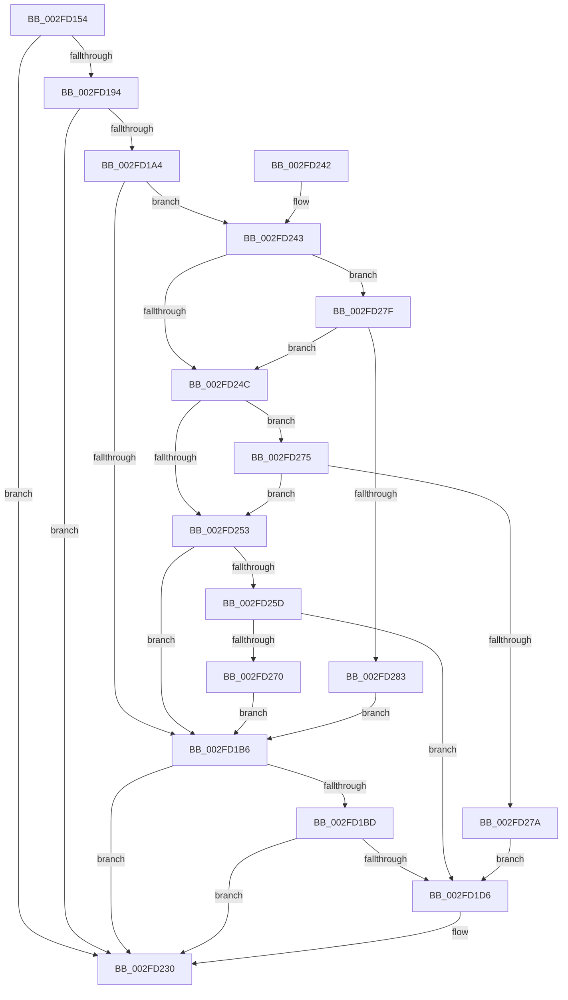

# PoTraceSystemTimerResolutionKernel

- RVA: `0x002FD154`–`0x002FD288` (길이 `308` bytes)
- VA: `0x00000001402FD154`
- 실행 섹션: `.text`
- PDB 이름 있음: `예`; PDB Function 태그: `아니요`
- unwind 정보 RVA: `0x00072BF4`
- 디코드: `70`개 명령, `308/308` bytes 표시
- 미해석 바이트: `0` (있으면 어셈블리에 `.byte`로 보존)

> 이 문서는 커널 이미지의 기계어와 PDB 기호를 분석해 생성했습니다. 4번과 5번은 함수 원형과 자료형을 바이너리 사용 방식에서 추정한 C 해석이며 원본 소스 복구 결과는 아닙니다.

## 1. Dependencies

- 직접 호출 지점: **3**; 고유 호출 대상: **3**
- 직접 호출자로 확인된 함수: **6**
- RIP 상대 이미지 참조: **5**

### Outgoing calls
- `0x002FD1CD` → [EtwpLevelKeywordEnabled](EtwpLevelKeywordEnabled_function_002FD110.md) (function, `0x002FD110`)
- `0x002FD22B` → [EtwWriteEx](../25/EtwWriteEx_function_0025F0D0.md) (function, `0x0025F0D0`)
- `0x002FD238` → [_security_check_cookie](../6A/_security_check_cookie_function_006AC640.md) (function, `0x006AC640`)

### Direct callers
- [ExpUpdateTimerConfigurationWorker](../23/ExpUpdateTimerConfigurationWorker_function_00235410.md) at `0x00235660`
- [KiSetClockIntervalToMinimumRequested](../39/KiSetClockIntervalToMinimumRequested_function_0039DF1C.md) at `0x0039E07C`
- [KiResetClockIntervalOneShot](../39/KiResetClockIntervalOneShot_function_0039E0D4.md) at `0x0039E0F4`
- [KiSetClockInterval](../47/KiSetClockInterval_function_00475064.md) at `0x004751AC`
- [ExSetTimerResolution](../49/ExSetTimerResolution_function_0049E7D0.md) at `0x0049E7F4`
- [KiResetClockInterval](../5B/KiResetClockInterval_function_005BB8BC.md) at `0x005BB8EA`

### Static image references
- `0x002FD160` → RVA `0x00E0A740` (`.data`; read)
- `0x002FD172` → RVA `0x00010FE0` (`.rdata`; read)
- `0x002FD17C` → RVA `0x00010FD0` (`.rdata`; read)
- `0x002FD187` → RVA `0x00E67858` (`.data`; read)
- `0x002FD194` → RVA `0x00F0B408` (`.data`; read)

## 2. Other-region calls and transfers

- 다른 실행 섹션으로 향하는 call: **0**
- 별도 외부 분기/꼬리 이동을 확인하지 못했습니다.

## 3. Assembly (complete function range)

```asm
002FD154  89 54 24 10                     mov dword ptr [rsp + 0x10], edx
002FD158  89 4C 24 08                     mov dword ptr [rsp + 8], ecx
002FD15C  48 83 EC 78                     sub rsp, 0x78
002FD160  48 8B 05 D9 D5 B0 00            mov rax, qword ptr [rip + 0xb0d5d9]
002FD167  48 33 C4                        xor rax, rsp
002FD16A  48 89 44 24 60                  mov qword ptr [rsp + 0x60], rax
002FD16F  45 33 C9                        xor r9d, r9d
002FD172  48 8D 05 67 3E D1 FF            lea rax, [rip - 0x2ec199]
002FD179  45 84 C0                        test r8b, r8b
002FD17C  4C 8D 15 4D 3E D1 FF            lea r10, [rip - 0x2ec1b3]
002FD183  4C 0F 44 D0                     cmove r10, rax
002FD187  44 38 0D CA A6 B6 00            cmp byte ptr [rip + 0xb6a6ca], r9b
002FD18E  0F 84 9C 00 00 00               je 0x1402fd230
002FD194  48 8B 15 6D E2 C0 00            mov rdx, qword ptr [rip + 0xc0e26d]
002FD19B  48 85 D2                        test rdx, rdx
002FD19E  0F 84 8C 00 00 00               je 0x1402fd230
002FD1A4  48 8B 4A 20                     mov rcx, qword ptr [rdx + 0x20]
002FD1A8  4D 8B 42 08                     mov r8, qword ptr [r10 + 8]
002FD1AC  44 39 49 60                     cmp dword ptr [rcx + 0x60], r9d
002FD1B0  0F 85 8D 00 00 00               jne 0x1402fd243
002FD1B6  66 44 39 4A 66                  cmp word ptr [rdx + 0x66], r9w
002FD1BB  74 73                           je 0x1402fd230
002FD1BD  48 8B 4A 28                     mov rcx, qword ptr [rdx + 0x28]
002FD1C1  4D 8B 42 08                     mov r8, qword ptr [r10 + 8]
002FD1C5  48 83 C1 60                     add rcx, 0x60
002FD1C9  41 8A 52 04                     mov dl, byte ptr [r10 + 4]
002FD1CD  E8 3E FF FF FF                  call 0x1402fd110
002FD1D2  84 C0                           test al, al
002FD1D4  74 5A                           je 0x1402fd230
002FD1D6  48 8B 0D 2B E2 C0 00            mov rcx, qword ptr [rip + 0xc0e22b]
002FD1DD  48 8D 84 24 80 00 00 00         lea rax, [rsp + 0x80]
002FD1E5  48 89 44 24 40                  mov qword ptr [rsp + 0x40], rax
002FD1EA  45 33 C0                        xor r8d, r8d
002FD1ED  48 8D 84 24 88 00 00 00         lea rax, [rsp + 0x88]
002FD1F5  48 C7 44 24 48 04 00 00 00      mov qword ptr [rsp + 0x48], 4
002FD1FE  48 89 44 24 50                  mov qword ptr [rsp + 0x50], rax
002FD203  49 8B D2                        mov rdx, r10
002FD206  48 8D 44 24 40                  lea rax, [rsp + 0x40]
002FD20B  48 C7 44 24 58 04 00 00 00      mov qword ptr [rsp + 0x58], 4
002FD214  48 89 44 24 38                  mov qword ptr [rsp + 0x38], rax
002FD219  C7 44 24 30 02 00 00 00         mov dword ptr [rsp + 0x30], 2
002FD221  4C 89 4C 24 28                  mov qword ptr [rsp + 0x28], r9
002FD226  4C 89 4C 24 20                  mov qword ptr [rsp + 0x20], r9
002FD22B  E8 A0 1E F6 FF                  call 0x14025f0d0
002FD230  48 8B 4C 24 60                  mov rcx, qword ptr [rsp + 0x60]
002FD235  48 33 CC                        xor rcx, rsp
002FD238  E8 03 F4 3A 00                  call 0x1406ac640
002FD23D  48 83 C4 78                     add rsp, 0x78
002FD241  C3                              ret
002FD242  CC                              int3
002FD243  8A 41 64                        mov al, byte ptr [rcx + 0x64]
002FD246  41 38 42 04                     cmp byte ptr [r10 + 4], al
002FD24A  77 33                           ja 0x1402fd27f
002FD24C  8B 41 68                        mov eax, dword ptr [rcx + 0x68]
002FD24F  A8 40                           test al, 0x40
002FD251  75 22                           jne 0x1402fd275
002FD253  4C 85 41 70                     test qword ptr [rcx + 0x70], r8
002FD257  0F 84 59 FF FF FF               je 0x1402fd1b6
002FD25D  48 8B 49 78                     mov rcx, qword ptr [rcx + 0x78]
002FD261  48 8B C1                        mov rax, rcx
002FD264  49 23 C0                        and rax, r8
002FD267  48 3B C1                        cmp rax, rcx
002FD26A  0F 84 66 FF FF FF               je 0x1402fd1d6
002FD270  E9 41 FF FF FF                  jmp 0x1402fd1b6
002FD275  4D 85 C0                        test r8, r8
002FD278  75 D9                           jne 0x1402fd253
002FD27A  E9 57 FF FF FF                  jmp 0x1402fd1d6
002FD27F  84 C0                           test al, al
002FD281  74 C9                           je 0x1402fd24c
002FD283  E9 2E FF FF FF                  jmp 0x1402fd1b6
```

## 4. C-style interpretation (structured pseudocode)

```c
__int64 __fastcall PoTraceSystemTimerResolutionKernel(int a1, int a2, unsigned __int8 a3, int a4)
{
    __int64 result;
    __int64 v_r10;
    __int64 v_rsp;
    unsigned __int64 v_stack_m18;
    unsigned __int64 v_stack_m20;
    unsigned __int64 v_stack_m28;
    unsigned __int64 v_stack_m30;
    unsigned __int64 v_stack_m38;
    unsigned __int64 v_stack_m40;
    unsigned int v_stack_m48;
    unsigned __int64 v_stack_m50;
    unsigned __int64 v_stack_m58;
    unsigned int v_stack_p10;
    unsigned int v_stack_p8;

    v_stack_p10 = a2;
    v_stack_p8 = a1;
    v_rsp = (v_rsp) - (120);
    result = (*(unsigned __int64 *)(v_rip + 11589081)) ^ (v_rsp);
    v_stack_m18 = result;
    a4 = 0;
    v_r10 = v_rip - 3064243;
    if (a3 == 0) { v_r10 = v_rip - 3064217; }
    if ((*(unsigned __int8 *)(v_rip + 11970250)) == 0) goto loc_002FD230;
    if (*(unsigned __int64 *)(v_rip + 12640877) == 0) goto loc_002FD230;
    if ((*(unsigned int *)(*(unsigned __int64 *)(*(unsigned __int64 *)(v_rip + 12640877) + 32) + 96)) != 0) goto loc_002FD243;
loc_002FD1B6:
    if ((*(unsigned __int16 *)(*(unsigned __int64 *)(v_rip + 12640877) + 102)) == 0) goto loc_002FD230;
    a1 = (*(unsigned __int64 *)(*(unsigned __int64 *)(v_rip + 12640877) + 40)) + (96);
    result = EtwpLevelKeywordEnabled(a1, *(unsigned __int8 *)(v_r10 + 4), *(unsigned __int64 *)(v_r10 + 8), a4);
    if ((unsigned __int8)(result) != 0) {
        a1 = *(unsigned __int64 *)(v_rip + 12640811);
        result = v_stack_p8;
        v_stack_m38 = result;
        a3 = 0;
        result = v_stack_p10;
        v_stack_m30 = 4;
        v_stack_m28 = result;
        a2 = v_r10;
        result = v_stack_m38;
        v_stack_m20 = 4;
        v_stack_m40 = result;
        v_stack_m48 = 2;
        v_stack_m50 = 0;
        v_stack_m58 = 0;
        result = EtwWriteEx(a1, a2, a3, a4);
    }
    a1 = (v_stack_m18) ^ (v_rsp);
    result = _security_check_cookie(a1, a2, a3, a4);
    v_rsp = (v_rsp) + (120);
    return result;
loc_002FD243:
    if ((*(unsigned __int8 *)(v_r10 + 4)) > ((unsigned __int8)(*(unsigned __int8 *)(a1 + 100)))) goto loc_002FD27F;
loc_002FD24C:
    if ((((unsigned __int8)((unsigned int)(*(unsigned int *)(a1 + 104)))) & (64)) != 0) goto loc_002FD275;
loc_002FD253:
    if (((*(unsigned __int64 *)(a1 + 112)) & (0)) == 0) goto loc_002FD1B6;
    result = (*(unsigned __int64 *)(a1 + 120)) & (0);
    if (result == (*(unsigned __int64 *)(a1 + 120))) goto loc_002FD1D6;
    goto loc_002FD1B6;
loc_002FD275:
    if (0 != 0) goto loc_002FD253;
    goto loc_002FD1D6;
loc_002FD27F:
    if ((unsigned __int8)(result) == 0) goto loc_002FD24C;
    goto loc_002FD1B6;
}
```

## 5. (Beta) C Style

```c
int64_t PoTraceSystemTimerResolutionKernel(int32_t Arg1, int32_t Arg2, uint8_t Arg3, int32_t Arg4)
{
    int64_t result;
    int64_t local_r10;
    int64_t local_rsp;
    uint64_t v_stack_m18;
    uint64_t v_stack_m20;
    uint64_t v_stack_m28;
    uint64_t v_stack_m30;
    uint64_t v_stack_m38;
    uint64_t v_stack_m40;
    uint32_t v_stack_m48;
    uint64_t v_stack_m50;
    uint64_t v_stack_m58;
    uint32_t v_stack_p10;
    uint32_t v_stack_p8;

    v_stack_p10 = Arg2;
    v_stack_p8 = Arg1;
    local_rsp = (local_rsp) - (120);
    result = (*(uint64_t *)(v_rip + 0xB0D5D9)) ^ (local_rsp);
    v_stack_m18 = result;
    Arg4 = 0;
    local_r10 = v_rip - 3064243;
    if (Arg3 == 0) { local_r10 = v_rip - 3064217; }
    if ((*(uint8_t *)(v_rip + 0xB6A6CA)) == 0) goto loc_002FD230;
    if (*(uint64_t *)(v_rip + 0xC0E26D) == 0) goto loc_002FD230;
    if ((*(uint32_t *)(*(uint64_t *)(*(uint64_t *)(v_rip + 0xC0E26D) + 0x20) + 0x60)) != 0) goto loc_002FD243;
loc_002FD1B6:
    if ((*(uint16_t *)(*(uint64_t *)(v_rip + 0xC0E26D) + 0x66)) == 0) goto loc_002FD230;
    Arg1 = (*(uint64_t *)(*(uint64_t *)(v_rip + 0xC0E26D) + 0x28)) + (96);
    result = EtwpLevelKeywordEnabled(Arg1, *(uint8_t *)(local_r10 + 0x4), *(uint64_t *)(local_r10 + 0x8), Arg4);
    if ((uint8_t)(result) != 0) {
        Arg1 = *(uint64_t *)(v_rip + 0xC0E22B);
        result = v_stack_p8;
        v_stack_m38 = result;
        Arg3 = 0;
        result = v_stack_p10;
        v_stack_m30 = 4;
        v_stack_m28 = result;
        Arg2 = local_r10;
        result = v_stack_m38;
        v_stack_m20 = 4;
        v_stack_m40 = result;
        v_stack_m48 = 2;
        v_stack_m50 = 0;
        v_stack_m58 = 0;
        result = EtwWriteEx(Arg1, Arg2, Arg3, Arg4);
    }
    Arg1 = (v_stack_m18) ^ (local_rsp);
    result = _security_check_cookie(Arg1, Arg2, Arg3, Arg4);
    local_rsp = (local_rsp) + (120);
    return result;
loc_002FD243:
    if ((*(uint8_t *)(local_r10 + 0x4)) > ((uint8_t)(*(uint8_t *)(Arg1 + 0x64)))) goto loc_002FD27F;
loc_002FD24C:
    if ((((uint8_t)((uint32_t)(*(uint32_t *)(Arg1 + 0x68)))) & (64)) != 0) goto loc_002FD275;
loc_002FD253:
    if (((*(uint64_t *)(Arg1 + 0x70)) & (0)) == 0) goto loc_002FD1B6;
    result = (*(uint64_t *)(Arg1 + 0x78)) & (0);
    if (result == (*(uint64_t *)(Arg1 + 0x78))) goto loc_002FD1D6;
    goto loc_002FD1B6;
loc_002FD275:
    if (0 != 0) goto loc_002FD253;
    goto loc_002FD1D6;
loc_002FD27F:
    if ((uint8_t)(result) == 0) goto loc_002FD24C;
    goto loc_002FD1B6;
}
```

## 6. Execution-region graph

[열기: 2D/3D 그래프와 함수 탐색 컨트롤 패널](../../../control-panel.html?section=text&rva=0x002FD154&view=graph)

- 2D 그래프는 위에서 아래로 흐르고, 3D 그래프는 빈 공간을 드래그해 회전합니다. Shift+드래그는 이동, 휠은 확대·축소, 함수 노드 선택은 대상 보고서 이동입니다.

### Static fallback


