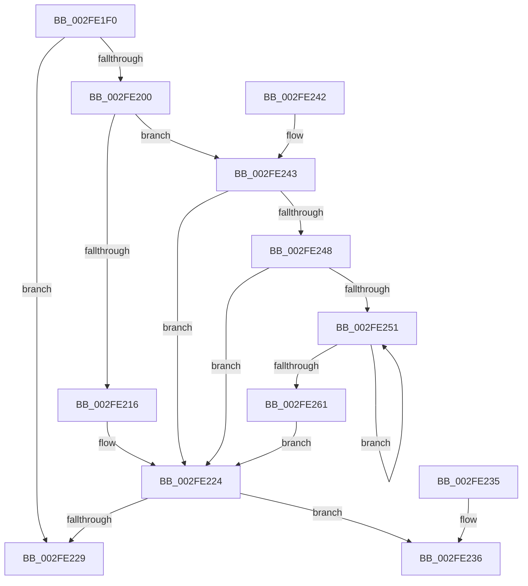

# PsGetCurrentServerSiloGlobals

- RVA: `0x002FE1F0`–`0x002FE263` (길이 `115` bytes)
- VA: `0x00000001402FE1F0`
- 실행 섹션: `.text`
- PDB 이름 있음: `예`; PDB Function 태그: `아니요`
- unwind 정보 RVA: `0x00072D6C`
- 디코드: `30`개 명령, `115/115` bytes 표시
- 미해석 바이트: `0` (있으면 어셈블리에 `.byte`로 보존)

> 이 문서는 커널 이미지의 기계어와 PDB 기호를 분석해 생성했습니다. 4번과 5번은 함수 원형과 자료형을 바이너리 사용 방식에서 추정한 C 해석이며 원본 소스 복구 결과는 아닙니다.

## 1. Dependencies

- 직접 호출 지점: **2**; 고유 호출 대상: **1**
- 직접 호출자로 확인된 함수: **186**
- RIP 상대 이미지 참조: **1**

### Outgoing calls
- `0x002FE248` → [PsIsServerSilo](../22/PsIsServerSilo_function_00225828.md) (function, `0x00225828`)
- `0x002FE258` → [PsIsServerSilo](../22/PsIsServerSilo_function_00225828.md) (function, `0x00225828`)

### Direct callers
- [EtwWriteKMSecurityEvent](../22/EtwWriteKMSecurityEvent_function_00225B8C.md) at `0x00225B96`
- [EtwpEventWriteFull](../22/EtwpEventWriteFull_function_00225C10.md) at `0x00225D9B`
- [NtTraceEvent](NtTraceEvent_function_002FA6C0.md) at `0x002FAC4B`
- [NtTraceEvent](NtTraceEvent_function_002FA6C0.md) at `0x002FAE41`
- [NtTraceEvent](NtTraceEvent_function_002FA6C0.md) at `0x002FAFC3`
- [NtTraceEvent](NtTraceEvent_function_002FA6C0.md) at `0x002FB227`
- [EtwTraceEvent](EtwTraceEvent_function_002FD290.md) at `0x002FD31A`
- [UpcaseUnicodeToUTF8NHelper](UpcaseUnicodeToUTF8NHelper_function_002FD8C4.md) at `0x002FD902`
- [RtlpUpcaseUnicodeStringPrivate](RtlpUpcaseUnicodeStringPrivate_function_002FE0B0.md) at `0x002FE0C8`
- [ExSystemTimeToLocalTime](ExSystemTimeToLocalTime_function_002FE1C0.md) at `0x002FE1C7`
- [EtwpAdjustTraceBuffers](../3E/EtwpAdjustTraceBuffers_function_003EB5F0.md) at `0x003EB665`
- [HalSetRealTimeClock](../42/HalSetRealTimeClock_function_0042D310.md) at `0x0042D35C`
- [HalQueryRealTimeClock](../42/HalQueryRealTimeClock_function_0042D810.md) at `0x0042D891`
- [HalQueryRealTimeClock](../42/HalQueryRealTimeClock_function_0042D810.md) at `0x0042D8D8`
- [RtlSetSystemGlobalData](../43/RtlSetSystemGlobalData_function_00435AF0.md) at `0x00435B97`
- [RtlGetActiveConsoleId](../43/RtlGetActiveConsoleId_function_00436230.md) at `0x0043624F`
- [RtlGetNtProductType](../43/RtlGetNtProductType_function_00436270.md) at `0x004362A5`
- [ExLocalTimeToSystemTime](../49/ExLocalTimeToSystemTime_function_00494BC0.md) at `0x00494BC7`
- [PopSystemTimeToLocalTime](../4C/PopSystemTimeToLocalTime_function_004C1724.md) at `0x004C172E`
- [ExLogTimeZoneInformation](../4E/ExLogTimeZoneInformation_function_004E3B50.md) at `0x004E3B6C`
- [HalEfiGetTime](../54/HalEfiGetTime_function_0054DC6C.md) at `0x0054DD9C`
- [HalEfiSetTime](../54/HalEfiSetTime_function_0054DE84.md) at `0x0054E048`
- [HalpSetResumeTime](../55/HalpSetResumeTime_function_0055BC08.md) at `0x0055BC97`
- [KiCollectTriageDumpDataBlocks](../5B/KiCollectTriageDumpDataBlocks_function_005B43F8.md) at `0x005B45F3`
- [EtwpGetPmcSessions](../64/EtwpGetPmcSessions_function_0064EB08.md) at `0x0064EB37`
- [EtwSendTraceBuffer](../65/EtwSendTraceBuffer_function_00651560.md) at `0x0065158B`
- [EtwTraceRaw](../65/EtwTraceRaw_function_006516CC.md) at `0x0065171D`
- [WmiGetClock](../65/WmiGetClock_function_00651A60.md) at `0x00651A66`
- [EtwpGetCompressionSettings](../65/EtwpGetCompressionSettings_function_006535A8.md) at `0x006535C8`
- [EtwpSetCompressionSettings](../65/EtwpSetCompressionSettings_function_00653910.md) at `0x0065392E`
- [sub_006F213A](../6F/Unknown_function_006F213A.md) at `0x006F21BE`
- [sub_006F213A](../6F/Unknown_function_006F213A.md) at `0x006F2236`
- [ExpWatchProductTypeWork](../../page/6F/ExpWatchProductTypeWork_function_006FFCA0.md) at `0x006FFFAC`
- [PspInitializeSessionGlobals](../../page/70/PspInitializeSessionGlobals_function_007005B8.md) at `0x0070061A`
- [PspInitializeSessionGlobals](../../page/70/PspInitializeSessionGlobals_function_007005B8.md) at `0x00700629`
- [ObIsDosDeviceLocallyMapped](../../page/74/ObIsDosDeviceLocallyMapped_function_0074EAB0.md) at `0x0074EAD7`
- [ObpCreateSymbolicLinkName](../../page/74/ObpCreateSymbolicLinkName_function_0074EB80.md) at `0x0074EC59`
- [PsGetCurrentServerSiloName](../../page/77/PsGetCurrentServerSiloName_function_0077F3F0.md) at `0x0077F3F4`
- [PspInitializeServerSiloDeferred](../../page/77/PspInitializeServerSiloDeferred_function_0077FEE0.md) at `0x0078003D`
- [RtlGetConsoleSessionForegroundProcessId](../../page/78/RtlGetConsoleSessionForegroundProcessId_function_0078A5C0.md) at `0x0078A5D9`
- [RtlInitFunctionalityCache](../../page/78/RtlInitFunctionalityCache_function_0078A5F8.md) at `0x0078A6BF`
- [RtlIsFunctionalityAvailable](../../page/78/RtlIsFunctionalityAvailable_function_0078A740.md) at `0x0078A751`
- [RtlSuffixUnicodeString](../../page/78/RtlSuffixUnicodeString_function_0078A780.md) at `0x0078A790`
- [RtlUpcaseUnicodeToCustomCPN](../../page/78/RtlUpcaseUnicodeToCustomCPN_function_0078BF90.md) at `0x0078BFB8`
- [RtlpInitCodePageTables](../../page/78/RtlpInitCodePageTables_function_0078C0F4.md) at `0x0078C117`
- [RtlpInitUppercaseTables](../../page/78/RtlpInitUppercaseTables_function_0078C29C.md) at `0x0078C2A6`
- [CompareNamesCaseSensitive](../../page/78/CompareNamesCaseSensitive_function_0078CA1C.md) at `0x0078CA55`
- [ComputeNameLength](../../page/78/ComputeNameLength_function_0078CBC8.md) at `0x0078CBF5`
- [RtlGetSessionProperties](../../page/78/RtlGetSessionProperties_function_0078E580.md) at `0x0078E651`
- [SepSetSystemPaths](../../page/79/SepSetSystemPaths_function_0079C040.md) at `0x0079C066`
- [SepRmSetSharedUserSessionWrkr](../../page/7A/SepRmSetSharedUserSessionWrkr_function_007A1B80.md) at `0x007A1B88`
- [EtwShutdown](../../page/7B/EtwShutdown_function_007B50B0.md) at `0x007B50E5`
- [WmiQueryTraceInformation](../../page/7B/WmiQueryTraceInformation_function_007B9370.md) at `0x007B93A0`
- [EtwRegisterEventCallback](../../page/7B/EtwRegisterEventCallback_function_007BC3B0.md) at `0x007BC3C5`
- [EtwpDeleteSessionDemuxObject](../../page/7B/EtwpDeleteSessionDemuxObject_function_007BC480.md) at `0x007BC4AB`
- [EtwpGetPrivateSessionTraceHandle](../../page/7B/EtwpGetPrivateSessionTraceHandle_function_007BC5A8.md) at `0x007BC5C7`
- [EtwpUpdatePeriodicCaptureState](../../page/7B/EtwpUpdatePeriodicCaptureState_function_007BCC4C.md) at `0x007BCC8A`
- [EtwStartAutoLogger](../../page/7B/EtwStartAutoLogger_function_007BD2F8.md) at `0x007BD3C3`
- [EtwStartAutoLogger](../../page/7B/EtwStartAutoLogger_function_007BD2F8.md) at `0x007BE164`
- [EtwStartAutoLogger](../../page/7B/EtwStartAutoLogger_function_007BD2F8.md) at `0x007BE17E`
- [ExpSetTimeZoneInformation](../../page/7C/ExpSetTimeZoneInformation_function_007C5240.md) at `0x007C5407`
- [ExInitializeUtcTimeZoneBias](../../page/7C/ExInitializeUtcTimeZoneBias_function_007C5818.md) at `0x007C588A`
- [ExpLogRefreshTimeZoneInformationCutoverFail](../../page/7C/ExpLogRefreshTimeZoneInformationCutoverFail_function_007C5BE0.md) at `0x007C5C03`
- [ExpRefreshSystemTime](../../page/7C/ExpRefreshSystemTime_function_007C6264.md) at `0x007C6289`
- [NtSetSystemTime](../../page/7C/NtSetSystemTime_function_007C65F0.md) at `0x007C664A`
- [ExFetchLicenseData](../../page/7C/ExFetchLicenseData_function_007C7780.md) at `0x007C77A8`
- [ExGetLicenseTamperState](../../page/7C/ExGetLicenseTamperState_function_007C7A30.md) at `0x007C7A51`
- [ExInitLicenseCallback](../../page/7C/ExInitLicenseCallback_function_007C7B14.md) at `0x007C7B1A`
- [ExSetLicenseTamperState](../../page/7C/ExSetLicenseTamperState_function_007C7B60.md) at `0x007C7B83`
- [ExSetLicenseTamperState](../../page/7C/ExSetLicenseTamperState_function_007C7B60.md) at `0x007C7C62`
- [ExUpdateOsPfnInRegistry](../../page/7C/ExUpdateOsPfnInRegistry_function_007C7CA0.md) at `0x007C7CAD`
- [NtSetDefaultHardErrorPort](../../page/7D/NtSetDefaultHardErrorPort_function_007D0340.md) at `0x007D034D`
- [CmCompleteRegistryInitialization](../../page/7D/CmCompleteRegistryInitialization_function_007DF1EC.md) at `0x007DF378`
- [sub_00853ABC](../../page/85/Unknown_function_00853ABC.md) at `0x00853BAB`
- [sub_00853ABC](../../page/85/Unknown_function_00853ABC.md) at `0x00853BDC`
- [sub_00855472](../../page/85/Unknown_function_00855472.md) at `0x0085559E`
- [CmpCompareInIndex](../../page/85/CmpCompareInIndex_function_0085CC40.md) at `0x0085CD5B`
- [CmpCompareInIndex](../../page/85/CmpCompareInIndex_function_0085CC40.md) at `0x0085CD8C`
- [ObpLookupDirectoryEntry](../../page/85/ObpLookupDirectoryEntry_function_0085D5B0.md) at `0x0085D6F1`
- [RtlUpcaseUnicodeChar](../../page/85/RtlUpcaseUnicodeChar_function_0085F0F0.md) at `0x0085F0F7`
- [SepAdtAuditObjectAccessWithContext](../../page/86/SepAdtAuditObjectAccessWithContext_function_0086EEF0.md) at `0x0086F177`
- [SepAdtAuditObjectAccessWithContext](../../page/86/SepAdtAuditObjectAccessWithContext_function_0086EEF0.md) at `0x0086F1C2`
- [SepAdtAuditObjectAccessWithContext](../../page/86/SepAdtAuditObjectAccessWithContext_function_0086EEF0.md) at `0x0086F212`
- [ObpLookupObjectName](../../page/89/ObpLookupObjectName_function_0089BE90.md) at `0x0089C2CB`
- [ObpLookupObjectName](../../page/89/ObpLookupObjectName_function_0089BE90.md) at `0x0089CF62`
- [ObpLookupObjectName](../../page/89/ObpLookupObjectName_function_0089BE90.md) at `0x0089D4FC`
- [ObpLookupObjectName](../../page/89/ObpLookupObjectName_function_0089BE90.md) at `0x0089D981`
- [IopParseDevice](../../page/89/IopParseDevice_function_0089E510.md) at `0x0089F510`
- [ExpWnfGetNameStoreRegistryRoot](../../page/8B/ExpWnfGetNameStoreRegistryRoot_function_008BDB00.md) at `0x008BDB48`
- [ExpWnfGetNameStoreRegistryRoot](../../page/8B/ExpWnfGetNameStoreRegistryRoot_function_008BDB00.md) at `0x008BDB83`
- [ExpWnfAllocateNextPersistentNameSequence](../../page/8B/ExpWnfAllocateNextPersistentNameSequence_function_008BDE84.md) at `0x008BDED6`
- [ExpWnfGenerateStateName](../../page/8B/ExpWnfGenerateStateName_function_008BE738.md) at `0x008BE811`
- [EtwpGetLoggerInfoFromContext](../../page/8B/EtwpGetLoggerInfoFromContext_function_008BEF90.md) at `0x008BF238`
- [PiPnpRtlObjectEventCreate](../../page/8D/PiPnpRtlObjectEventCreate_function_008DF7E0.md) at `0x008DF8C1`
- [PiDmGetObject](../../page/8D/PiDmGetObject_function_008DFAE0.md) at `0x008DFBE5`
- [sub_008E078C](../../page/8E/Unknown_function_008E078C.md) at `0x008E083E`
- [sub_008E2AB2](../../page/8E/Unknown_function_008E2AB2.md) at `0x008E2B78`
- [sub_008E41B3](../../page/8E/Unknown_function_008E41B3.md) at `0x008E42EE`
- [sub_008E4A5E](../../page/8E/Unknown_function_008E4A5E.md) at `0x008E4B2A`
- [sub_008EE966](../../page/8E/Unknown_function_008EE966.md) at `0x008EEB0C`
- [sub_008EE966](../../page/8E/Unknown_function_008EE966.md) at `0x008EEBA2`
- [_CmOpenCommonClassRegKeyWorker](../../page/8F/_CmOpenCommonClassRegKeyWorker_function_008F0A1C.md) at `0x008F0B01`
- [_CmOpenCommonClassRegKeyWorker](../../page/8F/_CmOpenCommonClassRegKeyWorker_function_008F0A1C.md) at `0x008F0BCF`
- [_CmOpenCommonClassRegKeyWorker](../../page/8F/_CmOpenCommonClassRegKeyWorker_function_008F0A1C.md) at `0x008F0C48`
- [CmGetDeviceInterfaceSubkeyPath](../../page/8F/CmGetDeviceInterfaceSubkeyPath_function_008F1010.md) at `0x008F1097`
- [CmGetDeviceInterfaceSubkeyPath](../../page/8F/CmGetDeviceInterfaceSubkeyPath_function_008F1010.md) at `0x008F10BA`
- [CmValidateDeviceInterfaceName](../../page/8F/CmValidateDeviceInterfaceName_function_008F1A40.md) at `0x008F1AA2`
- [CmValidateDeviceInterfaceName](../../page/8F/CmValidateDeviceInterfaceName_function_008F1A40.md) at `0x008F1AC5`
- [sub_008F210A](../../page/8F/Unknown_function_008F210A.md) at `0x008F2154`
- [sub_008F210A](../../page/8F/Unknown_function_008F210A.md) at `0x008F2177`
- [_CmOpenDeviceInterfaceRegKeyWorker](../../page/8F/_CmOpenDeviceInterfaceRegKeyWorker_function_008F2B48.md) at `0x008F2C63`
- [_CmOpenDeviceInterfaceRegKeyWorker](../../page/8F/_CmOpenDeviceInterfaceRegKeyWorker_function_008F2B48.md) at `0x008F2D01`
- [RtlPrefixUnicodeString](../../page/8F/RtlPrefixUnicodeString_function_008F4F70.md) at `0x008F4F86`
- [CmGetDeviceInterfacePathFormat](../../page/8F/CmGetDeviceInterfacePathFormat_function_008F5BE8.md) at `0x008F5C20`
- [CmGetDeviceInterfacePathFormat](../../page/8F/CmGetDeviceInterfacePathFormat_function_008F5BE8.md) at `0x008F5C41`
- [CmGetDeviceInterfacePathFormat](../../page/8F/CmGetDeviceInterfacePathFormat_function_008F5BE8.md) at `0x008F5C5A`
- [CmIsRootEnumeratedDevice](../../page/8F/CmIsRootEnumeratedDevice_function_008F6E08.md) at `0x008F6E3A`
- [ExpWnfDeleteScopeById](../../page/90/ExpWnfDeleteScopeById_function_00908168.md) at `0x00908189`
- [sub_0090B427](../../page/90/Unknown_function_0090B427.md) at `0x0090B434`
- [RtlAnsiStringToUnicodeString](../../page/90/RtlAnsiStringToUnicodeString_function_0090BEA0.md) at `0x0090BEE7`
- [RtlAnsiStringToUnicodeString](../../page/90/RtlAnsiStringToUnicodeString_function_0090BEA0.md) at `0x0090BF68`
- [RtlMultiByteToUnicodeSize](../../page/90/RtlMultiByteToUnicodeSize_function_0090CBC0.md) at `0x0090CBEE`
- [RtlUpcaseUnicodeToOemN](../../page/90/RtlUpcaseUnicodeToOemN_function_0090CC70.md) at `0x0090CCAD`
- [sub_0090CD4C](../../page/90/Unknown_function_0090CD4C.md) at `0x0090CD6D`
- [RtlxUnicodeStringToAnsiSize](../../page/90/RtlxUnicodeStringToAnsiSize_function_0090CE80.md) at `0x0090CEAD`
- [RtlIsNameLegalDOS8Dot3](../../page/90/RtlIsNameLegalDOS8Dot3_function_0090CF30.md) at `0x0090CF81`
- [RtlUnicodeToMultiByteSize](../../page/90/RtlUnicodeToMultiByteSize_function_0090D110.md) at `0x0090D13A`
- [RtlUnicodeStringToAnsiString](../../page/90/RtlUnicodeStringToAnsiString_function_0090D1F0.md) at `0x0090D243`
- [RtlUnicodeStringToAnsiString](../../page/90/RtlUnicodeStringToAnsiString_function_0090D1F0.md) at `0x0090D2B9`
- [RtlMultiByteToUnicodeN](../../page/90/RtlMultiByteToUnicodeN_function_0090D520.md) at `0x0090D55D`
- [RtlUpcaseUnicodeToMultiByteN](../../page/90/RtlUpcaseUnicodeToMultiByteN_function_0090D760.md) at `0x0090D79B`
- [RtlUnicodeToMultiByteN](../../page/90/RtlUnicodeToMultiByteN_function_0090D820.md) at `0x0090D854`
- [RtlAnsiCharToUnicodeChar](../../page/90/RtlAnsiCharToUnicodeChar_function_0090D980.md) at `0x0090D9B3`
- [RtlAnsiCharToUnicodeChar](../../page/90/RtlAnsiCharToUnicodeChar_function_0090D980.md) at `0x0090D9E6`
- [RtlpIsUtf8Process](../../page/90/RtlpIsUtf8Process_function_0090DB60.md) at `0x0090DB67`
- [RtlUpcaseUnicodeStringToCountedOemString](../../page/90/RtlUpcaseUnicodeStringToCountedOemString_function_0090E4D0.md) at `0x0090E51B`
- [RtlUpcaseUnicodeStringToCountedOemString](../../page/90/RtlUpcaseUnicodeStringToCountedOemString_function_0090E4D0.md) at `0x0090E5A5`
- [RtlGenerate8dot3Name](../../page/90/RtlGenerate8dot3Name_function_0090E950.md) at `0x0090E9A8`
- [RtlUnicodeToOemN](../../page/90/RtlUnicodeToOemN_function_0090F2B0.md) at `0x0090F2DF`
- [RtlOemToUnicodeN](../../page/90/RtlOemToUnicodeN_function_0090F330.md) at `0x0090F36B`
- [RtlIsValidOemCharacter](../../page/90/RtlIsValidOemCharacter_function_0090F5C0.md) at `0x0090F5E1`
- [sub_0091FAE5](../../page/91/Unknown_function_0091FAE5.md) at `0x0091FAF1`
- [sub_0091FB36](../../page/91/Unknown_function_0091FB36.md) at `0x0091FB47`
- [TraceLoggingRegisterEx_EtwRegister_EtwSetInformation](../../page/92/TraceLoggingRegisterEx_EtwRegister_EtwSetInformation_function_009208A0.md) at `0x009208E8`
- [EtwRegister](../../page/92/EtwRegister_function_00920960.md) at `0x00920967`
- [DbgkpStartSystemErrorHandler](../../page/92/DbgkpStartSystemErrorHandler_function_00920F78.md) at `0x00920FF3`
- [RtlEqualUnicodeString](../../page/93/RtlEqualUnicodeString_function_00932A20.md) at `0x00932A3D`
- [RtlCompareUnicodeString](../../page/93/RtlCompareUnicodeString_function_00937F90.md) at `0x00937FBD`
- [RtlFindUnicodeSubstring](../../page/94/RtlFindUnicodeSubstring_function_00949FA0.md) at `0x00949FBE`
- [sub_0095123B](../../page/95/Unknown_function_0095123B.md) at `0x0095124C`
- [sub_0095141E](../../page/95/Unknown_function_0095141E.md) at `0x00951429`
- [AslStringPatternMatchExW](../../page/95/AslStringPatternMatchExW_function_0095E850.md) at `0x0095E8C2`
- [AslStringPatternMatchExW](../../page/95/AslStringPatternMatchExW_function_0095E850.md) at `0x0095E8E3`
- [RtlUpcaseUnicodeString](../../page/96/RtlUpcaseUnicodeString_function_00960780.md) at `0x009607B0`
- [sub_009669C4](../../page/96/Unknown_function_009669C4.md) at `0x009669F1`
- [NtQueryLicenseValue](../../page/96/NtQueryLicenseValue_function_0096BCC0.md) at `0x0096BED1`
- [sub_0096BFF0](../../page/96/Unknown_function_0096BFF0.md) at `0x0096BFF7`
- [ObQueryDeviceMapInformation](../../page/96/ObQueryDeviceMapInformation_function_0096C5C0.md) at `0x0096CB9C`
- [ObpReferenceCurrentDeviceMap](../../page/96/ObpReferenceCurrentDeviceMap_function_0096CBD0.md) at `0x0096CD32`
- [ObpSetCurrentProcessDeviceMap](../../page/96/ObpSetCurrentProcessDeviceMap_function_0096CF6C.md) at `0x0096CFC1`
- [sub_0096D1EB](../../page/96/Unknown_function_0096D1EB.md) at `0x0096D1FA`
- [RtlCompareUnicodeStrings](../../page/97/RtlCompareUnicodeStrings_function_009727E0.md) at `0x00972804`
- [RtlHashUnicodeString](../../page/97/RtlHashUnicodeString_function_0097A780.md) at `0x0097A793`
- [ExpGetGlobalLocaleSection](../../page/98/ExpGetGlobalLocaleSection_function_00980DD4.md) at `0x00980E0A`
- [MmCreatePeb](../../page/98/MmCreatePeb_function_00980FB4.md) at `0x00981109`
- [MmLoadSystemImageEx](../../page/99/MmLoadSystemImageEx_function_00999B8C.md) at `0x00999C0C`
- [RtlFindUnicodePrefix](../../page/99/RtlFindUnicodePrefix_function_0099D710.md) at `0x0099D791`
- [CompareUnicodeStrings](../../page/99/CompareUnicodeStrings_function_0099DA20.md) at `0x0099DA33`
- [PnpCompareInstancePath](../../page/9A/PnpCompareInstancePath_function_009A9B60.md) at `0x009A9B95`
- [EtwpBufferingModeFlush](../../page/9B/EtwpBufferingModeFlush_function_009BD8F4.md) at `0x009BDA66`
- [EtwpExpandFileName](../../page/9C/EtwpExpandFileName_function_009C147C.md) at `0x009C156B`
- [RtlDowncaseUnicodeString](../../page/9C/RtlDowncaseUnicodeString_function_009C4190.md) at `0x009C41C0`
- [NtOpenPrivateNamespace](../../page/9C/NtOpenPrivateNamespace_function_009C94E0.md) at `0x009C959A`
- [NtCreatePrivateNamespace](../../page/9C/NtCreatePrivateNamespace_function_009CA6D0.md) at `0x009CA865`
- [ObpRegisterPrivateNamespace](../../page/9C/ObpRegisterPrivateNamespace_function_009CA9F4.md) at `0x009CAA14`
- [RtlDowncaseUnicodeChar](../../page/9E/RtlDowncaseUnicodeChar_function_009EA550.md) at `0x009EA558`
- [EtwpEventTracingCounterSetCallback](../../page/A0/EtwpEventTracingCounterSetCallback_function_00A0E0C0.md) at `0x00A0E12D`
- [RtlGetSuiteMask](../../page/A1/RtlGetSuiteMask_function_00A191E0.md) at `0x00A191FC`
- [RtlGetNtSystemRoot](../../page/A1/RtlGetNtSystemRoot_function_00A1DCD0.md) at `0x00A1DCED`
- [RtlIsMultiSessionSku](../../page/A2/RtlIsMultiSessionSku_function_00A20730.md) at `0x00A20751`
- [ObpRemoveNamespaceFromTable](../../page/A2/ObpRemoveNamespaceFromTable_function_00A2131C.md) at `0x00A2133C`
- [PsQueryCurrentApiSetSchema](../../page/A2/PsQueryCurrentApiSetSchema_function_00A24300.md) at `0x00A24330`
- [PipFindDeviceOverrideEntry](../../page/A2/PipFindDeviceOverrideEntry_function_00A2A694.md) at `0x00A2A794`
- [PnpGenerateDeviceIdsHash](../../page/A2/PnpGenerateDeviceIdsHash_function_00A2B120.md) at `0x00A2B186`
- [RtlpOpenBaseImageFileOptionsKey](../../page/A3/RtlpOpenBaseImageFileOptionsKey_function_00A3B9F4.md) at `0x00A3BA01`
- [EtwSetPerformanceTraceInformation](../../page/A5/EtwSetPerformanceTraceInformation_function_00A53928.md) at `0x00A53978`
- [ExpQuerySystemInformation](../../page/A5/ExpQuerySystemInformation_function_00A57858.md) at `0x00A57E66`
- [ExpQuerySystemInformation](../../page/A5/ExpQuerySystemInformation_function_00A57858.md) at `0x00A585AC`
- [ExpQuerySystemInformation](../../page/A5/ExpQuerySystemInformation_function_00A57858.md) at `0x00A59340`
- [EtwEnableTrace](../../page/A5/EtwEnableTrace_function_00A5C850.md) at `0x00A5C85A`
- [WdipSemGetLoggerIds](../../page/A5/WdipSemGetLoggerIds_function_00A5CBB4.md) at `0x00A5CC08`
- [WdipSemGetLoggerIds](../../page/A5/WdipSemGetLoggerIds_function_00A5CBB4.md) at `0x00A5CC59`
- [ExpRaiseHardError](../../page/A6/ExpRaiseHardError_function_00A64AD4.md) at `0x00A64B34`
- [EtwpRealtimeConnect](../../page/A6/EtwpRealtimeConnect_function_00A65C88.md) at `0x00A65DF7`
- [ExpLogRefreshTimeZoneInformationQueryFail](../../page/A6/ExpLogRefreshTimeZoneInformationQueryFail_function_00A6BE6C.md) at `0x00A6BE8B`
- [ExpWriteTimeZoneBias](../../page/A6/ExpWriteTimeZoneBias_function_00A6C028.md) at `0x00A6C03A`
- [ExpLogRefreshTimeZoneInformationSuccess](../../page/A6/ExpLogRefreshTimeZoneInformationSuccess_function_00A6C204.md) at `0x00A6C232`
- [ExpWriteTimeZoneBiasStartEnd](../../page/A6/ExpWriteTimeZoneBiasStartEnd_function_00A6C410.md) at `0x00A6C429`
- [PopBatteryDeviceState](../../page/A7/PopBatteryDeviceState_function_00A7905C.md) at `0x00A7910F`
- [PopBatteryDeviceState](../../page/A7/PopBatteryDeviceState_function_00A7905C.md) at `0x00A7912C`
- [ObpDeleteSymbolicLinkName](../../page/A7/ObpDeleteSymbolicLinkName_function_00A7BC80.md) at `0x00A7BCF7`
- [ExpWnfEnumerateScopeInstances](../../page/A7/ExpWnfEnumerateScopeInstances_function_00A7ECE8.md) at `0x00A7EDE9`
- [PiDevCfgResolveVariable](../../page/A8/PiDevCfgResolveVariable_function_00A81AB8.md) at `0x00A81B1D`
- [RtlSetConsoleSessionForegroundProcessId](../../page/A8/RtlSetConsoleSessionForegroundProcessId_function_00A87380.md) at `0x00A873A7`
- [PspIsSessionLeaderProcess](../../page/A8/PspIsSessionLeaderProcess_function_00A8F728.md) at `0x00A8F72F`
- [NtTraceControl](../../page/A9/NtTraceControl_function_00A9ED40.md) at `0x00A9ED89`
- [EtwQueryTraceHandleByLoggerName](../../page/AA/EtwQueryTraceHandleByLoggerName_function_00AA2578.md) at `0x00AA259F`
- [MmUnloadSystemImage](../../page/AA/MmUnloadSystemImage_function_00AA2F60.md) at `0x00AA2F77`
- [RtlGetDefaultCodePage](../../page/AA/RtlGetDefaultCodePage_function_00AA5AE0.md) at `0x00AA5AE7`
- [ExUpdateLicenseData](../../page/AB/ExUpdateLicenseData_function_00AB3160.md) at `0x00AB3167`
- [RtlSetActiveConsoleId](../../page/AC/RtlSetActiveConsoleId_function_00ACAB40.md) at `0x00ACAB60`
- [EtwpDemuxPrivateTraceHandle](../../page/AC/EtwpDemuxPrivateTraceHandle_function_00ACDB1C.md) at `0x00ACDB4B`
- [ExInitializeNls](../../page/AD/ExInitializeNls_function_00ADB178.md) at `0x00ADB1DB`
- [EtwQueryPerformanceTraceInformation](../../page/AF/EtwQueryPerformanceTraceInformation_function_00AF28A4.md) at `0x00AF28E4`
- [EtwQueryPerformanceTraceInformation](../../page/AF/EtwQueryPerformanceTraceInformation_function_00AF28A4.md) at `0x00AF2A79`
- [EtwpWriteUserEvent](../../page/AF/EtwpWriteUserEvent_function_00AF2FEC.md) at `0x00AF30E5`
- [NtSetSystemInformation](../../page/AF/NtSetSystemInformation_function_00AF4A60.md) at `0x00AF5EA1`
- [ExpTimeRefreshWork](../../pagelk/B7/ExpTimeRefreshWork_function_00B72A80.md) at `0x00B72AA0`
- [ExpSystemErrorHandler2](../../pagelk/B7/ExpSystemErrorHandler2_function_00B72C30.md) at `0x00B72CAC`
- [ExpSetSystemTime](../../pagelk/B7/ExpSetSystemTime_function_00B7C838.md) at `0x00B7C866`
- [GetBootSystemTime](../../init/C1/GetBootSystemTime_function_00C1AFCC.md) at `0x00C1B01C`
- [GetBootSystemTime](../../init/C1/GetBootSystemTime_function_00C1AFCC.md) at `0x00C1B0B9`
- [GetBootSystemTime](../../init/C1/GetBootSystemTime_function_00C1AFCC.md) at `0x00C1B132`
- [Phase1InitializationDiscard](../../init/C1/Phase1InitializationDiscard_function_00C1C728.md) at `0x00C1C7AE`
- [Phase1InitializationDiscard](../../init/C1/Phase1InitializationDiscard_function_00C1C728.md) at `0x00C1CE38`
- [Phase1InitializationDiscard](../../init/C1/Phase1InitializationDiscard_function_00C1C728.md) at `0x00C1CE70`
- [Phase1InitializationDiscard](../../init/C1/Phase1InitializationDiscard_function_00C1C728.md) at `0x00C1D6D5`

### Static image references
- `0x002FE229` → RVA `0x00FCF940` (`CACHEALI`; read)

## 2. Other-region calls and transfers

- 다른 실행 섹션으로 향하는 call: **0**
- 별도 외부 분기/꼬리 이동을 확인하지 못했습니다.

## 3. Assembly (complete function range)

```asm
002FE1F0  48 83 EC 28                     sub rsp, 0x28
002FE1F4  65 8A 04 25 A0 01 00 00         mov al, byte ptr gs:[0x1a0]
002FE1FC  84 C0                           test al, al
002FE1FE  75 29                           jne 0x1402fe229
002FE200  65 48 8B 04 25 88 01 00 00      mov rax, qword ptr gs:[0x188]
002FE209  48 8B 88 98 06 00 00            mov rcx, qword ptr [rax + 0x698]
002FE210  48 83 F9 FD                     cmp rcx, -3
002FE214  75 2D                           jne 0x1402fe243
002FE216  48 8B 88 20 02 00 00            mov rcx, qword ptr [rax + 0x220]
002FE21D  48 8B 89 F0 05 00 00            mov rcx, qword ptr [rcx + 0x5f0]
002FE224  48 85 C9                        test rcx, rcx
002FE227  75 0D                           jne 0x1402fe236
002FE229  48 8D 05 10 17 CD 00            lea rax, [rip + 0xcd1710]
002FE230  48 83 C4 28                     add rsp, 0x28
002FE234  C3                              ret
002FE235  CC                              int3
002FE236  48 8B 81 E0 05 00 00            mov rax, qword ptr [rcx + 0x5e0]
002FE23D  48 83 C4 28                     add rsp, 0x28
002FE241  C3                              ret
002FE242  CC                              int3
002FE243  48 85 C9                        test rcx, rcx
002FE246  74 DC                           je 0x1402fe224
002FE248  E8 DB 75 F2 FF                  call 0x140225828
002FE24D  84 C0                           test al, al
002FE24F  75 D3                           jne 0x1402fe224
002FE251  48 8B 89 18 05 00 00            mov rcx, qword ptr [rcx + 0x518]
002FE258  E8 CB 75 F2 FF                  call 0x140225828
002FE25D  84 C0                           test al, al
002FE25F  74 F0                           je 0x1402fe251
002FE261  EB C1                           jmp 0x1402fe224
```

## 4. C-style interpretation (structured pseudocode)

```c
__int64 __fastcall PsGetCurrentServerSiloGlobals(void)
{
    __int64 result;
    __int64 v_rsp;

    v_rsp = (v_rsp) - (40);
    if ((unsigned __int8)(*(unsigned __int8 *)(gs_base + (0 + 416))) != 0) goto loc_002FE229;
    if ((*(unsigned __int64 *)(*(unsigned __int64 *)(gs_base + (0 + 392)) + 1688)) != -3) goto loc_002FE243;
loc_002FE224:
    if (*(unsigned __int64 *)(*(unsigned __int64 *)(*(unsigned __int64 *)(gs_base + (0 + 392)) + 544) + 1520) != 0) goto loc_002FE236;
loc_002FE229:
    v_rsp = (v_rsp) + (40);
    return v_rip + 13440784;
loc_002FE236:
    v_rsp = (v_rsp) + (40);
    return *(unsigned __int64 *)(*(unsigned __int64 *)(*(unsigned __int64 *)(*(unsigned __int64 *)(gs_base + (0 + 392)) + 544) + 1520) + 1504);
loc_002FE243:
    if (*(unsigned __int64 *)(*(unsigned __int64 *)(*(unsigned __int64 *)(gs_base + (0 + 392)) + 544) + 1520) == 0) goto loc_002FE224;
    result = PsIsServerSilo(*(unsigned __int64 *)(*(unsigned __int64 *)(*(unsigned __int64 *)(gs_base + (0 + 392)) + 544) + 1520), a2, a3, a4);
    if ((unsigned __int8)(result) != 0) goto loc_002FE224;
loc_002FE251:
    result = PsIsServerSilo(*(unsigned __int64 *)(*(unsigned __int64 *)(*(unsigned __int64 *)(*(unsigned __int64 *)(gs_base + (0 + 392)) + 544) + 1520) + 1304), a2, a3, a4);
    if ((unsigned __int8)(result) == 0) goto loc_002FE251;
    goto loc_002FE224;
}
```

## 5. (Beta) C Style

```c
void PsGetCurrentServerSiloGlobals(void)
{
    int64_t result;
    int64_t local_rsp;

    local_rsp = (local_rsp) - (40);
    if ((uint8_t)(*(uint8_t *)(gs_base + (0 + 0x1A0))) != 0) goto loc_002FE229;
    if ((*(uint64_t *)(*(uint64_t *)(gs_base + (0 + 0x188)) + 0x698)) != -3) goto loc_002FE243;
loc_002FE224:
    if (*(uint64_t *)(*(uint64_t *)(*(uint64_t *)(gs_base + (0 + 0x188)) + 0x220) + 0x5F0) != 0) goto loc_002FE236;
loc_002FE229:
    local_rsp = (local_rsp) + (40);
    return v_rip + 13440784;
loc_002FE236:
    local_rsp = (local_rsp) + (40);
    return *(uint64_t *)(*(uint64_t *)(*(uint64_t *)(*(uint64_t *)(gs_base + (0 + 0x188)) + 0x220) + 0x5F0) + 0x5E0);
loc_002FE243:
    if (*(uint64_t *)(*(uint64_t *)(*(uint64_t *)(gs_base + (0 + 0x188)) + 0x220) + 0x5F0) == 0) goto loc_002FE224;
    result = PsIsServerSilo(*(uint64_t *)(*(uint64_t *)(*(uint64_t *)(gs_base + (0 + 0x188)) + 0x220) + 0x5F0), a2, a3, a4);
    if ((uint8_t)(result) != 0) goto loc_002FE224;
loc_002FE251:
    result = PsIsServerSilo(*(uint64_t *)(*(uint64_t *)(*(uint64_t *)(*(uint64_t *)(gs_base + (0 + 0x188)) + 0x220) + 0x5F0) + 0x518), a2, a3, a4);
    if ((uint8_t)(result) == 0) goto loc_002FE251;
    goto loc_002FE224;
}
```

## 6. Execution-region graph

[열기: 2D/3D 그래프와 함수 탐색 컨트롤 패널](../../../control-panel.html?section=text&rva=0x002FE1F0&view=graph)

- 2D 그래프는 위에서 아래로 흐르고, 3D 그래프는 빈 공간을 드래그해 회전합니다. Shift+드래그는 이동, 휠은 확대·축소, 함수 노드 선택은 대상 보고서 이동입니다.

### Static fallback


