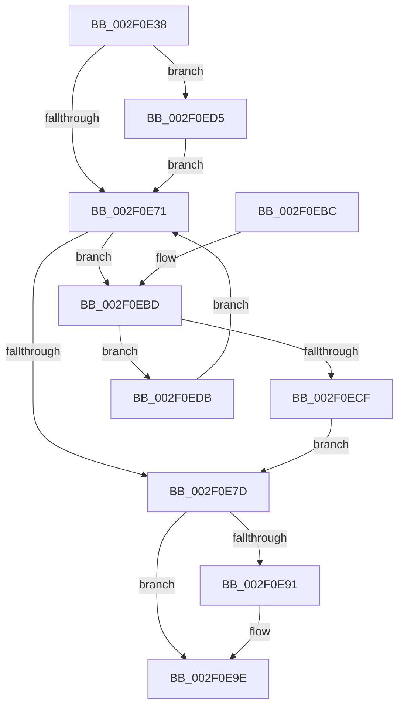

# PsGetNextPartitionUnsafe

- RVA: `0x002F0E38`–`0x002F0EE0` (길이 `168` bytes)
- VA: `0x00000001402F0E38`
- 실행 섹션: `.text`
- PDB 이름 있음: `예`; PDB Function 태그: `아니요`
- unwind 정보 RVA: `0x00071D88`
- 디코드: `46`개 명령, `168/168` bytes 표시
- 미해석 바이트: `0` (있으면 어셈블리에 `.byte`로 보존)

> 이 문서는 커널 이미지의 기계어와 PDB 기호를 분석해 생성했습니다. 4번과 5번은 함수 원형과 자료형을 바이너리 사용 방식에서 추정한 C 해석이며 원본 소스 복구 결과는 아닙니다.

## 1. Dependencies

- 직접 호출 지점: **4**; 고유 호출 대상: **4**
- 직접 호출자로 확인된 함수: **6**
- RIP 상대 이미지 참조: **2**

### Outgoing calls
- `0x002F0E5D` → [ExAcquireSpinLockShared](../24/ExAcquireSpinLockShared_function_0024DCE0.md) (function, `0x0024DCE0`)
- `0x002F0E87` → [ExReleaseSpinLockShared](ExReleaseSpinLockShared_function_002F0EF0.md) (function, `0x002F0EF0`)
- `0x002F0E99` → [ObfDereferenceObjectWithTag](ObfDereferenceObjectWithTag_function_002F78E0.md) (function, `0x002F78E0`)
- `0x002F0EC6` → [ObReferenceObjectSafeWithTag](../21/ObReferenceObjectSafeWithTag_function_00210EE0.md) (function, `0x00210EE0`)

### Direct callers
- [CcGetDirtyPages](CcGetDirtyPages_function_002F0720.md) at `0x002F0750`
- [CcForEachPartition](CcForEachPartition_function_002F0828.md) at `0x002F0857`
- [PsGetNextPartition](../3B/PsGetNextPartition_function_003B9D5C.md) at `0x003B9D6B`
- [CcCoalescingCallBack](../3C/CcCoalescingCallBack_function_003CA040.md) at `0x003CA05E`
- [CcIsThereDirtyData](../48/CcIsThereDirtyData_function_0048BE30.md) at `0x0048BE5A`
- [ExSwapinWorkerThreads](../../page/A6/ExSwapinWorkerThreads_function_00A68C40.md) at `0x00A68CB4`

### Static image references
- `0x002F0E56` → RVA `0x00F05D60` (`.data`; read)
- `0x002F0E62` → RVA `0x00E087F0` (`.data`; read)

## 2. Other-region calls and transfers

- 다른 실행 섹션으로 향하는 call: **0**
- 별도 외부 분기/꼬리 이동을 확인하지 못했습니다.

## 3. Assembly (complete function range)

```asm
002F0E38  48 8B C4                        mov rax, rsp
002F0E3B  48 89 58 08                     mov qword ptr [rax + 8], rbx
002F0E3F  48 89 68 10                     mov qword ptr [rax + 0x10], rbp
002F0E43  48 89 70 18                     mov qword ptr [rax + 0x18], rsi
002F0E47  48 89 78 20                     mov qword ptr [rax + 0x20], rdi
002F0E4B  41 56                           push r14
002F0E4D  48 83 EC 20                     sub rsp, 0x20
002F0E51  48 8B F9                        mov rdi, rcx
002F0E54  33 F6                           xor esi, esi
002F0E56  48 8D 0D 03 4F C1 00            lea rcx, [rip + 0xc14f03]
002F0E5D  E8 7E CE F5 FF                  call 0x14024dce0
002F0E62  48 8B 1D 87 79 B1 00            mov rbx, qword ptr [rip + 0xb17987]
002F0E69  44 8A F0                        mov r14b, al
002F0E6C  48 85 FF                        test rdi, rdi
002F0E6F  75 64                           jne 0x1402f0ed5
002F0E71  48 8D 05 78 79 B1 00            lea rax, [rip + 0xb17978]
002F0E78  48 3B D8                        cmp rbx, rax
002F0E7B  75 40                           jne 0x1402f0ebd
002F0E7D  41 8A D6                        mov dl, r14b
002F0E80  48 8D 0D D9 4E C1 00            lea rcx, [rip + 0xc14ed9]
002F0E87  E8 64 00 00 00                  call 0x1402f0ef0
002F0E8C  48 85 FF                        test rdi, rdi
002F0E8F  74 0D                           je 0x1402f0e9e
002F0E91  BA 50 73 45 6E                  mov edx, 0x6e457350
002F0E96  48 8B CF                        mov rcx, rdi
002F0E99  E8 42 6A 00 00                  call 0x1402f78e0
002F0E9E  48 8B 5C 24 30                  mov rbx, qword ptr [rsp + 0x30]
002F0EA3  48 8B C6                        mov rax, rsi
002F0EA6  48 8B 74 24 40                  mov rsi, qword ptr [rsp + 0x40]
002F0EAB  48 8B 6C 24 38                  mov rbp, qword ptr [rsp + 0x38]
002F0EB0  48 8B 7C 24 48                  mov rdi, qword ptr [rsp + 0x48]
002F0EB5  48 83 C4 20                     add rsp, 0x20
002F0EB9  41 5E                           pop r14
002F0EBB  C3                              ret
002F0EBC  CC                              int3
002F0EBD  BA 50 73 45 6E                  mov edx, 0x6e457350
002F0EC2  48 8D 4B C8                     lea rcx, [rbx - 0x38]
002F0EC6  E8 15 00 F2 FF                  call 0x140210ee0
002F0ECB  84 C0                           test al, al
002F0ECD  74 0C                           je 0x1402f0edb
002F0ECF  48 8D 73 C8                     lea rsi, [rbx - 0x38]
002F0ED3  EB A8                           jmp 0x1402f0e7d
002F0ED5  48 8B 5F 38                     mov rbx, qword ptr [rdi + 0x38]
002F0ED9  EB 96                           jmp 0x1402f0e71
002F0EDB  48 8B 1B                        mov rbx, qword ptr [rbx]
002F0EDE  EB 91                           jmp 0x1402f0e71
```

## 4. C-style interpretation (structured pseudocode)

```c
__int64 __fastcall PsGetNextPartitionUnsafe(__int64 a1)
{
    __int64 result;
    __int64 v_rsi;
    __int64 v_rsp;
    unsigned __int64 v_stack_p10;
    unsigned __int64 v_stack_p18;
    unsigned __int64 v_stack_p20;
    unsigned __int64 v_stack_p8;

    *(unsigned __int64 *)(v_rsp + 8) = v_rbx;
    *(unsigned __int64 *)(v_rsp + 16) = v_rbp;
    *(unsigned __int64 *)(v_rsp + 24) = v_rsi;
    *(unsigned __int64 *)(v_rsp + 32) = v_rdi;
    v_rsp = (v_rsp) - (32);
    v_rsi = 0;
    result = ExAcquireSpinLockShared(v_rip + 12668675, a2, a3, a4);
    if (a1 != 0) goto loc_002F0ED5;
loc_002F0E71:
    if ((*(unsigned __int64 *)(v_rip + 11630983)) != (v_rip + 11630968)) goto loc_002F0EBD;
loc_002F0E7D:
    result = ExReleaseSpinLockShared(v_rip + 12668633, (unsigned __int8)((unsigned __int8)(result)), a3, a4);
    if (a1 != 0) {
        a2 = 0x6E457350ULL;
        a1 = a1;
        result = ObfDereferenceObjectWithTag(a1, a2, a3, a4);
    }
    v_rsp = (v_rsp) + (32);
    return 0;
loc_002F0EBD:
    result = ObReferenceObjectSafeWithTag(v_stack_p8 - 56, (unsigned int)(0x6E457350ULL), a3, a4);
    if ((unsigned __int8)(result) == 0) goto loc_002F0EDB;
    goto loc_002F0E7D;
loc_002F0ED5:
    goto loc_002F0E71;
loc_002F0EDB:
    goto loc_002F0E71;
}
```

## 5. (Beta) C Style

```c
int64_t PsGetNextPartitionUnsafe(int64_t Arg1)
{
    int64_t result;
    int64_t local_rsi;
    int64_t local_rsp;
    uint64_t v_stack_p10;
    uint64_t v_stack_p18;
    uint64_t v_stack_p20;
    uint64_t v_stack_p8;

    *(uint64_t *)(local_rsp + 0x8) = local_rbx;
    *(uint64_t *)(local_rsp + 0x10) = local_rbp;
    *(uint64_t *)(local_rsp + 0x18) = local_rsi;
    *(uint64_t *)(local_rsp + 0x20) = local_rdi;
    local_rsp = (local_rsp) - (32);
    local_rsi = 0;
    result = ExAcquireSpinLockShared(v_rip + 12668675, a2, a3, a4);
    if (Arg1 != 0) goto loc_002F0ED5;
loc_002F0E71:
    if ((*(uint64_t *)(v_rip + 0xB17987)) != (v_rip + 11630968)) goto loc_002F0EBD;
loc_002F0E7D:
    result = ExReleaseSpinLockShared(v_rip + 12668633, (uint8_t)((uint8_t)(result)), a3, a4);
    if (Arg1 != 0) {
        a2 = 0x6E457350ULL;
        Arg1 = Arg1;
        result = ObfDereferenceObjectWithTag(Arg1, a2, a3, a4);
    }
    local_rsp = (local_rsp) + (32);
    return 0;
loc_002F0EBD:
    result = ObReferenceObjectSafeWithTag(v_stack_p8 - 56, (uint32_t)(0x6E457350ULL), a3, a4);
    if ((uint8_t)(result) == 0) goto loc_002F0EDB;
    goto loc_002F0E7D;
loc_002F0ED5:
    goto loc_002F0E71;
loc_002F0EDB:
    goto loc_002F0E71;
}
```

## 6. Execution-region graph

[열기: 2D/3D 그래프와 함수 탐색 컨트롤 패널](../../../control-panel.html?section=text&rva=0x002F0E38&view=graph)

- 2D 그래프는 위에서 아래로 흐르고, 3D 그래프는 빈 공간을 드래그해 회전합니다. Shift+드래그는 이동, 휠은 확대·축소, 함수 노드 선택은 대상 보고서 이동입니다.

### Static fallback


