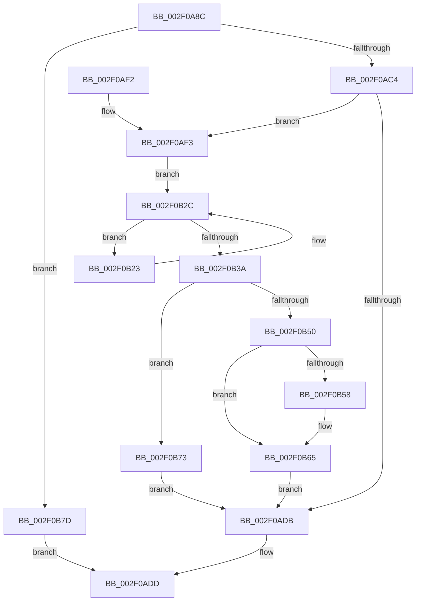

# RtlCSparseBitmapBitmaskWrite

- RVA: `0x002F0A8C`–`0x002F0B8F` (길이 `259` bytes)
- VA: `0x00000001402F0A8C`
- 실행 섹션: `.text`
- PDB 이름 있음: `예`; PDB Function 태그: `아니요`
- unwind 정보 RVA: `0x00071D34`
- 디코드: `72`개 명령, `259/259` bytes 표시
- 미해석 바이트: `0` (있으면 어셈블리에 `.byte`로 보존)

> 이 문서는 커널 이미지의 기계어와 PDB 기호를 분석해 생성했습니다. 4번과 5번은 함수 원형과 자료형을 바이너리 사용 방식에서 추정한 C 해석이며 원본 소스 복구 결과는 아닙니다.

## 1. Dependencies

- 직접 호출 지점: **5**; 고유 호출 대상: **5**
- 직접 호출자로 확인된 함수: **1**
- RIP 상대 이미지 참조: **1**

### Outgoing calls
- `0x002F0AD0` → [RtlpCSparseBitmapPageCommit](RtlpCSparseBitmapPageCommit_function_002F0B98.md) (function, `0x002F0B98`)
- `0x002F0B41` → [RtlpCSparseBitmapUnlock](RtlpCSparseBitmapUnlock_function_002F0DD0.md) (function, `0x002F0DD0`)
- `0x002F0B60` → [KiLowerIrqlProcessIrqlFlags](../4F/KiLowerIrqlProcessIrqlFlags_function_004F5698.md) (function, `0x004F5698`)
- `0x002F0B73` → [KeLeaveGuardedRegion](../2E/KeLeaveGuardedRegion_function_002E2C40.md) (function, `0x002E2C40`)
- `0x002F0B83` → [RtlCSparseBitmapBitsClear](../2E/RtlCSparseBitmapBitsClear_function_002E34C4.md) (function, `0x002E34C4`)

### Direct callers
- [RtlpHpSegSegmentAllocate](../32/RtlpHpSegSegmentAllocate_function_00326A78.md) at `0x00326B0D`

### Static image references
- `0x002F0B50` → RVA `0x00FC6D20` (`ALMOSTRO`; read)

## 2. Other-region calls and transfers

- 다른 실행 섹션으로 향하는 call: **0**
- 별도 외부 분기/꼬리 이동을 확인하지 못했습니다.

## 3. Assembly (complete function range)

```asm
002F0A8C  4C 8B DC                        mov r11, rsp
002F0A8F  49 89 5B 08                     mov qword ptr [r11 + 8], rbx
002F0A93  49 89 6B 10                     mov qword ptr [r11 + 0x10], rbp
002F0A97  49 89 73 18                     mov qword ptr [r11 + 0x18], rsi
002F0A9B  57                              push rdi
002F0A9C  48 83 EC 40                     sub rsp, 0x40
002F0AA0  33 C0                           xor eax, eax
002F0AA2  0F 57 C0                        xorps xmm0, xmm0
002F0AA5  49 89 43 D9                     mov qword ptr [r11 - 0x27], rax
002F0AA9  49 8B E9                        mov rbp, r9
002F0AAC  49 89 43 D8                     mov qword ptr [r11 - 0x28], rax
002F0AB0  48 8B FA                        mov rdi, rdx
002F0AB3  48 8B F1                        mov rsi, rcx
002F0AB6  0F 11 44 24 30                  movups xmmword ptr [rsp + 0x30], xmm0
002F0ABB  4D 85 C9                        test r9, r9
002F0ABE  0F 84 B9 00 00 00               je 0x1402f0b7d
002F0AC4  48 C1 EA 0F                     shr rdx, 0xf
002F0AC8  4D 8D 4B D8                     lea r9, [r11 - 0x28]
002F0ACC  4D 8D 43 E8                     lea r8, [r11 - 0x18]
002F0AD0  E8 C3 00 00 00                  call 0x1402f0b98
002F0AD5  8B D8                           mov ebx, eax
002F0AD7  85 C0                           test eax, eax
002F0AD9  79 18                           jns 0x1402f0af3
002F0ADB  8B C3                           mov eax, ebx
002F0ADD  48 8B 5C 24 50                  mov rbx, qword ptr [rsp + 0x50]
002F0AE2  48 8B 6C 24 58                  mov rbp, qword ptr [rsp + 0x58]
002F0AE7  48 8B 74 24 60                  mov rsi, qword ptr [rsp + 0x60]
002F0AEC  48 83 C4 40                     add rsp, 0x40
002F0AF0  5F                              pop rdi
002F0AF1  C3                              ret
002F0AF2  CC                              int3
002F0AF3  4C 8B 4E 08                     mov r9, qword ptr [rsi + 8]
002F0AF7  4C 8B C7                        mov r8, rdi
002F0AFA  40 80 E7 3F                     and dil, 0x3f
002F0AFE  49 C1 E8 06                     shr r8, 6
002F0B02  40 8A CF                        mov cl, dil
002F0B05  41 BA 03 00 00 00               mov r10d, 3
002F0B0B  49 D3 E2                        shl r10, cl
002F0B0E  48 D3 E5                        shl rbp, cl
002F0B11  49 F7 D2                        not r10
002F0B14  4B 8B 14 C1                     mov rdx, qword ptr [r9 + r8*8]
002F0B18  49 8B CA                        mov rcx, r10
002F0B1B  48 23 CA                        and rcx, rdx
002F0B1E  48 8B C2                        mov rax, rdx
002F0B21  EB 09                           jmp 0x1402f0b2c
002F0B23  49 8B CA                        mov rcx, r10
002F0B26  48 8B D0                        mov rdx, rax
002F0B29  48 23 C8                        and rcx, rax
002F0B2C  48 0B CD                        or rcx, rbp
002F0B2F  F0 4B 0F B1 0C C1               lock cmpxchg qword ptr [r9 + r8*8], rcx
002F0B35  48 3B D0                        cmp rdx, rax
002F0B38  75 E9                           jne 0x1402f0b23
002F0B3A  33 DB                           xor ebx, ebx
002F0B3C  48 8D 4C 24 30                  lea rcx, [rsp + 0x30]
002F0B41  E8 8A 02 00 00                  call 0x1402f0dd0
002F0B46  48 8B 44 24 28                  mov rax, qword ptr [rsp + 0x28]
002F0B4B  38 58 30                        cmp byte ptr [rax + 0x30], bl
002F0B4E  74 23                           je 0x1402f0b73
002F0B50  39 1D CA 61 CD 00               cmp dword ptr [rip + 0xcd61ca], ebx
002F0B56  74 0D                           je 0x1402f0b65
002F0B58  44 0F 20 C1                     mov rcx, cr8
002F0B5C  8A 54 24 20                     mov dl, byte ptr [rsp + 0x20]
002F0B60  E8 33 4B 20 00                  call 0x1404f5698
002F0B65  0F B6 44 24 20                  movzx eax, byte ptr [rsp + 0x20]
002F0B6A  44 0F 22 C0                     mov cr8, rax
002F0B6E  E9 68 FF FF FF                  jmp 0x1402f0adb
002F0B73  E8 C8 20 FF FF                  call 0x1402e2c40
002F0B78  E9 5E FF FF FF                  jmp 0x1402f0adb
002F0B7D  41 B8 02 00 00 00               mov r8d, 2
002F0B83  E8 3C 29 FF FF                  call 0x1402e34c4
002F0B88  33 C0                           xor eax, eax
002F0B8A  E9 4E FF FF FF                  jmp 0x1402f0add
```

## 4. C-style interpretation (structured pseudocode)

```c
__int64 __fastcall RtlCSparseBitmapBitmaskWrite(__int64 a1, __int64 a2, __int64 a3, __int64 a4)
{
    __int64 result;
    __int64 v_r10;
    __int64 v_rbp;
    __int64 v_rbx;
    __int64 v_rdi;
    __int64 v_rsp;
    unsigned __int64 v_stack_m18;
    unsigned __int64 v_stack_p10;
    unsigned __int64 v_stack_p18;
    unsigned __int8 v_stack_p20;
    unsigned __int64 v_stack_p28;
    unsigned __int64 v_stack_p30;
    unsigned __int64 v_stack_p8;

    *(unsigned __int64 *)(v_rsp + 8) = v_rbx;
    *(unsigned __int64 *)(v_rsp + 16) = v_rbp;
    *(unsigned __int64 *)(v_rsp + 24) = v_rsi;
    v_rsp = (v_rsp) - (64);
    result = 0;
    *(unsigned __int64 *)(v_rsp - 39) = 0;
    *(unsigned __int64 *)(v_rsp - 40) = 0;
    v_stack_m18 = v_xmm0;
    if (a4 == 0) goto loc_002F0B7D;
    a2 = (a2) >> (15);
    result = RtlpCSparseBitmapPageCommit(a1, a2, v_rsp - 24, v_rsp - 40);
    if (!sign_flag) goto loc_002F0AF3;
loc_002F0ADB:
loc_002F0ADD:
    v_rsp = (v_rsp) + (64);
    return (unsigned int)((unsigned int)((unsigned int)((unsigned int)(result))));
loc_002F0AF3:
    v_rdi = (unsigned __int8)((a2) & (63));
    a3 = (a2) >> (6);
    v_r10 = (3) << ((unsigned __int8)((unsigned __int8)(v_rdi)));
    v_rbp = (v_stack_p10) << ((unsigned __int8)((unsigned __int8)(v_rdi)));
    v_r10 = ~(v_r10);
    a1 = (v_r10) & (*(unsigned __int64 *)(*(unsigned __int64 *)(v_stack_p18 + 8) + a3 * 8));
    goto loc_002F0B2C;
loc_002F0B23:
    a1 = (v_r10) & (*(unsigned __int64 *)(*(unsigned __int64 *)(v_stack_p18 + 8) + a3 * 8));
loc_002F0B2C:
    a1 = (a1) | (v_rbp);
    if ((*(unsigned __int64 *)(*(unsigned __int64 *)(v_stack_p18 + 8) + a3 * 8)) != (*(unsigned __int64 *)(*(unsigned __int64 *)(v_stack_p18 + 8) + a3 * 8))) goto loc_002F0B23;
    v_rbx = 0;
    result = RtlpCSparseBitmapUnlock(v_stack_p30, *(unsigned __int64 *)(*(unsigned __int64 *)(v_stack_p18 + 8) + a3 * 8), a3, *(unsigned __int64 *)(v_stack_p18 + 8));
    if ((*(unsigned __int8 *)(v_stack_p28 + 48)) == 0) goto loc_002F0B73;
    result = v_stack_p28;
    if ((*(unsigned int *)(v_rip + 13459914)) != 0) {
        a1 = v_cr8;
        a2 = v_stack_p20;
        result = KiLowerIrqlProcessIrqlFlags(a1, a2, a3, *(unsigned __int64 *)(v_stack_p18 + 8));
    }
    goto loc_002F0ADB;
loc_002F0B73:
    result = KeLeaveGuardedRegion(a1, a2, a3, *(unsigned __int64 *)(v_stack_p18 + 8));
    goto loc_002F0ADB;
loc_002F0B7D:
    result = RtlCSparseBitmapBitsClear(a1, a2, 2, *(unsigned __int64 *)(v_stack_p18 + 8));
    result = 0;
    goto loc_002F0ADD;
}
```

## 5. (Beta) C Style

```c
int64_t RtlCSparseBitmapBitmaskWrite(void *Arg1, int64_t Arg2, int64_t Arg3, int64_t Arg4)
{
    uint8_t *arg1 = (uint8_t *)Arg1;

    int64_t result;
    int64_t local_r10;
    int64_t local_rbp;
    int64_t local_rbx;
    int64_t local_rdi;
    int64_t local_rsp;
    uint64_t v_stack_m18;
    uint64_t v_stack_p10;
    uint64_t v_stack_p18;
    uint8_t v_stack_p20;
    uint64_t v_stack_p28;
    uint64_t v_stack_p30;
    uint64_t v_stack_p8;

    *(uint64_t *)(local_rsp + 0x8) = local_rbx;
    *(uint64_t *)(local_rsp + 0x10) = local_rbp;
    *(uint64_t *)(local_rsp + 0x18) = local_rsi;
    local_rsp = (local_rsp) - (64);
    result = 0;
    *(uint64_t *)(local_rsp - 0x27) = 0;
    *(uint64_t *)(local_rsp - 0x28) = 0;
    v_stack_m18 = v_xmm0;
    if (Arg4 == 0) goto loc_002F0B7D;
    Arg2 = (Arg2) >> (15);
    result = RtlpCSparseBitmapPageCommit(Arg1, Arg2, local_rsp - 24, local_rsp - 40);
    if (!sign_flag) goto loc_002F0AF3;
loc_002F0ADB:
loc_002F0ADD:
    local_rsp = (local_rsp) + (64);
    return (uint32_t)((uint32_t)((uint32_t)((uint32_t)(result))));
loc_002F0AF3:
    local_rdi = (uint8_t)((Arg2) & (63));
    Arg3 = (Arg2) >> (6);
    local_r10 = (3) << ((uint8_t)((uint8_t)(local_rdi)));
    local_rbp = (v_stack_p10) << ((uint8_t)((uint8_t)(local_rdi)));
    local_r10 = ~(local_r10);
    Arg1 = (local_r10) & (*(uint64_t *)(*(uint64_t *)(v_stack_p18 + 0x8) + Arg3 * 8));
    goto loc_002F0B2C;
loc_002F0B23:
    Arg1 = (local_r10) & (*(uint64_t *)(*(uint64_t *)(v_stack_p18 + 0x8) + Arg3 * 8));
loc_002F0B2C:
    Arg1 = (Arg1) | (local_rbp);
    if ((*(uint64_t *)(*(uint64_t *)(v_stack_p18 + 0x8) + Arg3 * 8)) != (*(uint64_t *)(*(uint64_t *)(v_stack_p18 + 0x8) + Arg3 * 8))) goto loc_002F0B23;
    local_rbx = 0;
    result = RtlpCSparseBitmapUnlock(v_stack_p30, *(uint64_t *)(*(uint64_t *)(v_stack_p18 + 0x8) + Arg3 * 8), Arg3, *(uint64_t *)(v_stack_p18 + 0x8));
    if ((*(uint8_t *)(v_stack_p28 + 0x30)) == 0) goto loc_002F0B73;
    result = v_stack_p28;
    if ((*(uint32_t *)(v_rip + 0xCD61CA)) != 0) {
        Arg1 = v_cr8;
        Arg2 = v_stack_p20;
        result = KiLowerIrqlProcessIrqlFlags(Arg1, Arg2, Arg3, *(uint64_t *)(v_stack_p18 + 0x8));
    }
    goto loc_002F0ADB;
loc_002F0B73:
    result = KeLeaveGuardedRegion(Arg1, Arg2, Arg3, *(uint64_t *)(v_stack_p18 + 0x8));
    goto loc_002F0ADB;
loc_002F0B7D:
    result = RtlCSparseBitmapBitsClear(Arg1, Arg2, 2, *(uint64_t *)(v_stack_p18 + 0x8));
    result = 0;
    goto loc_002F0ADD;
}
```

### 관측된 메모리 오프셋

구조체 형식이 확인되지 않은 접근은 인자 기준의 오프셋으로만 기록했습니다.

| 기준 인자 | 오프셋 표현 | 폭 (bit) | 접근 |
|---|---:|---:|---|
| `Arg1` | `+ 0x8` | `64` | `R` |

## 6. Execution-region graph

[열기: 2D/3D 그래프와 함수 탐색 컨트롤 패널](../../../control-panel.html?section=text&rva=0x002F0A8C&view=graph)

- 2D 그래프는 위에서 아래로 흐르고, 3D 그래프는 빈 공간을 드래그해 회전합니다. Shift+드래그는 이동, 휠은 확대·축소, 함수 노드 선택은 대상 보고서 이동입니다.

### Static fallback


