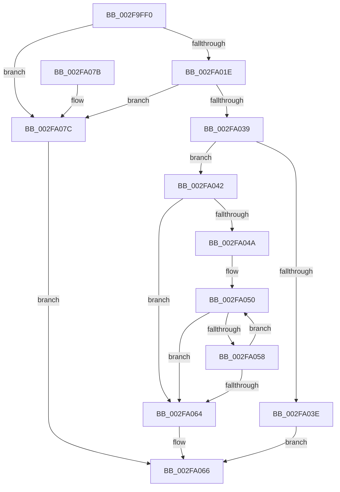

# RtlCaptureStackBackTrace

- RVA: `0x002F9FF0`–`0x002FA083` (길이 `147` bytes)
- VA: `0x00000001402F9FF0`
- 실행 섹션: `.text`
- PDB 이름 있음: `예`; PDB Function 태그: `아니요`
- unwind 정보 RVA: `0x00069AD0`
- 디코드: `50`개 명령, `147/147` bytes 표시
- 미해석 바이트: `0` (있으면 어셈블리에 `.byte`로 보존)

> 이 문서는 커널 이미지의 기계어와 PDB 기호를 분석해 생성했습니다. 4번과 5번은 함수 원형과 자료형을 바이너리 사용 방식에서 추정한 C 해석이며 원본 소스 복구 결과는 아닙니다.

## 1. Dependencies

- 직접 호출 지점: **1**; 고유 호출 대상: **1**
- 직접 호출자로 확인된 함수: **34**
- RIP 상대 이미지 참조: **0**

### Outgoing calls
- `0x002FA02D` → [RtlWalkFrameChain](RtlWalkFrameChain_function_002F85E0.md) (function, `0x002F85E0`)

### Direct callers
- [ExpFreeOwnerEntry](../20/ExpFreeOwnerEntry_function_0020F740.md) at `0x0020F8D2`
- [ObpPushStackInfo](../21/ObpPushStackInfo_function_002109E4.md) at `0x00210A75`
- [ExEnterPriorityRegionAndAcquireResourceShared](../21/ExEnterPriorityRegionAndAcquireResourceShared_function_00213870.md) at `0x00213981`
- [sub_002142F9](../21/Unknown_function_002142F9.md) at `0x00214BD5`
- [sub_002142F9](../21/Unknown_function_002142F9.md) at `0x00214C70`
- [sub_0025EB5D](../25/Unknown_function_0025EB5D.md) at `0x0025ECAD`
- [sub_00260D5A](../26/Unknown_function_00260D5A.md) at `0x00260EF5`
- [sub_00260D5A](../26/Unknown_function_00260D5A.md) at `0x00260F7C`
- [sub_0027475D](../27/Unknown_function_0027475D.md) at `0x00275374`
- [sub_0027475D](../27/Unknown_function_0027475D.md) at `0x002753FB`
- [sub_002F1861](Unknown_function_002F1861.md) at `0x002F18EA`
- [sub_0034FEB1](../34/Unknown_function_0034FEB1.md) at `0x00350000`
- [PsLeavePriorityRegion](../39/PsLeavePriorityRegion_function_00390F00.md) at `0x00390F90`
- [PsBoostThreadIo](../39/PsBoostThreadIo_function_003927C0.md) at `0x0039291F`
- [PsBoostThreadIoEx](../39/PsBoostThreadIoEx_function_00392C00.md) at `0x00392D6C`
- [PsEnterPriorityRegion](../3F/PsEnterPriorityRegion_function_003F8CD0.md) at `0x003F8D5C`
- [SepGetStackTraceHash](../41/SepGetStackTraceHash_function_0041E960.md) at `0x0041E9C0`
- [RtlGetCallersAddress](../46/RtlGetCallersAddress_function_004646A0.md) at `0x004646CC`
- [RtlStdLogStackTrace](../49/RtlStdLogStackTrace_function_00495BF8.md) at `0x00495C3D`
- [MiCaptureStackTraceCallout](../4C/MiCaptureStackTraceCallout_function_004C8684.md) at `0x004C86A0`
- [DifGetReturnAddressForWrappers](../4D/DifGetReturnAddressForWrappers_function_004D3C08.md) at `0x004D3C29`
- [sub_005AB166](../5A/Unknown_function_005AB166.md) at `0x005AB19D`
- [sub_005AF8A0](../5A/Unknown_function_005AF8A0.md) at `0x005AF953`
- [RtlpHpHeapHandleError](../5F/RtlpHpHeapHandleError_function_005F12F4.md) at `0x005F1330`
- [CarInitializeTelemetryData](../61/CarInitializeTelemetryData_function_00618BB0.md) at `0x00618C06`
- [UcOnUnexpectedCodePath](../69/UcOnUnexpectedCodePath_function_0069AED0.md) at `0x0069B082`
- [CmpLogDirtyVectorUse](../../page/9B/CmpLogDirtyVectorUse_function_009B69D4.md) at `0x009B6A44`
- [VfPendingFinishLogging](../../pagevrfy/BA/VfPendingFinishLogging_function_00BA1A60.md) at `0x00BA1A7D`
- [ViFaultsInjectionNotification](../../pagevrfy/BA/ViFaultsInjectionNotification_function_00BA6BDC.md) at `0x00BA6CBB`
- [VfDeadlockInitializeResource](../../pagevrfy/BA/VfDeadlockInitializeResource_function_00BA80A0.md) at `0x00BA8149`
- [ViIrqlLogCRStackTrace](../../pagevrfy/BA/ViIrqlLogCRStackTrace_function_00BAD6E8.md) at `0x00BAD73C`
- [IovpLogStackCallout](../../pagevrfy/BB/IovpLogStackCallout_function_00BB6B10.md) at `0x00BB6B2D`
- [ViPtCaptureStackTraceCallout](../../pagevrfy/BB/ViPtCaptureStackTraceCallout_function_00BB7370.md) at `0x00BB73BA`
- [VfDeadlockReleaseResource](../../pagevrfy/BB/VfDeadlockReleaseResource_function_00BB759C.md) at `0x00BB764B`
- [ViKeIrqlLogCommon](../../pagevrfy/BB/ViKeIrqlLogCommon_function_00BB8290.md) at `0x00BB82EB`
- [VfDeadlockAcquireResource](../../pagevrfy/BB/VfDeadlockAcquireResource_function_00BB83B4.md) at `0x00BB84E6`
- [VfCheckUserHandle](../../pagevrfy/BB/VfCheckUserHandle_function_00BB9218.md) at `0x00BB92A0`

### Static image references
- 디코드된 RIP-relative 메모리 참조가 없습니다.

## 2. Other-region calls and transfers

- 다른 실행 섹션으로 향하는 call: **0**
- 별도 외부 분기/꼬리 이동을 확인하지 못했습니다.

## 3. Assembly (complete function range)

```asm
002F9FF0  48 89 5C 24 08                  mov qword ptr [rsp + 8], rbx
002F9FF5  48 89 6C 24 10                  mov qword ptr [rsp + 0x10], rbp
002F9FFA  48 89 74 24 18                  mov qword ptr [rsp + 0x18], rsi
002F9FFF  57                              push rdi
002FA000  48 83 EC 20                     sub rsp, 0x20
002FA004  BF FF FF 00 00                  mov edi, 0xffff
002FA009  49 8B F1                        mov rsi, r9
002FA00C  3B D7                           cmp edx, edi
002FA00E  49 8B E8                        mov rbp, r8
002FA011  8B D9                           mov ebx, ecx
002FA013  0F 46 FA                        cmovbe edi, edx
002FA016  81 F9 FE 00 00 00               cmp ecx, 0xfe
002FA01C  77 5E                           ja 0x1402fa07c
002FA01E  FF C3                           inc ebx
002FA020  48 8B CD                        mov rcx, rbp
002FA023  44 8B C3                        mov r8d, ebx
002FA026  41 C1 E0 08                     shl r8d, 8
002FA02A  8D 14 1F                        lea edx, [rdi + rbx]
002FA02D  E8 AE E5 FF FF                  call 0x1402f85e0
002FA032  44 8B C0                        mov r8d, eax
002FA035  3B C3                           cmp eax, ebx
002FA037  76 43                           jbe 0x1402fa07c
002FA039  48 85 F6                        test rsi, rsi
002FA03C  75 04                           jne 0x1402fa042
002FA03E  2B C3                           sub eax, ebx
002FA040  EB 24                           jmp 0x1402fa066
002FA042  33 D2                           xor edx, edx
002FA044  8B C2                           mov eax, edx
002FA046  85 FF                           test edi, edi
002FA048  74 1A                           je 0x1402fa064
002FA04A  66 0F 1F 44 00 00               nop word ptr [rax + rax]
002FA050  8D 0C 18                        lea ecx, [rax + rbx]
002FA053  41 3B C8                        cmp ecx, r8d
002FA056  73 0C                           jae 0x1402fa064
002FA058  8B C8                           mov ecx, eax
002FA05A  FF C0                           inc eax
002FA05C  03 54 CD 00                     add edx, dword ptr [rbp + rcx*8]
002FA060  3B C7                           cmp eax, edi
002FA062  72 EC                           jb 0x1402fa050
002FA064  89 16                           mov dword ptr [rsi], edx
002FA066  48 8B 5C 24 30                  mov rbx, qword ptr [rsp + 0x30]
002FA06B  48 8B 6C 24 38                  mov rbp, qword ptr [rsp + 0x38]
002FA070  48 8B 74 24 40                  mov rsi, qword ptr [rsp + 0x40]
002FA075  48 83 C4 20                     add rsp, 0x20
002FA079  5F                              pop rdi
002FA07A  C3                              ret
002FA07B  CC                              int3
002FA07C  33 D2                           xor edx, edx
002FA07E  0F B7 C2                        movzx eax, dx
002FA081  EB E3                           jmp 0x1402fa066
```

## 4. C-style interpretation (structured pseudocode)

```c
__int64 __fastcall RtlCaptureStackBackTrace(int a1, int a2, __int64 a3, __int64 a4)
{
    __int64 result;
    __int64 v_rbx;
    __int64 v_rdi;
    __int64 v_rsp;
    unsigned __int64 v_stack_p10;
    unsigned __int64 v_stack_p18;
    unsigned __int64 v_stack_p8;

    v_stack_p8 = v_rbx;
    v_stack_p10 = v_rbp;
    v_stack_p18 = v_rsi;
    v_rsp = (v_rsp) - (32);
    v_rdi = (unsigned int)(0xFFFFULL);
    if (a2 <= ((unsigned int)((unsigned int)(0xFFFFULL)))) { v_rdi = a2; }
    if (a1 > 254) goto loc_002FA07C;
    v_rbx = (unsigned int)(((unsigned int)(a1)) + 1);
    a3 = (unsigned int)(((unsigned int)((unsigned int)(v_rbx))) << (8));
    result = RtlWalkFrameChain(a3, v_rdi + v_rbx * 1, a3, a4);
    if (((unsigned int)(result)) <= ((unsigned int)(v_rbx))) goto loc_002FA07C;
    if (a4 != 0) goto loc_002FA042;
    result = (unsigned int)((result) - ((unsigned int)(v_rbx)));
    goto loc_002FA066;
loc_002FA042:
    a2 = 0;
    if ((unsigned int)(v_rdi) == 0) goto loc_002FA064;
loc_002FA050:
    if (((unsigned int)(0 + v_rbx * 1)) >= ((unsigned int)((unsigned int)((unsigned int)(result))))) goto loc_002FA064;
    result = (unsigned int)((0) + 1);
    a2 = (unsigned int)((a2) + (*(unsigned int *)(a3 + 0 * 8)));
    if (((unsigned int)(result)) < ((unsigned int)(v_rdi))) goto loc_002FA050;
loc_002FA064:
    *(unsigned int *)(a4) = a2;
loc_002FA066:
    v_rsp = (v_rsp) + (32);
    return result;
loc_002FA07C:
    a2 = 0;
    goto loc_002FA066;
}
```

## 5. (Beta) C Style

```c
int64_t RtlCaptureStackBackTrace(int32_t Arg1, int32_t Arg2, void *Arg3, int64_t Arg4)
{
    uint8_t *arg3 = (uint8_t *)Arg3;

    int64_t result;
    int64_t local_rbx;
    int64_t local_rdi;
    int64_t local_rsp;
    uint64_t v_stack_p10;
    uint64_t v_stack_p18;
    uint64_t v_stack_p8;

    v_stack_p8 = local_rbx;
    v_stack_p10 = local_rbp;
    v_stack_p18 = local_rsi;
    local_rsp = (local_rsp) - (32);
    local_rdi = (uint32_t)(0xFFFFULL);
    if (Arg2 <= ((uint32_t)((uint32_t)(0xFFFFULL)))) { local_rdi = Arg2; }
    if (Arg1 > 254) goto loc_002FA07C;
    local_rbx = (uint32_t)(((uint32_t)(Arg1)) + 1);
    Arg3 = (uint32_t)(((uint32_t)((uint32_t)(local_rbx))) << (8));
    result = RtlWalkFrameChain(Arg3, local_rdi + local_rbx * 1, Arg3, Arg4);
    if (((uint32_t)(result)) <= ((uint32_t)(local_rbx))) goto loc_002FA07C;
    if (Arg4 != 0) goto loc_002FA042;
    result = (uint32_t)((result) - ((uint32_t)(local_rbx)));
    goto loc_002FA066;
loc_002FA042:
    Arg2 = 0;
    if ((uint32_t)(local_rdi) == 0) goto loc_002FA064;
loc_002FA050:
    if (((uint32_t)(0 + local_rbx * 1)) >= ((uint32_t)((uint32_t)((uint32_t)(result))))) goto loc_002FA064;
    result = (uint32_t)((0) + 1);
    Arg2 = (uint32_t)((Arg2) + (*(uint32_t *)(arg3 + 0x0 * 8)));
    if (((uint32_t)(result)) < ((uint32_t)(local_rdi))) goto loc_002FA050;
loc_002FA064:
    *(uint32_t *)(Arg4) = Arg2;
loc_002FA066:
    local_rsp = (local_rsp) + (32);
    return result;
loc_002FA07C:
    Arg2 = 0;
    goto loc_002FA066;
}
```

### 관측된 메모리 오프셋

구조체 형식이 확인되지 않은 접근은 인자 기준의 오프셋으로만 기록했습니다.

| 기준 인자 | 오프셋 표현 | 폭 (bit) | 접근 |
|---|---:|---:|---|
| `Arg3` | `+ 0x0 + rcx*8` | `32` | `R` |

## 6. Execution-region graph

[열기: 2D/3D 그래프와 함수 탐색 컨트롤 패널](../../../control-panel.html?section=text&rva=0x002F9FF0&view=graph)

- 2D 그래프는 위에서 아래로 흐르고, 3D 그래프는 빈 공간을 드래그해 회전합니다. Shift+드래그는 이동, 휠은 확대·축소, 함수 노드 선택은 대상 보고서 이동입니다.

### Static fallback


