# RtlDispatchException

- RVA: `0x002F22A0`–`0x002F2744` (길이 `1,188` bytes)
- VA: `0x00000001402F22A0`
- 실행 섹션: `.text`
- PDB 이름 있음: `예`; PDB Function 태그: `예`
- unwind 정보 RVA: `0x00071F2C`
- 디코드: `284`개 명령, `1,188/1,188` bytes 표시
- 미해석 바이트: `0` (있으면 어셈블리에 `.byte`로 보존)

> 이 문서는 커널 이미지의 기계어와 PDB 기호를 분석해 생성했습니다. 4번과 5번은 함수 원형과 자료형을 바이너리 사용 방식에서 추정한 C 해석이며 원본 소스 복구 결과는 아닙니다.

## 1. Dependencies

- 직접 호출 지점: **19**; 고유 호출 대상: **16**
- 직접 호출자로 확인된 함수: **2**
- RIP 상대 이미지 참조: **3**

### Outgoing calls
- `0x002F22EE` → [memset](../6C/memset_function_006C6C40.md) (function, `0x006C6C40`)
- `0x002F2321` → [memset](../6C/memset_function_006C6C40.md) (function, `0x006C6C40`)
- `0x002F2358` → [KeQueryCurrentStackInformationEx](KeQueryCurrentStackInformationEx_function_002F7CD0.md) (function, `0x002F7CD0`)
- `0x002F2387` → [RtlpGetStackLimitsEx](../45/RtlpGetStackLimitsEx_function_0045D2E0.md) (function, `0x0045D2E0`)
- `0x002F23C5` → [RtlpValidateContextFlags2](../4E/RtlpValidateContextFlags2_function_004EF138.md) (function, `0x004EF138`)
- `0x002F2407` → [_chkstk](../6B/_chkstk_function_006BA960.md) (function, `0x006BA960`)
- `0x002F2420` → [RtlInitializeExtendedContext2](RtlInitializeExtendedContext2_function_002F5D40.md) (function, `0x002F5D40`)
- `0x002F242B` → [RtlpCopyContext](RtlpCopyContext_function_002F1E00.md) (function, `0x002F1E00`)
- `0x002F2474` → [RtlLookupFunctionEntry](RtlLookupFunctionEntry_function_002F2F30.md) (function, `0x002F2F30`)
- `0x002F24D6` → [RtlpxVirtualUnwind](RtlpxVirtualUnwind_function_002F5110.md) (function, `0x002F5110`)
- `0x002F2555` → [RtlpGetStackLimitsEx](../45/RtlpGetStackLimitsEx_function_0045D2E0.md) (function, `0x0045D2E0`)
- `0x002F25E2` → [RtlpExecuteHandlerForException](../6B/RtlpExecuteHandlerForException_function_006BAFA0.md) (function, `0x006BAFA0`)
- `0x002F2626` → [_security_check_cookie](../6A/_security_check_cookie_function_006AC640.md) (function, `0x006AC640`)
- `0x002F2687` → [RtlpGetEntireXStateAreaLength2](../4E/RtlpGetEntireXStateAreaLength2_function_004EF20C.md) (function, `0x004EF20C`)
- `0x002F269C` → [RtlpRemoveArchDisallowedXStateFeatures](RtlpRemoveArchDisallowedXStateFeatures_function_002F32FC.md) (function, `0x002F32FC`)
- `0x002F26D0` → [RtlpLogExceptionDispatch](../5E/RtlpLogExceptionDispatch_function_005E521C.md) (function, `0x005E521C`)
- `0x002F26F1` → [RtlpGetStackLimitsEx](../45/RtlpGetStackLimitsEx_function_0045D2E0.md) (function, `0x0045D2E0`)
- `0x002F2705` → [RtlpLogExceptionHandler](../5E/RtlpLogExceptionHandler_function_005E53D0.md) (function, `0x005E53D0`)
- `0x002F273E` → [RtlRaiseStatus](RtlRaiseStatus_function_002F6A50.md) (function, `0x002F6A50`)

### Direct callers
- [KiDispatchException](../3D/KiDispatchException_function_003D7650.md) at `0x003D79BD`
- [RtlRaiseException](../5E/RtlRaiseException_function_005E6B00.md) at `0x005E6C08`

### Static image references
- `0x002F22BF` → RVA `0x00E0A740` (`.data`; read)
- `0x002F2326` → RVA `0x00FC42C0` (`.data`; read)
- `0x002F2394` → RVA `0x01201841` (`CFGRO`; read)

## 2. Other-region calls and transfers

- 다른 실행 섹션으로 향하는 call: **0**
- call이 아닌 외부 분기/꼬리 이동: **1**
  - `0x002F2649` → [sub_006DF0C8](../6D/Unknown_function_006DF0C8.md) (`tail-transfer`)

## 3. Assembly (complete function range)

```asm
002F22A0  40 55                           push rbp
002F22A2  56                              push rsi
002F22A3  57                              push rdi
002F22A4  41 54                           push r12
002F22A6  41 55                           push r13
002F22A8  41 56                           push r14
002F22AA  41 57                           push r15
002F22AC  48 81 EC 30 02 00 00            sub rsp, 0x230
002F22B3  48 8D 6C 24 60                  lea rbp, [rsp + 0x60]
002F22B8  48 89 9D 20 02 00 00            mov qword ptr [rbp + 0x220], rbx
002F22BF  48 8B 05 7A 84 B1 00            mov rax, qword ptr [rip + 0xb1847a]
002F22C6  48 33 C5                        xor rax, rbp
002F22C9  48 89 85 C0 01 00 00            mov qword ptr [rbp + 0x1c0], rax
002F22D0  45 33 FF                        xor r15d, r15d
002F22D3  48 89 55 58                     mov qword ptr [rbp + 0x58], rdx
002F22D7  4C 8B EA                        mov r13, rdx
002F22DA  48 89 4D 50                     mov qword ptr [rbp + 0x50], rcx
002F22DE  4C 8B E1                        mov r12, rcx
002F22E1  33 D2                           xor edx, edx
002F22E3  48 8D 4D 70                     lea rcx, [rbp + 0x70]
002F22E7  41 8B DF                        mov ebx, r15d
002F22EA  45 8D 47 50                     lea r8d, [r15 + 0x50]
002F22EE  E8 4D 49 3D 00                  call 0x1406c6c40
002F22F3  33 D2                           xor edx, edx
002F22F5  88 5D 04                        mov byte ptr [rbp + 4], bl
002F22F8  41 B8 C0 00 00 00               mov r8d, 0xc0
002F22FE  4C 89 7D 08                     mov qword ptr [rbp + 8], r15
002F2302  48 8D 8D F8 00 00 00            lea rcx, [rbp + 0xf8]
002F2309  4C 89 7D 40                     mov qword ptr [rbp + 0x40], r15
002F230D  4C 89 7D 48                     mov qword ptr [rbp + 0x48], r15
002F2311  4C 89 7D 10                     mov qword ptr [rbp + 0x10], r15
002F2315  4C 89 7D 28                     mov qword ptr [rbp + 0x28], r15
002F2319  4C 89 7D 18                     mov qword ptr [rbp + 0x18], r15
002F231D  44 89 7D 00                     mov dword ptr [rbp], r15d
002F2321  E8 1A 49 3D 00                  call 0x1406c6c40
002F2326  F7 05 90 1F CD 00 00 00 80 00   test dword ptr [rip + 0xcd1f90], 0x800000
002F2330  0F 85 90 03 00 00               jne 0x1402f26c6
002F2336  45 8B 74 24 04                  mov r14d, dword ptr [r12 + 4]
002F233B  4C 8D 4D 10                     lea r9, [rbp + 0x10]
002F233F  49 8B 8D 98 00 00 00            mov rcx, qword ptr [r13 + 0x98]
002F2346  4C 8D 45 18                     lea r8, [rbp + 0x18]
002F234A  48 8D 55 00                     lea rdx, [rbp]
002F234E  41 81 E6 81 00 00 00            and r14d, 0x81
002F2355  40 32 FF                        xor dil, dil
002F2358  E8 73 59 00 00                  call 0x1402f7cd0
002F235D  83 7D 00 0A                     cmp dword ptr [rbp], 0xa
002F2361  4C 8D 45 10                     lea r8, [rbp + 0x10]
002F2365  40 0F B6 C7                     movzx eax, dil
002F2369  48 8D 55 18                     lea rdx, [rbp + 0x18]
002F236D  B9 01 00 00 00                  mov ecx, 1
002F2372  4C 89 64 24 20                  mov qword ptr [rsp + 0x20], r12
002F2377  0F 44 C1                        cmove eax, ecx
002F237A  4D 8B CD                        mov r9, r13
002F237D  49 8B 8D 98 00 00 00            mov rcx, qword ptr [r13 + 0x98]
002F2384  89 45 00                        mov dword ptr [rbp], eax
002F2387  E8 54 AF 16 00                  call 0x14045d2e0
002F238C  84 C0                           test al, al
002F238E  0F 84 22 03 00 00               je 0x1402f26b6
002F2394  38 1D A7 F4 F0 00               cmp byte ptr [rip + 0xf0f4a7], bl
002F239A  48 8D 55 20                     lea rdx, [rbp + 0x20]
002F239E  B8 8B 00 10 00                  mov eax, 0x10008b
002F23A3  44 89 7D 20                     mov dword ptr [rbp + 0x20], r15d
002F23A7  BF 0B 00 10 00                  mov edi, 0x10000b
002F23AC  4C 89 7D 38                     mov qword ptr [rbp + 0x38], r15
002F23B0  0F 45 F8                        cmovne edi, eax
002F23B3  49 8B F7                        mov rsi, r15
002F23B6  49 BF D8 03 00 00 80 F7 FF FF   movabs r15, 0xfffff780000003d8
002F23C0  8B CF                           mov ecx, edi
002F23C2  4D 8B C7                        mov r8, r15
002F23C5  E8 6E CD 1F 00                  call 0x1404ef138
002F23CA  85 C0                           test eax, eax
002F23CC  78 20                           js 0x1402f23ee
002F23CE  44 8B 5D 20                     mov r11d, dword ptr [rbp + 0x20]
002F23D2  B8 F0 04 00 00                  mov eax, 0x4f0
002F23D7  41 F6 C3 02                     test r11b, 2
002F23DB  0F 85 93 02 00 00               jne 0x1402f2674
002F23E1  41 F6 C3 04                     test r11b, 4
002F23E5  8D 58 20                        lea ebx, [rax + 0x20]
002F23E8  0F 44 D8                        cmove ebx, eax
002F23EB  83 C3 0F                        add ebx, 0xf
002F23EE  8B CB                           mov ecx, ebx
002F23F0  48 8D 41 0F                     lea rax, [rcx + 0xf]
002F23F4  48 3B C1                        cmp rax, rcx
002F23F7  77 0A                           ja 0x1402f2403
002F23F9  48 B8 F0 FF FF FF FF FF FF 0F   movabs rax, 0xffffffffffffff0
002F2403  48 83 E0 F0                     and rax, 0xfffffffffffffff0
002F2407  E8 54 85 3C 00                  call 0x1406ba960
002F240C  48 2B E0                        sub rsp, rax
002F240F  4C 8D 45 60                     lea r8, [rbp + 0x60]
002F2413  45 33 C9                        xor r9d, r9d
002F2416  8B D7                           mov edx, edi
002F2418  48 8D 74 24 60                  lea rsi, [rsp + 0x60]
002F241D  48 8B CE                        mov rcx, rsi
002F2420  E8 1B 39 00 00                  call 0x1402f5d40
002F2425  49 8B D5                        mov rdx, r13
002F2428  48 8B CE                        mov rcx, rsi
002F242B  E8 D0 F9 FF FF                  call 0x1402f1e00
002F2430  4D 8B BD F8 00 00 00            mov r15, qword ptr [r13 + 0xf8]
002F2437  48 8D 85 E0 00 00 00            lea rax, [rbp + 0xe0]
002F243E  33 DB                           xor ebx, ebx
002F2440  48 89 45 20                     mov qword ptr [rbp + 0x20], rax
002F2444  48 89 5D 38                     mov qword ptr [rbp + 0x38], rbx
002F2448  89 9D E0 00 00 00               mov dword ptr [rbp + 0xe0], ebx
002F244E  48 89 9D F0 00 00 00            mov qword ptr [rbp + 0xf0], rbx
002F2455  C7 85 E4 00 00 00 00 00 00 01   mov dword ptr [rbp + 0xe4], 0x1000000
002F245F  48 C7 85 E8 00 00 00 FF FF FF FF  mov qword ptr [rbp + 0xe8], 0xffffffffffffffff
002F246A  4C 8B C0                        mov r8, rax
002F246D  48 8D 55 28                     lea rdx, [rbp + 0x28]
002F2471  49 8B CF                        mov rcx, r15
002F2474  E8 B7 0A 00 00                  call 0x1402f2f30
002F2479  48 8B 7D 28                     mov rdi, qword ptr [rbp + 0x28]
002F247D  48 8D 8D C0 00 00 00            lea rcx, [rbp + 0xc0]
002F2484  89 5C 24 50                     mov dword ptr [rsp + 0x50], ebx
002F2488  0F 57 C0                        xorps xmm0, xmm0
002F248B  48 89 4C 24 48                  mov qword ptr [rsp + 0x48], rcx
002F2490  4C 8B C8                        mov r9, rax
002F2493  48 8D 4D 40                     lea rcx, [rbp + 0x40]
002F2497  48 89 45 60                     mov qword ptr [rbp + 0x60], rax
002F249B  48 89 4C 24 40                  mov qword ptr [rsp + 0x40], rcx
002F24A0  4D 8B C7                        mov r8, r15
002F24A3  48 8D 4D 08                     lea rcx, [rbp + 8]
002F24A7  48 89 9D D0 00 00 00            mov qword ptr [rbp + 0xd0], rbx
002F24AE  48 89 4C 24 38                  mov qword ptr [rsp + 0x38], rcx
002F24B3  48 8B D7                        mov rdx, rdi
002F24B6  48 8D 4D 48                     lea rcx, [rbp + 0x48]
002F24BA  48 89 4C 24 30                  mov qword ptr [rsp + 0x30], rcx
002F24BF  B9 01 00 00 00                  mov ecx, 1
002F24C4  48 89 5C 24 28                  mov qword ptr [rsp + 0x28], rbx
002F24C9  48 89 74 24 20                  mov qword ptr [rsp + 0x20], rsi
002F24CE  F3 0F 7F 85 C0 00 00 00         movdqu xmmword ptr [rbp + 0xc0], xmm0
002F24D6  E8 35 2C 00 00                  call 0x1402f5110
002F24DB  85 C0                           test eax, eax
002F24DD  0F 88 D7 01 00 00               js 0x1402f26ba
002F24E3  48 8B 5D 08                     mov rbx, qword ptr [rbp + 8]
002F24E7  F6 C3 07                        test bl, 7
002F24EA  0F 85 B7 01 00 00               jne 0x1402f26a7
002F24F0  48 3B 5D 18                     cmp rbx, qword ptr [rbp + 0x18]
002F24F4  0F 82 AD 01 00 00               jb 0x1402f26a7
002F24FA  48 3B 5D 10                     cmp rbx, qword ptr [rbp + 0x10]
002F24FE  0F 83 A3 01 00 00               jae 0x1402f26a7
002F2504  48 83 7D 40 00                  cmp qword ptr [rbp + 0x40], 0
002F2509  75 62                           jne 0x1402f256d
002F250B  48 8B 8E 98 00 00 00            mov rcx, qword ptr [rsi + 0x98]
002F2512  4C 8B BE F8 00 00 00            mov r15, qword ptr [rsi + 0xf8]
002F2519  F6 C1 07                        test cl, 7
002F251C  75 19                           jne 0x1402f2537
002F251E  48 3B 4D 18                     cmp rcx, qword ptr [rbp + 0x18]
002F2522  72 13                           jb 0x1402f2537
002F2524  BB 00 00 00 00                  mov ebx, 0
002F2529  48 8B 45 20                     mov rax, qword ptr [rbp + 0x20]
002F252D  48 3B 4D 10                     cmp rcx, qword ptr [rbp + 0x10]
002F2531  0F 82 33 FF FF FF               jb 0x1402f246a
002F2537  80 7D 00 01                     cmp byte ptr [rbp], 1
002F253B  0F 85 79 01 00 00               jne 0x1402f26ba
002F2541  4D 8B CD                        mov r9, r13
002F2544  C6 45 00 00                     mov byte ptr [rbp], 0
002F2548  4C 8D 45 10                     lea r8, [rbp + 0x10]
002F254C  4C 89 64 24 20                  mov qword ptr [rsp + 0x20], r12
002F2551  48 8D 55 18                     lea rdx, [rbp + 0x18]
002F2555  E8 86 AD 16 00                  call 0x14045d2e0
002F255A  84 C0                           test al, al
002F255C  0F 84 58 01 00 00               je 0x1402f26ba
002F2562  48 8B 45 20                     mov rax, qword ptr [rbp + 0x20]
002F2566  33 DB                           xor ebx, ebx
002F2568  E9 FD FE FF FF                  jmp 0x1402f246a
002F256D  45 33 E4                        xor r12d, r12d
002F2570  48 8B 45 60                     mov rax, qword ptr [rbp + 0x60]
002F2574  45 32 ED                        xor r13b, r13b
002F2577  48 8B 4D 50                     mov rcx, qword ptr [rbp + 0x50]
002F257B  4C 8B 4D 40                     mov r9, qword ptr [rbp + 0x40]
002F257F  48 89 85 80 00 00 00            mov qword ptr [rbp + 0x80], rax
002F2586  48 8B 45 48                     mov rax, qword ptr [rbp + 0x48]
002F258A  48 89 7D 78                     mov qword ptr [rbp + 0x78], rdi
002F258E  33 FF                           xor edi, edi
002F2590  48 89 85 A8 00 00 00            mov qword ptr [rbp + 0xa8], rax
002F2597  48 8B 45 20                     mov rax, qword ptr [rbp + 0x20]
002F259B  48 89 85 B0 00 00 00            mov qword ptr [rbp + 0xb0], rax
002F25A2  44 89 71 04                     mov dword ptr [rcx + 4], r14d
002F25A6  4C 89 7D 70                     mov qword ptr [rbp + 0x70], r15
002F25AA  48 89 9D 88 00 00 00            mov qword ptr [rbp + 0x88], rbx
002F25B1  48 89 B5 98 00 00 00            mov qword ptr [rbp + 0x98], rsi
002F25B8  4C 89 8D A0 00 00 00            mov qword ptr [rbp + 0xa0], r9
002F25BF  44 89 A5 B8 00 00 00            mov dword ptr [rbp + 0xb8], r12d
002F25C6  40 38 7D 04                     cmp byte ptr [rbp + 4], dil
002F25CA  0F 85 2F 01 00 00               jne 0x1402f26ff
002F25D0  4C 8B 45 58                     mov r8, qword ptr [rbp + 0x58]
002F25D4  4C 8D 4D 70                     lea r9, [rbp + 0x70]
002F25D8  48 8B D3                        mov rdx, rbx
002F25DB  48 8B 5D 50                     mov rbx, qword ptr [rbp + 0x50]
002F25DF  48 8B CB                        mov rcx, rbx
002F25E2  E8 B9 89 3C 00                  call 0x1406bafa0
002F25E7  8B D0                           mov edx, eax
002F25E9  48 85 FF                        test rdi, rdi
002F25EC  0F 85 24 01 00 00               jne 0x1402f2716
002F25F2  8B 4B 04                        mov ecx, dword ptr [rbx + 4]
002F25F5  48 8B 5D 08                     mov rbx, qword ptr [rbp + 8]
002F25F9  83 E1 01                        and ecx, 1
002F25FC  44 0B F1                        or r14d, ecx
002F25FF  48 8B 4D 38                     mov rcx, qword ptr [rbp + 0x38]
002F2603  48 3B CB                        cmp rcx, rbx
002F2606  0F 84 15 01 00 00               je 0x1402f2721
002F260C  85 D2                           test edx, edx
002F260E  75 36                           jne 0x1402f2646
002F2610  41 F6 C6 01                     test r14b, 1
002F2614  0F 85 1F 01 00 00               jne 0x1402f2739
002F261A  B0 01                           mov al, 1
002F261C  48 8B 8D C0 01 00 00            mov rcx, qword ptr [rbp + 0x1c0]
002F2623  48 33 CD                        xor rcx, rbp
002F2626  E8 15 A0 3B 00                  call 0x1406ac640
002F262B  48 8B 9D 20 02 00 00            mov rbx, qword ptr [rbp + 0x220]
002F2632  48 8D A5 D0 01 00 00            lea rsp, [rbp + 0x1d0]
002F2639  41 5F                           pop r15
002F263B  41 5E                           pop r14
002F263D  41 5D                           pop r13
002F263F  41 5C                           pop r12
002F2641  5F                              pop rdi
002F2642  5E                              pop rsi
002F2643  5D                              pop rbp
002F2644  C3                              ret
002F2645  CC                              int3
002F2646  83 EA 01                        sub edx, 1
002F2649  0F 85 79 CA 3E 00               jne 0x1406df0c8
002F264F  8B 45 00                        mov eax, dword ptr [rbp]
002F2652  48 8B 7D 28                     mov rdi, qword ptr [rbp + 0x28]
002F2656  3C 02                           cmp al, 2
002F2658  0F 84 D2 00 00 00               je 0x1402f2730
002F265E  45 84 ED                        test r13b, r13b
002F2661  0F 85 09 FF FF FF               jne 0x1402f2570
002F2667  4C 8B 6D 58                     mov r13, qword ptr [rbp + 0x58]
002F266B  4C 8B 65 50                     mov r12, qword ptr [rbp + 0x50]
002F266F  E9 97 FE FF FF                  jmp 0x1402f250b
002F2674  A1 EC 03 00 00 80 F7 FF FF      movabs eax, dword ptr [0xfffff780000003ec]
002F267D  A8 02                           test al, 2
002F267F  75 15                           jne 0x1402f2696
002F2681  49 8B D7                        mov rdx, r15
002F2684  48 8B CE                        mov rcx, rsi
002F2687  E8 80 CB 1F 00                  call 0x1404ef20c
002F268C  05 20 03 00 00                  add eax, 0x320
002F2691  E9 4B FD FF FF                  jmp 0x1402f23e1
002F2696  48 8D 55 38                     lea rdx, [rbp + 0x38]
002F269A  8B CF                           mov ecx, edi
002F269C  E8 5B 0C 00 00                  call 0x1402f32fc
002F26A1  48 8B 75 38                     mov rsi, qword ptr [rbp + 0x38]
002F26A5  EB DA                           jmp 0x1402f2681
002F26A7  8B 45 00                        mov eax, dword ptr [rbp]
002F26AA  3C 01                           cmp al, 1
002F26AC  74 2C                           je 0x1402f26da
002F26AE  84 C0                           test al, al
002F26B0  0F 85 4E FE FF FF               jne 0x1402f2504
002F26B6  41 83 CE 08                     or r14d, 8
002F26BA  32 C0                           xor al, al
002F26BC  45 89 74 24 04                  mov dword ptr [r12 + 4], r14d
002F26C1  E9 56 FF FF FF                  jmp 0x1402f261c
002F26C6  49 8B D5                        mov rdx, r13
002F26C9  C6 45 04 01                     mov byte ptr [rbp + 4], 1
002F26CD  49 8B CC                        mov rcx, r12
002F26D0  E8 47 2B 2F 00                  call 0x1405e521c
002F26D5  E9 5C FC FF FF                  jmp 0x1402f2336
002F26DA  4D 8B CD                        mov r9, r13
002F26DD  C6 45 00 02                     mov byte ptr [rbp], 2
002F26E1  4C 8D 45 10                     lea r8, [rbp + 0x10]
002F26E5  4C 89 64 24 20                  mov qword ptr [rsp + 0x20], r12
002F26EA  48 8D 55 18                     lea rdx, [rbp + 0x18]
002F26EE  48 8B CB                        mov rcx, rbx
002F26F1  E8 EA AB 16 00                  call 0x14045d2e0
002F26F6  48 8B 5D 08                     mov rbx, qword ptr [rbp + 8]
002F26FA  E9 05 FE FF FF                  jmp 0x1402f2504
002F26FF  4D 8B C7                        mov r8, r15
002F2702  48 8B D6                        mov rdx, rsi
002F2705  E8 C6 2C 2F 00                  call 0x1405e53d0
002F270A  48 8B 5D 08                     mov rbx, qword ptr [rbp + 8]
002F270E  48 8B F8                        mov rdi, rax
002F2711  E9 BA FE FF FF                  jmp 0x1402f25d0
002F2716  89 97 74 05 00 00               mov dword ptr [rdi + 0x574], edx
002F271C  E9 D1 FE FF FF                  jmp 0x1402f25f2
002F2721  41 83 E6 EF                     and r14d, 0xffffffef
002F2725  33 C9                           xor ecx, ecx
002F2727  48 89 4D 38                     mov qword ptr [rbp + 0x38], rcx
002F272B  E9 DC FE FF FF                  jmp 0x1402f260c
002F2730  C6 45 00 00                     mov byte ptr [rbp], 0
002F2734  E9 25 FF FF FF                  jmp 0x1402f265e
002F2739  B9 25 00 00 C0                  mov ecx, 0xc0000025
002F273E  E8 0D 43 00 00                  call 0x1402f6a50
002F2743  CC                              int3
```

## 4. C-style interpretation (structured pseudocode)

```c
__int64 __fastcall RtlDispatchException(__int64 a1, __int64 a2)
{
    __int64 result;
    __int64 v_r12;
    __int64 v_r13;
    __int64 v_r14;
    __int64 v_r15;
    __int64 v_rbx;
    __int64 v_rdi;
    __int64 v_rsp;
    unsigned __int64 v_stack_m110;
    unsigned __int64 v_stack_m118;
    unsigned __int64 v_stack_m120;
    unsigned int v_stack_m124;
    unsigned __int64 v_stack_m128;
    unsigned __int64 v_stack_m138;
    unsigned __int64 v_stack_m148;
    unsigned int v_stack_m150;
    unsigned __int64 v_stack_m158;
    unsigned __int64 v_stack_m160;
    unsigned __int64 v_stack_m168;
    unsigned __int64 v_stack_m170;
    unsigned __int64 v_stack_m180;
    unsigned __int64 v_stack_m188;
    unsigned __int64 v_stack_m190;
    unsigned __int64 v_stack_m198;
    unsigned __int64 v_stack_m1A8;
    unsigned __int64 v_stack_m1B0;
    unsigned __int64 v_stack_m1B8;
    unsigned __int64 v_stack_m1C0;
    unsigned __int64 v_stack_m1C8;
    unsigned __int64 v_stack_m1D0;
    unsigned __int64 v_stack_m1E0;
    unsigned __int64 v_stack_m1E8;
    unsigned __int64 v_stack_m1F0;
    unsigned __int64 v_stack_m1F8;
    unsigned __int64 v_stack_m200;
    unsigned __int8 v_stack_m204;
    unsigned __int64 v_stack_m208;
    unsigned int v_stack_m218;
    unsigned __int64 v_stack_m220;
    unsigned __int64 v_stack_m228;
    unsigned __int64 v_stack_m230;
    unsigned __int64 v_stack_m238;
    unsigned __int64 v_stack_m240;
    unsigned __int64 v_stack_m248;
    unsigned __int64 v_stack_m38;
    unsigned __int64 v_stack_m48;
    unsigned __int64 v_stack_p18;
    unsigned __int64 v_stack_p20;

    v_rsp = (v_rsp) - (560);
    v_stack_p18 = v_rbx;
    result = (*(unsigned __int64 *)(v_rip + 11633786)) ^ (v_stack_m208);
    v_stack_m48 = result;
    v_r15 = 0;
    v_stack_m1B0 = a2;
    v_stack_m1B8 = a1;
    a2 = 0;
    result = memset(v_stack_m198, a2, v_r15 + 80, a4);
    a2 = 0;
    v_stack_m204 = 0;
    v_stack_m200 = 0;
    v_stack_m1C8 = 0;
    v_stack_m1C0 = 0;
    v_stack_m1F8 = 0;
    v_stack_m1E0 = 0;
    v_stack_m1F0 = 0;
    v_stack_m208 = 0;
    result = memset(v_stack_m110, a2, 192, a4);
    if (((*(unsigned int *)(v_rip + 13442960)) & (0x800000ULL)) != 0) goto loc_002F26C6;
loc_002F2336:
    v_r14 = (unsigned int)(((unsigned int)(*(unsigned int *)(a1 + 4))) & (129));
    v_rdi = 0;
    result = KeQueryCurrentStackInformationEx(*(unsigned __int64 *)(a2 + 152), v_stack_m208, v_stack_m1F0, v_stack_m1F8);
    v_stack_m248 = a1;
    result = 0;
    if (v_stack_m208 == 10) { result = 1; }
    v_stack_m208 = (unsigned int)(result);
    result = RtlpGetStackLimitsEx(*(unsigned __int64 *)(a2 + 152), v_stack_m1F0, v_stack_m1F8, 0);
    if ((unsigned __int8)(result) == 0) goto loc_002F26B6;
    v_stack_m1E8 = 0;
    v_stack_m1D0 = 0;
    v_rdi = (unsigned int)(0x10000BULL);
    if ((*(unsigned __int8 *)(v_rip + 15791271)) != 0) { v_rdi = (unsigned int)((unsigned int)(0x10008BULL)); }
    result = RtlpValidateContextFlags2((unsigned int)((unsigned int)(v_rdi)), v_stack_m1E8, 0, 0);
    if (sign_flag) goto loc_002F23EE;
    if ((((unsigned __int8)((unsigned int)(v_stack_m1E8))) & (2)) != 0) goto loc_002F2674;
loc_002F23E1:
    v_rbx = (unsigned int)(0x4F0ULL) + 32;
    if ((((unsigned __int8)((unsigned int)(v_stack_m1E8))) & (4)) == 0) { v_rbx = (unsigned int)((unsigned int)(0x4F0ULL)); }
    v_rbx = (unsigned int)((v_rbx) + (15));
loc_002F23EE:
    if (((unsigned int)((unsigned int)(v_rbx)) + 15) <= ((unsigned int)((unsigned int)(v_rbx)))) {
    }
    result = ((unsigned int)((unsigned int)(v_rbx)) + 15) & (-16);
    result = _chkstk((unsigned int)((unsigned int)(v_rbx)), v_stack_m1E8, 0, 0);
    v_rsp = (v_rsp) - (result);
    a4 = 0;
    result = RtlInitializeExtendedContext2(v_stack_m208, (unsigned int)((unsigned int)(v_rdi)), v_stack_m1A8, a4);
    result = RtlpCopyContext(v_stack_m208, 0, v_stack_m1A8, a4);
    v_rbx = 0;
    v_stack_m1E8 = v_stack_m128;
    v_stack_m1D0 = 0;
    v_stack_m128 = 0;
    v_stack_m118 = 0;
    v_stack_m124 = 0x1000000ULL;
    v_stack_m120 = -1;
loc_002F246A:
    result = RtlLookupFunctionEntry(*(unsigned __int64 *)(a2 + 248), v_stack_m1E0, v_stack_m128, a4);
    v_stack_m218 = 0;
    v_stack_m220 = v_stack_m148;
    v_stack_m1A8 = result;
    v_stack_m228 = v_stack_m1C8;
    v_stack_m138 = 0;
    v_stack_m230 = v_stack_m200;
    v_stack_m238 = v_stack_m1C0;
    v_stack_m240 = 0;
    v_stack_m248 = v_stack_m208;
    v_stack_m148 = v_xmm0;
    result = RtlpxVirtualUnwind(1, v_stack_m1E0, *(unsigned __int64 *)(a2 + 248), result);
    if (sign_flag) goto loc_002F26BA;
    if ((((unsigned __int8)(v_stack_m200)) & (7)) != 0) goto loc_002F26A7;
    if (v_stack_m200 < v_stack_m1F0) goto loc_002F26A7;
    if (v_stack_m200 >= v_stack_m1F8) goto loc_002F26A7;
loc_002F2504:
    if (v_stack_m1C8 != 0) goto loc_002F256D;
loc_002F250B:
    if ((((unsigned __int8)(*(unsigned __int64 *)(v_stack_m208 + 152))) & (7)) != 0) goto loc_002F2537;
    if ((*(unsigned __int64 *)(v_stack_m208 + 152)) < v_stack_m1F0) goto loc_002F2537;
    if ((*(unsigned __int64 *)(v_stack_m208 + 152)) < v_stack_m1F8) goto loc_002F246A;
loc_002F2537:
    if (v_stack_m208 != 1) goto loc_002F26BA;
    v_stack_m208 = 0;
    v_stack_m248 = a1;
    result = RtlpGetStackLimitsEx(*(unsigned __int64 *)(v_stack_m208 + 152), v_stack_m1F0, v_stack_m1F8, 0);
    if ((unsigned __int8)(result) == 0) goto loc_002F26BA;
    v_rbx = 0;
    goto loc_002F246A;
loc_002F256D:
    v_r12 = 0;
loc_002F2570:
    v_r13 = 0;
    v_stack_m188 = v_stack_m1A8;
    v_stack_m190 = v_stack_m1E0;
    v_rdi = 0;
    v_stack_m160 = v_stack_m1C0;
    v_stack_m158 = v_stack_m1E8;
    *(unsigned int *)(v_stack_m1B8 + 4) = (unsigned int)(v_r14);
    v_stack_m198 = *(unsigned __int64 *)(v_stack_m208 + 248);
    v_stack_m180 = 0;
    v_stack_m170 = v_stack_m208;
    v_stack_m168 = v_stack_m1C8;
    v_stack_m150 = 0;
    if (v_stack_m204 != 0) goto loc_002F26FF;
loc_002F25D0:
    result = RtlpExecuteHandlerForException(v_stack_m1B8, 0, v_stack_m1B0, v_stack_m198);
    if (0 != 0) goto loc_002F2716;
loc_002F25F2:
    a1 = (unsigned int)(((unsigned int)(*(unsigned int *)(v_stack_m1B8 + 4))) & (1));
    v_r14 = (unsigned int)((v_r14) | ((unsigned int)(a1)));
    if (v_stack_m1D0 == v_stack_m200) goto loc_002F2721;
loc_002F260C:
    if ((unsigned int)((unsigned int)((unsigned int)(result))) != 0) goto loc_002F2646;
    if ((((unsigned __int8)(v_r14)) & (1)) != 0) goto loc_002F2739;
loc_002F261C:
    a1 = (v_stack_m48) ^ (v_stack_m208);
    result = _security_check_cookie(a1, (unsigned int)((unsigned int)(result)), v_stack_m1B0, v_stack_m198);
    return result;
loc_002F2646:
    a2 = (unsigned int)(((unsigned int)((unsigned int)(result))) - (1));
    if (((unsigned __int8)((unsigned int)(v_stack_m208))) == 2) goto loc_002F2730;
loc_002F265E:
    if (0 != 0) goto loc_002F2570;
    goto loc_002F250B;
loc_002F2674:
    if ((((unsigned __int8)((unsigned int)(v_stack_m208))) & (2)) != 0) goto loc_002F2696;
loc_002F2681:
    result = RtlpGetEntireXStateAreaLength2(v_stack_m208, *(unsigned __int64 *)(v_stack_m208 + 248), v_stack_m1B0, v_stack_m198);
    result = (unsigned int)((result) + (800));
    goto loc_002F23E1;
loc_002F2696:
    result = RtlpRemoveArchDisallowedXStateFeatures((unsigned int)((unsigned int)(v_stack_m1E0)), v_stack_m1D0, v_stack_m1B0, v_stack_m198);
    goto loc_002F2681;
loc_002F26A7:
    if (((unsigned __int8)((unsigned int)(v_stack_m208))) == 1) goto loc_002F26DA;
    if ((unsigned __int8)((unsigned int)(v_stack_m208)) != 0) goto loc_002F2504;
loc_002F26B6:
    v_r14 = (unsigned int)((v_r14) | (8));
loc_002F26BA:
    result = 0;
    *(unsigned int *)(v_stack_m1B8 + 4) = (unsigned int)(v_r14);
    goto loc_002F261C;
loc_002F26C6:
    v_stack_m204 = 1;
    result = RtlpLogExceptionDispatch(v_stack_m1B8, v_stack_m1B0, v_stack_m1B0, v_stack_m198);
    goto loc_002F2336;
loc_002F26DA:
    v_stack_m208 = 2;
    v_stack_p20 = v_stack_m1B8;
    result = RtlpGetStackLimitsEx(v_stack_p18, v_stack_m1F0, v_stack_m1F8, v_stack_m1B0);
    goto loc_002F2504;
loc_002F26FF:
    result = RtlpLogExceptionHandler(v_stack_p18, v_stack_m1D0, *(unsigned __int64 *)(v_stack_m208 + 248), v_stack_m1B0);
    goto loc_002F25D0;
loc_002F2716:
    *(unsigned int *)(result + 1396) = (unsigned int)(v_stack_m1D0);
    goto loc_002F25F2;
loc_002F2721:
    v_r14 = (unsigned int)((v_r14) & (0xFFFFFFEFULL));
    a1 = 0;
    v_stack_m1D0 = 0;
    goto loc_002F260C;
loc_002F2730:
    v_stack_m208 = 0;
    goto loc_002F265E;
loc_002F2739:
    result = RtlRaiseStatus((unsigned int)(0xC0000025ULL), v_stack_m1D0, *(unsigned __int64 *)(v_stack_m208 + 248), v_stack_m1B0);
    return result;
}
```

## 5. (Beta) C Style

```c
int64_t RtlDispatchException(void *Arg1, void *Arg2)
{
    uint8_t *arg1 = (uint8_t *)Arg1;
    uint8_t *arg2 = (uint8_t *)Arg2;

    int64_t result;
    int64_t local_r12;
    int64_t local_r13;
    int64_t local_r14;
    int64_t local_r15;
    int64_t local_rbx;
    int64_t local_rdi;
    int64_t local_rsp;
    uint64_t v_stack_m110;
    uint64_t v_stack_m118;
    uint64_t v_stack_m120;
    uint32_t v_stack_m124;
    uint64_t v_stack_m128;
    uint64_t v_stack_m138;
    uint64_t v_stack_m148;
    uint32_t v_stack_m150;
    uint64_t v_stack_m158;
    uint64_t v_stack_m160;
    uint64_t v_stack_m168;
    uint64_t v_stack_m170;
    uint64_t v_stack_m180;
    uint64_t v_stack_m188;
    uint64_t v_stack_m190;
    uint64_t v_stack_m198;
    uint64_t v_stack_m1A8;
    uint64_t v_stack_m1B0;
    uint64_t v_stack_m1B8;
    uint64_t v_stack_m1C0;
    uint64_t v_stack_m1C8;
    uint64_t v_stack_m1D0;
    uint64_t v_stack_m1E0;
    uint64_t v_stack_m1E8;
    uint64_t v_stack_m1F0;
    uint64_t v_stack_m1F8;
    uint64_t v_stack_m200;
    uint8_t v_stack_m204;
    uint64_t v_stack_m208;
    uint32_t v_stack_m218;
    uint64_t v_stack_m220;
    uint64_t v_stack_m228;
    uint64_t v_stack_m230;
    uint64_t v_stack_m238;
    uint64_t v_stack_m240;
    uint64_t v_stack_m248;
    uint64_t v_stack_m38;
    uint64_t v_stack_m48;
    uint64_t v_stack_p18;
    uint64_t v_stack_p20;

    local_rsp = (local_rsp) - (560);
    v_stack_p18 = local_rbx;
    result = (*(uint64_t *)(v_rip + 0xB1847A)) ^ (v_stack_m208);
    v_stack_m48 = result;
    local_r15 = 0;
    v_stack_m1B0 = Arg2;
    v_stack_m1B8 = Arg1;
    Arg2 = 0;
    result = memset(v_stack_m198, Arg2, local_r15 + 80, a4);
    Arg2 = 0;
    v_stack_m204 = 0;
    v_stack_m200 = 0;
    v_stack_m1C8 = 0;
    v_stack_m1C0 = 0;
    v_stack_m1F8 = 0;
    v_stack_m1E0 = 0;
    v_stack_m1F0 = 0;
    v_stack_m208 = 0;
    result = memset(v_stack_m110, Arg2, 192, a4);
    if (((*(uint32_t *)(v_rip + 0xCD1F90)) & (0x800000ULL)) != 0) goto loc_002F26C6;
loc_002F2336:
    local_r14 = (uint32_t)(((uint32_t)(*(uint32_t *)(arg1 + 0x4))) & (129));
    local_rdi = 0;
    result = KeQueryCurrentStackInformationEx(*(uint64_t *)(arg2 + 0x98), v_stack_m208, v_stack_m1F0, v_stack_m1F8);
    v_stack_m248 = Arg1;
    result = 0;
    if (v_stack_m208 == 10) { result = 1; }
    v_stack_m208 = (uint32_t)(result);
    result = RtlpGetStackLimitsEx(*(uint64_t *)(arg2 + 0x98), v_stack_m1F0, v_stack_m1F8, 0);
    if ((uint8_t)(result) == 0) goto loc_002F26B6;
    v_stack_m1E8 = 0;
    v_stack_m1D0 = 0;
    local_rdi = (uint32_t)(0x10000BULL);
    if ((*(uint8_t *)(v_rip + 0xF0F4A7)) != 0) { local_rdi = (uint32_t)((uint32_t)(0x10008BULL)); }
    result = RtlpValidateContextFlags2((uint32_t)((uint32_t)(local_rdi)), v_stack_m1E8, 0, 0);
    if (sign_flag) goto loc_002F23EE;
    if ((((uint8_t)((uint32_t)(v_stack_m1E8))) & (2)) != 0) goto loc_002F2674;
loc_002F23E1:
    local_rbx = (uint32_t)(0x4F0ULL) + 32;
    if ((((uint8_t)((uint32_t)(v_stack_m1E8))) & (4)) == 0) { local_rbx = (uint32_t)((uint32_t)(0x4F0ULL)); }
    local_rbx = (uint32_t)((local_rbx) + (15));
loc_002F23EE:
    if (((uint32_t)((uint32_t)(local_rbx)) + 15) <= ((uint32_t)((uint32_t)(local_rbx)))) {
    }
    result = ((uint32_t)((uint32_t)(local_rbx)) + 15) & (-16);
    result = _chkstk((uint32_t)((uint32_t)(local_rbx)), v_stack_m1E8, 0, 0);
    local_rsp = (local_rsp) - (result);
    a4 = 0;
    result = RtlInitializeExtendedContext2(v_stack_m208, (uint32_t)((uint32_t)(local_rdi)), v_stack_m1A8, a4);
    result = RtlpCopyContext(v_stack_m208, 0, v_stack_m1A8, a4);
    local_rbx = 0;
    v_stack_m1E8 = v_stack_m128;
    v_stack_m1D0 = 0;
    v_stack_m128 = 0;
    v_stack_m118 = 0;
    v_stack_m124 = 0x1000000ULL;
    v_stack_m120 = -1;
loc_002F246A:
    result = RtlLookupFunctionEntry(*(uint64_t *)(arg2 + 0xF8), v_stack_m1E0, v_stack_m128, a4);
    v_stack_m218 = 0;
    v_stack_m220 = v_stack_m148;
    v_stack_m1A8 = result;
    v_stack_m228 = v_stack_m1C8;
    v_stack_m138 = 0;
    v_stack_m230 = v_stack_m200;
    v_stack_m238 = v_stack_m1C0;
    v_stack_m240 = 0;
    v_stack_m248 = v_stack_m208;
    v_stack_m148 = v_xmm0;
    result = RtlpxVirtualUnwind(1, v_stack_m1E0, *(uint64_t *)(arg2 + 0xF8), result);
    if (sign_flag) goto loc_002F26BA;
    if ((((uint8_t)(v_stack_m200)) & (7)) != 0) goto loc_002F26A7;
    if (v_stack_m200 < v_stack_m1F0) goto loc_002F26A7;
    if (v_stack_m200 >= v_stack_m1F8) goto loc_002F26A7;
loc_002F2504:
    if (v_stack_m1C8 != 0) goto loc_002F256D;
loc_002F250B:
    if ((((uint8_t)(*(uint64_t *)(v_stack_m208 + 0x98))) & (7)) != 0) goto loc_002F2537;
    if ((*(uint64_t *)(v_stack_m208 + 0x98)) < v_stack_m1F0) goto loc_002F2537;
    if ((*(uint64_t *)(v_stack_m208 + 0x98)) < v_stack_m1F8) goto loc_002F246A;
loc_002F2537:
    if (v_stack_m208 != 1) goto loc_002F26BA;
    v_stack_m208 = 0;
    v_stack_m248 = Arg1;
    result = RtlpGetStackLimitsEx(*(uint64_t *)(v_stack_m208 + 0x98), v_stack_m1F0, v_stack_m1F8, 0);
    if ((uint8_t)(result) == 0) goto loc_002F26BA;
    local_rbx = 0;
    goto loc_002F246A;
loc_002F256D:
    local_r12 = 0;
loc_002F2570:
    local_r13 = 0;
    v_stack_m188 = v_stack_m1A8;
    v_stack_m190 = v_stack_m1E0;
    local_rdi = 0;
    v_stack_m160 = v_stack_m1C0;
    v_stack_m158 = v_stack_m1E8;
    *(uint32_t *)(v_stack_m1B8 + 0x4) = (uint32_t)(local_r14);
    v_stack_m198 = *(uint64_t *)(v_stack_m208 + 0xF8);
    v_stack_m180 = 0;
    v_stack_m170 = v_stack_m208;
    v_stack_m168 = v_stack_m1C8;
    v_stack_m150 = 0;
    if (v_stack_m204 != 0) goto loc_002F26FF;
loc_002F25D0:
    result = RtlpExecuteHandlerForException(v_stack_m1B8, 0, v_stack_m1B0, v_stack_m198);
    if (0 != 0) goto loc_002F2716;
loc_002F25F2:
    Arg1 = (uint32_t)(((uint32_t)(*(uint32_t *)(v_stack_m1B8 + 0x4))) & (1));
    local_r14 = (uint32_t)((local_r14) | ((uint32_t)(Arg1)));
    if (v_stack_m1D0 == v_stack_m200) goto loc_002F2721;
loc_002F260C:
    if ((uint32_t)((uint32_t)((uint32_t)(result))) != 0) goto loc_002F2646;
    if ((((uint8_t)(local_r14)) & (1)) != 0) goto loc_002F2739;
loc_002F261C:
    Arg1 = (v_stack_m48) ^ (v_stack_m208);
    result = _security_check_cookie(Arg1, (uint32_t)((uint32_t)(result)), v_stack_m1B0, v_stack_m198);
    return result;
loc_002F2646:
    Arg2 = (uint32_t)(((uint32_t)((uint32_t)(result))) - (1));
    if (((uint8_t)((uint32_t)(v_stack_m208))) == 2) goto loc_002F2730;
loc_002F265E:
    if (0 != 0) goto loc_002F2570;
    goto loc_002F250B;
loc_002F2674:
    if ((((uint8_t)((uint32_t)(v_stack_m208))) & (2)) != 0) goto loc_002F2696;
loc_002F2681:
    result = RtlpGetEntireXStateAreaLength2(v_stack_m208, *(uint64_t *)(v_stack_m208 + 0xF8), v_stack_m1B0, v_stack_m198);
    result = (uint32_t)((result) + (800));
    goto loc_002F23E1;
loc_002F2696:
    result = RtlpRemoveArchDisallowedXStateFeatures((uint32_t)((uint32_t)(v_stack_m1E0)), v_stack_m1D0, v_stack_m1B0, v_stack_m198);
    goto loc_002F2681;
loc_002F26A7:
    if (((uint8_t)((uint32_t)(v_stack_m208))) == 1) goto loc_002F26DA;
    if ((uint8_t)((uint32_t)(v_stack_m208)) != 0) goto loc_002F2504;
loc_002F26B6:
    local_r14 = (uint32_t)((local_r14) | (8));
loc_002F26BA:
    result = 0;
    *(uint32_t *)(v_stack_m1B8 + 0x4) = (uint32_t)(local_r14);
    goto loc_002F261C;
loc_002F26C6:
    v_stack_m204 = 1;
    result = RtlpLogExceptionDispatch(v_stack_m1B8, v_stack_m1B0, v_stack_m1B0, v_stack_m198);
    goto loc_002F2336;
loc_002F26DA:
    v_stack_m208 = 2;
    v_stack_p20 = v_stack_m1B8;
    result = RtlpGetStackLimitsEx(v_stack_p18, v_stack_m1F0, v_stack_m1F8, v_stack_m1B0);
    goto loc_002F2504;
loc_002F26FF:
    result = RtlpLogExceptionHandler(v_stack_p18, v_stack_m1D0, *(uint64_t *)(v_stack_m208 + 0xF8), v_stack_m1B0);
    goto loc_002F25D0;
loc_002F2716:
    *(uint32_t *)(result + 0x574) = (uint32_t)(v_stack_m1D0);
    goto loc_002F25F2;
loc_002F2721:
    local_r14 = (uint32_t)((local_r14) & (0xFFFFFFEFULL));
    Arg1 = 0;
    v_stack_m1D0 = 0;
    goto loc_002F260C;
loc_002F2730:
    v_stack_m208 = 0;
    goto loc_002F265E;
loc_002F2739:
    result = RtlRaiseStatus((uint32_t)(0xC0000025ULL), v_stack_m1D0, *(uint64_t *)(v_stack_m208 + 0xF8), v_stack_m1B0);
    return result;
}
```

### 관측된 메모리 오프셋

구조체 형식이 확인되지 않은 접근은 인자 기준의 오프셋으로만 기록했습니다.

| 기준 인자 | 오프셋 표현 | 폭 (bit) | 접근 |
|---|---:|---:|---|
| `Arg1` | `+ 0x4` | `32` | `R` |
| `Arg2` | `+ 0x98` | `64` | `R` |
| `Arg2` | `+ 0xF8` | `64` | `R` |

## 6. Execution-region graph

[열기: 2D/3D 그래프와 함수 탐색 컨트롤 패널](../../../control-panel.html?section=text&rva=0x002F22A0&view=graph)

- 2D 그래프는 위에서 아래로 흐르고, 3D 그래프는 빈 공간을 드래그해 회전합니다. Shift+드래그는 이동, 휠은 확대·축소, 함수 노드 선택은 대상 보고서 이동입니다.

### Static fallback

```mermaid
flowchart TD
  bb_002F22A0[BB_002F22A0]
  bb_002F2336[BB_002F2336]
  bb_002F2394[BB_002F2394]
  bb_002F23CE[BB_002F23CE]
  bb_002F23E1[BB_002F23E1]
  bb_002F23EE[BB_002F23EE]
  bb_002F23F9[BB_002F23F9]
  bb_002F2403[BB_002F2403]
  bb_002F246A[BB_002F246A]
  bb_002F24E3[BB_002F24E3]
  bb_002F24F0[BB_002F24F0]
  bb_002F24FA[BB_002F24FA]
  bb_002F2504[BB_002F2504]
  bb_002F250B[BB_002F250B]
  bb_002F251E[BB_002F251E]
  bb_002F2524[BB_002F2524]
  bb_002F2537[BB_002F2537]
  bb_002F2541[BB_002F2541]
  bb_002F2562[BB_002F2562]
  bb_002F256D[BB_002F256D]
  bb_002F2570[BB_002F2570]
  bb_002F25D0[BB_002F25D0]
  bb_002F25F2[BB_002F25F2]
  bb_002F260C[BB_002F260C]
  bb_002F2610[BB_002F2610]
  bb_002F261A[BB_002F261A]
  bb_002F261C[BB_002F261C]
  bb_002F2645[BB_002F2645]
  bb_002F2646[BB_002F2646]
  bb_002F264F[BB_002F264F]
  bb_002F265E[BB_002F265E]
  bb_002F2667[BB_002F2667]
  bb_002F2674[BB_002F2674]
  bb_002F2681[BB_002F2681]
  bb_002F2696[BB_002F2696]
  bb_002F26A7[BB_002F26A7]
  bb_002F26AE[BB_002F26AE]
  bb_002F26B6[BB_002F26B6]
  bb_002F26BA[BB_002F26BA]
  bb_002F26C6[BB_002F26C6]
  bb_002F26DA[BB_002F26DA]
  bb_002F26FF[BB_002F26FF]
  bb_002F2716[BB_002F2716]
  bb_002F2721[BB_002F2721]
  bb_002F2730[BB_002F2730]
  bb_002F2739[BB_002F2739]
  bb_002F22A0 -->|branch| bb_002F26C6
  bb_002F22A0 -->|fallthrough| bb_002F2336
  bb_002F2336 -->|branch| bb_002F26B6
  bb_002F2336 -->|fallthrough| bb_002F2394
  bb_002F2394 -->|branch| bb_002F23EE
  bb_002F2394 -->|fallthrough| bb_002F23CE
  bb_002F23CE -->|branch| bb_002F2674
  bb_002F23CE -->|fallthrough| bb_002F23E1
  bb_002F23E1 -->|flow| bb_002F23EE
  bb_002F23EE -->|branch| bb_002F2403
  bb_002F23EE -->|fallthrough| bb_002F23F9
  bb_002F23F9 -->|flow| bb_002F2403
  bb_002F2403 -->|flow| bb_002F246A
  bb_002F246A -->|branch| bb_002F26BA
  bb_002F246A -->|fallthrough| bb_002F24E3
  bb_002F24E3 -->|branch| bb_002F26A7
  bb_002F24E3 -->|fallthrough| bb_002F24F0
  bb_002F24F0 -->|branch| bb_002F26A7
  bb_002F24F0 -->|fallthrough| bb_002F24FA
  bb_002F24FA -->|branch| bb_002F26A7
  bb_002F24FA -->|fallthrough| bb_002F2504
  bb_002F2504 -->|branch| bb_002F256D
  bb_002F2504 -->|fallthrough| bb_002F250B
  bb_002F250B -->|branch| bb_002F2537
  bb_002F250B -->|fallthrough| bb_002F251E
  bb_002F251E -->|branch| bb_002F2537
  bb_002F251E -->|fallthrough| bb_002F2524
  bb_002F2524 -->|branch| bb_002F246A
  bb_002F2524 -->|fallthrough| bb_002F2537
  bb_002F2537 -->|branch| bb_002F26BA
  bb_002F2537 -->|fallthrough| bb_002F2541
  bb_002F2541 -->|branch| bb_002F26BA
  bb_002F2541 -->|fallthrough| bb_002F2562
  bb_002F2562 -->|branch| bb_002F246A
  bb_002F256D -->|flow| bb_002F2570
  bb_002F2570 -->|branch| bb_002F26FF
  bb_002F2570 -->|fallthrough| bb_002F25D0
  bb_002F25D0 -->|branch| bb_002F2716
  bb_002F25D0 -->|fallthrough| bb_002F25F2
  bb_002F25F2 -->|branch| bb_002F2721
  bb_002F25F2 -->|fallthrough| bb_002F260C
  bb_002F260C -->|branch| bb_002F2646
  bb_002F260C -->|fallthrough| bb_002F2610
  bb_002F2610 -->|branch| bb_002F2739
  bb_002F2610 -->|fallthrough| bb_002F261A
  bb_002F261A -->|flow| bb_002F261C
  bb_002F2645 -->|flow| bb_002F2646
  bb_002F2646 -->|fallthrough| bb_002F264F
  bb_002F264F -->|branch| bb_002F2730
  bb_002F264F -->|fallthrough| bb_002F265E
  bb_002F265E -->|branch| bb_002F2570
  bb_002F265E -->|fallthrough| bb_002F2667
  bb_002F2667 -->|branch| bb_002F250B
  bb_002F2674 -->|branch| bb_002F2696
  bb_002F2674 -->|fallthrough| bb_002F2681
  bb_002F2681 -->|branch| bb_002F23E1
  bb_002F2696 -->|branch| bb_002F2681
  bb_002F26A7 -->|branch| bb_002F26DA
  bb_002F26A7 -->|fallthrough| bb_002F26AE
  bb_002F26AE -->|branch| bb_002F2504
  bb_002F26AE -->|fallthrough| bb_002F26B6
  bb_002F26B6 -->|flow| bb_002F26BA
  bb_002F26BA -->|branch| bb_002F261C
  bb_002F26C6 -->|branch| bb_002F2336
  bb_002F26DA -->|branch| bb_002F2504
  bb_002F26FF -->|branch| bb_002F25D0
  bb_002F2716 -->|branch| bb_002F25F2
  bb_002F2721 -->|branch| bb_002F260C
  bb_002F2730 -->|branch| bb_002F265E
```


