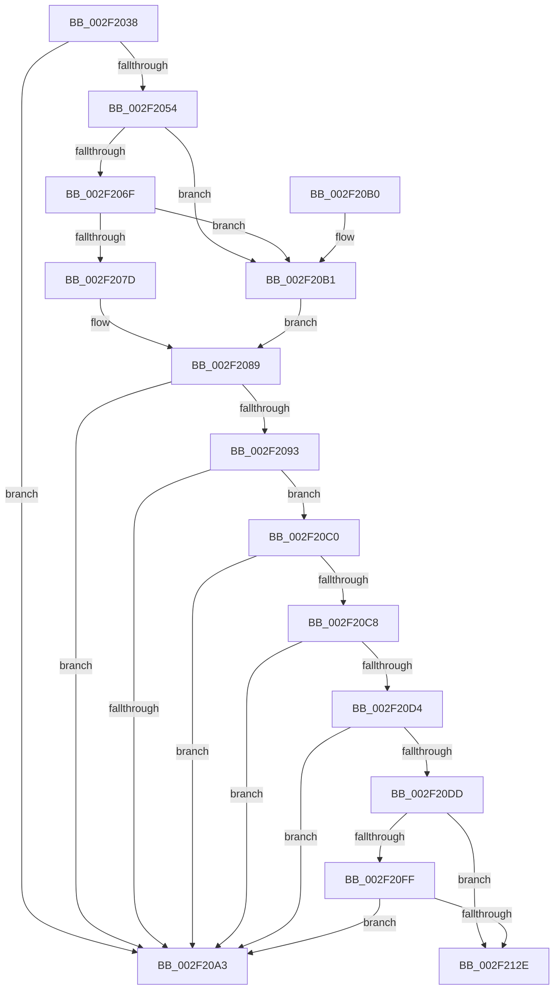

# RtlGuardCheckExceptionHandler

- RVA: `0x002F2038`–`0x002F213C` (길이 `260` bytes)
- VA: `0x00000001402F2038`
- 실행 섹션: `.text`
- PDB 이름 있음: `예`; PDB Function 태그: `아니요`
- unwind 정보 RVA: `0x00071EF4`
- 디코드: `68`개 명령, `260/260` bytes 표시
- 미해석 바이트: `0` (있으면 어셈블리에 `.byte`로 보존)

> 이 문서는 커널 이미지의 기계어와 PDB 기호를 분석해 생성했습니다. 4번과 5번은 함수 원형과 자료형을 바이너리 사용 방식에서 추정한 C 해석이며 원본 소스 복구 결과는 아닙니다.

## 1. Dependencies

- 직접 호출 지점: **5**; 고유 호출 대상: **5**
- 직접 호출자로 확인된 함수: **1**
- RIP 상대 이미지 참조: **4**

### Outgoing calls
- `0x002F204B` → [VslGetNestedPageProtectionFlags](VslGetNestedPageProtectionFlags_function_002F2164.md) (function, `0x002F2164`)
- `0x002F2096` → [LdrImageDirectoryEntryToLoadConfig](../../page/A8/LdrImageDirectoryEntryToLoadConfig_function_00A8F564.md) (function, `0x00A8F564`)
- `0x002F20B9` → [RtlpxLookupFunctionTable](RtlpxLookupFunctionTable_function_002F3610.md) (function, `0x002F3610`)
- `0x002F2120` → [bsearch_s](../50/bsearch_s_function_00500540.md) (function, `0x00500540`)
- `0x002F2136` → [RtlFailFast2](../4F/RtlFailFast2_function_004FEDC0.md) (function, `0x004FEDC0`)

### Direct callers
- [RtlUnwindEx](RtlUnwindEx_function_002F2830.md) at `0x002F2BA2`

### Static image references
- `0x002F2054` → RVA `0x01200038` (`CFGRO`; read)
- `0x002F206F` → RVA `0x01200040` (`CFGRO`; read)
- `0x002F207D` → RVA `0x01200030` (`CFGRO`; read)
- `0x002F2114` → RVA `0x00463790` (`RtlpTargetCompare`; read)

## 2. Other-region calls and transfers

- 다른 실행 섹션으로 향하는 call: **1**
  - `0x002F2096` → [LdrImageDirectoryEntryToLoadConfig](../../page/A8/LdrImageDirectoryEntryToLoadConfig_function_00A8F564.md) (`.text` → `PAGE`)
- 별도 외부 분기/꼬리 이동을 확인하지 못했습니다.

## 3. Assembly (complete function range)

```asm
002F2038  48 89 5C 24 08                  mov qword ptr [rsp + 8], rbx
002F203D  88 54 24 10                     mov byte ptr [rsp + 0x10], dl
002F2041  57                              push rdi
002F2042  48 83 EC 50                     sub rsp, 0x50
002F2046  48 8B D9                        mov rbx, rcx
002F2049  33 C9                           xor ecx, ecx
002F204B  E8 14 01 00 00                  call 0x1402f2164
002F2050  84 C0                           test al, al
002F2052  79 4F                           jns 0x1402f20a3
002F2054  48 8B 0D DD DF F0 00            mov rcx, qword ptr [rip + 0xf0dfdd]
002F205B  33 C0                           xor eax, eax
002F205D  48 89 44 24 40                  mov qword ptr [rsp + 0x40], rax
002F2062  0F 57 C0                        xorps xmm0, xmm0
002F2065  0F 11 44 24 30                  movups xmmword ptr [rsp + 0x30], xmm0
002F206A  48 3B D9                        cmp rbx, rcx
002F206D  72 42                           jb 0x1402f20b1
002F206F  8B 05 CB DF F0 00               mov eax, dword ptr [rip + 0xf0dfcb]
002F2075  48 03 C1                        add rax, rcx
002F2078  48 3B D8                        cmp rbx, rax
002F207B  73 34                           jae 0x1402f20b1
002F207D  0F 28 05 AC DF F0 00            movaps xmm0, xmmword ptr [rip + 0xf0dfac]
002F2084  0F 11 44 24 30                  movups xmmword ptr [rsp + 0x30], xmm0
002F2089  48 8B 7C 24 38                  mov rdi, qword ptr [rsp + 0x38]
002F208E  48 85 FF                        test rdi, rdi
002F2091  74 10                           je 0x1402f20a3
002F2093  48 8B CF                        mov rcx, rdi
002F2096  E8 C9 D4 79 00                  call 0x140a8f564
002F209B  48 8B D0                        mov rdx, rax
002F209E  48 85 C0                        test rax, rax
002F20A1  75 1D                           jne 0x1402f20c0
002F20A3  48 8B 5C 24 60                  mov rbx, qword ptr [rsp + 0x60]
002F20A8  33 C0                           xor eax, eax
002F20AA  48 83 C4 50                     add rsp, 0x50
002F20AE  5F                              pop rdi
002F20AF  C3                              ret
002F20B0  CC                              int3
002F20B1  48 8D 54 24 30                  lea rdx, [rsp + 0x30]
002F20B6  48 8B CB                        mov rcx, rbx
002F20B9  E8 52 15 00 00                  call 0x1402f3610
002F20BE  EB C9                           jmp 0x1402f2089
002F20C0  81 38 18 01 00 00               cmp dword ptr [rax], 0x118
002F20C6  72 DB                           jb 0x1402f20a3
002F20C8  F7 80 90 00 00 00 00 00 40 00   test dword ptr [rax + 0x90], 0x400000
002F20D2  74 CF                           je 0x1402f20a3
002F20D4  48 39 B8 08 01 00 00            cmp qword ptr [rax + 0x108], rdi
002F20DB  76 C6                           jbe 0x1402f20a3
002F20DD  8B C3                           mov eax, ebx
002F20DF  2B 44 24 38                     sub eax, dword ptr [rsp + 0x38]
002F20E3  89 44 24 68                     mov dword ptr [rsp + 0x68], eax
002F20E7  8B 82 90 00 00 00               mov eax, dword ptr [rdx + 0x90]
002F20ED  4C 8B 82 10 01 00 00            mov r8, qword ptr [rdx + 0x110]
002F20F4  C1 E8 1C                        shr eax, 0x1c
002F20F7  83 C0 04                        add eax, 4
002F20FA  4D 85 C0                        test r8, r8
002F20FD  74 2F                           je 0x1402f212e
002F20FF  48 83 64 24 28 00               and qword ptr [rsp + 0x28], 0
002F2105  48 8D 4C 24 68                  lea rcx, [rsp + 0x68]
002F210A  48 8B 92 08 01 00 00            mov rdx, qword ptr [rdx + 0x108]
002F2111  44 8B C8                        mov r9d, eax
002F2114  48 8D 05 75 16 17 00            lea rax, [rip + 0x171675]
002F211B  48 89 44 24 20                  mov qword ptr [rsp + 0x20], rax
002F2120  E8 1B E4 20 00                  call 0x140500540
002F2125  48 85 C0                        test rax, rax
002F2128  0F 85 75 FF FF FF               jne 0x1402f20a3
002F212E  48 8B D3                        mov rdx, rbx
002F2131  B9 26 00 00 00                  mov ecx, 0x26
002F2136  E8 85 CC 20 00                  call 0x1404fedc0
002F213B  CC                              int3
```

## 4. C-style interpretation (structured pseudocode)

```c
__int64 __fastcall RtlGuardCheckExceptionHandler(__int64 a1, unsigned __int8 a2)
{
    __int64 result;
    __int64 v_rsp;
    unsigned __int64 v_stack_m18;
    unsigned __int64 v_stack_m20;
    unsigned __int64 v_stack_m28;
    unsigned __int8 v_stack_p10;
    unsigned __int64 v_stack_p20;
    unsigned __int64 v_stack_p28;
    unsigned __int64 v_stack_p30;
    unsigned int v_stack_p38;
    unsigned int v_stack_p68;
    unsigned __int64 v_stack_p8;

    v_stack_p8 = v_rbx;
    v_stack_p10 = a2;
    v_rsp = (v_rsp) - (80);
    a1 = 0;
    result = VslGetNestedPageProtectionFlags(a1, a2, a3, a4);
    if (!sign_flag) goto loc_002F20A3;
    result = 0;
    v_stack_m18 = 0;
    v_stack_m28 = v_xmm0;
    if (0 < (*(unsigned __int64 *)(v_rip + 15785949))) goto loc_002F20B1;
    result = ((unsigned int)(*(unsigned int *)(v_rip + 15785931))) + (*(unsigned __int64 *)(v_rip + 15785949));
    if (0 >= result) goto loc_002F20B1;
    v_stack_m28 = v_xmm0;
loc_002F2089:
    if (v_stack_m20 == 0) goto loc_002F20A3;
    result = LdrImageDirectoryEntryToLoadConfig(v_stack_m20, a2, a3, a4);
    if (result != 0) goto loc_002F20C0;
loc_002F20A3:
    result = 0;
    v_rsp = (v_rsp) + (80);
    return result;
loc_002F20B1:
    result = RtlpxLookupFunctionTable(v_stack_p8, v_stack_p30, a3, a4);
    goto loc_002F2089;
loc_002F20C0:
    if ((*(unsigned int *)(result)) < 280) goto loc_002F20A3;
    if (((*(unsigned int *)(result + 144)) & (0x400000ULL)) == 0) goto loc_002F20A3;
    if ((*(unsigned __int64 *)(result + 264)) <= v_stack_m20) goto loc_002F20A3;
    result = (unsigned int)(((unsigned int)((unsigned int)(v_stack_p8))) - (v_stack_p38));
    v_stack_p68 = (unsigned int)(result);
    result = (unsigned int)(((unsigned int)(*(unsigned int *)(v_stack_p30 + 144))) >> (28));
    result = (unsigned int)((result) + (4));
    if (*(unsigned __int64 *)(v_stack_p30 + 272) == 0) goto loc_002F212E;
    v_stack_p20 = v_rip + 1513077;
    result = bsearch_s(v_stack_p68, *(unsigned __int64 *)(v_stack_p30 + 264), *(unsigned __int64 *)(v_stack_p30 + 272), (unsigned int)((unsigned int)(result)));
    if (result != 0) goto loc_002F20A3;
loc_002F212E:
    result = RtlFailFast2(38, v_stack_p8, *(unsigned __int64 *)(v_stack_p30 + 272), (unsigned int)((unsigned int)(result)));
    return result;
}
```

## 5. (Beta) C Style

```c
int64_t RtlGuardCheckExceptionHandler(int64_t Arg1, uint8_t Arg2)
{
    int64_t result;
    int64_t local_rsp;
    uint64_t v_stack_m18;
    uint64_t v_stack_m20;
    uint64_t v_stack_m28;
    uint8_t v_stack_p10;
    uint64_t v_stack_p20;
    uint64_t v_stack_p28;
    uint64_t v_stack_p30;
    uint32_t v_stack_p38;
    uint32_t v_stack_p68;
    uint64_t v_stack_p8;

    v_stack_p8 = local_rbx;
    v_stack_p10 = Arg2;
    local_rsp = (local_rsp) - (80);
    Arg1 = 0;
    result = VslGetNestedPageProtectionFlags(Arg1, Arg2, a3, a4);
    if (!sign_flag) goto loc_002F20A3;
    result = 0;
    v_stack_m18 = 0;
    v_stack_m28 = v_xmm0;
    if (0 < (*(uint64_t *)(v_rip + 0xF0DFDD))) goto loc_002F20B1;
    result = ((uint32_t)(*(uint32_t *)(v_rip + 0xF0DFCB))) + (*(uint64_t *)(v_rip + 0xF0DFDD));
    if (0 >= result) goto loc_002F20B1;
    v_stack_m28 = v_xmm0;
loc_002F2089:
    if (v_stack_m20 == 0) goto loc_002F20A3;
    result = LdrImageDirectoryEntryToLoadConfig(v_stack_m20, Arg2, a3, a4);
    if (result != 0) goto loc_002F20C0;
loc_002F20A3:
    result = 0;
    local_rsp = (local_rsp) + (80);
    return result;
loc_002F20B1:
    result = RtlpxLookupFunctionTable(v_stack_p8, v_stack_p30, a3, a4);
    goto loc_002F2089;
loc_002F20C0:
    if ((*(uint32_t *)(result)) < 280) goto loc_002F20A3;
    if (((*(uint32_t *)(result + 0x90)) & (0x400000ULL)) == 0) goto loc_002F20A3;
    if ((*(uint64_t *)(result + 0x108)) <= v_stack_m20) goto loc_002F20A3;
    result = (uint32_t)(((uint32_t)((uint32_t)(v_stack_p8))) - (v_stack_p38));
    v_stack_p68 = (uint32_t)(result);
    result = (uint32_t)(((uint32_t)(*(uint32_t *)(v_stack_p30 + 0x90))) >> (28));
    result = (uint32_t)((result) + (4));
    if (*(uint64_t *)(v_stack_p30 + 0x110) == 0) goto loc_002F212E;
    v_stack_p20 = v_rip + 1513077;
    result = bsearch_s(v_stack_p68, *(uint64_t *)(v_stack_p30 + 0x108), *(uint64_t *)(v_stack_p30 + 0x110), (uint32_t)((uint32_t)(result)));
    if (result != 0) goto loc_002F20A3;
loc_002F212E:
    result = RtlFailFast2(38, v_stack_p8, *(uint64_t *)(v_stack_p30 + 0x110), (uint32_t)((uint32_t)(result)));
    return result;
}
```

## 6. Execution-region graph

[열기: 2D/3D 그래프와 함수 탐색 컨트롤 패널](../../../control-panel.html?section=text&rva=0x002F2038&view=graph)

- 2D 그래프는 위에서 아래로 흐르고, 3D 그래프는 빈 공간을 드래그해 회전합니다. Shift+드래그는 이동, 휠은 확대·축소, 함수 노드 선택은 대상 보고서 이동입니다.

### Static fallback


