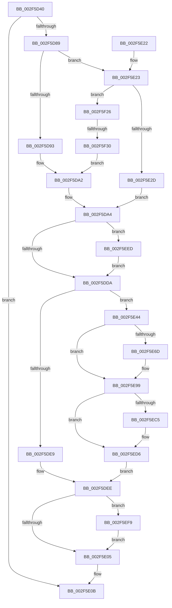

# RtlInitializeExtendedContext2

- RVA: `0x002F5D40`–`0x002F5F44` (길이 `516` bytes)
- VA: `0x00000001402F5D40`
- 실행 섹션: `.text`
- PDB 이름 있음: `예`; PDB Function 태그: `예`
- unwind 정보 RVA: `0x000721E0`
- 디코드: `137`개 명령, `516/516` bytes 표시
- 미해석 바이트: `0` (있으면 어셈블리에 `.byte`로 보존)

> 이 문서는 커널 이미지의 기계어와 PDB 기호를 분석해 생성했습니다. 4번과 5번은 함수 원형과 자료형을 바이너리 사용 방식에서 추정한 C 해석이며 원본 소스 복구 결과는 아닙니다.

## 1. Dependencies

- 직접 호출 지점: **4**; 고유 호출 대상: **4**
- 직접 호출자로 확인된 함수: **14**
- RIP 상대 이미지 참조: **0**

### Outgoing calls
- `0x002F5D7C` → [RtlpValidateContextFlags2](../4E/RtlpValidateContextFlags2_function_004EF138.md) (function, `0x004EF138`)
- `0x002F5E8F` → [RtlpRemoveArchDisallowedXStateFeatures](RtlpRemoveArchDisallowedXStateFeatures_function_002F32FC.md) (function, `0x002F32FC`)
- `0x002F5E9F` → [RtlpGetEntireXStateAreaLength2](../4E/RtlpGetEntireXStateAreaLength2_function_004EF20C.md) (function, `0x004EF20C`)
- `0x002F5EB3` → [memset](../6C/memset_function_006C6C40.md) (function, `0x006C6C40`)

### Direct callers
- [RtlUnwind](RtlUnwind_function_002F1CB0.md) at `0x002F1D72`
- [RtlDispatchException](RtlDispatchException_function_002F22A0.md) at `0x002F2420`
- [RtlUnwindEx](RtlUnwindEx_function_002F2830.md) at `0x002F2DE2`
- [RtlpWalkFrameChain](RtlpWalkFrameChain_function_002F3ED0.md) at `0x002F4056`
- [KiContinuePreviousModeUser](KiContinuePreviousModeUser_function_002F9B10.md) at `0x002F9CB9`
- [RtlInitializeExtendedContext](../3D/RtlInitializeExtendedContext_function_003D7220.md) at `0x003D726E`
- [KiDispatchException](../3D/KiDispatchException_function_003D7650.md) at `0x003D777B`
- [RtlRaiseException](../5E/RtlRaiseException_function_005E6B00.md) at `0x005E6B9F`
- [PspWow64SetContextThread](../../page/8C/PspWow64SetContextThread_function_008CCC88.md) at `0x008CCE10`
- [PspWow64SetContextThread](../../page/8C/PspWow64SetContextThread_function_008CCC88.md) at `0x008CCECD`
- [PspWow64SetContextThread](../../page/8C/PspWow64SetContextThread_function_008CCC88.md) at `0x008CD0F2`
- [PspWow64InitThread](../../page/8C/PspWow64InitThread_function_008CDC98.md) at `0x008CDD74`
- [PspInitializeThunkContext](../../page/8D/PspInitializeThunkContext_function_008D5418.md) at `0x008D5508`
- [PspInitializeThunkContext](../../page/8D/PspInitializeThunkContext_function_008D5418.md) at `0x008D5681`
- [NtCreateThreadEx](../../page/9E/NtCreateThreadEx_function_009ED3D0.md) at `0x009ED5E7`
- [PspWow64GetContextThread](../../page/A1/PspWow64GetContextThread_function_00A11E90.md) at `0x00A12000`
- [PspWow64GetContextThread](../../page/A1/PspWow64GetContextThread_function_00A11E90.md) at `0x00A120B0`
- [PspWow64GetContextThread](../../page/A1/PspWow64GetContextThread_function_00A11E90.md) at `0x00A12249`
- [NtCreateUserProcess](../../page/AE/NtCreateUserProcess_function_00AEA680.md) at `0x00AEB2FF`

### Static image references
- 디코드된 RIP-relative 메모리 참조가 없습니다.

## 2. Other-region calls and transfers

- 다른 실행 섹션으로 향하는 call: **0**
- call이 아닌 외부 분기/꼬리 이동: **1**
  - `0x002F5F2A` → [sub_006DF27C](../6D/Unknown_function_006DF27C.md) (`tail-transfer`)

## 3. Assembly (complete function range)

```asm
002F5D40  48 8B C4                        mov rax, rsp
002F5D43  48 89 58 08                     mov qword ptr [rax + 8], rbx
002F5D47  48 89 68 10                     mov qword ptr [rax + 0x10], rbp
002F5D4B  56                              push rsi
002F5D4C  57                              push rdi
002F5D4D  41 54                           push r12
002F5D4F  41 56                           push r14
002F5D51  41 57                           push r15
002F5D53  48 83 EC 30                     sub rsp, 0x30
002F5D57  8B FA                           mov edi, edx
002F5D59  4D 8B E0                        mov r12, r8
002F5D5C  48 8B F1                        mov rsi, rcx
002F5D5F  48 8D 50 C8                     lea rdx, [rax - 0x38]
002F5D63  45 33 F6                        xor r14d, r14d
002F5D66  8B CF                           mov ecx, edi
002F5D68  49 B8 D8 03 00 00 80 F7 FF FF   movabs r8, 0xfffff780000003d8
002F5D72  44 89 70 C8                     mov dword ptr [rax - 0x38], r14d
002F5D76  49 8B E9                        mov rbp, r9
002F5D79  41 8B DE                        mov ebx, r14d
002F5D7C  E8 B7 93 1F 00                  call 0x1404ef138
002F5D81  85 C0                           test eax, eax
002F5D83  0F 88 82 00 00 00               js 0x1402f5e0b
002F5D89  0F BA E7 10                     bt edi, 0x10
002F5D8D  0F 83 90 00 00 00               jae 0x1402f5e23
002F5D93  48 8D 4E 03                     lea rcx, [rsi + 3]
002F5D97  48 83 E1 FC                     and rcx, 0xfffffffffffffffc
002F5D9B  48 8D 99 CC 02 00 00            lea rbx, [rcx + 0x2cc]
002F5DA2  89 39                           mov dword ptr [rcx], edi
002F5DA4  8B C3                           mov eax, ebx
002F5DA6  2B C1                           sub eax, ecx
002F5DA8  89 43 0C                        mov dword ptr [rbx + 0xc], eax
002F5DAB  8B 4B 0C                        mov ecx, dword ptr [rbx + 0xc]
002F5DAE  8B C1                           mov eax, ecx
002F5DB0  F7 D8                           neg eax
002F5DB2  89 43 08                        mov dword ptr [rbx + 8], eax
002F5DB5  89 03                           mov dword ptr [rbx], eax
002F5DB7  8D 41 20                        lea eax, [rcx + 0x20]
002F5DBA  B9 20 00 01 00                  mov ecx, 0x10020
002F5DBF  89 43 04                        mov dword ptr [rbx + 4], eax
002F5DC2  8B C7                           mov eax, edi
002F5DC4  23 C1                           and eax, ecx
002F5DC6  3B C1                           cmp eax, ecx
002F5DC8  0F 95 C1                        setne cl
002F5DCB  0F BA E7 10                     bt edi, 0x10
002F5DCF  0F 92 C0                        setb al
002F5DD2  84 C8                           test al, cl
002F5DD4  0F 85 13 01 00 00               jne 0x1402f5eed
002F5DDA  44 8B 7C 24 20                  mov r15d, dword ptr [rsp + 0x20]
002F5DDF  4C 8D 43 20                     lea r8, [rbx + 0x20]
002F5DE3  41 F6 C7 02                     test r15b, 2
002F5DE7  75 5B                           jne 0x1402f5e44
002F5DE9  B9 21 00 00 00                  mov ecx, 0x21
002F5DEE  89 4B 10                        mov dword ptr [rbx + 0x10], ecx
002F5DF1  48 8B D3                        mov rdx, rbx
002F5DF4  44 89 73 14                     mov dword ptr [rbx + 0x14], r14d
002F5DF8  48 8B C3                        mov rax, rbx
002F5DFB  41 F6 C7 04                     test r15b, 4
002F5DFF  0F 85 F4 00 00 00               jne 0x1402f5ef9
002F5E05  49 89 1C 24                     mov qword ptr [r12], rbx
002F5E09  33 C0                           xor eax, eax
002F5E0B  48 8B 5C 24 60                  mov rbx, qword ptr [rsp + 0x60]
002F5E10  48 8B 6C 24 68                  mov rbp, qword ptr [rsp + 0x68]
002F5E15  48 83 C4 30                     add rsp, 0x30
002F5E19  41 5F                           pop r15
002F5E1B  41 5E                           pop r14
002F5E1D  41 5C                           pop r12
002F5E1F  5F                              pop rdi
002F5E20  5E                              pop rsi
002F5E21  C3                              ret
002F5E22  CC                              int3
002F5E23  0F BA E7 14                     bt edi, 0x14
002F5E27  0F 83 F9 00 00 00               jae 0x1402f5f26
002F5E2D  48 8D 4E 0F                     lea rcx, [rsi + 0xf]
002F5E31  48 83 E1 F0                     and rcx, 0xfffffffffffffff0
002F5E35  89 79 30                        mov dword ptr [rcx + 0x30], edi
002F5E38  48 8D 99 D0 04 00 00            lea rbx, [rcx + 0x4d0]
002F5E3F  E9 60 FF FF FF                  jmp 0x1402f5da4
002F5E44  A1 EC 03 00 00 80 F7 FF FF      movabs eax, dword ptr [0xfffff780000003ec]
002F5E4D  48 8D 73 5F                     lea rsi, [rbx + 0x5f]
002F5E51  48 83 E6 C0                     and rsi, 0xffffffffffffffc0
002F5E55  48 BA 00 00 00 00 00 00 00 80   movabs rdx, 0x8000000000000000
002F5E5F  49 B8 D8 03 00 00 80 F7 FF FF   movabs r8, 0xfffff780000003d8
002F5E69  A8 02                           test al, 2
002F5E6B  74 2C                           je 0x1402f5e99
002F5E6D  48 B9 08 07 00 00 80 F7 FF FF   movabs rcx, 0xfffff78000000708
002F5E77  48 8B 09                        mov rcx, qword ptr [rcx]
002F5E7A  49 0B 08                        or rcx, qword ptr [r8]
002F5E7D  48 0B CA                        or rcx, rdx
002F5E80  48 8D 54 24 78                  lea rdx, [rsp + 0x78]
002F5E85  48 23 E9                        and rbp, rcx
002F5E88  8B CF                           mov ecx, edi
002F5E8A  48 89 6C 24 78                  mov qword ptr [rsp + 0x78], rbp
002F5E8F  E8 68 D4 FF FF                  call 0x1402f32fc
002F5E94  48 8B 6C 24 78                  mov rbp, qword ptr [rsp + 0x78]
002F5E99  49 8B D0                        mov rdx, r8
002F5E9C  48 8B CD                        mov rcx, rbp
002F5E9F  E8 68 93 1F 00                  call 0x1404ef20c
002F5EA4  33 D2                           xor edx, edx
002F5EA6  48 8B CE                        mov rcx, rsi
002F5EA9  44 8D B0 00 FE FF FF            lea r14d, [rax - 0x200]
002F5EB0  45 8B C6                        mov r8d, r14d
002F5EB3  E8 88 0D 3D 00                  call 0x1406c6c40
002F5EB8  A1 EC 03 00 00 80 F7 FF FF      movabs eax, dword ptr [0xfffff780000003ec]
002F5EC1  A8 02                           test al, 2
002F5EC3  74 11                           je 0x1402f5ed6
002F5EC5  48 B8 00 00 00 00 00 00 00 80   movabs rax, 0x8000000000000000
002F5ECF  48 0B E8                        or rbp, rax
002F5ED2  48 89 6E 08                     mov qword ptr [rsi + 8], rbp
002F5ED6  8B CE                           mov ecx, esi
002F5ED8  4D 8D 04 36                     lea r8, [r14 + rsi]
002F5EDC  2B CB                           sub ecx, ebx
002F5EDE  8B C1                           mov eax, ecx
002F5EE0  2B 03                           sub eax, dword ptr [rbx]
002F5EE2  41 03 C6                        add eax, r14d
002F5EE5  89 43 04                        mov dword ptr [rbx + 4], eax
002F5EE8  E9 01 FF FF FF                  jmp 0x1402f5dee
002F5EED  C7 43 0C CC 00 00 00            mov dword ptr [rbx + 0xc], 0xcc
002F5EF4  E9 E1 FE FF FF                  jmp 0x1402f5dda
002F5EF9  33 C9                           xor ecx, ecx
002F5EFB  49 8D 40 07                     lea rax, [r8 + 7]
002F5EFF  48 83 E0 F8                     and rax, 0xfffffffffffffff8
002F5F03  0F 57 C0                        xorps xmm0, xmm0
002F5F06  0F 11 00                        movups xmmword ptr [rax], xmm0
002F5F09  48 89 48 10                     mov qword ptr [rax + 0x10], rcx
002F5F0D  2B C3                           sub eax, ebx
002F5F0F  89 43 18                        mov dword ptr [rbx + 0x18], eax
002F5F12  2B 03                           sub eax, dword ptr [rbx]
002F5F14  83 C0 18                        add eax, 0x18
002F5F17  C7 43 1C 18 00 00 00            mov dword ptr [rbx + 0x1c], 0x18
002F5F1E  89 43 04                        mov dword ptr [rbx + 4], eax
002F5F21  E9 DF FE FF FF                  jmp 0x1402f5e05
002F5F26  0F BA E7 15                     bt edi, 0x15
002F5F2A  0F 83 4C 93 3E 00               jae 0x1406df27c
002F5F30  48 8D 4E 07                     lea rcx, [rsi + 7]
002F5F34  48 83 E1 F8                     and rcx, 0xfffffffffffffff8
002F5F38  48 8D 99 A0 01 00 00            lea rbx, [rcx + 0x1a0]
002F5F3F  E9 5E FE FF FF                  jmp 0x1402f5da2
```

## 4. C-style interpretation (structured pseudocode)

```c
__int64 __fastcall RtlInitializeExtendedContext2(__int64 a1, int a2, __int64 a3, __int64 a4)
{
    __int64 result;
    __int64 v_r14;
    __int64 v_rbp;
    __int64 v_rsi;
    __int64 v_rsp;
    unsigned int v_stack_m38;
    unsigned __int64 v_stack_p10;
    unsigned __int64 v_stack_p78;
    unsigned __int64 v_stack_p8;

    *(unsigned __int64 *)(v_rsp + 8) = v_rbx;
    *(unsigned __int64 *)(v_rsp + 16) = v_rbp;
    v_rsp = (v_rsp) - (48);
    v_r14 = 0;
    *(unsigned int *)(v_rsp - 56) = 0;
    result = RtlpValidateContextFlags2((unsigned int)((unsigned int)((unsigned int)(a2))), v_rsp - 56, a3, a4);
    if (sign_flag) goto loc_002F5E0B;
    if (condition_is_above_or_equal) goto loc_002F5E23;
    a1 = (a1 + 3) & (-4);
loc_002F5DA2:
    *(unsigned int *)(a1) = (unsigned int)((unsigned int)(a2));
loc_002F5DA4:
    result = (unsigned int)(((unsigned int)((unsigned int)(a1 + 716))) - ((unsigned int)(a1)));
    *(unsigned int *)(a1 + 716 + 12) = (unsigned int)(result);
    result = (unsigned int)(-((unsigned int)((unsigned int)((unsigned int)(*(unsigned int *)(a1 + 716 + 12))))));
    *(unsigned int *)(a1 + 716 + 8) = (unsigned int)(result);
    *(unsigned int *)(a1 + 716) = (unsigned int)(result);
    *(unsigned int *)(a1 + 716 + 4) = (unsigned int)((unsigned int)(*(unsigned int *)(a1 + 716 + 12)) + 32);
    result = (unsigned int)(((unsigned int)((unsigned int)((unsigned int)(a2)))) & ((unsigned int)((unsigned int)(0x10020ULL))));
    a1 = (((unsigned int)(result)) != ((unsigned int)((unsigned int)(0x10020ULL)))) ? 1 : 0;
    result = (((unsigned int)(result)) < ((unsigned int)((unsigned int)(0x10020ULL)))) ? 1 : 0;
    if ((((unsigned __int8)(result)) & ((unsigned __int8)(a1))) != 0) goto loc_002F5EED;
loc_002F5DDA:
    if ((((unsigned __int8)((unsigned int)(v_stack_m38))) & (2)) != 0) goto loc_002F5E44;
loc_002F5DEE:
    *(unsigned int *)(a1 + 716 + 16) = 33;
    *(unsigned int *)(a1 + 716 + 20) = 0;
    if ((((unsigned __int8)((unsigned int)(v_stack_m38))) & (4)) != 0) goto loc_002F5EF9;
loc_002F5E05:
    *(unsigned __int64 *)(a3) = a1 + 716;
    result = 0;
loc_002F5E0B:
    v_rsp = (v_rsp) + (48);
    return result;
loc_002F5E23:
    if (condition_is_above_or_equal) goto loc_002F5F26;
    a1 = (a1 + 15) & (-16);
    *(unsigned int *)(a1 + 48) = (unsigned int)((unsigned int)(a2));
    goto loc_002F5DA4;
loc_002F5E44:
    v_rsi = (a1 + 1232 + 95) & (-64);
    v_rbp = v_stack_p10;
    if (((0) & (2)) != 0) {
        a1 = *(unsigned __int64 *)(a1);
        a1 = (a1) | (*(unsigned __int64 *)(a1 + 716 + 32));
        a1 = (a1) | (a1 + 716);
        a2 = v_stack_p78;
        v_rbp = (v_stack_p10) & (a1);
        a1 = (unsigned int)((unsigned int)(a2));
        v_stack_p78 = v_rbp;
        result = RtlpRemoveArchDisallowedXStateFeatures(a1, a2, a1 + 716 + 32, a4);
        v_rbp = v_stack_p78;
    }
    result = RtlpGetEntireXStateAreaLength2(v_rbp, a1 + 716 + 32, a1 + 716 + 32, a4);
    a2 = 0;
    result = memset(v_rsi, a2, (unsigned int)((unsigned int)(result - 512)), a4);
    if ((((unsigned __int8)(result)) & (2)) != 0) {
        v_rbp = (v_rbp) | (result);
        *(unsigned __int64 *)(v_rsi + 8) = v_rbp;
    }
    a1 = (unsigned int)(((unsigned int)((unsigned int)(v_rsi))) - ((unsigned int)(a1 + 1232)));
    result = (unsigned int)(((unsigned int)((unsigned int)(a1))) - (*(unsigned int *)(a1 + 1232)));
    result = (unsigned int)((result) + ((unsigned int)(result - 512)));
    *(unsigned int *)(a1 + 1232 + 4) = (unsigned int)(result);
    goto loc_002F5DEE;
loc_002F5EED:
    *(unsigned int *)(a1 + 1232 + 12) = 204;
    goto loc_002F5DDA;
loc_002F5EF9:
    a1 = 0;
    result = (result - 512 + v_rsi * 1 + 7) & (-8);
    *(unsigned __int64 *)(result) = v_xmm0;
    *(unsigned __int64 *)(result + 16) = 0;
    result = (unsigned int)((result) - ((unsigned int)(a1 + 1232)));
    *(unsigned int *)(a1 + 1232 + 24) = (unsigned int)(result);
    result = (unsigned int)((result) - (*(unsigned int *)(a1 + 1232)));
    result = (unsigned int)((result) + (24));
    *(unsigned int *)(a1 + 1232 + 28) = 24;
    *(unsigned int *)(a1 + 1232 + 4) = (unsigned int)(result);
    goto loc_002F5E05;
loc_002F5F26:
    a1 = (v_rsi + 7) & (-8);
    goto loc_002F5DA2;
}
```

## 5. (Beta) C Style

```c
int64_t RtlInitializeExtendedContext2(void *ExtendedContext2, int32_t Arg2, void *Arg3, int64_t Arg4)
{
    uint8_t *extendedContext2 = (uint8_t *)ExtendedContext2;
    uint8_t *arg3 = (uint8_t *)Arg3;

    int64_t result;
    int64_t local_r14;
    int64_t local_rbp;
    int64_t local_rsi;
    int64_t local_rsp;
    uint32_t v_stack_m38;
    uint64_t v_stack_p10;
    uint64_t v_stack_p78;
    uint64_t v_stack_p8;

    *(uint64_t *)(local_rsp + 0x8) = local_rbx;
    *(uint64_t *)(local_rsp + 0x10) = local_rbp;
    local_rsp = (local_rsp) - (48);
    local_r14 = 0;
    *(uint32_t *)(local_rsp - 0x38) = 0;
    result = RtlpValidateContextFlags2((uint32_t)((uint32_t)((uint32_t)(Arg2))), local_rsp - 56, Arg3, Arg4);
    if (sign_flag) goto loc_002F5E0B;
    if (condition_is_above_or_equal) goto loc_002F5E23;
    ExtendedContext2 = (ExtendedContext2 + 3) & (-4);
loc_002F5DA2:
    *(uint32_t *)(extendedContext2) = (uint32_t)((uint32_t)(Arg2));
loc_002F5DA4:
    result = (uint32_t)(((uint32_t)((uint32_t)(ExtendedContext2 + 716))) - ((uint32_t)(ExtendedContext2)));
    *(uint32_t *)(extendedContext2 + 0x2CC + 0xC) = (uint32_t)(result);
    result = (uint32_t)(-((uint32_t)((uint32_t)((uint32_t)(*(uint32_t *)(extendedContext2 + 0x2CC + 0xC))))));
    *(uint32_t *)(extendedContext2 + 0x2CC + 0x8) = (uint32_t)(result);
    *(uint32_t *)(extendedContext2 + 0x2CC) = (uint32_t)(result);
    *(uint32_t *)(extendedContext2 + 0x2CC + 0x4) = (uint32_t)((uint32_t)(*(uint32_t *)(extendedContext2 + 0x2CC + 0xC)) + 32);
    result = (uint32_t)(((uint32_t)((uint32_t)((uint32_t)(Arg2)))) & ((uint32_t)((uint32_t)(0x10020ULL))));
    ExtendedContext2 = (((uint32_t)(result)) != ((uint32_t)((uint32_t)(0x10020ULL)))) ? 1 : 0;
    result = (((uint32_t)(result)) < ((uint32_t)((uint32_t)(0x10020ULL)))) ? 1 : 0;
    if ((((uint8_t)(result)) & ((uint8_t)(ExtendedContext2))) != 0) goto loc_002F5EED;
loc_002F5DDA:
    if ((((uint8_t)((uint32_t)(v_stack_m38))) & (2)) != 0) goto loc_002F5E44;
loc_002F5DEE:
    *(uint32_t *)(extendedContext2 + 0x2CC + 0x10) = 33;
    *(uint32_t *)(extendedContext2 + 0x2CC + 0x14) = 0;
    if ((((uint8_t)((uint32_t)(v_stack_m38))) & (4)) != 0) goto loc_002F5EF9;
loc_002F5E05:
    *(void **)(arg3) = ExtendedContext2 + 716;
    result = 0;
loc_002F5E0B:
    local_rsp = (local_rsp) + (48);
    return result;
loc_002F5E23:
    if (condition_is_above_or_equal) goto loc_002F5F26;
    ExtendedContext2 = (ExtendedContext2 + 15) & (-16);
    *(uint32_t *)(extendedContext2 + 0x30) = (uint32_t)((uint32_t)(Arg2));
    goto loc_002F5DA4;
loc_002F5E44:
    local_rsi = (ExtendedContext2 + 1232 + 95) & (-64);
    local_rbp = v_stack_p10;
    if (((0) & (2)) != 0) {
        ExtendedContext2 = *(uint64_t *)(extendedContext2);
        ExtendedContext2 = (ExtendedContext2) | (*(uint64_t *)(extendedContext2 + 0x2CC + 0x20));
        ExtendedContext2 = (ExtendedContext2) | (ExtendedContext2 + 716);
        Arg2 = v_stack_p78;
        local_rbp = (v_stack_p10) & (ExtendedContext2);
        ExtendedContext2 = (uint32_t)((uint32_t)(Arg2));
        v_stack_p78 = local_rbp;
        result = RtlpRemoveArchDisallowedXStateFeatures(ExtendedContext2, Arg2, ExtendedContext2 + 716 + 32, Arg4);
        local_rbp = v_stack_p78;
    }
    result = RtlpGetEntireXStateAreaLength2(local_rbp, ExtendedContext2 + 716 + 32, ExtendedContext2 + 716 + 32, Arg4);
    Arg2 = 0;
    result = memset(local_rsi, Arg2, (uint32_t)((uint32_t)(result - 512)), Arg4);
    if ((((uint8_t)(result)) & (2)) != 0) {
        local_rbp = (local_rbp) | (result);
        *(uint64_t *)(local_rsi + 0x8) = local_rbp;
    }
    ExtendedContext2 = (uint32_t)(((uint32_t)((uint32_t)(local_rsi))) - ((uint32_t)(ExtendedContext2 + 1232)));
    result = (uint32_t)(((uint32_t)((uint32_t)(ExtendedContext2))) - (*(uint32_t *)(extendedContext2 + 0x4D0)));
    result = (uint32_t)((result) + ((uint32_t)(result - 512)));
    *(uint32_t *)(extendedContext2 + 0x4D0 + 0x4) = (uint32_t)(result);
    goto loc_002F5DEE;
loc_002F5EED:
    *(uint32_t *)(extendedContext2 + 0x4D0 + 0xC) = 204;
    goto loc_002F5DDA;
loc_002F5EF9:
    ExtendedContext2 = 0;
    result = (result - 512 + local_rsi * 1 + 7) & (-8);
    *(uint64_t *)(result) = v_xmm0;
    *(uint64_t *)(result + 0x10) = 0;
    result = (uint32_t)((result) - ((uint32_t)(ExtendedContext2 + 1232)));
    *(uint32_t *)(extendedContext2 + 0x4D0 + 0x18) = (uint32_t)(result);
    result = (uint32_t)((result) - (*(uint32_t *)(extendedContext2 + 0x4D0)));
    result = (uint32_t)((result) + (24));
    *(uint32_t *)(extendedContext2 + 0x4D0 + 0x1C) = 24;
    *(uint32_t *)(extendedContext2 + 0x4D0 + 0x4) = (uint32_t)(result);
    goto loc_002F5E05;
loc_002F5F26:
    ExtendedContext2 = (local_rsi + 7) & (-8);
    goto loc_002F5DA2;
}
```

### 관측된 메모리 오프셋

구조체 형식이 확인되지 않은 접근은 인자 기준의 오프셋으로만 기록했습니다.

| 기준 인자 | 오프셋 표현 | 폭 (bit) | 접근 |
|---|---:|---:|---|
| `ExtendedContext2` | `+ 0x0` | `32` | `R` |
| `ExtendedContext2` | `+ 0x0` | `32` | `W` |
| `ExtendedContext2` | `+ 0x3` | `64` | `R` |
| `ExtendedContext2` | `+ 0x4` | `32` | `W` |
| `ExtendedContext2` | `+ 0x7` | `64` | `R` |
| `ExtendedContext2` | `+ 0x8` | `32` | `W` |
| `ExtendedContext2` | `+ 0x8` | `64` | `W` |
| `ExtendedContext2` | `+ 0xC` | `32` | `R` |
| `ExtendedContext2` | `+ 0xC` | `32` | `W` |
| `ExtendedContext2` | `+ 0xF` | `64` | `R` |
| `ExtendedContext2` | `+ 0x10` | `32` | `W` |
| `ExtendedContext2` | `+ 0x14` | `32` | `W` |
| `ExtendedContext2` | `+ 0x18` | `32` | `W` |
| `ExtendedContext2` | `+ 0x1C` | `32` | `W` |
| `ExtendedContext2` | `+ 0x20` | `64` | `R` |
| `ExtendedContext2` | `+ 0x30` | `32` | `W` |
| `ExtendedContext2` | `+ 0x5F` | `64` | `R` |
| `ExtendedContext2` | `+ 0x1A0` | `64` | `R` |
| `ExtendedContext2` | `+ 0x2CC` | `64` | `R` |
| `ExtendedContext2` | `+ 0x4D0` | `64` | `R` |
| `Arg3` | `+ 0x0` | `64` | `W` |

## 6. Execution-region graph

[열기: 2D/3D 그래프와 함수 탐색 컨트롤 패널](../../../control-panel.html?section=text&rva=0x002F5D40&view=graph)

- 2D 그래프는 위에서 아래로 흐르고, 3D 그래프는 빈 공간을 드래그해 회전합니다. Shift+드래그는 이동, 휠은 확대·축소, 함수 노드 선택은 대상 보고서 이동입니다.

### Static fallback


