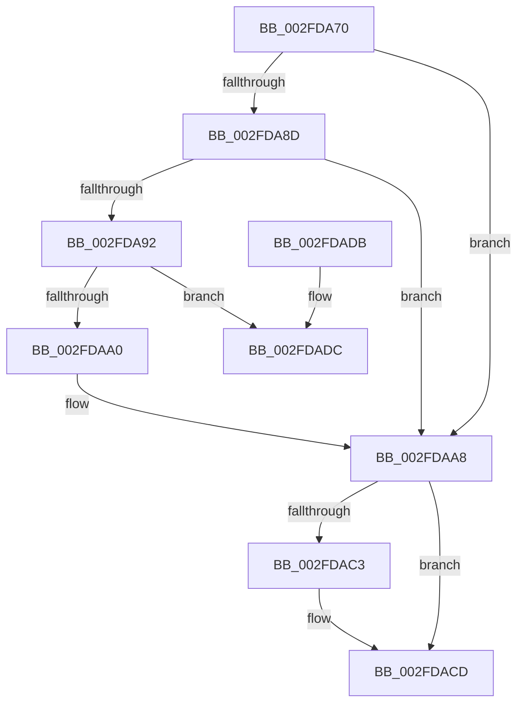

# RtlIsNameInExpression

- RVA: `0x002FDA70`–`0x002FDAE4` (길이 `116` bytes)
- VA: `0x00000001402FDA70`
- 실행 섹션: `.text`
- PDB 이름 있음: `예`; PDB Function 태그: `아니요`
- unwind 정보 RVA: `0x00072C88`
- 디코드: `35`개 명령, `116/116` bytes 표시
- 미해석 바이트: `0` (있으면 어셈블리에 `.byte`로 보존)

> 이 문서는 커널 이미지의 기계어와 PDB 기호를 분석해 생성했습니다. 4번과 5번은 함수 원형과 자료형을 바이너리 사용 방식에서 추정한 C 해석이며 원본 소스 복구 결과는 아닙니다.

## 1. Dependencies

- 직접 호출 지점: **4**; 고유 호출 대상: **4**
- 직접 호출자로 확인된 함수: **2**
- RIP 상대 이미지 참조: **0**

### Outgoing calls
- `0x002FDA97` → [RtlpUpcaseUnicodeStringPrivate](RtlpUpcaseUnicodeStringPrivate_function_002FE0B0.md) (function, `0x002FE0B0`)
- `0x002FDAB3` → [RtlpIsNameInExpressionPrivate](RtlpIsNameInExpressionPrivate_function_002FDBAC.md) (function, `0x002FDBAC`)
- `0x002FDAC8` → [RtlFreeAnsiString](../../page/9C/RtlFreeAnsiString_function_009C0800.md) (function, `0x009C0800`)
- `0x002FDADE` → [RtlRaiseStatus](RtlRaiseStatus_function_002F6A50.md) (function, `0x002F6A50`)

### Direct callers
- [AuthzBasepCompareUnicodeStringOperands](AuthzBasepCompareUnicodeStringOperands_function_002FE26C.md) at `0x002FE39F`
- [AuthzBasepCompareFQBNOperands](../30/AuthzBasepCompareFQBNOperands_function_00301444.md) at `0x003015EA`

### Static image references
- 디코드된 RIP-relative 메모리 참조가 없습니다.

## 2. Other-region calls and transfers

- 다른 실행 섹션으로 향하는 call: **1**
  - `0x002FDAC8` → [RtlFreeAnsiString](../../page/9C/RtlFreeAnsiString_function_009C0800.md) (`.text` → `PAGE`)
- 별도 외부 분기/꼬리 이동을 확인하지 못했습니다.

## 3. Assembly (complete function range)

```asm
002FDA70  48 89 5C 24 08                  mov qword ptr [rsp + 8], rbx
002FDA75  57                              push rdi
002FDA76  48 83 EC 40                     sub rsp, 0x40
002FDA7A  49 8B D9                        mov rbx, r9
002FDA7D  48 8B F9                        mov rdi, rcx
002FDA80  0F 57 C0                        xorps xmm0, xmm0
002FDA83  0F 11 44 24 30                  movups xmmword ptr [rsp + 0x30], xmm0
002FDA88  45 84 C0                        test r8b, r8b
002FDA8B  74 1B                           je 0x1402fdaa8
002FDA8D  48 85 DB                        test rbx, rbx
002FDA90  75 16                           jne 0x1402fdaa8
002FDA92  48 8D 4C 24 30                  lea rcx, [rsp + 0x30]
002FDA97  E8 14 06 00 00                  call 0x1402fe0b0
002FDA9C  85 C0                           test eax, eax
002FDA9E  78 3C                           js 0x1402fdadc
002FDAA0  48 8D 54 24 30                  lea rdx, [rsp + 0x30]
002FDAA5  45 32 C0                        xor r8b, r8b
002FDAA8  48 89 5C 24 20                  mov qword ptr [rsp + 0x20], rbx
002FDAAD  45 33 C9                        xor r9d, r9d
002FDAB0  48 8B CF                        mov rcx, rdi
002FDAB3  E8 F4 00 00 00                  call 0x1402fdbac
002FDAB8  0F B6 D8                        movzx ebx, al
002FDABB  48 83 7C 24 38 00               cmp qword ptr [rsp + 0x38], 0
002FDAC1  74 0A                           je 0x1402fdacd
002FDAC3  48 8D 4C 24 30                  lea rcx, [rsp + 0x30]
002FDAC8  E8 33 2D 6C 00                  call 0x1409c0800
002FDACD  0F B6 C3                        movzx eax, bl
002FDAD0  48 8B 5C 24 50                  mov rbx, qword ptr [rsp + 0x50]
002FDAD5  48 83 C4 40                     add rsp, 0x40
002FDAD9  5F                              pop rdi
002FDADA  C3                              ret
002FDADB  CC                              int3
002FDADC  8B C8                           mov ecx, eax
002FDADE  E8 6D 8F FF FF                  call 0x1402f6a50
002FDAE3  90                              nop
```

## 4. C-style interpretation (structured pseudocode)

```c
__int64 __fastcall RtlIsNameInExpression(__int64 a1, __int64 a2, unsigned __int8 a3, __int64 a4)
{
    __int64 result;
    __int64 v_rsp;
    unsigned __int64 v_stack_m10;
    unsigned __int64 v_stack_m18;
    unsigned __int64 v_stack_m28;
    unsigned __int64 v_stack_p8;

    v_stack_p8 = v_rbx;
    v_rsp = (v_rsp) - (64);
    v_stack_m18 = v_xmm0;
    if (a3 == 0) goto loc_002FDAA8;
    if (a4 != 0) goto loc_002FDAA8;
    result = RtlpUpcaseUnicodeStringPrivate(v_stack_m18, a2, a3, a4);
    if (sign_flag) goto loc_002FDADC;
    a3 = 0;
loc_002FDAA8:
    v_stack_m28 = a4;
    a4 = 0;
    result = RtlpIsNameInExpressionPrivate(a1, v_stack_m18, a3, a4);
    if (v_stack_m10 != 0) {
        a1 = v_stack_m18;
        result = RtlFreeAnsiString(a1, v_stack_m18, a3, a4);
    }
    v_rsp = (v_rsp) + (64);
    return (unsigned __int8)((unsigned __int8)(result));
loc_002FDADC:
    result = RtlRaiseStatus((unsigned int)((unsigned int)((unsigned __int8)((unsigned __int8)(result)))), v_stack_m18, a3, a4);
    return result;
}
```

## 5. (Beta) C Style

```c
int64_t RtlIsNameInExpression(int64_t Arg1, int64_t Arg2, uint8_t Arg3, int64_t Arg4)
{
    int64_t result;
    int64_t local_rsp;
    uint64_t v_stack_m10;
    uint64_t v_stack_m18;
    uint64_t v_stack_m28;
    uint64_t v_stack_p8;

    v_stack_p8 = local_rbx;
    local_rsp = (local_rsp) - (64);
    v_stack_m18 = v_xmm0;
    if (Arg3 == 0) goto loc_002FDAA8;
    if (Arg4 != 0) goto loc_002FDAA8;
    result = RtlpUpcaseUnicodeStringPrivate(v_stack_m18, Arg2, Arg3, Arg4);
    if (sign_flag) goto loc_002FDADC;
    Arg3 = 0;
loc_002FDAA8:
    v_stack_m28 = Arg4;
    Arg4 = 0;
    result = RtlpIsNameInExpressionPrivate(Arg1, v_stack_m18, Arg3, Arg4);
    if (v_stack_m10 != 0) {
        Arg1 = v_stack_m18;
        result = RtlFreeAnsiString(Arg1, v_stack_m18, Arg3, Arg4);
    }
    local_rsp = (local_rsp) + (64);
    return (uint8_t)((uint8_t)(result));
loc_002FDADC:
    result = RtlRaiseStatus((uint32_t)((uint32_t)((uint8_t)((uint8_t)(result)))), v_stack_m18, Arg3, Arg4);
    return result;
}
```

## 6. Execution-region graph

[열기: 2D/3D 그래프와 함수 탐색 컨트롤 패널](../../../control-panel.html?section=text&rva=0x002FDA70&view=graph)

- 2D 그래프는 위에서 아래로 흐르고, 3D 그래프는 빈 공간을 드래그해 회전합니다. Shift+드래그는 이동, 휠은 확대·축소, 함수 노드 선택은 대상 보고서 이동입니다.

### Static fallback


