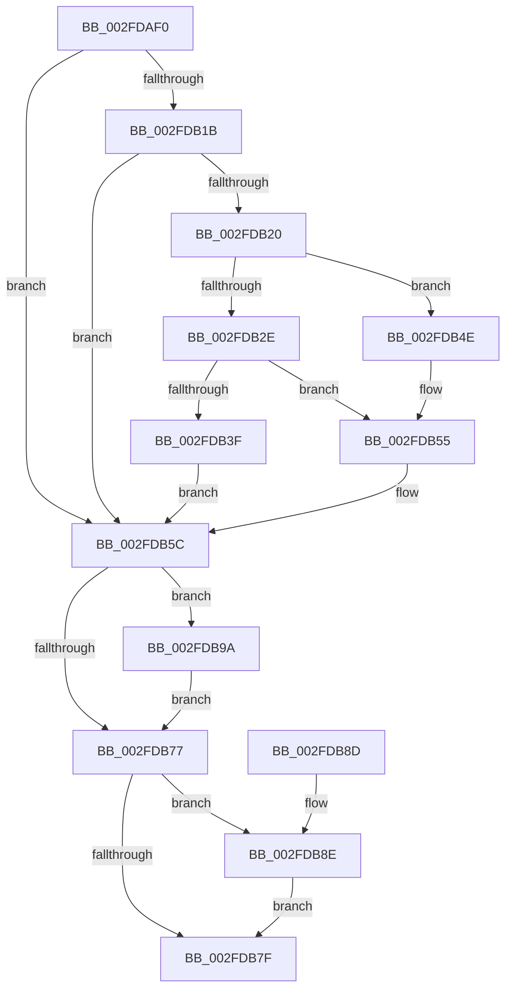

# RtlIsNameInUnUpcasedExpression

- RVA: `0x002FDAF0`–`0x002FDBA6` (길이 `182` bytes)
- VA: `0x00000001402FDAF0`
- 실행 섹션: `.text`
- PDB 이름 있음: `예`; PDB Function 태그: `아니요`
- unwind 정보 RVA: `0x00072CBC`
- 디코드: `52`개 명령, `182/182` bytes 표시
- 미해석 바이트: `0` (있으면 어셈블리에 `.byte`로 보존)

> 이 문서는 커널 이미지의 기계어와 PDB 기호를 분석해 생성했습니다. 4번과 5번은 함수 원형과 자료형을 바이너리 사용 방식에서 추정한 C 해석이며 원본 소스 복구 결과는 아닙니다.

## 1. Dependencies

- 직접 호출 지점: **7**; 고유 호출 대상: **4**
- 직접 호출자로 확인된 함수: **0**
- RIP 상대 이미지 참조: **0**

### Outgoing calls
- `0x002FDB25` → [RtlpUpcaseUnicodeStringPrivate](RtlpUpcaseUnicodeStringPrivate_function_002FE0B0.md) (function, `0x002FE0B0`)
- `0x002FDB36` → [RtlpUpcaseUnicodeStringPrivate](RtlpUpcaseUnicodeStringPrivate_function_002FE0B0.md) (function, `0x002FE0B0`)
- `0x002FDB50` → [RtlRaiseStatus](RtlRaiseStatus_function_002F6A50.md) (function, `0x002F6A50`)
- `0x002FDB57` → [RtlRaiseStatus](RtlRaiseStatus_function_002F6A50.md) (function, `0x002F6A50`)
- `0x002FDB67` → [RtlpIsNameInExpressionPrivate](RtlpIsNameInExpressionPrivate_function_002FDBAC.md) (function, `0x002FDBAC`)
- `0x002FDB93` → [RtlFreeAnsiString](../../page/9C/RtlFreeAnsiString_function_009C0800.md) (function, `0x009C0800`)
- `0x002FDB9F` → [RtlFreeAnsiString](../../page/9C/RtlFreeAnsiString_function_009C0800.md) (function, `0x009C0800`)

### Direct callers
- 이 함수 시작 RVA로 연결되는 직접 call은 확인되지 않았습니다. 간접 호출은 완전히 역산할 수 없습니다.

### Static image references
- 디코드된 RIP-relative 메모리 참조가 없습니다.

## 2. Other-region calls and transfers

- 다른 실행 섹션으로 향하는 call: **2**
  - `0x002FDB93` → [RtlFreeAnsiString](../../page/9C/RtlFreeAnsiString_function_009C0800.md) (`.text` → `PAGE`)
  - `0x002FDB9F` → [RtlFreeAnsiString](../../page/9C/RtlFreeAnsiString_function_009C0800.md) (`.text` → `PAGE`)
- 별도 외부 분기/꼬리 이동을 확인하지 못했습니다.

## 3. Assembly (complete function range)

```asm
002FDAF0  48 89 5C 24 08                  mov qword ptr [rsp + 8], rbx
002FDAF5  57                              push rdi
002FDAF6  48 83 EC 50                     sub rsp, 0x50
002FDAFA  49 8B D9                        mov rbx, r9
002FDAFD  48 8B F9                        mov rdi, rcx
002FDB00  33 C0                           xor eax, eax
002FDB02  48 89 44 24 30                  mov qword ptr [rsp + 0x30], rax
002FDB07  48 89 44 24 40                  mov qword ptr [rsp + 0x40], rax
002FDB0C  48 89 44 24 38                  mov qword ptr [rsp + 0x38], rax
002FDB11  48 89 44 24 48                  mov qword ptr [rsp + 0x48], rax
002FDB16  45 84 C0                        test r8b, r8b
002FDB19  74 41                           je 0x1402fdb5c
002FDB1B  48 85 DB                        test rbx, rbx
002FDB1E  75 3C                           jne 0x1402fdb5c
002FDB20  48 8D 4C 24 30                  lea rcx, [rsp + 0x30]
002FDB25  E8 86 05 00 00                  call 0x1402fe0b0
002FDB2A  85 C0                           test eax, eax
002FDB2C  78 20                           js 0x1402fdb4e
002FDB2E  48 8B D7                        mov rdx, rdi
002FDB31  48 8D 4C 24 40                  lea rcx, [rsp + 0x40]
002FDB36  E8 75 05 00 00                  call 0x1402fe0b0
002FDB3B  85 C0                           test eax, eax
002FDB3D  78 16                           js 0x1402fdb55
002FDB3F  48 8D 54 24 30                  lea rdx, [rsp + 0x30]
002FDB44  48 8D 7C 24 40                  lea rdi, [rsp + 0x40]
002FDB49  45 32 C0                        xor r8b, r8b
002FDB4C  EB 0E                           jmp 0x1402fdb5c
002FDB4E  8B C8                           mov ecx, eax
002FDB50  E8 FB 8E FF FF                  call 0x1402f6a50
002FDB55  8B C8                           mov ecx, eax
002FDB57  E8 F4 8E FF FF                  call 0x1402f6a50
002FDB5C  48 89 5C 24 20                  mov qword ptr [rsp + 0x20], rbx
002FDB61  41 B1 01                        mov r9b, 1
002FDB64  48 8B CF                        mov rcx, rdi
002FDB67  E8 40 00 00 00                  call 0x1402fdbac
002FDB6C  0F B6 D8                        movzx ebx, al
002FDB6F  48 83 7C 24 38 00               cmp qword ptr [rsp + 0x38], 0
002FDB75  75 23                           jne 0x1402fdb9a
002FDB77  48 83 7C 24 48 00               cmp qword ptr [rsp + 0x48], 0
002FDB7D  75 0F                           jne 0x1402fdb8e
002FDB7F  0F B6 C3                        movzx eax, bl
002FDB82  48 8B 5C 24 60                  mov rbx, qword ptr [rsp + 0x60]
002FDB87  48 83 C4 50                     add rsp, 0x50
002FDB8B  5F                              pop rdi
002FDB8C  C3                              ret
002FDB8D  CC                              int3
002FDB8E  48 8D 4C 24 40                  lea rcx, [rsp + 0x40]
002FDB93  E8 68 2C 6C 00                  call 0x1409c0800
002FDB98  EB E5                           jmp 0x1402fdb7f
002FDB9A  48 8D 4C 24 30                  lea rcx, [rsp + 0x30]
002FDB9F  E8 5C 2C 6C 00                  call 0x1409c0800
002FDBA4  EB D1                           jmp 0x1402fdb77
```

## 4. C-style interpretation (structured pseudocode)

```c
__int64 __fastcall RtlIsNameInUnUpcasedExpression(__int64 a1, __int64 a2, unsigned __int8 a3, __int64 a4)
{
    __int64 result;
    __int64 v_rsp;
    unsigned __int64 v_stack_m10;
    unsigned __int64 v_stack_m18;
    unsigned __int64 v_stack_m20;
    unsigned __int64 v_stack_m28;
    unsigned __int64 v_stack_m38;
    unsigned __int64 v_stack_p30;
    unsigned __int64 v_stack_p40;
    unsigned __int64 v_stack_p8;

    v_stack_p8 = v_rbx;
    v_rsp = (v_rsp) - (80);
    result = 0;
    v_stack_m28 = 0;
    v_stack_m18 = 0;
    v_stack_m20 = 0;
    v_stack_m10 = 0;
    if (a3 == 0) goto loc_002FDB5C;
    if (a4 != 0) goto loc_002FDB5C;
    result = RtlpUpcaseUnicodeStringPrivate(v_stack_m28, a2, a3, a4);
    if (sign_flag) goto loc_002FDB4E;
    result = RtlpUpcaseUnicodeStringPrivate(v_stack_m18, a1, a3, a4);
    if (sign_flag) goto loc_002FDB55;
    a3 = 0;
    goto loc_002FDB5C;
loc_002FDB4E:
    result = RtlRaiseStatus((unsigned int)((unsigned int)(result)), v_stack_m28, a3, a4);
loc_002FDB55:
    result = RtlRaiseStatus((unsigned int)((unsigned int)(result)), v_stack_m28, a3, a4);
loc_002FDB5C:
    v_stack_m38 = a4;
    result = RtlpIsNameInExpressionPrivate(v_stack_m18, v_stack_m28, a3, 1);
    if (v_stack_m20 != 0) goto loc_002FDB9A;
loc_002FDB77:
    if (v_stack_m10 != 0) goto loc_002FDB8E;
loc_002FDB7F:
    v_rsp = (v_rsp) + (80);
    return (unsigned __int8)((unsigned __int8)(result));
loc_002FDB8E:
    result = RtlFreeAnsiString(v_stack_p40, v_stack_m28, a3, 1);
    goto loc_002FDB7F;
loc_002FDB9A:
    result = RtlFreeAnsiString(v_stack_p30, v_stack_m28, a3, 1);
    goto loc_002FDB77;
}
```

## 5. (Beta) C Style

```c
int64_t RtlIsNameInUnUpcasedExpression(int64_t Arg1, int64_t Arg2, uint8_t Arg3, int64_t Arg4)
{
    int64_t result;
    int64_t local_rsp;
    uint64_t v_stack_m10;
    uint64_t v_stack_m18;
    uint64_t v_stack_m20;
    uint64_t v_stack_m28;
    uint64_t v_stack_m38;
    uint64_t v_stack_p30;
    uint64_t v_stack_p40;
    uint64_t v_stack_p8;

    v_stack_p8 = local_rbx;
    local_rsp = (local_rsp) - (80);
    result = 0;
    v_stack_m28 = 0;
    v_stack_m18 = 0;
    v_stack_m20 = 0;
    v_stack_m10 = 0;
    if (Arg3 == 0) goto loc_002FDB5C;
    if (Arg4 != 0) goto loc_002FDB5C;
    result = RtlpUpcaseUnicodeStringPrivate(v_stack_m28, Arg2, Arg3, Arg4);
    if (sign_flag) goto loc_002FDB4E;
    result = RtlpUpcaseUnicodeStringPrivate(v_stack_m18, Arg1, Arg3, Arg4);
    if (sign_flag) goto loc_002FDB55;
    Arg3 = 0;
    goto loc_002FDB5C;
loc_002FDB4E:
    result = RtlRaiseStatus((uint32_t)((uint32_t)(result)), v_stack_m28, Arg3, Arg4);
loc_002FDB55:
    result = RtlRaiseStatus((uint32_t)((uint32_t)(result)), v_stack_m28, Arg3, Arg4);
loc_002FDB5C:
    v_stack_m38 = Arg4;
    result = RtlpIsNameInExpressionPrivate(v_stack_m18, v_stack_m28, Arg3, 1);
    if (v_stack_m20 != 0) goto loc_002FDB9A;
loc_002FDB77:
    if (v_stack_m10 != 0) goto loc_002FDB8E;
loc_002FDB7F:
    local_rsp = (local_rsp) + (80);
    return (uint8_t)((uint8_t)(result));
loc_002FDB8E:
    result = RtlFreeAnsiString(v_stack_p40, v_stack_m28, Arg3, 1);
    goto loc_002FDB7F;
loc_002FDB9A:
    result = RtlFreeAnsiString(v_stack_p30, v_stack_m28, Arg3, 1);
    goto loc_002FDB77;
}
```

## 6. Execution-region graph

[열기: 2D/3D 그래프와 함수 탐색 컨트롤 패널](../../../control-panel.html?section=text&rva=0x002FDAF0&view=graph)

- 2D 그래프는 위에서 아래로 흐르고, 3D 그래프는 빈 공간을 드래그해 회전합니다. Shift+드래그는 이동, 휠은 확대·축소, 함수 노드 선택은 대상 보고서 이동입니다.

### Static fallback


