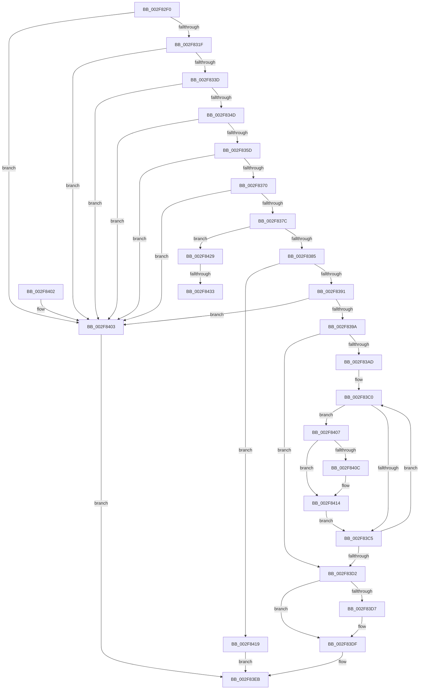

# RtlLocateExtendedFeature2

- RVA: `0x002F82F0`–`0x002F8440` (길이 `336` bytes)
- VA: `0x00000001402F82F0`
- 실행 섹션: `.text`
- PDB 이름 있음: `예`; PDB Function 태그: `예`
- unwind 정보 RVA: `0x000725EC`
- 디코드: `86`개 명령, `336/336` bytes 표시
- 미해석 바이트: `0` (있으면 어셈블리에 `.byte`로 보존)

> 이 문서는 커널 이미지의 기계어와 PDB 기호를 분석해 생성했습니다. 4번과 5번은 함수 원형과 자료형을 바이너리 사용 방식에서 추정한 C 해석이며 원본 소스 복구 결과는 아닙니다.

## 1. Dependencies

- 직접 호출 지점: **0**; 고유 호출 대상: **0**
- 직접 호출자로 확인된 함수: **3**
- RIP 상대 이미지 참조: **0**

### Outgoing calls
- 직접 디코드된 call 명령이 없습니다.

### Direct callers
- [RtlpUnwindPrologue](RtlpUnwindPrologue_function_002F5FA0.md) at `0x002F6489`
- [KiContinuePreviousModeUser](KiContinuePreviousModeUser_function_002F9B10.md) at `0x002F9D11`
- [RtlLocateExtendedFeature](../3D/RtlLocateExtendedFeature_function_003D72A0.md) at `0x003D72B1`

### Static image references
- 디코드된 RIP-relative 메모리 참조가 없습니다.

## 2. Other-region calls and transfers

- 다른 실행 섹션으로 향하는 call: **0**
- call이 아닌 외부 분기/꼬리 이동: **2**
  - `0x002F842D` → [sub_006DF3B6](../6D/Unknown_function_006DF3B6.md) (`tail-transfer`)
  - `0x002F843B` → [sub_006DF3B6 + 0x5](../6D/Unknown_function_006DF3B6.md) (`tail-transfer`)

## 3. Assembly (complete function range)

```asm
002F82F0  48 89 5C 24 08                  mov qword ptr [rsp + 8], rbx
002F82F5  48 89 6C 24 10                  mov qword ptr [rsp + 0x10], rbp
002F82FA  48 89 74 24 18                  mov qword ptr [rsp + 0x18], rsi
002F82FF  48 89 7C 24 20                  mov qword ptr [rsp + 0x20], rdi
002F8304  41 56                           push r14
002F8306  44 8B DA                        mov r11d, edx
002F8309  4D 8B D0                        mov r10, r8
002F830C  49 8B F9                        mov rdi, r9
002F830F  4C 8B C1                        mov r8, rcx
002F8312  41 8D 5B FE                     lea ebx, [r11 - 2]
002F8316  83 FB 3D                        cmp ebx, 0x3d
002F8319  0F 87 E4 00 00 00               ja 0x1402f8403
002F831F  4D 8B 8A 30 03 00 00            mov r9, qword ptr [r10 + 0x330]
002F8326  41 8B CB                        mov ecx, r11d
002F8329  4D 0B 0A                        or r9, qword ptr [r10]
002F832C  BD 01 00 00 00                  mov ebp, 1
002F8331  48 D3 E5                        shl rbp, cl
002F8334  4C 85 CD                        test rbp, r9
002F8337  0F 84 C6 00 00 00               je 0x1402f8403
002F833D  41 8B 72 14                     mov esi, dword ptr [r10 + 0x14]
002F8341  F7 C6 F8 FF FF FF               test esi, 0xfffffff8
002F8347  0F 85 B6 00 00 00               jne 0x1402f8403
002F834D  4D 63 48 10                     movsxd r9, dword ptr [r8 + 0x10]
002F8351  41 8B 08                        mov ecx, dword ptr [r8]
002F8354  41 3B C9                        cmp ecx, r9d
002F8357  0F 8F A6 00 00 00               jg 0x1402f8403
002F835D  41 8B 50 14                     mov edx, dword ptr [r8 + 0x14]
002F8361  41 03 48 04                     add ecx, dword ptr [r8 + 4]
002F8365  41 03 D1                        add edx, r9d
002F8368  3B CA                           cmp ecx, edx
002F836A  0F 8C 93 00 00 00               jl 0x1402f8403
002F8370  4D 8B F1                        mov r14, r9
002F8373  4D 03 F0                        add r14, r8
002F8376  0F 84 87 00 00 00               je 0x1402f8403
002F837C  48 85 FF                        test rdi, rdi
002F837F  0F 85 A4 00 00 00               jne 0x1402f8429
002F8385  41 8B 42 14                     mov eax, dword ptr [r10 + 0x14]
002F8389  A8 02                           test al, 2
002F838B  0F 84 88 00 00 00               je 0x1402f8419
002F8391  4D 8B 46 08                     mov r8, qword ptr [r14 + 8]
002F8395  49 85 E8                        test r8, rbp
002F8398  74 69                           je 0x1402f8403
002F839A  49 8B BA 20 02 00 00            mov rdi, qword ptr [r10 + 0x220]
002F83A1  41 B9 40 02 00 00               mov r9d, 0x240
002F83A7  41 83 FB 02                     cmp r11d, 2
002F83AB  76 25                           jbe 0x1402f83d2
002F83AD  B8 04 00 00 00                  mov eax, 4
002F83B2  8B D3                           mov edx, ebx
002F83B4  49 8D 8A 34 02 00 00            lea rcx, [r10 + 0x234]
002F83BB  0F 1F 44 00 00                  nop dword ptr [rax + rax]
002F83C0  49 85 C0                        test r8, rax
002F83C3  75 42                           jne 0x1402f8407
002F83C5  48 D1 C0                        rol rax, 1
002F83C8  48 83 C1 04                     add rcx, 4
002F83CC  48 83 EA 01                     sub rdx, 1
002F83D0  75 EE                           jne 0x1402f83c0
002F83D2  48 85 EF                        test rdi, rbp
002F83D5  74 08                           je 0x1402f83df
002F83D7  41 83 C1 3F                     add r9d, 0x3f
002F83DB  41 83 E1 C0                     and r9d, 0xffffffc0
002F83DF  41 8B C1                        mov eax, r9d
002F83E2  48 05 00 FE FF FF               add rax, -0x200
002F83E8  49 03 C6                        add rax, r14
002F83EB  48 8B 5C 24 10                  mov rbx, qword ptr [rsp + 0x10]
002F83F0  48 8B 6C 24 18                  mov rbp, qword ptr [rsp + 0x18]
002F83F5  48 8B 74 24 20                  mov rsi, qword ptr [rsp + 0x20]
002F83FA  48 8B 7C 24 28                  mov rdi, qword ptr [rsp + 0x28]
002F83FF  41 5E                           pop r14
002F8401  C3                              ret
002F8402  CC                              int3
002F8403  33 C0                           xor eax, eax
002F8405  EB E4                           jmp 0x1402f83eb
002F8407  48 85 C7                        test rdi, rax
002F840A  74 08                           je 0x1402f8414
002F840C  41 83 C1 3F                     add r9d, 0x3f
002F8410  41 83 E1 C0                     and r9d, 0xffffffc0
002F8414  44 03 09                        add r9d, dword ptr [rcx]
002F8417  EB AC                           jmp 0x1402f83c5
002F8419  43 8B 44 DA 18                  mov eax, dword ptr [r10 + r11*8 + 0x18]
002F841E  48 05 00 FE FF FF               add rax, -0x200
002F8424  49 03 C6                        add rax, r14
002F8427  EB C2                           jmp 0x1402f83eb
002F8429  40 F6 C6 02                     test sil, 2
002F842D  0F 84 83 6F 3E 00               je 0x1406df3b6
002F8433  43 8B 84 9A 2C 02 00 00         mov eax, dword ptr [r10 + r11*4 + 0x22c]
002F843B  E9 7B 6F 3E 00                  jmp 0x1406df3bb
```

## 4. C-style interpretation (structured pseudocode)

```c
__int64 __fastcall RtlLocateExtendedFeature2(__int64 a1, int a2, __int64 a3, __int64 a4)
{
    __int64 result;
    __int64 v_r14;
    __int64 v_rbp;
    unsigned __int64 v_stack_p10;
    unsigned __int64 v_stack_p18;
    unsigned __int64 v_stack_p20;
    unsigned __int64 v_stack_p8;

    v_stack_p8 = v_rbx;
    v_stack_p10 = v_rbp;
    v_stack_p18 = v_rsi;
    v_stack_p20 = v_rdi;
    if (((unsigned int)((unsigned int)(a2) - 2)) > 61) goto loc_002F8403;
    a4 = (*(unsigned __int64 *)(a3 + 816)) | (*(unsigned __int64 *)(a3));
    v_rbp = (1) << ((unsigned __int8)((unsigned int)((unsigned int)((unsigned int)(a2)))));
    if (((v_rbp) & (a4)) == 0) goto loc_002F8403;
    if ((((unsigned int)((unsigned int)(*(unsigned int *)(a3 + 20)))) & (0xFFFFFFF8ULL)) != 0) goto loc_002F8403;
    if (((unsigned int)((unsigned int)(*(unsigned int *)(a1)))) > ((unsigned int)((int)(*(unsigned int *)(a1 + 16))))) goto loc_002F8403;
    a1 = (unsigned int)(((unsigned int)(*(unsigned int *)(a1))) + (*(unsigned int *)(a1 + 4)));
    a2 = (unsigned int)(((unsigned int)(*(unsigned int *)(a1 + 20))) + ((unsigned int)((int)(*(unsigned int *)(a1 + 16)))));
    if (((unsigned int)(a1)) < a2) goto loc_002F8403;
    v_r14 = ((int)(*(unsigned int *)(a1 + 16))) + (a1);
    if (condition_is_equal) goto loc_002F8403;
    if (a4 != 0) goto loc_002F8429;
    if ((((unsigned __int8)((unsigned int)(*(unsigned int *)(a3 + 20)))) & (2)) == 0) goto loc_002F8419;
    if (((*(unsigned __int64 *)(v_r14 + 8)) & (v_rbp)) == 0) goto loc_002F8403;
    if (((unsigned int)((unsigned int)(a2))) <= 2) goto loc_002F83D2;
loc_002F83C0:
    if (((*(unsigned __int64 *)(v_r14 + 8)) & (4)) != 0) goto loc_002F8407;
loc_002F83C5:
    a1 = (a3 + 564) + (4);
    a2 = ((unsigned int)((unsigned int)((unsigned int)(a2) - 2))) - (1);
    if (condition_is_not_equal) goto loc_002F83C0;
loc_002F83D2:
    if (((*(unsigned __int64 *)(a3 + 544)) & (v_rbp)) != 0) {
        a4 = (unsigned int)((576) + (63));
        a4 = (unsigned int)((a4) & (0xFFFFFFC0ULL));
    }
    result = ((unsigned int)((unsigned int)(a4))) + (-512);
    result = (result) + (v_r14);
loc_002F83EB:
    return result;
loc_002F8403:
    result = 0;
    goto loc_002F83EB;
loc_002F8407:
    if (((v_stack_p20) & (0)) != 0) {
        a4 = (unsigned int)((a4) + (63));
        a4 = (unsigned int)((a4) & (0xFFFFFFC0ULL));
    }
    a4 = (unsigned int)((a4) + (*(unsigned int *)(a1)));
    goto loc_002F83C5;
loc_002F8419:
    result = ((unsigned int)(*(unsigned int *)(a3 + (unsigned int)(a2) * 8 + 24))) + (-512);
    result = (result) + (v_r14);
    goto loc_002F83EB;
loc_002F8429:
}
```

## 5. (Beta) C Style

```c
int64_t RtlLocateExtendedFeature2(void *Arg1, void *Arg2, void *Arg3, int64_t Arg4)
{
    uint8_t *arg1 = (uint8_t *)Arg1;
    uint8_t *arg2 = (uint8_t *)Arg2;
    uint8_t *arg3 = (uint8_t *)Arg3;

    int64_t result;
    int64_t local_r14;
    int64_t local_rbp;
    uint64_t v_stack_p10;
    uint64_t v_stack_p18;
    uint64_t v_stack_p20;
    uint64_t v_stack_p8;

    v_stack_p8 = local_rbx;
    v_stack_p10 = local_rbp;
    v_stack_p18 = local_rsi;
    v_stack_p20 = local_rdi;
    if (((uint32_t)((uint32_t)(Arg2) - 2)) > 61) goto loc_002F8403;
    Arg4 = (*(uint64_t *)(arg3 + 0x330)) | (*(uint64_t *)(arg3));
    local_rbp = (1) << ((uint8_t)((uint32_t)((uint32_t)((uint32_t)(Arg2)))));
    if (((local_rbp) & (Arg4)) == 0) goto loc_002F8403;
    if ((((uint32_t)((uint32_t)(*(uint32_t *)(arg3 + 0x14)))) & (0xFFFFFFF8ULL)) != 0) goto loc_002F8403;
    if (((uint32_t)((uint32_t)(*(uint32_t *)(arg1)))) > ((uint32_t)((int32_t)(*(uint32_t *)(arg1 + 0x10))))) goto loc_002F8403;
    Arg1 = (uint32_t)(((uint32_t)(*(uint32_t *)(arg1))) + (*(uint32_t *)(arg1 + 0x4)));
    Arg2 = (uint32_t)(((uint32_t)(*(uint32_t *)(arg1 + 0x14))) + ((uint32_t)((int32_t)(*(uint32_t *)(arg1 + 0x10)))));
    if (((uint32_t)(Arg1)) < Arg2) goto loc_002F8403;
    local_r14 = ((int32_t)(*(uint32_t *)(arg1 + 0x10))) + (Arg1);
    if (condition_is_equal) goto loc_002F8403;
    if (Arg4 != 0) goto loc_002F8429;
    if ((((uint8_t)((uint32_t)(*(uint32_t *)(arg3 + 0x14)))) & (2)) == 0) goto loc_002F8419;
    if (((*(uint64_t *)(local_r14 + 0x8)) & (local_rbp)) == 0) goto loc_002F8403;
    if (((uint32_t)((uint32_t)(Arg2))) <= 2) goto loc_002F83D2;
loc_002F83C0:
    if (((*(uint64_t *)(local_r14 + 0x8)) & (4)) != 0) goto loc_002F8407;
loc_002F83C5:
    Arg1 = (Arg3 + 564) + (4);
    Arg2 = ((uint32_t)((uint32_t)((uint32_t)(Arg2) - 2))) - (1);
    if (condition_is_not_equal) goto loc_002F83C0;
loc_002F83D2:
    if (((*(uint64_t *)(arg3 + 0x220)) & (local_rbp)) != 0) {
        Arg4 = (uint32_t)((576) + (63));
        Arg4 = (uint32_t)((Arg4) & (0xFFFFFFC0ULL));
    }
    result = ((uint32_t)((uint32_t)(Arg4))) + (-512);
    result = (result) + (local_r14);
loc_002F83EB:
    return result;
loc_002F8403:
    result = 0;
    goto loc_002F83EB;
loc_002F8407:
    if (((v_stack_p20) & (0)) != 0) {
        Arg4 = (uint32_t)((Arg4) + (63));
        Arg4 = (uint32_t)((Arg4) & (0xFFFFFFC0ULL));
    }
    Arg4 = (uint32_t)((Arg4) + (*(uint32_t *)(arg1)));
    goto loc_002F83C5;
loc_002F8419:
    result = ((uint32_t)(*(uint32_t *)(arg3 + (uint32_t)(arg2) * 8 + 0x18))) + (-512);
    result = (result) + (local_r14);
    goto loc_002F83EB;
loc_002F8429:
}
```

### 관측된 메모리 오프셋

구조체 형식이 확인되지 않은 접근은 인자 기준의 오프셋으로만 기록했습니다.

| 기준 인자 | 오프셋 표현 | 폭 (bit) | 접근 |
|---|---:|---:|---|
| `Arg1` | `+ 0x0` | `32` | `R` |
| `Arg1` | `+ 0x4` | `32` | `R` |
| `Arg1` | `+ 0x10` | `32` | `R` |
| `Arg1` | `+ 0x14` | `32` | `R` |
| `Arg2` | `- 0x2` | `32` | `R` |
| `Arg3` | `+ 0x0` | `32` | `R` |
| `Arg3` | `+ 0x0` | `64` | `R` |
| `Arg3` | `+ 0x14` | `32` | `R` |
| `Arg3` | `+ 0x18 + r11*8` | `32` | `R` |
| `Arg3` | `+ 0x220` | `64` | `R` |
| `Arg3` | `+ 0x22C + r11*4` | `32` | `R` |
| `Arg3` | `+ 0x234` | `64` | `R` |
| `Arg3` | `+ 0x330` | `64` | `R` |

## 6. Execution-region graph

[열기: 2D/3D 그래프와 함수 탐색 컨트롤 패널](../../../control-panel.html?section=text&rva=0x002F82F0&view=graph)

- 2D 그래프는 위에서 아래로 흐르고, 3D 그래프는 빈 공간을 드래그해 회전합니다. Shift+드래그는 이동, 휠은 확대·축소, 함수 노드 선택은 대상 보고서 이동입니다.

### Static fallback


