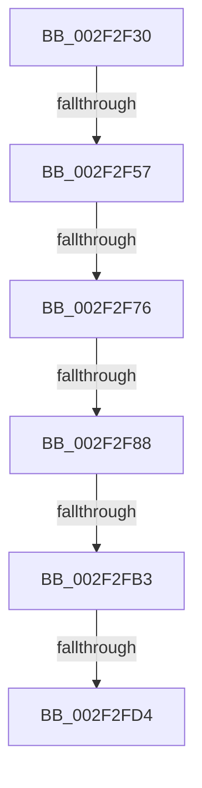

# RtlLookupFunctionEntry

- RVA: `0x002F2F30`–`0x002F2FD7` (길이 `167` bytes)
- VA: `0x00000001402F2F30`
- 실행 섹션: `.text`
- PDB 이름 있음: `예`; PDB Function 태그: `아니요`
- unwind 정보 RVA: `0x00071FAC`
- 디코드: `38`개 명령, `167/167` bytes 표시
- 미해석 바이트: `0` (있으면 어셈블리에 `.byte`로 보존)

> 이 문서는 커널 이미지의 기계어와 PDB 기호를 분석해 생성했습니다. 4번과 5번은 함수 원형과 자료형을 바이너리 사용 방식에서 추정한 C 해석이며 원본 소스 복구 결과는 아닙니다.

## 1. Dependencies

- 직접 호출 지점: **0**; 고유 호출 대상: **0**
- 직접 호출자로 확인된 함수: **11**
- RIP 상대 이미지 참조: **3**

### Outgoing calls
- 직접 디코드된 call 명령이 없습니다.

### Direct callers
- [RtlDispatchException](RtlDispatchException_function_002F22A0.md) at `0x002F2474`
- [RtlUnwindEx](RtlUnwindEx_function_002F2830.md) at `0x002F2955`
- [RtlpSameFunction](../48/RtlpSameFunction_function_0048E81C.md) at `0x0048E8B0`
- [RtlRaiseException](../5E/RtlRaiseException_function_005E6B00.md) at `0x005E6BBF`
- [MmWriteSystemImageTracepoint](../68/MmWriteSystemImageTracepoint_function_00684150.md) at `0x00684227`
- [sub_006DF0C8](../6D/Unknown_function_006DF0C8.md) at `0x006DF146`
- [KiTpBuildExcludedKernelTracepointBitmap](../../page/74/KiTpBuildExcludedKernelTracepointBitmap_function_007485B0.md) at `0x0074863A`
- [sub_00BF16D0](../../init/BF/Unknown_function_00BF16D0.md) at `0x00BF25EA`
- [sub_00BF16D0](../../init/BF/Unknown_function_00BF16D0.md) at `0x00BF3885`
- [sub_00BF16D0](../../init/BF/Unknown_function_00BF16D0.md) at `0x00BF81D7`
- [sub_00BF16D0](../../init/BF/Unknown_function_00BF16D0.md) at `0x00C13CF6`
- [KiInitDynamicTraceSupport](../../init/C3/KiInitDynamicTraceSupport_function_00C3A450.md) at `0x00C3A4B4`
- [RtlpInitMachineFrameEntries](../../init/C4/RtlpInitMachineFrameEntries_function_00C476D4.md) at `0x00C476F8`
- [RtlInitializeHistoryTable](../../init/C4/RtlInitializeHistoryTable_function_00C47724.md) at `0x00C4776D`

### Static image references
- `0x002F2F57` → RVA `0x01200038` (`CFGRO`; read)
- `0x002F2F76` → RVA `0x01200040` (`CFGRO`; read)
- `0x002F2F88` → RVA `0x01200030` (`CFGRO`; read)

## 2. Other-region calls and transfers

- 다른 실행 섹션으로 향하는 call: **0**
- call이 아닌 외부 분기/꼬리 이동: **5**
  - `0x002F2F51` → [sub_002F304F + 0x4F](Unknown_function_002F304F.md) (`tail-transfer`)
  - `0x002F2F70` → [sub_002F304F + 0x3A](Unknown_function_002F304F.md) (`tail-transfer`)
  - `0x002F2F82` → [sub_002F304F + 0x3A](Unknown_function_002F304F.md) (`tail-transfer`)
  - `0x002F2FAD` → [sub_002F31A4 + 0x14A](Unknown_function_002F31A4.md) (`tail-transfer`)
  - `0x002F2FD2` → [sub_002F304F](Unknown_function_002F304F.md) (`tail-transfer`)

## 3. Assembly (complete function range)

```asm
002F2F30  48 89 5C 24 10                  mov qword ptr [rsp + 0x10], rbx
002F2F35  48 89 74 24 18                  mov qword ptr [rsp + 0x18], rsi
002F2F3A  4C 89 74 24 20                  mov qword ptr [rsp + 0x20], r14
002F2F3F  41 57                           push r15
002F2F41  48 83 EC 40                     sub rsp, 0x40
002F2F45  4D 8B F0                        mov r14, r8
002F2F48  4C 8B FA                        mov r15, rdx
002F2F4B  48 8B D9                        mov rbx, rcx
002F2F4E  4D 85 C0                        test r8, r8
002F2F51  0F 85 47 01 00 00               jne 0x1402f309e
002F2F57  48 8B 0D DA D0 F0 00            mov rcx, qword ptr [rip + 0xf0d0da]
002F2F5E  33 C0                           xor eax, eax
002F2F60  48 89 44 24 30                  mov qword ptr [rsp + 0x30], rax
002F2F65  0F 57 C0                        xorps xmm0, xmm0
002F2F68  0F 11 44 24 20                  movups xmmword ptr [rsp + 0x20], xmm0
002F2F6D  48 3B D9                        cmp rbx, rcx
002F2F70  0F 82 13 01 00 00               jb 0x1402f3089
002F2F76  8B 05 C4 D0 F0 00               mov eax, dword ptr [rip + 0xf0d0c4]
002F2F7C  48 03 C1                        add rax, rcx
002F2F7F  48 3B D8                        cmp rbx, rax
002F2F82  0F 83 01 01 00 00               jae 0x1402f3089
002F2F88  0F 28 0D A1 D0 F0 00            movaps xmm1, xmmword ptr [rip + 0xf0d0a1]
002F2F8F  F2 0F 10 05 A9 D0 F0 00         movsd xmm0, qword ptr [rip + 0xf0d0a9]
002F2F97  66 48 0F 7E CE                  movq rsi, xmm1
002F2F9C  0F 11 4C 24 20                  movups xmmword ptr [rsp + 0x20], xmm1
002F2FA1  F2 0F 11 44 24 30               movsd qword ptr [rsp + 0x30], xmm0
002F2FA7  45 33 C9                        xor r9d, r9d
002F2FAA  48 85 F6                        test rsi, rsi
002F2FAD  0F 84 3B 03 00 00               je 0x1402f32ee
002F2FB3  8B 4C 24 34                     mov ecx, dword ptr [rsp + 0x34]
002F2FB7  48 B8 AB AA AA AA AA AA AA AA   movabs rax, 0xaaaaaaaaaaaaaaab
002F2FC1  4C 8B 44 24 28                  mov r8, qword ptr [rsp + 0x28]
002F2FC6  48 F7 E1                        mul rcx
002F2FC9  4D 89 07                        mov qword ptr [r15], r8
002F2FCC  48 C1 EA 03                     shr rdx, 3
002F2FD0  85 D2                           test edx, edx
002F2FD2  74 7B                           je 0x1402f304f
002F2FD4  8D 42 FF                        lea eax, [rdx - 1]
```

## 4. C-style interpretation (structured pseudocode)

```c
__int64 __fastcall RtlLookupFunctionEntry(__int64 a1, __int64 a2, __int64 a3, int a4)
{
    __int64 result;
    __int64 v_rsp;
    unsigned int v_stack_m14;
    unsigned __int64 v_stack_m18;
    unsigned __int64 v_stack_m20;
    unsigned __int64 v_stack_m28;
    unsigned __int64 v_stack_p10;
    unsigned __int64 v_stack_p18;
    unsigned __int64 v_stack_p20;

    v_stack_p10 = v_rbx;
    v_stack_p18 = v_rsi;
    v_stack_p20 = v_r14;
    v_rsp = (v_rsp) - (64);
    result = 0;
    v_stack_m18 = 0;
    v_stack_m28 = v_xmm0;
    result = ((unsigned int)(*(unsigned int *)(v_rip + 15782084))) + (*(unsigned __int64 *)(v_rip + 15782106));
    v_stack_m28 = v_xmm1;
    v_stack_m18 = v_xmm0;
    a4 = 0;
    *(unsigned __int64 *)(a2) = v_stack_m20;
    a2 = (a2) >> (3);
    return a2 - 1;
}
```

## 5. (Beta) C Style

```c
void *RtlLookupFunctionEntry(int64_t Arg1, void *Arg2, int64_t Arg3, int32_t Arg4)
{
    uint8_t *arg2 = (uint8_t *)Arg2;

    int64_t result;
    int64_t local_rsp;
    uint32_t v_stack_m14;
    uint64_t v_stack_m18;
    uint64_t v_stack_m20;
    uint64_t v_stack_m28;
    uint64_t v_stack_p10;
    uint64_t v_stack_p18;
    uint64_t v_stack_p20;

    v_stack_p10 = local_rbx;
    v_stack_p18 = local_rsi;
    v_stack_p20 = local_r14;
    local_rsp = (local_rsp) - (64);
    result = 0;
    v_stack_m18 = 0;
    v_stack_m28 = v_xmm0;
    result = ((uint32_t)(*(uint32_t *)(v_rip + 0xF0D0C4))) + (*(uint64_t *)(v_rip + 0xF0D0DA));
    v_stack_m28 = v_xmm1;
    v_stack_m18 = v_xmm0;
    Arg4 = 0;
    *(uint64_t *)(arg2) = v_stack_m20;
    Arg2 = (Arg2) >> (3);
    return Arg2 - 1;
}
```

### 관측된 메모리 오프셋

구조체 형식이 확인되지 않은 접근은 인자 기준의 오프셋으로만 기록했습니다.

| 기준 인자 | 오프셋 표현 | 폭 (bit) | 접근 |
|---|---:|---:|---|
| `Arg2` | `+ 0x0` | `64` | `W` |

## 6. Execution-region graph

[열기: 2D/3D 그래프와 함수 탐색 컨트롤 패널](../../../control-panel.html?section=text&rva=0x002F2F30&view=graph)

- 2D 그래프는 위에서 아래로 흐르고, 3D 그래프는 빈 공간을 드래그해 회전합니다. Shift+드래그는 이동, 휠은 확대·축소, 함수 노드 선택은 대상 보고서 이동입니다.

### Static fallback


