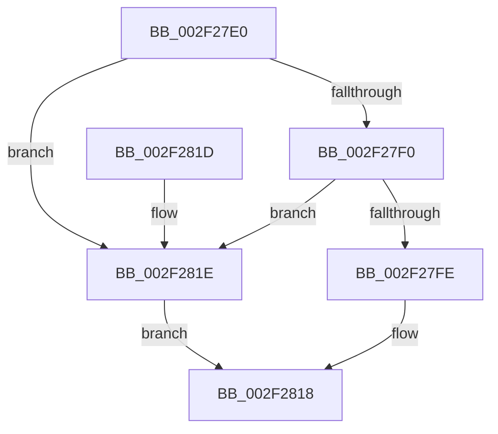

# RtlLookupFunctionTableEx

- RVA: `0x002F27E0`–`0x002F2825` (길이 `69` bytes)
- VA: `0x00000001402F27E0`
- 실행 섹션: `.text`
- PDB 이름 있음: `예`; PDB Function 태그: `아니요`
- unwind 정보 RVA: `0x0005CEE8`
- 디코드: `18`개 명령, `69/69` bytes 표시
- 미해석 바이트: `0` (있으면 어셈블리에 `.byte`로 보존)

> 이 문서는 커널 이미지의 기계어와 PDB 기호를 분석해 생성했습니다. 4번과 5번은 함수 원형과 자료형을 바이너리 사용 방식에서 추정한 C 해석이며 원본 소스 복구 결과는 아닙니다.

## 1. Dependencies

- 직접 호출 지점: **1**; 고유 호출 대상: **1**
- 직접 호출자로 확인된 함수: **0**
- RIP 상대 이미지 참조: **3**

### Outgoing calls
- `0x002F281E` → [RtlpxLookupFunctionTable](RtlpxLookupFunctionTable_function_002F3610.md) (function, `0x002F3610`)

### Direct callers
- 이 함수 시작 RVA로 연결되는 직접 call은 확인되지 않았습니다. 간접 호출은 완전히 역산할 수 없습니다.

### Static image references
- `0x002F27E4` → RVA `0x01200038` (`CFGRO`; read)
- `0x002F27F0` → RVA `0x01200040` (`CFGRO`; read)
- `0x002F27FE` → RVA `0x01200030` (`CFGRO`; read)

## 2. Other-region calls and transfers

- 다른 실행 섹션으로 향하는 call: **0**
- 별도 외부 분기/꼬리 이동을 확인하지 못했습니다.

## 3. Assembly (complete function range)

```asm
002F27E0  48 83 EC 28                     sub rsp, 0x28
002F27E4  4C 8B 05 4D D8 F0 00            mov r8, qword ptr [rip + 0xf0d84d]
002F27EB  49 3B C8                        cmp rcx, r8
002F27EE  72 2E                           jb 0x1402f281e
002F27F0  8B 05 4A D8 F0 00               mov eax, dword ptr [rip + 0xf0d84a]
002F27F6  49 03 C0                        add rax, r8
002F27F9  48 3B C8                        cmp rcx, rax
002F27FC  73 20                           jae 0x1402f281e
002F27FE  0F 28 05 2B D8 F0 00            movaps xmm0, xmmword ptr [rip + 0xf0d82b]
002F2805  0F 11 02                        movups xmmword ptr [rdx], xmm0
002F2808  F2 0F 10 0D 30 D8 F0 00         movsd xmm1, qword ptr [rip + 0xf0d830]
002F2810  F2 0F 11 4A 10                  movsd qword ptr [rdx + 0x10], xmm1
002F2815  48 8B 02                        mov rax, qword ptr [rdx]
002F2818  48 83 C4 28                     add rsp, 0x28
002F281C  C3                              ret
002F281D  CC                              int3
002F281E  E8 ED 0D 00 00                  call 0x1402f3610
002F2823  EB F3                           jmp 0x1402f2818
```

## 4. C-style interpretation (structured pseudocode)

```c
__int64 __fastcall RtlLookupFunctionTableEx(__int64 a1, __int64 a2)
{
    __int64 result;
    __int64 v_rsp;

    v_rsp = (v_rsp) - (40);
    if (a1 < (*(unsigned __int64 *)(v_rip + 15784013))) goto loc_002F281E;
    result = ((unsigned int)(*(unsigned int *)(v_rip + 15784010))) + (*(unsigned __int64 *)(v_rip + 15784013));
    if (a1 >= result) goto loc_002F281E;
    *(unsigned __int64 *)(a2) = v_xmm0;
    *(unsigned __int64 *)(a2 + 16) = v_xmm1;
loc_002F2818:
    v_rsp = (v_rsp) + (40);
    return *(unsigned __int64 *)(a2);
loc_002F281E:
    result = RtlpxLookupFunctionTable(a1, a2, *(unsigned __int64 *)(v_rip + 15784013), a4);
    goto loc_002F2818;
}
```

## 5. (Beta) C Style

```c
int64_t RtlLookupFunctionTableEx(int64_t Arg1, void *Arg2)
{
    uint8_t *arg2 = (uint8_t *)Arg2;

    int64_t result;
    int64_t local_rsp;

    local_rsp = (local_rsp) - (40);
    if (Arg1 < (*(uint64_t *)(v_rip + 0xF0D84D))) goto loc_002F281E;
    result = ((uint32_t)(*(uint32_t *)(v_rip + 0xF0D84A))) + (*(uint64_t *)(v_rip + 0xF0D84D));
    if (Arg1 >= result) goto loc_002F281E;
    *(uint64_t *)(arg2) = v_xmm0;
    *(uint64_t *)(arg2 + 0x10) = v_xmm1;
loc_002F2818:
    local_rsp = (local_rsp) + (40);
    return *(uint64_t *)(arg2);
loc_002F281E:
    result = RtlpxLookupFunctionTable(Arg1, Arg2, *(uint64_t *)(v_rip + 0xF0D84D), a4);
    goto loc_002F2818;
}
```

### 관측된 메모리 오프셋

구조체 형식이 확인되지 않은 접근은 인자 기준의 오프셋으로만 기록했습니다.

| 기준 인자 | 오프셋 표현 | 폭 (bit) | 접근 |
|---|---:|---:|---|
| `Arg2` | `+ 0x0` | `64` | `R` |
| `Arg2` | `+ 0x0` | `128` | `R` |
| `Arg2` | `+ 0x10` | `64` | `W` |

## 6. Execution-region graph

[열기: 2D/3D 그래프와 함수 탐색 컨트롤 패널](../../../control-panel.html?section=text&rva=0x002F27E0&view=graph)

- 2D 그래프는 위에서 아래로 흐르고, 3D 그래프는 빈 공간을 드래그해 회전합니다. Shift+드래그는 이동, 휠은 확대·축소, 함수 노드 선택은 대상 보고서 이동입니다.

### Static fallback


