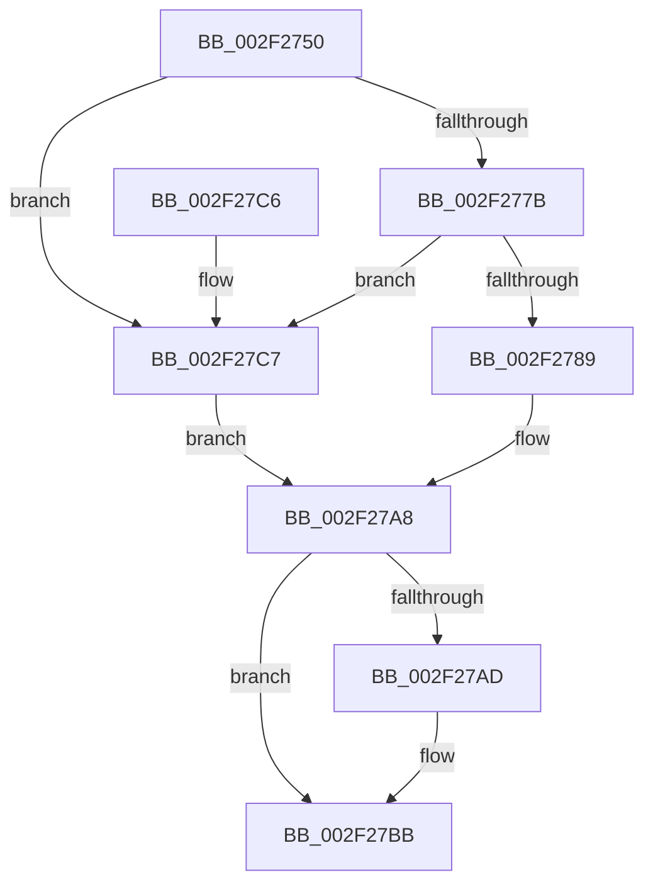

# RtlLookupFunctionTable

- RVA: `0x002F2750`–`0x002F27D3` (길이 `131` bytes)
- VA: `0x00000001402F2750`
- 실행 섹션: `.text`
- PDB 이름 있음: `예`; PDB Function 태그: `아니요`
- unwind 정보 RVA: `0x00071F64`
- 디코드: `35`개 명령, `131/131` bytes 표시
- 미해석 바이트: `0` (있으면 어셈블리에 `.byte`로 보존)

> 이 문서는 커널 이미지의 기계어와 PDB 기호를 분석해 생성했습니다. 4번과 5번은 함수 원형과 자료형을 바이너리 사용 방식에서 추정한 C 해석이며 원본 소스 복구 결과는 아닙니다.

## 1. Dependencies

- 직접 호출 지점: **1**; 고유 호출 대상: **1**
- 직접 호출자로 확인된 함수: **2**
- RIP 상대 이미지 참조: **3**

### Outgoing calls
- `0x002F27CC` → [RtlpxLookupFunctionTable](RtlpxLookupFunctionTable_function_002F3610.md) (function, `0x002F3610`)

### Direct callers
- [CcInitializeBcbProfiler](../../init/BE/CcInitializeBcbProfiler_function_00BEF294.md) at `0x00BEF425`
- [sub_00BF16D0](../../init/BF/Unknown_function_00BF16D0.md) at `0x00BF2569`
- [sub_00BF16D0](../../init/BF/Unknown_function_00BF16D0.md) at `0x00BF3804`
- [sub_00BF16D0](../../init/BF/Unknown_function_00BF16D0.md) at `0x00BF8156`
- [sub_00BF16D0](../../init/BF/Unknown_function_00BF16D0.md) at `0x00C13C59`

### Static image references
- `0x002F275A` → RVA `0x01200038` (`CFGRO`; read)
- `0x002F277B` → RVA `0x01200040` (`CFGRO`; read)
- `0x002F2789` → RVA `0x01200030` (`CFGRO`; read)

## 2. Other-region calls and transfers

- 다른 실행 섹션으로 향하는 call: **0**
- 별도 외부 분기/꼬리 이동을 확인하지 못했습니다.

## 3. Assembly (complete function range)

```asm
002F2750  48 89 5C 24 08                  mov qword ptr [rsp + 8], rbx
002F2755  57                              push rdi
002F2756  48 83 EC 40                     sub rsp, 0x40
002F275A  4C 8B 0D D7 D8 F0 00            mov r9, qword ptr [rip + 0xf0d8d7]
002F2761  33 C0                           xor eax, eax
002F2763  48 89 44 24 30                  mov qword ptr [rsp + 0x30], rax
002F2768  0F 57 C0                        xorps xmm0, xmm0
002F276B  49 8B D8                        mov rbx, r8
002F276E  48 8B FA                        mov rdi, rdx
002F2771  0F 11 44 24 20                  movups xmmword ptr [rsp + 0x20], xmm0
002F2776  49 3B C9                        cmp rcx, r9
002F2779  72 4C                           jb 0x1402f27c7
002F277B  8B 05 BF D8 F0 00               mov eax, dword ptr [rip + 0xf0d8bf]
002F2781  49 03 C1                        add rax, r9
002F2784  48 3B C8                        cmp rcx, rax
002F2787  73 3E                           jae 0x1402f27c7
002F2789  0F 28 0D A0 D8 F0 00            movaps xmm1, xmmword ptr [rip + 0xf0d8a0]
002F2790  F2 0F 10 05 A8 D8 F0 00         movsd xmm0, qword ptr [rip + 0xf0d8a8]
002F2798  66 48 0F 7E C8                  movq rax, xmm1
002F279D  0F 11 4C 24 20                  movups xmmword ptr [rsp + 0x20], xmm1
002F27A2  F2 0F 11 44 24 30               movsd qword ptr [rsp + 0x30], xmm0
002F27A8  48 85 C0                        test rax, rax
002F27AB  74 0E                           je 0x1402f27bb
002F27AD  48 8B 4C 24 28                  mov rcx, qword ptr [rsp + 0x28]
002F27B2  48 89 0F                        mov qword ptr [rdi], rcx
002F27B5  8B 4C 24 34                     mov ecx, dword ptr [rsp + 0x34]
002F27B9  89 0B                           mov dword ptr [rbx], ecx
002F27BB  48 8B 5C 24 50                  mov rbx, qword ptr [rsp + 0x50]
002F27C0  48 83 C4 40                     add rsp, 0x40
002F27C4  5F                              pop rdi
002F27C5  C3                              ret
002F27C6  CC                              int3
002F27C7  48 8D 54 24 20                  lea rdx, [rsp + 0x20]
002F27CC  E8 3F 0E 00 00                  call 0x1402f3610
002F27D1  EB D5                           jmp 0x1402f27a8
```

## 4. C-style interpretation (structured pseudocode)

```c
__int64 __fastcall RtlLookupFunctionTable(__int64 a1, __int64 a2, __int64 a3)
{
    __int64 result;
    __int64 v_rsp;
    unsigned int v_stack_m14;
    unsigned __int64 v_stack_m18;
    unsigned __int64 v_stack_m20;
    unsigned __int64 v_stack_m28;
    unsigned __int64 v_stack_p20;
    unsigned __int64 v_stack_p8;

    v_stack_p8 = v_rbx;
    v_rsp = (v_rsp) - (64);
    result = 0;
    v_stack_m18 = 0;
    v_stack_m28 = v_xmm0;
    if (a1 < (*(unsigned __int64 *)(v_rip + 15784151))) goto loc_002F27C7;
    result = ((unsigned int)(*(unsigned int *)(v_rip + 15784127))) + (*(unsigned __int64 *)(v_rip + 15784151));
    if (a1 >= result) goto loc_002F27C7;
    v_stack_m28 = v_xmm1;
    v_stack_m18 = v_xmm0;
loc_002F27A8:
    if (result != 0) {
        a1 = v_stack_m20;
        *(unsigned __int64 *)(a2) = a1;
        a1 = v_stack_m14;
        *(unsigned int *)(a3) = (unsigned int)(a1);
    }
    v_rsp = (v_rsp) + (64);
    return result;
loc_002F27C7:
    result = RtlpxLookupFunctionTable(a1, v_stack_p20, a3, *(unsigned __int64 *)(v_rip + 15784151));
    goto loc_002F27A8;
}
```

## 5. (Beta) C Style

```c
int64_t RtlLookupFunctionTable(int64_t Arg1, void *Arg2, void *Arg3)
{
    uint8_t *arg2 = (uint8_t *)Arg2;
    uint8_t *arg3 = (uint8_t *)Arg3;

    int64_t result;
    int64_t local_rsp;
    uint32_t v_stack_m14;
    uint64_t v_stack_m18;
    uint64_t v_stack_m20;
    uint64_t v_stack_m28;
    uint64_t v_stack_p20;
    uint64_t v_stack_p8;

    v_stack_p8 = local_rbx;
    local_rsp = (local_rsp) - (64);
    result = 0;
    v_stack_m18 = 0;
    v_stack_m28 = v_xmm0;
    if (Arg1 < (*(uint64_t *)(v_rip + 0xF0D8D7))) goto loc_002F27C7;
    result = ((uint32_t)(*(uint32_t *)(v_rip + 0xF0D8BF))) + (*(uint64_t *)(v_rip + 0xF0D8D7));
    if (Arg1 >= result) goto loc_002F27C7;
    v_stack_m28 = v_xmm1;
    v_stack_m18 = v_xmm0;
loc_002F27A8:
    if (result != 0) {
        Arg1 = v_stack_m20;
        *(uint64_t *)(arg2) = Arg1;
        Arg1 = v_stack_m14;
        *(uint32_t *)(arg3) = (uint32_t)(Arg1);
    }
    local_rsp = (local_rsp) + (64);
    return result;
loc_002F27C7:
    result = RtlpxLookupFunctionTable(Arg1, v_stack_p20, Arg3, *(uint64_t *)(v_rip + 0xF0D8D7));
    goto loc_002F27A8;
}
```

### 관측된 메모리 오프셋

구조체 형식이 확인되지 않은 접근은 인자 기준의 오프셋으로만 기록했습니다.

| 기준 인자 | 오프셋 표현 | 폭 (bit) | 접근 |
|---|---:|---:|---|
| `Arg2` | `+ 0x0` | `64` | `W` |
| `Arg3` | `+ 0x0` | `32` | `W` |

## 6. Execution-region graph

[열기: 2D/3D 그래프와 함수 탐색 컨트롤 패널](../../../control-panel.html?section=text&rva=0x002F2750&view=graph)

- 2D 그래프는 위에서 아래로 흐르고, 3D 그래프는 빈 공간을 드래그해 회전합니다. Shift+드래그는 이동, 휠은 확대·축소, 함수 노드 선택은 대상 보고서 이동입니다.

### Static fallback


