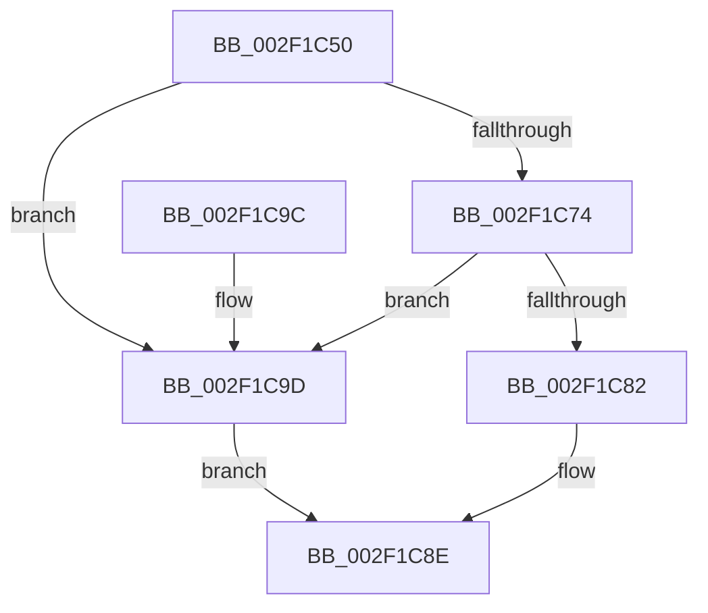

# RtlPcToFileHeader

- RVA: `0x002F1C50`–`0x002F1CA9` (길이 `89` bytes)
- VA: `0x00000001402F1C50`
- 실행 섹션: `.text`
- PDB 이름 있음: `예`; PDB Function 태그: `아니요`
- unwind 정보 RVA: `0x00071EBC`
- 디코드: `25`개 명령, `89/89` bytes 표시
- 미해석 바이트: `0` (있으면 어셈블리에 `.byte`로 보존)

> 이 문서는 커널 이미지의 기계어와 PDB 기호를 분석해 생성했습니다. 4번과 5번은 함수 원형과 자료형을 바이너리 사용 방식에서 추정한 C 해석이며 원본 소스 복구 결과는 아닙니다.

## 1. Dependencies

- 직접 호출 지점: **1**; 고유 호출 대상: **1**
- 직접 호출자로 확인된 함수: **8**
- RIP 상대 이미지 참조: **3**

### Outgoing calls
- `0x002F1CA2` → [RtlpxLookupFunctionTable](RtlpxLookupFunctionTable_function_002F3610.md) (function, `0x002F3610`)

### Direct callers
- [RtlGuardCheckLongJumpTarget](../5E/RtlGuardCheckLongJumpTarget_function_005EEF28.md) at `0x005EEF58`
- [EtwTimLogControlProtectionKernelModeReturnMismatch](../65/EtwTimLogControlProtectionKernelModeReturnMismatch_function_00651E84.md) at `0x00652053`
- [EtwTimLogControlProtectionKernelModeReturnMismatch](../65/EtwTimLogControlProtectionKernelModeReturnMismatch_function_00651E84.md) at `0x006520BF`
- [MiIssueDllInitializeCall](../../page/7F/MiIssueDllInitializeCall_function_007F8078.md) at `0x007F80B4`
- [MiUnloadApproved](../../page/7F/MiUnloadApproved_function_007F82A0.md) at `0x007F8305`
- [EtwpLocateDbgIdForRegEntry](../../page/8D/EtwpLocateDbgIdForRegEntry_function_008D99A4.md) at `0x008D9AC4`
- [IoCreateDriver](../../page/AC/IoCreateDriver_function_00AC9D70.md) at `0x00AC9F1E`
- [sub_00BF16D0](../../init/BF/Unknown_function_00BF16D0.md) at `0x00BF22E3`
- [sub_00BF16D0](../../init/BF/Unknown_function_00BF16D0.md) at `0x00BF80C4`
- [VslpRecordBootRanges](../../init/C7/VslpRecordBootRanges_function_00C76F04.md) at `0x00C76F88`

### Static image references
- `0x002F1C56` → RVA `0x01200038` (`CFGRO`; read)
- `0x002F1C74` → RVA `0x01200040` (`CFGRO`; read)
- `0x002F1C82` → RVA `0x01200030` (`CFGRO`; read)

## 2. Other-region calls and transfers

- 다른 실행 섹션으로 향하는 call: **0**
- 별도 외부 분기/꼬리 이동을 확인하지 못했습니다.

## 3. Assembly (complete function range)

```asm
002F1C50  40 53                           push rbx
002F1C52  48 83 EC 40                     sub rsp, 0x40
002F1C56  4C 8B 05 DB E3 F0 00            mov r8, qword ptr [rip + 0xf0e3db]
002F1C5D  33 C0                           xor eax, eax
002F1C5F  48 89 44 24 30                  mov qword ptr [rsp + 0x30], rax
002F1C64  0F 57 C0                        xorps xmm0, xmm0
002F1C67  48 8B DA                        mov rbx, rdx
002F1C6A  0F 11 44 24 20                  movups xmmword ptr [rsp + 0x20], xmm0
002F1C6F  49 3B C8                        cmp rcx, r8
002F1C72  72 29                           jb 0x1402f1c9d
002F1C74  8B 05 C6 E3 F0 00               mov eax, dword ptr [rip + 0xf0e3c6]
002F1C7A  49 03 C0                        add rax, r8
002F1C7D  48 3B C8                        cmp rcx, rax
002F1C80  73 1B                           jae 0x1402f1c9d
002F1C82  0F 28 05 A7 E3 F0 00            movaps xmm0, xmmword ptr [rip + 0xf0e3a7]
002F1C89  0F 11 44 24 20                  movups xmmword ptr [rsp + 0x20], xmm0
002F1C8E  48 8B 44 24 28                  mov rax, qword ptr [rsp + 0x28]
002F1C93  48 89 03                        mov qword ptr [rbx], rax
002F1C96  48 83 C4 40                     add rsp, 0x40
002F1C9A  5B                              pop rbx
002F1C9B  C3                              ret
002F1C9C  CC                              int3
002F1C9D  48 8D 54 24 20                  lea rdx, [rsp + 0x20]
002F1CA2  E8 69 19 00 00                  call 0x1402f3610
002F1CA7  EB E5                           jmp 0x1402f1c8e
```

## 4. C-style interpretation (structured pseudocode)

```c
__int64 __fastcall RtlPcToFileHeader(__int64 a1, __int64 a2)
{
    __int64 result;
    __int64 v_rsp;
    unsigned __int64 v_stack_m18;
    unsigned __int64 v_stack_m20;
    unsigned __int64 v_stack_m28;
    unsigned __int64 v_stack_p20;

    v_rsp = (v_rsp) - (64);
    result = 0;
    v_stack_m18 = 0;
    v_stack_m28 = v_xmm0;
    if (a1 < (*(unsigned __int64 *)(v_rip + 15786971))) goto loc_002F1C9D;
    result = ((unsigned int)(*(unsigned int *)(v_rip + 15786950))) + (*(unsigned __int64 *)(v_rip + 15786971));
    if (a1 >= result) goto loc_002F1C9D;
    v_stack_m28 = v_xmm0;
loc_002F1C8E:
    *(unsigned __int64 *)(a2) = v_stack_m20;
    v_rsp = (v_rsp) + (64);
    return v_stack_m20;
loc_002F1C9D:
    result = RtlpxLookupFunctionTable(a1, v_stack_p20, *(unsigned __int64 *)(v_rip + 15786971), a4);
    goto loc_002F1C8E;
}
```

## 5. (Beta) C Style

```c
int64_t RtlPcToFileHeader(int64_t Arg1, void *Arg2)
{
    uint8_t *arg2 = (uint8_t *)Arg2;

    int64_t result;
    int64_t local_rsp;
    uint64_t v_stack_m18;
    uint64_t v_stack_m20;
    uint64_t v_stack_m28;
    uint64_t v_stack_p20;

    local_rsp = (local_rsp) - (64);
    result = 0;
    v_stack_m18 = 0;
    v_stack_m28 = v_xmm0;
    if (Arg1 < (*(uint64_t *)(v_rip + 0xF0E3DB))) goto loc_002F1C9D;
    result = ((uint32_t)(*(uint32_t *)(v_rip + 0xF0E3C6))) + (*(uint64_t *)(v_rip + 0xF0E3DB));
    if (Arg1 >= result) goto loc_002F1C9D;
    v_stack_m28 = v_xmm0;
loc_002F1C8E:
    *(uint64_t *)(arg2) = v_stack_m20;
    local_rsp = (local_rsp) + (64);
    return v_stack_m20;
loc_002F1C9D:
    result = RtlpxLookupFunctionTable(Arg1, v_stack_p20, *(uint64_t *)(v_rip + 0xF0E3DB), a4);
    goto loc_002F1C8E;
}
```

### 관측된 메모리 오프셋

구조체 형식이 확인되지 않은 접근은 인자 기준의 오프셋으로만 기록했습니다.

| 기준 인자 | 오프셋 표현 | 폭 (bit) | 접근 |
|---|---:|---:|---|
| `Arg2` | `+ 0x0` | `64` | `W` |

## 6. Execution-region graph

[열기: 2D/3D 그래프와 함수 탐색 컨트롤 패널](../../../control-panel.html?section=text&rva=0x002F1C50&view=graph)

- 2D 그래프는 위에서 아래로 흐르고, 3D 그래프는 빈 공간을 드래그해 회전합니다. Shift+드래그는 이동, 휠은 확대·축소, 함수 노드 선택은 대상 보고서 이동입니다.

### Static fallback


