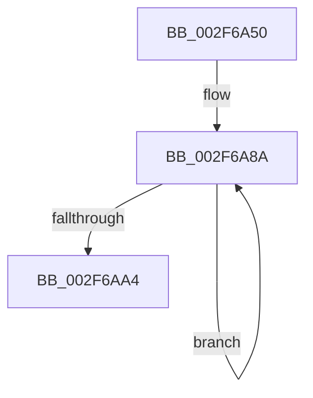

# RtlRaiseStatus

- RVA: `0x002F6A50`–`0x002F6AAC` (길이 `92` bytes)
- VA: `0x00000001402F6A50`
- 실행 섹션: `.text`
- PDB 이름 있음: `예`; PDB Function 태그: `아니요`
- unwind 정보 RVA: `0x000722B0`
- 디코드: `22`개 명령, `92/92` bytes 표시
- 미해석 바이트: `0` (있으면 어셈블리에 `.byte`로 보존)

> 이 문서는 커널 이미지의 기계어와 PDB 기호를 분석해 생성했습니다. 4번과 5번은 함수 원형과 자료형을 바이너리 사용 방식에서 추정한 C 해석이며 원본 소스 복구 결과는 아닙니다.

## 1. Dependencies

- 직접 호출 지점: **3**; 고유 호출 대상: **3**
- 직접 호출자로 확인된 함수: **113**
- RIP 상대 이미지 참조: **0**

### Outgoing calls
- `0x002F6A66` → [memset](../6C/memset_function_006C6C40.md) (function, `0x006C6C40`)
- `0x002F6A9A` → [RtlRaiseNoncontinuableException](../4F/RtlRaiseNoncontinuableException_function_004FED40.md) (function, `0x004FED40`)
- `0x002F6AA6` → [RtlRaiseStatus](RtlRaiseStatus_function_002F6A50.md) (function, `0x002F6A50`)

### Direct callers
- [sub_0020D8DF](../20/Unknown_function_0020D8DF.md) at `0x0020DA43`
- [KeWaitForSingleObject](../20/KeWaitForSingleObject_function_0020E6B0.md) at `0x0020F27E`
- [MiProbeAndLockPages](../23/MiProbeAndLockPages_function_0023B4F0.md) at `0x0023B60B`
- [MiProbeAndLockPages](../23/MiProbeAndLockPages_function_0023B4F0.md) at `0x0023B742`
- [MmProbeAndLockPages](../23/MmProbeAndLockPages_function_0023B990.md) at `0x0023BA51`
- [MmProbeAndLockPages](../23/MmProbeAndLockPages_function_0023B990.md) at `0x0023BA90`
- [sub_0023F9D7](../23/Unknown_function_0023F9D7.md) at `0x0023F9E1`
- [sub_0023FA4B](../23/Unknown_function_0023FA4B.md) at `0x0023FA74`
- [CcSetFileSizesEx](../26/CcSetFileSizesEx_function_0026D070.md) at `0x0026D328`
- [CcGetVacbMiss](../27/CcGetVacbMiss_function_00272900.md) at `0x00273068`
- [NtSetInformationFile](../29/NtSetInformationFile_function_0029C5E0.md) at `0x0029CC48`
- [CcZeroDataInCache](../29/CcZeroDataInCache_function_0029E894.md) at `0x0029EA1F`
- [RtlDispatchException](RtlDispatchException_function_002F22A0.md) at `0x002F273E`
- [RtlUnwindEx](RtlUnwindEx_function_002F2830.md) at `0x002F2914`
- [RtlUnwindEx](RtlUnwindEx_function_002F2830.md) at `0x002F2BE6`
- [RtlUnwindEx](RtlUnwindEx_function_002F2830.md) at `0x002F2F19`
- [RtlUnwindEx](RtlUnwindEx_function_002F2830.md) at `0x002F2F21`
- [RtlpLookupDynamicUserFunctionTable](RtlpLookupDynamicUserFunctionTable_function_002F333C.md) at `0x002F35AF`
- [RtlpxVirtualUnwind](RtlpxVirtualUnwind_function_002F5110.md) at `0x002F5303`
- [RtlpUnwindPrologue](RtlpUnwindPrologue_function_002F5FA0.md) at `0x002F6352`
- [RtlRaiseStatus](RtlRaiseStatus_function_002F6A50.md) at `0x002F6AA6`
- [CcMapAndRead](CcMapAndRead_function_002F6AC0.md) at `0x002F6BE0`
- [RtlIsNameInExpression](RtlIsNameInExpression_function_002FDA70.md) at `0x002FDADE`
- [RtlIsNameInUnUpcasedExpression](RtlIsNameInUnUpcasedExpression_function_002FDAF0.md) at `0x002FDB50`
- [RtlIsNameInUnUpcasedExpression](RtlIsNameInUnUpcasedExpression_function_002FDAF0.md) at `0x002FDB57`
- [CcPinFileData](../33/CcPinFileData_function_0033FB40.md) at `0x0033FFC5`
- [CcPinFileData](../33/CcPinFileData_function_0033FB40.md) at `0x0034033A`
- [CcPinFileData](../33/CcPinFileData_function_0033FB40.md) at `0x00340685`
- [CcPinFileData](../33/CcPinFileData_function_0033FB40.md) at `0x00340C3F`
- [KeReleaseSemaphoreEx](../34/KeReleaseSemaphoreEx_function_003468C0.md) at `0x00346BAE`
- [CcAsyncCopyRead](../35/CcAsyncCopyRead_function_00358880.md) at `0x00358B11`
- [CcAsyncCopyRead](../35/CcAsyncCopyRead_function_00358880.md) at `0x00358B46`
- [CcAsyncCopyRead](../35/CcAsyncCopyRead_function_00358880.md) at `0x00358B5C`
- [MiAllocatePool](../35/MiAllocatePool_function_0035B540.md) at `0x0035B592`
- [ExAllocatePoolMm](../35/ExAllocatePoolMm_function_0035B690.md) at `0x0035B6C2`
- [ExAllocateHeapPool](../35/ExAllocateHeapPool_function_0035BA30.md) at `0x0035CB73`
- [CcZeroDataOnDisk](../38/CcZeroDataOnDisk_function_00386B80.md) at `0x00386BDD`
- [sub_00387740](../38/Unknown_function_00387740.md) at `0x003879D4`
- [FsRtlAddEntry](../38/FsRtlAddEntry_function_00387BE0.md) at `0x00387D02`
- [CcZeroData](../38/CcZeroData_function_00387F00.md) at `0x00388145`
- [FsRtlPrivateLock](../38/FsRtlPrivateLock_function_0038DF90.md) at `0x0038E2E5`
- [FsRtlPrivateLock](../38/FsRtlPrivateLock_function_0038DF90.md) at `0x0038E46A`
- [FsRtlPrivateInitializeFileLock](../38/FsRtlPrivateInitializeFileLock_function_0038ED34.md) at `0x0038EDB3`
- [AlpcpSignal](../39/AlpcpSignal_function_003955E0.md) at `0x0039609F`
- [KeReleaseMutantEx](../39/KeReleaseMutantEx_function_00396850.md) at `0x00396D65`
- [sub_00397328](../39/Unknown_function_00397328.md) at `0x00397353`
- [KiWaitForAllObjects](../3C/KiWaitForAllObjects_function_003C5800.md) at `0x003C5F7A`
- [CcMdlWriteComplete2](../3C/CcMdlWriteComplete2_function_003CA36C.md) at `0x003CA4B0`
- [CcMapAndCopyInToCache](../3C/CcMapAndCopyInToCache_function_003CA7F0.md) at `0x003CADFB`
- [CcMapAndCopyInToCache](../3C/CcMapAndCopyInToCache_function_003CA7F0.md) at `0x003CAE16`
- [CcMapAndCopyInToCache](../3C/CcMapAndCopyInToCache_function_003CA7F0.md) at `0x003CAF20`
- [CcMapAndCopyInToCache](../3C/CcMapAndCopyInToCache_function_003CA7F0.md) at `0x003CB05B`
- [CcMapAndCopyInToCache](../3C/CcMapAndCopyInToCache_function_003CA7F0.md) at `0x003CB063`
- [CcMapAndCopyInToCache](../3C/CcMapAndCopyInToCache_function_003CA7F0.md) at `0x003CB0B6`
- [CcMapAndCopyInToCache](../3C/CcMapAndCopyInToCache_function_003CA7F0.md) at `0x003CB241`
- [CcMapAndCopyInToCache](../3C/CcMapAndCopyInToCache_function_003CA7F0.md) at `0x003CB384`
- [CcCopyToCacheHelper](../3C/CcCopyToCacheHelper_function_003CC290.md) at `0x003CC308`
- [CcInitializeCacheMapInternal](../3C/CcInitializeCacheMapInternal_function_003CC720.md) at `0x003CD0DF`
- [KiInitializeUserApc](../3D/KiInitializeUserApc_function_003D8D38.md) at `0x003D912C`
- [PsChargePoolQuota](../3E/PsChargePoolQuota_function_003EC7F0.md) at `0x003EC805`
- [RtlpUnwindOpSlots](../3F/RtlpUnwindOpSlots_function_003F9270.md) at `0x003F92AD`
- [FsRtlInitializeLargeMcb](../3F/FsRtlInitializeLargeMcb_function_003FB640.md) at `0x003FB69F`
- [FsRtlInitializeBaseMcbEx](../3F/FsRtlInitializeBaseMcbEx_function_003FB6B0.md) at `0x003FB719`
- [IopAllocateAndPopulateWriteIrp](../40/IopAllocateAndPopulateWriteIrp_function_004011F4.md) at `0x004015B9`
- [RtlAreNamesEqual](../40/RtlAreNamesEqual_function_0040BCB0.md) at `0x0040BD95`
- [RtlAreNamesEqual](../40/RtlAreNamesEqual_function_0040BCB0.md) at `0x0040BDBE`
- [CcCopyReadEx](../45/CcCopyReadEx_function_0045E160.md) at `0x0045E50C`
- [InitializeSListHead](../46/InitializeSListHead_function_00468A90.md) at `0x00468AAA`
- [RtlpLookupPrimaryFunctionEntry](../48/RtlpLookupPrimaryFunctionEntry_function_0048E8D0.md) at `0x0048E938`
- [CcPrepareMdlWrite](../49/CcPrepareMdlWrite_function_004996D0.md) at `0x004999AE`
- [CcPrepareMdlWrite](../49/CcPrepareMdlWrite_function_004996D0.md) at `0x00499A41`
- [FsRtlAllocatePool](../58/FsRtlAllocatePool_function_00581BD0.md) at `0x00581BEB`
- [FsRtlAllocatePoolWithQuota](../58/FsRtlAllocatePoolWithQuota_function_00581C00.md) at `0x00581C1B`
- [FsRtlAllocatePoolWithQuotaTag](../58/FsRtlAllocatePoolWithQuotaTag_function_00581C30.md) at `0x00581C45`
- [FsRtlAllocatePoolWithTag](../58/FsRtlAllocatePoolWithTag_function_00581C60.md) at `0x00581C75`
- [FsRtlpPostStackOverflow](../58/FsRtlpPostStackOverflow_function_0058351C.md) at `0x00583565`
- [KeSuspendThreadOld](../5B/KeSuspendThreadOld_function_005B9000.md) at `0x005B90E2`
- [RtlRaiseException](../5E/RtlRaiseException_function_005E6B00.md) at `0x005E6C23`
- [DifExRaiseStatusWrapper](../62/DifExRaiseStatusWrapper_function_00621C40.md) at `0x00621CFE`
- [purecall](../65/purecall_function_0065AAC0.md) at `0x0065AAC9`
- [MiZeroPageCalibrate](../69/MiZeroPageCalibrate_function_0069A69C.md) at `0x0069A7A7`
- [CcMapAndCopyInToCache$fin$1](../6D/CcMapAndCopyInToCache_fin_1_function_006D2AF9.md) at `0x006D2CAC`
- [sub_006DF0C8](../6D/Unknown_function_006DF0C8.md) at `0x006DF259`
- [sub_006DFD60](../6D/Unknown_function_006DFD60.md) at `0x006DFDF2`
- [sub_006E86B0](../6E/Unknown_function_006E86B0.md) at `0x006E8789`
- [IopSetEaOrQuotaInformationFile](../../page/71/IopSetEaOrQuotaInformationFile_function_0071BD70.md) at `0x0071C072`
- [IopSetEaOrQuotaInformationFile](../../page/71/IopSetEaOrQuotaInformationFile_function_0071BD70.md) at `0x0071C0F9`
- [IopSetFileObjectIosbRange](../../page/71/IopSetFileObjectIosbRange_function_0071C1C8.md) at `0x0071C399`
- [NtQueryQuotaInformationFile](../../page/72/NtQueryQuotaInformationFile_function_00720FE0.md) at `0x007215E3`
- [ObpInitStackAndObjectTables](../../page/74/ObpInitStackAndObjectTables_function_0074FCF4.md) at `0x0074FD9E`
- [EtwpInitializeStackLookasideList](../../page/7B/EtwpInitializeStackLookasideList_function_007BA578.md) at `0x007BA58C`
- [EtwpInitializeLastBranchTracing](../../page/7C/EtwpInitializeLastBranchTracing_function_007C0E04.md) at `0x007C0E22`
- [NtSetUuidSeed](../../page/7D/NtSetUuidSeed_function_007D0DD0.md) at `0x007D0EB5`
- [NtSetUuidSeed](../../page/7D/NtSetUuidSeed_function_007D0DD0.md) at `0x007D0ED4`
- [NtSetUuidSeed](../../page/7D/NtSetUuidSeed_function_007D0DD0.md) at `0x007D0F37`
- [NtSetUuidSeed](../../page/7D/NtSetUuidSeed_function_007D0DD0.md) at `0x007D0F56`
- [NtSetUuidSeed](../../page/7D/NtSetUuidSeed_function_007D0DD0.md) at `0x007D0F8B`
- [NtSetUuidSeed](../../page/7D/NtSetUuidSeed_function_007D0DD0.md) at `0x007D0FAC`
- [NtSetUuidSeed](../../page/7D/NtSetUuidSeed_function_007D0DD0.md) at `0x007D0FD0`
- [NtSetUuidSeed](../../page/7D/NtSetUuidSeed_function_007D0DD0.md) at `0x007D102E`
- [CmpInitCallbacks](../../page/7E/CmpInitCallbacks_function_007E19A0.md) at `0x007E1A0F`
- [ExRaiseDatatypeMisalignment](../../page/89/ExRaiseDatatypeMisalignment_function_00899FD0.md) at `0x00899FD9`
- [IopCreateFile](../../page/8A/IopCreateFile_function_008AB298.md) at `0x008AB412`
- [IopCreateFile](../../page/8A/IopCreateFile_function_008AB298.md) at `0x008ABDCF`
- [IopReadFile](../../page/8A/IopReadFile_function_008AEFF0.md) at `0x008AF98D`
- [NtQueryMultipleValueKey](../../page/8B/NtQueryMultipleValueKey_function_008B13B0.md) at `0x008B15BD`
- [ExRaiseAccessViolation](../../page/8E/ExRaiseAccessViolation_function_008E9240.md) at `0x008E9249`
- [IopXxxControlFile](../../page/8E/IopXxxControlFile_function_008E9AD0.md) at `0x008EAA05`
- [BuildQueryDirectoryIrp](../../page/8E/BuildQueryDirectoryIrp_function_008EC770.md) at `0x008ECAC1`
- [RtlRunOnceExecuteOnce](../../page/95/RtlRunOnceExecuteOnce_function_0095DC00.md) at `0x0095DCD9`
- [MiMapLockedPagesInUserSpace](../../page/97/MiMapLockedPagesInUserSpace_function_0097FE04.md) at `0x009800A3`
- [MiMapLockedPagesInUserSpace](../../page/97/MiMapLockedPagesInUserSpace_function_0097FE04.md) at `0x009801CF`
- [MiMapLockedPagesInUserSpace](../../page/97/MiMapLockedPagesInUserSpace_function_0097FE04.md) at `0x009801E3`
- [MiMapLockedPagesInUserSpace](../../page/97/MiMapLockedPagesInUserSpace_function_0097FE04.md) at `0x009801EE`
- [MiMapLockedPagesInUserSpace](../../page/97/MiMapLockedPagesInUserSpace_function_0097FE04.md) at `0x0098022B`
- [sub_009A5974](../../page/9A/Unknown_function_009A5974.md) at `0x009A5A98`
- [sub_009A5B10](../../page/9A/Unknown_function_009A5B10.md) at `0x009A5B3B`
- [sub_009A5B88](../../page/9A/Unknown_function_009A5B88.md) at `0x009A5BA0`
- [sub_009A5BBB](../../page/9A/Unknown_function_009A5BBB.md) at `0x009A5BC9`
- [CcMapAndCopyFromCache](../../page/A4/CcMapAndCopyFromCache_function_00A47060.md) at `0x00A4728C`
- [IopReadFileScatter](../../page/AA/IopReadFileScatter_function_00AA5D78.md) at `0x00AA62C9`
- [IopWriteFileGather](../../page/AA/IopWriteFileGather_function_00AAA95C.md) at `0x00AAAED6`
- [CcMdlRead](../../page/AB/CcMdlRead_function_00ABA520.md) at `0x00ABA686`
- [sub_00B1A404](../../page/B1/Unknown_function_00B1A404.md) at `0x00B1A43D`
- [sub_00B1A4B8](../../page/B1/Unknown_function_00B1A4B8.md) at `0x00B1A508`
- [sub_00B1D822](../../page/B1/Unknown_function_00B1D822.md) at `0x00B1D849`
- [sub_00B2D5E6](../../page/B2/Unknown_function_00B2D5E6.md) at `0x00B2D5FC`
- [sub_00B3738C](../../page/B3/Unknown_function_00B3738C.md) at `0x00B373C7`
- [sub_00B41AB2](../../page/B4/Unknown_function_00B41AB2.md) at `0x00B41B2F`
- [sub_00B41AB2](../../page/B4/Unknown_function_00B41AB2.md) at `0x00B41BB9`
- [PopEndMirroring](../../pagelk/B7/PopEndMirroring_function_00B75E50.md) at `0x00B76102`
- [ExAllocatePool2](../../poolcode/B8/ExAllocatePool2_function_00B820F0.md) at `0x00B82125`
- [ExAllocatePool3](../../poolcode/B8/ExAllocatePool3_function_00B84270.md) at `0x00B842EA`
- [VerifierExAllocatePool](../../pagevrfy/BA/VerifierExAllocatePool_function_00BA1060.md) at `0x00BA1169`
- [VerifierExAllocatePool2](../../pagevrfy/BA/VerifierExAllocatePool2_function_00BA1180.md) at `0x00BA129A`
- [VerifierExAllocatePool3](../../pagevrfy/BA/VerifierExAllocatePool3_function_00BA12D0.md) at `0x00BA13FC`
- [VerifierExAllocatePoolWithQuota](../../pagevrfy/BA/VerifierExAllocatePoolWithQuota_function_00BA1470.md) at `0x00BA14F7`
- [VerifierExAllocatePoolWithQuotaTag](../../pagevrfy/BA/VerifierExAllocatePoolWithQuotaTag_function_00BA1510.md) at `0x00BA1597`
- [VerifierExAllocatePoolWithTag](../../pagevrfy/BA/VerifierExAllocatePoolWithTag_function_00BA15B0.md) at `0x00BA16C4`
- [VerifierExAllocatePoolWithTagPriority](../../pagevrfy/BA/VerifierExAllocatePoolWithTagPriority_function_00BA16D0.md) at `0x00BA17F2`
- [ViRlrsMmProbeAndLockPages_Entry](../../pagevrfy/BA/ViRlrsMmProbeAndLockPages_Entry_function_00BAF7C0.md) at `0x00BAF7D5`
- [VerifierMmMapLockedPagesSpecifyCache](../../pagevrfy/BB/VerifierMmMapLockedPagesSpecifyCache_function_00BB0B30.md) at `0x00BB0C25`
- [VfHandlePoolAlloc](../../pagevrfy/BB/VfHandlePoolAlloc_function_00BB8A90.md) at `0x00BB8DBE`
- [HalpDmaAllocateReservedMappingArray](../../init/C2/HalpDmaAllocateReservedMappingArray_function_00C20A74.md) at `0x00C20A9C`
- [ExpWorkerFactoryInitialization](../../init/C5/ExpWorkerFactoryInitialization_function_00C54250.md) at `0x00C542FA`
- [WheapInitializeEventing](../../init/C5/WheapInitializeEventing_function_00C55610.md) at `0x00C556F6`
- [MiInitNucleus](../../init/C5/MiInitNucleus_function_00C5FD38.md) at `0x00C605BE`
- [MiInitializeDecayPfns](../../init/C6/MiInitializeDecayPfns_function_00C6CC04.md) at `0x00C6CC48`

### Static image references
- 디코드된 RIP-relative 메모리 참조가 없습니다.

## 2. Other-region calls and transfers

- 다른 실행 섹션으로 향하는 call: **0**
- 별도 외부 분기/꼬리 이동을 확인하지 못했습니다.

## 3. Assembly (complete function range)

```asm
002F6A50  40 53                           push rbx
002F6A52  48 81 EC 90 05 00 00            sub rsp, 0x590
002F6A59  33 D2                           xor edx, edx
002F6A5B  8B D9                           mov ebx, ecx
002F6A5D  48 8D 4C 24 3C                  lea rcx, [rsp + 0x3c]
002F6A62  44 8D 42 7C                     lea r8d, [rdx + 0x7c]
002F6A66  E8 D5 01 3D 00                  call 0x1406c6c40
002F6A6B  48 83 64 24 28 00               and qword ptr [rsp + 0x28], 0
002F6A71  83 64 24 38 00                  and dword ptr [rsp + 0x38], 0
002F6A76  48 83 4C 24 30 FF               or qword ptr [rsp + 0x30], 0xffffffffffffffff
002F6A7C  89 5C 24 20                     mov dword ptr [rsp + 0x20], ebx
002F6A80  B3 01                           mov bl, 1
002F6A82  C7 44 24 24 81 00 00 00         mov dword ptr [rsp + 0x24], 0x81
002F6A8A  44 8A C3                        mov r8b, bl
002F6A8D  48 8D 94 24 C0 00 00 00         lea rdx, [rsp + 0xc0]
002F6A95  48 8D 4C 24 20                  lea rcx, [rsp + 0x20]
002F6A9A  E8 A1 82 20 00                  call 0x1404fed40
002F6A9F  80 C3 FF                        add bl, 0xff
002F6AA2  74 E6                           je 0x1402f6a8a
002F6AA4  8B C8                           mov ecx, eax
002F6AA6  E8 A5 FF FF FF                  call 0x1402f6a50
002F6AAB  CC                              int3
```

## 4. C-style interpretation (structured pseudocode)

```c
__int64 __fastcall RtlRaiseStatus(int a1, int a2)
{
    __int64 result;
    __int64 v_rbx;
    __int64 v_rsp;
    unsigned __int64 v_stack_m4D8;
    unsigned __int64 v_stack_m55C;
    unsigned int v_stack_m560;
    unsigned __int64 v_stack_m568;
    unsigned __int64 v_stack_m570;
    unsigned int v_stack_m574;
    unsigned int v_stack_m578;

    v_rsp = (v_rsp) - (0x590ULL);
    a2 = 0;
    result = memset(v_stack_m55C, a2, a2 + 124, a4);
    v_stack_m578 = (unsigned int)((unsigned int)(a1));
    v_stack_m574 = 129;
loc_002F6A8A:
    result = RtlRaiseNoncontinuableException(v_stack_m578, v_stack_m4D8, 1, a4);
    v_rbx = (unsigned __int8)((1) + (255));
    if (condition_is_equal) goto loc_002F6A8A;
    result = RtlRaiseStatus((unsigned int)((unsigned int)(result)), v_stack_m4D8, 1, a4);
    return result;
}
```

## 5. (Beta) C Style

```c
int64_t RtlRaiseStatus(int32_t Arg1, int32_t Arg2)
{
    int64_t result;
    int64_t local_rbx;
    int64_t local_rsp;
    uint64_t v_stack_m4D8;
    uint64_t v_stack_m55C;
    uint32_t v_stack_m560;
    uint64_t v_stack_m568;
    uint64_t v_stack_m570;
    uint32_t v_stack_m574;
    uint32_t v_stack_m578;

    local_rsp = (local_rsp) - (0x590ULL);
    Arg2 = 0;
    result = memset(v_stack_m55C, Arg2, Arg2 + 124, a4);
    v_stack_m578 = (uint32_t)((uint32_t)(Arg1));
    v_stack_m574 = 129;
loc_002F6A8A:
    result = RtlRaiseNoncontinuableException(v_stack_m578, v_stack_m4D8, 1, a4);
    local_rbx = (uint8_t)((1) + (255));
    if (condition_is_equal) goto loc_002F6A8A;
    result = RtlRaiseStatus((uint32_t)((uint32_t)(result)), v_stack_m4D8, 1, a4);
    return result;
}
```

## 6. Execution-region graph

[열기: 2D/3D 그래프와 함수 탐색 컨트롤 패널](../../../control-panel.html?section=text&rva=0x002F6A50&view=graph)

- 2D 그래프는 위에서 아래로 흐르고, 3D 그래프는 빈 공간을 드래그해 회전합니다. Shift+드래그는 이동, 휠은 확대·축소, 함수 노드 선택은 대상 보고서 이동입니다.

### Static fallback


