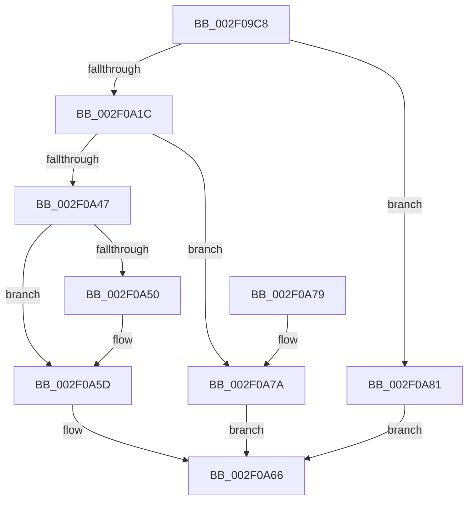

# RtlSparseArrayElementAllocate

- RVA: `0x002F09C8`–`0x002F0A85` (길이 `189` bytes)
- VA: `0x00000001402F09C8`
- 실행 섹션: `.text`
- PDB 이름 있음: `예`; PDB Function 태그: `아니요`
- unwind 정보 RVA: `0x00071D20`
- 디코드: `54`개 명령, `189/189` bytes 표시
- 미해석 바이트: `0` (있으면 어셈블리에 `.byte`로 보존)

> 이 문서는 커널 이미지의 기계어와 PDB 기호를 분석해 생성했습니다. 4번과 5번은 함수 원형과 자료형을 바이너리 사용 방식에서 추정한 C 해석이며 원본 소스 복구 결과는 아닙니다.

## 1. Dependencies

- 직접 호출 지점: **5**; 고유 호출 대상: **5**
- 직접 호출자로 확인된 함수: **1**
- RIP 상대 이미지 참조: **1**

### Outgoing calls
- `0x002F0A13` → [RtlpCSparseBitmapPageCommit](RtlpCSparseBitmapPageCommit_function_002F0B98.md) (function, `0x002F0B98`)
- `0x002F0A2D` → [memcpy](../6C/memcpy_function_006C6840.md) (function, `0x006C6840`)
- `0x002F0A37` → [RtlpCSparseBitmapUnlock](RtlpCSparseBitmapUnlock_function_002F0DD0.md) (function, `0x002F0DD0`)
- `0x002F0A58` → [KiLowerIrqlProcessIrqlFlags](../4F/KiLowerIrqlProcessIrqlFlags_function_004F5698.md) (function, `0x004F5698`)
- `0x002F0A7A` → [KeLeaveGuardedRegion](../2E/KeLeaveGuardedRegion_function_002E2C40.md) (function, `0x002E2C40`)

### Direct callers
- [RtlpHpVaMgrRangeCreate](../2E/RtlpHpVaMgrRangeCreate_function_002EF2BC.md) at `0x002EF2FD`
- [RtlpHpVaMgrRangeCreate](../2E/RtlpHpVaMgrRangeCreate_function_002EF2BC.md) at `0x002EF36B`

### Static image references
- `0x002F0A47` → RVA `0x00FC6D20` (`ALMOSTRO`; read)

## 2. Other-region calls and transfers

- 다른 실행 섹션으로 향하는 call: **0**
- 별도 외부 분기/꼬리 이동을 확인하지 못했습니다.

## 3. Assembly (complete function range)

```asm
002F09C8  4C 8B DC                        mov r11, rsp
002F09CB  49 89 5B 08                     mov qword ptr [r11 + 8], rbx
002F09CF  49 89 73 10                     mov qword ptr [r11 + 0x10], rsi
002F09D3  57                              push rdi
002F09D4  48 83 EC 40                     sub rsp, 0x40
002F09D8  8B 79 08                        mov edi, dword ptr [rcx + 8]
002F09DB  4C 8B C9                        mov r9, rcx
002F09DE  33 C0                           xor eax, eax
002F09E0  8B CF                           mov ecx, edi
002F09E2  48 D3 E2                        shl rdx, cl
002F09E5  49 8B F0                        mov rsi, r8
002F09E8  0F 57 C0                        xorps xmm0, xmm0
002F09EB  49 89 43 D9                     mov qword ptr [r11 - 0x27], rax
002F09EF  49 8B 59 18                     mov rbx, qword ptr [r9 + 0x18]
002F09F3  49 8D 49 10                     lea rcx, [r9 + 0x10]
002F09F7  48 03 DA                        add rbx, rdx
002F09FA  49 89 43 D8                     mov qword ptr [r11 - 0x28], rax
002F09FE  48 C1 E2 03                     shl rdx, 3
002F0A02  4D 8D 4B D8                     lea r9, [r11 - 0x28]
002F0A06  48 C1 EA 0F                     shr rdx, 0xf
002F0A0A  4D 8D 43 E8                     lea r8, [r11 - 0x18]
002F0A0E  0F 11 44 24 30                  movups xmmword ptr [rsp + 0x30], xmm0
002F0A13  E8 80 01 00 00                  call 0x1402f0b98
002F0A18  85 C0                           test eax, eax
002F0A1A  78 65                           js 0x1402f0a81
002F0A1C  8B CF                           mov ecx, edi
002F0A1E  41 B8 01 00 00 00               mov r8d, 1
002F0A24  41 D3 E0                        shl r8d, cl
002F0A27  48 8B D6                        mov rdx, rsi
002F0A2A  48 8B CB                        mov rcx, rbx
002F0A2D  E8 0E 5E 3D 00                  call 0x1406c6840
002F0A32  48 8D 4C 24 30                  lea rcx, [rsp + 0x30]
002F0A37  E8 94 03 00 00                  call 0x1402f0dd0
002F0A3C  48 8B 44 24 28                  mov rax, qword ptr [rsp + 0x28]
002F0A41  80 78 30 00                     cmp byte ptr [rax + 0x30], 0
002F0A45  74 33                           je 0x1402f0a7a
002F0A47  83 3D D2 62 CD 00 00            cmp dword ptr [rip + 0xcd62d2], 0
002F0A4E  74 0D                           je 0x1402f0a5d
002F0A50  44 0F 20 C1                     mov rcx, cr8
002F0A54  8A 54 24 20                     mov dl, byte ptr [rsp + 0x20]
002F0A58  E8 3B 4C 20 00                  call 0x1404f5698
002F0A5D  0F B6 4C 24 20                  movzx ecx, byte ptr [rsp + 0x20]
002F0A62  44 0F 22 C1                     mov cr8, rcx
002F0A66  48 8B 74 24 58                  mov rsi, qword ptr [rsp + 0x58]
002F0A6B  48 8B C3                        mov rax, rbx
002F0A6E  48 8B 5C 24 50                  mov rbx, qword ptr [rsp + 0x50]
002F0A73  48 83 C4 40                     add rsp, 0x40
002F0A77  5F                              pop rdi
002F0A78  C3                              ret
002F0A79  CC                              int3
002F0A7A  E8 C1 21 FF FF                  call 0x1402e2c40
002F0A7F  EB E5                           jmp 0x1402f0a66
002F0A81  33 DB                           xor ebx, ebx
002F0A83  EB E1                           jmp 0x1402f0a66
```

## 4. C-style interpretation (structured pseudocode)

```c
__int64 __fastcall RtlSparseArrayElementAllocate(__int64 a1, __int64 a2, __int64 a3)
{
    __int64 result;
    __int64 v_rbx;
    __int64 v_rsp;
    unsigned __int64 v_stack_m18;
    unsigned __int64 v_stack_m20;
    unsigned __int8 v_stack_m28;
    unsigned __int64 v_stack_p10;
    unsigned __int64 v_stack_p8;

    *(unsigned __int64 *)(v_rsp + 8) = v_rbx;
    *(unsigned __int64 *)(v_rsp + 16) = v_rsi;
    v_rsp = (v_rsp) - (64);
    result = 0;
    a2 = (a2) << ((unsigned __int8)((unsigned int)((unsigned int)((unsigned int)(*(unsigned int *)(a1 + 8))))));
    *(unsigned __int64 *)(v_rsp - 39) = 0;
    v_rbx = (*(unsigned __int64 *)(a1 + 24)) + (a2);
    *(unsigned __int64 *)(v_rsp - 40) = 0;
    a2 = (a2) << (3);
    a2 = (a2) >> (15);
    v_stack_m18 = v_xmm0;
    result = RtlpCSparseBitmapPageCommit(a1 + 16, a2, v_rsp - 24, v_rsp - 40);
    if (sign_flag) goto loc_002F0A81;
    a3 = (unsigned int)((1) << ((unsigned __int8)((unsigned int)((unsigned int)((unsigned int)(*(unsigned int *)(a1 + 8)))))));
    result = memcpy(v_rbx, a3, a3, v_rsp - 40);
    result = RtlpCSparseBitmapUnlock(v_stack_m18, a3, a3, v_rsp - 40);
    if ((*(unsigned __int8 *)(v_stack_m20 + 48)) == 0) goto loc_002F0A7A;
    result = v_stack_m20;
    if ((*(unsigned int *)(v_rip + 13460178)) != 0) {
        a1 = v_cr8;
        a2 = v_stack_m28;
        result = KiLowerIrqlProcessIrqlFlags(a1, a2, a3, v_rsp - 40);
    }
loc_002F0A66:
    v_rsp = (v_rsp) + (64);
    return v_rbx;
loc_002F0A7A:
    result = KeLeaveGuardedRegion(v_stack_m28, a2, a3, v_rsp - 40);
    goto loc_002F0A66;
loc_002F0A81:
    v_rbx = 0;
    goto loc_002F0A66;
}
```

## 5. (Beta) C Style

```c
int64_t RtlSparseArrayElementAllocate(void *Arg1, int64_t Arg2, int64_t Arg3)
{
    uint8_t *arg1 = (uint8_t *)Arg1;

    int64_t result;
    int64_t local_rbx;
    int64_t local_rsp;
    uint64_t v_stack_m18;
    uint64_t v_stack_m20;
    uint8_t v_stack_m28;
    uint64_t v_stack_p10;
    uint64_t v_stack_p8;

    *(uint64_t *)(local_rsp + 0x8) = local_rbx;
    *(uint64_t *)(local_rsp + 0x10) = local_rsi;
    local_rsp = (local_rsp) - (64);
    result = 0;
    Arg2 = (Arg2) << ((uint8_t)((uint32_t)((uint32_t)((uint32_t)(*(uint32_t *)(arg1 + 0x8))))));
    *(uint64_t *)(local_rsp - 0x27) = 0;
    local_rbx = (*(uint64_t *)(arg1 + 0x18)) + (Arg2);
    *(uint64_t *)(local_rsp - 0x28) = 0;
    Arg2 = (Arg2) << (3);
    Arg2 = (Arg2) >> (15);
    v_stack_m18 = v_xmm0;
    result = RtlpCSparseBitmapPageCommit(Arg1 + 16, Arg2, local_rsp - 24, local_rsp - 40);
    if (sign_flag) goto loc_002F0A81;
    Arg3 = (uint32_t)((1) << ((uint8_t)((uint32_t)((uint32_t)((uint32_t)(*(uint32_t *)(arg1 + 0x8)))))));
    result = memcpy(local_rbx, Arg3, Arg3, local_rsp - 40);
    result = RtlpCSparseBitmapUnlock(v_stack_m18, Arg3, Arg3, local_rsp - 40);
    if ((*(uint8_t *)(v_stack_m20 + 0x30)) == 0) goto loc_002F0A7A;
    result = v_stack_m20;
    if ((*(uint32_t *)(v_rip + 0xCD62D2)) != 0) {
        Arg1 = v_cr8;
        Arg2 = v_stack_m28;
        result = KiLowerIrqlProcessIrqlFlags(Arg1, Arg2, Arg3, local_rsp - 40);
    }
loc_002F0A66:
    local_rsp = (local_rsp) + (64);
    return local_rbx;
loc_002F0A7A:
    result = KeLeaveGuardedRegion(v_stack_m28, Arg2, Arg3, local_rsp - 40);
    goto loc_002F0A66;
loc_002F0A81:
    local_rbx = 0;
    goto loc_002F0A66;
}
```

### 관측된 메모리 오프셋

구조체 형식이 확인되지 않은 접근은 인자 기준의 오프셋으로만 기록했습니다.

| 기준 인자 | 오프셋 표현 | 폭 (bit) | 접근 |
|---|---:|---:|---|
| `Arg1` | `+ 0x8` | `32` | `R` |
| `Arg1` | `+ 0x10` | `64` | `R` |
| `Arg1` | `+ 0x18` | `64` | `R` |

## 6. Execution-region graph

[열기: 2D/3D 그래프와 함수 탐색 컨트롤 패널](../../../control-panel.html?section=text&rva=0x002F09C8&view=graph)

- 2D 그래프는 위에서 아래로 흐르고, 3D 그래프는 빈 공간을 드래그해 회전합니다. Shift+드래그는 이동, 휠은 확대·축소, 함수 노드 선택은 대상 보고서 이동입니다.

### Static fallback


