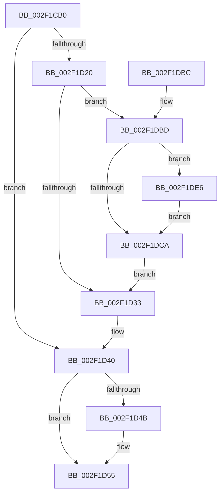

# RtlUnwind

- RVA: `0x002F1CB0`–`0x002F1DF7` (길이 `327` bytes)
- VA: `0x00000001402F1CB0`
- 실행 섹션: `.text`
- PDB 이름 있음: `예`; PDB Function 태그: `아니요`
- unwind 정보 RVA: `0x00071EC8`
- 디코드: `87`개 명령, `327/327` bytes 표시
- 미해석 바이트: `0` (있으면 어셈블리에 `.byte`로 보존)

> 이 문서는 커널 이미지의 기계어와 PDB 기호를 분석해 생성했습니다. 4번과 5번은 함수 원형과 자료형을 바이너리 사용 방식에서 추정한 C 해석이며 원본 소스 복구 결과는 아닙니다.

## 1. Dependencies

- 직접 호출 지점: **7**; 고유 호출 대상: **7**
- 직접 호출자로 확인된 함수: **2**
- RIP 상대 이미지 참조: **2**

### Outgoing calls
- `0x002F1D17` → [RtlpValidateContextFlags2](../4E/RtlpValidateContextFlags2_function_004EF138.md) (function, `0x004EF138`)
- `0x002F1D59` → [_chkstk](../6B/_chkstk_function_006BA960.md) (function, `0x006BA960`)
- `0x002F1D72` → [RtlInitializeExtendedContext2](RtlInitializeExtendedContext2_function_002F5D40.md) (function, `0x002F5D40`)
- `0x002F1D91` → [RtlUnwindEx](RtlUnwindEx_function_002F2830.md) (function, `0x002F2830`)
- `0x002F1D9D` → [_security_check_cookie](../6A/_security_check_cookie_function_006AC640.md) (function, `0x006AC640`)
- `0x002F1DD7` → [RtlpGetEntireXStateAreaLength2](../4E/RtlpGetEntireXStateAreaLength2_function_004EF20C.md) (function, `0x004EF20C`)
- `0x002F1DEC` → [RtlpRemoveArchDisallowedXStateFeatures](RtlpRemoveArchDisallowedXStateFeatures_function_002F32FC.md) (function, `0x002F32FC`)

### Direct callers
- [local_unwind](../4F/local_unwind_function_004FFB40.md) at `0x004FFB5E`
- [_longjmp_internal](../6A/_longjmp_internal_function_006AC6D0.md) at `0x006AC7A5`

### Static image references
- `0x002F1CCF` → RVA `0x00E0A740` (`.data`; read)
- `0x002F1CE4` → RVA `0x01201841` (`CFGRO`; read)

## 2. Other-region calls and transfers

- 다른 실행 섹션으로 향하는 call: **0**
- 별도 외부 분기/꼬리 이동을 확인하지 못했습니다.

## 3. Assembly (complete function range)

```asm
002F1CB0  40 55                           push rbp
002F1CB2  41 54                           push r12
002F1CB4  41 55                           push r13
002F1CB6  41 56                           push r14
002F1CB8  41 57                           push r15
002F1CBA  48 83 EC 50                     sub rsp, 0x50
002F1CBE  48 8D 6C 24 30                  lea rbp, [rsp + 0x30]
002F1CC3  48 89 5D 50                     mov qword ptr [rbp + 0x50], rbx
002F1CC7  48 89 75 58                     mov qword ptr [rbp + 0x58], rsi
002F1CCB  48 89 7D 60                     mov qword ptr [rbp + 0x60], rdi
002F1CCF  48 8B 05 6A 8A B1 00            mov rax, qword ptr [rip + 0xb18a6a]
002F1CD6  48 33 C5                        xor rax, rbp
002F1CD9  48 89 45 10                     mov qword ptr [rbp + 0x10], rax
002F1CDD  33 DB                           xor ebx, ebx
002F1CDF  B8 8B 00 10 00                  mov eax, 0x10008b
002F1CE4  38 1D 57 FB F0 00               cmp byte ptr [rip + 0xf0fb57], bl
002F1CEA  4D 8B F8                        mov r15, r8
002F1CED  4C 8B E2                        mov r12, rdx
002F1CF0  89 5D 00                        mov dword ptr [rbp], ebx
002F1CF3  4C 8B E9                        mov r13, rcx
002F1CF6  48 8D 55 00                     lea rdx, [rbp]
002F1CFA  BF 0B 00 10 00                  mov edi, 0x10000b
002F1CFF  49 B8 D8 03 00 00 80 F7 FF FF   movabs r8, 0xfffff780000003d8
002F1D09  0F 45 F8                        cmovne edi, eax
002F1D0C  4D 8B F1                        mov r14, r9
002F1D0F  33 F6                           xor esi, esi
002F1D11  8B CF                           mov ecx, edi
002F1D13  48 89 75 08                     mov qword ptr [rbp + 8], rsi
002F1D17  E8 1C D4 1F 00                  call 0x1404ef138
002F1D1C  85 C0                           test eax, eax
002F1D1E  78 20                           js 0x1402f1d40
002F1D20  44 8B 5D 00                     mov r11d, dword ptr [rbp]
002F1D24  B8 F0 04 00 00                  mov eax, 0x4f0
002F1D29  41 F6 C3 02                     test r11b, 2
002F1D2D  0F 85 8A 00 00 00               jne 0x1402f1dbd
002F1D33  41 F6 C3 04                     test r11b, 4
002F1D37  8D 58 20                        lea ebx, [rax + 0x20]
002F1D3A  0F 44 D8                        cmove ebx, eax
002F1D3D  83 C3 0F                        add ebx, 0xf
002F1D40  8B CB                           mov ecx, ebx
002F1D42  48 8D 43 0F                     lea rax, [rbx + 0xf]
002F1D46  48 3B C1                        cmp rax, rcx
002F1D49  77 0A                           ja 0x1402f1d55
002F1D4B  48 B8 F0 FF FF FF FF FF FF 0F   movabs rax, 0xffffffffffffff0
002F1D55  48 83 E0 F0                     and rax, 0xfffffffffffffff0
002F1D59  E8 02 8C 3C 00                  call 0x1406ba960
002F1D5E  48 2B E0                        sub rsp, rax
002F1D61  4C 8D 45 08                     lea r8, [rbp + 8]
002F1D65  45 33 C9                        xor r9d, r9d
002F1D68  8B D7                           mov edx, edi
002F1D6A  48 8D 5C 24 30                  lea rbx, [rsp + 0x30]
002F1D6F  48 8B CB                        mov rcx, rbx
002F1D72  E8 C9 3F 00 00                  call 0x1402f5d40
002F1D77  4D 8B CE                        mov r9, r14
002F1D7A  48 C7 44 24 28 00 00 00 00      mov qword ptr [rsp + 0x28], 0
002F1D83  4D 8B C7                        mov r8, r15
002F1D86  48 89 5C 24 20                  mov qword ptr [rsp + 0x20], rbx
002F1D8B  49 8B D4                        mov rdx, r12
002F1D8E  49 8B CD                        mov rcx, r13
002F1D91  E8 9A 0A 00 00                  call 0x1402f2830
002F1D96  48 8B 4D 10                     mov rcx, qword ptr [rbp + 0x10]
002F1D9A  48 33 CD                        xor rcx, rbp
002F1D9D  E8 9E A8 3B 00                  call 0x1406ac640
002F1DA2  48 8B 5D 50                     mov rbx, qword ptr [rbp + 0x50]
002F1DA6  48 8B 75 58                     mov rsi, qword ptr [rbp + 0x58]
002F1DAA  48 8B 7D 60                     mov rdi, qword ptr [rbp + 0x60]
002F1DAE  48 8D 65 20                     lea rsp, [rbp + 0x20]
002F1DB2  41 5F                           pop r15
002F1DB4  41 5E                           pop r14
002F1DB6  41 5D                           pop r13
002F1DB8  41 5C                           pop r12
002F1DBA  5D                              pop rbp
002F1DBB  C3                              ret
002F1DBC  CC                              int3
002F1DBD  A1 EC 03 00 00 80 F7 FF FF      movabs eax, dword ptr [0xfffff780000003ec]
002F1DC6  A8 02                           test al, 2
002F1DC8  75 1C                           jne 0x1402f1de6
002F1DCA  48 BA D8 03 00 00 80 F7 FF FF   movabs rdx, 0xfffff780000003d8
002F1DD4  48 8B CE                        mov rcx, rsi
002F1DD7  E8 30 D4 1F 00                  call 0x1404ef20c
002F1DDC  05 20 03 00 00                  add eax, 0x320
002F1DE1  E9 4D FF FF FF                  jmp 0x1402f1d33
002F1DE6  48 8D 55 08                     lea rdx, [rbp + 8]
002F1DEA  8B CF                           mov ecx, edi
002F1DEC  E8 0B 15 00 00                  call 0x1402f32fc
002F1DF1  48 8B 75 08                     mov rsi, qword ptr [rbp + 8]
002F1DF5  EB D3                           jmp 0x1402f1dca
```

## 4. C-style interpretation (structured pseudocode)

```c
__int64 __fastcall RtlUnwind(__int64 a1, __int64 a2, __int64 a3, __int64 a4)
{
    __int64 result;
    __int64 v_rbx;
    __int64 v_rdi;
    __int64 v_rsi;
    __int64 v_rsp;
    unsigned __int64 v_stack_m28;
    unsigned __int64 v_stack_m38;
    unsigned __int64 v_stack_m40;
    unsigned __int64 v_stack_m48;
    unsigned __int64 v_stack_m50;
    unsigned __int64 v_stack_m58;
    unsigned __int64 v_stack_p10;
    unsigned __int64 v_stack_p18;
    unsigned __int64 v_stack_p8;

    v_rsp = (v_rsp) - (80);
    v_stack_p8 = v_rbx;
    v_stack_p10 = v_rsi;
    v_stack_p18 = v_rdi;
    result = (*(unsigned __int64 *)(v_rip + 11635306)) ^ (v_stack_m48);
    v_stack_m38 = result;
    v_rbx = 0;
    v_stack_m48 = 0;
    v_rdi = (unsigned int)(0x10000BULL);
    if ((*(unsigned __int8 *)(v_rip + 15792983)) != 0) { v_rdi = (unsigned int)((unsigned int)(0x10008BULL)); }
    v_rsi = 0;
    v_stack_m40 = 0;
    result = RtlpValidateContextFlags2((unsigned int)((unsigned int)(v_rdi)), v_stack_m48, a3, a4);
    if (sign_flag) goto loc_002F1D40;
    if ((((unsigned __int8)((unsigned int)(v_stack_m48))) & (2)) != 0) goto loc_002F1DBD;
loc_002F1D33:
    v_rbx = (unsigned int)(0x4F0ULL) + 32;
    if ((((unsigned __int8)((unsigned int)(v_stack_m48))) & (4)) == 0) { v_rbx = (unsigned int)((unsigned int)(0x4F0ULL)); }
    v_rbx = (unsigned int)((v_rbx) + (15));
loc_002F1D40:
    if ((v_rbx + 15) <= ((unsigned int)((unsigned int)(v_rbx)))) {
    }
    result = (v_rbx + 15) & (-16);
    result = _chkstk((unsigned int)((unsigned int)(v_rbx)), v_stack_m48, a3, a4);
    v_rsp = (v_rsp) - (result);
    a4 = 0;
    result = RtlInitializeExtendedContext2(v_stack_m48, (unsigned int)((unsigned int)(v_rdi)), v_stack_m40, a4);
    v_stack_m50 = 0;
    v_stack_m58 = v_stack_m48;
    result = RtlUnwindEx(a1, a2, a3, 0);
    a1 = (v_stack_m38) ^ (v_stack_m48);
    result = _security_check_cookie(a1, a2, a3, 0);
    return result;
loc_002F1DBD:
    if ((((unsigned __int8)(result)) & (2)) != 0) goto loc_002F1DE6;
loc_002F1DCA:
    result = RtlpGetEntireXStateAreaLength2(v_stack_p10, a2, a3, 0);
    result = (unsigned int)((result) + (800));
    goto loc_002F1D33;
loc_002F1DE6:
    result = RtlpRemoveArchDisallowedXStateFeatures((unsigned int)((unsigned int)(v_stack_p18)), v_stack_m40, a3, 0);
    goto loc_002F1DCA;
}
```

## 5. (Beta) C Style

```c
int64_t RtlUnwind(int64_t Arg1, int64_t Arg2, int64_t Arg3, int64_t Arg4)
{
    int64_t result;
    int64_t local_rbx;
    int64_t local_rdi;
    int64_t local_rsi;
    int64_t local_rsp;
    uint64_t v_stack_m28;
    uint64_t v_stack_m38;
    uint64_t v_stack_m40;
    uint64_t v_stack_m48;
    uint64_t v_stack_m50;
    uint64_t v_stack_m58;
    uint64_t v_stack_p10;
    uint64_t v_stack_p18;
    uint64_t v_stack_p8;

    local_rsp = (local_rsp) - (80);
    v_stack_p8 = local_rbx;
    v_stack_p10 = local_rsi;
    v_stack_p18 = local_rdi;
    result = (*(uint64_t *)(v_rip + 0xB18A6A)) ^ (v_stack_m48);
    v_stack_m38 = result;
    local_rbx = 0;
    v_stack_m48 = 0;
    local_rdi = (uint32_t)(0x10000BULL);
    if ((*(uint8_t *)(v_rip + 0xF0FB57)) != 0) { local_rdi = (uint32_t)((uint32_t)(0x10008BULL)); }
    local_rsi = 0;
    v_stack_m40 = 0;
    result = RtlpValidateContextFlags2((uint32_t)((uint32_t)(local_rdi)), v_stack_m48, Arg3, Arg4);
    if (sign_flag) goto loc_002F1D40;
    if ((((uint8_t)((uint32_t)(v_stack_m48))) & (2)) != 0) goto loc_002F1DBD;
loc_002F1D33:
    local_rbx = (uint32_t)(0x4F0ULL) + 32;
    if ((((uint8_t)((uint32_t)(v_stack_m48))) & (4)) == 0) { local_rbx = (uint32_t)((uint32_t)(0x4F0ULL)); }
    local_rbx = (uint32_t)((local_rbx) + (15));
loc_002F1D40:
    if ((local_rbx + 15) <= ((uint32_t)((uint32_t)(local_rbx)))) {
    }
    result = (local_rbx + 15) & (-16);
    result = _chkstk((uint32_t)((uint32_t)(local_rbx)), v_stack_m48, Arg3, Arg4);
    local_rsp = (local_rsp) - (result);
    Arg4 = 0;
    result = RtlInitializeExtendedContext2(v_stack_m48, (uint32_t)((uint32_t)(local_rdi)), v_stack_m40, Arg4);
    v_stack_m50 = 0;
    v_stack_m58 = v_stack_m48;
    result = RtlUnwindEx(Arg1, Arg2, Arg3, 0);
    Arg1 = (v_stack_m38) ^ (v_stack_m48);
    result = _security_check_cookie(Arg1, Arg2, Arg3, 0);
    return result;
loc_002F1DBD:
    if ((((uint8_t)(result)) & (2)) != 0) goto loc_002F1DE6;
loc_002F1DCA:
    result = RtlpGetEntireXStateAreaLength2(v_stack_p10, Arg2, Arg3, 0);
    result = (uint32_t)((result) + (800));
    goto loc_002F1D33;
loc_002F1DE6:
    result = RtlpRemoveArchDisallowedXStateFeatures((uint32_t)((uint32_t)(v_stack_p18)), v_stack_m40, Arg3, 0);
    goto loc_002F1DCA;
}
```

## 6. Execution-region graph

[열기: 2D/3D 그래프와 함수 탐색 컨트롤 패널](../../../control-panel.html?section=text&rva=0x002F1CB0&view=graph)

- 2D 그래프는 위에서 아래로 흐르고, 3D 그래프는 빈 공간을 드래그해 회전합니다. Shift+드래그는 이동, 휠은 확대·축소, 함수 노드 선택은 대상 보고서 이동입니다.

### Static fallback


