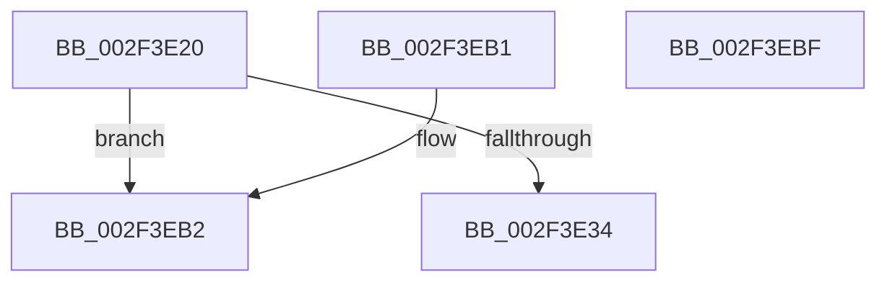

# RtlVirtualUnwind2

- RVA: `0x002F3E20`–`0x002F3EC0` (길이 `160` bytes)
- VA: `0x00000001402F3E20`
- 실행 섹션: `.text`
- PDB 이름 있음: `예`; PDB Function 태그: `아니요`
- unwind 정보 RVA: `0x000720E8`
- 디코드: `31`개 명령, `160/160` bytes 표시
- 미해석 바이트: `0` (있으면 어셈블리에 `.byte`로 보존)

> 이 문서는 커널 이미지의 기계어와 PDB 기호를 분석해 생성했습니다. 4번과 5번은 함수 원형과 자료형을 바이너리 사용 방식에서 추정한 C 해석이며 원본 소스 복구 결과는 아닙니다.

## 1. Dependencies

- 직접 호출 지점: **1**; 고유 호출 대상: **1**
- 직접 호출자로 확인된 함수: **1**
- RIP 상대 이미지 참조: **0**

### Outgoing calls
- `0x002F3EA4` → [RtlpxVirtualUnwind](RtlpxVirtualUnwind_function_002F5110.md) (function, `0x002F5110`)

### Direct callers
- [sub_009A623D](../../page/9A/Unknown_function_009A623D.md) at `0x009A6458`

### Static image references
- 디코드된 RIP-relative 메모리 참조가 없습니다.

## 2. Other-region calls and transfers

- 다른 실행 섹션으로 향하는 call: **0**
- 별도 외부 분기/꼬리 이동을 확인하지 못했습니다.

## 3. Assembly (complete function range)

```asm
002F3E20  4C 8B DC                        mov r11, rsp
002F3E23  48 81 EC 88 00 00 00            sub rsp, 0x88
002F3E2A  83 BC 24 F0 00 00 00 00         cmp dword ptr [rsp + 0xf0], 0
002F3E32  75 7E                           jne 0x1402f3eb2
002F3E34  48 8B 84 24 D0 00 00 00         mov rax, qword ptr [rsp + 0xd0]
002F3E3C  49 89 43 E8                     mov qword ptr [r11 - 0x18], rax
002F3E40  48 8B 84 24 D8 00 00 00         mov rax, qword ptr [rsp + 0xd8]
002F3E48  49 89 43 D8                     mov qword ptr [r11 - 0x28], rax
002F3E4C  48 8B 84 24 E0 00 00 00         mov rax, qword ptr [rsp + 0xe0]
002F3E54  49 89 43 E0                     mov qword ptr [r11 - 0x20], rax
002F3E58  49 8D 43 D8                     lea rax, [r11 - 0x28]
002F3E5C  C7 44 24 50 00 00 00 00         mov dword ptr [rsp + 0x50], 0
002F3E64  49 89 43 C0                     mov qword ptr [r11 - 0x40], rax
002F3E68  48 8B 84 24 E8 00 00 00         mov rax, qword ptr [rsp + 0xe8]
002F3E70  49 89 43 B8                     mov qword ptr [r11 - 0x48], rax
002F3E74  48 8B 84 24 C8 00 00 00         mov rax, qword ptr [rsp + 0xc8]
002F3E7C  49 89 43 B0                     mov qword ptr [r11 - 0x50], rax
002F3E80  48 8B 84 24 C0 00 00 00         mov rax, qword ptr [rsp + 0xc0]
002F3E88  49 89 43 A8                     mov qword ptr [r11 - 0x58], rax
002F3E8C  48 8B 84 24 B8 00 00 00         mov rax, qword ptr [rsp + 0xb8]
002F3E94  49 89 43 A0                     mov qword ptr [r11 - 0x60], rax
002F3E98  48 8B 84 24 B0 00 00 00         mov rax, qword ptr [rsp + 0xb0]
002F3EA0  49 89 43 98                     mov qword ptr [r11 - 0x68], rax
002F3EA4  E8 67 12 00 00                  call 0x1402f5110
002F3EA9  48 81 C4 88 00 00 00            add rsp, 0x88
002F3EB0  C3                              ret
002F3EB1  CC                              int3
002F3EB2  B8 0D 00 00 C0                  mov eax, 0xc000000d
002F3EB7  48 81 C4 88 00 00 00            add rsp, 0x88
002F3EBE  C3                              ret
002F3EBF  CC                              int3
```

## 4. C-style interpretation (structured pseudocode)

```c
__int64 __fastcall RtlVirtualUnwind2(__int64 a1, __int64 a2, __int64 a3, __int64 a4, __int64 a5, __int64 a6, __int64 a7, __int64 a8, __int64 a9, __int64 a10, __int64 a11, __int64 a12, unsigned int a13)
{
    __int64 result;
    __int64 v_rsp;
    unsigned int v_stack_m38;

    v_rsp = (v_rsp) - (136);
    if (a13 != 0) goto loc_002F3EB2;
    *(unsigned __int64 *)(v_rsp - 24) = a9;
    *(unsigned __int64 *)(v_rsp - 40) = a10;
    *(unsigned __int64 *)(v_rsp - 32) = a11;
    v_stack_m38 = 0;
    *(unsigned __int64 *)(v_rsp - 64) = v_rsp - 40;
    *(unsigned __int64 *)(v_rsp - 72) = a12;
    *(unsigned __int64 *)(v_rsp - 80) = a8;
    *(unsigned __int64 *)(v_rsp - 88) = a7;
    *(unsigned __int64 *)(v_rsp - 96) = a6;
    *(unsigned __int64 *)(v_rsp - 104) = a5;
    result = RtlpxVirtualUnwind(a1, a2, a3, a4);
    v_rsp = (v_rsp) + (136);
    return result;
loc_002F3EB2:
    v_rsp = (v_rsp) + (136);
    return (unsigned int)(0xC000000DULL);
}
```

## 5. (Beta) C Style

```c
int64_t RtlVirtualUnwind2(int64_t Arg1, int64_t Arg2, int64_t Arg3, int64_t Arg4, int64_t Arg5, int64_t Arg6, int64_t Arg7, int64_t Arg8, int64_t Arg9, int64_t Arg10, int64_t Arg11, int64_t Arg12, uint32_t Arg13)
{
    int64_t result;
    int64_t local_rsp;
    uint32_t v_stack_m38;

    local_rsp = (local_rsp) - (136);
    if (Arg13 != 0) goto loc_002F3EB2;
    *(uint64_t *)(local_rsp - 0x18) = Arg9;
    *(uint64_t *)(local_rsp - 0x28) = Arg10;
    *(uint64_t *)(local_rsp - 0x20) = Arg11;
    v_stack_m38 = 0;
    *(uint64_t *)(local_rsp - 0x40) = local_rsp - 40;
    *(uint64_t *)(local_rsp - 0x48) = Arg12;
    *(uint64_t *)(local_rsp - 0x50) = Arg8;
    *(uint64_t *)(local_rsp - 0x58) = Arg7;
    *(uint64_t *)(local_rsp - 0x60) = Arg6;
    *(uint64_t *)(local_rsp - 0x68) = Arg5;
    result = RtlpxVirtualUnwind(Arg1, Arg2, Arg3, Arg4);
    local_rsp = (local_rsp) + (136);
    return result;
loc_002F3EB2:
    local_rsp = (local_rsp) + (136);
    return (uint32_t)(0xC000000DULL);
}
```

## 6. Execution-region graph

[열기: 2D/3D 그래프와 함수 탐색 컨트롤 패널](../../../control-panel.html?section=text&rva=0x002F3E20&view=graph)

- 2D 그래프는 위에서 아래로 흐르고, 3D 그래프는 빈 공간을 드래그해 회전합니다. Shift+드래그는 이동, 휠은 확대·축소, 함수 노드 선택은 대상 보고서 이동입니다.

### Static fallback


