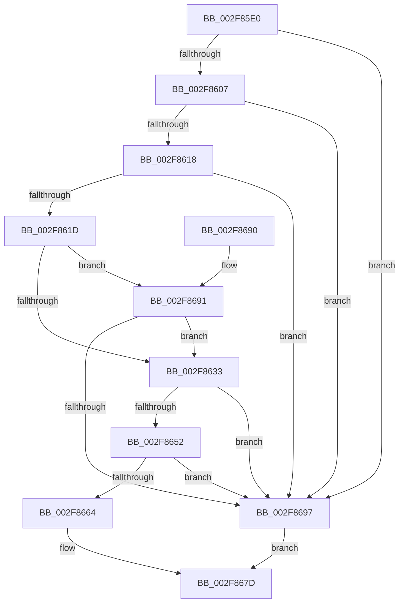

# RtlWalkFrameChain

- RVA: `0x002F85E0`–`0x002F869B` (길이 `187` bytes)
- VA: `0x00000001402F85E0`
- 실행 섹션: `.text`
- PDB 이름 있음: `예`; PDB Function 태그: `아니요`
- unwind 정보 RVA: `0x00072670`
- 디코드: `60`개 명령, `187/187` bytes 표시
- 미해석 바이트: `0` (있으면 어셈블리에 `.byte`로 보존)

> 이 문서는 커널 이미지의 기계어와 PDB 기호를 분석해 생성했습니다. 4번과 5번은 함수 원형과 자료형을 바이너리 사용 방식에서 추정한 C 해석이며 원본 소스 복구 결과는 아닙니다.

## 1. Dependencies

- 직접 호출 지점: **4**; 고유 호출 대상: **4**
- 직접 호출자로 확인된 함수: **17**
- RIP 상대 이미지 참조: **0**

### Outgoing calls
- `0x002F862A` → [MmCanThreadFault](MmCanThreadFault_function_002F86B0.md) (function, `0x002F86B0`)
- `0x002F8649` → [RtlpGetStackLimits](RtlpGetStackLimits_function_002F5F50.md) (function, `0x002F5F50`)
- `0x002F8652` → [KeGetCurrentStackPointer](../6B/KeGetCurrentStackPointer_function_006B1070.md) (function, `0x006B1070`)
- `0x002F866F` → [RtlpWalkFrameChain](RtlpWalkFrameChain_function_002F3ED0.md) (function, `0x002F3ED0`)

### Direct callers
- [KeExpandKernelStackAndCalloutInternal](KeExpandKernelStackAndCalloutInternal_function_002F8450.md) at `0x002F84E7`
- [sub_002F8E26](Unknown_function_002F8E26.md) at `0x002F8F54`
- [sub_002F90AE](Unknown_function_002F90AE.md) at `0x002F9203`
- [RtlCaptureStackBackTrace](RtlCaptureStackBackTrace_function_002F9FF0.md) at `0x002FA02D`
- [SepGetStackTraceHash](../41/SepGetStackTraceHash_function_0041E960.md) at `0x0041E9D0`
- [EtwpExpandStackAndWalkFrameChain](../44/EtwpExpandStackAndWalkFrameChain_function_00443F80.md) at `0x00444044`
- [KiDpcWatchdogCaptureStack](../44/KiDpcWatchdogCaptureStack_function_0044F124.md) at `0x0044F174`
- [EtwpExpandedStackWalk](../45/EtwpExpandedStackWalk_function_00453680.md) at `0x0045369A`
- [CmpThreadInfoLogStack](../4C/CmpThreadInfoLogStack_function_004CA590.md) at `0x004CA5DB`
- [SepCreateTokenEx](../4E/SepCreateTokenEx_function_004E9CD0.md) at `0x004EA5C4`
- [SepCreateTokenEx](../4E/SepCreateTokenEx_function_004E9CD0.md) at `0x004EA5ED`
- [EtwpCovSampCaptureKernelStack](../65/EtwpCovSampCaptureKernelStack_function_00653C28.md) at `0x00653CAE`
- [ExpUpdateDebugInfo](../../page/86/ExpUpdateDebugInfo_function_0086B174.md) at `0x0086B39D`
- [ExpUpdateDebugInfo](../../page/86/ExpUpdateDebugInfo_function_0086B174.md) at `0x0086B3BE`
- [SepDuplicateToken](../../page/8B/SepDuplicateToken_function_008B87EC.md) at `0x008B8A3E`
- [SepDuplicateToken](../../page/8B/SepDuplicateToken_function_008B87EC.md) at `0x008B8A65`
- [EtwpCovSampCaptureUserStack](../../page/8D/EtwpCovSampCaptureUserStack_function_008D78A4.md) at `0x008D78FE`
- [PoDiagCaptureUsermodeStack](../../page/9C/PoDiagCaptureUsermodeStack_function_009C58C0.md) at `0x009C58EE`
- [SepFilterToken](../../page/9C/SepFilterToken_function_009C6B80.md) at `0x009C6EDA`
- [SepFilterToken](../../page/9C/SepFilterToken_function_009C6B80.md) at `0x009C6F01`
- [EtwTimLogRedirectionTrustPolicy](../../page/AB/EtwTimLogRedirectionTrustPolicy_function_00ABA7E0.md) at `0x00ABA89F`

### Static image references
- 디코드된 RIP-relative 메모리 참조가 없습니다.

## 2. Other-region calls and transfers

- 다른 실행 섹션으로 향하는 call: **0**
- 별도 외부 분기/꼬리 이동을 확인하지 못했습니다.

## 3. Assembly (complete function range)

```asm
002F85E0  48 89 5C 24 08                  mov qword ptr [rsp + 8], rbx
002F85E5  48 89 6C 24 10                  mov qword ptr [rsp + 0x10], rbp
002F85EA  56                              push rsi
002F85EB  57                              push rdi
002F85EC  41 56                           push r14
002F85EE  48 83 EC 30                     sub rsp, 0x30
002F85F2  41 8B F8                        mov edi, r8d
002F85F5  8B EA                           mov ebp, edx
002F85F7  4C 8B F1                        mov r14, rcx
002F85FA  41 F7 C0 FC 00 FF FF            test r8d, 0xffff00fc
002F8601  0F 85 90 00 00 00               jne 0x1402f8697
002F8607  41 8B F0                        mov esi, r8d
002F860A  83 E7 03                        and edi, 3
002F860D  C1 EE 08                        shr esi, 8
002F8610  81 FE FE 00 00 00               cmp esi, 0xfe
002F8616  77 7F                           ja 0x1402f8697
002F8618  83 FA FF                        cmp edx, -1
002F861B  74 7A                           je 0x1402f8697
002F861D  8B DF                           mov ebx, edi
002F861F  D1 EB                           shr ebx, 1
002F8621  F7 D3                           not ebx
002F8623  83 E3 01                        and ebx, 1
002F8626  03 F3                           add esi, ebx
002F8628  03 EB                           add ebp, ebx
002F862A  E8 81 00 00 00                  call 0x1402f86b0
002F862F  85 C0                           test eax, eax
002F8631  74 5E                           je 0x1402f8691
002F8633  33 C0                           xor eax, eax
002F8635  48 8D 54 24 20                  lea rdx, [rsp + 0x20]
002F863A  48 8D 4C 24 68                  lea rcx, [rsp + 0x68]
002F863F  48 89 44 24 20                  mov qword ptr [rsp + 0x20], rax
002F8644  48 89 44 24 68                  mov qword ptr [rsp + 0x68], rax
002F8649  E8 02 D9 FF FF                  call 0x1402f5f50
002F864E  84 C0                           test al, al
002F8650  74 45                           je 0x1402f8697
002F8652  E8 19 8A 3B 00                  call 0x1406b1070
002F8657  48 2B 44 24 68                  sub rax, qword ptr [rsp + 0x68]
002F865C  48 3D 30 0E 00 00               cmp rax, 0xe30
002F8662  72 33                           jb 0x1402f8697
002F8664  44 8B CE                        mov r9d, esi
002F8667  44 8B C7                        mov r8d, edi
002F866A  8B D5                           mov edx, ebp
002F866C  49 8B CE                        mov rcx, r14
002F866F  E8 5C B8 FF FF                  call 0x1402f3ed0
002F8674  8B C8                           mov ecx, eax
002F8676  2B C3                           sub eax, ebx
002F8678  85 C9                           test ecx, ecx
002F867A  0F 44 C1                        cmove eax, ecx
002F867D  48 8B 5C 24 50                  mov rbx, qword ptr [rsp + 0x50]
002F8682  48 8B 6C 24 58                  mov rbp, qword ptr [rsp + 0x58]
002F8687  48 83 C4 30                     add rsp, 0x30
002F868B  41 5E                           pop r14
002F868D  5F                              pop rdi
002F868E  5E                              pop rsi
002F868F  C3                              ret
002F8690  CC                              int3
002F8691  40 F6 C7 01                     test dil, 1
002F8695  74 9C                           je 0x1402f8633
002F8697  33 C0                           xor eax, eax
002F8699  EB E2                           jmp 0x1402f867d
```

## 4. C-style interpretation (structured pseudocode)

```c
__int64 __fastcall RtlWalkFrameChain(__int64 a1, int a2, int a3)
{
    __int64 result;
    __int64 v_rbp;
    __int64 v_rbx;
    __int64 v_rdi;
    __int64 v_rsi;
    __int64 v_rsp;
    unsigned __int64 v_stack_m28;
    unsigned __int64 v_stack_p10;
    unsigned __int64 v_stack_p20;
    unsigned __int64 v_stack_p8;

    v_stack_p8 = v_rbx;
    v_stack_p10 = v_rbp;
    v_rsp = (v_rsp) - (48);
    if (((a3) & (0xFFFF00FCULL)) != 0) goto loc_002F8697;
    v_rdi = (unsigned int)(((unsigned int)(a3)) & (3));
    v_rsi = (unsigned int)(((unsigned int)(a3)) >> (8));
    if (((unsigned int)(v_rsi)) > 254) goto loc_002F8697;
    if (a2 == -1) goto loc_002F8697;
    v_rbx = (unsigned int)(((unsigned int)((unsigned int)(v_rdi))) >> (1));
    v_rbx = (unsigned int)(~(v_rbx));
    v_rbx = (unsigned int)((v_rbx) & (1));
    v_rsi = (unsigned int)((v_rsi) + ((unsigned int)(v_rbx)));
    v_rbp = (unsigned int)(((unsigned int)(a2)) + ((unsigned int)(v_rbx)));
    result = MmCanThreadFault(a1, a2, a3, a4);
    if ((unsigned int)(result) == 0) goto loc_002F8691;
loc_002F8633:
    result = 0;
    v_stack_m28 = 0;
    v_stack_p20 = 0;
    result = RtlpGetStackLimits(v_stack_p20, v_stack_m28, a3, a4);
    if ((unsigned __int8)(result) == 0) goto loc_002F8697;
    result = KeGetCurrentStackPointer(v_stack_p20, v_stack_m28, a3, a4);
    result = (result) - (v_stack_p20);
    if (result < 0xE30ULL) goto loc_002F8697;
    result = RtlpWalkFrameChain(a1, (unsigned int)((unsigned int)(v_rbp)), (unsigned int)((unsigned int)(v_rdi)), (unsigned int)((unsigned int)(v_rsi)));
    result = (unsigned int)((result) - ((unsigned int)(v_rbx)));
    if ((unsigned int)((unsigned int)((unsigned int)(result))) == 0) { result = (unsigned int)((unsigned int)((unsigned int)(result))); }
loc_002F867D:
    v_rsp = (v_rsp) + (48);
    return result;
loc_002F8691:
    if ((((unsigned __int8)(v_rdi)) & (1)) == 0) goto loc_002F8633;
loc_002F8697:
    result = 0;
    goto loc_002F867D;
}
```

## 5. (Beta) C Style

```c
int64_t RtlWalkFrameChain(int64_t Arg1, int32_t Arg2, int32_t Arg3)
{
    int64_t result;
    int64_t local_rbp;
    int64_t local_rbx;
    int64_t local_rdi;
    int64_t local_rsi;
    int64_t local_rsp;
    uint64_t v_stack_m28;
    uint64_t v_stack_p10;
    uint64_t v_stack_p20;
    uint64_t v_stack_p8;

    v_stack_p8 = local_rbx;
    v_stack_p10 = local_rbp;
    local_rsp = (local_rsp) - (48);
    if (((Arg3) & (0xFFFF00FCULL)) != 0) goto loc_002F8697;
    local_rdi = (uint32_t)(((uint32_t)(Arg3)) & (3));
    local_rsi = (uint32_t)(((uint32_t)(Arg3)) >> (8));
    if (((uint32_t)(local_rsi)) > 254) goto loc_002F8697;
    if (Arg2 == -1) goto loc_002F8697;
    local_rbx = (uint32_t)(((uint32_t)((uint32_t)(local_rdi))) >> (1));
    local_rbx = (uint32_t)(~(local_rbx));
    local_rbx = (uint32_t)((local_rbx) & (1));
    local_rsi = (uint32_t)((local_rsi) + ((uint32_t)(local_rbx)));
    local_rbp = (uint32_t)(((uint32_t)(Arg2)) + ((uint32_t)(local_rbx)));
    result = MmCanThreadFault(Arg1, Arg2, Arg3, a4);
    if ((uint32_t)(result) == 0) goto loc_002F8691;
loc_002F8633:
    result = 0;
    v_stack_m28 = 0;
    v_stack_p20 = 0;
    result = RtlpGetStackLimits(v_stack_p20, v_stack_m28, Arg3, a4);
    if ((uint8_t)(result) == 0) goto loc_002F8697;
    result = KeGetCurrentStackPointer(v_stack_p20, v_stack_m28, Arg3, a4);
    result = (result) - (v_stack_p20);
    if (result < 0xE30ULL) goto loc_002F8697;
    result = RtlpWalkFrameChain(Arg1, (uint32_t)((uint32_t)(local_rbp)), (uint32_t)((uint32_t)(local_rdi)), (uint32_t)((uint32_t)(local_rsi)));
    result = (uint32_t)((result) - ((uint32_t)(local_rbx)));
    if ((uint32_t)((uint32_t)((uint32_t)(result))) == 0) { result = (uint32_t)((uint32_t)((uint32_t)(result))); }
loc_002F867D:
    local_rsp = (local_rsp) + (48);
    return result;
loc_002F8691:
    if ((((uint8_t)(local_rdi)) & (1)) == 0) goto loc_002F8633;
loc_002F8697:
    result = 0;
    goto loc_002F867D;
}
```

## 6. Execution-region graph

[열기: 2D/3D 그래프와 함수 탐색 컨트롤 패널](../../../control-panel.html?section=text&rva=0x002F85E0&view=graph)

- 2D 그래프는 위에서 아래로 흐르고, 3D 그래프는 빈 공간을 드래그해 회전합니다. Shift+드래그는 이동, 휠은 확대·축소, 함수 노드 선택은 대상 보고서 이동입니다.

### Static fallback


