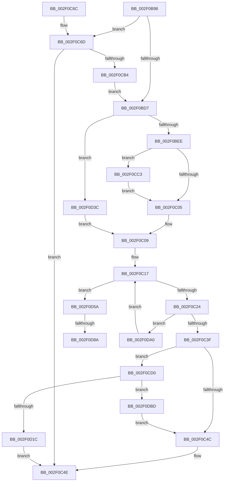

# RtlpCSparseBitmapPageCommit

- RVA: `0x002F0B98`–`0x002F0DCA` (길이 `562` bytes)
- VA: `0x00000001402F0B98`
- 실행 섹션: `.text`
- PDB 이름 있음: `예`; PDB Function 태그: `예`
- unwind 정보 RVA: `0x00071D4C`
- 디코드: `139`개 명령, `562/562` bytes 표시
- 미해석 바이트: `0` (있으면 어셈블리에 `.byte`로 보존)

> 이 문서는 커널 이미지의 기계어와 PDB 기호를 분석해 생성했습니다. 4번과 5번은 함수 원형과 자료형을 바이너리 사용 방식에서 추정한 C 해석이며 원본 소스 복구 결과는 아닙니다.

## 1. Dependencies

- 직접 호출 지점: **10**; 고유 호출 대상: **8**
- 직접 호출자로 확인된 함수: **2**
- RIP 상대 이미지 참조: **1**

### Outgoing calls
- `0x002F0C24` → [ExAcquireSpinLockShared](../24/ExAcquireSpinLockShared_function_0024DCE0.md) (function, `0x0024DCE0`)
- `0x002F0CA9` → [RtlpHpEnvAllocVA](../32/RtlpHpEnvAllocVA_function_00328F50.md) (function, `0x00328F50`)
- `0x002F0CC6` → [KiRaiseIrqlProcessIrqlFlags](../4F/KiRaiseIrqlProcessIrqlFlags_function_004F56FC.md) (function, `0x004F56FC`)
- `0x002F0D0D` → [RtlpHpEnvAllocVA](../32/RtlpHpEnvAllocVA_function_00328F50.md) (function, `0x00328F50`)
- `0x002F0D1F` → [RtlpCSparseBitmapUnlock](RtlpCSparseBitmapUnlock_function_002F0DD0.md) (function, `0x002F0DD0`)
- `0x002F0D32` → [RtlCSparseBitmapLeaveLockingRegion](../48/RtlCSparseBitmapLeaveLockingRegion_function_00482DD0.md) (function, `0x00482DD0`)
- `0x002F0D70` → [KeAbPreAcquire](../21/KeAbPreAcquire_function_00210230.md) (function, `0x00210230`)
- `0x002F0D95` → [ExfAcquirePushLockSharedEx](../21/ExfAcquirePushLockSharedEx_function_0021044C.md) (function, `0x0021044C`)
- `0x002F0DA3` → [RtlpCSparseBitmapUnlock](RtlpCSparseBitmapUnlock_function_002F0DD0.md) (function, `0x002F0DD0`)
- `0x002F0DB3` → [RtlpCSparseBitmapWaitOnAddress](../2E/RtlpCSparseBitmapWaitOnAddress_function_002EFF0C.md) (function, `0x002EFF0C`)

### Direct callers
- [RtlSparseArrayElementAllocate](RtlSparseArrayElementAllocate_function_002F09C8.md) at `0x002F0A13`
- [RtlCSparseBitmapBitmaskWrite](RtlCSparseBitmapBitmaskWrite_function_002F0A8C.md) at `0x002F0AD0`

### Static image references
- `0x002F0BF9` → RVA `0x00FC6D20` (`ALMOSTRO`; read)

## 2. Other-region calls and transfers

- 다른 실행 섹션으로 향하는 call: **0**
- call이 아닌 외부 분기/꼬리 이동: **2**
  - `0x002F0D84` → [sub_006DEEC2](../6D/Unknown_function_006DEEC2.md) (`tail-transfer`)
  - `0x002F0D9B` → [sub_006DEEC2](../6D/Unknown_function_006DEEC2.md) (`tail-transfer`)

## 3. Assembly (complete function range)

```asm
002F0B98  48 89 5C 24 18                  mov qword ptr [rsp + 0x18], rbx
002F0B9D  48 89 74 24 20                  mov qword ptr [rsp + 0x20], rsi
002F0BA2  48 89 54 24 10                  mov qword ptr [rsp + 0x10], rdx
002F0BA7  55                              push rbp
002F0BA8  57                              push rdi
002F0BA9  41 54                           push r12
002F0BAB  41 56                           push r14
002F0BAD  41 57                           push r15
002F0BAF  48 8B EC                        mov rbp, rsp
002F0BB2  48 81 EC 80 00 00 00            sub rsp, 0x80
002F0BB9  4C 8B F2                        mov r14, rdx
002F0BBC  4D 8B E1                        mov r12, r9
002F0BBF  49 C1 EE 0F                     shr r14, 0xf
002F0BC3  4D 8B F8                        mov r15, r8
002F0BC6  4C 0F A3 71 38                  bt qword ptr [rcx + 0x38], r14
002F0BCB  48 8B FA                        mov rdi, rdx
002F0BCE  48 8B D9                        mov rbx, rcx
002F0BD1  0F 83 96 00 00 00               jae 0x1402f0c6d
002F0BD7  33 C0                           xor eax, eax
002F0BD9  48 89 45 E1                     mov qword ptr [rbp - 0x1f], rax
002F0BDD  48 89 45 E0                     mov qword ptr [rbp - 0x20], rax
002F0BE1  48 89 5D E8                     mov qword ptr [rbp - 0x18], rbx
002F0BE5  38 43 30                        cmp byte ptr [rbx + 0x30], al
002F0BE8  0F 84 4E 01 00 00               je 0x1402f0d3c
002F0BEE  44 0F 20 C6                     mov rsi, cr8
002F0BF2  8D 50 02                        lea edx, [rax + 2]
002F0BF5  44 0F 22 C2                     mov cr8, rdx
002F0BF9  39 05 21 61 CD 00               cmp dword ptr [rip + 0xcd6121], eax
002F0BFF  0F 85 BE 00 00 00               jne 0x1402f0cc3
002F0C05  40 88 75 E0                     mov byte ptr [rbp - 0x20], sil
002F0C09  0F 10 45 E0                     movups xmm0, xmmword ptr [rbp - 0x20]
002F0C0D  48 8D 73 18                     lea rsi, [rbx + 0x18]
002F0C11  F3 41 0F 7F 04 24               movdqu xmmword ptr [r12], xmm0
002F0C17  80 7B 30 00                     cmp byte ptr [rbx + 0x30], 0
002F0C1B  48 8B CE                        mov rcx, rsi
002F0C1E  0F 84 36 01 00 00               je 0x1402f0d5a
002F0C24  E8 B7 D0 F5 FF                  call 0x14024dce0
002F0C29  41 88 47 04                     mov byte ptr [r15 + 4], al
002F0C2D  41 83 27 00                     and dword ptr [r15], 0
002F0C31  49 89 5F 08                     mov qword ptr [r15 + 8], rbx
002F0C35  48 39 7B 20                     cmp qword ptr [rbx + 0x20], rdi
002F0C39  0F 84 61 01 00 00               je 0x1402f0da0
002F0C3F  48 8B 03                        mov rax, qword ptr [rbx]
002F0C42  48 0F A3 38                     bt qword ptr [rax], rdi
002F0C46  0F 83 84 00 00 00               jae 0x1402f0cd0
002F0C4C  33 F6                           xor esi, esi
002F0C4E  4C 8D 9C 24 80 00 00 00         lea r11, [rsp + 0x80]
002F0C56  8B C6                           mov eax, esi
002F0C58  49 8B 5B 40                     mov rbx, qword ptr [r11 + 0x40]
002F0C5C  49 8B 73 48                     mov rsi, qword ptr [r11 + 0x48]
002F0C60  49 8B E3                        mov rsp, r11
002F0C63  41 5F                           pop r15
002F0C65  41 5E                           pop r14
002F0C67  41 5C                           pop r12
002F0C69  5F                              pop rdi
002F0C6A  5D                              pop rbp
002F0C6B  C3                              ret
002F0C6C  CC                              int3
002F0C6D  83 64 24 40 00                  and dword ptr [rsp + 0x40], 0
002F0C72  48 8D 55 30                     lea rdx, [rbp + 0x30]
002F0C76  49 8B C6                        mov rax, r14
002F0C79  48 C7 45 30 00 10 00 00         mov qword ptr [rbp + 0x30], 0x1000
002F0C81  48 C1 E0 0C                     shl rax, 0xc
002F0C85  41 B9 00 10 00 40               mov r9d, 0x40001000
002F0C8B  48 03 01                        add rax, qword ptr [rcx]
002F0C8E  45 33 C0                        xor r8d, r8d
002F0C91  48 89 45 D0                     mov qword ptr [rbp - 0x30], rax
002F0C95  0F B6 41 32                     movzx eax, byte ptr [rcx + 0x32]
002F0C99  48 8D 4D D0                     lea rcx, [rbp - 0x30]
002F0C9D  89 44 24 30                     mov dword ptr [rsp + 0x30], eax
002F0CA1  C7 44 24 20 04 00 00 00         mov dword ptr [rsp + 0x20], 4
002F0CA9  E8 A2 82 03 00                  call 0x140328f50
002F0CAE  8B F0                           mov esi, eax
002F0CB0  85 C0                           test eax, eax
002F0CB2  78 9A                           js 0x1402f0c4e
002F0CB4  F0 4C 0F AB 73 38               lock bts qword ptr [rbx + 0x38], r14
002F0CBA  48 8B 7D 38                     mov rdi, qword ptr [rbp + 0x38]
002F0CBE  E9 14 FF FF FF                  jmp 0x1402f0bd7
002F0CC3  40 8A CE                        mov cl, sil
002F0CC6  E8 31 4A 20 00                  call 0x1404f56fc
002F0CCB  E9 35 FF FF FF                  jmp 0x1402f0c05
002F0CD0  83 64 24 40 00                  and dword ptr [rsp + 0x40], 0
002F0CD5  48 8D 55 30                     lea rdx, [rbp + 0x30]
002F0CD9  48 8B C7                        mov rax, rdi
002F0CDC  48 C7 45 30 00 10 00 00         mov qword ptr [rbp + 0x30], 0x1000
002F0CE4  48 C1 E0 0C                     shl rax, 0xc
002F0CE8  48 8D 4D D0                     lea rcx, [rbp - 0x30]
002F0CEC  48 03 43 08                     add rax, qword ptr [rbx + 8]
002F0CF0  41 B9 00 10 00 40               mov r9d, 0x40001000
002F0CF6  48 89 45 D0                     mov qword ptr [rbp - 0x30], rax
002F0CFA  45 33 C0                        xor r8d, r8d
002F0CFD  0F B6 43 32                     movzx eax, byte ptr [rbx + 0x32]
002F0D01  89 44 24 30                     mov dword ptr [rsp + 0x30], eax
002F0D05  C7 44 24 20 04 00 00 00         mov dword ptr [rsp + 0x20], 4
002F0D0D  E8 3E 82 03 00                  call 0x140328f50
002F0D12  8B F0                           mov esi, eax
002F0D14  85 C0                           test eax, eax
002F0D16  0F 89 A1 00 00 00               jns 0x1402f0dbd
002F0D1C  49 8B CF                        mov rcx, r15
002F0D1F  E8 AC 00 00 00                  call 0x1402f0dd0
002F0D24  41 0F 10 04 24                  movups xmm0, xmmword ptr [r12]
002F0D29  48 8D 4D F0                     lea rcx, [rbp - 0x10]
002F0D2D  F3 0F 7F 45 F0                  movdqu xmmword ptr [rbp - 0x10], xmm0
002F0D32  E8 99 20 19 00                  call 0x140482dd0
002F0D37  E9 12 FF FF FF                  jmp 0x1402f0c4e
002F0D3C  65 48 8B 04 25 88 01 00 00      mov rax, qword ptr gs:[0x188]
002F0D45  48 8B 7D 38                     mov rdi, qword ptr [rbp + 0x38]
002F0D49  C6 45 E0 FF                     mov byte ptr [rbp - 0x20], 0xff
002F0D4D  66 FF 88 E6 01 00 00            dec word ptr [rax + 0x1e6]
002F0D54  90                              nop
002F0D55  E9 AF FE FF FF                  jmp 0x1402f0c09
002F0D5A  65 48 8B 04 25 88 01 00 00      mov rax, qword ptr gs:[0x188]
002F0D63  45 33 C0                        xor r8d, r8d
002F0D66  33 D2                           xor edx, edx
002F0D68  66 FF 88 E6 01 00 00            dec word ptr [rax + 0x1e6]
002F0D6F  90                              nop
002F0D70  E8 BB F4 F1 FF                  call 0x140210230
002F0D75  48 8B F8                        mov rdi, rax
002F0D78  B9 11 00 00 00                  mov ecx, 0x11
002F0D7D  33 C0                           xor eax, eax
002F0D7F  F0 48 0F B1 0E                  lock cmpxchg qword ptr [rsi], rcx
002F0D84  0F 84 38 E1 3E 00               je 0x1406deec2
002F0D8A  4C 8B CE                        mov r9, rsi
002F0D8D  4C 8B C7                        mov r8, rdi
002F0D90  33 D2                           xor edx, edx
002F0D92  48 8B CE                        mov rcx, rsi
002F0D95  E8 B2 F6 F1 FF                  call 0x14021044c
002F0D9A  90                              nop
002F0D9B  E9 22 E1 3E 00                  jmp 0x1406deec2
002F0DA0  49 8B CF                        mov rcx, r15
002F0DA3  E8 28 00 00 00                  call 0x1402f0dd0
002F0DA8  4C 8B CB                        mov r9, rbx
002F0DAB  48 8D 55 38                     lea rdx, [rbp + 0x38]
002F0DAF  48 8D 4B 20                     lea rcx, [rbx + 0x20]
002F0DB3  E8 54 F1 FF FF                  call 0x1402eff0c
002F0DB8  E9 5A FE FF FF                  jmp 0x1402f0c17
002F0DBD  48 8B 03                        mov rax, qword ptr [rbx]
002F0DC0  F0 48 0F AB 38                  lock bts qword ptr [rax], rdi
002F0DC5  E9 82 FE FF FF                  jmp 0x1402f0c4c
```

## 4. C-style interpretation (structured pseudocode)

```c
__int64 __fastcall RtlpCSparseBitmapPageCommit(__int64 a1, __int64 a2, __int64 a3, __int64 a4)
{
    __int64 result;
    __int64 v_r14;
    __int64 v_rsi;
    __int64 v_rsp;
    unsigned __int64 v_stack_m28;
    unsigned __int64 v_stack_m38;
    unsigned __int64 v_stack_m40;
    unsigned __int64 v_stack_m47;
    unsigned __int64 v_stack_m48;
    unsigned int v_stack_m50;
    unsigned __int64 v_stack_m58;
    unsigned int v_stack_m60;
    unsigned __int64 v_stack_p10;
    unsigned __int64 v_stack_p18;
    unsigned __int64 v_stack_p20;
    unsigned __int64 v_stack_p8;

    v_stack_p18 = v_rbx;
    v_stack_p20 = v_rsi;
    v_stack_p10 = a2;
    v_rsp = (v_rsp) - (128);
    v_r14 = (a2) >> (15);
    if (condition_is_above_or_equal) goto loc_002F0C6D;
loc_002F0BD7:
    result = 0;
    v_stack_m47 = 0;
    v_stack_m48 = 0;
    v_stack_m40 = a1;
    if ((*(unsigned __int8 *)(a1 + 48)) == 0) goto loc_002F0D3C;
    if ((*(unsigned int *)(v_rip + 13459745)) != 0) goto loc_002F0CC3;
loc_002F0C05:
    v_stack_m48 = (unsigned __int8)(v_cr8);
loc_002F0C09:
    *(unsigned __int64 *)(a4) = v_xmm0;
loc_002F0C17:
    if ((*(unsigned __int8 *)(a1 + 48)) == 0) goto loc_002F0D5A;
    result = ExAcquireSpinLockShared(a1 + 24, result + 2, a3, a4);
    *(unsigned __int8 *)(a3 + 4) = (unsigned __int8)(result);
    *(unsigned __int64 *)(a3 + 8) = a1;
    if ((*(unsigned __int64 *)(a1 + 32)) == a2) goto loc_002F0DA0;
    if ((*(unsigned __int64 *)(a1 + 32)) >= a2) goto loc_002F0CD0;
loc_002F0C4C:
    v_rsi = 0;
loc_002F0C4E:
    return 0;
loc_002F0C6D:
    v_stack_p8 = 0x1000ULL;
    result = (v_r14) << (12);
    result = (result) + (*(unsigned __int64 *)(a1 + 24));
    a3 = 0;
    v_stack_m58 = result;
    v_stack_m50 = (unsigned int)(*(unsigned __int8 *)(a1 + 24 + 50));
    v_stack_m60 = 4;
    result = RtlpHpEnvAllocVA(v_stack_m58, v_stack_p8, a3, (unsigned int)(0x40001000ULL));
    if (sign_flag) goto loc_002F0C4E;
    goto loc_002F0BD7;
loc_002F0CC3:
    result = KiRaiseIrqlProcessIrqlFlags((unsigned __int8)((unsigned int)((unsigned int)(result))), v_stack_p8, a3, (unsigned int)(0x40001000ULL));
    goto loc_002F0C05;
loc_002F0CD0:
    v_stack_p8 = 0x1000ULL;
    result = (v_stack_p10) << (12);
    result = (result) + (*(unsigned __int64 *)(*(unsigned __int64 *)(v_stack_m28 + 64) + 8));
    v_stack_m58 = result;
    a3 = 0;
    v_stack_m50 = (unsigned int)(*(unsigned __int8 *)(*(unsigned __int64 *)(v_stack_m28 + 64) + 50));
    v_stack_m60 = 4;
    result = RtlpHpEnvAllocVA(v_stack_m58, v_stack_p8, a3, (unsigned int)(0x40001000ULL));
    if (!sign_flag) goto loc_002F0DBD;
    result = RtlpCSparseBitmapUnlock(0, v_stack_p8, a3, (unsigned int)(0x40001000ULL));
    v_stack_m38 = v_xmm0;
    result = RtlCSparseBitmapLeaveLockingRegion(v_stack_m38, v_stack_p8, a3, (unsigned int)(0x40001000ULL));
    goto loc_002F0C4E;
loc_002F0D3C:
    v_stack_m48 = 255;
    goto loc_002F0C09;
loc_002F0D5A:
    a3 = 0;
    a2 = 0;
    result = KeAbPreAcquire(v_stack_m38, a2, a3, (unsigned int)(0x40001000ULL));
    result = 0;
    a2 = 0;
    result = ExfAcquirePushLockSharedEx((unsigned int)((unsigned int)(result)), a2, 0, (unsigned int)((unsigned int)(result)));
loc_002F0DA0:
    result = RtlpCSparseBitmapUnlock(0, a2, 0, (unsigned int)((unsigned int)(result)));
    result = RtlpCSparseBitmapWaitOnAddress(*(unsigned __int64 *)(v_stack_m28 + 64) + 32, v_stack_p10, 0, *(unsigned __int64 *)(v_stack_m28 + 64));
    goto loc_002F0C17;
loc_002F0DBD:
    goto loc_002F0C4C;
}
```

## 5. (Beta) C Style

```c
int64_t RtlpCSparseBitmapPageCommit(void *Arg1, int64_t Arg2, void *Arg3, void *Arg4)
{
    uint8_t *arg1 = (uint8_t *)Arg1;
    uint8_t *arg3 = (uint8_t *)Arg3;
    uint8_t *arg4 = (uint8_t *)Arg4;

    int64_t result;
    int64_t local_r14;
    int64_t local_rsi;
    int64_t local_rsp;
    uint64_t v_stack_m28;
    uint64_t v_stack_m38;
    uint64_t v_stack_m40;
    uint64_t v_stack_m47;
    uint64_t v_stack_m48;
    uint32_t v_stack_m50;
    uint64_t v_stack_m58;
    uint32_t v_stack_m60;
    uint64_t v_stack_p10;
    uint64_t v_stack_p18;
    uint64_t v_stack_p20;
    uint64_t v_stack_p8;

    v_stack_p18 = local_rbx;
    v_stack_p20 = local_rsi;
    v_stack_p10 = Arg2;
    local_rsp = (local_rsp) - (128);
    local_r14 = (Arg2) >> (15);
    if (condition_is_above_or_equal) goto loc_002F0C6D;
loc_002F0BD7:
    result = 0;
    v_stack_m47 = 0;
    v_stack_m48 = 0;
    v_stack_m40 = Arg1;
    if ((*(uint8_t *)(arg1 + 0x30)) == 0) goto loc_002F0D3C;
    if ((*(uint32_t *)(v_rip + 0xCD6121)) != 0) goto loc_002F0CC3;
loc_002F0C05:
    v_stack_m48 = (uint8_t)(v_cr8);
loc_002F0C09:
    *(uint64_t *)(arg4) = v_xmm0;
loc_002F0C17:
    if ((*(uint8_t *)(arg1 + 0x30)) == 0) goto loc_002F0D5A;
    result = ExAcquireSpinLockShared(Arg1 + 24, result + 2, Arg3, Arg4);
    *(uint8_t *)(arg3 + 0x4) = (uint8_t)(result);
    *(void **)(arg3 + 0x8) = Arg1;
    if ((*(uint64_t *)(arg1 + 0x20)) == Arg2) goto loc_002F0DA0;
    if ((*(uint64_t *)(arg1 + 0x20)) >= Arg2) goto loc_002F0CD0;
loc_002F0C4C:
    local_rsi = 0;
loc_002F0C4E:
    return 0;
loc_002F0C6D:
    v_stack_p8 = 0x1000ULL;
    result = (local_r14) << (12);
    result = (result) + (*(uint64_t *)(arg1 + 0x18));
    Arg3 = 0;
    v_stack_m58 = result;
    v_stack_m50 = (uint32_t)(*(uint8_t *)(arg1 + 0x18 + 0x32));
    v_stack_m60 = 4;
    result = RtlpHpEnvAllocVA(v_stack_m58, v_stack_p8, Arg3, (uint32_t)(0x40001000ULL));
    if (sign_flag) goto loc_002F0C4E;
    goto loc_002F0BD7;
loc_002F0CC3:
    result = KiRaiseIrqlProcessIrqlFlags((uint8_t)((uint32_t)((uint32_t)(result))), v_stack_p8, Arg3, (uint32_t)(0x40001000ULL));
    goto loc_002F0C05;
loc_002F0CD0:
    v_stack_p8 = 0x1000ULL;
    result = (v_stack_p10) << (12);
    result = (result) + (*(uint64_t *)(*(uint64_t *)(v_stack_m28 + 0x40) + 0x8));
    v_stack_m58 = result;
    Arg3 = 0;
    v_stack_m50 = (uint32_t)(*(uint8_t *)(*(uint64_t *)(v_stack_m28 + 0x40) + 0x32));
    v_stack_m60 = 4;
    result = RtlpHpEnvAllocVA(v_stack_m58, v_stack_p8, Arg3, (uint32_t)(0x40001000ULL));
    if (!sign_flag) goto loc_002F0DBD;
    result = RtlpCSparseBitmapUnlock(0, v_stack_p8, Arg3, (uint32_t)(0x40001000ULL));
    v_stack_m38 = v_xmm0;
    result = RtlCSparseBitmapLeaveLockingRegion(v_stack_m38, v_stack_p8, Arg3, (uint32_t)(0x40001000ULL));
    goto loc_002F0C4E;
loc_002F0D3C:
    v_stack_m48 = 255;
    goto loc_002F0C09;
loc_002F0D5A:
    Arg3 = 0;
    Arg2 = 0;
    result = KeAbPreAcquire(v_stack_m38, Arg2, Arg3, (uint32_t)(0x40001000ULL));
    result = 0;
    Arg2 = 0;
    result = ExfAcquirePushLockSharedEx((uint32_t)((uint32_t)(result)), Arg2, 0, (uint32_t)((uint32_t)(result)));
loc_002F0DA0:
    result = RtlpCSparseBitmapUnlock(0, Arg2, 0, (uint32_t)((uint32_t)(result)));
    result = RtlpCSparseBitmapWaitOnAddress(*(uint64_t *)(v_stack_m28 + 0x40) + 32, v_stack_p10, 0, *(uint64_t *)(v_stack_m28 + 0x40));
    goto loc_002F0C17;
loc_002F0DBD:
    goto loc_002F0C4C;
}
```

### 관측된 메모리 오프셋

구조체 형식이 확인되지 않은 접근은 인자 기준의 오프셋으로만 기록했습니다.

| 기준 인자 | 오프셋 표현 | 폭 (bit) | 접근 |
|---|---:|---:|---|
| `Arg1` | `+ 0x0` | `64` | `R` |
| `Arg1` | `+ 0x8` | `64` | `R` |
| `Arg1` | `+ 0x18` | `64` | `R` |
| `Arg1` | `+ 0x20` | `64` | `R` |
| `Arg1` | `+ 0x30` | `8` | `R` |
| `Arg1` | `+ 0x32` | `8` | `R` |
| `Arg1` | `+ 0x38` | `64` | `R` |
| `Arg1` | `+ 0x38` | `64` | `R/W` |
| `Arg3` | `+ 0x0` | `32` | `R/W` |
| `Arg3` | `+ 0x4` | `8` | `W` |
| `Arg3` | `+ 0x8` | `64` | `W` |
| `Arg4` | `+ 0x0` | `128` | `R` |
| `Arg4` | `+ 0x0` | `128` | `W` |

## 6. Execution-region graph

[열기: 2D/3D 그래프와 함수 탐색 컨트롤 패널](../../../control-panel.html?section=text&rva=0x002F0B98&view=graph)

- 2D 그래프는 위에서 아래로 흐르고, 3D 그래프는 빈 공간을 드래그해 회전합니다. Shift+드래그는 이동, 휠은 확대·축소, 함수 노드 선택은 대상 보고서 이동입니다.

### Static fallback


