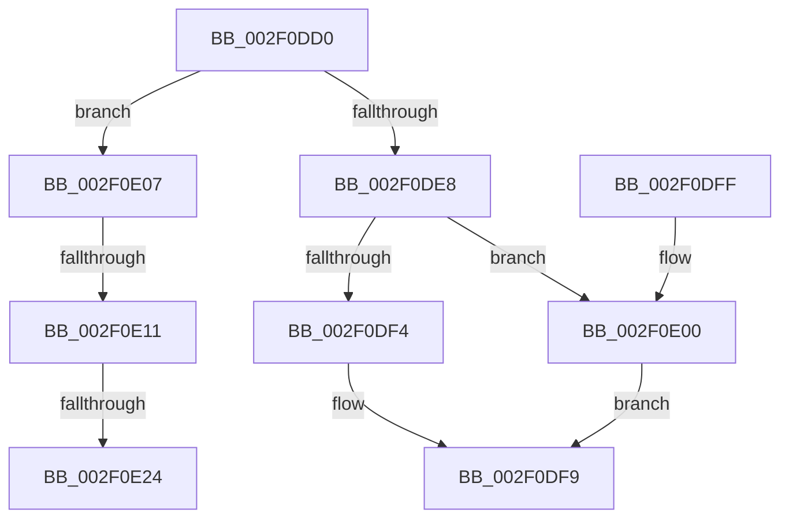

# RtlpCSparseBitmapUnlock

- RVA: `0x002F0DD0`–`0x002F0E32` (길이 `98` bytes)
- VA: `0x00000001402F0DD0`
- 실행 섹션: `.text`
- PDB 이름 있음: `예`; PDB Function 태그: `예`
- unwind 정보 RVA: `0x0006CB78`
- 디코드: `30`개 명령, `98/98` bytes 표시
- 미해석 바이트: `0` (있으면 어셈블리에 `.byte`로 보존)

> 이 문서는 커널 이미지의 기계어와 PDB 기호를 분석해 생성했습니다. 4번과 5번은 함수 원형과 자료형을 바이너리 사용 방식에서 추정한 C 해석이며 원본 소스 복구 결과는 아닙니다.

## 1. Dependencies

- 직접 호출 지점: **3**; 고유 호출 대상: **3**
- 직접 호출자로 확인된 함수: **4**
- RIP 상대 이미지 참조: **0**

### Outgoing calls
- `0x002F0DF4` → [ExReleaseSpinLockShared](ExReleaseSpinLockShared_function_002F0EF0.md) (function, `0x002F0EF0`)
- `0x002F0E00` → [ExReleaseSpinLockExclusive](../2C/ExReleaseSpinLockExclusive_function_002C0EF0.md) (function, `0x002C0EF0`)
- `0x002F0E27` → [ExfTryToWakePushLock](../26/ExfTryToWakePushLock_function_00265DD0.md) (function, `0x00265DD0`)

### Direct callers
- [RtlpCSparseBitmapPageDecommit](../2E/RtlpCSparseBitmapPageDecommit_function_002EFAD4.md) at `0x002EFCF4`
- [RtlpCSparseBitmapPageDecommit](../2E/RtlpCSparseBitmapPageDecommit_function_002EFAD4.md) at `0x002EFD1F`
- [RtlSparseArrayElementAllocate](RtlSparseArrayElementAllocate_function_002F09C8.md) at `0x002F0A37`
- [RtlCSparseBitmapBitmaskWrite](RtlCSparseBitmapBitmaskWrite_function_002F0A8C.md) at `0x002F0B41`
- [RtlpCSparseBitmapPageCommit](RtlpCSparseBitmapPageCommit_function_002F0B98.md) at `0x002F0D1F`
- [RtlpCSparseBitmapPageCommit](RtlpCSparseBitmapPageCommit_function_002F0B98.md) at `0x002F0DA3`

### Static image references
- 디코드된 RIP-relative 메모리 참조가 없습니다.

## 2. Other-region calls and transfers

- 다른 실행 섹션으로 향하는 call: **0**
- call이 아닌 외부 분기/꼬리 이동: **3**
  - `0x002F0E0B` → [sub_006DEED6](../6D/Unknown_function_006DEED6.md) (`tail-transfer`)
  - `0x002F0E1E` → [sub_006DEED6 + 0x14](../6D/Unknown_function_006DEED6.md) (`tail-transfer`)
  - `0x002F0E2D` → [sub_006DEED6 + 0x14](../6D/Unknown_function_006DEED6.md) (`tail-transfer`)

## 3. Assembly (complete function range)

```asm
002F0DD0  40 53                           push rbx
002F0DD2  48 83 EC 20                     sub rsp, 0x20
002F0DD6  48 8B 41 08                     mov rax, qword ptr [rcx + 8]
002F0DDA  33 D2                           xor edx, edx
002F0DDC  44 8B 01                        mov r8d, dword ptr [rcx]
002F0DDF  48 8D 58 18                     lea rbx, [rax + 0x18]
002F0DE3  38 50 30                        cmp byte ptr [rax + 0x30], dl
002F0DE6  74 1F                           je 0x1402f0e07
002F0DE8  8A 51 04                        mov dl, byte ptr [rcx + 4]
002F0DEB  48 8B CB                        mov rcx, rbx
002F0DEE  41 83 F8 01                     cmp r8d, 1
002F0DF2  74 0C                           je 0x1402f0e00
002F0DF4  E8 F7 00 00 00                  call 0x1402f0ef0
002F0DF9  48 83 C4 20                     add rsp, 0x20
002F0DFD  5B                              pop rbx
002F0DFE  C3                              ret
002F0DFF  CC                              int3
002F0E00  E8 EB 00 FD FF                  call 0x1402c0ef0
002F0E05  EB F2                           jmp 0x1402f0df9
002F0E07  41 83 F8 01                     cmp r8d, 1
002F0E0B  0F 85 C5 E0 3E 00               jne 0x1406deed6
002F0E11  48 83 C8 FF                     or rax, 0xffffffffffffffff
002F0E15  F0 48 0F C1 03                  lock xadd qword ptr [rbx], rax
002F0E1A  24 06                           and al, 6
002F0E1C  3C 02                           cmp al, 2
002F0E1E  0F 85 C6 E0 3E 00               jne 0x1406deeea
002F0E24  48 8B CB                        mov rcx, rbx
002F0E27  E8 A4 4F F7 FF                  call 0x140265dd0
002F0E2C  90                              nop
002F0E2D  E9 B8 E0 3E 00                  jmp 0x1406deeea
```

## 4. C-style interpretation (structured pseudocode)

```c
__int64 __fastcall RtlpCSparseBitmapUnlock(__int64 a1, int a2)
{
    __int64 result;
    __int64 v_rsp;

    v_rsp = (v_rsp) - (32);
    a2 = 0;
    if ((*(unsigned __int8 *)(*(unsigned __int64 *)(a1 + 8) + 48)) == 0) goto loc_002F0E07;
    if (((unsigned int)((unsigned int)(*(unsigned int *)(a1)))) == 1) goto loc_002F0E00;
    result = ExReleaseSpinLockShared(*(unsigned __int64 *)(a1 + 8) + 24, *(unsigned __int8 *)(a1 + 4), (unsigned int)(*(unsigned int *)(a1)), a4);
loc_002F0DF9:
    v_rsp = (v_rsp) + (32);
    return result;
loc_002F0E00:
    result = ExReleaseSpinLockExclusive(*(unsigned __int64 *)(a1 + 8) + 24, *(unsigned __int8 *)(a1 + 4), (unsigned int)(*(unsigned int *)(a1)), a4);
    goto loc_002F0DF9;
loc_002F0E07:
    result = (result) | (-1);
    result = (unsigned __int8)((result) & (6));
    result = ExfTryToWakePushLock(*(unsigned __int64 *)(a1 + 8) + 24, *(unsigned __int8 *)(a1 + 4), (unsigned int)(*(unsigned int *)(a1)), a4);
}
```

## 5. (Beta) C Style

```c
int64_t RtlpCSparseBitmapUnlock(void *Arg1, int32_t Arg2)
{
    uint8_t *arg1 = (uint8_t *)Arg1;

    int64_t result;
    int64_t local_rsp;

    local_rsp = (local_rsp) - (32);
    Arg2 = 0;
    if ((*(uint8_t *)(*(uint64_t *)(arg1 + 0x8) + 0x30)) == 0) goto loc_002F0E07;
    if (((uint32_t)((uint32_t)(*(uint32_t *)(arg1)))) == 1) goto loc_002F0E00;
    result = ExReleaseSpinLockShared(*(uint64_t *)(arg1 + 0x8) + 24, *(uint8_t *)(arg1 + 0x4), (uint32_t)(*(uint32_t *)(arg1)), a4);
loc_002F0DF9:
    local_rsp = (local_rsp) + (32);
    return result;
loc_002F0E00:
    result = ExReleaseSpinLockExclusive(*(uint64_t *)(arg1 + 0x8) + 24, *(uint8_t *)(arg1 + 0x4), (uint32_t)(*(uint32_t *)(arg1)), a4);
    goto loc_002F0DF9;
loc_002F0E07:
    result = (result) | (-1);
    result = (uint8_t)((result) & (6));
    result = ExfTryToWakePushLock(*(uint64_t *)(arg1 + 0x8) + 24, *(uint8_t *)(arg1 + 0x4), (uint32_t)(*(uint32_t *)(arg1)), a4);
}
```

### 관측된 메모리 오프셋

구조체 형식이 확인되지 않은 접근은 인자 기준의 오프셋으로만 기록했습니다.

| 기준 인자 | 오프셋 표현 | 폭 (bit) | 접근 |
|---|---:|---:|---|
| `Arg1` | `+ 0x0` | `32` | `R` |
| `Arg1` | `+ 0x4` | `8` | `R` |
| `Arg1` | `+ 0x8` | `64` | `R` |

## 6. Execution-region graph

[열기: 2D/3D 그래프와 함수 탐색 컨트롤 패널](../../../control-panel.html?section=text&rva=0x002F0DD0&view=graph)

- 2D 그래프는 위에서 아래로 흐르고, 3D 그래프는 빈 공간을 드래그해 회전합니다. Shift+드래그는 이동, 휠은 확대·축소, 함수 노드 선택은 대상 보고서 이동입니다.

### Static fallback


