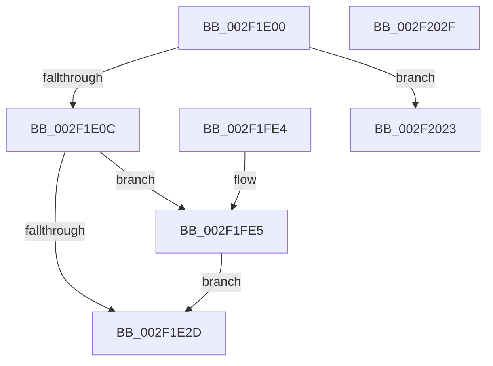

# RtlpCopyContext

- RVA: `0x002F1E00`–`0x002F2030` (길이 `560` bytes)
- VA: `0x00000001402F1E00`
- 실행 섹션: `.text`
- PDB 이름 있음: `예`; PDB Function 태그: `예`
- unwind 정보 RVA: `0x000DB714`
- 디코드: `98`개 명령, `560/560` bytes 표시
- 미해석 바이트: `0` (있으면 어셈블리에 `.byte`로 보존)

> 이 문서는 커널 이미지의 기계어와 PDB 기호를 분석해 생성했습니다. 4번과 5번은 함수 원형과 자료형을 바이너리 사용 방식에서 추정한 C 해석이며 원본 소스 복구 결과는 아닙니다.

## 1. Dependencies

- 직접 호출 지점: **0**; 고유 호출 대상: **0**
- 직접 호출자로 확인된 함수: **3**
- RIP 상대 이미지 참조: **0**

### Outgoing calls
- 직접 디코드된 call 명령이 없습니다.

### Direct callers
- [RtlDispatchException](RtlDispatchException_function_002F22A0.md) at `0x002F242B`
- [RtlUnwindEx](RtlUnwindEx_function_002F2830.md) at `0x002F2967`
- [RtlUnwindEx](RtlUnwindEx_function_002F2830.md) at `0x002F2C1B`
- [RtlUnwindEx](RtlUnwindEx_function_002F2830.md) at `0x002F2C31`
- [sub_006DF0C8](../6D/Unknown_function_006DF0C8.md) at `0x006DF0F7`

### Static image references
- 디코드된 RIP-relative 메모리 참조가 없습니다.

## 2. Other-region calls and transfers

- 다른 실행 섹션으로 향하는 call: **0**
- 별도 외부 분기/꼬리 이동을 확인하지 못했습니다.

## 3. Assembly (complete function range)

```asm
002F1E00  4C 8B C2                        mov r8, rdx
002F1E03  48 3B D1                        cmp rdx, rcx
002F1E06  0F 84 17 02 00 00               je 0x1402f2023
002F1E0C  8B 41 30                        mov eax, dword ptr [rcx + 0x30]
002F1E0F  C7 41 30 00 00 00 00            mov dword ptr [rcx + 0x30], 0
002F1E16  8B 52 30                        mov edx, dword ptr [rdx + 0x30]
002F1E19  23 D0                           and edx, eax
002F1E1B  81 E2 80 00 10 00               and edx, 0x100080
002F1E21  81 FA 80 00 10 00               cmp edx, 0x100080
002F1E27  0F 84 B8 01 00 00               je 0x1402f1fe5
002F1E2D  41 8B 40 30                     mov eax, dword ptr [r8 + 0x30]
002F1E31  25 0F 00 10 00                  and eax, 0x10000f
002F1E36  09 41 30                        or dword ptr [rcx + 0x30], eax
002F1E39  49 8B 80 F8 00 00 00            mov rax, qword ptr [r8 + 0xf8]
002F1E40  48 89 81 F8 00 00 00            mov qword ptr [rcx + 0xf8], rax
002F1E47  49 8B 80 90 00 00 00            mov rax, qword ptr [r8 + 0x90]
002F1E4E  48 89 81 90 00 00 00            mov qword ptr [rcx + 0x90], rax
002F1E55  49 8B 80 98 00 00 00            mov rax, qword ptr [r8 + 0x98]
002F1E5C  48 89 81 98 00 00 00            mov qword ptr [rcx + 0x98], rax
002F1E63  49 8B 80 A0 00 00 00            mov rax, qword ptr [r8 + 0xa0]
002F1E6A  48 89 81 A0 00 00 00            mov qword ptr [rcx + 0xa0], rax
002F1E71  49 8B 80 A8 00 00 00            mov rax, qword ptr [r8 + 0xa8]
002F1E78  48 89 81 A8 00 00 00            mov qword ptr [rcx + 0xa8], rax
002F1E7F  49 8B 80 B0 00 00 00            mov rax, qword ptr [r8 + 0xb0]
002F1E86  48 89 81 B0 00 00 00            mov qword ptr [rcx + 0xb0], rax
002F1E8D  49 8B 80 D8 00 00 00            mov rax, qword ptr [r8 + 0xd8]
002F1E94  48 89 81 D8 00 00 00            mov qword ptr [rcx + 0xd8], rax
002F1E9B  49 8B 80 E0 00 00 00            mov rax, qword ptr [r8 + 0xe0]
002F1EA2  48 89 81 E0 00 00 00            mov qword ptr [rcx + 0xe0], rax
002F1EA9  49 8B 80 E8 00 00 00            mov rax, qword ptr [r8 + 0xe8]
002F1EB0  48 89 81 E8 00 00 00            mov qword ptr [rcx + 0xe8], rax
002F1EB7  49 8B 80 F0 00 00 00            mov rax, qword ptr [r8 + 0xf0]
002F1EBE  48 89 81 F0 00 00 00            mov qword ptr [rcx + 0xf0], rax
002F1EC5  41 0F 10 80 00 02 00 00         movups xmm0, xmmword ptr [r8 + 0x200]
002F1ECD  0F 11 81 00 02 00 00            movups xmmword ptr [rcx + 0x200], xmm0
002F1ED4  41 0F 10 80 10 02 00 00         movups xmm0, xmmword ptr [r8 + 0x210]
002F1EDC  0F 11 81 10 02 00 00            movups xmmword ptr [rcx + 0x210], xmm0
002F1EE3  41 0F 10 80 20 02 00 00         movups xmm0, xmmword ptr [r8 + 0x220]
002F1EEB  0F 11 81 20 02 00 00            movups xmmword ptr [rcx + 0x220], xmm0
002F1EF2  41 0F 10 80 30 02 00 00         movups xmm0, xmmword ptr [r8 + 0x230]
002F1EFA  0F 11 81 30 02 00 00            movups xmmword ptr [rcx + 0x230], xmm0
002F1F01  41 0F 10 80 40 02 00 00         movups xmm0, xmmword ptr [r8 + 0x240]
002F1F09  0F 11 81 40 02 00 00            movups xmmword ptr [rcx + 0x240], xmm0
002F1F10  41 0F 10 80 50 02 00 00         movups xmm0, xmmword ptr [r8 + 0x250]
002F1F18  0F 11 81 50 02 00 00            movups xmmword ptr [rcx + 0x250], xmm0
002F1F1F  41 0F 10 80 60 02 00 00         movups xmm0, xmmword ptr [r8 + 0x260]
002F1F27  0F 11 81 60 02 00 00            movups xmmword ptr [rcx + 0x260], xmm0
002F1F2E  41 0F 10 80 70 02 00 00         movups xmm0, xmmword ptr [r8 + 0x270]
002F1F36  0F 11 81 70 02 00 00            movups xmmword ptr [rcx + 0x270], xmm0
002F1F3D  41 0F 10 80 80 02 00 00         movups xmm0, xmmword ptr [r8 + 0x280]
002F1F45  0F 11 81 80 02 00 00            movups xmmword ptr [rcx + 0x280], xmm0
002F1F4C  41 0F 10 80 90 02 00 00         movups xmm0, xmmword ptr [r8 + 0x290]
002F1F54  0F 11 81 90 02 00 00            movups xmmword ptr [rcx + 0x290], xmm0
002F1F5B  41 0F B7 40 38                  movzx eax, word ptr [r8 + 0x38]
002F1F60  66 89 41 38                     mov word ptr [rcx + 0x38], ax
002F1F64  41 0F B7 40 42                  movzx eax, word ptr [r8 + 0x42]
002F1F69  66 89 41 42                     mov word ptr [rcx + 0x42], ax
002F1F6D  41 8B 40 34                     mov eax, dword ptr [r8 + 0x34]
002F1F71  89 41 34                        mov dword ptr [rcx + 0x34], eax
002F1F74  41 8B 40 44                     mov eax, dword ptr [r8 + 0x44]
002F1F78  89 41 44                        mov dword ptr [rcx + 0x44], eax
002F1F7B  49 8D 80 00 01 00 00            lea rax, [r8 + 0x100]
002F1F82  0F 10 00                        movups xmm0, xmmword ptr [rax]
002F1F85  48 81 C1 00 01 00 00            add rcx, 0x100
002F1F8C  0F 11 01                        movups xmmword ptr [rcx], xmm0
002F1F8F  0F 10 48 10                     movups xmm1, xmmword ptr [rax + 0x10]
002F1F93  0F 11 49 10                     movups xmmword ptr [rcx + 0x10], xmm1
002F1F97  0F 10 40 20                     movups xmm0, xmmword ptr [rax + 0x20]
002F1F9B  0F 11 41 20                     movups xmmword ptr [rcx + 0x20], xmm0
002F1F9F  0F 10 48 30                     movups xmm1, xmmword ptr [rax + 0x30]
002F1FA3  0F 11 49 30                     movups xmmword ptr [rcx + 0x30], xmm1
002F1FA7  0F 10 40 40                     movups xmm0, xmmword ptr [rax + 0x40]
002F1FAB  0F 11 41 40                     movups xmmword ptr [rcx + 0x40], xmm0
002F1FAF  0F 10 48 50                     movups xmm1, xmmword ptr [rax + 0x50]
002F1FB3  0F 11 49 50                     movups xmmword ptr [rcx + 0x50], xmm1
002F1FB7  0F 10 40 60                     movups xmm0, xmmword ptr [rax + 0x60]
002F1FBB  0F 11 41 60                     movups xmmword ptr [rcx + 0x60], xmm0
002F1FBF  0F 10 40 70                     movups xmm0, xmmword ptr [rax + 0x70]
002F1FC3  0F 11 41 70                     movups xmmword ptr [rcx + 0x70], xmm0
002F1FC7  0F 10 88 80 00 00 00            movups xmm1, xmmword ptr [rax + 0x80]
002F1FCE  0F 11 89 80 00 00 00            movups xmmword ptr [rcx + 0x80], xmm1
002F1FD5  0F 10 80 90 00 00 00            movups xmm0, xmmword ptr [rax + 0x90]
002F1FDC  0F 11 81 90 00 00 00            movups xmmword ptr [rcx + 0x90], xmm0
002F1FE3  C3                              ret
002F1FE4  CC                              int3
002F1FE5  48 63 81 E8 04 00 00            movsxd rax, dword ptr [rcx + 0x4e8]
002F1FEC  C7 41 30 80 00 10 00            mov dword ptr [rcx + 0x30], 0x100080
002F1FF3  49 63 90 E8 04 00 00            movsxd rdx, dword ptr [r8 + 0x4e8]
002F1FFA  42 0F 10 84 02 D0 04 00 00      movups xmm0, xmmword ptr [rdx + r8 + 0x4d0]
002F2003  0F 11 84 08 D0 04 00 00         movups xmmword ptr [rax + rcx + 0x4d0], xmm0
002F200B  F2 42 0F 10 8C 02 E0 04 00 00   movsd xmm1, qword ptr [rdx + r8 + 0x4e0]
002F2015  F2 0F 11 8C 08 E0 04 00 00      movsd qword ptr [rax + rcx + 0x4e0], xmm1
002F201E  E9 0A FE FF FF                  jmp 0x1402f1e2d
002F2023  8B 42 30                        mov eax, dword ptr [rdx + 0x30]
002F2026  25 CF 00 10 00                  and eax, 0x1000cf
002F202B  89 41 30                        mov dword ptr [rcx + 0x30], eax
002F202E  C3                              ret
002F202F  CC                              int3
```

## 4. C-style interpretation (structured pseudocode)

```c
__int64 __fastcall RtlpCopyContext(__int64 a1, __int64 a2)
{
    __int64 result;

    if (a2 == a1) goto loc_002F2023;
    *(unsigned int *)(a1 + 48) = 0;
    a2 = (unsigned int)(((unsigned int)(*(unsigned int *)(a2 + 48))) & ((unsigned int)((unsigned int)(*(unsigned int *)(a1 + 48)))));
    a2 = (unsigned int)((a2) & (0x100080ULL));
    if (((unsigned int)(a2)) == 0x100080ULL) goto loc_002F1FE5;
loc_002F1E2D:
    result = (unsigned int)(((unsigned int)(*(unsigned int *)(a2 + 48))) & (0x10000FULL));
    *(unsigned __int64 *)(a1 + 248) = *(unsigned __int64 *)(a2 + 248);
    *(unsigned __int64 *)(a1 + 144) = *(unsigned __int64 *)(a2 + 144);
    *(unsigned __int64 *)(a1 + 152) = *(unsigned __int64 *)(a2 + 152);
    *(unsigned __int64 *)(a1 + 160) = *(unsigned __int64 *)(a2 + 160);
    *(unsigned __int64 *)(a1 + 168) = *(unsigned __int64 *)(a2 + 168);
    *(unsigned __int64 *)(a1 + 176) = *(unsigned __int64 *)(a2 + 176);
    *(unsigned __int64 *)(a1 + 216) = *(unsigned __int64 *)(a2 + 216);
    *(unsigned __int64 *)(a1 + 224) = *(unsigned __int64 *)(a2 + 224);
    *(unsigned __int64 *)(a1 + 232) = *(unsigned __int64 *)(a2 + 232);
    *(unsigned __int64 *)(a1 + 240) = *(unsigned __int64 *)(a2 + 240);
    *(unsigned __int64 *)(a1 + 512) = v_xmm0;
    *(unsigned __int64 *)(a1 + 528) = v_xmm0;
    *(unsigned __int64 *)(a1 + 544) = v_xmm0;
    *(unsigned __int64 *)(a1 + 560) = v_xmm0;
    *(unsigned __int64 *)(a1 + 576) = v_xmm0;
    *(unsigned __int64 *)(a1 + 592) = v_xmm0;
    *(unsigned __int64 *)(a1 + 608) = v_xmm0;
    *(unsigned __int64 *)(a1 + 624) = v_xmm0;
    *(unsigned __int64 *)(a1 + 640) = v_xmm0;
    *(unsigned __int64 *)(a1 + 656) = v_xmm0;
    *(unsigned __int16 *)(a1 + 56) = (unsigned __int16)(*(unsigned __int16 *)(a2 + 56));
    *(unsigned __int16 *)(a1 + 66) = (unsigned __int16)(*(unsigned __int16 *)(a2 + 66));
    *(unsigned int *)(a1 + 52) = (unsigned int)((unsigned int)(*(unsigned int *)(a2 + 52)));
    *(unsigned int *)(a1 + 68) = (unsigned int)((unsigned int)(*(unsigned int *)(a2 + 68)));
    a1 = (a1) + (256);
    *(unsigned __int64 *)(a1) = v_xmm0;
    *(unsigned __int64 *)(a1 + 16) = v_xmm1;
    *(unsigned __int64 *)(a1 + 32) = v_xmm0;
    *(unsigned __int64 *)(a1 + 48) = v_xmm1;
    *(unsigned __int64 *)(a1 + 64) = v_xmm0;
    *(unsigned __int64 *)(a1 + 80) = v_xmm1;
    *(unsigned __int64 *)(a1 + 96) = v_xmm0;
    *(unsigned __int64 *)(a1 + 112) = v_xmm0;
    *(unsigned __int64 *)(a1 + 128) = v_xmm1;
    *(unsigned __int64 *)(a1 + 144) = v_xmm0;
    return a2 + 256;
loc_002F1FE5:
    *(unsigned int *)(a1 + 48) = 0x100080ULL;
    *(unsigned __int64 *)((int)(*(unsigned int *)(a1 + 1256)) + a1 * 1 + 1232) = v_xmm0;
    *(unsigned __int64 *)((int)(*(unsigned int *)(a1 + 1256)) + a1 * 1 + 1248) = v_xmm1;
    goto loc_002F1E2D;
loc_002F2023:
    result = (unsigned int)(((unsigned int)(*(unsigned int *)((int)(*(unsigned int *)(a2 + 1256)) + 48))) & (0x1000CFULL));
    *(unsigned int *)(a1 + 48) = (unsigned int)(result);
    return result;
}
```

## 5. (Beta) C Style

```c
void *RtlpCopyContext(void *Arg1, void *Arg2)
{
    uint8_t *arg1 = (uint8_t *)Arg1;
    uint8_t *arg2 = (uint8_t *)Arg2;

    int64_t result;

    if (Arg2 == Arg1) goto loc_002F2023;
    *(uint32_t *)(arg1 + 0x30) = 0;
    Arg2 = (uint32_t)(((uint32_t)(*(uint32_t *)(arg2 + 0x30))) & ((uint32_t)((uint32_t)(*(uint32_t *)(arg1 + 0x30)))));
    Arg2 = (uint32_t)((Arg2) & (0x100080ULL));
    if (((uint32_t)(Arg2)) == 0x100080ULL) goto loc_002F1FE5;
loc_002F1E2D:
    result = (uint32_t)(((uint32_t)(*(uint32_t *)(arg2 + 0x30))) & (0x10000FULL));
    *(uint64_t *)(arg1 + 0xF8) = *(uint64_t *)(arg2 + 0xF8);
    *(uint64_t *)(arg1 + 0x90) = *(uint64_t *)(arg2 + 0x90);
    *(uint64_t *)(arg1 + 0x98) = *(uint64_t *)(arg2 + 0x98);
    *(uint64_t *)(arg1 + 0xA0) = *(uint64_t *)(arg2 + 0xA0);
    *(uint64_t *)(arg1 + 0xA8) = *(uint64_t *)(arg2 + 0xA8);
    *(uint64_t *)(arg1 + 0xB0) = *(uint64_t *)(arg2 + 0xB0);
    *(uint64_t *)(arg1 + 0xD8) = *(uint64_t *)(arg2 + 0xD8);
    *(uint64_t *)(arg1 + 0xE0) = *(uint64_t *)(arg2 + 0xE0);
    *(uint64_t *)(arg1 + 0xE8) = *(uint64_t *)(arg2 + 0xE8);
    *(uint64_t *)(arg1 + 0xF0) = *(uint64_t *)(arg2 + 0xF0);
    *(uint64_t *)(arg1 + 0x200) = v_xmm0;
    *(uint64_t *)(arg1 + 0x210) = v_xmm0;
    *(uint64_t *)(arg1 + 0x220) = v_xmm0;
    *(uint64_t *)(arg1 + 0x230) = v_xmm0;
    *(uint64_t *)(arg1 + 0x240) = v_xmm0;
    *(uint64_t *)(arg1 + 0x250) = v_xmm0;
    *(uint64_t *)(arg1 + 0x260) = v_xmm0;
    *(uint64_t *)(arg1 + 0x270) = v_xmm0;
    *(uint64_t *)(arg1 + 0x280) = v_xmm0;
    *(uint64_t *)(arg1 + 0x290) = v_xmm0;
    *(uint16_t *)(arg1 + 0x38) = (uint16_t)(*(uint16_t *)(arg2 + 0x38));
    *(uint16_t *)(arg1 + 0x42) = (uint16_t)(*(uint16_t *)(arg2 + 0x42));
    *(uint32_t *)(arg1 + 0x34) = (uint32_t)((uint32_t)(*(uint32_t *)(arg2 + 0x34)));
    *(uint32_t *)(arg1 + 0x44) = (uint32_t)((uint32_t)(*(uint32_t *)(arg2 + 0x44)));
    Arg1 = (Arg1) + (256);
    *(uint64_t *)(arg1) = v_xmm0;
    *(uint64_t *)(arg1 + 0x10) = v_xmm1;
    *(uint64_t *)(arg1 + 0x20) = v_xmm0;
    *(uint64_t *)(arg1 + 0x30) = v_xmm1;
    *(uint64_t *)(arg1 + 0x40) = v_xmm0;
    *(uint64_t *)(arg1 + 0x50) = v_xmm1;
    *(uint64_t *)(arg1 + 0x60) = v_xmm0;
    *(uint64_t *)(arg1 + 0x70) = v_xmm0;
    *(uint64_t *)(arg1 + 0x80) = v_xmm1;
    *(uint64_t *)(arg1 + 0x90) = v_xmm0;
    return Arg2 + 256;
loc_002F1FE5:
    *(uint32_t *)(arg1 + 0x30) = 0x100080ULL;
    *(uint64_t *)((int32_t)(*(uint32_t *)(arg1 + 0x4E8)) + arg1 * 1 + 0x4D0) = v_xmm0;
    *(uint64_t *)((int32_t)(*(uint32_t *)(arg1 + 0x4E8)) + arg1 * 1 + 0x4E0) = v_xmm1;
    goto loc_002F1E2D;
loc_002F2023:
    result = (uint32_t)(((uint32_t)(*(uint32_t *)((int32_t)(*(uint32_t *)(arg2 + 0x4E8)) + 0x30))) & (0x1000CFULL));
    *(uint32_t *)(arg1 + 0x30) = (uint32_t)(result);
    return result;
}
```

### 관측된 메모리 오프셋

구조체 형식이 확인되지 않은 접근은 인자 기준의 오프셋으로만 기록했습니다.

| 기준 인자 | 오프셋 표현 | 폭 (bit) | 접근 |
|---|---:|---:|---|
| `Arg1` | `+ 0x0` | `128` | `R` |
| `Arg1` | `+ 0x10` | `128` | `R` |
| `Arg1` | `+ 0x20` | `128` | `R` |
| `Arg1` | `+ 0x30` | `32` | `R` |
| `Arg1` | `+ 0x30` | `32` | `R/W` |
| `Arg1` | `+ 0x30` | `32` | `W` |
| `Arg1` | `+ 0x30` | `128` | `R` |
| `Arg1` | `+ 0x34` | `32` | `W` |
| `Arg1` | `+ 0x38` | `16` | `W` |
| `Arg1` | `+ 0x40` | `128` | `R` |
| `Arg1` | `+ 0x42` | `16` | `W` |
| `Arg1` | `+ 0x44` | `32` | `W` |
| `Arg1` | `+ 0x50` | `128` | `R` |
| `Arg1` | `+ 0x60` | `128` | `R` |
| `Arg1` | `+ 0x70` | `128` | `R` |
| `Arg1` | `+ 0x80` | `128` | `R` |
| `Arg1` | `+ 0x90` | `64` | `W` |
| `Arg1` | `+ 0x90` | `128` | `R` |
| `Arg1` | `+ 0x98` | `64` | `W` |
| `Arg1` | `+ 0xA0` | `64` | `W` |
| `Arg1` | `+ 0xA8` | `64` | `W` |
| `Arg1` | `+ 0xB0` | `64` | `W` |
| `Arg1` | `+ 0xD8` | `64` | `W` |
| `Arg1` | `+ 0xE0` | `64` | `W` |
| `Arg1` | `+ 0xE8` | `64` | `W` |
| `Arg1` | `+ 0xF0` | `64` | `W` |
| `Arg1` | `+ 0xF8` | `64` | `W` |
| `Arg1` | `+ 0x200` | `128` | `R` |
| `Arg1` | `+ 0x210` | `128` | `R` |
| `Arg1` | `+ 0x220` | `128` | `R` |
| `Arg1` | `+ 0x230` | `128` | `R` |
| `Arg1` | `+ 0x240` | `128` | `R` |

추가 오프셋 43개는 표에서 생략했습니다.

## 6. Execution-region graph

[열기: 2D/3D 그래프와 함수 탐색 컨트롤 패널](../../../control-panel.html?section=text&rva=0x002F1E00&view=graph)

- 2D 그래프는 위에서 아래로 흐르고, 3D 그래프는 빈 공간을 드래그해 회전합니다. Shift+드래그는 이동, 휠은 확대·축소, 함수 노드 선택은 대상 보고서 이동입니다.

### Static fallback


