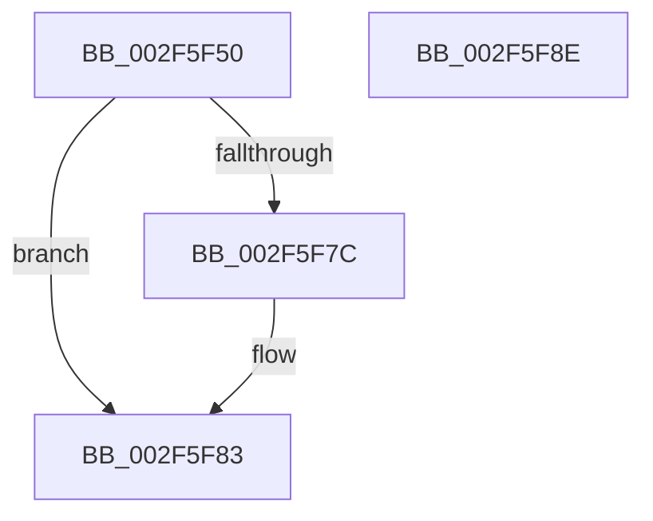

# RtlpGetStackLimits

- RVA: `0x002F5F50`–`0x002F5F8F` (길이 `63` bytes)
- VA: `0x00000001402F5F50`
- 실행 섹션: `.text`
- PDB 이름 있음: `예`; PDB Function 태그: `아니요`
- unwind 정보 RVA: `0x0005CAAC`
- 디코드: `20`개 명령, `63/63` bytes 표시
- 미해석 바이트: `0` (있으면 어셈블리에 `.byte`로 보존)

> 이 문서는 커널 이미지의 기계어와 PDB 기호를 분석해 생성했습니다. 4번과 5번은 함수 원형과 자료형을 바이너리 사용 방식에서 추정한 C 해석이며 원본 소스 복구 결과는 아닙니다.

## 1. Dependencies

- 직접 호출 지점: **2**; 고유 호출 대상: **2**
- 직접 호출자로 확인된 함수: **14**
- RIP 상대 이미지 참조: **0**

### Outgoing calls
- `0x002F5F60` → [KeGetCurrentStackPointer](../6B/KeGetCurrentStackPointer_function_006B1070.md) (function, `0x006B1070`)
- `0x002F5F73` → [KeQueryCurrentStackInformationEx](KeQueryCurrentStackInformationEx_function_002F7CD0.md) (function, `0x002F7CD0`)

### Direct callers
- [RtlUnwindEx](RtlUnwindEx_function_002F2830.md) at `0x002F2902`
- [RtlpWalkFrameChain](RtlpWalkFrameChain_function_002F3ED0.md) at `0x002F406F`
- [RtlWalkFrameChain](RtlWalkFrameChain_function_002F85E0.md) at `0x002F8649`
- [MiCreateSlabEntry](../37/MiCreateSlabEntry_function_00374DEC.md) at `0x003752DA`
- [EtwpApplyPayloadFilterInternal](../3F/EtwpApplyPayloadFilterInternal_function_003F43D0.md) at `0x003F44F9`
- [IoGetStackLimits](../41/IoGetStackLimits_function_0041FD70.md) at `0x0041FD80`
- [RtlEnoughStackSpaceForStackCapture](../43/RtlEnoughStackSpaceForStackCapture_function_004341D0.md) at `0x004341EC`
- [MiDoStackCopy](../48/MiDoStackCopy_function_0048BA30.md) at `0x0048BB10`
- [_RegRtlEnumKeyWithCallback](../../page/99/_RegRtlEnumKeyWithCallback_function_009929EC.md) at `0x00992A39`
- [RegRtlDeleteTreeInternal](../../page/99/RegRtlDeleteTreeInternal_function_00994700.md) at `0x0099474B`
- [sub_009A623D](../../page/9A/Unknown_function_009A623D.md) at `0x009A628C`
- [ViMiscValidateKeWaitUsage](../../pagevrfy/BA/ViMiscValidateKeWaitUsage_function_00BAF554.md) at `0x00BAF60E`
- [MmVerifierTrimMemory](../../pagevrfy/BB/MmVerifierTrimMemory_function_00BB47E8.md) at `0x00BB48F4`
- [ViDeadlockCheckStackLimits](../../pagevrfy/BB/ViDeadlockCheckStackLimits_function_00BB7BF8.md) at `0x00BB7C1B`

### Static image references
- 디코드된 RIP-relative 메모리 참조가 없습니다.

## 2. Other-region calls and transfers

- 다른 실행 섹션으로 향하는 call: **0**
- 별도 외부 분기/꼬리 이동을 확인하지 못했습니다.

## 3. Assembly (complete function range)

```asm
002F5F50  48 89 5C 24 08                  mov qword ptr [rsp + 8], rbx
002F5F55  57                              push rdi
002F5F56  48 83 EC 20                     sub rsp, 0x20
002F5F5A  48 8B DA                        mov rbx, rdx
002F5F5D  48 8B F9                        mov rdi, rcx
002F5F60  E8 0B B1 3B 00                  call 0x1406b1070
002F5F65  48 8B C8                        mov rcx, rax
002F5F68  48 8D 54 24 40                  lea rdx, [rsp + 0x40]
002F5F6D  4C 8B CB                        mov r9, rbx
002F5F70  4C 8B C7                        mov r8, rdi
002F5F73  E8 58 1D 00 00                  call 0x1402f7cd0
002F5F78  84 C0                           test al, al
002F5F7A  75 07                           jne 0x1402f5f83
002F5F7C  B9 04 00 00 00                  mov ecx, 4
002F5F81  CD 29                           int 0x29
002F5F83  48 8B 5C 24 30                  mov rbx, qword ptr [rsp + 0x30]
002F5F88  48 83 C4 20                     add rsp, 0x20
002F5F8C  5F                              pop rdi
002F5F8D  C3                              ret
002F5F8E  CC                              int3
```

## 4. C-style interpretation (structured pseudocode)

```c
__int64 __fastcall RtlpGetStackLimits(__int64 a1, __int64 a2)
{
    __int64 result;
    __int64 v_rsp;
    unsigned __int64 v_stack_p18;
    unsigned __int64 v_stack_p8;

    v_stack_p8 = v_rbx;
    v_rsp = (v_rsp) - (32);
    result = KeGetCurrentStackPointer(a1, a2, a3, a4);
    result = KeQueryCurrentStackInformationEx(result, v_stack_p18, a1, a2);
    if ((unsigned __int8)(result) == 0) {
        a1 = 4;
    }
    v_rsp = (v_rsp) + (32);
    return result;
}
```

## 5. (Beta) C Style

```c
int64_t RtlpGetStackLimits(int64_t Arg1, int64_t Arg2)
{
    int64_t result;
    int64_t local_rsp;
    uint64_t v_stack_p18;
    uint64_t v_stack_p8;

    v_stack_p8 = local_rbx;
    local_rsp = (local_rsp) - (32);
    result = KeGetCurrentStackPointer(Arg1, Arg2, a3, a4);
    result = KeQueryCurrentStackInformationEx(result, v_stack_p18, Arg1, Arg2);
    if ((uint8_t)(result) == 0) {
        Arg1 = 4;
    }
    local_rsp = (local_rsp) + (32);
    return result;
}
```

## 6. Execution-region graph

[열기: 2D/3D 그래프와 함수 탐색 컨트롤 패널](../../../control-panel.html?section=text&rva=0x002F5F50&view=graph)

- 2D 그래프는 위에서 아래로 흐르고, 3D 그래프는 빈 공간을 드래그해 회전합니다. Shift+드래그는 이동, 휠은 확대·축소, 함수 노드 선택은 대상 보고서 이동입니다.

### Static fallback


