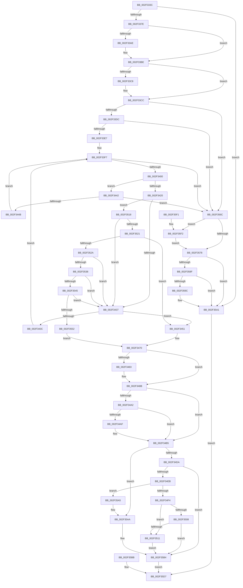

# RtlpLookupDynamicUserFunctionTable

- RVA: `0x002F333C`–`0x002F35FF` (길이 `707` bytes)
- VA: `0x00000001402F333C`
- 실행 섹션: `.text`
- PDB 이름 있음: `예`; PDB Function 태그: `아니요`
- unwind 정보 RVA: `0x0007200C`
- 디코드: `178`개 명령, `707/707` bytes 표시
- 미해석 바이트: `0` (있으면 어셈블리에 `.byte`로 보존)

> 이 문서는 커널 이미지의 기계어와 PDB 기호를 분석해 생성했습니다. 4번과 5번은 함수 원형과 자료형을 바이너리 사용 방식에서 추정한 C 해석이며 원본 소스 복구 결과는 아닙니다.

## 1. Dependencies

- 직접 호출 지점: **10**; 고유 호출 대상: **7**
- 직접 호출자로 확인된 함수: **1**
- RIP 상대 이미지 참조: **5**

### Outgoing calls
- `0x002F3399` → [KeAbPreAcquire](../21/KeAbPreAcquire_function_00210230.md) (function, `0x00210230`)
- `0x002F33B9` → [ExfAcquirePushLockSharedEx](../21/ExfAcquirePushLockSharedEx_function_0021044C.md) (function, `0x0021044C`)
- `0x002F3486` → [ExfReleasePushLockShared](../26/ExfReleasePushLockShared_function_00263440.md) (function, `0x00263440`)
- `0x002F348E` → [KeAbPostRelease](../2E/KeAbPostRelease_function_002E1600.md) (function, `0x002E1600`)
- `0x002F34AF` → [KiCheckForKernelApcDelivery](../2E/KiCheckForKernelApcDelivery_function_002E2C80.md) (function, `0x002E2C80`)
- `0x002F357B` → [KeAbPostRelease](../2E/KeAbPostRelease_function_002E1600.md) (function, `0x002E1600`)
- `0x002F359C` → [KiCheckForKernelApcDelivery](../2E/KiCheckForKernelApcDelivery_function_002E2C80.md) (function, `0x002E2C80`)
- `0x002F35A5` → [ExRaiseDatatypeMisalignment](../../page/89/ExRaiseDatatypeMisalignment_function_00899FD0.md) (function, `0x00899FD0`)
- `0x002F35AF` → [RtlRaiseStatus](RtlRaiseStatus_function_002F6A50.md) (function, `0x002F6A50`)
- `0x002F35F5` → [ExfReleasePushLockShared](../26/ExfReleasePushLockShared_function_00263440.md) (function, `0x00263440`)

### Direct callers
- [RtlpLookupUserFunctionTable](RtlpLookupUserFunctionTable_function_002F3CD0.md) at `0x002F3CF6`

### Static image references
- `0x002F33E7` → RVA `0x00E2D83C` (`.data`; read)
- `0x002F342A` → RVA `0x01201848` (`CFGRO`; read)
- `0x002F3538` → RVA `0x00FC6B98` (`ALMOSTRO`; read)
- `0x002F3545` → RVA `0x00FC6B28` (`ALMOSTRO`; read)
- `0x002F3552` → RVA `0x01201A70` (`CFGRO`; read)

## 2. Other-region calls and transfers

- 다른 실행 섹션으로 향하는 call: **1**
  - `0x002F35A5` → [ExRaiseDatatypeMisalignment](../../page/89/ExRaiseDatatypeMisalignment_function_00899FD0.md) (`.text` → `PAGE`)
- 별도 외부 분기/꼬리 이동을 확인하지 못했습니다.

## 3. Assembly (complete function range)

```asm
002F333C  48 89 5C 24 08                  mov qword ptr [rsp + 8], rbx
002F3341  48 89 74 24 20                  mov qword ptr [rsp + 0x20], rsi
002F3346  48 89 54 24 10                  mov qword ptr [rsp + 0x10], rdx
002F334B  57                              push rdi
002F334C  41 54                           push r12
002F334E  41 55                           push r13
002F3350  41 56                           push r14
002F3352  41 57                           push r15
002F3354  48 83 EC 50                     sub rsp, 0x50
002F3358  48 8B F2                        mov rsi, rdx
002F335B  4C 8B E1                        mov r12, rcx
002F335E  65 48 8B 3C 25 88 01 00 00      mov rdi, qword ptr gs:[0x188]
002F3367  4C 8B B7 20 02 00 00            mov r14, qword ptr [rdi + 0x220]
002F336E  45 33 ED                        xor r13d, r13d
002F3371  4D 39 AE C8 05 00 00            cmp qword ptr [r14 + 0x5c8], r13
002F3378  0F 84 23 02 00 00               je 0x1402f35a1
002F337E  41 8D 4D 01                     lea ecx, [r13 + 1]
002F3382  66 29 8F E6 01 00 00            sub word ptr [rdi + 0x1e6], cx
002F3389  90                              nop
002F338A  49 8D 9E D0 05 00 00            lea rbx, [r14 + 0x5d0]
002F3391  45 33 C0                        xor r8d, r8d
002F3394  33 D2                           xor edx, edx
002F3396  48 8B CB                        mov rcx, rbx
002F3399  E8 92 CE F1 FF                  call 0x140210230
002F339E  4C 8B F8                        mov r15, rax
002F33A1  41 8D 4D 11                     lea ecx, [r13 + 0x11]
002F33A5  33 C0                           xor eax, eax
002F33A7  F0 48 0F B1 0B                  lock cmpxchg qword ptr [rbx], rcx
002F33AC  74 10                           je 0x1402f33be
002F33AE  4C 8B CB                        mov r9, rbx
002F33B1  4D 8B C7                        mov r8, r15
002F33B4  33 D2                           xor edx, edx
002F33B6  48 8B CB                        mov rcx, rbx
002F33B9  E8 8E D0 F1 FF                  call 0x14021044c
002F33BE  B9 01 00 00 00                  mov ecx, 1
002F33C3  4D 85 FF                        test r15, r15
002F33C6  74 04                           je 0x1402f33cc
002F33C8  41 88 4F 0A                     mov byte ptr [r15 + 0xa], cl
002F33CC  4D 8B 86 C8 05 00 00            mov r8, qword ptr [r14 + 0x5c8]
002F33D3  4D 85 C0                        test r8, r8
002F33D6  0F 84 90 01 00 00               je 0x1402f356c
002F33DC  41 8B 00                        mov eax, dword ptr [r8]
002F33DF  3B C1                           cmp eax, ecx
002F33E1  0F 84 85 01 00 00               je 0x1402f356c
002F33E7  8B 15 4F A4 B3 00               mov edx, dword ptr [rip + 0xb3a44f]
002F33ED  C1 E2 0C                        shl edx, 0xc
002F33F0  44 8B D1                        mov r10d, ecx
002F33F3  44 8D 78 FF                     lea r15d, [rax - 1]
002F33F7  45 3B FA                        cmp r15d, r10d
002F33FA  0F 8C 6C 01 00 00               jl 0x1402f356c
002F3400  47 8D 0C 3A                     lea r9d, [r10 + r15]
002F3404  41 D1 F9                        sar r9d, 1
002F3407  49 63 C1                        movsxd rax, r9d
002F340A  4C 8D 34 40                     lea r14, [rax + rax*2]
002F340E  4F 8B 5C F0 18                  mov r11, qword ptr [r8 + r14*8 + 0x18]
002F3413  43 8B 4C F0 20                  mov ecx, dword ptr [r8 + r14*8 + 0x20]
002F3418  49 03 CB                        add rcx, r11
002F341B  4D 3B E3                        cmp r12, r11
002F341E  72 22                           jb 0x1402f3442
002F3420  48 B8 FF FF FE FF FF 7F 00 00   movabs rax, 0x7ffffffeffff
002F342A  44 39 2D 17 E4 F0 00            cmp dword ptr [rip + 0xf0e417], r13d
002F3431  0F 85 E1 00 00 00               jne 0x1402f3518
002F3437  4C 3B E1                        cmp r12, rcx
002F343A  72 15                           jb 0x1402f3451
002F343C  45 8D 51 01                     lea r10d, [r9 + 1]
002F3440  EB B5                           jmp 0x1402f33f7
002F3442  45 85 C9                        test r9d, r9d
002F3445  0F 84 21 01 00 00               je 0x1402f356c
002F344B  45 8D 79 FF                     lea r15d, [r9 - 1]
002F344F  EB A6                           jmp 0x1402f33f7
002F3451  43 0F 10 4C F0 10               movups xmm1, xmmword ptr [r8 + r14*8 + 0x10]
002F3457  0F 11 4C 24 30                  movups xmmword ptr [rsp + 0x30], xmm1
002F345C  F2 43 0F 10 44 F0 20            movsd xmm0, qword ptr [r8 + r14*8 + 0x20]
002F3463  F2 0F 11 44 24 40               movsd qword ptr [rsp + 0x40], xmm0
002F3469  8B 54 24 40                     mov edx, dword ptr [rsp + 0x40]
002F346D  49 8B CB                        mov rcx, r11
002F3470  48 89 4E 08                     mov qword ptr [rsi + 8], rcx
002F3474  89 56 10                        mov dword ptr [rsi + 0x10], edx
002F3477  B8 11 00 00 00                  mov eax, 0x11
002F347C  F0 4C 0F B1 2B                  lock cmpxchg qword ptr [rbx], r13
002F3481  74 08                           je 0x1402f348b
002F3483  48 8B CB                        mov rcx, rbx
002F3486  E8 B5 FF F6 FF                  call 0x140263440
002F348B  48 8B CB                        mov rcx, rbx
002F348E  E8 6D E1 FE FF                  call 0x1402e1600
002F3493  90                              nop
002F3494  B9 01 00 00 00                  mov ecx, 1
002F3499  66 01 8F E6 01 00 00            add word ptr [rdi + 0x1e6], cx
002F34A0  75 13                           jne 0x1402f34b5
002F34A2  90                              nop
002F34A3  48 8D 87 98 00 00 00            lea rax, [rdi + 0x98]
002F34AA  48 39 00                        cmp qword ptr [rax], rax
002F34AD  74 06                           je 0x1402f34b5
002F34AF  E8 CC F7 FE FF                  call 0x1402e2c80
002F34B4  90                              nop
002F34B5  48 8B 44 24 30                  mov rax, qword ptr [rsp + 0x30]
002F34BA  48 8B 48 10                     mov rcx, qword ptr [rax + 0x10]
002F34BE  48 89 4C 24 20                  mov qword ptr [rsp + 0x20], rcx
002F34C3  48 89 0E                        mov qword ptr [rsi], rcx
002F34C6  48 8B 44 24 30                  mov rax, qword ptr [rsp + 0x30]
002F34CB  8B 50 54                        mov edx, dword ptr [rax + 0x54]
002F34CE  81 FA 55 55 55 15               cmp edx, 0x15555555
002F34D4  0F 87 D0 00 00 00               ja 0x1402f35aa
002F34DA  8D 04 52                        lea eax, [rdx + rdx*2]
002F34DD  C1 E0 02                        shl eax, 2
002F34E0  89 46 14                        mov dword ptr [rsi + 0x14], eax
002F34E3  85 C0                           test eax, eax
002F34E5  0F 84 C9 00 00 00               je 0x1402f35b4
002F34EB  F6 C1 03                        test cl, 3
002F34EE  0F 85 B1 00 00 00               jne 0x1402f35a5
002F34F4  8B D0                           mov edx, eax
002F34F6  48 03 D1                        add rdx, rcx
002F34F9  48 B8 00 00 FF FF FF 7F 00 00   movabs rax, 0x7fffffff0000
002F3503  48 3B D0                        cmp rdx, rax
002F3506  77 09                           ja 0x1402f3511
002F3508  48 3B D1                        cmp rdx, rcx
002F350B  0F 83 A3 00 00 00               jae 0x1402f35b4
002F3511  8A 00                           mov al, byte ptr [rax]
002F3513  E9 9C 00 00 00                  jmp 0x1402f35b4
002F3518  4C 3B E0                        cmp r12, rax
002F351B  0F 86 16 FF FF FF               jbe 0x1402f3437
002F3521  4C 3B E1                        cmp r12, rcx
002F3524  0F 82 27 FF FF FF               jb 0x1402f3451
002F352A  8B C2                           mov eax, edx
002F352C  48 03 C1                        add rax, rcx
002F352F  4C 3B E0                        cmp r12, rax
002F3532  0F 83 FF FE FF FF               jae 0x1402f3437
002F3538  4C 3B 1D 59 36 CD 00            cmp r11, qword ptr [rip + 0xcd3659]
002F353F  0F 84 F2 FE FF FF               je 0x1402f3437
002F3545  4C 3B 1D DC 35 CD 00            cmp r11, qword ptr [rip + 0xcd35dc]
002F354C  0F 84 E5 FE FF FF               je 0x1402f3437
002F3552  48 8D 05 17 E5 F0 00            lea rax, [rip + 0xf0e517]
002F3559  48 89 44 24 30                  mov qword ptr [rsp + 0x30], rax
002F355E  48 89 4C 24 38                  mov qword ptr [rsp + 0x38], rcx
002F3563  89 54 24 40                     mov dword ptr [rsp + 0x40], edx
002F3567  E9 04 FF FF FF                  jmp 0x1402f3470
002F356C  B8 11 00 00 00                  mov eax, 0x11
002F3571  F0 4C 0F B1 2B                  lock cmpxchg qword ptr [rbx], r13
002F3576  75 7A                           jne 0x1402f35f2
002F3578  48 8B CB                        mov rcx, rbx
002F357B  E8 80 E0 FE FF                  call 0x1402e1600
002F3580  90                              nop
002F3581  B9 01 00 00 00                  mov ecx, 1
002F3586  66 01 8F E6 01 00 00            add word ptr [rdi + 0x1e6], cx
002F358D  75 12                           jne 0x1402f35a1
002F358F  90                              nop
002F3590  48 8D 87 98 00 00 00            lea rax, [rdi + 0x98]
002F3597  48 39 00                        cmp qword ptr [rax], rax
002F359A  74 05                           je 0x1402f35a1
002F359C  E8 DF F6 FE FF                  call 0x1402e2c80
002F35A1  33 C0                           xor eax, eax
002F35A3  EB 32                           jmp 0x1402f35d7
002F35A5  E8 26 6A 5A 00                  call 0x140899fd0
002F35AA  B9 95 00 00 C0                  mov ecx, 0xc0000095
002F35AF  E8 9C 34 00 00                  call 0x1402f6a50
002F35B4  48 8B 44 24 20                  mov rax, qword ptr [rsp + 0x20]
002F35B9  EB 1C                           jmp 0x1402f35d7
002F35BB  33 C0                           xor eax, eax
002F35BD  48 89 44 24 20                  mov qword ptr [rsp + 0x20], rax
002F35C2  48 8B 8C 24 88 00 00 00         mov rcx, qword ptr [rsp + 0x88]
002F35CA  48 21 41 08                     and qword ptr [rcx + 8], rax
002F35CE  21 41 10                        and dword ptr [rcx + 0x10], eax
002F35D1  48 21 01                        and qword ptr [rcx], rax
002F35D4  21 41 14                        and dword ptr [rcx + 0x14], eax
002F35D7  4C 8D 5C 24 50                  lea r11, [rsp + 0x50]
002F35DC  49 8B 5B 30                     mov rbx, qword ptr [r11 + 0x30]
002F35E0  49 8B 73 48                     mov rsi, qword ptr [r11 + 0x48]
002F35E4  49 8B E3                        mov rsp, r11
002F35E7  41 5F                           pop r15
002F35E9  41 5E                           pop r14
002F35EB  41 5D                           pop r13
002F35ED  41 5C                           pop r12
002F35EF  5F                              pop rdi
002F35F0  C3                              ret
002F35F1  CC                              int3
002F35F2  48 8B CB                        mov rcx, rbx
002F35F5  E8 46 FE F6 FF                  call 0x140263440
002F35FA  E9 79 FF FF FF                  jmp 0x1402f3578
```

## 4. C-style interpretation (structured pseudocode)

```c
__int64 __fastcall RtlpLookupDynamicUserFunctionTable(__int64 a1, __int64 a2, int a3)
{
    __int64 result;
    __int64 v_r13;
    __int64 v_rsp;
    unsigned __int64 v_stack_m28;
    unsigned __int64 v_stack_m38;
    unsigned __int64 v_stack_m40;
    unsigned __int64 v_stack_m48;
    unsigned __int64 v_stack_m58;
    unsigned __int64 v_stack_p10;
    unsigned __int64 v_stack_p20;
    unsigned __int64 v_stack_p8;

    v_stack_p8 = v_rbx;
    v_stack_p20 = v_rsi;
    v_stack_p10 = a2;
    v_rsp = (v_rsp) - (80);
    v_r13 = 0;
    if ((*(unsigned __int64 *)(*(unsigned __int64 *)(*(unsigned __int64 *)(gs_base + (0 + 392)) + 544) + 1480)) == 0) goto loc_002F35A1;
    a3 = 0;
    a2 = 0;
    result = KeAbPreAcquire(*(unsigned __int64 *)(*(unsigned __int64 *)(gs_base + (0 + 392)) + 544) + 1488, a2, a3, a4);
    result = 0;
    if (!(condition_is_equal)) {
        a4 = *(unsigned __int64 *)(*(unsigned __int64 *)(gs_base + (0 + 392)) + 544) + 1488;
        a3 = 0;
        a2 = 0;
        a1 = *(unsigned __int64 *)(*(unsigned __int64 *)(gs_base + (0 + 392)) + 544) + 1488;
        result = ExfAcquirePushLockSharedEx(a1, a2, a3, a4);
    }
    if (result != 0) {
        *(unsigned __int8 *)(result + 10) = 1;
    }
    if (*(unsigned __int64 *)(*(unsigned __int64 *)(*(unsigned __int64 *)(gs_base + (0 + 392)) + 544) + 1480) == 0) goto loc_002F356C;
    if (((unsigned int)((unsigned int)(*(unsigned int *)(*(unsigned __int64 *)(*(unsigned __int64 *)(*(unsigned __int64 *)(gs_base + (0 + 392)) + 544) + 1480))))) == 1) goto loc_002F356C;
    a2 = (unsigned int)(((unsigned int)(*(unsigned int *)(v_rip + 11773007))) << (12));
loc_002F33F7:
    if (((unsigned int)((unsigned int)(*(unsigned int *)(*(unsigned __int64 *)(*(unsigned __int64 *)(*(unsigned __int64 *)(gs_base + (0 + 392)) + 544) + 1480))) - 1)) < 1) goto loc_002F356C;
    a4 = (unsigned int)((1 + (unsigned int)(*(unsigned int *)(*(unsigned __int64 *)(*(unsigned __int64 *)(*(unsigned __int64 *)(gs_base + (0 + 392)) + 544) + 1480))) - 1 * 1) >> (1));
    a1 = ((unsigned int)(*(unsigned int *)(*(unsigned __int64 *)(*(unsigned __int64 *)(*(unsigned __int64 *)(gs_base + (0 + 392)) + 544) + 1480) + (int)((unsigned int)(a4)) + (int)((unsigned int)(a4)) * 2 * 8 + 32))) + (*(unsigned __int64 *)(*(unsigned __int64 *)(*(unsigned __int64 *)(*(unsigned __int64 *)(gs_base + (0 + 392)) + 544) + 1480) + (int)((unsigned int)(a4)) + (int)((unsigned int)(a4)) * 2 * 8 + 24));
    if (a1 < (*(unsigned __int64 *)(*(unsigned __int64 *)(*(unsigned __int64 *)(*(unsigned __int64 *)(gs_base + (0 + 392)) + 544) + 1480) + (int)((unsigned int)(a4)) + (int)((unsigned int)(a4)) * 2 * 8 + 24))) goto loc_002F3442;
    if ((*(unsigned int *)(v_rip + 15787031)) != 0) goto loc_002F3518;
loc_002F3437:
    if (a1 < a1) goto loc_002F3451;
    goto loc_002F33F7;
loc_002F3442:
    if ((unsigned int)(a4) == 0) goto loc_002F356C;
    goto loc_002F33F7;
loc_002F3451:
    v_stack_m48 = v_xmm1;
    v_stack_m38 = v_xmm0;
loc_002F3470:
    *(unsigned __int64 *)(a2 + 8) = *(unsigned __int64 *)(*(unsigned __int64 *)(*(unsigned __int64 *)(*(unsigned __int64 *)(gs_base + (0 + 392)) + 544) + 1480) + (int)((unsigned int)(a4)) + (int)((unsigned int)(a4)) * 2 * 8 + 24);
    *(unsigned int *)(a2 + 16) = (unsigned int)((unsigned int)(v_stack_m38));
    result = 17;
    if ((unsigned int)(a4) != 0) {
        a1 = *(unsigned __int64 *)(*(unsigned __int64 *)(gs_base + (0 + 392)) + 544) + 1488;
        result = ExfReleasePushLockShared(a1, (unsigned int)(v_stack_m38), *(unsigned __int64 *)(*(unsigned __int64 *)(*(unsigned __int64 *)(gs_base + (0 + 392)) + 544) + 1480), a4);
    }
    result = KeAbPostRelease(*(unsigned __int64 *)(*(unsigned __int64 *)(gs_base + (0 + 392)) + 544) + 1488, (unsigned int)(v_stack_m38), *(unsigned __int64 *)(*(unsigned __int64 *)(*(unsigned __int64 *)(gs_base + (0 + 392)) + 544) + 1480), a4);
    if ((unsigned int)(a4) != 0) goto loc_002F34B5;
    result = *(unsigned __int64 *)(gs_base + (0 + 392)) + 152;
    if ((*(unsigned __int64 *)(*(unsigned __int64 *)(gs_base + (0 + 392)) + 152)) != (*(unsigned __int64 *)(gs_base + (0 + 392)) + 152)) {
        result = KiCheckForKernelApcDelivery(1, (unsigned int)(v_stack_m38), *(unsigned __int64 *)(*(unsigned __int64 *)(*(unsigned __int64 *)(gs_base + (0 + 392)) + 544) + 1480), a4);
    }
    v_stack_m58 = *(unsigned __int64 *)(v_stack_m48 + 16);
    *(unsigned __int64 *)(a2) = *(unsigned __int64 *)(v_stack_m48 + 16);
    if (((unsigned int)((unsigned int)(*(unsigned int *)(v_stack_m48 + 84)))) > 0x15555555ULL) goto loc_002F35AA;
    result = (unsigned int)(((unsigned int)(*(unsigned int *)(v_stack_m48 + 84)) + (unsigned int)(*(unsigned int *)(v_stack_m48 + 84)) * 2) << (2));
    *(unsigned int *)(a2 + 20) = (unsigned int)(result);
    if ((unsigned int)(result) == 0) goto loc_002F35B4;
    if ((((unsigned __int8)(*(unsigned __int64 *)(v_stack_m48 + 16))) & (3)) != 0) goto loc_002F35A5;
    a2 = ((unsigned int)((unsigned int)(result))) + (*(unsigned __int64 *)(v_stack_m48 + 16));
    if (a2 > result) goto loc_002F3511;
    if (a2 >= (*(unsigned __int64 *)(v_stack_m48 + 16))) goto loc_002F35B4;
loc_002F3511:
    goto loc_002F35B4;
loc_002F3518:
    if (a1 <= (*(unsigned __int8 *)(result))) goto loc_002F3437;
    if (a1 < (*(unsigned __int64 *)(v_stack_m48 + 16))) goto loc_002F3451;
    result = ((unsigned int)((unsigned int)(a2))) + (*(unsigned __int64 *)(v_stack_m48 + 16));
    if (a1 >= result) goto loc_002F3437;
    if ((*(unsigned __int64 *)(*(unsigned __int64 *)(*(unsigned __int64 *)(*(unsigned __int64 *)(gs_base + (0 + 392)) + 544) + 1480) + (int)((unsigned int)(a4)) + (int)((unsigned int)(a4)) * 2 * 8 + 24)) == (*(unsigned __int64 *)(v_rip + 13448793))) goto loc_002F3437;
    if ((*(unsigned __int64 *)(*(unsigned __int64 *)(*(unsigned __int64 *)(*(unsigned __int64 *)(gs_base + (0 + 392)) + 544) + 1480) + (int)((unsigned int)(a4)) + (int)((unsigned int)(a4)) * 2 * 8 + 24)) == (*(unsigned __int64 *)(v_rip + 13448668))) goto loc_002F3437;
    v_stack_m48 = v_rip + 15787287;
    v_stack_m40 = *(unsigned __int64 *)(v_stack_m48 + 16);
    v_stack_m38 = (unsigned int)(a2);
    goto loc_002F3470;
loc_002F356C:
    if ((*(unsigned __int64 *)(*(unsigned __int64 *)(*(unsigned __int64 *)(*(unsigned __int64 *)(gs_base + (0 + 392)) + 544) + 1480) + (int)((unsigned int)(a4)) + (int)((unsigned int)(a4)) * 2 * 8 + 24)) != (*(unsigned __int64 *)(v_rip + 13448668))) goto loc_002F35F2;
loc_002F3578:
    result = KeAbPostRelease(*(unsigned __int64 *)(*(unsigned __int64 *)(gs_base + (0 + 392)) + 544) + 1488, a2, *(unsigned __int64 *)(*(unsigned __int64 *)(*(unsigned __int64 *)(gs_base + (0 + 392)) + 544) + 1480), a4);
    if ((*(unsigned __int64 *)(*(unsigned __int64 *)(*(unsigned __int64 *)(*(unsigned __int64 *)(gs_base + (0 + 392)) + 544) + 1480) + (int)((unsigned int)(a4)) + (int)((unsigned int)(a4)) * 2 * 8 + 24)) != (*(unsigned __int64 *)(v_rip + 13448668))) goto loc_002F35A1;
    result = *(unsigned __int64 *)(gs_base + (0 + 392)) + 152;
    if ((*(unsigned __int64 *)(*(unsigned __int64 *)(gs_base + (0 + 392)) + 152)) != (*(unsigned __int64 *)(gs_base + (0 + 392)) + 152)) {
        result = KiCheckForKernelApcDelivery(1, a2, *(unsigned __int64 *)(*(unsigned __int64 *)(*(unsigned __int64 *)(gs_base + (0 + 392)) + 544) + 1480), a4);
    }
    result = 0;
    goto loc_002F35D7;
loc_002F35A5:
    result = ExRaiseDatatypeMisalignment(1, a2, *(unsigned __int64 *)(*(unsigned __int64 *)(*(unsigned __int64 *)(gs_base + (0 + 392)) + 544) + 1480), a4);
loc_002F35AA:
    result = RtlRaiseStatus((unsigned int)(0xC0000095ULL), a2, *(unsigned __int64 *)(*(unsigned __int64 *)(*(unsigned __int64 *)(gs_base + (0 + 392)) + 544) + 1480), a4);
loc_002F35B4:
    goto loc_002F35D7;
loc_002F35D7:
    return v_stack_m58;
loc_002F35F2:
    result = ExfReleasePushLockShared(*(unsigned __int64 *)(v_stack_m28 + 48), a2, *(unsigned __int64 *)(*(unsigned __int64 *)(*(unsigned __int64 *)(gs_base + (0 + 392)) + 544) + 1480), a4);
    goto loc_002F3578;
}
```

## 5. (Beta) C Style

```c
int64_t RtlpLookupDynamicUserFunctionTable(int64_t Arg1, void *Arg2, int32_t Arg3)
{
    uint8_t *arg2 = (uint8_t *)Arg2;

    int64_t result;
    int64_t local_r13;
    int64_t local_rsp;
    uint64_t v_stack_m28;
    uint64_t v_stack_m38;
    uint64_t v_stack_m40;
    uint64_t v_stack_m48;
    uint64_t v_stack_m58;
    uint64_t v_stack_p10;
    uint64_t v_stack_p20;
    uint64_t v_stack_p8;

    v_stack_p8 = local_rbx;
    v_stack_p20 = local_rsi;
    v_stack_p10 = Arg2;
    local_rsp = (local_rsp) - (80);
    local_r13 = 0;
    if ((*(uint64_t *)(*(uint64_t *)(*(uint64_t *)(gs_base + (0 + 0x188)) + 0x220) + 0x5C8)) == 0) goto loc_002F35A1;
    Arg3 = 0;
    Arg2 = 0;
    result = KeAbPreAcquire(*(uint64_t *)(*(uint64_t *)(gs_base + (0 + 0x188)) + 0x220) + 1488, Arg2, Arg3, a4);
    result = 0;
    if (!(condition_is_equal)) {
        a4 = *(uint64_t *)(*(uint64_t *)(gs_base + (0 + 0x188)) + 0x220) + 1488;
        Arg3 = 0;
        Arg2 = 0;
        Arg1 = *(uint64_t *)(*(uint64_t *)(gs_base + (0 + 0x188)) + 0x220) + 1488;
        result = ExfAcquirePushLockSharedEx(Arg1, Arg2, Arg3, a4);
    }
    if (result != 0) {
        *(uint8_t *)(result + 0xA) = 1;
    }
    if (*(uint64_t *)(*(uint64_t *)(*(uint64_t *)(gs_base + (0 + 0x188)) + 0x220) + 0x5C8) == 0) goto loc_002F356C;
    if (((uint32_t)((uint32_t)(*(uint32_t *)(*(uint64_t *)(*(uint64_t *)(*(uint64_t *)(gs_base + (0 + 0x188)) + 0x220) + 0x5C8))))) == 1) goto loc_002F356C;
    Arg2 = (uint32_t)(((uint32_t)(*(uint32_t *)(v_rip + 0xB3A44F))) << (12));
loc_002F33F7:
    if (((uint32_t)((uint32_t)(*(uint32_t *)(*(uint64_t *)(*(uint64_t *)(*(uint64_t *)(gs_base + (0 + 0x188)) + 0x220) + 0x5C8))) - 1)) < 1) goto loc_002F356C;
    a4 = (uint32_t)((1 + (uint32_t)(*(uint32_t *)(*(uint64_t *)(*(uint64_t *)(*(uint64_t *)(gs_base + (0 + 0x188)) + 0x220) + 0x5C8))) - 1 * 1) >> (1));
    Arg1 = ((uint32_t)(*(uint32_t *)(*(uint64_t *)(*(uint64_t *)(*(uint64_t *)(gs_base + (0 + 0x188)) + 0x220) + 0x5C8) + (int32_t)((uint32_t)(a4)) + (int32_t)((uint32_t)(a4)) * 2 * 8 + 0x20))) + (*(uint64_t *)(*(uint64_t *)(*(uint64_t *)(*(uint64_t *)(gs_base + (0 + 0x188)) + 0x220) + 0x5C8) + (int32_t)((uint32_t)(a4)) + (int32_t)((uint32_t)(a4)) * 2 * 8 + 0x18));
    if (Arg1 < (*(uint64_t *)(*(uint64_t *)(*(uint64_t *)(*(uint64_t *)(gs_base + (0 + 0x188)) + 0x220) + 0x5C8) + (int32_t)((uint32_t)(a4)) + (int32_t)((uint32_t)(a4)) * 2 * 8 + 0x18))) goto loc_002F3442;
    if ((*(uint32_t *)(v_rip + 0xF0E417)) != 0) goto loc_002F3518;
loc_002F3437:
    if (Arg1 < Arg1) goto loc_002F3451;
    goto loc_002F33F7;
loc_002F3442:
    if ((uint32_t)(a4) == 0) goto loc_002F356C;
    goto loc_002F33F7;
loc_002F3451:
    v_stack_m48 = v_xmm1;
    v_stack_m38 = v_xmm0;
loc_002F3470:
    *(uint64_t *)(arg2 + 0x8) = *(uint64_t *)(*(uint64_t *)(*(uint64_t *)(*(uint64_t *)(gs_base + (0 + 0x188)) + 0x220) + 0x5C8) + (int32_t)((uint32_t)(a4)) + (int32_t)((uint32_t)(a4)) * 2 * 8 + 0x18);
    *(uint32_t *)(arg2 + 0x10) = (uint32_t)((uint32_t)(v_stack_m38));
    result = 17;
    if ((uint32_t)(a4) != 0) {
        Arg1 = *(uint64_t *)(*(uint64_t *)(gs_base + (0 + 0x188)) + 0x220) + 1488;
        result = ExfReleasePushLockShared(Arg1, (uint32_t)(v_stack_m38), *(uint64_t *)(*(uint64_t *)(*(uint64_t *)(gs_base + (0 + 0x188)) + 0x220) + 0x5C8), a4);
    }
    result = KeAbPostRelease(*(uint64_t *)(*(uint64_t *)(gs_base + (0 + 0x188)) + 0x220) + 1488, (uint32_t)(v_stack_m38), *(uint64_t *)(*(uint64_t *)(*(uint64_t *)(gs_base + (0 + 0x188)) + 0x220) + 0x5C8), a4);
    if ((uint32_t)(a4) != 0) goto loc_002F34B5;
    result = *(uint64_t *)(gs_base + (0 + 0x188)) + 152;
    if ((*(uint64_t *)(*(uint64_t *)(gs_base + (0 + 0x188)) + 0x98)) != (*(uint64_t *)(gs_base + (0 + 0x188)) + 152)) {
        result = KiCheckForKernelApcDelivery(1, (uint32_t)(v_stack_m38), *(uint64_t *)(*(uint64_t *)(*(uint64_t *)(gs_base + (0 + 0x188)) + 0x220) + 0x5C8), a4);
    }
    v_stack_m58 = *(uint64_t *)(v_stack_m48 + 0x10);
    *(uint64_t *)(arg2) = *(uint64_t *)(v_stack_m48 + 0x10);
    if (((uint32_t)((uint32_t)(*(uint32_t *)(v_stack_m48 + 0x54)))) > 0x15555555ULL) goto loc_002F35AA;
    result = (uint32_t)(((uint32_t)(*(uint32_t *)(v_stack_m48 + 0x54)) + (uint32_t)(*(uint32_t *)(v_stack_m48 + 0x54)) * 2) << (2));
    *(uint32_t *)(arg2 + 0x14) = (uint32_t)(result);
    if ((uint32_t)(result) == 0) goto loc_002F35B4;
    if ((((uint8_t)(*(uint64_t *)(v_stack_m48 + 0x10))) & (3)) != 0) goto loc_002F35A5;
    Arg2 = ((uint32_t)((uint32_t)(result))) + (*(uint64_t *)(v_stack_m48 + 0x10));
    if (Arg2 > result) goto loc_002F3511;
    if (Arg2 >= (*(uint64_t *)(v_stack_m48 + 0x10))) goto loc_002F35B4;
loc_002F3511:
    goto loc_002F35B4;
loc_002F3518:
    if (Arg1 <= (*(uint8_t *)(result))) goto loc_002F3437;
    if (Arg1 < (*(uint64_t *)(v_stack_m48 + 0x10))) goto loc_002F3451;
    result = ((uint32_t)((uint32_t)(Arg2))) + (*(uint64_t *)(v_stack_m48 + 0x10));
    if (Arg1 >= result) goto loc_002F3437;
    if ((*(uint64_t *)(*(uint64_t *)(*(uint64_t *)(*(uint64_t *)(gs_base + (0 + 0x188)) + 0x220) + 0x5C8) + (int32_t)((uint32_t)(a4)) + (int32_t)((uint32_t)(a4)) * 2 * 8 + 0x18)) == (*(uint64_t *)(v_rip + 0xCD3659))) goto loc_002F3437;
    if ((*(uint64_t *)(*(uint64_t *)(*(uint64_t *)(*(uint64_t *)(gs_base + (0 + 0x188)) + 0x220) + 0x5C8) + (int32_t)((uint32_t)(a4)) + (int32_t)((uint32_t)(a4)) * 2 * 8 + 0x18)) == (*(uint64_t *)(v_rip + 0xCD35DC))) goto loc_002F3437;
    v_stack_m48 = v_rip + 15787287;
    v_stack_m40 = *(uint64_t *)(v_stack_m48 + 0x10);
    v_stack_m38 = (uint32_t)(Arg2);
    goto loc_002F3470;
loc_002F356C:
    if ((*(uint64_t *)(*(uint64_t *)(*(uint64_t *)(*(uint64_t *)(gs_base + (0 + 0x188)) + 0x220) + 0x5C8) + (int32_t)((uint32_t)(a4)) + (int32_t)((uint32_t)(a4)) * 2 * 8 + 0x18)) != (*(uint64_t *)(v_rip + 0xCD35DC))) goto loc_002F35F2;
loc_002F3578:
    result = KeAbPostRelease(*(uint64_t *)(*(uint64_t *)(gs_base + (0 + 0x188)) + 0x220) + 1488, Arg2, *(uint64_t *)(*(uint64_t *)(*(uint64_t *)(gs_base + (0 + 0x188)) + 0x220) + 0x5C8), a4);
    if ((*(uint64_t *)(*(uint64_t *)(*(uint64_t *)(*(uint64_t *)(gs_base + (0 + 0x188)) + 0x220) + 0x5C8) + (int32_t)((uint32_t)(a4)) + (int32_t)((uint32_t)(a4)) * 2 * 8 + 0x18)) != (*(uint64_t *)(v_rip + 0xCD35DC))) goto loc_002F35A1;
    result = *(uint64_t *)(gs_base + (0 + 0x188)) + 152;
    if ((*(uint64_t *)(*(uint64_t *)(gs_base + (0 + 0x188)) + 0x98)) != (*(uint64_t *)(gs_base + (0 + 0x188)) + 152)) {
        result = KiCheckForKernelApcDelivery(1, Arg2, *(uint64_t *)(*(uint64_t *)(*(uint64_t *)(gs_base + (0 + 0x188)) + 0x220) + 0x5C8), a4);
    }
    result = 0;
    goto loc_002F35D7;
loc_002F35A5:
    result = ExRaiseDatatypeMisalignment(1, Arg2, *(uint64_t *)(*(uint64_t *)(*(uint64_t *)(gs_base + (0 + 0x188)) + 0x220) + 0x5C8), a4);
loc_002F35AA:
    result = RtlRaiseStatus((uint32_t)(0xC0000095ULL), Arg2, *(uint64_t *)(*(uint64_t *)(*(uint64_t *)(gs_base + (0 + 0x188)) + 0x220) + 0x5C8), a4);
loc_002F35B4:
    goto loc_002F35D7;
loc_002F35D7:
    return v_stack_m58;
loc_002F35F2:
    result = ExfReleasePushLockShared(*(uint64_t *)(v_stack_m28 + 0x30), Arg2, *(uint64_t *)(*(uint64_t *)(*(uint64_t *)(gs_base + (0 + 0x188)) + 0x220) + 0x5C8), a4);
    goto loc_002F3578;
}
```

### 관측된 메모리 오프셋

구조체 형식이 확인되지 않은 접근은 인자 기준의 오프셋으로만 기록했습니다.

| 기준 인자 | 오프셋 표현 | 폭 (bit) | 접근 |
|---|---:|---:|---|
| `Arg2` | `+ 0x0` | `64` | `W` |
| `Arg2` | `+ 0x8` | `64` | `W` |
| `Arg2` | `+ 0x10` | `32` | `W` |
| `Arg2` | `+ 0x14` | `32` | `W` |

## 6. Execution-region graph

[열기: 2D/3D 그래프와 함수 탐색 컨트롤 패널](../../../control-panel.html?section=text&rva=0x002F333C&view=graph)

- 2D 그래프는 위에서 아래로 흐르고, 3D 그래프는 빈 공간을 드래그해 회전합니다. Shift+드래그는 이동, 휠은 확대·축소, 함수 노드 선택은 대상 보고서 이동입니다.

### Static fallback


