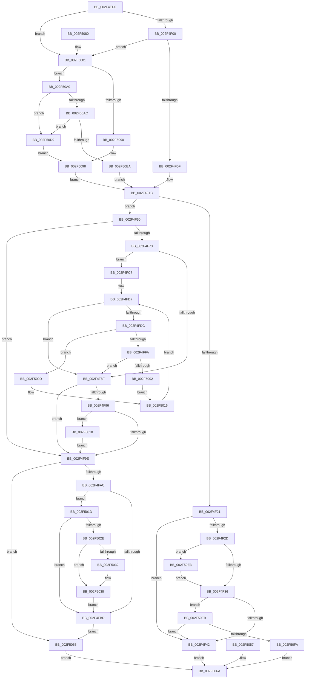

# RtlpLookupFunctionEntryForStackWalks

- RVA: `0x002F4ED0`–`0x002F5108` (길이 `568` bytes)
- VA: `0x00000001402F4ED0`
- 실행 섹션: `.text`
- PDB 이름 있음: `예`; PDB Function 태그: `아니요`
- unwind 정보 RVA: `0x00072144`
- 디코드: `152`개 명령, `568/568` bytes 표시
- 미해석 바이트: `0` (있으면 어셈블리에 `.byte`로 보존)

> 이 문서는 커널 이미지의 기계어와 PDB 기호를 분석해 생성했습니다. 4번과 5번은 함수 원형과 자료형을 바이너리 사용 방식에서 추정한 C 해석이며 원본 소스 복구 결과는 아닙니다.

## 1. Dependencies

- 직접 호출 지점: **3**; 고유 호출 대상: **3**
- 직접 호출자로 확인된 함수: **3**
- RIP 상대 이미지 참조: **4**

### Outgoing calls
- `0x002F5032` → [ExRaiseDatatypeMisalignment](../../page/89/ExRaiseDatatypeMisalignment_function_00899FD0.md) (function, `0x00899FD0`)
- `0x002F5093` → [RtlpLookupUserFunctionTable](RtlpLookupUserFunctionTable_function_002F3CD0.md) (function, `0x002F3CD0`)
- `0x002F50DC` → [RtlpxLookupFunctionTable](RtlpxLookupFunctionTable_function_002F3610.md) (function, `0x002F3610`)

### Direct callers
- [RtlpWalkFrameChain](RtlpWalkFrameChain_function_002F3ED0.md) at `0x002F41E1`
- [RtlpSameFunction](../48/RtlpSameFunction_function_0048E81C.md) at `0x0048E869`
- [sub_009A623D](../../page/9A/Unknown_function_009A623D.md) at `0x009A63F7`

### Static image references
- `0x002F4F21` → RVA `0x01201850` (`CFGRO`; read)
- `0x002F50A0` → RVA `0x01200038` (`CFGRO`; read)
- `0x002F50AC` → RVA `0x01200040` (`CFGRO`; read)
- `0x002F50BA` → RVA `0x01200030` (`CFGRO`; read)

## 2. Other-region calls and transfers

- 다른 실행 섹션으로 향하는 call: **1**
  - `0x002F5032` → [ExRaiseDatatypeMisalignment](../../page/89/ExRaiseDatatypeMisalignment_function_00899FD0.md) (`.text` → `PAGE`)
- 별도 외부 분기/꼬리 이동을 확인하지 못했습니다.

## 3. Assembly (complete function range)

```asm
002F4ED0  48 89 5C 24 08                  mov qword ptr [rsp + 8], rbx
002F4ED5  48 89 74 24 18                  mov qword ptr [rsp + 0x18], rsi
002F4EDA  48 89 7C 24 20                  mov qword ptr [rsp + 0x20], rdi
002F4EDF  48 89 54 24 10                  mov qword ptr [rsp + 0x10], rdx
002F4EE4  41 56                           push r14
002F4EE6  48 83 EC 50                     sub rsp, 0x50
002F4EEA  48 8B DA                        mov rbx, rdx
002F4EED  48 8B F9                        mov rdi, rcx
002F4EF0  48 8D 72 08                     lea rsi, [rdx + 8]
002F4EF4  48 8B 0E                        mov rcx, qword ptr [rsi]
002F4EF7  48 3B F9                        cmp rdi, rcx
002F4EFA  0F 82 81 01 00 00               jb 0x1402f5081
002F4F00  8B 42 10                        mov eax, dword ptr [rdx + 0x10]
002F4F03  48 03 C1                        add rax, rcx
002F4F06  48 3B F8                        cmp rdi, rax
002F4F09  0F 83 72 01 00 00               jae 0x1402f5081
002F4F0F  4C 8B 0A                        mov r9, qword ptr [rdx]
002F4F12  49 BE FF FF FE FF FF 7F 00 00   movabs r14, 0x7ffffffeffff
002F4F1C  4D 85 C9                        test r9, r9
002F4F1F  75 2F                           jne 0x1402f4f50
002F4F21  48 8B 05 28 C9 F0 00            mov rax, qword ptr [rip + 0xf0c928]
002F4F28  48 85 C0                        test rax, rax
002F4F2B  74 15                           je 0x1402f4f42
002F4F2D  48 85 F6                        test rsi, rsi
002F4F30  0F 85 AD 01 00 00               jne 0x1402f50e3
002F4F36  48 8B 06                        mov rax, qword ptr [rsi]
002F4F39  48 3B F8                        cmp rdi, rax
002F4F3C  0F 83 A9 01 00 00               jae 0x1402f50eb
002F4F42  33 C0                           xor eax, eax
002F4F44  48 89 43 08                     mov qword ptr [rbx + 8], rax
002F4F48  89 43 10                        mov dword ptr [rbx + 0x10], eax
002F4F4B  E9 1A 01 00 00                  jmp 0x1402f506a
002F4F50  B8 AB AA AA AA                  mov eax, 0xaaaaaaab
002F4F55  F7 63 14                        mul dword ptr [rbx + 0x14]
002F4F58  44 8B D2                        mov r10d, edx
002F4F5B  41 C1 EA 03                     shr r10d, 3
002F4F5F  33 C0                           xor eax, eax
002F4F61  48 89 44 24 28                  mov qword ptr [rsp + 0x28], rax
002F4F66  89 44 24 20                     mov dword ptr [rsp + 0x20], eax
002F4F6A  89 44 24 24                     mov dword ptr [rsp + 0x24], eax
002F4F6E  45 85 D2                        test r10d, r10d
002F4F71  74 2B                           je 0x1402f4f9e
002F4F73  48 2B 7B 08                     sub rdi, qword ptr [rbx + 8]
002F4F77  41 8D 4A FF                     lea ecx, [r10 - 1]
002F4F7B  48 8D 0C 49                     lea rcx, [rcx + rcx*2]
002F4F7F  49 8D 14 89                     lea rdx, [r9 + rcx*4]
002F4F83  48 89 54 24 28                  mov qword ptr [rsp + 0x28], rdx
002F4F88  8B 0A                           mov ecx, dword ptr [rdx]
002F4F8A  48 3B F9                        cmp rdi, rcx
002F4F8D  72 38                           jb 0x1402f4fc7
002F4F8F  8B 0A                           mov ecx, dword ptr [rdx]
002F4F91  48 3B F9                        cmp rdi, rcx
002F4F94  72 08                           jb 0x1402f4f9e
002F4F96  8B 4A 04                        mov ecx, dword ptr [rdx + 4]
002F4F99  48 3B F9                        cmp rdi, rcx
002F4F9C  72 7A                           jb 0x1402f5018
002F4F9E  48 89 44 24 30                  mov qword ptr [rsp + 0x30], rax
002F4FA3  48 85 C0                        test rax, rax
002F4FA6  0F 84 A9 00 00 00               je 0x1402f5055
002F4FAC  48 8B 53 08                     mov rdx, qword ptr [rbx + 8]
002F4FB0  48 89 44 24 38                  mov qword ptr [rsp + 0x38], rax
002F4FB5  8B 48 08                        mov ecx, dword ptr [rax + 8]
002F4FB8  F6 C1 01                        test cl, 1
002F4FBB  75 60                           jne 0x1402f501d
002F4FBD  48 89 44 24 30                  mov qword ptr [rsp + 0x30], rax
002F4FC2  E9 8E 00 00 00                  jmp 0x1402f5055
002F4FC7  44 8B C0                        mov r8d, eax
002F4FCA  89 44 24 24                     mov dword ptr [rsp + 0x24], eax
002F4FCE  41 83 C2 FE                     add r10d, -2
002F4FD2  44 89 54 24 20                  mov dword ptr [rsp + 0x20], r10d
002F4FD7  45 3B D0                        cmp r10d, r8d
002F4FDA  7C B3                           jl 0x1402f4f8f
002F4FDC  47 8D 1C 10                     lea r11d, [r8 + r10]
002F4FE0  41 D1 FB                        sar r11d, 1
002F4FE3  49 63 CB                        movsxd rcx, r11d
002F4FE6  48 8D 14 49                     lea rdx, [rcx + rcx*2]
002F4FEA  49 8D 14 91                     lea rdx, [r9 + rdx*4]
002F4FEE  48 89 54 24 28                  mov qword ptr [rsp + 0x28], rdx
002F4FF3  8B 0A                           mov ecx, dword ptr [rdx]
002F4FF5  48 3B F9                        cmp rdi, rcx
002F4FF8  72 13                           jb 0x1402f500d
002F4FFA  8B 4A 0C                        mov ecx, dword ptr [rdx + 0xc]
002F4FFD  48 3B F9                        cmp rdi, rcx
002F5000  72 8D                           jb 0x1402f4f8f
002F5002  45 8D 43 01                     lea r8d, [r11 + 1]
002F5006  44 89 44 24 24                  mov dword ptr [rsp + 0x24], r8d
002F500B  EB 09                           jmp 0x1402f5016
002F500D  45 8D 53 FF                     lea r10d, [r11 - 1]
002F5011  44 89 54 24 20                  mov dword ptr [rsp + 0x20], r10d
002F5016  EB BF                           jmp 0x1402f4fd7
002F5018  48 8B C2                        mov rax, rdx
002F501B  EB 81                           jmp 0x1402f4f9e
002F501D  48 8D 42 FF                     lea rax, [rdx - 1]
002F5021  48 03 C1                        add rax, rcx
002F5024  48 89 44 24 38                  mov qword ptr [rsp + 0x38], rax
002F5029  49 3B D6                        cmp rdx, r14
002F502C  77 8F                           ja 0x1402f4fbd
002F502E  A8 03                           test al, 3
002F5030  74 06                           je 0x1402f5038
002F5032  E8 99 4F 5A 00                  call 0x140899fd0
002F5037  CC                              int3
002F5038  48 8B C8                        mov rcx, rax
002F503B  48 BA 00 00 FF FF FF 7F 00 00   movabs rdx, 0x7fffffff0000
002F5045  48 3B C2                        cmp rax, rdx
002F5048  48 0F 43 CA                     cmovae rcx, rdx
002F504C  90                              nop
002F504D  0F B6 09                        movzx ecx, byte ptr [rcx]
002F5050  E9 68 FF FF FF                  jmp 0x1402f4fbd
002F5055  EB 13                           jmp 0x1402f506a
002F5057  33 C0                           xor eax, eax
002F5059  48 89 44 24 30                  mov qword ptr [rsp + 0x30], rax
002F505E  48 8B 4C 24 68                  mov rcx, qword ptr [rsp + 0x68]
002F5063  48 89 41 08                     mov qword ptr [rcx + 8], rax
002F5067  89 41 10                        mov dword ptr [rcx + 0x10], eax
002F506A  48 8B 5C 24 60                  mov rbx, qword ptr [rsp + 0x60]
002F506F  48 8B 74 24 70                  mov rsi, qword ptr [rsp + 0x70]
002F5074  48 8B 7C 24 78                  mov rdi, qword ptr [rsp + 0x78]
002F5079  48 83 C4 50                     add rsp, 0x50
002F507D  41 5E                           pop r14
002F507F  C3                              ret
002F5080  CC                              int3
002F5081  49 BE FF FF FE FF FF 7F 00 00   movabs r14, 0x7ffffffeffff
002F508B  49 3B FE                        cmp rdi, r14
002F508E  77 10                           ja 0x1402f50a0
002F5090  48 8B CF                        mov rcx, rdi
002F5093  E8 38 EC FF FF                  call 0x1402f3cd0
002F5098  4C 8B C8                        mov r9, rax
002F509B  E9 7C FE FF FF                  jmp 0x1402f4f1c
002F50A0  48 8B 0D 91 AF F0 00            mov rcx, qword ptr [rip + 0xf0af91]
002F50A7  48 3B F9                        cmp rdi, rcx
002F50AA  72 2D                           jb 0x1402f50d9
002F50AC  8B 05 8E AF F0 00               mov eax, dword ptr [rip + 0xf0af8e]
002F50B2  48 03 C1                        add rax, rcx
002F50B5  48 3B F8                        cmp rdi, rax
002F50B8  73 1F                           jae 0x1402f50d9
002F50BA  0F 28 05 6F AF F0 00            movaps xmm0, xmmword ptr [rip + 0xf0af6f]
002F50C1  0F 11 02                        movups xmmword ptr [rdx], xmm0
002F50C4  F2 0F 10 0D 74 AF F0 00         movsd xmm1, qword ptr [rip + 0xf0af74]
002F50CC  F2 0F 11 4A 10                  movsd qword ptr [rdx + 0x10], xmm1
002F50D1  4C 8B 0A                        mov r9, qword ptr [rdx]
002F50D4  E9 43 FE FF FF                  jmp 0x1402f4f1c
002F50D9  48 8B CF                        mov rcx, rdi
002F50DC  E8 2F E5 FF FF                  call 0x1402f3610
002F50E1  EB B5                           jmp 0x1402f5098
002F50E3  48 89 06                        mov qword ptr [rsi], rax
002F50E6  E9 4B FE FF FF                  jmp 0x1402f4f36
002F50EB  48 05 00 10 00 00               add rax, 0x1000
002F50F1  48 3B F8                        cmp rdi, rax
002F50F4  0F 83 48 FE FF FF               jae 0x1402f4f42
002F50FA  C7 43 10 00 10 00 00            mov dword ptr [rbx + 0x10], 0x1000
002F5101  33 C0                           xor eax, eax
002F5103  E9 62 FF FF FF                  jmp 0x1402f506a
```

## 4. C-style interpretation (structured pseudocode)

```c
__int64 __fastcall RtlpLookupFunctionEntryForStackWalks(__int64 a1, __int64 a2)
{
    __int64 result;
    __int64 v_r10;
    __int64 v_r11;
    __int64 v_rdi;
    __int64 v_rsp;
    unsigned __int64 v_stack_m20;
    unsigned __int64 v_stack_m28;
    unsigned __int64 v_stack_m30;
    unsigned int v_stack_m34;
    unsigned int v_stack_m38;
    unsigned __int64 v_stack_p10;
    unsigned __int64 v_stack_p18;
    unsigned __int64 v_stack_p20;
    unsigned __int64 v_stack_p8;

    v_stack_p8 = v_rbx;
    v_stack_p18 = v_rsi;
    v_stack_p20 = v_rdi;
    v_stack_p10 = a2;
    v_rsp = (v_rsp) - (80);
    if (a1 < (*(unsigned __int64 *)(a2 + 8))) goto loc_002F5081;
    result = ((unsigned int)(*(unsigned int *)(a2 + 16))) + (*(unsigned __int64 *)(a2 + 8));
    if (a1 >= result) goto loc_002F5081;
loc_002F4F1C:
    if (*(unsigned __int64 *)(a2) != 0) goto loc_002F4F50;
    if (*(unsigned __int64 *)(v_rip + 15780136) == 0) goto loc_002F4F42;
    if (a2 + 8 != 0) goto loc_002F50E3;
loc_002F4F36:
    if (a1 >= (*(unsigned __int64 *)(a2 + 8))) goto loc_002F50EB;
loc_002F4F42:
    result = 0;
    *(unsigned __int64 *)(a2 + 8) = 0;
    *(unsigned int *)(a2 + 16) = 0;
    goto loc_002F506A;
loc_002F4F50:
    v_r10 = (unsigned int)(((unsigned int)((unsigned int)(a2))) >> (3));
    result = 0;
    v_stack_m30 = 0;
    v_stack_m38 = 0;
    v_stack_m34 = 0;
    if ((unsigned int)(v_r10) == 0) goto loc_002F4F9E;
    v_rdi = (a1) - (*(unsigned __int64 *)(a2 + 8));
    v_stack_m30 = *(unsigned __int64 *)(a2) + v_r10 - 1 + v_r10 - 1 * 2 * 4;
    if (v_rdi < ((unsigned int)(*(unsigned int *)(*(unsigned __int64 *)(a2) + v_r10 - 1 + v_r10 - 1 * 2 * 4)))) goto loc_002F4FC7;
loc_002F4F8F:
    if (v_rdi < ((unsigned int)(*(unsigned int *)(*(unsigned __int64 *)(a2) + v_r10 - 1 + v_r10 - 1 * 2 * 4)))) goto loc_002F4F9E;
    if (v_rdi < ((unsigned int)(*(unsigned int *)(*(unsigned __int64 *)(a2) + v_r10 - 1 + v_r10 - 1 * 2 * 4 + 4)))) goto loc_002F5018;
loc_002F4F9E:
    v_stack_m28 = 0;
    if (0 == 0) goto loc_002F5055;
    v_stack_m20 = 0;
    if ((((unsigned __int8)((unsigned int)(*(unsigned int *)(result + 8)))) & (1)) != 0) goto loc_002F501D;
loc_002F4FBD:
    v_stack_m28 = 0;
    goto loc_002F5055;
loc_002F4FC7:
    v_stack_m34 = 0;
    v_r10 = (unsigned int)((v_r10) + (-2));
    v_stack_m38 = (unsigned int)(v_r10);
loc_002F4FD7:
    if (((unsigned int)(v_r10)) < 0) goto loc_002F4F8F;
    v_r11 = (unsigned int)((0 + v_r10 * 1) >> (1));
    v_stack_m30 = *(unsigned __int64 *)(a2) + (int)((unsigned int)(v_r11)) + (int)((unsigned int)(v_r11)) * 2 * 4;
    if (v_rdi < ((unsigned int)(*(unsigned int *)(*(unsigned __int64 *)(a2) + (int)((unsigned int)(v_r11)) + (int)((unsigned int)(v_r11)) * 2 * 4)))) goto loc_002F500D;
    if (v_rdi < ((unsigned int)(*(unsigned int *)(*(unsigned __int64 *)(a2) + (int)((unsigned int)(v_r11)) + (int)((unsigned int)(v_r11)) * 2 * 4 + 12)))) goto loc_002F4F8F;
    v_stack_m34 = (unsigned int)(v_r11 + 1);
    goto loc_002F5016;
loc_002F500D:
    v_stack_m38 = (unsigned int)(v_r11 - 1);
loc_002F5016:
    goto loc_002F4FD7;
loc_002F5018:
    goto loc_002F4F9E;
loc_002F501D:
    result = (*(unsigned __int64 *)(a2) + (int)((unsigned int)(v_r11)) + (int)((unsigned int)(v_r11)) * 2 * 4 - 1) + ((unsigned int)(*(unsigned int *)(*(unsigned __int64 *)(a2) + (int)((unsigned int)(v_r11)) + (int)((unsigned int)(v_r11)) * 2 * 4 + 12)));
    v_stack_m20 = result;
    if ((*(unsigned __int64 *)(a2) + (int)((unsigned int)(v_r11)) + (int)((unsigned int)(v_r11)) * 2 * 4) > v_r14) goto loc_002F4FBD;
    if ((((unsigned __int8)(result)) & (3)) != 0) {
        result = ExRaiseDatatypeMisalignment((unsigned int)(*(unsigned int *)(*(unsigned __int64 *)(a2) + (int)((unsigned int)(v_r11)) + (int)((unsigned int)(v_r11)) * 2 * 4 + 12)), *(unsigned __int64 *)(a2) + (int)((unsigned int)(v_r11)) + (int)((unsigned int)(v_r11)) * 2 * 4, v_r11 + 1, *(unsigned __int64 *)(a2));
    }
    a1 = result;
    if (result >= (*(unsigned __int64 *)(a2) + (int)((unsigned int)(v_r11)) + (int)((unsigned int)(v_r11)) * 2 * 4)) { a1 = *(unsigned __int64 *)(a2) + (int)((unsigned int)(v_r11)) + (int)((unsigned int)(v_r11)) * 2 * 4; }
    goto loc_002F4FBD;
loc_002F5055:
    goto loc_002F506A;
loc_002F506A:
    v_rsp = (v_rsp) + (80);
    return result;
loc_002F5081:
    if (v_stack_p20 > v_r14) goto loc_002F50A0;
    result = RtlpLookupUserFunctionTable(v_stack_p20, *(unsigned __int64 *)(a2) + (int)((unsigned int)(v_r11)) + (int)((unsigned int)(v_r11)) * 2 * 4, v_r11 + 1, *(unsigned __int64 *)(a2));
loc_002F5098:
    goto loc_002F4F1C;
loc_002F50A0:
    if (v_stack_p20 < (*(unsigned __int64 *)(v_rip + 15773585))) goto loc_002F50D9;
    result = ((unsigned int)(*(unsigned int *)(v_rip + 15773582))) + (*(unsigned __int64 *)(v_rip + 15773585));
    if (v_stack_p20 >= result) goto loc_002F50D9;
    *(unsigned __int64 *)(*(unsigned __int64 *)(a2) + (int)((unsigned int)(v_r11)) + (int)((unsigned int)(v_r11)) * 2 * 4) = v_xmm0;
    *(unsigned __int64 *)(*(unsigned __int64 *)(a2) + (int)((unsigned int)(v_r11)) + (int)((unsigned int)(v_r11)) * 2 * 4 + 16) = v_xmm1;
    goto loc_002F4F1C;
loc_002F50D9:
    result = RtlpxLookupFunctionTable(v_stack_p20, *(unsigned __int64 *)(a2) + (int)((unsigned int)(v_r11)) + (int)((unsigned int)(v_r11)) * 2 * 4, v_r11 + 1, *(unsigned __int64 *)(*(unsigned __int64 *)(a2) + (int)((unsigned int)(v_r11)) + (int)((unsigned int)(v_r11)) * 2 * 4));
    goto loc_002F5098;
loc_002F50E3:
    *(unsigned __int64 *)(v_stack_p18) = result;
    goto loc_002F4F36;
loc_002F50EB:
    result = (result) + (0x1000ULL);
    if (v_stack_p20 >= result) goto loc_002F4F42;
    *(unsigned int *)(v_stack_p8 + 16) = 0x1000ULL;
    result = 0;
    goto loc_002F506A;
}
```

## 5. (Beta) C Style

```c
int64_t RtlpLookupFunctionEntryForStackWalks(int64_t Arg1, void *Arg2)
{
    uint8_t *arg2 = (uint8_t *)Arg2;

    int64_t result;
    int64_t local_r10;
    int64_t local_r11;
    int64_t local_rdi;
    int64_t local_rsp;
    uint64_t v_stack_m20;
    uint64_t v_stack_m28;
    uint64_t v_stack_m30;
    uint32_t v_stack_m34;
    uint32_t v_stack_m38;
    uint64_t v_stack_p10;
    uint64_t v_stack_p18;
    uint64_t v_stack_p20;
    uint64_t v_stack_p8;

    v_stack_p8 = local_rbx;
    v_stack_p18 = local_rsi;
    v_stack_p20 = local_rdi;
    v_stack_p10 = Arg2;
    local_rsp = (local_rsp) - (80);
    if (Arg1 < (*(uint64_t *)(arg2 + 0x8))) goto loc_002F5081;
    result = ((uint32_t)(*(uint32_t *)(arg2 + 0x10))) + (*(uint64_t *)(arg2 + 0x8));
    if (Arg1 >= result) goto loc_002F5081;
loc_002F4F1C:
    if (*(uint64_t *)(arg2) != 0) goto loc_002F4F50;
    if (*(uint64_t *)(v_rip + 0xF0C928) == 0) goto loc_002F4F42;
    if (Arg2 + 8 != 0) goto loc_002F50E3;
loc_002F4F36:
    if (Arg1 >= (*(uint64_t *)(arg2 + 0x8))) goto loc_002F50EB;
loc_002F4F42:
    result = 0;
    *(uint64_t *)(arg2 + 0x8) = 0;
    *(uint32_t *)(arg2 + 0x10) = 0;
    goto loc_002F506A;
loc_002F4F50:
    local_r10 = (uint32_t)(((uint32_t)((uint32_t)(Arg2))) >> (3));
    result = 0;
    v_stack_m30 = 0;
    v_stack_m38 = 0;
    v_stack_m34 = 0;
    if ((uint32_t)(local_r10) == 0) goto loc_002F4F9E;
    local_rdi = (Arg1) - (*(uint64_t *)(arg2 + 0x8));
    v_stack_m30 = *(uint64_t *)(arg2) + local_r10 - 1 + local_r10 - 1 * 2 * 4;
    if (local_rdi < ((uint32_t)(*(uint32_t *)(*(uint64_t *)(arg2) + local_r10 - 0x1 + local_r10 - 0x1 * 2 * 4)))) goto loc_002F4FC7;
loc_002F4F8F:
    if (local_rdi < ((uint32_t)(*(uint32_t *)(*(uint64_t *)(arg2) + local_r10 - 0x1 + local_r10 - 0x1 * 2 * 4)))) goto loc_002F4F9E;
    if (local_rdi < ((uint32_t)(*(uint32_t *)(*(uint64_t *)(arg2) + local_r10 - 0x1 + local_r10 - 0x1 * 2 * 4 + 0x4)))) goto loc_002F5018;
loc_002F4F9E:
    v_stack_m28 = 0;
    if (0 == 0) goto loc_002F5055;
    v_stack_m20 = 0;
    if ((((uint8_t)((uint32_t)(*(uint32_t *)(result + 0x8)))) & (1)) != 0) goto loc_002F501D;
loc_002F4FBD:
    v_stack_m28 = 0;
    goto loc_002F5055;
loc_002F4FC7:
    v_stack_m34 = 0;
    local_r10 = (uint32_t)((local_r10) + (-2));
    v_stack_m38 = (uint32_t)(local_r10);
loc_002F4FD7:
    if (((uint32_t)(local_r10)) < 0) goto loc_002F4F8F;
    local_r11 = (uint32_t)((0 + local_r10 * 1) >> (1));
    v_stack_m30 = *(uint64_t *)(arg2) + (int32_t)((uint32_t)(local_r11)) + (int32_t)((uint32_t)(local_r11)) * 2 * 4;
    if (local_rdi < ((uint32_t)(*(uint32_t *)(*(uint64_t *)(arg2) + (int32_t)((uint32_t)(local_r11)) + (int32_t)((uint32_t)(local_r11)) * 2 * 4)))) goto loc_002F500D;
    if (local_rdi < ((uint32_t)(*(uint32_t *)(*(uint64_t *)(arg2) + (int32_t)((uint32_t)(local_r11)) + (int32_t)((uint32_t)(local_r11)) * 2 * 4 + 0xC)))) goto loc_002F4F8F;
    v_stack_m34 = (uint32_t)(local_r11 + 1);
    goto loc_002F5016;
loc_002F500D:
    v_stack_m38 = (uint32_t)(local_r11 - 1);
loc_002F5016:
    goto loc_002F4FD7;
loc_002F5018:
    goto loc_002F4F9E;
loc_002F501D:
    result = (*(uint64_t *)(arg2) + (int32_t)((uint32_t)(local_r11)) + (int32_t)((uint32_t)(local_r11)) * 2 * 4 - 1) + ((uint32_t)(*(uint32_t *)(*(uint64_t *)(arg2) + (int32_t)((uint32_t)(local_r11)) + (int32_t)((uint32_t)(local_r11)) * 2 * 4 + 0xC)));
    v_stack_m20 = result;
    if ((*(uint64_t *)(arg2) + (int32_t)((uint32_t)(local_r11)) + (int32_t)((uint32_t)(local_r11)) * 2 * 4) > local_r14) goto loc_002F4FBD;
    if ((((uint8_t)(result)) & (3)) != 0) {
        result = ExRaiseDatatypeMisalignment((uint32_t)(*(uint32_t *)(*(uint64_t *)(arg2) + (int32_t)((uint32_t)(local_r11)) + (int32_t)((uint32_t)(local_r11)) * 2 * 4 + 0xC)), *(uint64_t *)(arg2) + (int32_t)((uint32_t)(local_r11)) + (int32_t)((uint32_t)(local_r11)) * 2 * 4, local_r11 + 1, *(uint64_t *)(arg2));
    }
    Arg1 = result;
    if (result >= (*(uint64_t *)(arg2) + (int32_t)((uint32_t)(local_r11)) + (int32_t)((uint32_t)(local_r11)) * 2 * 4)) { Arg1 = *(uint64_t *)(arg2) + (int32_t)((uint32_t)(local_r11)) + (int32_t)((uint32_t)(local_r11)) * 2 * 4; }
    goto loc_002F4FBD;
loc_002F5055:
    goto loc_002F506A;
loc_002F506A:
    local_rsp = (local_rsp) + (80);
    return result;
loc_002F5081:
    if (v_stack_p20 > local_r14) goto loc_002F50A0;
    result = RtlpLookupUserFunctionTable(v_stack_p20, *(uint64_t *)(arg2) + (int32_t)((uint32_t)(local_r11)) + (int32_t)((uint32_t)(local_r11)) * 2 * 4, local_r11 + 1, *(uint64_t *)(arg2));
loc_002F5098:
    goto loc_002F4F1C;
loc_002F50A0:
    if (v_stack_p20 < (*(uint64_t *)(v_rip + 0xF0AF91))) goto loc_002F50D9;
    result = ((uint32_t)(*(uint32_t *)(v_rip + 0xF0AF8E))) + (*(uint64_t *)(v_rip + 0xF0AF91));
    if (v_stack_p20 >= result) goto loc_002F50D9;
    *(uint64_t *)(*(uint64_t *)(arg2) + (int32_t)((uint32_t)(local_r11)) + (int32_t)((uint32_t)(local_r11)) * 2 * 4) = v_xmm0;
    *(uint64_t *)(*(uint64_t *)(arg2) + (int32_t)((uint32_t)(local_r11)) + (int32_t)((uint32_t)(local_r11)) * 2 * 4 + 0x10) = v_xmm1;
    goto loc_002F4F1C;
loc_002F50D9:
    result = RtlpxLookupFunctionTable(v_stack_p20, *(uint64_t *)(arg2) + (int32_t)((uint32_t)(local_r11)) + (int32_t)((uint32_t)(local_r11)) * 2 * 4, local_r11 + 1, *(uint64_t *)(*(uint64_t *)(arg2) + (int32_t)((uint32_t)(local_r11)) + (int32_t)((uint32_t)(local_r11)) * 2 * 4));
    goto loc_002F5098;
loc_002F50E3:
    *(uint64_t *)(v_stack_p18) = result;
    goto loc_002F4F36;
loc_002F50EB:
    result = (result) + (0x1000ULL);
    if (v_stack_p20 >= result) goto loc_002F4F42;
    *(uint32_t *)(v_stack_p8 + 0x10) = 0x1000ULL;
    result = 0;
    goto loc_002F506A;
}
```

### 관측된 메모리 오프셋

구조체 형식이 확인되지 않은 접근은 인자 기준의 오프셋으로만 기록했습니다.

| 기준 인자 | 오프셋 표현 | 폭 (bit) | 접근 |
|---|---:|---:|---|
| `Arg2` | `+ 0x0` | `64` | `R` |
| `Arg2` | `+ 0x0` | `128` | `R` |
| `Arg2` | `+ 0x8` | `64` | `R` |
| `Arg2` | `+ 0x8` | `64` | `W` |
| `Arg2` | `+ 0x10` | `32` | `R` |
| `Arg2` | `+ 0x10` | `32` | `W` |
| `Arg2` | `+ 0x10` | `64` | `W` |
| `Arg2` | `+ 0x14` | `32` | `R` |

## 6. Execution-region graph

[열기: 2D/3D 그래프와 함수 탐색 컨트롤 패널](../../../control-panel.html?section=text&rva=0x002F4ED0&view=graph)

- 2D 그래프는 위에서 아래로 흐르고, 3D 그래프는 빈 공간을 드래그해 회전합니다. Shift+드래그는 이동, 휠은 확대·축소, 함수 노드 선택은 대상 보고서 이동입니다.

### Static fallback


