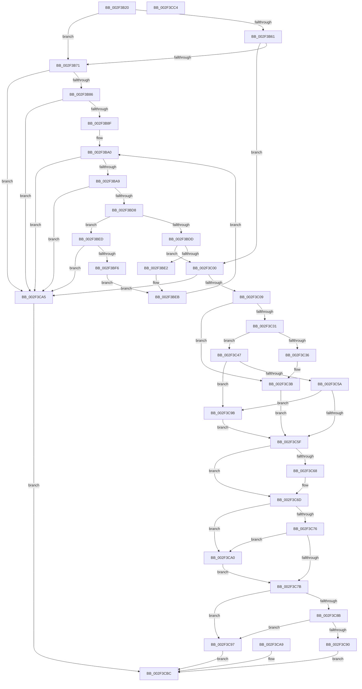

# RtlpLookupUserFunctionTableInverted

- RVA: `0x002F3B20`–`0x002F3CC5` (길이 `421` bytes)
- VA: `0x00000001402F3B20`
- 실행 섹션: `.text`
- PDB 이름 있음: `예`; PDB Function 태그: `아니요`
- unwind 정보 RVA: `0x0007207C`
- 디코드: `122`개 명령, `421/421` bytes 표시
- 미해석 바이트: `0` (있으면 어셈블리에 `.byte`로 보존)

> 이 문서는 커널 이미지의 기계어와 PDB 기호를 분석해 생성했습니다. 4번과 5번은 함수 원형과 자료형을 바이너리 사용 방식에서 추정한 C 해석이며 원본 소스 복구 결과는 아닙니다.

## 1. Dependencies

- 직접 호출 지점: **2**; 고유 호출 대상: **1**
- 직접 호출자로 확인된 함수: **2**
- RIP 상대 이미지 참조: **1**

### Outgoing calls
- `0x002F3C36` → [ExRaiseDatatypeMisalignment](../../page/89/ExRaiseDatatypeMisalignment_function_00899FD0.md) (function, `0x00899FD0`)
- `0x002F3C68` → [ExRaiseDatatypeMisalignment](../../page/89/ExRaiseDatatypeMisalignment_function_00899FD0.md) (function, `0x00899FD0`)

### Direct callers
- [RtlpLookupUserFunctionTable](RtlpLookupUserFunctionTable_function_002F3CD0.md) at `0x002F3CE6`
- [RtlGetImageBaseAndLoadConfig](../46/RtlGetImageBaseAndLoadConfig_function_0046C3A4.md) at `0x0046C3DA`

### Static image references
- `0x002F3B32` → RVA `0x00FC74D8` (`ALMOSTRO`; read)

## 2. Other-region calls and transfers

- 다른 실행 섹션으로 향하는 call: **2**
  - `0x002F3C36` → [ExRaiseDatatypeMisalignment](../../page/89/ExRaiseDatatypeMisalignment_function_00899FD0.md) (`.text` → `PAGE`)
  - `0x002F3C68` → [ExRaiseDatatypeMisalignment](../../page/89/ExRaiseDatatypeMisalignment_function_00899FD0.md) (`.text` → `PAGE`)
- 별도 외부 분기/꼬리 이동을 확인하지 못했습니다.

## 3. Assembly (complete function range)

```asm
002F3B20  48 89 54 24 10                  mov qword ptr [rsp + 0x10], rdx
002F3B25  53                              push rbx
002F3B26  56                              push rsi
002F3B27  57                              push rdi
002F3B28  48 83 EC 40                     sub rsp, 0x40
002F3B2C  48 8B FA                        mov rdi, rdx
002F3B2F  48 8B D9                        mov rbx, rcx
002F3B32  48 8B 35 9F 39 CD 00            mov rsi, qword ptr [rip + 0xcd399f]
002F3B39  48 89 74 24 78                  mov qword ptr [rsp + 0x78], rsi
002F3B3E  8B 46 08                        mov eax, dword ptr [rsi + 8]
002F3B41  89 44 24 70                     mov dword ptr [rsp + 0x70], eax
002F3B45  33 C0                           xor eax, eax
002F3B47  89 44 24 20                     mov dword ptr [rsp + 0x20], eax
002F3B4B  89 44 24 24                     mov dword ptr [rsp + 0x24], eax
002F3B4F  4C 8B 5C 24 78                  mov r11, qword ptr [rsp + 0x78]
002F3B54  49 83 C3 10                     add r11, 0x10
002F3B58  49 8B 53 08                     mov rdx, qword ptr [r11 + 8]
002F3B5C  48 3B CA                        cmp rcx, rdx
002F3B5F  72 10                           jb 0x1402f3b71
002F3B61  41 8B 4B 10                     mov ecx, dword ptr [r11 + 0x10]
002F3B65  48 03 CA                        add rcx, rdx
002F3B68  48 3B D9                        cmp rbx, rcx
002F3B6B  0F 82 8F 00 00 00               jb 0x1402f3c00
002F3B71  48 8B 44 24 78                  mov rax, qword ptr [rsp + 0x78]
002F3B76  8B 08                           mov ecx, dword ptr [rax]
002F3B78  8D 41 FF                        lea eax, [rcx - 1]
002F3B7B  3D 00 02 00 00                  cmp eax, 0x200
002F3B80  0F 87 1F 01 00 00               ja 0x1402f3ca5
002F3B86  83 F9 01                        cmp ecx, 1
002F3B89  0F 84 16 01 00 00               je 0x1402f3ca5
002F3B8F  41 B8 01 00 00 00               mov r8d, 1
002F3B95  44 89 44 24 24                  mov dword ptr [rsp + 0x24], r8d
002F3B9A  89 44 24 20                     mov dword ptr [rsp + 0x20], eax
002F3B9E  66 90                           nop
002F3BA0  41 3B C0                        cmp eax, r8d
002F3BA3  0F 8C FC 00 00 00               jl 0x1402f3ca5
002F3BA9  45 8D 0C 00                     lea r9d, [r8 + rax]
002F3BAD  41 D1 F9                        sar r9d, 1
002F3BB0  49 63 C9                        movsxd rcx, r9d
002F3BB3  48 8D 14 49                     lea rdx, [rcx + rcx*2]
002F3BB7  48 8B 4C 24 78                  mov rcx, qword ptr [rsp + 0x78]
002F3BBC  48 8D 52 02                     lea rdx, [rdx + 2]
002F3BC0  4C 8D 1C D1                     lea r11, [rcx + rdx*8]
002F3BC4  49 8B 53 08                     mov rdx, qword ptr [r11 + 8]
002F3BC8  45 8B 53 10                     mov r10d, dword ptr [r11 + 0x10]
002F3BCC  4C 03 D2                        add r10, rdx
002F3BCF  4C 3B D2                        cmp r10, rdx
002F3BD2  0F 82 CD 00 00 00               jb 0x1402f3ca5
002F3BD8  48 3B DA                        cmp rbx, rdx
002F3BDB  72 10                           jb 0x1402f3bed
002F3BDD  49 3B DA                        cmp rbx, r10
002F3BE0  72 1E                           jb 0x1402f3c00
002F3BE2  45 8D 41 01                     lea r8d, [r9 + 1]
002F3BE6  44 89 44 24 24                  mov dword ptr [rsp + 0x24], r8d
002F3BEB  EB B3                           jmp 0x1402f3ba0
002F3BED  45 85 C9                        test r9d, r9d
002F3BF0  0F 84 AF 00 00 00               je 0x1402f3ca5
002F3BF6  41 8D 41 FF                     lea eax, [r9 - 1]
002F3BFA  89 44 24 20                     mov dword ptr [rsp + 0x20], eax
002F3BFE  EB EB                           jmp 0x1402f3beb
002F3C00  4D 85 DB                        test r11, r11
002F3C03  0F 84 9C 00 00 00               je 0x1402f3ca5
002F3C09  49 8B 0B                        mov rcx, qword ptr [r11]
002F3C0C  48 89 4C 24 28                  mov qword ptr [rsp + 0x28], rcx
002F3C11  48 89 0F                        mov qword ptr [rdi], rcx
002F3C14  49 8B 43 08                     mov rax, qword ptr [r11 + 8]
002F3C18  48 89 47 08                     mov qword ptr [rdi + 8], rax
002F3C1C  41 8B 43 14                     mov eax, dword ptr [r11 + 0x14]
002F3C20  89 47 14                        mov dword ptr [rdi + 0x14], eax
002F3C23  41 8B 43 10                     mov eax, dword ptr [r11 + 0x10]
002F3C27  89 47 10                        mov dword ptr [rdi + 0x10], eax
002F3C2A  8B 47 14                        mov eax, dword ptr [rdi + 0x14]
002F3C2D  85 C0                           test eax, eax
002F3C2F  74 0A                           je 0x1402f3c3b
002F3C31  F6 C1 03                        test cl, 3
002F3C34  74 11                           je 0x1402f3c47
002F3C36  E8 95 63 5A 00                  call 0x140899fd0
002F3C3B  48 BA 00 00 FF FF FF 7F 00 00   movabs rdx, 0x7fffffff0000
002F3C45  EB 18                           jmp 0x1402f3c5f
002F3C47  4C 8D 04 01                     lea r8, [rcx + rax]
002F3C4B  48 BA 00 00 FF FF FF 7F 00 00   movabs rdx, 0x7fffffff0000
002F3C55  4C 3B C2                        cmp r8, rdx
002F3C58  77 41                           ja 0x1402f3c9b
002F3C5A  4C 3B C1                        cmp r8, rcx
002F3C5D  72 3C                           jb 0x1402f3c9b
002F3C5F  48 8B 4F 08                     mov rcx, qword ptr [rdi + 8]
002F3C63  66 85 C9                        test cx, cx
002F3C66  74 05                           je 0x1402f3c6d
002F3C68  E8 63 63 5A 00                  call 0x140899fd0
002F3C6D  48 8D 41 40                     lea rax, [rcx + 0x40]
002F3C71  48 3B C2                        cmp rax, rdx
002F3C74  77 2A                           ja 0x1402f3ca0
002F3C76  48 3B C1                        cmp rax, rcx
002F3C79  72 25                           jb 0x1402f3ca0
002F3C7B  F0 83 0C 24 00                  lock or dword ptr [rsp], 0
002F3C80  8B 46 08                        mov eax, dword ptr [rsi + 8]
002F3C83  8B 4C 24 70                     mov ecx, dword ptr [rsp + 0x70]
002F3C87  3B C1                           cmp eax, ecx
002F3C89  75 0C                           jne 0x1402f3c97
002F3C8B  F6 C1 01                        test cl, 1
002F3C8E  75 07                           jne 0x1402f3c97
002F3C90  48 8B 44 24 28                  mov rax, qword ptr [rsp + 0x28]
002F3C95  EB 25                           jmp 0x1402f3cbc
002F3C97  33 C0                           xor eax, eax
002F3C99  EB 21                           jmp 0x1402f3cbc
002F3C9B  0F B6 02                        movzx eax, byte ptr [rdx]
002F3C9E  EB BF                           jmp 0x1402f3c5f
002F3CA0  0F B6 02                        movzx eax, byte ptr [rdx]
002F3CA3  EB D6                           jmp 0x1402f3c7b
002F3CA5  33 C0                           xor eax, eax
002F3CA7  EB 13                           jmp 0x1402f3cbc
002F3CA9  33 C0                           xor eax, eax
002F3CAB  48 89 44 24 28                  mov qword ptr [rsp + 0x28], rax
002F3CB0  48 8B 4C 24 68                  mov rcx, qword ptr [rsp + 0x68]
002F3CB5  48 89 41 08                     mov qword ptr [rcx + 8], rax
002F3CB9  89 41 10                        mov dword ptr [rcx + 0x10], eax
002F3CBC  48 83 C4 40                     add rsp, 0x40
002F3CC0  5F                              pop rdi
002F3CC1  5E                              pop rsi
002F3CC2  5B                              pop rbx
002F3CC3  C3                              ret
002F3CC4  CC                              int3
```

## 4. C-style interpretation (structured pseudocode)

```c
__int64 __fastcall RtlpLookupUserFunctionTableInverted(__int64 a1, __int64 a2)
{
    __int64 result;
    __int64 v_r10;
    __int64 v_r11;
    __int64 v_rsp;
    unsigned __int64 v_stack_m30;
    unsigned int v_stack_m34;
    unsigned int v_stack_m38;
    unsigned int v_stack_m58;
    unsigned __int64 v_stack_p10;
    unsigned int v_stack_p18;
    unsigned __int64 v_stack_p20;

    v_stack_p10 = a2;
    v_rsp = (v_rsp) - (64);
    v_stack_p20 = *(unsigned __int64 *)(v_rip + 13449631);
    v_stack_p18 = (unsigned int)((unsigned int)(*(unsigned int *)(*(unsigned __int64 *)(v_rip + 13449631) + 8)));
    result = 0;
    v_stack_m38 = 0;
    v_stack_m34 = 0;
    v_r11 = (v_stack_p20) + (16);
    if (a1 < (*(unsigned __int64 *)(v_r11 + 8))) goto loc_002F3B71;
    a1 = ((unsigned int)(*(unsigned int *)(v_r11 + 16))) + (*(unsigned __int64 *)(v_r11 + 8));
    if (a1 < a1) goto loc_002F3C00;
loc_002F3B71:
    if (((unsigned int)((unsigned int)(*(unsigned int *)(v_stack_p20)) - 1)) > 512) goto loc_002F3CA5;
    if (((unsigned int)((unsigned int)(*(unsigned int *)(v_stack_p20)))) == 1) goto loc_002F3CA5;
    v_stack_m34 = 1;
    v_stack_m38 = (unsigned int)((unsigned int)(*(unsigned int *)(v_stack_p20)) - 1);
loc_002F3BA0:
    if (((unsigned int)((unsigned int)(*(unsigned int *)(v_stack_p20)) - 1)) < 1) goto loc_002F3CA5;
    a4 = (unsigned int)((1 + (unsigned int)(*(unsigned int *)(v_stack_p20)) - 1 * 1) >> (1));
    v_r10 = ((unsigned int)(*(unsigned int *)(v_stack_p20 + (int)((unsigned int)(a4)) + (int)((unsigned int)(a4)) * 2 + 2 * 8 + 16))) + (*(unsigned __int64 *)(v_stack_p20 + (int)((unsigned int)(a4)) + (int)((unsigned int)(a4)) * 2 + 2 * 8 + 8));
    if (v_r10 < (*(unsigned __int64 *)(v_stack_p20 + (int)((unsigned int)(a4)) + (int)((unsigned int)(a4)) * 2 + 2 * 8 + 8))) goto loc_002F3CA5;
    if (a1 < (*(unsigned __int64 *)(v_stack_p20 + (int)((unsigned int)(a4)) + (int)((unsigned int)(a4)) * 2 + 2 * 8 + 8))) goto loc_002F3BED;
    if (a1 < v_r10) goto loc_002F3C00;
    v_stack_m34 = (unsigned int)(a4 + 1);
loc_002F3BEB:
    goto loc_002F3BA0;
loc_002F3BED:
    if ((unsigned int)(a4) == 0) goto loc_002F3CA5;
    v_stack_m38 = (unsigned int)(a4 - 1);
    goto loc_002F3BEB;
loc_002F3C00:
    if (v_stack_p20 + (int)((unsigned int)(a4)) + (int)((unsigned int)(a4)) * 2 + 2 * 8 == 0) goto loc_002F3CA5;
    v_stack_m30 = *(unsigned __int64 *)(v_stack_p20 + (int)((unsigned int)(a4)) + (int)((unsigned int)(a4)) * 2 + 2 * 8);
    *(unsigned __int64 *)(a2) = *(unsigned __int64 *)(v_stack_p20 + (int)((unsigned int)(a4)) + (int)((unsigned int)(a4)) * 2 + 2 * 8);
    *(unsigned __int64 *)(a2 + 8) = *(unsigned __int64 *)(v_stack_p20 + (int)((unsigned int)(a4)) + (int)((unsigned int)(a4)) * 2 + 2 * 8 + 8);
    *(unsigned int *)(a2 + 20) = (unsigned int)((unsigned int)(*(unsigned int *)(v_stack_p20 + (int)((unsigned int)(a4)) + (int)((unsigned int)(a4)) * 2 + 2 * 8 + 20)));
    *(unsigned int *)(a2 + 16) = (unsigned int)((unsigned int)(*(unsigned int *)(v_stack_p20 + (int)((unsigned int)(a4)) + (int)((unsigned int)(a4)) * 2 + 2 * 8 + 16)));
    if ((unsigned int)((unsigned int)(*(unsigned int *)(a2 + 20))) == 0) goto loc_002F3C3B;
    if ((((unsigned __int8)(*(unsigned __int64 *)(v_stack_p20 + (int)((unsigned int)(a4)) + (int)((unsigned int)(a4)) * 2 + 2 * 8))) & (3)) == 0) goto loc_002F3C47;
    result = ExRaiseDatatypeMisalignment(*(unsigned __int64 *)(v_stack_p20 + (int)((unsigned int)(a4)) + (int)((unsigned int)(a4)) * 2 + 2 * 8), *(unsigned __int64 *)(v_stack_p20 + (int)((unsigned int)(a4)) + (int)((unsigned int)(a4)) * 2 + 2 * 8 + 8), a4 + 1, a4);
loc_002F3C3B:
    goto loc_002F3C5F;
loc_002F3C47:
    if ((*(unsigned __int64 *)(v_stack_p20 + (int)((unsigned int)(a4)) + (int)((unsigned int)(a4)) * 2 + 2 * 8) + result * 1) > (*(unsigned __int64 *)(v_stack_p20 + (int)((unsigned int)(a4)) + (int)((unsigned int)(a4)) * 2 + 2 * 8 + 8))) goto loc_002F3C9B;
    if ((*(unsigned __int64 *)(v_stack_p20 + (int)((unsigned int)(a4)) + (int)((unsigned int)(a4)) * 2 + 2 * 8) + result * 1) < (*(unsigned __int64 *)(v_stack_p20 + (int)((unsigned int)(a4)) + (int)((unsigned int)(a4)) * 2 + 2 * 8))) goto loc_002F3C9B;
loc_002F3C5F:
    if ((unsigned __int16)(*(unsigned __int64 *)(a2 + 8)) != 0) {
        result = ExRaiseDatatypeMisalignment(*(unsigned __int64 *)(a2 + 8), *(unsigned __int64 *)(v_stack_p20 + (int)((unsigned int)(a4)) + (int)((unsigned int)(a4)) * 2 + 2 * 8 + 8), *(unsigned __int64 *)(v_stack_p20 + (int)((unsigned int)(a4)) + (int)((unsigned int)(a4)) * 2 + 2 * 8) + result * 1, a4);
    }
    if ((*(unsigned __int64 *)(a2 + 8) + 64) > (*(unsigned __int64 *)(v_stack_p20 + (int)((unsigned int)(a4)) + (int)((unsigned int)(a4)) * 2 + 2 * 8 + 8))) goto loc_002F3CA0;
    if ((*(unsigned __int64 *)(a2 + 8) + 64) < (*(unsigned __int64 *)(a2 + 8))) goto loc_002F3CA0;
loc_002F3C7B:
    if (((unsigned int)((unsigned int)(*(unsigned int *)(*(unsigned __int64 *)(v_rip + 13449631) + 8)))) != ((unsigned int)((unsigned int)(v_stack_p18)))) goto loc_002F3C97;
    if ((((unsigned __int8)((unsigned int)(v_stack_p18))) & (1)) != 0) goto loc_002F3C97;
    goto loc_002F3CBC;
loc_002F3C97:
    result = 0;
    goto loc_002F3CBC;
loc_002F3C9B:
    goto loc_002F3C5F;
loc_002F3CA0:
    goto loc_002F3C7B;
loc_002F3CA5:
    result = 0;
    goto loc_002F3CBC;
loc_002F3CBC:
    v_rsp = (v_rsp) + (64);
    return result;
}
```

## 5. (Beta) C Style

```c
int64_t RtlpLookupUserFunctionTableInverted(int64_t Arg1, void *Arg2)
{
    uint8_t *arg2 = (uint8_t *)Arg2;

    int64_t result;
    int64_t local_r10;
    int64_t local_r11;
    int64_t local_rsp;
    uint64_t v_stack_m30;
    uint32_t v_stack_m34;
    uint32_t v_stack_m38;
    uint32_t v_stack_m58;
    uint64_t v_stack_p10;
    uint32_t v_stack_p18;
    uint64_t v_stack_p20;

    v_stack_p10 = Arg2;
    local_rsp = (local_rsp) - (64);
    v_stack_p20 = *(uint64_t *)(v_rip + 0xCD399F);
    v_stack_p18 = (uint32_t)((uint32_t)(*(uint32_t *)(*(uint64_t *)(v_rip + 0xCD399F) + 0x8)));
    result = 0;
    v_stack_m38 = 0;
    v_stack_m34 = 0;
    local_r11 = (v_stack_p20) + (16);
    if (Arg1 < (*(uint64_t *)(local_r11 + 0x8))) goto loc_002F3B71;
    Arg1 = ((uint32_t)(*(uint32_t *)(local_r11 + 0x10))) + (*(uint64_t *)(local_r11 + 0x8));
    if (Arg1 < Arg1) goto loc_002F3C00;
loc_002F3B71:
    if (((uint32_t)((uint32_t)(*(uint32_t *)(v_stack_p20)) - 1)) > 512) goto loc_002F3CA5;
    if (((uint32_t)((uint32_t)(*(uint32_t *)(v_stack_p20)))) == 1) goto loc_002F3CA5;
    v_stack_m34 = 1;
    v_stack_m38 = (uint32_t)((uint32_t)(*(uint32_t *)(v_stack_p20)) - 1);
loc_002F3BA0:
    if (((uint32_t)((uint32_t)(*(uint32_t *)(v_stack_p20)) - 1)) < 1) goto loc_002F3CA5;
    a4 = (uint32_t)((1 + (uint32_t)(*(uint32_t *)(v_stack_p20)) - 1 * 1) >> (1));
    local_r10 = ((uint32_t)(*(uint32_t *)(v_stack_p20 + (int32_t)((uint32_t)(a4)) + (int32_t)((uint32_t)(a4)) * 2 + 0x2 * 8 + 0x10))) + (*(uint64_t *)(v_stack_p20 + (int32_t)((uint32_t)(a4)) + (int32_t)((uint32_t)(a4)) * 2 + 0x2 * 8 + 0x8));
    if (local_r10 < (*(uint64_t *)(v_stack_p20 + (int32_t)((uint32_t)(a4)) + (int32_t)((uint32_t)(a4)) * 2 + 0x2 * 8 + 0x8))) goto loc_002F3CA5;
    if (Arg1 < (*(uint64_t *)(v_stack_p20 + (int32_t)((uint32_t)(a4)) + (int32_t)((uint32_t)(a4)) * 2 + 0x2 * 8 + 0x8))) goto loc_002F3BED;
    if (Arg1 < local_r10) goto loc_002F3C00;
    v_stack_m34 = (uint32_t)(a4 + 1);
loc_002F3BEB:
    goto loc_002F3BA0;
loc_002F3BED:
    if ((uint32_t)(a4) == 0) goto loc_002F3CA5;
    v_stack_m38 = (uint32_t)(a4 - 1);
    goto loc_002F3BEB;
loc_002F3C00:
    if (v_stack_p20 + (int32_t)((uint32_t)(a4)) + (int32_t)((uint32_t)(a4)) * 2 + 2 * 8 == 0) goto loc_002F3CA5;
    v_stack_m30 = *(uint64_t *)(v_stack_p20 + (int32_t)((uint32_t)(a4)) + (int32_t)((uint32_t)(a4)) * 2 + 0x2 * 8);
    *(uint64_t *)(arg2) = *(uint64_t *)(v_stack_p20 + (int32_t)((uint32_t)(a4)) + (int32_t)((uint32_t)(a4)) * 2 + 0x2 * 8);
    *(uint64_t *)(arg2 + 0x8) = *(uint64_t *)(v_stack_p20 + (int32_t)((uint32_t)(a4)) + (int32_t)((uint32_t)(a4)) * 2 + 0x2 * 8 + 0x8);
    *(uint32_t *)(arg2 + 0x14) = (uint32_t)((uint32_t)(*(uint32_t *)(v_stack_p20 + (int32_t)((uint32_t)(a4)) + (int32_t)((uint32_t)(a4)) * 2 + 0x2 * 8 + 0x14)));
    *(uint32_t *)(arg2 + 0x10) = (uint32_t)((uint32_t)(*(uint32_t *)(v_stack_p20 + (int32_t)((uint32_t)(a4)) + (int32_t)((uint32_t)(a4)) * 2 + 0x2 * 8 + 0x10)));
    if ((uint32_t)((uint32_t)(*(uint32_t *)(arg2 + 0x14))) == 0) goto loc_002F3C3B;
    if ((((uint8_t)(*(uint64_t *)(v_stack_p20 + (int32_t)((uint32_t)(a4)) + (int32_t)((uint32_t)(a4)) * 2 + 0x2 * 8))) & (3)) == 0) goto loc_002F3C47;
    result = ExRaiseDatatypeMisalignment(*(uint64_t *)(v_stack_p20 + (int32_t)((uint32_t)(a4)) + (int32_t)((uint32_t)(a4)) * 2 + 0x2 * 8), *(uint64_t *)(v_stack_p20 + (int32_t)((uint32_t)(a4)) + (int32_t)((uint32_t)(a4)) * 2 + 0x2 * 8 + 0x8), a4 + 1, a4);
loc_002F3C3B:
    goto loc_002F3C5F;
loc_002F3C47:
    if ((*(uint64_t *)(v_stack_p20 + (int32_t)((uint32_t)(a4)) + (int32_t)((uint32_t)(a4)) * 2 + 0x2 * 8) + result * 1) > (*(uint64_t *)(v_stack_p20 + (int32_t)((uint32_t)(a4)) + (int32_t)((uint32_t)(a4)) * 2 + 0x2 * 8 + 0x8))) goto loc_002F3C9B;
    if ((*(uint64_t *)(v_stack_p20 + (int32_t)((uint32_t)(a4)) + (int32_t)((uint32_t)(a4)) * 2 + 0x2 * 8) + result * 1) < (*(uint64_t *)(v_stack_p20 + (int32_t)((uint32_t)(a4)) + (int32_t)((uint32_t)(a4)) * 2 + 0x2 * 8))) goto loc_002F3C9B;
loc_002F3C5F:
    if ((uint16_t)(*(uint64_t *)(arg2 + 0x8)) != 0) {
        result = ExRaiseDatatypeMisalignment(*(uint64_t *)(arg2 + 0x8), *(uint64_t *)(v_stack_p20 + (int32_t)((uint32_t)(a4)) + (int32_t)((uint32_t)(a4)) * 2 + 0x2 * 8 + 0x8), *(uint64_t *)(v_stack_p20 + (int32_t)((uint32_t)(a4)) + (int32_t)((uint32_t)(a4)) * 2 + 0x2 * 8) + result * 1, a4);
    }
    if ((*(uint64_t *)(arg2 + 0x8) + 64) > (*(uint64_t *)(v_stack_p20 + (int32_t)((uint32_t)(a4)) + (int32_t)((uint32_t)(a4)) * 2 + 0x2 * 8 + 0x8))) goto loc_002F3CA0;
    if ((*(uint64_t *)(arg2 + 0x8) + 64) < (*(uint64_t *)(arg2 + 0x8))) goto loc_002F3CA0;
loc_002F3C7B:
    if (((uint32_t)((uint32_t)(*(uint32_t *)(*(uint64_t *)(v_rip + 0xCD399F) + 0x8)))) != ((uint32_t)((uint32_t)(v_stack_p18)))) goto loc_002F3C97;
    if ((((uint8_t)((uint32_t)(v_stack_p18))) & (1)) != 0) goto loc_002F3C97;
    goto loc_002F3CBC;
loc_002F3C97:
    result = 0;
    goto loc_002F3CBC;
loc_002F3C9B:
    goto loc_002F3C5F;
loc_002F3CA0:
    goto loc_002F3C7B;
loc_002F3CA5:
    result = 0;
    goto loc_002F3CBC;
loc_002F3CBC:
    local_rsp = (local_rsp) + (64);
    return result;
}
```

### 관측된 메모리 오프셋

구조체 형식이 확인되지 않은 접근은 인자 기준의 오프셋으로만 기록했습니다.

| 기준 인자 | 오프셋 표현 | 폭 (bit) | 접근 |
|---|---:|---:|---|
| `Arg2` | `+ 0x0` | `64` | `W` |
| `Arg2` | `+ 0x8` | `64` | `R` |
| `Arg2` | `+ 0x8` | `64` | `W` |
| `Arg2` | `+ 0x10` | `32` | `W` |
| `Arg2` | `+ 0x14` | `32` | `R` |
| `Arg2` | `+ 0x14` | `32` | `W` |

## 6. Execution-region graph

[열기: 2D/3D 그래프와 함수 탐색 컨트롤 패널](../../../control-panel.html?section=text&rva=0x002F3B20&view=graph)

- 2D 그래프는 위에서 아래로 흐르고, 3D 그래프는 빈 공간을 드래그해 회전합니다. Shift+드래그는 이동, 휠은 확대·축소, 함수 노드 선택은 대상 보고서 이동입니다.

### Static fallback


