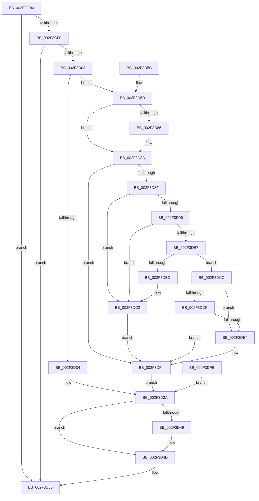

# RtlpLookupUserFunctionTable

- RVA: `0x002F3CD0`–`0x002F3E16` (길이 `326` bytes)
- VA: `0x00000001402F3CD0`
- 실행 섹션: `.text`
- PDB 이름 있음: `예`; PDB Function 태그: `아니요`
- unwind 정보 RVA: `0x000720B0`
- 디코드: `93`개 명령, `326/326` bytes 표시
- 미해석 바이트: `0` (있으면 어셈블리에 `.byte`로 보존)

> 이 문서는 커널 이미지의 기계어와 PDB 기호를 분석해 생성했습니다. 4번과 5번은 함수 원형과 자료형을 바이너리 사용 방식에서 추정한 C 해석이며 원본 소스 복구 결과는 아닙니다.

## 1. Dependencies

- 직접 호출 지점: **5**; 고유 호출 대상: **5**
- 직접 호출자로 확인된 함수: **1**
- RIP 상대 이미지 참조: **0**

### Outgoing calls
- `0x002F3CE6` → [RtlpLookupUserFunctionTableInverted](RtlpLookupUserFunctionTableInverted_function_002F3B20.md) (function, `0x002F3B20`)
- `0x002F3CF6` → [RtlpLookupDynamicUserFunctionTable](RtlpLookupDynamicUserFunctionTable_function_002F333C.md) (function, `0x002F333C`)
- `0x002F3D2B` → [MmGetImageInformation](../../page/8D/MmGetImageInformation_function_008D9C68.md) (function, `0x008D9C68`)
- `0x002F3D74` → [RtlImageDirectoryEntryToData](../43/RtlImageDirectoryEntryToData_function_004328D0.md) (function, `0x004328D0`)
- `0x002F3DBD` → [ExRaiseDatatypeMisalignment](../../page/89/ExRaiseDatatypeMisalignment_function_00899FD0.md) (function, `0x00899FD0`)

### Direct callers
- [RtlpLookupFunctionEntryForStackWalks](RtlpLookupFunctionEntryForStackWalks_function_002F4ED0.md) at `0x002F5093`

### Static image references
- 디코드된 RIP-relative 메모리 참조가 없습니다.

## 2. Other-region calls and transfers

- 다른 실행 섹션으로 향하는 call: **2**
  - `0x002F3D2B` → [MmGetImageInformation](../../page/8D/MmGetImageInformation_function_008D9C68.md) (`.text` → `PAGE`)
  - `0x002F3DBD` → [ExRaiseDatatypeMisalignment](../../page/89/ExRaiseDatatypeMisalignment_function_00899FD0.md) (`.text` → `PAGE`)
- 별도 외부 분기/꼬리 이동을 확인하지 못했습니다.

## 3. Assembly (complete function range)

```asm
002F3CD0  48 89 54 24 10                  mov qword ptr [rsp + 0x10], rdx
002F3CD5  53                              push rbx
002F3CD6  56                              push rsi
002F3CD7  57                              push rdi
002F3CD8  41 56                           push r14
002F3CDA  41 57                           push r15
002F3CDC  48 83 EC 40                     sub rsp, 0x40
002F3CE0  48 8B DA                        mov rbx, rdx
002F3CE3  48 8B F9                        mov rdi, rcx
002F3CE6  E8 35 FE FF FF                  call 0x1402f3b20
002F3CEB  48 85 C0                        test rax, rax
002F3CEE  75 60                           jne 0x1402f3d50
002F3CF0  48 8B D3                        mov rdx, rbx
002F3CF3  48 8B CF                        mov rcx, rdi
002F3CF6  E8 41 F6 FF FF                  call 0x1402f333c
002F3CFB  48 8B F0                        mov rsi, rax
002F3CFE  48 85 C0                        test rax, rax
002F3D01  75 4D                           jne 0x1402f3d50
002F3D03  45 33 F6                        xor r14d, r14d
002F3D06  4C 89 B4 24 88 00 00 00         mov qword ptr [rsp + 0x88], r14
002F3D0E  4C 89 74 24 28                  mov qword ptr [rsp + 0x28], r14
002F3D13  4C 8D 8C 24 80 00 00 00         lea r9, [rsp + 0x80]
002F3D1B  4C 8D 44 24 28                  lea r8, [rsp + 0x28]
002F3D20  48 8D 94 24 88 00 00 00         lea rdx, [rsp + 0x88]
002F3D28  48 8B CF                        mov rcx, rdi
002F3D2B  E8 38 5F 5E 00                  call 0x1408d9c68
002F3D30  85 C0                           test eax, eax
002F3D32  79 29                           jns 0x1402f3d5d
002F3D34  41 8B FE                        mov edi, r14d
002F3D37  41 8B C6                        mov eax, r14d
002F3D3A  48 89 7B 08                     mov qword ptr [rbx + 8], rdi
002F3D3E  89 43 10                        mov dword ptr [rbx + 0x10], eax
002F3D41  48 89 33                        mov qword ptr [rbx], rsi
002F3D44  48 85 F6                        test rsi, rsi
002F3D47  75 04                           jne 0x1402f3d4d
002F3D49  44 89 73 14                     mov dword ptr [rbx + 0x14], r14d
002F3D4D  48 8B C6                        mov rax, rsi
002F3D50  48 83 C4 40                     add rsp, 0x40
002F3D54  41 5F                           pop r15
002F3D56  41 5E                           pop r14
002F3D58  5F                              pop rdi
002F3D59  5E                              pop rsi
002F3D5A  5B                              pop rbx
002F3D5B  C3                              ret
002F3D5C  CC                              int3
002F3D5D  41 B8 03 00 00 00               mov r8d, 3
002F3D63  4C 8D 4B 14                     lea r9, [rbx + 0x14]
002F3D67  B2 01                           mov dl, 1
002F3D69  48 8B BC 24 88 00 00 00         mov rdi, qword ptr [rsp + 0x88]
002F3D71  48 8B CF                        mov rcx, rdi
002F3D74  E8 57 EB 13 00                  call 0x1404328d0
002F3D79  48 8B F0                        mov rsi, rax
002F3D7C  48 89 44 24 20                  mov qword ptr [rsp + 0x20], rax
002F3D81  48 85 C0                        test rax, rax
002F3D84  75 04                           jne 0x1402f3d8a
002F3D86  44 89 73 14                     mov dword ptr [rbx + 0x14], r14d
002F3D8A  48 85 F6                        test rsi, rsi
002F3D8D  74 65                           je 0x1402f3df4
002F3D8F  8B 43 14                        mov eax, dword ptr [rbx + 0x14]
002F3D92  85 C0                           test eax, eax
002F3D94  74 2C                           je 0x1402f3dc2
002F3D96  44 8B C0                        mov r8d, eax
002F3D99  48 B8 AB AA AA AA AA AA AA AA   movabs rax, 0xaaaaaaaaaaaaaaab
002F3DA3  49 F7 E0                        mul r8
002F3DA6  48 C1 EA 03                     shr rdx, 3
002F3DAA  48 8D 0C 52                     lea rcx, [rdx + rdx*2]
002F3DAE  48 C1 E1 02                     shl rcx, 2
002F3DB2  4C 3B C1                        cmp r8, rcx
002F3DB5  75 0B                           jne 0x1402f3dc2
002F3DB7  40 F6 C6 03                     test sil, 3
002F3DBB  74 0F                           je 0x1402f3dcc
002F3DBD  E8 0E 62 5A 00                  call 0x140899fd0
002F3DC2  49 8B F6                        mov rsi, r14
002F3DC5  4C 89 74 24 20                  mov qword ptr [rsp + 0x20], r14
002F3DCA  EB 28                           jmp 0x1402f3df4
002F3DCC  49 8D 04 30                     lea rax, [r8 + rsi]
002F3DD0  48 B9 00 00 FF FF FF 7F 00 00   movabs rcx, 0x7fffffff0000
002F3DDA  48 3B C6                        cmp rax, rsi
002F3DDD  72 05                           jb 0x1402f3de4
002F3DDF  48 3B C1                        cmp rax, rcx
002F3DE2  76 10                           jbe 0x1402f3df4
002F3DE4  0F B6 01                        movzx eax, byte ptr [rcx]
002F3DE7  48 8B 74 24 20                  mov rsi, qword ptr [rsp + 0x20]
002F3DEC  48 8B BC 24 88 00 00 00         mov rdi, qword ptr [rsp + 0x88]
002F3DF4  48 8B 44 24 28                  mov rax, qword ptr [rsp + 0x28]
002F3DF9  E9 3C FF FF FF                  jmp 0x1402f3d3a
002F3DFE  33 FF                           xor edi, edi
002F3E00  33 C0                           xor eax, eax
002F3E02  33 F6                           xor esi, esi
002F3E04  48 89 74 24 20                  mov qword ptr [rsp + 0x20], rsi
002F3E09  45 33 F6                        xor r14d, r14d
002F3E0C  48 8B 5C 24 78                  mov rbx, qword ptr [rsp + 0x78]
002F3E11  E9 24 FF FF FF                  jmp 0x1402f3d3a
```

## 4. C-style interpretation (structured pseudocode)

```c
__int64 __fastcall RtlpLookupUserFunctionTable(__int64 a1, __int64 a2)
{
    __int64 result;
    __int64 v_r14;
    __int64 v_rdi;
    __int64 v_rsi;
    __int64 v_rsp;
    unsigned __int64 v_stack_m40;
    unsigned __int64 v_stack_p10;
    unsigned __int64 v_stack_p18;
    unsigned __int64 v_stack_p20;
    unsigned __int64 v_stack_p28;
    unsigned __int64 v_stack_p78;
    unsigned __int64 v_stack_p88;

    v_stack_p10 = a2;
    v_rsp = (v_rsp) - (64);
    result = RtlpLookupUserFunctionTableInverted(a1, a2, a3, a4);
    if (result != 0) goto loc_002F3D50;
    result = RtlpLookupDynamicUserFunctionTable(a1, a2, a3, a4);
    if (result != 0) goto loc_002F3D50;
    v_r14 = 0;
    v_stack_p20 = 0;
    v_stack_m40 = 0;
    result = MmGetImageInformation(a1, v_stack_p20, v_stack_m40, v_stack_p18);
    if (!sign_flag) goto loc_002F3D5D;
loc_002F3D3A:
    *(unsigned __int64 *)(a2 + 8) = 0;
    *(unsigned int *)(a2 + 16) = 0;
    *(unsigned __int64 *)(a2) = result;
    if (result == 0) {
        *(unsigned int *)(a2 + 20) = 0;
    }
loc_002F3D50:
    v_rsp = (v_rsp) + (64);
    return result;
loc_002F3D5D:
    result = RtlImageDirectoryEntryToData(v_stack_p88, 1, 3, a2 + 20);
    v_stack_p20 = result;
    if (result == 0) {
        *(unsigned int *)(a2 + 20) = 0;
    }
    if (result == 0) goto loc_002F3DF4;
    if ((unsigned int)((unsigned int)(*(unsigned int *)(a2 + 20))) == 0) goto loc_002F3DC2;
    a2 = (1) >> (3);
    a1 = (a2 + a2 * 2) << (2);
    if (((unsigned int)((unsigned int)((unsigned int)(*(unsigned int *)(a2 + 20))))) != a1) goto loc_002F3DC2;
    if ((((unsigned __int8)(result)) & (3)) == 0) goto loc_002F3DCC;
    result = ExRaiseDatatypeMisalignment(a1, a2, (unsigned int)((unsigned int)((unsigned int)(*(unsigned int *)(a2 + 20)))), a2 + 20);
loc_002F3DC2:
    v_stack_p20 = 0;
    goto loc_002F3DF4;
loc_002F3DCC:
    if (((unsigned int)((unsigned int)((unsigned int)(*(unsigned int *)(a2 + 20)))) + 0 * 1) < 0) goto loc_002F3DE4;
    result = (unsigned int)((unsigned int)((unsigned int)(*(unsigned int *)(a2 + 20)))) + 0 * 1;
    v_rsi = 0;
    v_rdi = v_stack_p88;
    if (((unsigned int)((unsigned int)((unsigned int)(*(unsigned int *)(a2 + 20)))) + 0 * 1) >= = a1) {
        result = *(unsigned __int8 *)(a1);
        v_rsi = v_stack_p20;
        v_rdi = v_stack_p88;
    }
    goto loc_002F3D3A;
}
```

## 5. (Beta) C Style

```c
int64_t RtlpLookupUserFunctionTable(int64_t Arg1, void *Arg2)
{
    uint8_t *arg2 = (uint8_t *)Arg2;

    int64_t result;
    int64_t local_r14;
    int64_t local_rdi;
    int64_t local_rsi;
    int64_t local_rsp;
    uint64_t v_stack_m40;
    uint64_t v_stack_p10;
    uint64_t v_stack_p18;
    uint64_t v_stack_p20;
    uint64_t v_stack_p28;
    uint64_t v_stack_p78;
    uint64_t v_stack_p88;

    v_stack_p10 = Arg2;
    local_rsp = (local_rsp) - (64);
    result = RtlpLookupUserFunctionTableInverted(Arg1, Arg2, a3, a4);
    if (result != 0) goto loc_002F3D50;
    result = RtlpLookupDynamicUserFunctionTable(Arg1, Arg2, a3, a4);
    if (result != 0) goto loc_002F3D50;
    local_r14 = 0;
    v_stack_p20 = 0;
    v_stack_m40 = 0;
    result = MmGetImageInformation(Arg1, v_stack_p20, v_stack_m40, v_stack_p18);
    if (!sign_flag) goto loc_002F3D5D;
loc_002F3D3A:
    *(uint64_t *)(arg2 + 0x8) = 0;
    *(uint32_t *)(arg2 + 0x10) = 0;
    *(uint64_t *)(arg2) = result;
    if (result == 0) {
        *(uint32_t *)(arg2 + 0x14) = 0;
    }
loc_002F3D50:
    local_rsp = (local_rsp) + (64);
    return result;
loc_002F3D5D:
    result = RtlImageDirectoryEntryToData(v_stack_p88, 1, 3, Arg2 + 20);
    v_stack_p20 = result;
    if (result == 0) {
        *(uint32_t *)(arg2 + 0x14) = 0;
    }
    if (result == 0) goto loc_002F3DF4;
    if ((uint32_t)((uint32_t)(*(uint32_t *)(arg2 + 0x14))) == 0) goto loc_002F3DC2;
    Arg2 = (1) >> (3);
    Arg1 = (Arg2 + Arg2 * 2) << (2);
    if (((uint32_t)((uint32_t)((uint32_t)(*(uint32_t *)(arg2 + 0x14))))) != Arg1) goto loc_002F3DC2;
    if ((((uint8_t)(result)) & (3)) == 0) goto loc_002F3DCC;
    result = ExRaiseDatatypeMisalignment(Arg1, Arg2, (uint32_t)((uint32_t)((uint32_t)(*(uint32_t *)(arg2 + 0x14)))), Arg2 + 20);
loc_002F3DC2:
    v_stack_p20 = 0;
    goto loc_002F3DF4;
loc_002F3DCC:
    if (((uint32_t)((uint32_t)((uint32_t)(*(uint32_t *)(arg2 + 0x14)))) + 0 * 1) < 0) goto loc_002F3DE4;
    result = (uint32_t)((uint32_t)((uint32_t)(*(uint32_t *)(arg2 + 0x14)))) + 0 * 1;
    local_rsi = 0;
    local_rdi = v_stack_p88;
    if (((uint32_t)((uint32_t)((uint32_t)(*(uint32_t *)(arg2 + 0x14)))) + 0 * 1) >= = Arg1) {
        result = *(uint8_t *)(Arg1);
        local_rsi = v_stack_p20;
        local_rdi = v_stack_p88;
    }
    goto loc_002F3D3A;
}
```

### 관측된 메모리 오프셋

구조체 형식이 확인되지 않은 접근은 인자 기준의 오프셋으로만 기록했습니다.

| 기준 인자 | 오프셋 표현 | 폭 (bit) | 접근 |
|---|---:|---:|---|
| `Arg2` | `+ 0x0` | `64` | `W` |
| `Arg2` | `+ 0x8` | `64` | `W` |
| `Arg2` | `+ 0x10` | `32` | `W` |
| `Arg2` | `+ 0x14` | `32` | `R` |
| `Arg2` | `+ 0x14` | `32` | `W` |
| `Arg2` | `+ 0x14` | `64` | `R` |

## 6. Execution-region graph

[열기: 2D/3D 그래프와 함수 탐색 컨트롤 패널](../../../control-panel.html?section=text&rva=0x002F3CD0&view=graph)

- 2D 그래프는 위에서 아래로 흐르고, 3D 그래프는 빈 공간을 드래그해 회전합니다. Shift+드래그는 이동, 휠은 확대·축소, 함수 노드 선택은 대상 보고서 이동입니다.

### Static fallback


