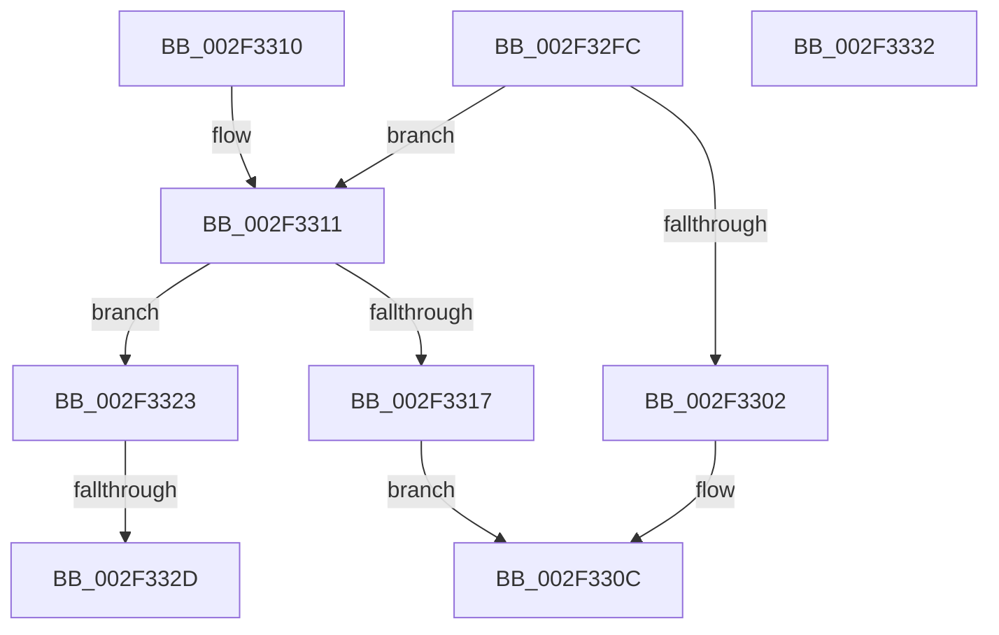

# RtlpRemoveArchDisallowedXStateFeatures

- RVA: `0x002F32FC`–`0x002F3333` (길이 `55` bytes)
- VA: `0x00000001402F32FC`
- 실행 섹션: `.text`
- PDB 이름 있음: `예`; PDB Function 태그: `예`
- unwind 정보 RVA: `0x000DB714`
- 디코드: `15`개 명령, `55/55` bytes 표시
- 미해석 바이트: `0` (있으면 어셈블리에 `.byte`로 보존)

> 이 문서는 커널 이미지의 기계어와 PDB 기호를 분석해 생성했습니다. 4번과 5번은 함수 원형과 자료형을 바이너리 사용 방식에서 추정한 C 해석이며 원본 소스 복구 결과는 아닙니다.

## 1. Dependencies

- 직접 호출 지점: **0**; 고유 호출 대상: **0**
- 직접 호출자로 확인된 함수: **9**
- RIP 상대 이미지 참조: **0**

### Outgoing calls
- 직접 디코드된 call 명령이 없습니다.

### Direct callers
- [RtlUnwind](RtlUnwind_function_002F1CB0.md) at `0x002F1DEC`
- [RtlDispatchException](RtlDispatchException_function_002F22A0.md) at `0x002F269C`
- [RtlUnwindEx](RtlUnwindEx_function_002F2830.md) at `0x002F2E76`
- [RtlpWalkFrameChain](RtlpWalkFrameChain_function_002F3ED0.md) at `0x002F4E4F`
- [RtlInitializeExtendedContext2](RtlInitializeExtendedContext2_function_002F5D40.md) at `0x002F5E8F`
- [RtlGetExtendedContextLength3](../4E/RtlGetExtendedContextLength3_function_004EF028.md) at `0x004EF0E9`
- [RtlGetEnabledExtendedFeatures](../5E/RtlGetEnabledExtendedFeatures_function_005E6C90.md) at `0x005E6CC7`
- [RtlWow64GetCpuAreaInfo](../../page/8C/RtlWow64GetCpuAreaInfo_function_008CDE0C.md) at `0x008CDE74`
- [RtlWow64GetCpuAreaEnabledFeatures](../../page/8C/RtlWow64GetCpuAreaEnabledFeatures_function_008CDFB4.md) at `0x008CDFDC`

### Static image references
- 디코드된 RIP-relative 메모리 참조가 없습니다.

## 2. Other-region calls and transfers

- 다른 실행 섹션으로 향하는 call: **0**
- call이 아닌 외부 분기/꼬리 이동: **1**
  - `0x002F3327` → `0x006DF276` (`tail-transfer`)

## 3. Assembly (complete function range)

```asm
002F32FC  0F BA E1 10                     bt ecx, 0x10
002F3300  73 0F                           jae 0x1402f3311
002F3302  48 B8 FF 09 00 00 00 00 00 40   movabs rax, 0x40000000000009ff
002F330C  48 21 02                        and qword ptr [rdx], rax
002F330F  C3                              ret
002F3310  CC                              int3
002F3311  0F BA E1 14                     bt ecx, 0x14
002F3315  73 0C                           jae 0x1402f3323
002F3317  48 B8 FF 0D 06 00 00 00 00 40   movabs rax, 0x4000000000060dff
002F3321  EB E9                           jmp 0x1402f330c
002F3323  0F BA E1 16                     bt ecx, 0x16
002F3327  0F 83 49 BF 3E 00               jae 0x1406df276
002F332D  48 83 22 04                     and qword ptr [rdx], 4
002F3331  C3                              ret
002F3332  CC                              int3
```

## 4. C-style interpretation (structured pseudocode)

```c
__int64 __fastcall RtlpRemoveArchDisallowedXStateFeatures(int a1, __int64 a2)
{
    if (condition_is_above_or_equal) goto loc_002F3311;
loc_002F330C:
    return result;
loc_002F3311:
    if (condition_is_above_or_equal) goto loc_002F3323;
    goto loc_002F330C;
loc_002F3323:
    return result;
}
```

## 5. (Beta) C Style

```c
int64_t RtlpRemoveArchDisallowedXStateFeatures(int32_t Arg1, void *Arg2)
{
    uint8_t *arg2 = (uint8_t *)Arg2;

    if (condition_is_above_or_equal) goto loc_002F3311;
loc_002F330C:
    return result;
loc_002F3311:
    if (condition_is_above_or_equal) goto loc_002F3323;
    goto loc_002F330C;
loc_002F3323:
    return result;
}
```

### 관측된 메모리 오프셋

구조체 형식이 확인되지 않은 접근은 인자 기준의 오프셋으로만 기록했습니다.

| 기준 인자 | 오프셋 표현 | 폭 (bit) | 접근 |
|---|---:|---:|---|
| `Arg2` | `+ 0x0` | `64` | `R/W` |

## 6. Execution-region graph

[열기: 2D/3D 그래프와 함수 탐색 컨트롤 패널](../../../control-panel.html?section=text&rva=0x002F32FC&view=graph)

- 2D 그래프는 위에서 아래로 흐르고, 3D 그래프는 빈 공간을 드래그해 회전합니다. Shift+드래그는 이동, 휠은 확대·축소, 함수 노드 선택은 대상 보고서 이동입니다.

### Static fallback


