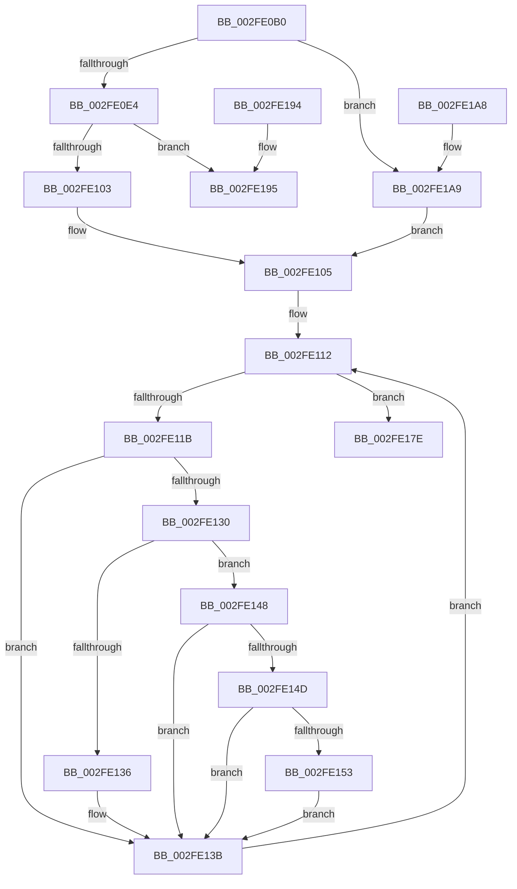

# RtlpUpcaseUnicodeStringPrivate

- RVA: `0x002FE0B0`–`0x002FE1B4` (길이 `260` bytes)
- VA: `0x00000001402FE0B0`
- 실행 섹션: `.text`
- PDB 이름 있음: `예`; PDB Function 태그: `아니요`
- unwind 정보 RVA: `0x00072D2C`
- 디코드: `79`개 명령, `260/260` bytes 표시
- 미해석 바이트: `0` (있으면 어셈블리에 `.byte`로 보존)

> 이 문서는 커널 이미지의 기계어와 PDB 기호를 분석해 생성했습니다. 4번과 5번은 함수 원형과 자료형을 바이너리 사용 방식에서 추정한 C 해석이며 원본 소스 복구 결과는 아닙니다.

## 1. Dependencies

- 직접 호출 지점: **2**; 고유 호출 대상: **2**
- 직접 호출자로 확인된 함수: **3**
- RIP 상대 이미지 참조: **0**

### Outgoing calls
- `0x002FE0C8` → [PsGetCurrentServerSiloGlobals](PsGetCurrentServerSiloGlobals_function_002FE1F0.md) (function, `0x002FE1F0`)
- `0x002FE0F1` → [ExAllocatePool2](../../poolcode/B8/ExAllocatePool2_function_00B820F0.md) (function, `0x00B820F0`)

### Direct callers
- [RtlIsNameInExpression](RtlIsNameInExpression_function_002FDA70.md) at `0x002FDA97`
- [RtlIsNameInUnUpcasedExpression](RtlIsNameInUnUpcasedExpression_function_002FDAF0.md) at `0x002FDB25`
- [RtlIsNameInUnUpcasedExpression](RtlIsNameInUnUpcasedExpression_function_002FDAF0.md) at `0x002FDB36`
- [RtlAreNamesEqual](../40/RtlAreNamesEqual_function_0040BCB0.md) at `0x0040BD8A`
- [RtlAreNamesEqual](../40/RtlAreNamesEqual_function_0040BCB0.md) at `0x0040BDA7`

### Static image references
- 디코드된 RIP-relative 메모리 참조가 없습니다.

## 2. Other-region calls and transfers

- 다른 실행 섹션으로 향하는 call: **1**
  - `0x002FE0F1` → [ExAllocatePool2](../../poolcode/B8/ExAllocatePool2_function_00B820F0.md) (`.text` → `POOLCODE`)
- 별도 외부 분기/꼬리 이동을 확인하지 못했습니다.

## 3. Assembly (complete function range)

```asm
002FE0B0  48 89 5C 24 10                  mov qword ptr [rsp + 0x10], rbx
002FE0B5  48 89 4C 24 08                  mov qword ptr [rsp + 8], rcx
002FE0BA  56                              push rsi
002FE0BB  57                              push rdi
002FE0BC  41 56                           push r14
002FE0BE  48 83 EC 30                     sub rsp, 0x30
002FE0C2  48 8B FA                        mov rdi, rdx
002FE0C5  48 8B D9                        mov rbx, rcx
002FE0C8  E8 23 01 00 00                  call 0x1402fe1f0
002FE0CD  48 8B B0 B0 04 00 00            mov rsi, qword ptr [rax + 0x4b0]
002FE0D4  0F B7 02                        movzx eax, word ptr [rdx]
002FE0D7  66 89 43 02                     mov word ptr [rbx + 2], ax
002FE0DB  66 85 C0                        test ax, ax
002FE0DE  0F 84 C5 00 00 00               je 0x1402fe1a9
002FE0E4  8B D0                           mov edx, eax
002FE0E6  B9 40 00 00 00                  mov ecx, 0x40
002FE0EB  41 B8 53 74 72 67               mov r8d, 0x67727453
002FE0F1  E8 FA 3F 88 00                  call 0x140b820f0
002FE0F6  48 89 43 08                     mov qword ptr [rbx + 8], rax
002FE0FA  48 85 C0                        test rax, rax
002FE0FD  0F 84 92 00 00 00               je 0x1402fe195
002FE103  33 C0                           xor eax, eax
002FE105  44 0F B7 1F                     movzx r11d, word ptr [rdi]
002FE109  41 D1 EB                        shr r11d, 1
002FE10C  41 BE C0 00 00 00               mov r14d, 0xc0
002FE112  89 44 24 20                     mov dword ptr [rsp + 0x20], eax
002FE116  41 3B C3                        cmp eax, r11d
002FE119  73 63                           jae 0x1402fe17e
002FE11B  8B C8                           mov ecx, eax
002FE11D  4C 8D 14 09                     lea r10, [rcx + rcx]
002FE121  48 8B 4F 08                     mov rcx, qword ptr [rdi + 8]
002FE125  45 0F B7 0C 0A                  movzx r9d, word ptr [r10 + rcx]
002FE12A  41 83 F9 61                     cmp r9d, 0x61
002FE12E  72 0B                           jb 0x1402fe13b
002FE130  41 83 F9 7A                     cmp r9d, 0x7a
002FE134  77 12                           ja 0x1402fe148
002FE136  66 41 83 E9 20                  sub r9w, 0x20
002FE13B  48 8B 4B 08                     mov rcx, qword ptr [rbx + 8]
002FE13F  66 45 89 0C 0A                  mov word ptr [r10 + rcx], r9w
002FE144  FF C0                           inc eax
002FE146  EB CA                           jmp 0x1402fe112
002FE148  48 85 F6                        test rsi, rsi
002FE14B  74 EE                           je 0x1402fe13b
002FE14D  66 45 3B CE                     cmp r9w, r14w
002FE151  72 E8                           jb 0x1402fe13b
002FE153  45 8B C1                        mov r8d, r9d
002FE156  49 8B C9                        mov rcx, r9
002FE159  48 C1 E9 08                     shr rcx, 8
002FE15D  0F B7 14 4E                     movzx edx, word ptr [rsi + rcx*2]
002FE161  41 8B C9                        mov ecx, r9d
002FE164  C1 E9 04                        shr ecx, 4
002FE167  83 E1 0F                        and ecx, 0xf
002FE16A  03 D1                           add edx, ecx
002FE16C  0F B7 14 56                     movzx edx, word ptr [rsi + rdx*2]
002FE170  41 83 E0 0F                     and r8d, 0xf
002FE174  41 03 D0                        add edx, r8d
002FE177  66 44 03 0C 56                  add r9w, word ptr [rsi + rdx*2]
002FE17C  EB BD                           jmp 0x1402fe13b
002FE17E  0F B7 07                        movzx eax, word ptr [rdi]
002FE181  66 89 03                        mov word ptr [rbx], ax
002FE184  33 C0                           xor eax, eax
002FE186  48 8B 5C 24 58                  mov rbx, qword ptr [rsp + 0x58]
002FE18B  48 83 C4 30                     add rsp, 0x30
002FE18F  41 5E                           pop r14
002FE191  5F                              pop rdi
002FE192  5E                              pop rsi
002FE193  C3                              ret
002FE194  CC                              int3
002FE195  B8 17 00 00 C0                  mov eax, 0xc0000017
002FE19A  48 8B 5C 24 58                  mov rbx, qword ptr [rsp + 0x58]
002FE19F  48 83 C4 30                     add rsp, 0x30
002FE1A3  41 5E                           pop r14
002FE1A5  5F                              pop rdi
002FE1A6  5E                              pop rsi
002FE1A7  C3                              ret
002FE1A8  CC                              int3
002FE1A9  33 C0                           xor eax, eax
002FE1AB  48 89 43 08                     mov qword ptr [rbx + 8], rax
002FE1AF  E9 51 FF FF FF                  jmp 0x1402fe105
```

## 4. C-style interpretation (structured pseudocode)

```c
__int64 __fastcall RtlpUpcaseUnicodeStringPrivate(__int64 a1, __int64 a2)
{
    __int64 result;
    __int64 v_r11;
    __int64 v_rsp;
    unsigned int v_stack_m28;
    unsigned __int64 v_stack_p10;
    unsigned __int64 v_stack_p58;
    unsigned __int64 v_stack_p8;

    v_stack_p10 = v_rbx;
    v_stack_p8 = a1;
    v_rsp = (v_rsp) - (48);
    result = PsGetCurrentServerSiloGlobals(a1, a2, a3, a4);
    *(unsigned __int16 *)(a1 + 2) = (unsigned __int16)(*(unsigned __int16 *)(a2));
    if ((unsigned __int16)(*(unsigned __int16 *)(a2)) == 0) goto loc_002FE1A9;
    result = ExAllocatePool2(64, (unsigned int)((unsigned int)(*(unsigned __int16 *)(a2))), (unsigned int)(0x67727453ULL), a4);
    *(unsigned __int64 *)(a1 + 8) = result;
    if (result == 0) goto loc_002FE195;
    result = 0;
loc_002FE105:
    v_r11 = (unsigned int)((*(unsigned __int16 *)(a2)) >> (1));
loc_002FE112:
    v_stack_m28 = 0;
    if (0 >= ((unsigned int)(v_r11))) goto loc_002FE17E;
    if (((unsigned int)(*(unsigned __int16 *)(0 + 0 * 1 + *(unsigned __int64 *)(a2 + 8) * 1))) < 97) goto loc_002FE13B;
    if (((unsigned int)(*(unsigned __int16 *)(0 + 0 * 1 + *(unsigned __int64 *)(a2 + 8) * 1))) > 122) goto loc_002FE148;
    a4 = (unsigned __int16)((*(unsigned __int16 *)(0 + 0 * 1 + *(unsigned __int64 *)(a2 + 8) * 1)) - (32));
loc_002FE13B:
    *(unsigned __int16 *)(0 + 0 * 1 + *(unsigned __int64 *)(a1 + 8) * 1) = (unsigned __int16)(a4);
    result = (unsigned int)((result) + 1);
    goto loc_002FE112;
loc_002FE148:
    if (*(unsigned __int64 *)(result + 1200) == 0) goto loc_002FE13B;
    if (((unsigned __int16)(a4)) < 192) goto loc_002FE13B;
    a1 = (a4) >> (8);
    a1 = (unsigned int)(((unsigned int)((unsigned int)(a4))) >> (4));
    a1 = (unsigned int)((a1) & (15));
    a2 = (unsigned int)((*(unsigned __int16 *)(*(unsigned __int64 *)(result + 1200) + a1 * 2)) + ((unsigned int)(a1)));
    a3 = (unsigned int)(((unsigned int)((unsigned int)(a4))) & (15));
    a2 = (unsigned int)((*(unsigned __int16 *)(*(unsigned __int64 *)(result + 1200) + a2 * 2)) + ((unsigned int)(a3)));
    a4 = (unsigned __int16)((a4) + (*(unsigned __int16 *)(*(unsigned __int64 *)(result + 1200) + a2 * 2)));
    goto loc_002FE13B;
loc_002FE17E:
    *(unsigned __int16 *)(a1) = (unsigned __int16)(*(unsigned __int16 *)(a2));
    result = 0;
    v_rsp = (v_rsp) + (48);
    return result;
loc_002FE195:
    v_rsp = (v_rsp) + (48);
    return (unsigned int)(0xC0000017ULL);
loc_002FE1A9:
    result = 0;
    *(unsigned __int64 *)(v_stack_p58 + 8) = 0;
    goto loc_002FE105;
}
```

## 5. (Beta) C Style

```c
int64_t RtlpUpcaseUnicodeStringPrivate(void *Arg1, void *Arg2)
{
    uint8_t *arg1 = (uint8_t *)Arg1;
    uint8_t *arg2 = (uint8_t *)Arg2;

    int64_t result;
    int64_t local_r11;
    int64_t local_rsp;
    uint32_t v_stack_m28;
    uint64_t v_stack_p10;
    uint64_t v_stack_p58;
    uint64_t v_stack_p8;

    v_stack_p10 = local_rbx;
    v_stack_p8 = Arg1;
    local_rsp = (local_rsp) - (48);
    result = PsGetCurrentServerSiloGlobals(Arg1, Arg2, a3, a4);
    *(uint16_t *)(arg1 + 0x2) = (uint16_t)(*(uint16_t *)(arg2));
    if ((uint16_t)(*(uint16_t *)(arg2)) == 0) goto loc_002FE1A9;
    result = ExAllocatePool2(64, (uint32_t)((uint32_t)(*(uint16_t *)(arg2))), (uint32_t)(0x67727453ULL), a4);
    *(uint64_t *)(arg1 + 0x8) = result;
    if (result == 0) goto loc_002FE195;
    result = 0;
loc_002FE105:
    local_r11 = (uint32_t)((*(uint16_t *)(arg2)) >> (1));
loc_002FE112:
    v_stack_m28 = 0;
    if (0 >= ((uint32_t)(local_r11))) goto loc_002FE17E;
    if (((uint32_t)(*(uint16_t *)(0 + 0x0 * 1 + *(uint64_t *)(arg2 + 0x8) * 1))) < 97) goto loc_002FE13B;
    if (((uint32_t)(*(uint16_t *)(0 + 0x0 * 1 + *(uint64_t *)(arg2 + 0x8) * 1))) > 122) goto loc_002FE148;
    a4 = (uint16_t)((*(uint16_t *)(0 + 0x0 * 1 + *(uint64_t *)(arg2 + 0x8) * 1)) - (32));
loc_002FE13B:
    *(uint16_t *)(0 + 0x0 * 1 + *(uint64_t *)(arg1 + 0x8) * 1) = (uint16_t)(a4);
    result = (uint32_t)((result) + 1);
    goto loc_002FE112;
loc_002FE148:
    if (*(uint64_t *)(result + 0x4B0) == 0) goto loc_002FE13B;
    if (((uint16_t)(a4)) < 192) goto loc_002FE13B;
    Arg1 = (a4) >> (8);
    Arg1 = (uint32_t)(((uint32_t)((uint32_t)(a4))) >> (4));
    Arg1 = (uint32_t)((Arg1) & (15));
    Arg2 = (uint32_t)((*(uint16_t *)(*(uint64_t *)(result + 0x4B0) + arg1 * 2)) + ((uint32_t)(Arg1)));
    a3 = (uint32_t)(((uint32_t)((uint32_t)(a4))) & (15));
    Arg2 = (uint32_t)((*(uint16_t *)(*(uint64_t *)(result + 0x4B0) + arg2 * 2)) + ((uint32_t)(a3)));
    a4 = (uint16_t)((a4) + (*(uint16_t *)(*(uint64_t *)(result + 0x4B0) + arg2 * 2)));
    goto loc_002FE13B;
loc_002FE17E:
    *(uint16_t *)(arg1) = (uint16_t)(*(uint16_t *)(arg2));
    result = 0;
    local_rsp = (local_rsp) + (48);
    return result;
loc_002FE195:
    local_rsp = (local_rsp) + (48);
    return (uint32_t)(0xC0000017ULL);
loc_002FE1A9:
    result = 0;
    *(uint64_t *)(v_stack_p58 + 0x8) = 0;
    goto loc_002FE105;
}
```

### 관측된 메모리 오프셋

구조체 형식이 확인되지 않은 접근은 인자 기준의 오프셋으로만 기록했습니다.

| 기준 인자 | 오프셋 표현 | 폭 (bit) | 접근 |
|---|---:|---:|---|
| `Arg1` | `+ 0x0` | `16` | `W` |
| `Arg1` | `+ 0x2` | `16` | `W` |
| `Arg1` | `+ 0x8` | `64` | `R` |
| `Arg1` | `+ 0x8` | `64` | `W` |
| `Arg2` | `+ 0x0` | `16` | `R` |
| `Arg2` | `+ 0x8` | `64` | `R` |

## 6. Execution-region graph

[열기: 2D/3D 그래프와 함수 탐색 컨트롤 패널](../../../control-panel.html?section=text&rva=0x002FE0B0&view=graph)

- 2D 그래프는 위에서 아래로 흐르고, 3D 그래프는 빈 공간을 드래그해 회전합니다. Shift+드래그는 이동, 휠은 확대·축소, 함수 노드 선택은 대상 보고서 이동입니다.

### Static fallback


