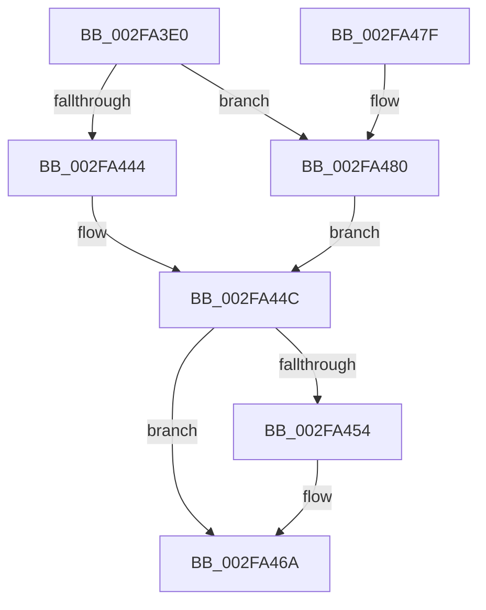

# SMKM_STORE&lt;SM_TRAITS&gt;::SmStDirectReadCallout

- RVA: `0x002FA3E0`–`0x002FA48C` (길이 `172` bytes)
- VA: `0x00000001402FA3E0`
- 실행 섹션: `.text`
- PDB 이름 있음: `예`; PDB Function 태그: `아니요`
- unwind 정보 RVA: `0x0007293C`
- 디코드: `43`개 명령, `172/172` bytes 표시
- 미해석 바이트: `0` (있으면 어셈블리에 `.byte`로 보존)

> 이 문서는 커널 이미지의 기계어와 PDB 기호를 분석해 생성했습니다. 4번과 5번은 함수 원형과 자료형을 바이너리 사용 방식에서 추정한 C 해석이며 원본 소스 복구 결과는 아닙니다.

## 1. Dependencies

- 직접 호출 지점: **6**; 고유 호출 대상: **6**
- 직접 호출자로 확인된 함수: **1**
- RIP 상대 이미지 참조: **0**

### Outgoing calls
- `0x002FA406` → [SMKM_STORE<SM_TRAITS>::SmStDirectReadIssue](../20/SMKM_STORE_SM_TRAITS_SmStDirectReadIssue_function_00203444.md) (function, `0x00203444`)
- `0x002FA41F` → [B_TREE<_SM_PAGE_KEY,ST_STORE<SM_TRAITS>::_ST_PAGE_ENTRY,4096,NP_CONTEXT,B_TREE_KEY_COMPARATOR<_SM_PAGE_KEY> >::BTreeSearchResultDeref](../3A/B_TREE__SM_PAGE_KEY_ST_STORE_SM_TRAITS__ST_PAGE_ENTRY_4096_NP_CONTEXT_B_TREE_KEY_COMPARATOR__SM_PAGE_function_003AC5D0.md) (function, `0x003AC5D0`)
- `0x002FA432` → [B_TREE<unsigned long,ST_STORE<SM_TRAITS>::_ST_REGION_ENTRY,4096,NP_CONTEXT,ST_STORE<SM_TRAITS>::ST_REGION_ENTRY_COMPARATOR>::BTreeSearchResultDeref](../3A/B_TREE_unsigned_long_ST_STORE_SM_TRAITS__ST_REGION_ENTRY_4096_NP_CONTEXT_ST_STORE_SM_TRAITS_ST_REGIO_function_003AD260.md) (function, `0x003AD260`)
- `0x002FA447` → [ExpInterlockedPushEntrySList](../6B/ExpInterlockedPushEntrySList_function_006BA5B0.md) (function, `0x006BA5B0`)
- `0x002FA45E` → [SMKM_STORE<SM_TRAITS>::SmStDirectReadComplete](../20/SMKM_STORE_SM_TRAITS_SmStDirectReadComplete_function_00204968.md) (function, `0x00204968`)
- `0x002FA485` → [ExFreePoolWithTag](../../poolcode/B8/ExFreePoolWithTag_function_00B82870.md) (function, `0x00B82870`)

### Direct callers
- [KeExpandKernelStackAndCalloutInternal](KeExpandKernelStackAndCalloutInternal_function_002F8450.md) at `0x002F8502`

### Static image references
- 디코드된 RIP-relative 메모리 참조가 없습니다.

## 2. Other-region calls and transfers

- 다른 실행 섹션으로 향하는 call: **1**
  - `0x002FA485` → [ExFreePoolWithTag](../../poolcode/B8/ExFreePoolWithTag_function_00B82870.md) (`.text` → `POOLCODE`)
- 별도 외부 분기/꼬리 이동을 확인하지 못했습니다.

## 3. Assembly (complete function range)

```asm
002FA3E0  48 89 5C 24 08                  mov qword ptr [rsp + 8], rbx
002FA3E5  48 89 6C 24 10                  mov qword ptr [rsp + 0x10], rbp
002FA3EA  48 89 74 24 18                  mov qword ptr [rsp + 0x18], rsi
002FA3EF  57                              push rdi
002FA3F0  48 83 EC 20                     sub rsp, 0x20
002FA3F4  83 61 18 00                     and dword ptr [rcx + 0x18], 0
002FA3F8  48 8B F9                        mov rdi, rcx
002FA3FB  4C 8B 41 10                     mov r8, qword ptr [rcx + 0x10]
002FA3FF  48 8B 51 08                     mov rdx, qword ptr [rcx + 8]
002FA403  48 8B 09                        mov rcx, qword ptr [rcx]
002FA406  E8 39 90 F0 FF                  call 0x140203444
002FA40B  48 8B 1F                        mov rbx, qword ptr [rdi]
002FA40E  8B E8                           mov ebp, eax
002FA410  48 8B 77 10                     mov rsi, qword ptr [rdi + 0x10]
002FA414  48 8D 4B 50                     lea rcx, [rbx + 0x50]
002FA418  48 8B 96 A8 01 00 00            mov rdx, qword ptr [rsi + 0x1a8]
002FA41F  E8 AC 21 0B 00                  call 0x1403ac5d0
002FA424  48 8B 96 B0 01 00 00            mov rdx, qword ptr [rsi + 0x1b0]
002FA42B  48 8D 8B 90 00 00 00            lea rcx, [rbx + 0x90]
002FA432  E8 29 2E 0B 00                  call 0x1403ad260
002FA437  48 8D 8B D0 12 00 00            lea rcx, [rbx + 0x12d0]
002FA43E  66 83 39 10                     cmp word ptr [rcx], 0x10
002FA442  73 3C                           jae 0x1402fa480
002FA444  48 8B D6                        mov rdx, rsi
002FA447  E8 64 01 3C 00                  call 0x1406ba5b0
002FA44C  81 FD 12 01 00 C0               cmp ebp, 0xc0000112
002FA452  74 16                           je 0x1402fa46a
002FA454  48 8B 57 08                     mov rdx, qword ptr [rdi + 8]
002FA458  44 8B C5                        mov r8d, ebp
002FA45B  48 8B 0F                        mov rcx, qword ptr [rdi]
002FA45E  E8 05 A5 F0 FF                  call 0x140204968
002FA463  C7 47 18 01 00 00 00            mov dword ptr [rdi + 0x18], 1
002FA46A  48 8B 5C 24 30                  mov rbx, qword ptr [rsp + 0x30]
002FA46F  48 8B 6C 24 38                  mov rbp, qword ptr [rsp + 0x38]
002FA474  48 8B 74 24 40                  mov rsi, qword ptr [rsp + 0x40]
002FA479  48 83 C4 20                     add rsp, 0x20
002FA47D  5F                              pop rdi
002FA47E  C3                              ret
002FA47F  CC                              int3
002FA480  33 D2                           xor edx, edx
002FA482  48 8B CE                        mov rcx, rsi
002FA485  E8 E6 83 88 00                  call 0x140b82870
002FA48A  EB C0                           jmp 0x1402fa44c
```

## 4. C-style interpretation (structured pseudocode)

```c
__int64 __fastcall SMKM_STORE_SM_TRAITS___SmStDirectReadCallout(__int64 a1)
{
    __int64 result;
    __int64 v_rsp;
    unsigned __int64 v_stack_p10;
    unsigned __int64 v_stack_p18;
    unsigned __int64 v_stack_p8;

    v_stack_p8 = v_rbx;
    v_stack_p10 = v_rbp;
    v_stack_p18 = v_rsi;
    v_rsp = (v_rsp) - (32);
    result = SMKM_STORE_SM_TRAITS___SmStDirectReadIssue(*(unsigned __int64 *)(a1), *(unsigned __int64 *)(a1 + 8), *(unsigned __int64 *)(a1 + 16), a4);
    result = B_TREE__SM_PAGE_KEY_ST_STORE_SM_TRAITS____ST_PAGE_ENTRY_4096_NP_CONTEXT_B_TREE_KEY_COMPARATOR__SM_PA(*(unsigned __int64 *)(a1) + 80, *(unsigned __int64 *)(*(unsigned __int64 *)(a1 + 16) + 424), *(unsigned __int64 *)(a1 + 16), a4);
    result = B_TREE_unsigned_long_ST_STORE_SM_TRAITS____ST_REGION_ENTRY_4096_NP_CONTEXT_ST_STORE_SM_TRAITS___ST_R(*(unsigned __int64 *)(a1) + 144, *(unsigned __int64 *)(*(unsigned __int64 *)(a1 + 16) + 432), *(unsigned __int64 *)(a1 + 16), a4);
    if ((*(unsigned __int16 *)(*(unsigned __int64 *)(a1) + 4816)) >= 16) goto loc_002FA480;
    result = ExpInterlockedPushEntrySList(*(unsigned __int64 *)(a1) + 4816, *(unsigned __int64 *)(a1 + 16), *(unsigned __int64 *)(a1 + 16), a4);
loc_002FA44C:
    if (((unsigned int)((unsigned int)((unsigned int)(result)))) != 0xC0000112ULL) {
        a2 = *(unsigned __int64 *)(a1 + 8);
        a3 = (unsigned int)((unsigned int)((unsigned int)(result)));
        a1 = *(unsigned __int64 *)(a1);
        result = SMKM_STORE_SM_TRAITS___SmStDirectReadComplete(a1, a2, a3, a4);
        *(unsigned int *)(a1 + 24) = 1;
    }
    v_rsp = (v_rsp) + (32);
    return result;
loc_002FA480:
    a2 = 0;
    result = ExFreePoolWithTag(v_stack_p18, a2, a3, a4);
    goto loc_002FA44C;
}
```

## 5. (Beta) C Style

```c
int64_t SMKM_STORE_SM_TRAITS___SmStDirectReadCallout(void *Arg1)
{
    uint8_t *arg1 = (uint8_t *)Arg1;

    int64_t result;
    int64_t local_rsp;
    uint64_t v_stack_p10;
    uint64_t v_stack_p18;
    uint64_t v_stack_p8;

    v_stack_p8 = local_rbx;
    v_stack_p10 = local_rbp;
    v_stack_p18 = local_rsi;
    local_rsp = (local_rsp) - (32);
    result = SMKM_STORE_SM_TRAITS___SmStDirectReadIssue(*(uint64_t *)(arg1), *(uint64_t *)(arg1 + 0x8), *(uint64_t *)(arg1 + 0x10), a4);
    result = B_TREE__SM_PAGE_KEY_ST_STORE_SM_TRAITS____ST_PAGE_ENTRY_4096_NP_CONTEXT_B_TREE_KEY_COMPARATOR__SM_PA(*(uint64_t *)(arg1) + 80, *(uint64_t *)(*(uint64_t *)(arg1 + 0x10) + 0x1A8), *(uint64_t *)(arg1 + 0x10), a4);
    result = B_TREE_unsigned_long_ST_STORE_SM_TRAITS____ST_REGION_ENTRY_4096_NP_CONTEXT_ST_STORE_SM_TRAITS___ST_R(*(uint64_t *)(arg1) + 144, *(uint64_t *)(*(uint64_t *)(arg1 + 0x10) + 0x1B0), *(uint64_t *)(arg1 + 0x10), a4);
    if ((*(uint16_t *)(*(uint64_t *)(arg1) + 0x12D0)) >= 16) goto loc_002FA480;
    result = ExpInterlockedPushEntrySList(*(uint64_t *)(arg1) + 4816, *(uint64_t *)(arg1 + 0x10), *(uint64_t *)(arg1 + 0x10), a4);
loc_002FA44C:
    if (((uint32_t)((uint32_t)((uint32_t)(result)))) != 0xC0000112ULL) {
        a2 = *(uint64_t *)(arg1 + 0x8);
        a3 = (uint32_t)((uint32_t)((uint32_t)(result)));
        Arg1 = *(uint64_t *)(arg1);
        result = SMKM_STORE_SM_TRAITS___SmStDirectReadComplete(Arg1, a2, a3, a4);
        *(uint32_t *)(arg1 + 0x18) = 1;
    }
    local_rsp = (local_rsp) + (32);
    return result;
loc_002FA480:
    a2 = 0;
    result = ExFreePoolWithTag(v_stack_p18, a2, a3, a4);
    goto loc_002FA44C;
}
```

### 관측된 메모리 오프셋

구조체 형식이 확인되지 않은 접근은 인자 기준의 오프셋으로만 기록했습니다.

| 기준 인자 | 오프셋 표현 | 폭 (bit) | 접근 |
|---|---:|---:|---|
| `Arg1` | `+ 0x0` | `64` | `R` |
| `Arg1` | `+ 0x8` | `64` | `R` |
| `Arg1` | `+ 0x10` | `64` | `R` |
| `Arg1` | `+ 0x18` | `32` | `R/W` |
| `Arg1` | `+ 0x18` | `32` | `W` |

## 6. Execution-region graph

[열기: 2D/3D 그래프와 함수 탐색 컨트롤 패널](../../../control-panel.html?section=text&rva=0x002FA3E0&view=graph)

- 2D 그래프는 위에서 아래로 흐르고, 3D 그래프는 빈 공간을 드래그해 회전합니다. Shift+드래그는 이동, 휠은 확대·축소, 함수 노드 선택은 대상 보고서 이동입니다.

### Static fallback


