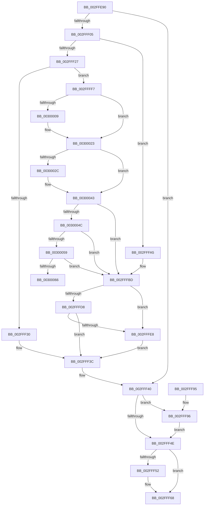

# SepCanTokenMatchAllPackageSid

- RVA: `0x002FFE90`–`0x0030007D` (길이 `493` bytes)
- VA: `0x00000001402FFE90`
- 실행 섹션: `.text`
- PDB 이름 있음: `예`; PDB Function 태그: `아니요`
- unwind 정보 RVA: `0x00072EB4`
- 디코드: `121`개 명령, `493/493` bytes 표시
- 미해석 바이트: `0` (있으면 어셈블리에 `.byte`로 보존)

> 이 문서는 커널 이미지의 기계어와 PDB 기호를 분석해 생성했습니다. 4번과 5번은 함수 원형과 자료형을 바이너리 사용 방식에서 추정한 C 해석이며 원본 소스 복구 결과는 아닙니다.

## 1. Dependencies

- 직접 호출 지점: **13**; 고유 호출 대상: **10**
- 직접 호출자로 확인된 함수: **2**
- RIP 상대 이미지 참조: **2**

### Outgoing calls
- `0x002FFF37` → [ExpAcquireResourceSharedLite](../21/ExpAcquireResourceSharedLite_function_00212040.md) (function, `0x00212040`)
- `0x002FFF45` → [AuthzBasepQuerySecurityAttributeAndValues](../30/AuthzBasepQuerySecurityAttributeAndValues_function_00300090.md) (function, `0x00300090`)
- `0x002FFF55` → [ExReleaseResourceLite](../25/ExReleaseResourceLite_function_0025FA10.md) (function, `0x0025FA10`)
- `0x002FFF63` → [KeLeaveCriticalRegionThread](../25/KeLeaveCriticalRegionThread_function_0025EFF0.md) (function, `0x0025EFF0`)
- `0x002FFF77` → [_security_check_cookie](../6A/_security_check_cookie_function_006AC640.md) (function, `0x006AC640`)
- `0x002FFFB7` → [KeBugCheckEx](../4F/KeBugCheckEx_function_004FD660.md) (function, `0x004FD660`)
- `0x002FFFBD` → [ExpAllocateOwnerEntryForLegacyShim](../21/ExpAllocateOwnerEntryForLegacyShim_function_00213B50.md) (function, `0x00213B50`)
- `0x002FFFCF` → [ExAcquireFastResourceShared](../21/ExAcquireFastResourceShared_function_00210F40.md) (function, `0x00210F40`)
- `0x002FFFDB` → [ExIsFastResourceHeldExclusive](../21/ExIsFastResourceHeldExclusive_function_00213450.md) (function, `0x00213450`)
- `0x002FFFED` → [ExFreePoolWithTag](../../poolcode/B8/ExFreePoolWithTag_function_00B82870.md) (function, `0x00B82870`)
- `0x0030001D` → [KeBugCheckEx](../4F/KeBugCheckEx_function_004FD660.md) (function, `0x004FD660`)
- `0x0030003D` → [KeBugCheckEx](../4F/KeBugCheckEx_function_004FD660.md) (function, `0x004FD660`)
- `0x00300077` → [KeBugCheckEx](../4F/KeBugCheckEx_function_004FD660.md) (function, `0x004FD660`)

### Direct callers
- [SepMatchPackage](SepMatchPackage_function_002FFDC0.md) at `0x002FFDF6`
- [SeQueryInformationToken](../../page/8B/SeQueryInformationToken_function_008B5090.md) at `0x008B5EF1`

### Static image references
- `0x002FFEA7` → RVA `0x00E0A740` (`.data`; read)
- `0x002FFEBC` → RVA `0x006CD610` (` ?? ::FNODOBFM::`string'`; read)

## 2. Other-region calls and transfers

- 다른 실행 섹션으로 향하는 call: **1**
  - `0x002FFFED` → [ExFreePoolWithTag](../../poolcode/B8/ExFreePoolWithTag_function_00B82870.md) (`.text` → `POOLCODE`)
- 별도 외부 분기/꼬리 이동을 확인하지 못했습니다.

## 3. Assembly (complete function range)

```asm
002FFE90  4C 8B DC                        mov r11, rsp
002FFE93  49 89 5B 10                     mov qword ptr [r11 + 0x10], rbx
002FFE97  49 89 6B 18                     mov qword ptr [r11 + 0x18], rbp
002FFE9B  49 89 73 20                     mov qword ptr [r11 + 0x20], rsi
002FFE9F  57                              push rdi
002FFEA0  48 81 EC 90 00 00 00            sub rsp, 0x90
002FFEA7  48 8B 05 92 A8 B0 00            mov rax, qword ptr [rip + 0xb0a892]
002FFEAE  48 33 C4                        xor rax, rsp
002FFEB1  48 89 84 24 80 00 00 00         mov qword ptr [rsp + 0x80], rax
002FFEB9  45 33 C9                        xor r9d, r9d
002FFEBC  48 8D 05 4D D7 3C 00            lea rax, [rip + 0x3cd74d]
002FFEC3  4D 89 4B 98                     mov qword ptr [r11 - 0x68], r9
002FFEC7  0F 57 C0                        xorps xmm0, xmm0
002FFECA  66 0F 7F 44 24 50               movdqa xmmword ptr [rsp + 0x50], xmm0
002FFED0  0F 57 C9                        xorps xmm1, xmm1
002FFED3  66 0F 7F 4C 24 60               movdqa xmmword ptr [rsp + 0x60], xmm1
002FFED9  32 DB                           xor bl, bl
002FFEDB  49 89 43 B0                     mov qword ptr [r11 - 0x50], rax
002FFEDF  40 B6 01                        mov sil, 1
002FFEE2  48 8B 81 08 03 00 00            mov rax, qword ptr [rcx + 0x308]
002FFEE9  49 89 43 A0                     mov qword ptr [r11 - 0x60], rax
002FFEED  4D 89 4B D8                     mov qword ptr [r11 - 0x28], r9
002FFEF1  49 C7 43 A8 22 00 24 00         mov qword ptr [r11 - 0x58], 0x240022
002FFEF9  44 0F 20 C0                     mov rax, cr8
002FFEFD  48 8D 79 30                     lea rdi, [rcx + 0x30]
002FFF01  3C 02                           cmp al, 2
002FFF03  73 3B                           jae 0x1402fff40
002FFF05  65 48 8B 04 25 88 01 00 00      mov rax, qword ptr gs:[0x188]
002FFF0E  66 FF 88 E4 01 00 00            dec word ptr [rax + 0x1e4]
002FFF15  90                              nop
002FFF16  48 8B 1F                        mov rbx, qword ptr [rdi]
002FFF19  0F B7 4B 1A                     movzx ecx, word ptr [rbx + 0x1a]
002FFF1D  0F B6 C1                        movzx eax, cl
002FFF20  24 41                           and al, 0x41
002FFF22  40 3A C6                        cmp al, sil
002FFF25  74 7E                           je 0x1402fffa5
002FFF27  40 84 CE                        test sil, cl
002FFF2A  0F 85 C7 00 00 00               jne 0x1402ffff7
002FFF30  40 0F B6 D6                     movzx edx, sil
002FFF34  48 8B CB                        mov rcx, rbx
002FFF37  E8 04 21 F1 FF                  call 0x140212040
002FFF3C  40 0F B6 DE                     movzx ebx, sil
002FFF40  48 8D 4C 24 30                  lea rcx, [rsp + 0x30]
002FFF45  E8 46 01 00 00                  call 0x140300090
002FFF4A  85 C0                           test eax, eax
002FFF4C  79 48                           jns 0x1402fff96
002FFF4E  84 DB                           test bl, bl
002FFF50  74 16                           je 0x1402fff68
002FFF52  48 8B 0F                        mov rcx, qword ptr [rdi]
002FFF55  E8 B6 FA F5 FF                  call 0x14025fa10
002FFF5A  65 48 8B 0C 25 88 01 00 00      mov rcx, qword ptr gs:[0x188]
002FFF63  E8 88 F0 F5 FF                  call 0x14025eff0
002FFF68  40 0F B6 C6                     movzx eax, sil
002FFF6C  48 8B 8C 24 80 00 00 00         mov rcx, qword ptr [rsp + 0x80]
002FFF74  48 33 CC                        xor rcx, rsp
002FFF77  E8 C4 C6 3A 00                  call 0x1406ac640
002FFF7C  4C 8D 9C 24 90 00 00 00         lea r11, [rsp + 0x90]
002FFF84  49 8B 5B 18                     mov rbx, qword ptr [r11 + 0x18]
002FFF88  49 8B 6B 20                     mov rbp, qword ptr [r11 + 0x20]
002FFF8C  49 8B 73 28                     mov rsi, qword ptr [r11 + 0x28]
002FFF90  49 8B E3                        mov rsp, r11
002FFF93  5F                              pop rdi
002FFF94  C3                              ret
002FFF95  CC                              int3
002FFF96  48 8B 44 24 60                  mov rax, qword ptr [rsp + 0x60]
002FFF9B  48 83 38 00                     cmp qword ptr [rax], 0
002FFF9F  40 0F 94 C6                     sete sil
002FFFA3  EB A9                           jmp 0x1402fff4e
002FFFA5  4C 8B C3                        mov r8, rbx
002FFFA8  4C 89 4C 24 20                  mov qword ptr [rsp + 0x20], r9
002FFFAD  BA 0F 00 00 00                  mov edx, 0xf
002FFFB2  B9 C6 01 00 00                  mov ecx, 0x1c6
002FFFB7  E8 A4 D6 1F 00                  call 0x1404fd660
002FFFBC  CC                              int3
002FFFBD  E8 8E 3B F1 FF                  call 0x140213b50
002FFFC2  44 0F B6 C6                     movzx r8d, sil
002FFFC6  48 8B D0                        mov rdx, rax
002FFFC9  48 8B CB                        mov rcx, rbx
002FFFCC  48 8B E8                        mov rbp, rax
002FFFCF  E8 6C 0F F1 FF                  call 0x140210f40
002FFFD4  84 C0                           test al, al
002FFFD6  74 10                           je 0x1402fffe8
002FFFD8  48 8B CB                        mov rcx, rbx
002FFFDB  E8 70 34 F1 FF                  call 0x140213450
002FFFE0  84 C0                           test al, al
002FFFE2  0F 84 54 FF FF FF               je 0x1402fff3c
002FFFE8  33 D2                           xor edx, edx
002FFFEA  48 8B CD                        mov rcx, rbp
002FFFED  E8 7E 28 88 00                  call 0x140b82870
002FFFF2  E9 45 FF FF FF                  jmp 0x1402fff3c
002FFFF7  44 0F 20 C1                     mov rcx, cr8
002FFFFB  65 48 8B 14 25 88 01 00 00      mov rdx, qword ptr gs:[0x188]
00300004  40 3A CE                        cmp cl, sil
00300007  76 1A                           jbe 0x140300023
00300009  33 D2                           xor edx, edx
0030000B  44 0F B6 C1                     movzx r8d, cl
0030000F  4C 89 4C 24 20                  mov qword ptr [rsp + 0x20], r9
00300014  B9 C6 01 00 00                  mov ecx, 0x1c6
00300019  44 8D 4A 01                     lea r9d, [rdx + 1]
0030001D  E8 3E D6 1F 00                  call 0x1404fd660
00300022  CC                              int3
00300023  F6 82 C0 00 00 00 02            test byte ptr [rdx + 0xc0], 2
0030002A  74 17                           je 0x140300043
0030002C  45 33 C0                        xor r8d, r8d
0030002F  4C 89 4C 24 20                  mov qword ptr [rsp + 0x20], r9
00300034  B9 C6 01 00 00                  mov ecx, 0x1c6
00300039  41 8D 50 06                     lea edx, [r8 + 6]
0030003D  E8 1E D6 1F 00                  call 0x1404fd660
00300042  CC                              int3
00300043  40 3A CE                        cmp cl, sil
00300046  0F 83 71 FF FF FF               jae 0x1402fffbd
0030004C  F7 42 74 00 04 00 00            test dword ptr [rdx + 0x74], 0x400
00300053  0F 85 64 FF FF FF               jne 0x1402fffbd
00300059  44 39 8A E4 01 00 00            cmp dword ptr [rdx + 0x1e4], r9d
00300060  0F 85 57 FF FF FF               jne 0x1402fffbd
00300066  45 33 C0                        xor r8d, r8d
00300069  4C 89 4C 24 20                  mov qword ptr [rsp + 0x20], r9
0030006E  B9 C6 01 00 00                  mov ecx, 0x1c6
00300073  41 8D 50 07                     lea edx, [r8 + 7]
00300077  E8 E4 D5 1F 00                  call 0x1404fd660
0030007C  CC                              int3
```

## 4. C-style interpretation (structured pseudocode)

```c
__int64 __fastcall SepCanTokenMatchAllPackageSid(__int64 a1, __int64 a2, __int64 a3, int a4)
{
    __int64 result;
    __int64 v_rbx;
    __int64 v_rsi;
    __int64 v_rsp;
    unsigned __int64 v_stack_m18;
    unsigned __int64 v_stack_m30;
    unsigned __int64 v_stack_m38;
    unsigned __int64 v_stack_m48;
    unsigned __int64 v_stack_m68;
    unsigned __int64 v_stack_m70;
    unsigned __int64 v_stack_m8;

    *(unsigned __int64 *)(v_rsp + 16) = v_rbx;
    *(unsigned __int64 *)(v_rsp + 24) = v_rbp;
    *(unsigned __int64 *)(v_rsp + 32) = v_rsi;
    v_rsp = (v_rsp) - (144);
    result = (*(unsigned __int64 *)(v_rip + 11577490)) ^ (v_rsp);
    v_stack_m18 = result;
    a4 = 0;
    *(unsigned __int64 *)(v_rsp - 104) = 0;
    v_stack_m48 = v_xmm0;
    v_stack_m38 = v_xmm1;
    v_rbx = 0;
    *(unsigned __int64 *)(v_rsp - 80) = v_rip + 3987277;
    *(unsigned __int64 *)(v_rsp - 96) = *(unsigned __int64 *)(a1 + 776);
    *(unsigned __int64 *)(v_rsp - 40) = 0;
    *(unsigned __int64 *)(v_rsp - 88) = 0x240022ULL;
    if (((unsigned __int8)(v_cr8)) >= 2) goto loc_002FFF40;
    result = (unsigned __int8)(((unsigned __int8)(*(unsigned __int16 *)(*(unsigned __int64 *)(a1 + 48) + 26))) & (65));
    if (((unsigned __int8)(result)) == 1) goto loc_002FFFA5;
    if (((1) & ((unsigned __int8)(*(unsigned __int16 *)(*(unsigned __int64 *)(a1 + 48) + 26)))) != 0) goto loc_002FFFF7;
    result = ExpAcquireResourceSharedLite(*(unsigned __int64 *)(a1 + 48), 1, a3, a4);
loc_002FFF3C:
loc_002FFF40:
    result = AuthzBasepQuerySecurityAttributeAndValues(v_stack_m68, 1, a3, a4);
    if (!sign_flag) goto loc_002FFF96;
loc_002FFF4E:
    if (1 != 0) {
        a1 = *(unsigned __int64 *)(a1 + 48);
        result = ExReleaseResourceLite(a1, 1, a3, a4);
        a1 = *(unsigned __int64 *)(gs_base + (0 + 392));
        result = KeLeaveCriticalRegionThread(a1, 1, a3, a4);
    }
    a1 = (v_stack_m18) ^ (v_rsp);
    result = _security_check_cookie(a1, 1, a3, a4);
    return result;
loc_002FFF96:
    v_rsi = ((*(unsigned __int64 *)(v_stack_m30)) == 0) ? 1 : 0;
    goto loc_002FFF4E;
loc_002FFFA5:
    v_stack_m70 = 0;
    result = KeBugCheckEx(454, 15, *(unsigned __int64 *)(v_stack_m8 + 24), a4);
loc_002FFFBD:
    result = ExpAllocateOwnerEntryForLegacyShim(454, 15, *(unsigned __int64 *)(v_stack_m8 + 24), a4);
    result = ExAcquireFastResourceShared(*(unsigned __int64 *)(v_stack_m8 + 24), result, (unsigned __int8)(v_rsi), a4);
    if ((unsigned __int8)(result) == 0) goto loc_002FFFE8;
    result = ExIsFastResourceHeldExclusive(*(unsigned __int64 *)(v_stack_m8 + 24), result, (unsigned __int8)(v_rsi), a4);
    if ((unsigned __int8)(result) == 0) goto loc_002FFF3C;
loc_002FFFE8:
    a2 = 0;
    result = ExFreePoolWithTag(result, a2, (unsigned __int8)(v_rsi), a4);
    goto loc_002FFF3C;
loc_002FFFF7:
    if (((unsigned __int8)(v_cr8)) >= = ((unsigned __int8)(v_rsi))) {
        a2 = 0;
        a3 = (unsigned __int8)(v_cr8);
        v_stack_m70 = 0;
        a1 = 454;
        a4 = a2 + 1;
        result = KeBugCheckEx(a1, a2, a3, a4);
    }
    if (((*(unsigned __int8 *)(a2 + 192)) & (2)) != 0) {
        a3 = 0;
        v_stack_m70 = a4;
        a1 = 454;
        a2 = a3 + 6;
        result = KeBugCheckEx(a1, a2, a3, a4);
    }
    if (((unsigned __int8)(a1)) >= ((unsigned __int8)(v_rsi))) goto loc_002FFFBD;
    if (((*(unsigned int *)(a2 + 116)) & (0x400ULL)) != 0) goto loc_002FFFBD;
    if ((*(unsigned int *)(a2 + 484)) != a4) goto loc_002FFFBD;
    a3 = 0;
    v_stack_m70 = a4;
    result = KeBugCheckEx(454, a3 + 7, a3, a4);
    return result;
}
```

## 5. (Beta) C Style

```c
int64_t SepCanTokenMatchAllPackageSid(void *Arg1, int64_t Arg2, int64_t Arg3, int32_t Arg4)
{
    uint8_t *arg1 = (uint8_t *)Arg1;

    int64_t result;
    int64_t local_rbx;
    int64_t local_rsi;
    int64_t local_rsp;
    uint64_t v_stack_m18;
    uint64_t v_stack_m30;
    uint64_t v_stack_m38;
    uint64_t v_stack_m48;
    uint64_t v_stack_m68;
    uint64_t v_stack_m70;
    uint64_t v_stack_m8;

    *(uint64_t *)(local_rsp + 0x10) = local_rbx;
    *(uint64_t *)(local_rsp + 0x18) = local_rbp;
    *(uint64_t *)(local_rsp + 0x20) = local_rsi;
    local_rsp = (local_rsp) - (144);
    result = (*(uint64_t *)(v_rip + 0xB0A892)) ^ (local_rsp);
    v_stack_m18 = result;
    Arg4 = 0;
    *(uint64_t *)(local_rsp - 0x68) = 0;
    v_stack_m48 = v_xmm0;
    v_stack_m38 = v_xmm1;
    local_rbx = 0;
    *(uint64_t *)(local_rsp - 0x50) = v_rip + 3987277;
    *(uint64_t *)(local_rsp - 0x60) = *(uint64_t *)(arg1 + 0x308);
    *(uint64_t *)(local_rsp - 0x28) = 0;
    *(uint64_t *)(local_rsp - 0x58) = 0x240022ULL;
    if (((uint8_t)(v_cr8)) >= 2) goto loc_002FFF40;
    result = (uint8_t)(((uint8_t)(*(uint16_t *)(*(uint64_t *)(arg1 + 0x30) + 0x1A))) & (65));
    if (((uint8_t)(result)) == 1) goto loc_002FFFA5;
    if (((1) & ((uint8_t)(*(uint16_t *)(*(uint64_t *)(arg1 + 0x30) + 0x1A)))) != 0) goto loc_002FFFF7;
    result = ExpAcquireResourceSharedLite(*(uint64_t *)(arg1 + 0x30), 1, Arg3, Arg4);
loc_002FFF3C:
loc_002FFF40:
    result = AuthzBasepQuerySecurityAttributeAndValues(v_stack_m68, 1, Arg3, Arg4);
    if (!sign_flag) goto loc_002FFF96;
loc_002FFF4E:
    if (1 != 0) {
        Arg1 = *(uint64_t *)(arg1 + 0x30);
        result = ExReleaseResourceLite(Arg1, 1, Arg3, Arg4);
        Arg1 = *(uint64_t *)(gs_base + (0 + 0x188));
        result = KeLeaveCriticalRegionThread(Arg1, 1, Arg3, Arg4);
    }
    Arg1 = (v_stack_m18) ^ (local_rsp);
    result = _security_check_cookie(Arg1, 1, Arg3, Arg4);
    return result;
loc_002FFF96:
    local_rsi = ((*(uint64_t *)(v_stack_m30)) == 0) ? 1 : 0;
    goto loc_002FFF4E;
loc_002FFFA5:
    v_stack_m70 = 0;
    result = KeBugCheckEx(454, 15, *(uint64_t *)(v_stack_m8 + 0x18), Arg4);
loc_002FFFBD:
    result = ExpAllocateOwnerEntryForLegacyShim(454, 15, *(uint64_t *)(v_stack_m8 + 0x18), Arg4);
    result = ExAcquireFastResourceShared(*(uint64_t *)(v_stack_m8 + 0x18), result, (uint8_t)(local_rsi), Arg4);
    if ((uint8_t)(result) == 0) goto loc_002FFFE8;
    result = ExIsFastResourceHeldExclusive(*(uint64_t *)(v_stack_m8 + 0x18), result, (uint8_t)(local_rsi), Arg4);
    if ((uint8_t)(result) == 0) goto loc_002FFF3C;
loc_002FFFE8:
    Arg2 = 0;
    result = ExFreePoolWithTag(result, Arg2, (uint8_t)(local_rsi), Arg4);
    goto loc_002FFF3C;
loc_002FFFF7:
    if (((uint8_t)(v_cr8)) >= = ((uint8_t)(local_rsi))) {
        Arg2 = 0;
        Arg3 = (uint8_t)(v_cr8);
        v_stack_m70 = 0;
        Arg1 = 454;
        Arg4 = Arg2 + 1;
        result = KeBugCheckEx(Arg1, Arg2, Arg3, Arg4);
    }
    if (((*(uint8_t *)(Arg2 + 0xC0)) & (2)) != 0) {
        Arg3 = 0;
        v_stack_m70 = Arg4;
        Arg1 = 454;
        Arg2 = Arg3 + 6;
        result = KeBugCheckEx(Arg1, Arg2, Arg3, Arg4);
    }
    if (((uint8_t)(Arg1)) >= ((uint8_t)(local_rsi))) goto loc_002FFFBD;
    if (((*(uint32_t *)(Arg2 + 0x74)) & (0x400ULL)) != 0) goto loc_002FFFBD;
    if ((*(uint32_t *)(Arg2 + 0x1E4)) != Arg4) goto loc_002FFFBD;
    Arg3 = 0;
    v_stack_m70 = Arg4;
    result = KeBugCheckEx(454, Arg3 + 7, Arg3, Arg4);
    return result;
}
```

### 관측된 메모리 오프셋

구조체 형식이 확인되지 않은 접근은 인자 기준의 오프셋으로만 기록했습니다.

| 기준 인자 | 오프셋 표현 | 폭 (bit) | 접근 |
|---|---:|---:|---|
| `Arg1` | `+ 0x0` | `64` | `R` |
| `Arg1` | `+ 0x30` | `64` | `R` |
| `Arg1` | `+ 0x308` | `64` | `R` |

## 6. Execution-region graph

[열기: 2D/3D 그래프와 함수 탐색 컨트롤 패널](../../../control-panel.html?section=text&rva=0x002FFE90&view=graph)

- 2D 그래프는 위에서 아래로 흐르고, 3D 그래프는 빈 공간을 드래그해 회전합니다. Shift+드래그는 이동, 휠은 확대·축소, 함수 노드 선택은 대상 보고서 이동입니다.

### Static fallback


