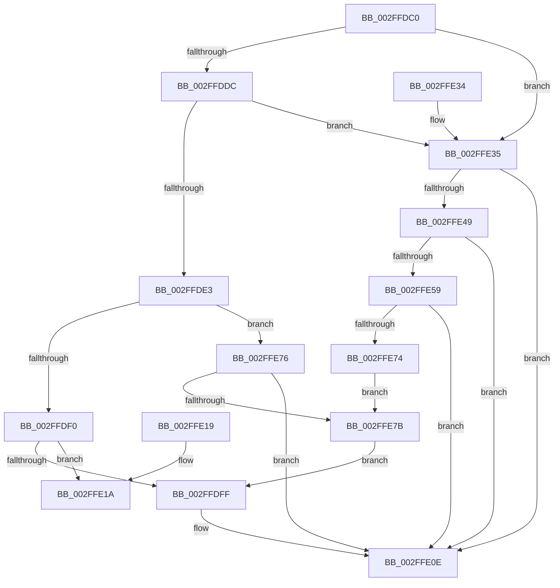

# SepMatchPackage

- RVA: `0x002FFDC0`–`0x002FFE7F` (길이 `191` bytes)
- VA: `0x00000001402FFDC0`
- 실행 섹션: `.text`
- PDB 이름 있음: `예`; PDB Function 태그: `아니요`
- unwind 정보 RVA: `0x00072EA0`
- 디코드: `57`개 명령, `191/191` bytes 표시
- 미해석 바이트: `0` (있으면 어셈블리에 `.byte`로 보존)

> 이 문서는 커널 이미지의 기계어와 PDB 기호를 분석해 생성했습니다. 4번과 5번은 함수 원형과 자료형을 바이너리 사용 방식에서 추정한 C 해석이며 원본 소스 복구 결과는 아닙니다.

## 1. Dependencies

- 직접 호출 지점: **2**; 고유 호출 대상: **2**
- 직접 호출자로 확인된 함수: **4**
- RIP 상대 이미지 참조: **0**

### Outgoing calls
- `0x002FFDF6` → [SepCanTokenMatchAllPackageSid](SepCanTokenMatchAllPackageSid_function_002FFE90.md) (function, `0x002FFE90`)
- `0x002FFE6B` → [memcmp](../6C/memcmp_function_006C6B10.md) (function, `0x006C6B10`)

### Direct callers
- [SepMaximumAccessCheck](../30/SepMaximumAccessCheck_function_00300BF0.md) at `0x00300CFC`
- [SepNormalAccessCheckEx](../3C/SepNormalAccessCheckEx_function_003CFD8C.md) at `0x003CFF73`
- [SepNormalAccessCheck](../3D/SepNormalAccessCheck_function_003D0688.md) at `0x003D084C`
- [SepMaximumAccessCheckEx](../60/SepMaximumAccessCheckEx_function_00606D78.md) at `0x00606EC7`

### Static image references
- 디코드된 RIP-relative 메모리 참조가 없습니다.

## 2. Other-region calls and transfers

- 다른 실행 섹션으로 향하는 call: **0**
- 별도 외부 분기/꼬리 이동을 확인하지 못했습니다.

## 3. Assembly (complete function range)

```asm
002FFDC0  48 89 5C 24 08                  mov qword ptr [rsp + 8], rbx
002FFDC5  57                              push rdi
002FFDC6  48 83 EC 20                     sub rsp, 0x20
002FFDCA  41 83 78 08 02                  cmp dword ptr [r8 + 8], 2
002FFDCF  8B DA                           mov ebx, edx
002FFDD1  48 8B D1                        mov rdx, rcx
002FFDD4  41 8B F9                        mov edi, r9d
002FFDD7  49 8B C0                        mov rax, r8
002FFDDA  75 59                           jne 0x1402ffe35
002FFDDC  41 80 78 01 02                  cmp byte ptr [r8 + 1], 2
002FFDE1  75 52                           jne 0x1402ffe35
002FFDE3  41 8B 48 0C                     mov ecx, dword ptr [r8 + 0xc]
002FFDE7  83 F9 01                        cmp ecx, 1
002FFDEA  0F 85 86 00 00 00               jne 0x1402ffe76
002FFDF0  48 8B CA                        mov rcx, rdx
002FFDF3  41 23 D9                        and ebx, r9d
002FFDF6  E8 95 00 00 00                  call 0x1402ffe90
002FFDFB  84 C0                           test al, al
002FFDFD  74 1B                           je 0x1402ffe1a
002FFDFF  48 8B 44 24 58                  mov rax, qword ptr [rsp + 0x58]
002FFE04  09 18                           or dword ptr [rax], ebx
002FFE06  48 8B 44 24 50                  mov rax, qword ptr [rsp + 0x50]
002FFE0B  C6 00 01                        mov byte ptr [rax], 1
002FFE0E  48 8B 5C 24 30                  mov rbx, qword ptr [rsp + 0x30]
002FFE13  48 83 C4 20                     add rsp, 0x20
002FFE17  5F                              pop rdi
002FFE18  C3                              ret
002FFE19  CC                              int3
002FFE1A  48 8B 44 24 68                  mov rax, qword ptr [rsp + 0x68]
002FFE1F  09 18                           or dword ptr [rax], ebx
002FFE21  48 8B 44 24 70                  mov rax, qword ptr [rsp + 0x70]
002FFE26  48 8B 5C 24 30                  mov rbx, qword ptr [rsp + 0x30]
002FFE2B  C6 00 01                        mov byte ptr [rax], 1
002FFE2E  48 83 C4 20                     add rsp, 0x20
002FFE32  5F                              pop rdi
002FFE33  C3                              ret
002FFE34  CC                              int3
002FFE35  48 8B 4C 24 60                  mov rcx, qword ptr [rsp + 0x60]
002FFE3A  C6 01 01                        mov byte ptr [rcx], 1
002FFE3D  F7 82 C8 00 00 00 00 40 00 00   test dword ptr [rdx + 0xc8], 0x4000
002FFE47  74 C5                           je 0x1402ffe0e
002FFE49  48 8B 8A 10 03 00 00            mov rcx, qword ptr [rdx + 0x310]
002FFE50  0F B7 11                        movzx edx, word ptr [rcx]
002FFE53  66 41 3B 10                     cmp dx, word ptr [r8]
002FFE57  75 B5                           jne 0x1402ffe0e
002FFE59  44 8B C2                        mov r8d, edx
002FFE5C  48 8B D0                        mov rdx, rax
002FFE5F  49 C1 E8 08                     shr r8, 8
002FFE63  4E 8D 04 85 08 00 00 00         lea r8, [r8*4 + 8]
002FFE6B  E8 A0 6C 3C 00                  call 0x1406c6b10
002FFE70  85 C0                           test eax, eax
002FFE72  75 9A                           jne 0x1402ffe0e
002FFE74  EB 05                           jmp 0x1402ffe7b
002FFE76  83 F9 02                        cmp ecx, 2
002FFE79  75 93                           jne 0x1402ffe0e
002FFE7B  23 DF                           and ebx, edi
002FFE7D  EB 80                           jmp 0x1402ffdff
```

## 4. C-style interpretation (structured pseudocode)

```c
__int64 __fastcall SepMatchPackage(__int64 a1, int a2, __int64 a3, int a4, __int64 a5, __int64 a6, __int64 a7, __int64 a8, __int64 a9)
{
    __int64 result;
    __int64 v_rbx;
    __int64 v_rsp;
    unsigned __int64 v_stack_p30;
    unsigned __int64 v_stack_p8;

    v_stack_p8 = v_rbx;
    v_rsp = (v_rsp) - (32);
    if ((*(unsigned int *)(a3 + 8)) != 2) goto loc_002FFE35;
    if ((*(unsigned __int8 *)(a3 + 1)) != 2) goto loc_002FFE35;
    if (((unsigned int)((unsigned int)(*(unsigned int *)(a3 + 12)))) != 1) goto loc_002FFE76;
    v_rbx = (unsigned int)(((unsigned int)(a2)) & (a4));
    result = SepCanTokenMatchAllPackageSid(a1, a1, a3, a4);
    if ((unsigned __int8)(result) == 0) goto loc_002FFE1A;
loc_002FFDFF:
    *(unsigned __int8 *)(a5) = 1;
loc_002FFE0E:
    v_rsp = (v_rsp) + (32);
    return a5;
loc_002FFE1A:
    *(unsigned __int8 *)(a9) = 1;
    v_rsp = (v_rsp) + (32);
    return a9;
loc_002FFE35:
    *(unsigned __int8 *)(a7) = 1;
    if (((*(unsigned int *)(a1 + 200)) & (0x4000ULL)) == 0) goto loc_002FFE0E;
    if (((unsigned __int16)(*(unsigned __int16 *)(*(unsigned __int64 *)(a1 + 784)))) != (*(unsigned __int16 *)(a3))) goto loc_002FFE0E;
    a3 = ((unsigned int)((unsigned int)(*(unsigned __int16 *)(*(unsigned __int64 *)(a1 + 784))))) >> (8);
    result = memcmp(*(unsigned __int64 *)(a1 + 784), a9, a3 * 4 + 8, a4);
    if ((unsigned int)(result) != 0) goto loc_002FFE0E;
    goto loc_002FFE7B;
loc_002FFE76:
    if (((unsigned int)(*(unsigned __int64 *)(a1 + 784))) != 2) goto loc_002FFE0E;
loc_002FFE7B:
    v_rbx = (unsigned int)((v_stack_p30) & ((unsigned int)((unsigned int)(a4))));
    goto loc_002FFDFF;
}
```

## 5. (Beta) C Style

```c
void *SepMatchPackage(void *Arg1, int32_t Arg2, void *Arg3, int32_t Arg4, void *Arg5, void *Arg6, void *Arg7, void *Arg8, void *Arg9)
{
    uint8_t *arg1 = (uint8_t *)Arg1;
    uint8_t *arg3 = (uint8_t *)Arg3;
    uint8_t *arg5 = (uint8_t *)Arg5;
    uint8_t *arg6 = (uint8_t *)Arg6;
    uint8_t *arg7 = (uint8_t *)Arg7;
    uint8_t *arg8 = (uint8_t *)Arg8;
    uint8_t *arg9 = (uint8_t *)Arg9;

    int64_t result;
    int64_t local_rbx;
    int64_t local_rsp;
    uint64_t v_stack_p30;
    uint64_t v_stack_p8;

    v_stack_p8 = local_rbx;
    local_rsp = (local_rsp) - (32);
    if ((*(uint32_t *)(arg3 + 0x8)) != 2) goto loc_002FFE35;
    if ((*(uint8_t *)(arg3 + 0x1)) != 2) goto loc_002FFE35;
    if (((uint32_t)((uint32_t)(*(uint32_t *)(arg3 + 0xC)))) != 1) goto loc_002FFE76;
    local_rbx = (uint32_t)(((uint32_t)(Arg2)) & (Arg4));
    result = SepCanTokenMatchAllPackageSid(Arg1, Arg1, Arg3, Arg4);
    if ((uint8_t)(result) == 0) goto loc_002FFE1A;
loc_002FFDFF:
    *(uint8_t *)(arg5) = 1;
loc_002FFE0E:
    local_rsp = (local_rsp) + (32);
    return Arg5;
loc_002FFE1A:
    *(uint8_t *)(arg9) = 1;
    local_rsp = (local_rsp) + (32);
    return Arg9;
loc_002FFE35:
    *(uint8_t *)(arg7) = 1;
    if (((*(uint32_t *)(arg1 + 0xC8)) & (0x4000ULL)) == 0) goto loc_002FFE0E;
    if (((uint16_t)(*(uint16_t *)(*(uint64_t *)(arg1 + 0x310)))) != (*(uint16_t *)(arg3))) goto loc_002FFE0E;
    Arg3 = ((uint32_t)((uint32_t)(*(uint16_t *)(*(uint64_t *)(arg1 + 0x310))))) >> (8);
    result = memcmp(*(uint64_t *)(arg1 + 0x310), Arg9, Arg3 * 4 + 8, Arg4);
    if ((uint32_t)(result) != 0) goto loc_002FFE0E;
    goto loc_002FFE7B;
loc_002FFE76:
    if (((uint32_t)(*(uint64_t *)(arg1 + 0x310))) != 2) goto loc_002FFE0E;
loc_002FFE7B:
    local_rbx = (uint32_t)((v_stack_p30) & ((uint32_t)((uint32_t)(Arg4))));
    goto loc_002FFDFF;
}
```

### 관측된 메모리 오프셋

구조체 형식이 확인되지 않은 접근은 인자 기준의 오프셋으로만 기록했습니다.

| 기준 인자 | 오프셋 표현 | 폭 (bit) | 접근 |
|---|---:|---:|---|
| `Arg1` | `+ 0xC8` | `32` | `R` |
| `Arg1` | `+ 0x310` | `64` | `R` |
| `Arg3` | `+ 0x0` | `16` | `R` |
| `Arg3` | `+ 0x1` | `8` | `R` |
| `Arg3` | `+ 0x8` | `32` | `R` |
| `Arg3` | `+ 0xC` | `32` | `R` |
| `Arg5` | `+ 0x0` | `8` | `W` |
| `Arg6` | `+ 0x0` | `32` | `R/W` |
| `Arg7` | `+ 0x0` | `8` | `W` |
| `Arg8` | `+ 0x0` | `32` | `R/W` |
| `Arg9` | `+ 0x0` | `8` | `W` |

## 6. Execution-region graph

[열기: 2D/3D 그래프와 함수 탐색 컨트롤 패널](../../../control-panel.html?section=text&rva=0x002FFDC0&view=graph)

- 2D 그래프는 위에서 아래로 흐르고, 3D 그래프는 빈 공간을 드래그해 회전합니다. Shift+드래그는 이동, 휠은 확대·축소, 함수 노드 선택은 대상 보고서 이동입니다.

### Static fallback


