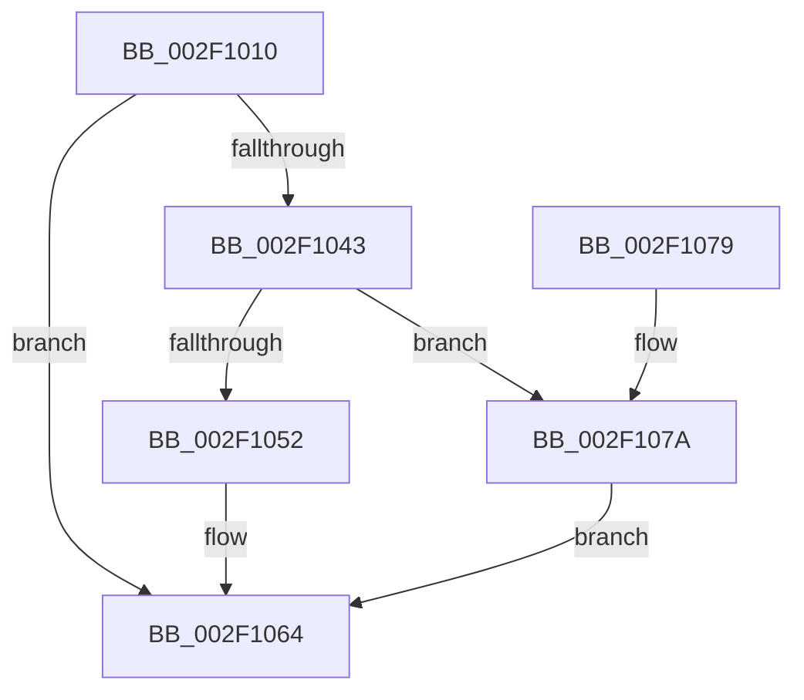

# TlgAggregateAbsorbEvent

- RVA: `0x002F1010`–`0x002F10A0` (길이 `144` bytes)
- VA: `0x00000001402F1010`
- 실행 섹션: `.text`
- PDB 이름 있음: `예`; PDB Function 태그: `예`
- unwind 정보 RVA: `0x00071DA4`
- 디코드: `39`개 명령, `144/144` bytes 표시
- 미해석 바이트: `0` (있으면 어셈블리에 `.byte`로 보존)

> 이 문서는 커널 이미지의 기계어와 PDB 기호를 분석해 생성했습니다. 4번과 5번은 함수 원형과 자료형을 바이너리 사용 방식에서 추정한 C 해석이며 원본 소스 복구 결과는 아닙니다.

## 1. Dependencies

- 직접 호출 지점: **3**; 고유 호출 대상: **3**
- 직접 호출자로 확인된 함수: **1**
- RIP 상대 이미지 참조: **1**

### Outgoing calls
- `0x002F1046` → [ExtractAggregateFieldTypes](ExtractAggregateFieldTypes_function_002F1390.md) (function, `0x002F1390`)
- `0x002F105F` → [InsertEventEntryInLookUpTable](InsertEventEntryInLookUpTable_function_002F1424.md) (function, `0x002F1424`)
- `0x002F1099` → [EtwWriteEx](../25/EtwWriteEx_function_0025F0D0.md) (function, `0x0025F0D0`)

### Direct callers
- [tlgWriteAgg](tlgWriteAgg_function_002F0F7C.md) at `0x002F0FFC`

### Static image references
- `0x002F102B` → RVA `0x00A69500` (`TlgAggregateInternalRegisteredProviderEtwCallback`; read)

## 2. Other-region calls and transfers

- 다른 실행 섹션으로 향하는 call: **0**
- 별도 외부 분기/꼬리 이동을 확인하지 못했습니다.

## 3. Assembly (complete function range)

```asm
002F1010  48 89 5C 24 08                  mov qword ptr [rsp + 8], rbx
002F1015  48 89 6C 24 10                  mov qword ptr [rsp + 0x10], rbp
002F101A  48 89 74 24 18                  mov qword ptr [rsp + 0x18], rsi
002F101F  57                              push rdi
002F1020  48 83 EC 40                     sub rsp, 0x40
002F1024  48 8B F9                        mov rdi, rcx
002F1027  41 0F B6 F0                     movzx esi, r8b
002F102B  48 8D 0D CE 84 77 00            lea rcx, [rip + 0x7784ce]
002F1032  49 8B D9                        mov rbx, r9
002F1035  48 8B EA                        mov rbp, rdx
002F1038  B8 0D 00 00 C0                  mov eax, 0xc000000d
002F103D  48 39 4F 28                     cmp qword ptr [rdi + 0x28], rcx
002F1041  75 21                           jne 0x1402f1064
002F1043  48 8B D3                        mov rdx, rbx
002F1046  E8 45 03 00 00                  call 0x1402f1390
002F104B  48 8B D5                        mov rdx, rbp
002F104E  84 C0                           test al, al
002F1050  74 28                           je 0x1402f107a
002F1052  4C 8B CB                        mov r9, rbx
002F1055  88 44 24 20                     mov byte ptr [rsp + 0x20], al
002F1059  44 8A C6                        mov r8b, sil
002F105C  48 8B CF                        mov rcx, rdi
002F105F  E8 C0 03 00 00                  call 0x1402f1424
002F1064  48 8B 5C 24 50                  mov rbx, qword ptr [rsp + 0x50]
002F1069  48 8B 6C 24 58                  mov rbp, qword ptr [rsp + 0x58]
002F106E  48 8B 74 24 60                  mov rsi, qword ptr [rsp + 0x60]
002F1073  48 83 C4 40                     add rsp, 0x40
002F1077  5F                              pop rdi
002F1078  C3                              ret
002F1079  CC                              int3
002F107A  48 8B 4F 20                     mov rcx, qword ptr [rdi + 0x20]
002F107E  45 33 C9                        xor r9d, r9d
002F1081  48 89 5C 24 38                  mov qword ptr [rsp + 0x38], rbx
002F1086  45 33 C0                        xor r8d, r8d
002F1089  89 74 24 30                     mov dword ptr [rsp + 0x30], esi
002F108D  48 83 64 24 28 00               and qword ptr [rsp + 0x28], 0
002F1093  48 83 64 24 20 00               and qword ptr [rsp + 0x20], 0
002F1099  E8 32 E0 F6 FF                  call 0x14025f0d0
002F109E  EB C4                           jmp 0x1402f1064
```

## 4. C-style interpretation (structured pseudocode)

```c
__int64 __fastcall TlgAggregateAbsorbEvent(__int64 a1, __int64 a2, unsigned __int8 a3, __int64 a4)
{
    __int64 result;
    __int64 v_rsp;
    unsigned __int8 v_stack_m28;
    unsigned __int64 v_stack_p10;
    unsigned __int64 v_stack_p18;
    unsigned __int64 v_stack_p20;
    unsigned __int64 v_stack_p28;
    unsigned int v_stack_p30;
    unsigned __int64 v_stack_p38;
    unsigned __int64 v_stack_p8;

    v_stack_p8 = v_rbx;
    v_stack_p10 = v_rbp;
    v_stack_p18 = v_rsi;
    v_rsp = (v_rsp) - (64);
    if ((*(unsigned __int64 *)(a1 + 40)) != (v_rip + 7832782)) goto loc_002F1064;
    result = ExtractAggregateFieldTypes(v_rip + 7832782, a4, a3, a4);
    if ((unsigned __int8)(result) == 0) goto loc_002F107A;
    v_stack_m28 = (unsigned __int8)(result);
    result = InsertEventEntryInLookUpTable(a1, a2, a3, a4);
loc_002F1064:
    v_rsp = (v_rsp) + (64);
    return result;
loc_002F107A:
    a4 = 0;
    v_stack_p38 = v_stack_p8;
    a3 = 0;
    v_stack_p30 = (unsigned int)(v_stack_p18);
    result = EtwWriteEx(*(unsigned __int64 *)(a1 + 32), a2, a3, a4);
    goto loc_002F1064;
}
```

## 5. (Beta) C Style

```c
int64_t TlgAggregateAbsorbEvent(void *Arg1, int64_t Arg2, uint8_t Arg3, int64_t Arg4)
{
    uint8_t *arg1 = (uint8_t *)Arg1;

    int64_t result;
    int64_t local_rsp;
    uint8_t v_stack_m28;
    uint64_t v_stack_p10;
    uint64_t v_stack_p18;
    uint64_t v_stack_p20;
    uint64_t v_stack_p28;
    uint32_t v_stack_p30;
    uint64_t v_stack_p38;
    uint64_t v_stack_p8;

    v_stack_p8 = local_rbx;
    v_stack_p10 = local_rbp;
    v_stack_p18 = local_rsi;
    local_rsp = (local_rsp) - (64);
    if ((*(uint64_t *)(arg1 + 0x28)) != (v_rip + 7832782)) goto loc_002F1064;
    result = ExtractAggregateFieldTypes(v_rip + 7832782, Arg4, Arg3, Arg4);
    if ((uint8_t)(result) == 0) goto loc_002F107A;
    v_stack_m28 = (uint8_t)(result);
    result = InsertEventEntryInLookUpTable(Arg1, Arg2, Arg3, Arg4);
loc_002F1064:
    local_rsp = (local_rsp) + (64);
    return result;
loc_002F107A:
    Arg4 = 0;
    v_stack_p38 = v_stack_p8;
    Arg3 = 0;
    v_stack_p30 = (uint32_t)(v_stack_p18);
    result = EtwWriteEx(*(uint64_t *)(arg1 + 0x20), Arg2, Arg3, Arg4);
    goto loc_002F1064;
}
```

### 관측된 메모리 오프셋

구조체 형식이 확인되지 않은 접근은 인자 기준의 오프셋으로만 기록했습니다.

| 기준 인자 | 오프셋 표현 | 폭 (bit) | 접근 |
|---|---:|---:|---|
| `Arg1` | `+ 0x20` | `64` | `R` |
| `Arg1` | `+ 0x28` | `64` | `R` |

## 6. Execution-region graph

[열기: 2D/3D 그래프와 함수 탐색 컨트롤 패널](../../../control-panel.html?section=text&rva=0x002F1010&view=graph)

- 2D 그래프는 위에서 아래로 흐르고, 3D 그래프는 빈 공간을 드래그해 회전합니다. Shift+드래그는 이동, 휠은 확대·축소, 함수 노드 선택은 대상 보고서 이동입니다.

### Static fallback


