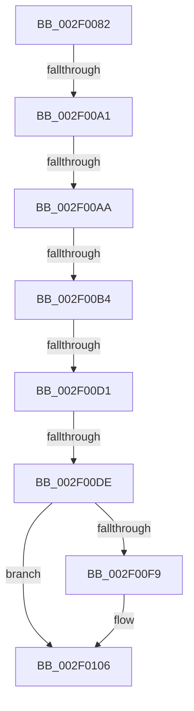

# sub_002F0082

- RVA: `0x002F0082`–`0x002F0118` (길이 `150` bytes)
- VA: `0x00000001402F0082`
- 실행 섹션: `.text`
- PDB 이름 있음: `아니요`; PDB Function 태그: `아니요`
- unwind 정보 RVA: `0x00071B7C`
- 디코드: `31`개 명령, `150/150` bytes 표시
- 미해석 바이트: `0` (있으면 어셈블리에 `.byte`로 보존)

> 이 문서는 커널 이미지의 기계어와 PDB 기호를 분석해 생성했습니다. 4번과 5번은 함수 원형과 자료형을 바이너리 사용 방식에서 추정한 C 해석이며 원본 소스 복구 결과는 아닙니다.

## 1. Dependencies

- 직접 호출 지점: **2**; 고유 호출 대상: **2**
- 직접 호출자로 확인된 함수: **0**
- RIP 상대 이미지 참조: **5**

### Outgoing calls
- `0x002F00BF` → [ExpAcquireSpinLockSharedAtDpcLevelInstrumented](../27/ExpAcquireSpinLockSharedAtDpcLevelInstrumented_function_0027CD20.md) (function, `0x0027CD20`)
- `0x002F0101` → [KiLowerIrqlProcessIrqlFlags](../4F/KiLowerIrqlProcessIrqlFlags_function_004F5698.md) (function, `0x004F5698`)

### Direct callers
- 이 함수 시작 RVA로 연결되는 직접 call은 확인되지 않았습니다. 간접 호출은 완전히 역산할 수 없습니다.

### Static image references
- `0x002F0094` → RVA `0x00FC6D20` (`ALMOSTRO`; read)
- `0x002F00A1` → RVA `0x00FC6B06` (`ALMOSTRO`; read)
- `0x002F00AA` → RVA `0x00F0DE58` (`.data`; read)
- `0x002F00B8` → RVA `0x00EFACC8` (`.data`; read)
- `0x002F00DE` → RVA `0x00EFACC8` (`.data`; read/write)

## 2. Other-region calls and transfers

- 다른 실행 섹션으로 향하는 call: **0**
- call이 아닌 외부 분기/꼬리 이동: **6**
  - `0x002F009B` → [sub_002F0126 + 0x37](Unknown_function_002F0126.md) (`tail-transfer`)
  - `0x002F00A8` → [sub_002F0126](Unknown_function_002F0126.md) (`tail-transfer`)
  - `0x002F00B2` → [sub_002F0126](Unknown_function_002F0126.md) (`tail-transfer`)
  - `0x002F00CB` → [sub_002F01EB](Unknown_function_002F01EB.md) (`tail-transfer`)
  - `0x002F00D8` → [sub_002F0187](Unknown_function_002F0187.md) (`tail-transfer`)
  - `0x002F0116` → [sub_002F016E + 0xA](Unknown_function_002F016E.md) (`tail-transfer`)

## 3. Assembly (complete function range)

```asm
002F0082  48 89 74 24 30                  mov qword ptr [rsp + 0x30], rsi
002F0087  44 0F 20 C6                     mov rsi, cr8
002F008B  B8 02 00 00 00                  mov eax, 2
002F0090  44 0F 22 C0                     mov cr8, rax
002F0094  83 3D 85 6C CD 00 00            cmp dword ptr [rip + 0xcd6c85], 0
002F009B  0F 85 BC 00 00 00               jne 0x1402f015d
002F00A1  F6 05 5E 6A CD 00 21            test byte ptr [rip + 0xcd6a5e], 0x21
002F00A8  74 7C                           je 0x1402f0126
002F00AA  8B 05 A8 DD C1 00               mov eax, dword ptr [rip + 0xc1dda8]
002F00B0  85 C0                           test eax, eax
002F00B2  75 72                           jne 0x1402f0126
002F00B4  40 0F B6 D6                     movzx edx, sil
002F00B8  48 8D 0D 09 AC C0 00            lea rcx, [rip + 0xc0ac09]
002F00BF  E8 5C CC F8 FF                  call 0x14027cd20
002F00C4  48 8B 1F                        mov rbx, qword ptr [rdi]
002F00C7  48 83 E3 F0                     and rbx, 0xfffffffffffffff0
002F00CB  0F 85 1A 01 00 00               jne 0x1402f01eb
002F00D1  F6 05 2E 6A CD 00 01            test byte ptr [rip + 0xcd6a2e], 1
002F00D8  0F 85 A9 00 00 00               jne 0x1402f0187
002F00DE  F0 81 25 DF AB C0 00 FF FF FF BF  lock and dword ptr [rip + 0xc0abdf], 0xbfffffff
002F00E9  F0 FF 0D D8 AB C0 00            lock dec dword ptr [rip + 0xc0abd8]
002F00F0  83 3D 29 6C CD 00 00            cmp dword ptr [rip + 0xcd6c29], 0
002F00F7  74 0D                           je 0x1402f0106
002F00F9  44 0F 20 C1                     mov rcx, cr8
002F00FD  40 0F B6 D6                     movzx edx, sil
002F0101  E8 92 55 20 00                  call 0x1404f5698
002F0106  40 0F B6 C6                     movzx eax, sil
002F010A  44 0F 22 C0                     mov cr8, rax
002F010E  48 8B 74 24 30                  mov rsi, qword ptr [rsp + 0x30]
002F0113  48 85 DB                        test rbx, rbx
002F0116  75 60                           jne 0x1402f0178
```

## 4. C-style interpretation (structured pseudocode)

```c
__int64 __fastcall sub_002F0082(__int64 a1, __int64 a2, __int64 a3, __int64 a4, __int64 a5, __int64 a6)
{
    __int64 result;
    __int64 v_rbx;
    unsigned __int64 v_stack_p30;

    v_stack_p30 = v_rsi;
    result = ExpAcquireSpinLockSharedAtDpcLevelInstrumented(v_rip + 12626953, (unsigned __int8)(v_cr8), a3, a4);
    v_rbx = (*(unsigned __int64 *)(v_rdi)) & (-16);
    if ((*(unsigned int *)(v_rip + 13462569)) != 0) {
        a1 = 2;
        a2 = (unsigned __int8)(v_cr8);
        result = KiLowerIrqlProcessIrqlFlags(a1, a2, a3, a4);
    }
}
```

## 5. (Beta) C Style

```c
int64_t sub_002F0082(int64_t Arg1, int64_t Arg2, int64_t Arg3, int64_t Arg4, uint64_t Arg5, int64_t Arg6)
{
    int64_t result;
    int64_t local_rbx;
    uint64_t v_stack_p30;

    v_stack_p30 = local_rsi;
    result = ExpAcquireSpinLockSharedAtDpcLevelInstrumented(v_rip + 12626953, (uint8_t)(v_cr8), Arg3, Arg4);
    local_rbx = (*(uint64_t *)(local_rdi)) & (-16);
    if ((*(uint32_t *)(v_rip + 0xCD6C29)) != 0) {
        Arg1 = 2;
        Arg2 = (uint8_t)(v_cr8);
        result = KiLowerIrqlProcessIrqlFlags(Arg1, Arg2, Arg3, Arg4);
    }
}
```

## 6. Execution-region graph

[열기: 2D/3D 그래프와 함수 탐색 컨트롤 패널](../../../control-panel.html?section=text&rva=0x002F0082&view=graph)

- 2D 그래프는 위에서 아래로 흐르고, 3D 그래프는 빈 공간을 드래그해 회전합니다. Shift+드래그는 이동, 휠은 확대·축소, 함수 노드 선택은 대상 보고서 이동입니다.

### Static fallback


