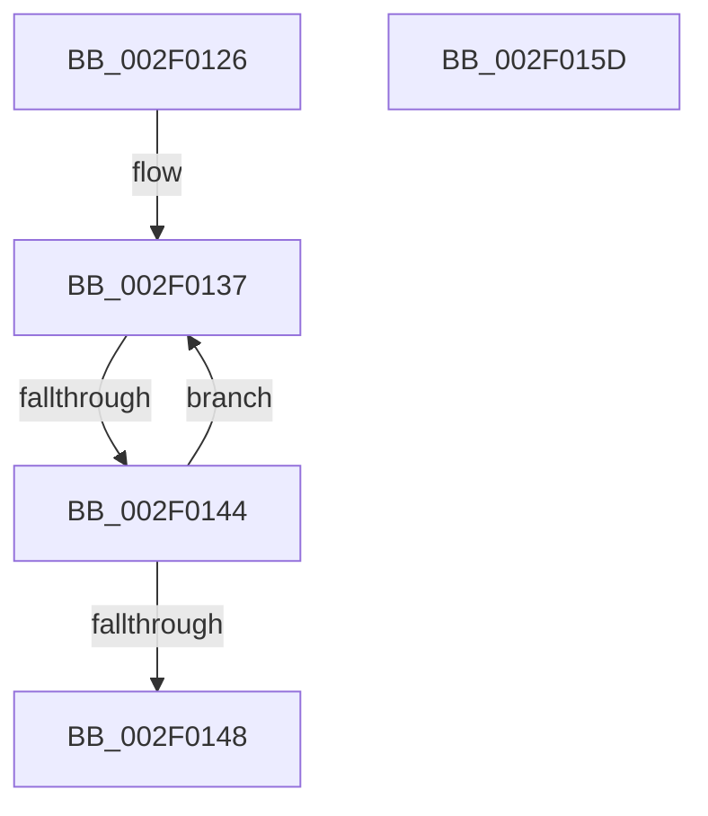

# sub_002F0126

- RVA: `0x002F0126`–`0x002F016E` (길이 `72` bytes)
- VA: `0x00000001402F0126`
- 실행 섹션: `.text`
- PDB 이름 있음: `아니요`; PDB Function 태그: `아니요`
- unwind 정보 RVA: `0x00071BA4`
- 디코드: `16`개 명령, `72/72` bytes 표시
- 미해석 바이트: `0` (있으면 어셈블리에 `.byte`로 보존)

> 이 문서는 커널 이미지의 기계어와 PDB 기호를 분석해 생성했습니다. 4번과 5번은 함수 원형과 자료형을 바이너리 사용 방식에서 추정한 C 해석이며 원본 소스 복구 결과는 아닙니다.

## 1. Dependencies

- 직접 호출 지점: **2**; 고유 호출 대상: **2**
- 직접 호출자로 확인된 함수: **0**
- RIP 상대 이미지 참조: **1**

### Outgoing calls
- `0x002F0153` → [ExpWaitForSpinLockSharedAndAcquire](../36/ExpWaitForSpinLockSharedAndAcquire_function_00362380.md) (function, `0x00362380`)
- `0x002F0164` → [KiRaiseIrqlProcessIrqlFlags](../4F/KiRaiseIrqlProcessIrqlFlags_function_004F56FC.md) (function, `0x004F56FC`)

### Direct callers
- 이 함수 시작 RVA로 연결되는 직접 call은 확인되지 않았습니다. 간접 호출은 완전히 역산할 수 없습니다.

### Static image references
- `0x002F0126` → RVA `0x00EFACC8` (`.data`; read)

## 2. Other-region calls and transfers

- 다른 실행 섹션으로 향하는 call: **0**
- call이 아닌 외부 분기/꼬리 이동: **3**
  - `0x002F0142` → [sub_002F0082 + 0x42](Unknown_function_002F0082.md) (`tail-transfer`)
  - `0x002F0158` → [sub_002F0082 + 0x42](Unknown_function_002F0082.md) (`tail-transfer`)
  - `0x002F0169` → [sub_002F0082 + 0x1F](Unknown_function_002F0082.md) (`tail-transfer`)

## 3. Assembly (complete function range)

```asm
002F0126  0F 0D 0D 9B AB C0 00            prefetchw byte ptr [rip + 0xc0ab9b]
002F012D  8B 05 95 AB C0 00               mov eax, dword ptr [rip + 0xc0ab95]
002F0133  0F BA F0 1F                     btr eax, 0x1f
002F0137  8D 48 01                        lea ecx, [rax + 1]
002F013A  F0 0F B1 0D 86 AB C0 00         lock cmpxchg dword ptr [rip + 0xc0ab86], ecx
002F0142  74 80                           je 0x1402f00c4
002F0144  85 C0                           test eax, eax
002F0146  79 EF                           jns 0x1402f0137
002F0148  40 0F B6 D6                     movzx edx, sil
002F014C  48 8D 0D 75 AB C0 00            lea rcx, [rip + 0xc0ab75]
002F0153  E8 28 22 07 00                  call 0x140362380
002F0158  E9 67 FF FF FF                  jmp 0x1402f00c4
002F015D  0F B6 D0                        movzx edx, al
002F0160  40 0F B6 CE                     movzx ecx, sil
002F0164  E8 93 55 20 00                  call 0x1404f56fc
002F0169  E9 33 FF FF FF                  jmp 0x1402f00a1
```

## 4. C-style interpretation (structured pseudocode)

```c
__int64 __fastcall sub_002F0126(void)
{
    __int64 result;

loc_002F0137:
    if (!sign_flag) goto loc_002F0137;
    result = ExpWaitForSpinLockSharedAndAcquire(v_rip + 12626805, (unsigned __int8)(v_rsi), a3, a4);
}
```

## 5. (Beta) C Style

```c
void sub_002F0126(void)
{
    int64_t result;

loc_002F0137:
    if (!sign_flag) goto loc_002F0137;
    result = ExpWaitForSpinLockSharedAndAcquire(v_rip + 12626805, (uint8_t)(local_rsi), a3, a4);
}
```

## 6. Execution-region graph

[열기: 2D/3D 그래프와 함수 탐색 컨트롤 패널](../../../control-panel.html?section=text&rva=0x002F0126&view=graph)

- 2D 그래프는 위에서 아래로 흐르고, 3D 그래프는 빈 공간을 드래그해 회전합니다. Shift+드래그는 이동, 휠은 확대·축소, 함수 노드 선택은 대상 보고서 이동입니다.

### Static fallback


