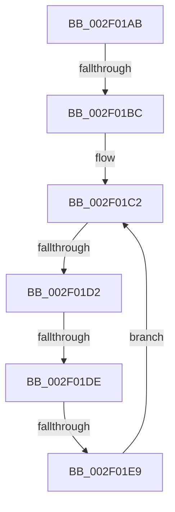

# sub_002F01AB

- RVA: `0x002F01AB`–`0x002F01EB` (길이 `64` bytes)
- VA: `0x00000001402F01AB`
- 실행 섹션: `.text`
- PDB 이름 있음: `아니요`; PDB Function 태그: `아니요`
- unwind 정보 RVA: `0x00071BE0`
- 디코드: `20`개 명령, `64/64` bytes 표시
- 미해석 바이트: `0` (있으면 어셈블리에 `.byte`로 보존)

> 이 문서는 커널 이미지의 기계어와 PDB 기호를 분석해 생성했습니다. 4번과 5번은 함수 원형과 자료형을 바이너리 사용 방식에서 추정한 C 해석이며 원본 소스 복구 결과는 아닙니다.

## 1. Dependencies

- 직접 호출 지점: **1**; 고유 호출 대상: **1**
- 직접 호출자로 확인된 함수: **0**
- RIP 상대 이미지 참조: **0**

### Outgoing calls
- `0x002F01B3` → [ExAcquireRundownProtectionEx](../41/ExAcquireRundownProtectionEx_function_0041BEE0.md) (function, `0x0041BEE0`)

### Direct callers
- 이 함수 시작 RVA로 연결되는 직접 call은 확인되지 않았습니다. 간접 호출은 완전히 역산할 수 없습니다.

### Static image references
- 디코드된 RIP-relative 메모리 참조가 없습니다.

## 2. Other-region calls and transfers

- 다른 실행 섹션으로 향하는 call: **0**
- call이 아닌 외부 분기/꼬리 이동: **4**
  - `0x002F01BA` → [sub_002F016E + 0xA](Unknown_function_002F016E.md) (`tail-transfer`)
  - `0x002F01D0` → [sub_002F0200](Unknown_function_002F0200.md) (`tail-transfer`)
  - `0x002F01DC` → [sub_002F0200](Unknown_function_002F0200.md) (`tail-transfer`)
  - `0x002F01E7` → [sub_002F016E + 0xA](Unknown_function_002F016E.md) (`tail-transfer`)

## 3. Assembly (complete function range)

```asm
002F01AB  BA 0F 00 00 00                  mov edx, 0xf
002F01B0  48 8B CB                        mov rcx, rbx
002F01B3  E8 28 BD 12 00                  call 0x14041bee0
002F01B8  84 C0                           test al, al
002F01BA  74 BC                           je 0x1402f0178
002F01BC  0F 0D 0F                        prefetchw byte ptr [rdi]
002F01BF  48 8B 07                        mov rax, qword ptr [rdi]
002F01C2  48 8B C8                        mov rcx, rax
002F01C5  83 E1 0F                        and ecx, 0xf
002F01C8  48 83 C1 0F                     add rcx, 0xf
002F01CC  48 83 F9 0F                     cmp rcx, 0xf
002F01D0  77 2E                           ja 0x1402f0200
002F01D2  48 8B C8                        mov rcx, rax
002F01D5  48 83 E1 F0                     and rcx, 0xfffffffffffffff0
002F01D9  48 3B D9                        cmp rbx, rcx
002F01DC  75 22                           jne 0x1402f0200
002F01DE  48 8D 48 0F                     lea rcx, [rax + 0xf]
002F01E2  F0 48 0F B1 0F                  lock cmpxchg qword ptr [rdi], rcx
002F01E7  74 8F                           je 0x1402f0178
002F01E9  EB D7                           jmp 0x1402f01c2
```

## 4. C-style interpretation (structured pseudocode)

```c
__int64 __fastcall sub_002F01AB(void)
{
    __int64 result;

    result = ExAcquireRundownProtectionEx(v_rbx, 15, a3, a4);
loc_002F01C2:
    a1 = (unsigned int)((*(unsigned __int64 *)(v_rdi)) & (15));
    a1 = (a1) + (15);
    a1 = (*(unsigned __int64 *)(v_rdi)) & (-16);
    goto loc_002F01C2;
}
```

## 5. (Beta) C Style

```c
void sub_002F01AB(void)
{
    int64_t result;

    result = ExAcquireRundownProtectionEx(local_rbx, 15, a3, a4);
loc_002F01C2:
    a1 = (uint32_t)((*(uint64_t *)(local_rdi)) & (15));
    a1 = (a1) + (15);
    a1 = (*(uint64_t *)(local_rdi)) & (-16);
    goto loc_002F01C2;
}
```

## 6. Execution-region graph

[열기: 2D/3D 그래프와 함수 탐색 컨트롤 패널](../../../control-panel.html?section=text&rva=0x002F01AB&view=graph)

- 2D 그래프는 위에서 아래로 흐르고, 3D 그래프는 빈 공간을 드래그해 회전합니다. Shift+드래그는 이동, 휠은 확대·축소, 함수 노드 선택은 대상 보고서 이동입니다.

### Static fallback


