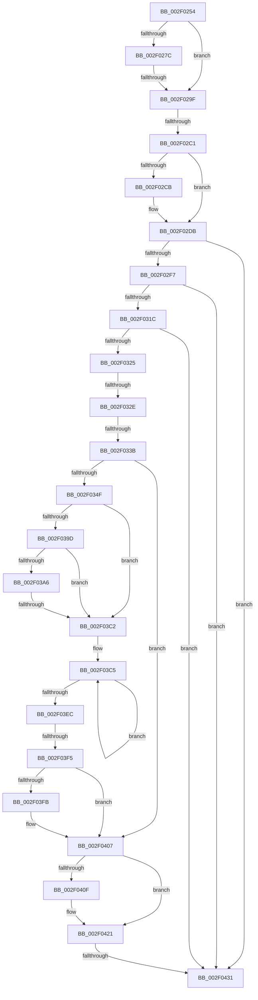

# sub_002F0254

- RVA: `0x002F0254`–`0x002F0448` (길이 `500` bytes)
- VA: `0x00000001402F0254`
- 실행 섹션: `.text`
- PDB 이름 있음: `아니요`; PDB Function 태그: `아니요`
- unwind 정보 RVA: `0x00071C28`
- 디코드: `114`개 명령, `500/500` bytes 표시
- 미해석 바이트: `0` (있으면 어셈블리에 `.byte`로 보존)

> 이 문서는 커널 이미지의 기계어와 PDB 기호를 분석해 생성했습니다. 4번과 5번은 함수 원형과 자료형을 바이너리 사용 방식에서 추정한 C 해석이며 원본 소스 복구 결과는 아닙니다.

## 1. Dependencies

- 직접 호출 지점: **1**; 고유 호출 대상: **1**
- 직접 호출자로 확인된 함수: **0**
- RIP 상대 이미지 참조: **4**

### Outgoing calls
- `0x002F041C` → [ObpPushStackInfo](../21/ObpPushStackInfo_function_002109E4.md) (function, `0x002109E4`)

### Direct callers
- 이 함수 시작 RVA로 연결되는 직접 call은 확인되지 않았습니다. 간접 호출은 완전히 역산할 수 없습니다.

### Static image references
- `0x002F025C` → RVA `0x00000000` (`image boundary/outside`; read)
- `0x002F02FE` → RVA `0x00FC7228` (`ALMOSTRO`; read)
- `0x002F0342` → RVA `0x00FC6AB0` (`ALMOSTRO`; read)
- `0x002F0407` → RVA `0x00FC5010` (`ALMOSTRO`; read)

## 2. Other-region calls and transfers

- 다른 실행 섹션으로 향하는 call: **0**
- call이 아닌 외부 분기/꼬리 이동: **7**
  - `0x002F0299` → [sub_002F06FC](Unknown_function_002F06FC.md) (`tail-transfer`)
  - `0x002F02BB` → [sub_002F0454 + 0x61](Unknown_function_002F0454.md) (`tail-transfer`)
  - `0x002F0328` → [sub_002F0454 + 0x253](Unknown_function_002F0454.md) (`tail-transfer`)
  - `0x002F0335` → [sub_002F0454 + 0x253](Unknown_function_002F0454.md) (`tail-transfer`)
  - `0x002F03BC` → [sub_002F0454](Unknown_function_002F0454.md) (`tail-transfer`)
  - `0x002F03EF` → [sub_002F0454 + 0x179](Unknown_function_002F0454.md) (`tail-transfer`)
  - `0x002F042B` → [sub_002F0454 + 0x1E7](Unknown_function_002F0454.md) (`tail-transfer`)

## 3. Assembly (complete function range)

```asm
002F0254  48 89 9C 24 80 00 00 00         mov qword ptr [rsp + 0x80], rbx
002F025C  4C 8D 05 9D FD D0 FF            lea r8, [rip - 0x2f0263]
002F0263  48 BA 00 00 00 00 00 80 FF FF   movabs rdx, 0xffff800000000000
002F026D  4C 89 64 24 48                  mov qword ptr [rsp + 0x48], r12
002F0272  4C 89 6C 24 40                  mov qword ptr [rsp + 0x40], r13
002F0277  48 3B F2                        cmp rsi, rdx
002F027A  72 23                           jb 0x1402f029f
002F027C  48 8B C6                        mov rax, rsi
002F027F  48 C1 E8 27                     shr rax, 0x27
002F0283  25 FF 01 00 00                  and eax, 0x1ff
002F0288  2D 00 01 00 00                  sub eax, 0x100
002F028D  42 0F B6 8C 00 A8 8A E3 00      movzx ecx, byte ptr [rax + r8 + 0xe38aa8]
002F0296  83 F9 05                        cmp ecx, 5
002F0299  0F 84 5D 04 00 00               je 0x1402f06fc
002F029F  41 BD 40 00 00 00               mov r13d, 0x40
002F02A5  48 89 7C 24 50                  mov qword ptr [rsp + 0x50], rdi
002F02AA  48 8B DD                        mov rbx, rbp
002F02AD  49 C7 C4 FF FF FF FF            mov r12, 0xffffffffffffffff
002F02B4  48 F7 C6 FF 0F 00 00            test rsi, 0xfff
002F02BB  0F 84 F4 01 00 00               je 0x1402f04b5
002F02C1  F6 46 F3 04                     test byte ptr [rsi - 0xd], 4
002F02C5  48 8D 5E F0                     lea rbx, [rsi - 0x10]
002F02C9  74 10                           je 0x1402f02db
002F02CB  0F B7 03                        movzx eax, word ptr [rbx]
002F02CE  0F B6 C8                        movzx ecx, al
002F02D1  48 F7 D9                        neg rcx
002F02D4  48 C1 E1 04                     shl rcx, 4
002F02D8  48 03 D9                        add rbx, rcx
002F02DB  0F B7 43 02                     movzx eax, word ptr [rbx + 2]
002F02DF  44 8B 7B 04                     mov r15d, dword ptr [rbx + 4]
002F02E3  44 0F B6 F0                     movzx r14d, al
002F02E7  49 C1 E6 04                     shl r14, 4
002F02EB  66 C1 E8 08                     shr ax, 8
002F02EF  A8 08                           test al, 8
002F02F1  0F 84 3A 01 00 00               je 0x1402f0431
002F02F7  48 8B 7B 08                     mov rdi, qword ptr [rbx + 8]
002F02FB  48 8B C3                        mov rax, rbx
002F02FE  48 33 3D 23 6F CD 00            xor rdi, qword ptr [rip + 0xcd6f23]
002F0305  48 33 FB                        xor rdi, rbx
002F0308  48 33 05 19 6F CD 00            xor rax, qword ptr [rip + 0xcd6f19]
002F030F  48 89 43 08                     mov qword ptr [rbx + 8], rax
002F0313  48 85 FF                        test rdi, rdi
002F0316  0F 84 15 01 00 00               je 0x1402f0431
002F031C  49 3B FC                        cmp rdi, r12
002F031F  0F 84 0C 01 00 00               je 0x1402f0431
002F0325  48 3B FA                        cmp rdi, rdx
002F0328  0F 82 79 03 00 00               jb 0x1402f06a7
002F032E  0F B6 07                        movzx eax, byte ptr [rdi]
002F0331  24 7F                           and al, 0x7f
002F0333  3C 03                           cmp al, 3
002F0335  0F 85 6C 03 00 00               jne 0x1402f06a7
002F033B  41 81 E5 00 01 00 00            and r13d, 0x100
002F0342  48 3B 3D 67 67 CD 00            cmp rdi, qword ptr [rip + 0xcd6767]
002F0349  0F 84 B8 00 00 00               je 0x1402f0407
002F034F  4D 85 ED                        test r13, r13
002F0352  8B C5                           mov eax, ebp
002F0354  0F 95 C0                        setne al
002F0357  44 8B D0                        mov r10d, eax
002F035A  48 8B 87 F8 02 00 00            mov rax, qword ptr [rdi + 0x2f8]
002F0361  45 8B DA                        mov r11d, r10d
002F0364  49 C1 E3 07                     shl r11, 7
002F0368  4C 89 94 24 90 00 00 00         mov qword ptr [rsp + 0x90], r10
002F0370  47 0F B6 AC D0 50 73 FC 00      movzx r13d, byte ptr [r8 + r10*8 + 0xfc7350]
002F0379  48 89 84 24 88 00 00 00         mov qword ptr [rsp + 0x88], rax
002F0381  49 8D 34 03                     lea rsi, [r11 + rax]
002F0385  4C 89 9C 24 98 00 00 00         mov qword ptr [rsp + 0x98], r11
002F038D  0F 0D 0E                        prefetchw byte ptr [rsi]
002F0390  48 8B 1E                        mov rbx, qword ptr [rsi]
002F0393  48 8B 46 40                     mov rax, qword ptr [rsi + 0x40]
002F0397  48 39 6E 50                     cmp qword ptr [rsi + 0x50], rbp
002F039B  74 25                           je 0x1402f03c2
002F039D  49 6B CA 38                     imul rcx, r10, 0x38
002F03A1  48 3B C3                        cmp rax, rbx
002F03A4  76 1C                           jbe 0x1402f03c2
002F03A6  4D 8D 80 48 66 F0 00            lea r8, [r8 + 0xf06648]
002F03AD  4C 03 C1                        add r8, rcx
002F03B0  48 8B C8                        mov rcx, rax
002F03B3  48 2B CB                        sub rcx, rbx
002F03B6  49 8B 10                        mov rdx, qword ptr [r8]
002F03B9  48 3B CA                        cmp rcx, rdx
002F03BC  0F 87 92 00 00 00               ja 0x1402f0454
002F03C2  4D 8B C6                        mov r8, r14
002F03C5  4C 3B F3                        cmp r14, rbx
002F03C8  4C 8B CB                        mov r9, rbx
002F03CB  48 8B CB                        mov rcx, rbx
002F03CE  48 8B D5                        mov rdx, rbp
002F03D1  4D 0F 42 CE                     cmovb r9, r14
002F03D5  48 8B C3                        mov rax, rbx
002F03D8  49 2B CE                        sub rcx, r14
002F03DB  4C 3B F3                        cmp r14, rbx
002F03DE  48 0F 42 D1                     cmovb rdx, rcx
002F03E2  F0 48 0F B1 16                  lock cmpxchg qword ptr [rsi], rdx
002F03E7  48 8B D8                        mov rbx, rax
002F03EA  75 D9                           jne 0x1402f03c5
002F03EC  4D 2B F1                        sub r14, r9
002F03EF  0F 85 D8 01 00 00               jne 0x1402f05cd
002F03F5  41 F6 C5 04                     test r13b, 4
002F03F9  74 0C                           je 0x1402f0407
002F03FB  49 F7 D8                        neg r8
002F03FE  F0 4E 01 84 D7 00 02 00 00      lock add qword ptr [rdi + r10*8 + 0x200], r8
002F0407  39 2D 03 4C CD 00               cmp dword ptr [rip + 0xcd4c03], ebp
002F040D  74 12                           je 0x1402f0421
002F040F  33 D2                           xor edx, edx
002F0411  48 8D 4F D0                     lea rcx, [rdi - 0x30]
002F0415  45 8B CF                        mov r9d, r15d
002F0418  44 8D 42 01                     lea r8d, [rdx + 1]
002F041C  E8 C3 05 F2 FF                  call 0x1402109e4
002F0421  F0 4C 0F C1 67 D0               lock xadd qword ptr [rdi - 0x30], r12
002F0427  49 83 EC 01                     sub r12, 1
002F042B  0F 8E 0A 02 00 00               jle 0x1402f063b
002F0431  48 8B 7C 24 50                  mov rdi, qword ptr [rsp + 0x50]
002F0436  4C 8B 64 24 48                  mov r12, qword ptr [rsp + 0x48]
002F043B  48 8B 9C 24 80 00 00 00         mov rbx, qword ptr [rsp + 0x80]
002F0443  4C 8B 6C 24 40                  mov r13, qword ptr [rsp + 0x40]
```

## 4. C-style interpretation (structured pseudocode)

```c
__int64 __fastcall sub_002F0254(__int64 a1, __int64 a2, __int64 a3, __int64 a4, __int64 a5, __int64 a6, __int64 a7, __int64 a8, __int64 a9, __int64 a10, __int64 a11, __int64 a12, __int64 a13, __int64 a14, __int64 a15, __int64 a16)
{
    __int64 result;
    __int64 v_r11;
    __int64 v_r12;
    __int64 v_r13;
    __int64 v_r14;
    __int64 v_rbx;
    __int64 v_rdi;
    unsigned __int64 v_stack_p40;
    unsigned __int64 v_stack_p48;
    unsigned __int64 v_stack_p50;
    unsigned __int64 v_stack_p80;
    unsigned __int64 v_stack_p88;
    unsigned __int64 v_stack_p90;
    unsigned __int64 v_stack_p98;

    v_stack_p80 = v_rbx;
    v_stack_p48 = v_r12;
    v_stack_p40 = v_r13;
    if (v_rsi < a2) goto loc_002F029F;
    result = (v_rsi) >> (39);
    result = (unsigned int)((result) & (511));
    result = (unsigned int)((result) - (256));
loc_002F029F:
    v_stack_p50 = v_rdi;
    v_rbx = v_rsi - 16;
    if (((*(unsigned __int8 *)(v_rsi - 13)) & (4)) != 0) {
        result = *(unsigned __int16 *)(v_rsi - 16);
        a1 = (unsigned __int8)(result);
        a1 = -(a1);
        a1 = (a1) << (4);
        v_rbx = (v_rsi - 16) + (a1);
    }
    v_r14 = ((unsigned __int8)(*(unsigned __int16 *)(v_rbx + 2))) << (4);
    result = (unsigned __int16)((*(unsigned __int16 *)(v_rbx + 2)) >> (8));
    if ((((unsigned __int8)(result)) & (8)) == 0) goto loc_002F0431;
    v_rdi = (*(unsigned __int64 *)(v_rbx + 8)) ^ (*(unsigned __int64 *)(v_rip + 13463331));
    v_rdi = (v_rdi) ^ (v_rbx);
    result = (v_rbx) ^ (*(unsigned __int64 *)(v_rip + 13463321));
    *(unsigned __int64 *)(v_rbx + 8) = result;
    if (v_rdi == 0) goto loc_002F0431;
    if (v_rdi == -1) goto loc_002F0431;
    result = (unsigned __int8)((*(unsigned __int8 *)(v_rdi)) & (127));
    v_r13 = (unsigned int)((64) & (256));
    if (v_rdi == (*(unsigned __int64 *)(v_rip + 13461351))) goto loc_002F0407;
    result = (v_r13 != 0) ? 1 : 0;
    v_r11 = ((unsigned int)((unsigned int)((unsigned int)((unsigned int)(result))))) << (7);
    v_stack_p90 = (unsigned int)((unsigned int)(result));
    v_stack_p88 = *(unsigned __int64 *)(v_rdi + 760);
    v_stack_p98 = v_r11;
    if ((*(unsigned __int64 *)(v_r11 + *(unsigned __int64 *)(v_rdi + 760) * 1 + 80)) == v_rbp) goto loc_002F03C2;
    a1 = (a1) * ((unsigned int)((unsigned int)(result)));
    if ((*(unsigned __int64 *)(v_r11 + *(unsigned __int64 *)(v_rdi + 760) * 1 + 64)) <= (*(unsigned __int64 *)(v_r11 + *(unsigned __int64 *)(v_rdi + 760) * 1))) goto loc_002F03C2;
    a3 = (v_rip - 3080803 + 15754824) + (a1);
    a1 = (*(unsigned __int64 *)(v_r11 + *(unsigned __int64 *)(v_rdi + 760) * 1 + 64)) - (*(unsigned __int64 *)(v_r11 + *(unsigned __int64 *)(v_rdi + 760) * 1));
loc_002F03C2:
loc_002F03C5:
    a4 = *(unsigned __int64 *)(v_r11 + *(unsigned __int64 *)(v_rdi + 760) * 1);
    if (v_r14 < (*(unsigned __int64 *)(v_r11 + *(unsigned __int64 *)(v_rdi + 760) * 1))) { a4 = v_r14; }
    a1 = (*(unsigned __int64 *)(v_r11 + *(unsigned __int64 *)(v_rdi + 760) * 1)) - (v_r14);
    a2 = v_rbp;
    if (v_r14 < (*(unsigned __int64 *)(v_r11 + *(unsigned __int64 *)(v_rdi + 760) * 1))) { a2 = a1; }
    if (v_r14 != (*(unsigned __int64 *)(v_r11 + *(unsigned __int64 *)(v_rdi + 760) * 1))) goto loc_002F03C5;
    v_r14 = (v_r14) - (a4);
    if ((((unsigned __int8)(*(unsigned __int8 *)(v_rip - 3080803 + (unsigned int)((unsigned int)(result)) * 8 + 16544592))) & (4)) != 0) {
        a3 = -(v_r14);
    }
    result = *(unsigned __int64 *)(v_r11 + *(unsigned __int64 *)(v_rdi + 760) * 1);
    if ((*(unsigned int *)(v_rip + 13454339)) != ((unsigned int)(v_rbp))) {
        a2 = 0;
        a1 = v_rdi - 48;
        a4 = (unsigned int)((unsigned int)(*(unsigned int *)(v_rbx + 4)));
        a3 = a2 + 1;
        result = ObpPushStackInfo(a1, a2, a3, a4);
    }
    v_r12 = (-1) - (1);
loc_002F0431:
    return result;
}
```

## 5. (Beta) C Style

```c
int64_t sub_002F0254(int64_t Arg1, int64_t Arg2, int64_t Arg3, int64_t Arg4, uint64_t Arg5, uint64_t Arg6, uint64_t Arg7, int64_t Arg8, int64_t Arg9, int64_t Arg10, uint64_t Arg11, uint64_t Arg12, uint64_t Arg13, uint64_t Arg14, uint64_t Arg15, int64_t Arg16)
{
    int64_t result;
    int64_t local_r11;
    int64_t local_r12;
    int64_t local_r13;
    int64_t local_r14;
    int64_t local_rbx;
    int64_t local_rdi;
    uint64_t v_stack_p40;
    uint64_t v_stack_p48;
    uint64_t v_stack_p50;
    uint64_t v_stack_p80;
    uint64_t v_stack_p88;
    uint64_t v_stack_p90;
    uint64_t v_stack_p98;

    v_stack_p80 = local_rbx;
    v_stack_p48 = local_r12;
    v_stack_p40 = local_r13;
    if (local_rsi < Arg2) goto loc_002F029F;
    result = (local_rsi) >> (39);
    result = (uint32_t)((result) & (511));
    result = (uint32_t)((result) - (256));
loc_002F029F:
    v_stack_p50 = local_rdi;
    local_rbx = local_rsi - 16;
    if (((*(uint8_t *)(local_rsi - 0xD)) & (4)) != 0) {
        result = *(uint16_t *)(local_rsi - 0x10);
        Arg1 = (uint8_t)(result);
        Arg1 = -(Arg1);
        Arg1 = (Arg1) << (4);
        local_rbx = (local_rsi - 16) + (Arg1);
    }
    local_r14 = ((uint8_t)(*(uint16_t *)(local_rbx + 0x2))) << (4);
    result = (uint16_t)((*(uint16_t *)(local_rbx + 0x2)) >> (8));
    if ((((uint8_t)(result)) & (8)) == 0) goto loc_002F0431;
    local_rdi = (*(uint64_t *)(local_rbx + 0x8)) ^ (*(uint64_t *)(v_rip + 0xCD6F23));
    local_rdi = (local_rdi) ^ (local_rbx);
    result = (local_rbx) ^ (*(uint64_t *)(v_rip + 0xCD6F19));
    *(uint64_t *)(local_rbx + 0x8) = result;
    if (local_rdi == 0) goto loc_002F0431;
    if (local_rdi == -1) goto loc_002F0431;
    result = (uint8_t)((*(uint8_t *)(local_rdi)) & (127));
    local_r13 = (uint32_t)((64) & (256));
    if (local_rdi == (*(uint64_t *)(v_rip + 0xCD6767))) goto loc_002F0407;
    result = (local_r13 != 0) ? 1 : 0;
    local_r11 = ((uint32_t)((uint32_t)((uint32_t)((uint32_t)(result))))) << (7);
    v_stack_p90 = (uint32_t)((uint32_t)(result));
    v_stack_p88 = *(uint64_t *)(local_rdi + 0x2F8);
    v_stack_p98 = local_r11;
    if ((*(uint64_t *)(local_r11 + *(uint64_t *)(local_rdi + 0x2F8) * 1 + 0x50)) == local_rbp) goto loc_002F03C2;
    Arg1 = (Arg1) * ((uint32_t)((uint32_t)(result)));
    if ((*(uint64_t *)(local_r11 + *(uint64_t *)(local_rdi + 0x2F8) * 1 + 0x40)) <= (*(uint64_t *)(local_r11 + *(uint64_t *)(local_rdi + 0x2F8) * 1))) goto loc_002F03C2;
    Arg3 = (v_rip - 3080803 + 15754824) + (Arg1);
    Arg1 = (*(uint64_t *)(local_r11 + *(uint64_t *)(local_rdi + 0x2F8) * 1 + 0x40)) - (*(uint64_t *)(local_r11 + *(uint64_t *)(local_rdi + 0x2F8) * 1));
loc_002F03C2:
loc_002F03C5:
    Arg4 = *(uint64_t *)(local_r11 + *(uint64_t *)(local_rdi + 0x2F8) * 1);
    if (local_r14 < (*(uint64_t *)(local_r11 + *(uint64_t *)(local_rdi + 0x2F8) * 1))) { Arg4 = local_r14; }
    Arg1 = (*(uint64_t *)(local_r11 + *(uint64_t *)(local_rdi + 0x2F8) * 1)) - (local_r14);
    Arg2 = local_rbp;
    if (local_r14 < (*(uint64_t *)(local_r11 + *(uint64_t *)(local_rdi + 0x2F8) * 1))) { Arg2 = Arg1; }
    if (local_r14 != (*(uint64_t *)(local_r11 + *(uint64_t *)(local_rdi + 0x2F8) * 1))) goto loc_002F03C5;
    local_r14 = (local_r14) - (Arg4);
    if ((((uint8_t)(*(uint8_t *)(v_rip - 0x2F0263 + (uint32_t)((uint32_t)(result)) * 8 + 0xFC7350))) & (4)) != 0) {
        Arg3 = -(local_r14);
    }
    result = *(uint64_t *)(local_r11 + *(uint64_t *)(local_rdi + 0x2F8) * 1);
    if ((*(uint32_t *)(v_rip + 0xCD4C03)) != ((uint32_t)(local_rbp))) {
        Arg2 = 0;
        Arg1 = local_rdi - 48;
        Arg4 = (uint32_t)((uint32_t)(*(uint32_t *)(local_rbx + 0x4)));
        Arg3 = Arg2 + 1;
        result = ObpPushStackInfo(Arg1, Arg2, Arg3, Arg4);
    }
    local_r12 = (-1) - (1);
loc_002F0431:
    return result;
}
```

## 6. Execution-region graph

[열기: 2D/3D 그래프와 함수 탐색 컨트롤 패널](../../../control-panel.html?section=text&rva=0x002F0254&view=graph)

- 2D 그래프는 위에서 아래로 흐르고, 3D 그래프는 빈 공간을 드래그해 회전합니다. Shift+드래그는 이동, 휠은 확대·축소, 함수 노드 선택은 대상 보고서 이동입니다.

### Static fallback


