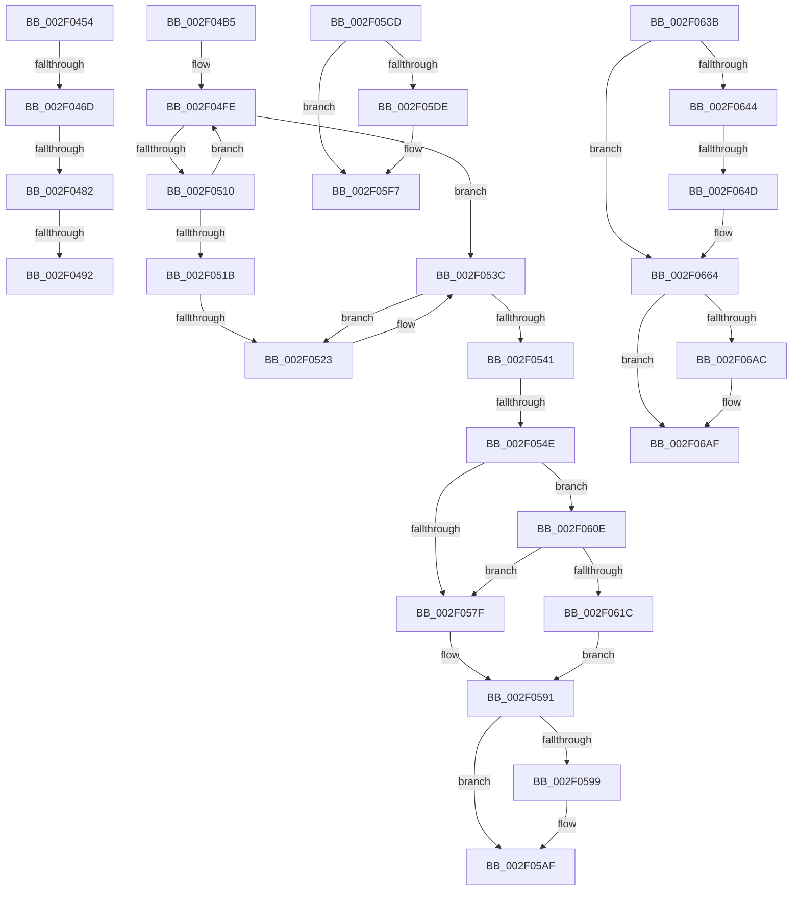

# sub_002F0454

- RVA: `0x002F0454`–`0x002F06CA` (길이 `630` bytes)
- VA: `0x00000001402F0454`
- 실행 섹션: `.text`
- PDB 이름 있음: `아니요`; PDB Function 태그: `아니요`
- unwind 정보 RVA: `0x00071C5C`
- 디코드: `143`개 명령, `630/630` bytes 표시
- 미해석 바이트: `0` (있으면 어셈블리에 `.byte`로 보존)

> 이 문서는 커널 이미지의 기계어와 PDB 기호를 분석해 생성했습니다. 4번과 5번은 함수 원형과 자료형을 바이너리 사용 방식에서 추정한 C 해석이며 원본 소스 복구 결과는 아닙니다.

## 1. Dependencies

- 직접 호출 지점: **9**; 고유 호출 대상: **5**
- 직접 호출자로 확인된 함수: **0**
- RIP 상대 이미지 참조: **11**

### Outgoing calls
- `0x002F049B` → [PspReturnResourceQuota](../38/PspReturnResourceQuota_function_0038FFC4.md) (function, `0x0038FFC4`)
- `0x002F04BC` → [ExAcquireSpinLockShared](../24/ExAcquireSpinLockShared_function_0024DCE0.md) (function, `0x0024DCE0`)
- `0x002F0536` → [KeBugCheckEx](../4F/KeBugCheckEx_function_004FD660.md) (function, `0x004FD660`)
- `0x002F05A1` → [KiLowerIrqlProcessIrqlFlags](../4F/KiLowerIrqlProcessIrqlFlags_function_004F5698.md) (function, `0x004F5698`)
- `0x002F05F1` → [KeBugCheckEx](../4F/KeBugCheckEx_function_004FD660.md) (function, `0x004FD660`)
- `0x002F0628` → [ExpReleaseSpinLockSharedFromDpcLevelInstrumented](ExpReleaseSpinLockSharedFromDpcLevelInstrumented_function_002F0F48.md) (function, `0x002F0F48`)
- `0x002F065E` → [KeBugCheckEx](../4F/KeBugCheckEx_function_004FD660.md) (function, `0x004FD660`)
- `0x002F06A1` → [KeBugCheckEx](../4F/KeBugCheckEx_function_004FD660.md) (function, `0x004FD660`)
- `0x002F06C4` → [KeBugCheckEx](../4F/KeBugCheckEx_function_004FD660.md) (function, `0x004FD660`)

### Direct callers
- 이 함수 시작 RVA로 연결되는 직접 call은 확인되지 않았습니다. 간접 호출은 완전히 역산할 수 없습니다.

### Static image references
- `0x002F04B5` → RVA `0x00EFACF8` (`.data`; read)
- `0x002F04C1` → RVA `0x00EFED38` (`.data`; read)
- `0x002F04CB` → RVA `0x00EFED30` (`.data`; read)
- `0x002F0555` → RVA `0x00FC7228` (`ALMOSTRO`; read)
- `0x002F0572` → RVA `0x00FC6B06` (`ALMOSTRO`; read)
- `0x002F057F` → RVA `0x00EFACF8` (`.data`; read/write)
- `0x002F0591` → RVA `0x00FC6D20` (`ALMOSTRO`; read)
- `0x002F05C1` → RVA `0x00000000` (`image boundary/outside`; read)
- `0x002F05CD` → RVA `0x00E27F80` (`.data`; read)
- `0x002F060E` → RVA `0x00F0DE58` (`.data`; read)
- `0x002F0688` → RVA `0x00FC6E4C` (`ALMOSTRO`; read)

## 2. Other-region calls and transfers

- 다른 실행 섹션으로 향하는 call: **0**
- call이 아닌 외부 분기/꼬리 이동: **9**
  - `0x002F0467` → [sub_002F0254 + 0x16E](Unknown_function_002F0254.md) (`tail-transfer`)
  - `0x002F047C` → [sub_002F0254 + 0x16E](Unknown_function_002F0254.md) (`tail-transfer`)
  - `0x002F048C` → [sub_002F0254 + 0x16E](Unknown_function_002F0254.md) (`tail-transfer`)
  - `0x002F04B0` → [sub_002F0254 + 0x16E](Unknown_function_002F0254.md) (`tail-transfer`)
  - `0x002F051D` → [sub_002F06DC + 0x8](Unknown_function_002F06DC.md) (`tail-transfer`)
  - `0x002F0548` → [sub_002F06DC](Unknown_function_002F06DC.md) (`tail-transfer`)
  - `0x002F05C8` → [sub_002F0254 + 0xBF](Unknown_function_002F0254.md) (`tail-transfer`)
  - `0x002F0609` → [sub_002F0254 + 0x171](Unknown_function_002F0254.md) (`tail-transfer`)
  - `0x002F0647` → [sub_002F06DC + 0x12](Unknown_function_002F06DC.md) (`tail-transfer`)

## 3. Assembly (complete function range)

```asm
002F0454  49 3B D6                        cmp rdx, r14
002F0457  48 8B C8                        mov rcx, rax
002F045A  49 0F 47 D6                     cmova rdx, r14
002F045E  48 2B CA                        sub rcx, rdx
002F0461  F0 48 0F B1 4E 40               lock cmpxchg qword ptr [rsi + 0x40], rcx
002F0467  0F 85 55 FF FF FF               jne 0x1402f03c2
002F046D  48 8B C2                        mov rax, rdx
002F0470  F0 48 0F C1 46 48               lock xadd qword ptr [rsi + 0x48], rax
002F0476  48 03 D0                        add rdx, rax
002F0479  49 3B 10                        cmp rdx, qword ptr [r8]
002F047C  0F 86 40 FF FF FF               jbe 0x1402f03c2
002F0482  4C 8B C5                        mov r8, rbp
002F0485  4C 87 46 48                     xchg qword ptr [rsi + 0x48], r8
002F0489  4D 85 C0                        test r8, r8
002F048C  0F 84 30 FF FF FF               je 0x1402f03c2
002F0492  45 33 C9                        xor r9d, r9d
002F0495  48 8B D6                        mov rdx, rsi
002F0498  41 8B CA                        mov ecx, r10d
002F049B  E8 24 FB 09 00                  call 0x14038ffc4
002F04A0  4C 8B 94 24 90 00 00 00         mov r10, qword ptr [rsp + 0x90]
002F04A8  4C 8B 9C 24 98 00 00 00         mov r11, qword ptr [rsp + 0x98]
002F04B0  E9 0D FF FF FF                  jmp 0x1402f03c2
002F04B5  48 8D 0D 3C A8 C0 00            lea rcx, [rip + 0xc0a83c]
002F04BC  E8 1F D8 F5 FF                  call 0x14024dce0
002F04C1  4C 8B 15 70 E8 C0 00            mov r10, qword ptr [rip + 0xc0e870]
002F04C8  48 8B CE                        mov rcx, rsi
002F04CB  4C 8B 1D 5E E8 C0 00            mov r11, qword ptr [rip + 0xc0e85e]
002F04D2  44 0F B6 C0                     movzx r8d, al
002F04D6  48 C1 E9 0C                     shr rcx, 0xc
002F04DA  BF 01 00 00 00                  mov edi, 1
002F04DF  48 69 D1 5F 9E 00 00            imul rdx, rcx, 0x9e5f
002F04E6  41 8D 4A FF                     lea ecx, [r10 - 1]
002F04EA  88 84 24 88 00 00 00            mov byte ptr [rsp + 0x88], al
002F04F1  4C 8B CA                        mov r9, rdx
002F04F4  49 C1 E9 20                     shr r9, 0x20
002F04F8  44 33 CA                        xor r9d, edx
002F04FB  44 23 C9                        and r9d, ecx
002F04FE  41 8B D1                        mov edx, r9d
002F0501  48 C1 E2 05                     shl rdx, 5
002F0505  49 03 D3                        add rdx, r11
002F0508  48 8B 02                        mov rax, qword ptr [rdx]
002F050B  48 3B C6                        cmp rax, rsi
002F050E  74 2C                           je 0x1402f053c
002F0510  41 FF C1                        inc r9d
002F0513  41 8B C1                        mov eax, r9d
002F0516  49 3B C2                        cmp rax, r10
002F0519  72 E3                           jb 0x1402f04fe
002F051B  85 FF                           test edi, edi
002F051D  0F 85 C1 01 00 00               jne 0x1402f06e4
002F0523  BA 22 00 00 00                  mov edx, 0x22
002F0528  48 89 6C 24 20                  mov qword ptr [rsp + 0x20], rbp
002F052D  4D 8B CD                        mov r9, r13
002F0530  4C 8B C6                        mov r8, rsi
002F0533  8D 4A F7                        lea ecx, [rdx - 9]
002F0536  E8 25 D1 20 00                  call 0x1404fd660
002F053B  CC                              int3
002F053C  48 85 D2                        test rdx, rdx
002F053F  74 E2                           je 0x1402f0523
002F0541  F7 42 0C 00 01 00 00            test dword ptr [rdx + 0xc], 0x100
002F0548  0F 84 8E 01 00 00               je 0x1402f06dc
002F054E  44 8B 7A 08                     mov r15d, dword ptr [rdx + 8]
002F0552  48 8B FE                        mov rdi, rsi
002F0555  48 33 3D CC 6C CD 00            xor rdi, qword ptr [rip + 0xcd6ccc]
002F055C  48 8B C6                        mov rax, rsi
002F055F  48 33 7A 18                     xor rdi, qword ptr [rdx + 0x18]
002F0563  48 33 05 BE 6C CD 00            xor rax, qword ptr [rip + 0xcd6cbe]
002F056A  4C 8B 72 10                     mov r14, qword ptr [rdx + 0x10]
002F056E  48 89 42 18                     mov qword ptr [rdx + 0x18], rax
002F0572  F6 05 8D 65 CD 00 01            test byte ptr [rip + 0xcd658d], 1
002F0579  0F 85 8F 00 00 00               jne 0x1402f060e
002F057F  F0 81 25 6E A7 C0 00 FF FF FF BF  lock and dword ptr [rip + 0xc0a76e], 0xbfffffff
002F058A  F0 FF 0D 67 A7 C0 00            lock dec dword ptr [rip + 0xc0a767]
002F0591  39 1D 89 67 CD 00               cmp dword ptr [rip + 0xcd6789], ebx
002F0597  74 16                           je 0x1402f05af
002F0599  44 0F 20 C1                     mov rcx, cr8
002F059D  41 0F B6 D0                     movzx edx, r8b
002F05A1  E8 F2 50 20 00                  call 0x1404f5698
002F05A6  44 0F B6 84 24 88 00 00 00      movzx r8d, byte ptr [rsp + 0x88]
002F05AF  41 0F B6 C0                     movzx eax, r8b
002F05B3  44 0F 22 C0                     mov cr8, rax
002F05B7  48 BA 00 00 00 00 00 80 FF FF   movabs rdx, 0xffff800000000000
002F05C1  4C 8D 05 38 FA D0 FF            lea r8, [rip - 0x2f05c8]
002F05C8  E9 46 FD FF FF                  jmp 0x1402f0313
002F05CD  48 8D 05 AC 79 B3 00            lea rax, [rip + 0xb379ac]
002F05D4  48 39 84 24 88 00 00 00         cmp qword ptr [rsp + 0x88], rax
002F05DC  75 19                           jne 0x1402f05f7
002F05DE  4D 8B C8                        mov r9, r8
002F05E1  4C 89 74 24 20                  mov qword ptr [rsp + 0x20], r14
002F05E6  4D 8B C2                        mov r8, r10
002F05E9  48 8B D7                        mov rdx, rdi
002F05EC  B9 21 00 00 00                  mov ecx, 0x21
002F05F1  E8 6A D0 20 00                  call 0x1404fd660
002F05F6  CC                              int3
002F05F7  48 89 84 24 88 00 00 00         mov qword ptr [rsp + 0x88], rax
002F05FF  49 8D 34 03                     lea rsi, [r11 + rax]
002F0603  0F 0D 0E                        prefetchw byte ptr [rsi]
002F0606  48 8B 1E                        mov rbx, qword ptr [rsi]
002F0609  E9 B7 FD FF FF                  jmp 0x1402f03c5
002F060E  8B 05 44 D8 C1 00               mov eax, dword ptr [rip + 0xc1d844]
002F0614  85 C0                           test eax, eax
002F0616  0F 85 63 FF FF FF               jne 0x1402f057f
002F061C  48 8B 54 24 78                  mov rdx, qword ptr [rsp + 0x78]
002F0621  48 8D 0D D0 A6 C0 00            lea rcx, [rip + 0xc0a6d0]
002F0628  E8 1B 09 00 00                  call 0x1402f0f48
002F062D  44 0F B6 84 24 88 00 00 00      movzx r8d, byte ptr [rsp + 0x88]
002F0636  E9 56 FF FF FF                  jmp 0x1402f0591
002F063B  48 8B 4F D8                     mov rcx, qword ptr [rdi - 0x28]
002F063F  48 85 C9                        test rcx, rcx
002F0642  75 20                           jne 0x1402f0664
002F0644  4D 85 E4                        test r12, r12
002F0647  0F 89 A1 00 00 00               jns 0x1402f06ee
002F064D  33 D2                           xor edx, edx
002F064F  4C 89 64 24 20                  mov qword ptr [rsp + 0x20], r12
002F0654  44 8D 49 04                     lea r9d, [rcx + 4]
002F0658  4C 8B C7                        mov r8, rdi
002F065B  8D 4A 18                        lea ecx, [rdx + 0x18]
002F065E  E8 FD CF 20 00                  call 0x1404fd660
002F0663  CC                              int3
002F0664  41 B9 03 00 00 00               mov r9d, 3
002F066A  48 89 4C 24 20                  mov qword ptr [rsp + 0x20], rcx
002F066F  48 8D 47 D0                     lea rax, [rdi - 0x30]
002F0673  4C 8B C7                        mov r8, rdi
002F0676  48 C1 E8 08                     shr rax, 8
002F067A  0F B6 D0                        movzx edx, al
002F067D  0F B6 47 E8                     movzx eax, byte ptr [rdi - 0x18]
002F0681  41 8D 49 15                     lea ecx, [r9 + 0x15]
002F0685  48 33 D0                        xor rdx, rax
002F0688  0F B6 05 BD 67 CD 00            movzx eax, byte ptr [rip + 0xcd67bd]
002F068F  48 33 D0                        xor rdx, rax
002F0692  48 8D 05 67 F9 D0 FF            lea rax, [rip - 0x2f0699]
002F0699  48 8B 94 D0 00 78 FC 00         mov rdx, qword ptr [rax + rdx*8 + 0xfc7800]
002F06A1  E8 BA CF 20 00                  call 0x1404fd660
002F06A6  CC                              int3
002F06A7  48 85 DB                        test rbx, rbx
002F06AA  74 03                           je 0x1402f06af
002F06AC  8B 6B 04                        mov ebp, dword ptr [rbx + 4]
002F06AF  44 8B CD                        mov r9d, ebp
002F06B2  4C 8B C6                        mov r8, rsi
002F06B5  BA 0D 00 00 00                  mov edx, 0xd
002F06BA  48 89 7C 24 20                  mov qword ptr [rsp + 0x20], rdi
002F06BF  B9 C2 00 00 00                  mov ecx, 0xc2
002F06C4  E8 97 CF 20 00                  call 0x1404fd660
002F06C9  CC                              int3
```

## 4. C-style interpretation (structured pseudocode)

```c
__int64 __fastcall sub_002F0454(__int64 a1, __int64 a2, __int64 a3, int a4, __int64 a5, __int64 a6, __int64 a7, __int64 a8, __int64 a9, __int64 a10, __int64 a11, __int64 a12, __int64 a13, __int64 a14, __int64 a15, __int64 a16, __int64 a17, __int64 a18, __int64 a19)
{
    __int64 result;
    unsigned __int64 v_stack_p20;
    unsigned __int64 v_stack_p78;
    unsigned __int8 v_stack_p88;

    if (a2 > v_r14) { a2 = v_r14; }
    a1 = (result) - (a2);
    a2 = (a2) + (a2);
    a4 = 0;
    result = PspReturnResourceQuota((unsigned int)((unsigned int)(v_r10)), v_rsi, v_rbp, a4);
}
```

## 5. (Beta) C Style

```c
int64_t sub_002F0454(int64_t Arg1, int64_t Arg2, void *Arg3, int32_t Arg4, uint64_t Arg5, uint64_t Arg6, uint64_t Arg7, uint64_t Arg8, uint64_t Arg9, uint64_t Arg10, uint64_t Arg11, uint64_t Arg12, uint64_t Arg13, uint64_t Arg14, uint64_t Arg15, uint64_t Arg16, uint64_t Arg17, int64_t Arg18, int64_t Arg19)
{
    uint8_t *arg3 = (uint8_t *)Arg3;

    int64_t result;
    uint64_t v_stack_p20;
    uint64_t v_stack_p78;
    uint8_t v_stack_p88;

    if (Arg2 > local_r14) { Arg2 = local_r14; }
    Arg1 = (result) - (Arg2);
    Arg2 = (Arg2) + (Arg2);
    Arg4 = 0;
    result = PspReturnResourceQuota((uint32_t)((uint32_t)(local_r10)), local_rsi, local_rbp, Arg4);
}
```

### 관측된 메모리 오프셋

구조체 형식이 확인되지 않은 접근은 인자 기준의 오프셋으로만 기록했습니다.

| 기준 인자 | 오프셋 표현 | 폭 (bit) | 접근 |
|---|---:|---:|---|
| `Arg3` | `+ 0x0` | `64` | `R` |

## 6. Execution-region graph

[열기: 2D/3D 그래프와 함수 탐색 컨트롤 패널](../../../control-panel.html?section=text&rva=0x002F0454&view=graph)

- 2D 그래프는 위에서 아래로 흐르고, 3D 그래프는 빈 공간을 드래그해 회전합니다. Shift+드래그는 이동, 휠은 확대·축소, 함수 노드 선택은 대상 보고서 이동입니다.

### Static fallback


