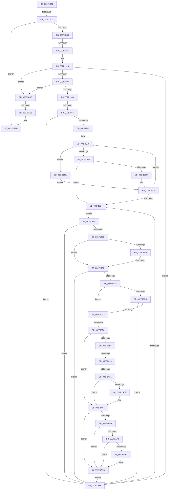

# sub_002F1861

- RVA: `0x002F1861`–`0x002F1B1D` (길이 `700` bytes)
- VA: `0x00000001402F1861`
- 실행 섹션: `.text`
- PDB 이름 있음: `아니요`; PDB Function 태그: `아니요`
- unwind 정보 RVA: `0x00071E38`
- 디코드: `175`개 명령, `700/700` bytes 표시
- 미해석 바이트: `0` (있으면 어셈블리에 `.byte`로 보존)

> 이 문서는 커널 이미지의 기계어와 PDB 기호를 분석해 생성했습니다. 4번과 5번은 함수 원형과 자료형을 바이너리 사용 방식에서 추정한 C 해석이며 원본 소스 복구 결과는 아닙니다.

## 1. Dependencies

- 직접 호출 지점: **9**; 고유 호출 대상: **8**
- 직접 호출자로 확인된 함수: **0**
- RIP 상대 이미지 참조: **6**

### Outgoing calls
- `0x002F18A8` → [memset](../6C/memset_function_006C6C40.md) (function, `0x006C6C40`)
- `0x002F18EA` → [RtlCaptureStackBackTrace](RtlCaptureStackBackTrace_function_002F9FF0.md) (function, `0x002F9FF0`)
- `0x002F1901` → [MiAllocatePool](../35/MiAllocatePool_function_0035B540.md) (function, `0x0035B540`)
- `0x002F191A` → [MmLockLoadedModuleListShared](MmLockLoadedModuleListShared_function_002F21E4.md) (function, `0x002F21E4`)
- `0x002F19FF` → [wcslen](../50/wcslen_function_00501BA0.md) (function, `0x00501BA0`)
- `0x002F1A3C` → [memcpy](../6C/memcpy_function_006C6840.md) (function, `0x006C6840`)
- `0x002F1A89` → [memcpy](../6C/memcpy_function_006C6840.md) (function, `0x006C6840`)
- `0x002F1AC4` → [MmUnlockLoadedModuleListShared](MmUnlockLoadedModuleListShared_function_002F2230.md) (function, `0x002F2230`)
- `0x002F1AF3` → [MiLogBadMapper](MiLogBadMapper_function_002F1140.md) (function, `0x002F1140`)

### Direct callers
- 이 함수 시작 RVA로 연결되는 직접 call은 확인되지 않았습니다. 간접 호출은 완전히 역산할 수 없습니다.

### Static image references
- `0x002F18AD` → RVA `0x00FC525C` (`ALMOSTRO`; read)
- `0x002F1948` → RVA `0x00EF54C0` (`.data`; read)
- `0x002F1956` → RVA `0x00E2D980` (`.data`; read)
- `0x002F19F8` → RVA `0x006CB4E0` (` ?? ::FNODOBFM::`string'`; read)
- `0x002F1AC9` → RVA `0x00E37618` (`.data`; read)
- `0x002F1AE1` → RVA `0x00E302C4` (`.data`; read/write)

## 2. Other-region calls and transfers

- 다른 실행 섹션으로 향하는 call: **0**
- call이 아닌 외부 분기/꼬리 이동: **9**
  - `0x002F18CA` → [sub_002F1B5E + 0x8D](Unknown_function_002F1B5E.md) (`tail-transfer`)
  - `0x002F1911` → [sub_002F1B5E + 0xB2](Unknown_function_002F1B5E.md) (`tail-transfer`)
  - `0x002F1950` → [sub_002F1B5E + 0x48](Unknown_function_002F1B5E.md) (`tail-transfer`)
  - `0x002F19BD` → [sub_002F1B5E + 0x16](Unknown_function_002F1B5E.md) (`tail-transfer`)
  - `0x002F19ED` → [sub_002F1B5E](Unknown_function_002F1B5E.md) (`tail-transfer`)
  - `0x002F1A0A` → [sub_002F1B5E + 0x77](Unknown_function_002F1B5E.md) (`tail-transfer`)
  - `0x002F1A1B` → [sub_002F1B5E + 0x77](Unknown_function_002F1B5E.md) (`tail-transfer`)
  - `0x002F1ADB` → [sub_002F1B5E + 0x81](Unknown_function_002F1B5E.md) (`tail-transfer`)
  - `0x002F1B1B` → [sub_002F1B1D + 0xA](Unknown_function_002F1B1D.md) (`tail-transfer`)

## 3. Assembly (complete function range)

```asm
002F1861  49 89 6B 18                     mov qword ptr [r11 + 0x18], rbp
002F1865  44 8B F2                        mov r14d, edx
002F1868  49 89 73 E0                     mov qword ptr [r11 - 0x20], rsi
002F186C  BD 80 00 00 00                  mov ebp, 0x80
002F1871  49 89 7B D8                     mov qword ptr [r11 - 0x28], rdi
002F1875  48 8B D9                        mov rbx, rcx
002F1878  41 8B F8                        mov edi, r8d
002F187B  44 89 44 24 4C                  mov dword ptr [rsp + 0x4c], r8d
002F1880  89 54 24 48                     mov dword ptr [rsp + 0x48], edx
002F1884  45 33 FF                        xor r15d, r15d
002F1887  48 89 4C 24 60                  mov qword ptr [rsp + 0x60], rcx
002F188C  44 8B C5                        mov r8d, ebp
002F188F  4D 89 63 D0                     mov qword ptr [r11 - 0x30], r12
002F1893  48 8D 4C 24 70                  lea rcx, [rsp + 0x70]
002F1898  33 D2                           xor edx, edx
002F189A  4D 89 6B C8                     mov qword ptr [r11 - 0x38], r13
002F189E  44 89 7C 24 50                  mov dword ptr [rsp + 0x50], r15d
002F18A3  48 89 6C 24 58                  mov qword ptr [rsp + 0x58], rbp
002F18A8  E8 93 53 3D 00                  call 0x1406c6c40
002F18AD  44 39 3D A8 39 CD 00            cmp dword ptr [rip + 0xcd39a8], r15d
002F18B4  41 BD 01 00 00 00               mov r13d, 1
002F18BA  0F 57 C0                        xorps xmm0, xmm0
002F18BD  45 0F 44 EF                     cmove r13d, r15d
002F18C1  0F 11 44 24 38                  movups xmmword ptr [rsp + 0x38], xmm0
002F18C6  40 F6 C7 01                     test dil, 1
002F18CA  0F 85 1B 03 00 00               jne 0x1402f1beb
002F18D0  45 85 ED                        test r13d, r13d
002F18D3  0F 85 22 02 00 00               jne 0x1402f1afb
002F18D9  41 8D 55 10                     lea edx, [r13 + 0x10]
002F18DD  8D 4A F1                        lea ecx, [rdx - 0xf]
002F18E0  4C 8D 4C 24 50                  lea r9, [rsp + 0x50]
002F18E5  4C 8D 44 24 70                  lea r8, [rsp + 0x70]
002F18EA  E8 01 87 00 00                  call 0x1402f9ff0
002F18EF  41 B8 4D 6D 20 20               mov r8d, 0x20206d4d
002F18F5  66 89 6C 24 3A                  mov word ptr [rsp + 0x3a], bp
002F18FA  48 8B D5                        mov rdx, rbp
002F18FD  41 8D 4D 40                     lea ecx, [r13 + 0x40]
002F1901  E8 3A 9C 06 00                  call 0x14035b540
002F1906  48 89 44 24 40                  mov qword ptr [rsp + 0x40], rax
002F190B  4C 8B E0                        mov r12, rax
002F190E  48 85 C0                        test rax, rax
002F1911  0F 84 F9 02 00 00               je 0x1402f1c10
002F1917  49 8B F7                        mov rsi, r15
002F191A  E8 C5 08 00 00                  call 0x1402f21e4
002F191F  88 44 24 30                     mov byte ptr [rsp + 0x30], al
002F1923  48 B9 FF FF FE FF FF 7F 00 00   movabs rcx, 0x7ffffffeffff
002F192D  41 83 FF 10                     cmp r15d, 0x10
002F1931  0F 83 88 01 00 00               jae 0x1402f1abf
002F1937  41 8B C7                        mov eax, r15d
002F193A  4C 8B 4C C4 70                  mov r9, qword ptr [rsp + rax*8 + 0x70]
002F193F  4C 3B C9                        cmp r9, rcx
002F1942  0F 86 77 01 00 00               jbe 0x1402f1abf
002F1948  48 83 3D 70 3B C0 00 00         cmp qword ptr [rip + 0xc03b70], 0
002F1950  0F 84 50 02 00 00               je 0x1402f1ba6
002F1956  48 8B 05 23 C0 B3 00            mov rax, qword ptr [rip + 0xb3c023]
002F195D  48 85 C0                        test rax, rax
002F1960  74 37                           je 0x1402f1999
002F1962  0F 1F 40 00                     nop dword ptr [rax]
002F1966  66 66 0F 1F 84 00 00 00 00 00   nop word ptr [rax + rax]
002F1970  8B 90 70 FF FF FF               mov edx, dword ptr [rax - 0x90]
002F1976  4C 8B 80 60 FF FF FF            mov r8, qword ptr [rax - 0xa0]
002F197D  FF CA                           dec edx
002F197F  49 03 D0                        add rdx, r8
002F1982  4C 3B CA                        cmp r9, rdx
002F1985  77 17                           ja 0x1402f199e
002F1987  4D 3B C8                        cmp r9, r8
002F198A  73 08                           jae 0x1402f1994
002F198C  48 8B 00                        mov rax, qword ptr [rax]
002F198F  48 85 C0                        test rax, rax
002F1992  75 DC                           jne 0x1402f1970
002F1994  48 85 C0                        test rax, rax
002F1997  75 0B                           jne 0x1402f19a4
002F1999  41 FF C7                        inc r15d
002F199C  EB 85                           jmp 0x1402f1923
002F199E  48 8B 40 08                     mov rax, qword ptr [rax + 8]
002F19A2  EB EB                           jmp 0x1402f198f
002F19A4  48 8D 98 30 FF FF FF            lea rbx, [rax - 0xd0]
002F19AB  48 85 DB                        test rbx, rbx
002F19AE  74 E9                           je 0x1402f1999
002F19B0  40 F6 C7 02                     test dil, 2
002F19B4  74 0D                           je 0x1402f19c3
002F19B6  F7 43 68 00 00 00 02            test dword ptr [rbx + 0x68], 0x2000000
002F19BD  0F 85 B1 01 00 00               jne 0x1402f1b74
002F19C3  4D 85 E4                        test r12, r12
002F19C6  74 D1                           je 0x1402f1999
002F19C8  48 85 F6                        test rsi, rsi
002F19CB  74 05                           je 0x1402f19d2
002F19CD  48 3B F3                        cmp rsi, rbx
002F19D0  74 C7                           je 0x1402f1999
002F19D2  0F B7 4B 58                     movzx ecx, word ptr [rbx + 0x58]
002F19D6  48 85 F6                        test rsi, rsi
002F19D9  0F B7 54 24 38                  movzx edx, word ptr [rsp + 0x38]
002F19DE  0F B7 ED                        movzx ebp, bp
002F19E1  8B FA                           mov edi, edx
002F19E3  8D 41 02                        lea eax, [rcx + 2]
002F19E6  0F 44 C1                        cmove eax, ecx
002F19E9  03 C2                           add eax, edx
002F19EB  3B C5                           cmp eax, ebp
002F19ED  0F 87 6B 01 00 00               ja 0x1402f1b5e
002F19F3  48 85 F6                        test rsi, rsi
002F19F6  74 69                           je 0x1402f1a61
002F19F8  48 8D 0D E1 9A 3D 00            lea rcx, [rip + 0x3d9ae1]
002F19FF  E8 9C 01 21 00                  call 0x140501ba0
002F1A04  48 3D FE 7F 00 00               cmp rax, 0x7ffe
002F1A0A  0F 87 C5 01 00 00               ja 0x1402f1bd5
002F1A10  66 03 C0                        add ax, ax
002F1A13  0F B7 F0                        movzx esi, ax
002F1A16  8D 04 37                        lea eax, [rdi + rsi]
002F1A19  3B C5                           cmp eax, ebp
002F1A1B  0F 87 B4 01 00 00               ja 0x1402f1bd5
002F1A21  0F B7 44 24 38                  movzx eax, word ptr [rsp + 0x38]
002F1A26  48 8D 15 B3 9A 3D 00            lea rdx, [rip + 0x3d9ab3]
002F1A2D  48 D1 E8                        shr rax, 1
002F1A30  44 8B C6                        mov r8d, esi
002F1A33  8B FE                           mov edi, esi
002F1A35  4D 8D 34 44                     lea r14, [r12 + rax*2]
002F1A39  49 8B CE                        mov rcx, r14
002F1A3C  E8 FF 4D 3D 00                  call 0x1406c6840
002F1A41  0F B7 54 24 38                  movzx edx, word ptr [rsp + 0x38]
002F1A46  66 03 D6                        add dx, si
002F1A49  0F B7 C2                        movzx eax, dx
002F1A4C  FF C0                           inc eax
002F1A4E  66 89 54 24 38                  mov word ptr [rsp + 0x38], dx
002F1A53  3B C5                           cmp eax, ebp
002F1A55  73 0A                           jae 0x1402f1a61
002F1A57  48 D1 EF                        shr rdi, 1
002F1A5A  33 C0                           xor eax, eax
002F1A5C  66 41 89 04 7E                  mov word ptr [r14 + rdi*2], ax
002F1A61  0F B7 73 58                     movzx esi, word ptr [rbx + 0x58]
002F1A65  66 85 F6                        test si, si
002F1A68  74 44                           je 0x1402f1aae
002F1A6A  0F B7 CA                        movzx ecx, dx
002F1A6D  03 CE                           add ecx, esi
002F1A6F  3B CD                           cmp ecx, ebp
002F1A71  77 3B                           ja 0x1402f1aae
002F1A73  0F B7 C2                        movzx eax, dx
002F1A76  44 8B C6                        mov r8d, esi
002F1A79  48 8B 53 60                     mov rdx, qword ptr [rbx + 0x60]
002F1A7D  8B FE                           mov edi, esi
002F1A7F  48 D1 E8                        shr rax, 1
002F1A82  4D 8D 34 44                     lea r14, [r12 + rax*2]
002F1A86  49 8B CE                        mov rcx, r14
002F1A89  E8 B2 4D 3D 00                  call 0x1406c6840
002F1A8E  0F B7 54 24 38                  movzx edx, word ptr [rsp + 0x38]
002F1A93  66 03 D6                        add dx, si
002F1A96  0F B7 C2                        movzx eax, dx
002F1A99  FF C0                           inc eax
002F1A9B  66 89 54 24 38                  mov word ptr [rsp + 0x38], dx
002F1AA0  3B C5                           cmp eax, ebp
002F1AA2  73 0A                           jae 0x1402f1aae
002F1AA4  48 D1 EF                        shr rdi, 1
002F1AA7  33 C0                           xor eax, eax
002F1AA9  66 41 89 04 7E                  mov word ptr [r14 + rdi*2], ax
002F1AAE  48 8B 6C 24 58                  mov rbp, qword ptr [rsp + 0x58]
002F1AB3  48 8B F3                        mov rsi, rbx
002F1AB6  8B 7C 24 4C                     mov edi, dword ptr [rsp + 0x4c]
002F1ABA  E9 DA FE FF FF                  jmp 0x1402f1999
002F1ABF  0F B6 4C 24 30                  movzx ecx, byte ptr [rsp + 0x30]
002F1AC4  E8 67 07 00 00                  call 0x1402f2230
002F1AC9  48 83 3D 47 5B B4 00 00         cmp qword ptr [rip + 0xb45b47], 0
002F1AD1  48 8B 5C 24 60                  mov rbx, qword ptr [rsp + 0x60]
002F1AD6  44 8B 74 24 48                  mov r14d, dword ptr [rsp + 0x48]
002F1ADB  0F 84 FE 00 00 00               je 0x1402f1bdf
002F1AE1  F0 FF 05 DC E7 B3 00            lock inc dword ptr [rip + 0xb3e7dc]
002F1AE8  4C 8D 44 24 38                  lea r8, [rsp + 0x38]
002F1AED  41 8B D6                        mov edx, r14d
002F1AF0  48 8B CB                        mov rcx, rbx
002F1AF3  E8 48 F6 FF FF                  call 0x1402f1140
002F1AF8  45 33 FF                        xor r15d, r15d
002F1AFB  4C 8B 64 24 40                  mov r12, qword ptr [rsp + 0x40]
002F1B00  48 8B BC 24 10 01 00 00         mov rdi, qword ptr [rsp + 0x110]
002F1B08  48 8B B4 24 18 01 00 00         mov rsi, qword ptr [rsp + 0x118]
002F1B10  48 8B AC 24 50 01 00 00         mov rbp, qword ptr [rsp + 0x150]
002F1B18  4D 85 E4                        test r12, r12
002F1B1B  74 0A                           je 0x1402f1b27
```

## 4. C-style interpretation (structured pseudocode)

```c
__int64 __fastcall sub_002F1861(__int64 a1, int a2, int a3, __int64 a4, __int64 a5, unsigned __int8 a6, unsigned __int16 a7, __int64 a8, unsigned int a9, __int64 a10, __int64 a11, __int64 a12, __int64 a13, __int64 a14, __int64 a15, __int64 a16, __int64 a17, __int64 a18, __int64 a19, __int64 a20, __int64 a21, __int64 a22, __int64 a23, __int64 a24, __int64 a25, __int64 a26, __int64 a27, __int64 a28, __int64 a29, __int64 a30, __int64 a31, __int64 a32, __int64 a33, __int64 a34, __int64 a35, __int64 a36, __int64 a37, __int64 a38, __int64 a39, __int64 a40, __int64 a41, __int64 a42)
{
    __int64 result;
    __int64 v_r13;
    __int64 v_r15;
    __int64 v_rdi;
    unsigned __int8 v_stack_p30;
    unsigned __int16 v_stack_p38;
    unsigned __int16 v_stack_p3A;
    unsigned __int64 v_stack_p40;
    unsigned int v_stack_p48;
    unsigned int v_stack_p4C;
    unsigned int v_stack_p50;
    unsigned __int64 v_stack_p58;
    unsigned __int64 v_stack_p60;

    *(unsigned __int64 *)(v_r11 + 24) = v_rbp;
    *(unsigned __int64 *)(v_r11 - 32) = v_rsi;
    *(unsigned __int64 *)(v_r11 - 40) = v_rdi;
    v_stack_p4C = a3;
    v_stack_p48 = a2;
    v_r15 = 0;
    v_stack_p60 = a1;
    *(unsigned __int64 *)(v_r11 - 48) = v_r12;
    a2 = 0;
    *(unsigned __int64 *)(v_r11 - 56) = v_r13;
    v_stack_p50 = 0;
    v_stack_p58 = 128;
    result = memset(a14, a2, 128, a4);
    v_r13 = 1;
    if ((*(unsigned int *)(v_rip + 13449640)) == 0) { v_r13 = 0; }
    a7 = v_xmm0;
    if ((unsigned int)(v_r13) != 0) goto loc_002F1AFB;
    result = RtlCaptureStackBackTrace(v_r13 + 16 - 15, v_r13 + 16, a14, a10);
    v_stack_p3A = 128;
    result = MiAllocatePool(v_r13 + 64, 128, (unsigned int)(0x20206D4DULL), a10);
    v_stack_p40 = result;
    result = MmLockLoadedModuleListShared(v_r13 + 64, 128, (unsigned int)(0x20206D4DULL), a10);
    v_stack_p30 = (unsigned __int8)(result);
loc_002F1923:
    if (0 >= 16) goto loc_002F1ABF;
    if ((*(unsigned __int64 *)(v_rsp + 0 * 8 + 112)) <= (v_r13 + 64)) goto loc_002F1ABF;
    if (*(unsigned __int64 *)(v_rip + 11780131) == 0) goto loc_002F1999;
loc_002F1970:
    a2 = (unsigned int)(((unsigned int)(*(unsigned int *)(*(unsigned __int64 *)(v_rip + 11780131) - 144))) - 1);
    a2 = (a2) + (*(unsigned __int64 *)(*(unsigned __int64 *)(v_rip + 11780131) - 160));
    if ((*(unsigned __int64 *)(v_rsp + 0 * 8 + 112)) > a2) goto loc_002F199E;
    if ((*(unsigned __int64 *)(v_rsp + 0 * 8 + 112)) >= (*(unsigned __int64 *)(*(unsigned __int64 *)(v_rip + 11780131) - 160))) goto loc_002F1994;
loc_002F198F:
    if (*(unsigned __int64 *)(*(unsigned __int64 *)(v_rip + 11780131)) != 0) goto loc_002F1970;
loc_002F1994:
    if (*(unsigned __int64 *)(*(unsigned __int64 *)(v_rip + 11780131)) != 0) goto loc_002F19A4;
loc_002F1999:
    v_r15 = (unsigned int)((v_r15) + 1);
    goto loc_002F1923;
loc_002F199E:
    goto loc_002F198F;
loc_002F19A4:
    if (*(unsigned __int64 *)(*(unsigned __int64 *)(*(unsigned __int64 *)(v_rip + 11780131)) + 8) - 208 == 0) goto loc_002F1999;
    if ((((unsigned __int8)((unsigned int)(a3))) & (2)) == 0) goto loc_002F19C3;
loc_002F19C3:
    if (result == 0) goto loc_002F1999;
    if (0 == 0) goto loc_002F19D2;
    if (0 == (*(unsigned __int64 *)(*(unsigned __int64 *)(*(unsigned __int64 *)(v_rip + 11780131)) + 8) - 208)) goto loc_002F1999;
loc_002F19D2:
    result = *(unsigned __int16 *)(*(unsigned __int64 *)(*(unsigned __int64 *)(*(unsigned __int64 *)(v_rip + 11780131)) + 8) - 208 + 88) + 2;
    if (0 == 0) { result = (unsigned int)(*(unsigned __int16 *)(*(unsigned __int64 *)(*(unsigned __int64 *)(*(unsigned __int64 *)(v_rip + 11780131)) + 8) - 208 + 88)); }
    result = (unsigned int)((result) + (a7));
    if (0 == 0) goto loc_002F1A61;
    result = wcslen(v_rip + 4037345, a7, *(unsigned __int64 *)(*(unsigned __int64 *)(v_rip + 11780131) - 160), *(unsigned __int64 *)(v_rsp + 0 * 8 + 112));
    result = (unsigned __int16)((result) + ((unsigned __int16)(result)));
    result = (a7) >> (1);
    result = memcpy(result + result * 2, v_rip + 4037299, (unsigned int)((unsigned int)((unsigned __int16)(result))), *(unsigned __int64 *)(v_rsp + 0 * 8 + 112));
    a2 = (unsigned __int16)((a7) + ((unsigned __int16)((unsigned __int16)(result))));
    result = (unsigned int)(((unsigned __int16)(a2)) + 1);
    v_stack_p38 = (unsigned __int16)(a2);
    v_rdi = (unsigned int)((unsigned int)((unsigned __int16)(result)));
    if (((unsigned int)(result)) < 128) {
        v_rdi = ((unsigned int)((unsigned int)((unsigned __int16)(result)))) >> (1);
        result = 0;
        *(unsigned __int16 *)(result + result * 2 + v_rdi * 2) = 0;
    }
    if ((unsigned __int16)(*(unsigned __int16 *)(*(unsigned __int64 *)(*(unsigned __int64 *)(*(unsigned __int64 *)(v_rip + 11780131)) + 8) - 208 + 88)) == 0) goto loc_002F1AAE;
    a1 = (unsigned int)(((unsigned __int16)(a2)) + ((unsigned int)(*(unsigned __int16 *)(*(unsigned __int64 *)(*(unsigned __int64 *)(*(unsigned __int64 *)(v_rip + 11780131)) + 8) - 208 + 88))));
    if (((unsigned int)(a1)) > 128) goto loc_002F1AAE;
    result = ((unsigned __int16)(a2)) >> (1);
    result = memcpy(result + result * 2, *(unsigned __int64 *)(*(unsigned __int64 *)(*(unsigned __int64 *)(*(unsigned __int64 *)(v_rip + 11780131)) + 8) - 208 + 96), (unsigned int)((unsigned int)(*(unsigned __int16 *)(*(unsigned __int64 *)(*(unsigned __int64 *)(*(unsigned __int64 *)(v_rip + 11780131)) + 8) - 208 + 88))), *(unsigned __int64 *)(v_rsp + 0 * 8 + 112));
    a2 = (unsigned __int16)((a7) + ((unsigned __int16)(*(unsigned __int16 *)(*(unsigned __int64 *)(*(unsigned __int64 *)(*(unsigned __int64 *)(v_rip + 11780131)) + 8) - 208 + 88))));
    result = (unsigned int)(((unsigned __int16)(a2)) + 1);
    v_stack_p38 = (unsigned __int16)(a2);
    v_rdi = (unsigned int)((unsigned int)(*(unsigned __int16 *)(*(unsigned __int64 *)(*(unsigned __int64 *)(*(unsigned __int64 *)(v_rip + 11780131)) + 8) - 208 + 88)));
    if (((unsigned int)(result)) < 128) {
        v_rdi = ((unsigned int)((unsigned int)(*(unsigned __int16 *)(*(unsigned __int64 *)(*(unsigned __int64 *)(*(unsigned __int64 *)(v_rip + 11780131)) + 8) - 208 + 88)))) >> (1);
        result = 0;
        *(unsigned __int16 *)(result + result * 2 + v_rdi * 2) = 0;
    }
    goto loc_002F1999;
loc_002F1ABF:
    result = MmUnlockLoadedModuleListShared(a6, a2, (unsigned int)((unsigned int)(*(unsigned __int16 *)(*(unsigned __int64 *)(*(unsigned __int64 *)(*(unsigned __int64 *)(v_rip + 11780131)) + 8) - 208 + 88))), *(unsigned __int64 *)(v_rsp + 0 * 8 + 112));
    result = MiLogBadMapper(a12, (unsigned int)((unsigned int)((unsigned int)(a9))), a7, *(unsigned __int64 *)(v_rsp + 0 * 8 + 112));
    v_r15 = 0;
loc_002F1AFB:
}
```

## 5. (Beta) C Style

```c
int64_t sub_002F1861(int64_t Arg1, int32_t Arg2, int32_t Arg3, int64_t Arg4, uint64_t Arg5, uint8_t Arg6, void *Arg7, int64_t Arg8, uint32_t Arg9, int64_t Arg10, int64_t Arg11, int64_t Arg12, uint64_t Arg13, int64_t Arg14, uint64_t Arg15, uint64_t Arg16, uint64_t Arg17, uint64_t Arg18, uint64_t Arg19, uint64_t Arg20, uint64_t Arg21, uint64_t Arg22, uint64_t Arg23, uint64_t Arg24, uint64_t Arg25, uint64_t Arg26, uint64_t Arg27, uint64_t Arg28, uint64_t Arg29, uint64_t Arg30, uint64_t Arg31, uint64_t Arg32, uint64_t Arg33, int64_t Arg34, int64_t Arg35, uint64_t Arg36, uint64_t Arg37, uint64_t Arg38, uint64_t Arg39, uint64_t Arg40, uint64_t Arg41, int64_t Arg42)
{
    uint8_t *arg7 = (uint8_t *)Arg7;

    int64_t result;
    int64_t local_r13;
    int64_t local_r15;
    int64_t local_rdi;
    uint8_t v_stack_p30;
    uint16_t v_stack_p38;
    uint16_t v_stack_p3A;
    uint64_t v_stack_p40;
    uint32_t v_stack_p48;
    uint32_t v_stack_p4C;
    uint32_t v_stack_p50;
    uint64_t v_stack_p58;
    uint64_t v_stack_p60;

    *(uint64_t *)(local_r11 + 0x18) = local_rbp;
    *(uint64_t *)(local_r11 - 0x20) = local_rsi;
    *(uint64_t *)(local_r11 - 0x28) = local_rdi;
    v_stack_p4C = Arg3;
    v_stack_p48 = Arg2;
    local_r15 = 0;
    v_stack_p60 = Arg1;
    *(uint64_t *)(local_r11 - 0x30) = local_r12;
    Arg2 = 0;
    *(uint64_t *)(local_r11 - 0x38) = local_r13;
    v_stack_p50 = 0;
    v_stack_p58 = 128;
    result = memset(Arg14, Arg2, 128, Arg4);
    local_r13 = 1;
    if ((*(uint32_t *)(v_rip + 0xCD39A8)) == 0) { local_r13 = 0; }
    Arg7 = v_xmm0;
    if ((uint32_t)(local_r13) != 0) goto loc_002F1AFB;
    result = RtlCaptureStackBackTrace(local_r13 + 16 - 15, local_r13 + 16, Arg14, Arg10);
    v_stack_p3A = 128;
    result = MiAllocatePool(local_r13 + 64, 128, (uint32_t)(0x20206D4DULL), Arg10);
    v_stack_p40 = result;
    result = MmLockLoadedModuleListShared(local_r13 + 64, 128, (uint32_t)(0x20206D4DULL), Arg10);
    v_stack_p30 = (uint8_t)(result);
loc_002F1923:
    if (0 >= 16) goto loc_002F1ABF;
    if ((*(uint64_t *)(local_rsp + 0x0 * 8 + 0x70)) <= (local_r13 + 64)) goto loc_002F1ABF;
    if (*(uint64_t *)(v_rip + 0xB3C023) == 0) goto loc_002F1999;
loc_002F1970:
    Arg2 = (uint32_t)(((uint32_t)(*(uint32_t *)(*(uint64_t *)(v_rip + 0xB3C023) - 0x90))) - 1);
    Arg2 = (Arg2) + (*(uint64_t *)(*(uint64_t *)(v_rip + 0xB3C023) - 0xA0));
    if ((*(uint64_t *)(local_rsp + 0x0 * 8 + 0x70)) > Arg2) goto loc_002F199E;
    if ((*(uint64_t *)(local_rsp + 0x0 * 8 + 0x70)) >= (*(uint64_t *)(*(uint64_t *)(v_rip + 0xB3C023) - 0xA0))) goto loc_002F1994;
loc_002F198F:
    if (*(uint64_t *)(*(uint64_t *)(v_rip + 0xB3C023)) != 0) goto loc_002F1970;
loc_002F1994:
    if (*(uint64_t *)(*(uint64_t *)(v_rip + 0xB3C023)) != 0) goto loc_002F19A4;
loc_002F1999:
    local_r15 = (uint32_t)((local_r15) + 1);
    goto loc_002F1923;
loc_002F199E:
    goto loc_002F198F;
loc_002F19A4:
    if (*(uint64_t *)(*(uint64_t *)(*(uint64_t *)(v_rip + 0xB3C023)) + 0x8) - 208 == 0) goto loc_002F1999;
    if ((((uint8_t)((uint32_t)(Arg3))) & (2)) == 0) goto loc_002F19C3;
loc_002F19C3:
    if (result == 0) goto loc_002F1999;
    if (0 == 0) goto loc_002F19D2;
    if (0 == (*(uint64_t *)(*(uint64_t *)(*(uint64_t *)(v_rip + 0xB3C023)) + 0x8) - 208)) goto loc_002F1999;
loc_002F19D2:
    result = *(uint16_t *)(*(uint64_t *)(*(uint64_t *)(*(uint64_t *)(v_rip + 0xB3C023)) + 0x8) - 0xD0 + 0x58) + 2;
    if (0 == 0) { result = (uint32_t)(*(uint16_t *)(*(uint64_t *)(*(uint64_t *)(*(uint64_t *)(v_rip + 0xB3C023)) + 0x8) - 0xD0 + 0x58)); }
    result = (uint32_t)((result) + (Arg7));
    if (0 == 0) goto loc_002F1A61;
    result = wcslen(v_rip + 4037345, Arg7, *(uint64_t *)(*(uint64_t *)(v_rip + 0xB3C023) - 0xA0), *(uint64_t *)(local_rsp + 0x0 * 8 + 0x70));
    result = (uint16_t)((result) + ((uint16_t)(result)));
    result = (Arg7) >> (1);
    result = memcpy(result + result * 2, v_rip + 4037299, (uint32_t)((uint32_t)((uint16_t)(result))), *(uint64_t *)(local_rsp + 0x0 * 8 + 0x70));
    Arg2 = (uint16_t)((Arg7) + ((uint16_t)((uint16_t)(result))));
    result = (uint32_t)(((uint16_t)(Arg2)) + 1);
    v_stack_p38 = (uint16_t)(Arg2);
    local_rdi = (uint32_t)((uint32_t)((uint16_t)(result)));
    if (((uint32_t)(result)) < 128) {
        local_rdi = ((uint32_t)((uint32_t)((uint16_t)(result)))) >> (1);
        result = 0;
        *(uint16_t *)(result + result * 2 + local_rdi * 2) = 0;
    }
    if ((uint16_t)(*(uint16_t *)(*(uint64_t *)(*(uint64_t *)(*(uint64_t *)(v_rip + 0xB3C023)) + 0x8) - 0xD0 + 0x58)) == 0) goto loc_002F1AAE;
    Arg1 = (uint32_t)(((uint16_t)(Arg2)) + ((uint32_t)(*(uint16_t *)(*(uint64_t *)(*(uint64_t *)(*(uint64_t *)(v_rip + 0xB3C023)) + 0x8) - 0xD0 + 0x58))));
    if (((uint32_t)(Arg1)) > 128) goto loc_002F1AAE;
    result = ((uint16_t)(Arg2)) >> (1);
    result = memcpy(result + result * 2, *(uint64_t *)(*(uint64_t *)(*(uint64_t *)(*(uint64_t *)(v_rip + 0xB3C023)) + 0x8) - 0xD0 + 0x60), (uint32_t)((uint32_t)(*(uint16_t *)(*(uint64_t *)(*(uint64_t *)(*(uint64_t *)(v_rip + 0xB3C023)) + 0x8) - 0xD0 + 0x58))), *(uint64_t *)(local_rsp + 0x0 * 8 + 0x70));
    Arg2 = (uint16_t)((Arg7) + ((uint16_t)(*(uint16_t *)(*(uint64_t *)(*(uint64_t *)(*(uint64_t *)(v_rip + 0xB3C023)) + 0x8) - 0xD0 + 0x58))));
    result = (uint32_t)(((uint16_t)(Arg2)) + 1);
    v_stack_p38 = (uint16_t)(Arg2);
    local_rdi = (uint32_t)((uint32_t)(*(uint16_t *)(*(uint64_t *)(*(uint64_t *)(*(uint64_t *)(v_rip + 0xB3C023)) + 0x8) - 0xD0 + 0x58)));
    if (((uint32_t)(result)) < 128) {
        local_rdi = ((uint32_t)((uint32_t)(*(uint16_t *)(*(uint64_t *)(*(uint64_t *)(*(uint64_t *)(v_rip + 0xB3C023)) + 0x8) - 0xD0 + 0x58)))) >> (1);
        result = 0;
        *(uint16_t *)(result + result * 2 + local_rdi * 2) = 0;
    }
    goto loc_002F1999;
loc_002F1ABF:
    result = MmUnlockLoadedModuleListShared(Arg6, Arg2, (uint32_t)((uint32_t)(*(uint16_t *)(*(uint64_t *)(*(uint64_t *)(*(uint64_t *)(v_rip + 0xB3C023)) + 0x8) - 0xD0 + 0x58))), *(uint64_t *)(local_rsp + 0x0 * 8 + 0x70));
    result = MiLogBadMapper(Arg12, (uint32_t)((uint32_t)((uint32_t)(Arg9))), Arg7, *(uint64_t *)(local_rsp + 0x0 * 8 + 0x70));
    local_r15 = 0;
loc_002F1AFB:
}
```

### 관측된 메모리 오프셋

구조체 형식이 확인되지 않은 접근은 인자 기준의 오프셋으로만 기록했습니다.

| 기준 인자 | 오프셋 표현 | 폭 (bit) | 접근 |
|---|---:|---:|---|
| `Arg7` | `+ 0x0 + rsi*1` | `32` | `R` |

## 6. Execution-region graph

[열기: 2D/3D 그래프와 함수 탐색 컨트롤 패널](../../../control-panel.html?section=text&rva=0x002F1861&view=graph)

- 2D 그래프는 위에서 아래로 흐르고, 3D 그래프는 빈 공간을 드래그해 회전합니다. Shift+드래그는 이동, 휠은 확대·축소, 함수 노드 선택은 대상 보고서 이동입니다.

### Static fallback


